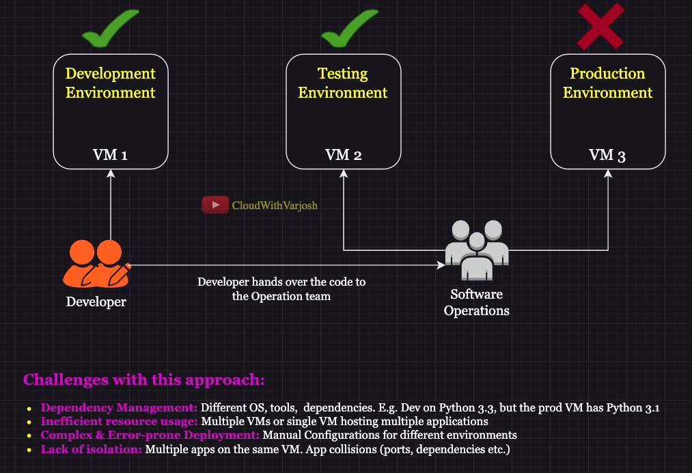
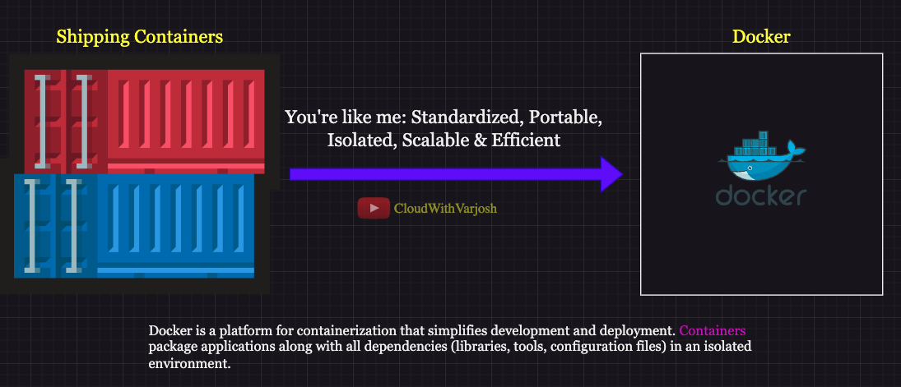
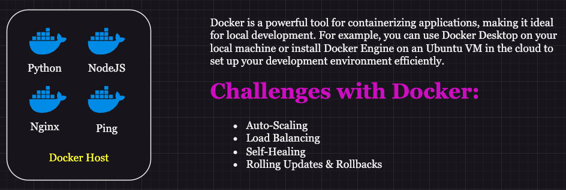
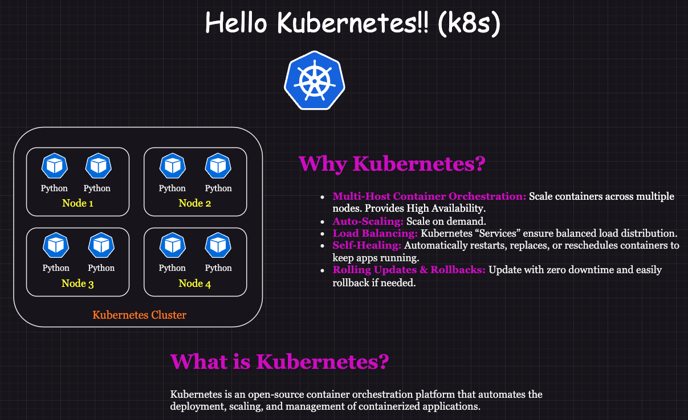
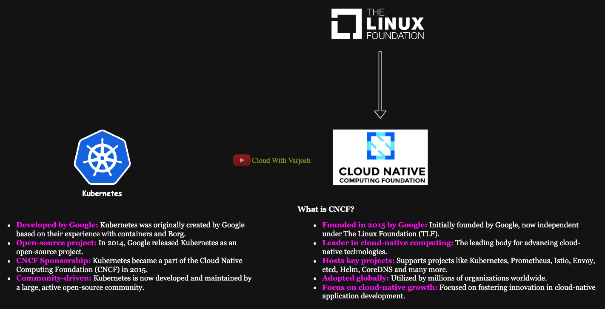

# 01 · Why Kubernetes

> **Level:** ★ foundation
>
> **You will learn:** how software was shipped before containers, what Docker fixed, what Docker *alone* still can't do once you have many containers on many machines, what "container orchestration" means, where Kubernetes came from, and how it compares with Docker Swarm and Docker Compose.
>
> **You need:** nothing. Your Docker notes (topics [01](../../Docker/notes/01-why-containers.md)–[02](../../Docker/notes/02-what-a-container-really-is.md)) help but aren't required.

---

## ⚡ Core: the 10-minute version

**The idea.** Docker packages an app and everything it needs into a container, but only on **one machine**. Once you have dozens of containers on many machines, someone has to restart them when they crash, move them when a server dies, spread traffic across copies, and roll out new versions without downtime. That job is called **orchestration**, and Kubernetes is the standard tool for it. You tell Kubernetes **what you want** ("3 copies of my web app, version 2"). It keeps working until reality matches, and it keeps it that way.

**Picture it.** Docker is a shipping container. Kubernetes is the port authority that decides which ship carries which container, and reroutes cargo when a ship sinks.

**The one thing to know.** Kubernetes is driven by **desired state**:

```yaml
spec:
  replicas: 3          # "I want 3 copies"; Kubernetes recreates any that die
```

**Try it now** (after topic 11 gives you a cluster):
1. `kubectl create deployment web --image=nginx --replicas=3`
2. `kubectl get pods`: three Pods.
3. Delete one: `kubectl delete pod <one-of-them>`, then `kubectl get pods` again. A new one has already replaced it.
4. Clean up: `kubectl delete deployment web`.

**You've got it if you can explain:** what Docker solves, what it doesn't solve at scale, and what "desired state" means.

> 📖 **That's the core.** On a first pass, do the mini-lab and move on to the next topic. Everything below is the **full reference**: come back for the details, the edge cases, interview answers and exam-level depth.

---

## What it is

**Kubernetes** (Greek for "helmsman", the person who steers a ship) is a system that **runs and manages containers across a group of machines** for you.

You tell Kubernetes **what you want**: "run 5 copies of my web app, version 2.3, each with 0.5 CPU and 256 MiB of memory, reachable at one stable address". Kubernetes then **keeps it that way**, all the time. If a copy crashes, it starts a new one. If a machine dies, it moves the copies to healthy machines. If you ask for version 2.4, it swaps the copies over gradually so users never see downtime.

Some short names you will see everywhere:

- **K8s** = Kubernetes. The "8" stands for the 8 letters between "K" and "s".
- **Cluster** = the group of machines Kubernetes manages, as one unit.
- **Node** = one machine in the cluster (a physical server or a VM).
- **Orchestration** = the automatic placing, starting, restarting, scaling, connecting and updating of containers across many machines. Kubernetes is a **container orchestrator**.

---

## Why it exists

To understand why Kubernetes exists, follow the history in three steps.

### Step 1: Before Docker (how software used to be shipped)



Before containers, every stage of the software lifecycle was manual and error-prone:

1. **Development.** Developers installed the language, libraries and tools by hand on their own laptops. Teams wrote long setup documents ("install Python 3.4, then libpq, then…") so other people could copy the environment.
2. **Testing.** Test servers were set up by hand to look like production. They were never exactly the same. Small differences caused bugs that only showed up in production, so testing could not be trusted.
3. **Deployment.** The app was packed into a `.tar.gz` or `.zip` file. Scripts or people copied the files to servers, installed dependencies and edited config files. Every manual step was a chance for a human mistake and a delay.

The four big problems this caused:

| Problem | What it looked like |
|---|---|
| **Dependency management** | Development used **Python 3.4**, production had **Python 3.1**. The app broke only in production. Different OSes, libraries and configs in every environment. |
| **Inefficient resource usage** | One app per VM wastes resources (each VM carries a full operating system). Many apps on one VM fight over CPU, memory and ports. |
| **Complex, error-prone deployment** | Manual, different steps for dev, test and prod. Deployments failed because one setting was different. |
| **No isolation** | Apps on the same VM conflicted: two apps needing **different versions of the same library**, or the same port. |

### Step 2: Docker fixed packaging



**Docker** packages an app **together with everything it needs** (runtime, libraries, config defaults) into an **image**. Running an image gives you a **container**: an isolated process on the host that sees only its own files, network and processes. The same image runs the same way on a laptop, a test server and a production server. That solved dependency conflicts, isolation and "works on my machine". (Topics 02 and 04 recap how containers work underneath.)

### Step 3: Docker alone doesn't scale to production



Docker runs containers **on one machine**, and it runs them the way you tell it to, one command at a time. In production you quickly have **hundreds of containers on dozens of machines**, and you need things plain Docker doesn't give you:

| Need | What plain Docker gives you | What you actually need |
|---|---|---|
| **Self-healing** | A restart policy restarts a crashed container **on the same machine**. If the machine itself dies, nothing moves the container anywhere. | Something that notices a dead container *or a dead machine* and recreates the container on a healthy machine. |
| **Auto-scaling** | You run more containers by hand. No built-in scaling based on CPU or traffic. | Add or remove copies automatically when load goes up or down. |
| **Load balancing** | Port publishing (`-p`) sends traffic to **one** container on **one** host. | One stable address that spreads traffic across all healthy copies on all machines. |
| **Rolling updates / rollbacks** | Stop the old container, start the new one: downtime, and no automatic way back. | Replace copies a few at a time, check they're healthy, and roll back with one command if something goes wrong. |
| **Placement (scheduling)** | You decide which machine runs what. | Something that picks a machine with enough free CPU and memory, automatically. |
| **Service discovery** | Container IPs change on restart. You hard-code addresses. | Stable names (`backend.prod.svc`) that always point to the current healthy copies. |
| **Config and secrets** | Environment variables and files per host, managed by hand. | Central config and secrets, injected into containers wherever they run. |

> ✅ **Correct today** ([C1](#c1)): Docker *does* restart crashed containers with `--restart` policies (see your Docker notes, topic [32](../../Docker/notes/32-restart-and-healthchecks.md)), **but only on the same host**. It can't replace a container whose machine died, and it doesn't restart a container that is "unhealthy" but still running. That gap is what an orchestrator fills.

That missing layer is **orchestration**, and Kubernetes is the industry standard orchestrator.



### Why Kubernetes in particular

- It is **not just another orchestrator**. It's the industry standard: every major cloud sells managed Kubernetes (Amazon EKS, Google GKE, Azure AKS), and nearly every DevOps/SRE job expects it.
- Docker **packages and runs individual containers**. Kubernetes **orchestrates many containers across many machines**.
- It **automates deployment, scaling and operations**, giving you **high availability** (the app keeps running when parts fail), **load balancing** and **self-healing**.

### Where Kubernetes came from



- Google ran containers internally for over a decade on a system called **Borg** (and later **Omega**).
- In **2014** Google released **Kubernetes** as open source, rebuilt from those lessons.
- In **2015** Kubernetes v1.0 was released and Google donated it to the new **CNCF** (Cloud Native Computing Foundation, part of the Linux Foundation). The CNCF now owns it, and thousands of companies contribute.
- A new **minor version** comes out about **3 times a year** (v1.35 Dec 2025, v1.36 Apr 2026, **v1.37 Aug 2026**). These notes target **v1.37** (November 2026). Topic 76 explains versioning and support windows.

---

## Analogy

Think of a **shipping port**.

- **Shipping containers** (Docker containers) standardised *how goods are packed*. Any crane, ship, train or truck can carry any container. That's what Docker did for software (the Day 01 comparison below).
- But standard boxes alone don't run a port. You also need a **port authority** that decides which ship each container goes on, replaces a ship that breaks down, sends more ships when demand rises, and keeps a record of where every container is. **Kubernetes is the port authority.** You hand it a manifest ("these 500 containers must reach these destinations"), and it makes it happen and keeps it happening.

From Day 01, how shipping containers map to Docker containers:

| Aspect | Shipping containers | Docker containers |
|---|---|---|
| **Standardisation** | Standard sizes (20-foot, 40-foot) move across ships, trains and trucks. | Apps plus dependencies are packed into identical units that run in every environment. |
| **Portability** | Moved between transport types with goods intact. | Run the same in dev, test and prod. |
| **Isolation** | Goods kept separate, protected from damage, contamination or theft. | Apps and their dependencies are isolated, so they can't conflict, while still sharing the host. |
| **Scalability** | Bulk transport, easy to scale logistics with demand. | Scalable deployments, microservices, efficient use of resources. |
| **Efficiency** | Less manual handling, lower cost. | Automated deployment, fewer setup errors, consistent behaviour. |

---

## How it works inside

You'll learn every piece of this in Part 1. Here is the core idea, because everything else builds on it.

### The idea: desired state + control loops

1. **You declare the desired state.** You write a file (a **manifest**, usually YAML) that says *what* you want: "3 copies of image `shop:2.3`". You don't write *how* to do it.
2. **Kubernetes stores it.** The manifest is sent to the **API server** (the cluster's front door) and saved in **etcd** (the cluster's database).
3. **Controllers watch and compare.** Small programs called **controllers** run in a loop: *look at the desired state → look at the actual state → if they differ, act to fix it.* This is called a **control loop** or **reconciliation loop**.
4. **The scheduler picks machines.** A component called the **scheduler** chooses a node for each new container group.
5. **An agent on each node does the work.** The **kubelet** on the chosen node tells the container runtime (containerd, the same engine Docker uses underneath) to start the containers.
6. **The loop never stops.** If a container dies, the actual state ("2 running") no longer matches the desired state ("3"), so a controller creates a replacement. You didn't run any command; the loop did it.

```
   you ──manifest──▶ API server ──▶ etcd (desired state)
                          ▲
       ┌──────────────────┴─────────────────┐
       │ controllers: desired vs actual?     │──fix──▶ scheduler ──▶ kubelet ──▶ containers
       └─────────────────────────────────────┘
```

**Imperative vs declarative.** Docker is mostly **imperative**: "run this container now". Kubernetes is **declarative**: "this is how the world should look; keep it that way". Topic 15 goes deep on this.

### Where the Linux and Docker pieces fit

Kubernetes doesn't replace containers. It **uses** them:
- Each node runs a normal **container runtime** (containerd or CRI-O) which uses the same Linux **namespaces** and **cgroups** you studied in Docker (topic 04 recaps them).
- Kubernetes adds the **cluster brain** on top: placement, healing, networking across machines, config, security, scaling.

---

## Commands / YAML

You don't have a cluster yet (that's topic 11). Here is what the difference *feels* like.

**Docker way (imperative, one host):**

```bash
docker run -d --name web1 -p 8081:80 nginx:1.29
docker run -d --name web2 -p 8082:80 nginx:1.29
docker run -d --name web3 -p 8083:80 nginx:1.29
```

- You start each copy yourself, choose each port yourself, and must put a load balancer in front yourself.
- If the host dies, all three are gone.

**Kubernetes way (declarative, whole cluster):**

```yaml
apiVersion: apps/v1          # which API group/version defines this object type
kind: Deployment             # the type of object: "keep N copies of a Pod running"
metadata:
  name: web                  # the object's name
spec:
  replicas: 3                # desired state: 3 copies
  selector:
    matchLabels:
      app: web               # "the copies I own are the ones labelled app=web"
  template:                  # the blueprint for each copy
    metadata:
      labels:
        app: web
    spec:
      containers:
      - name: nginx
        image: nginx:1.29
        ports:
        - containerPort: 80
```

```bash
kubectl apply -f web.yaml
```

```
deployment.apps/web created
```

- `kubectl` = the Kubernetes command-line tool (topic 12).
- `apply` = "make the cluster match this file".
- Output `deployment.apps/web created` = an object of kind `Deployment` in API group `apps`, named `web`, now exists. From here, Kubernetes keeps 3 copies running on whichever nodes have room.

Don't worry about every field yet. Topics 13 (YAML), 18 (Pods) and 25 (Deployments) explain each line.

### Kubernetes vs Docker Swarm vs Docker Compose

**Docker Compose** runs a multi-container app on **one host** from a YAML file (your Docker notes, topics [35](../../Docker/notes/35-compose-basics.md)–[39](../../Docker/notes/39-compose-on-a-server.md)). **Docker Swarm** is Docker's own built-in orchestrator (`docker swarm init`): simpler than Kubernetes, multi-host, but with a much smaller ecosystem and little industry use today.

> ✅ **Correct today** ([C2](#c2)): Swarm is a **multi-host** orchestrator (its manager nodes use Raft consensus and it has an overlay network and routing mesh). What's true is that it's best for small-to-medium clusters and has far less ecosystem than Kubernetes. Swarm is still maintained (by Mirantis) but is rarely chosen for new production platforms.

| Feature | Kubernetes | Docker Swarm | Docker Compose |
|---|---|---|---|
| **Scope** | Orchestrates containers across a **cluster of machines**: automated deployment, scaling, management. | Orchestrates Docker containers across a **cluster of Docker hosts** (corrected), with basic features. | Defines and runs **multi-container apps on a single host** with simple YAML. |
| **Complexity** | High: resource quotas, custom schedulers, advanced networking. | Simpler: basic clustering and orchestration. | Simplest: local development and simple setups. |
| **Scalability** | Large production deployments, hundreds/thousands of nodes. | Moderate: small-to-medium deployments. | Limited: one host. |
| **Features** | **Auto-scaling, self-healing**, service discovery, load balancing, secrets, rolling updates. | Service discovery, **manual scaling**, rolling updates; no built-in autoscaling, monitoring or logging tools. | Services, networks and volumes for multi-container apps. |
| **Learning curve** | Steep: many options, YAML manifests, troubleshooting at scale. | Easier: Docker basics plus cluster setup. | Very easy. |
| **Community & ecosystem** | Huge: Helm, Prometheus, Istio, Argo CD and thousands more. | Small, Docker-focused. | Large among developers for local testing. |
| **Use cases** | Production microservices, large systems. | Smaller production apps, test clusters. | Local development, testing, small non-critical deployments. |
| **State management** | Stateful workloads with StatefulSets, PersistentVolumes; config with ConfigMaps. | No dedicated stateful features; uses external storage. | Mostly stateless; volumes for data. |
| **Networking** | Advanced: Services (ClusterIP, NodePort, LoadBalancer), Ingress/Gateway, NetworkPolicies. | Overlay networks, routing mesh. | Docker's single-host networks. |
| **Installation** | Complex: kubeadm, or managed services (EKS, GKE, AKS). | Simple: `docker swarm init`. | Very simple: one YAML file. |
| **Fault tolerance** | High: automatic rescheduling, rolling updates. | Moderate: manager leader election, container restarts. | Very limited (single host). |

Key characteristics side by side:

| Characteristic | Kubernetes | Docker Swarm | Docker Compose |
|---|---|---|---|
| **Orchestration** | Yes (multi-host, distributed) | Yes (multi-host, within one Swarm) | No (single host) |
| **Scaling** | Automatic and manual | Manual (no built-in autoscaler) | Manual |
| **Load balancing** | Built-in and advanced | Basic (routing mesh) | Not built-in across hosts |
| **Self-healing** | Yes (robust) | Basic (reschedules failed tasks) | Restart on same host only |
| **Multi-host** | Yes | Yes | No |
| **Networking** | Advanced (CNI plugins, network policies, service mesh add-ons) | Basic (overlay network) | Limited (Docker's default networking) |

---

## Hands-on lab: feel the pain Kubernetes removes

Use your WSL2 Docker setup from your Docker notes (topic [04](../../Docker/notes/04-installing-docker.md)).

1. Start three copies of nginx by hand:
   ```bash
   for i in 1 2 3; do docker run -d --name web$i -p 808$i:80 nginx:1.29; done
   docker ps --format 'table {{.Names}}\t{{.Status}}\t{{.Ports}}'
   ```
   ```
   NAMES     STATUS          PORTS
   web3      Up 3 seconds    0.0.0.0:8083->80/tcp
   web2      Up 4 seconds    0.0.0.0:8082->80/tcp
   web1      Up 5 seconds    0.0.0.0:8081->80/tcp
   ```
2. "Crash" one: `docker kill web2`. Run `docker ps` again: **nothing replaced it**. You'd have to notice and restart it yourself.
3. Try a "rolling update" to `nginx:1.29-alpine`: you must stop/remove/re-run each container by hand, and port 8082 is down while you do it.
4. Ask yourself: how would you spread these across 3 machines, and give users **one** address? (You'd need a load balancer, a script to watch health, and a way to know which machine has room.) That pile of scripts is what Kubernetes replaces.
5. Clean up: `docker rm -f web1 web2 web3`.

You'll redo this in topic 25 with a Deployment and watch Kubernetes heal and update for you.

---

## Where you'll use it

- **Every modern platform team**: apps are packaged as images and run on Kubernetes (often a managed one like EKS/GKE/AKS).
- **Interviews**: "Why Kubernetes over plain Docker?" and "What problems does orchestration solve?" are standard opening questions.
- **Design discussions**: knowing when Kubernetes is *overkill* (a single small app on one VM may be fine with Compose) is a senior-level skill.

---

## When it breaks

At this stage, the "breakages" are wrong expectations:

| Wrong expectation | Reality |
|---|---|
| "Kubernetes replaces Docker." | Kubernetes **uses a container runtime** (containerd/CRI-O). You still build images with Docker or similar tools. |
| "Kubernetes makes my app highly available automatically." | Only if you run **more than one copy**, spread across nodes, with health checks. One replica on one node is still a single point of failure. |
| "Kubernetes is always the right choice." | It adds real complexity. For one small service on one server, Docker Compose may be better. |
| "Swarm is single-host." | Swarm is multi-host; it's just less capable and less used. |

---

## Quick recap

- Before containers: manual setup, environment drift, dependency conflicts, wasted VMs.
- Docker fixed **packaging and isolation** on **one machine**.
- At scale you also need self-healing, scaling, load balancing, rolling updates, placement and service discovery across **many machines**: that's **orchestration**.
- Kubernetes works by **desired state + control loops**: you declare, it reconciles forever.
- Born at Google (Borg), open-sourced 2014, owned by the CNCF; current version v1.37.

### Interview questions

1. **Q: What problem does Kubernetes solve that Docker doesn't?**
   A: Docker runs containers on one host. Kubernetes manages containers across many hosts: scheduling, self-healing (including when a node dies), scaling, service discovery, load balancing and rolling updates, all driven by declared desired state.
2. **Q: What does "declarative" mean in Kubernetes?**
   A: You describe the end state you want (e.g. 3 replicas of image X); controllers continuously compare it with the actual state and act to close the gap. You don't script the steps.
3. **Q: When would you *not* use Kubernetes?**
   A: For a small, single-server app or a team without the skills to operate it; Compose or a managed PaaS may be simpler and cheaper. Kubernetes pays off when you have many services, many nodes, and need HA and automation.

---

## Appendix: notes on the original course material

This topic was rebuilt from the original CKA course notes. This appendix keeps the audit trail out of your way while you learn.

### Sources

Day 01 (life before Docker, challenges), Day 06 (challenges with Docker, why Kubernetes, comparison tables), Day 08 (Kubernetes origin).

### Corrections to the original notes

Each entry shows what the original said and what's true now. In the topic above, each correction appears as a ✅ **Correct today** line or a ⚠️ **Fix to the original** box, linked to its entry here.

<a id="c1"></a>**C1 · Corrected (Day 06).** the original said Docker "does not have inherent self-healing capabilities to restart failed containers". **Now:** Docker *does* restart crashed containers with `--restart` policies (see your Docker notes, topic [32](../../Docker/notes/32-restart-and-healthchecks.md)), **but only on the same host**. It can't replace a container whose machine died, and it doesn't restart a container that is "unhealthy" but still running. That gap is what an orchestrator fills.

<a id="c2"></a>**C2 · Corrected (Day 06).** the original table said Swarm is "primarily designed for managing Docker containers within a **single host** or a small cluster". **Now:** Swarm is a **multi-host** orchestrator (its manager nodes use Raft consensus and it has an overlay network and routing mesh). What's true is that it's best for small-to-medium clusters and has far less ecosystem than Kubernetes. Swarm is still maintained (by Mirantis) but is rarely chosen for new production platforms.
