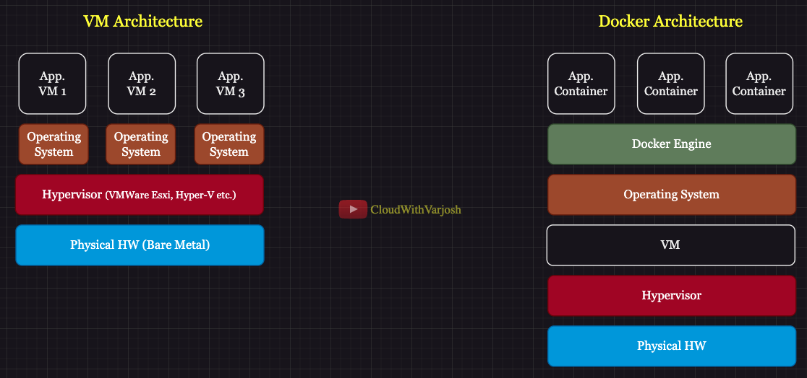
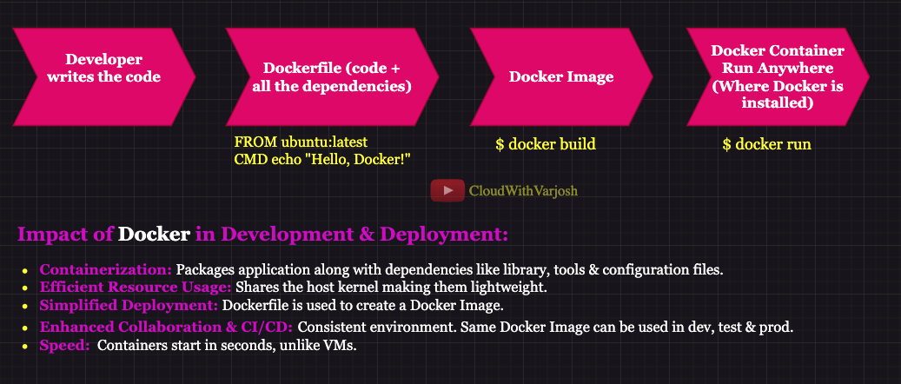
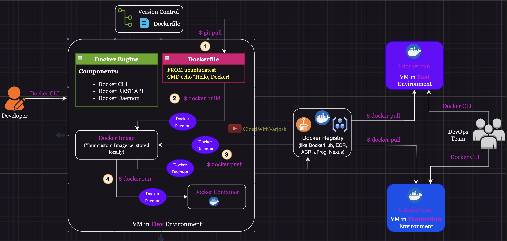
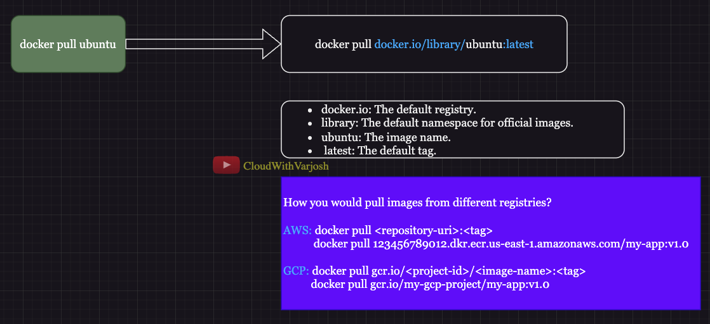

# 02 · Docker Recap I: Containers and Images

> **Level:** ★ foundation
>
> **You will learn:** the difference between a VM and a container, what images, containers and registries are, how Docker's engine is built (CLI → API → daemon → containerd → runc), how image names work (`docker.io/library/ubuntu:latest`), how to pull from Docker Hub, ECR and Google's registry, and the everyday container and image commands. Every point is tied to **where Kubernetes uses it**.
>
> **You need:** topic 01. Your Docker notes (topics [01](../../Docker/notes/01-why-containers.md)–[13](../../Docker/notes/13-cleanup-and-disk-usage.md)) go much deeper; this topic is the part Kubernetes depends on.

---

## ⚡ Core: the 10-minute version

**The idea.** An **image** is a read-only package of an app plus its files and libraries. A **container** is a running copy of an image. A **registry** (Docker Hub, ECR, GHCR) stores images. Containers share the host's Linux kernel, so they start in milliseconds and use far less memory than virtual machines. Kubernetes doesn't build images. It **pulls and runs** them through a container runtime (containerd), exactly as Docker does underneath.

**Picture it.** An image is a recipe card; a container is a dish cooked from it; a registry is the recipe library.

**The one thing to know.** How image names expand:

```text
nginx           →  docker.io/library/nginx:latest
myorg/api:1.4   →  docker.io/myorg/api:1.4
ghcr.io/org/app:2.0  (any registry: registry/namespace/repository:tag)
```

**Try it now:**
1. `docker pull nginx:1.27` and `docker images`.
2. `docker run -d --name web -p 8080:80 nginx:1.27`, then `curl localhost:8080`.
3. `docker ps`, `docker logs web`, `docker rm -f web`.

**You've got it if you can:** say the difference between an image and a container, expand a short image name to its full form, and name the component Kubernetes uses to run containers (containerd, via CRI).

> 📖 **That's the core.** On a first pass, do the mini-lab and move on to the next topic. Everything below is the **full reference**: come back for the details, the edge cases, interview answers and exam-level depth.

---

## What it is

- An **image** is a read-only package: your app, its runtime (e.g. Python), its libraries, and some settings (which command to run, which port it uses). It's a **blueprint**.
- A **container** is a **running instance** of an image: an ordinary Linux process that the kernel isolates (topic 04 shows how).
- A **registry** is a server that stores images so other machines can download them: Docker Hub, Amazon ECR (Elastic Container Registry), Google Artifact Registry, Azure ACR (Azure Container Registry), JFrog Artifactory, Sonatype Nexus, Harbor.
- **Docker Engine** is the software that builds images and runs containers on one machine.

**Why this matters for Kubernetes:** Kubernetes never builds your app. It only **pulls images from a registry and runs containers from them**. Every Pod you write says `image: <name>`, and every node must be able to download that image. If you understand images and registries, half of the "my Pod won't start" errors (`ImagePullBackOff`, topic 21) become easy.

---

## Why it exists

Topic 01 covered the history: manual installs and environment drift. Containers fix this by shipping the app **with** its environment. Compared with virtual machines they are far lighter, because they **share the host's kernel** instead of booting their own operating system.

### Virtual machines vs containers



- **VM (virtual machine):** a **hypervisor** (software that slices one physical machine into many virtual ones, e.g. VMware ESXi, KVM, Hyper-V) gives each VM virtual hardware. Each VM boots a **full guest operating system** with its own kernel.
- **Container:** no guest OS. All containers on a host share the **host kernel**. The kernel just isolates them from each other.

| Feature | Virtual machines | Containers |
|---|---|---|
| **Architecture** | Full OS on top of a hypervisor | Share the host OS kernel |
| **Weight** | Heavy (each includes a guest OS, GBs) | Light (no guest OS, often MBs) |
| **Startup time** | Slow (tens of seconds to minutes to boot) | Fast (milliseconds to seconds: it's just starting a process) |
| **Resource usage** | High (an OS copy per VM) | Low (shared kernel) |
| **Isolation** | Strong: hardware-level, separate kernels | Process-level: one shared kernel (a kernel bug can affect all containers) |
| **Deployment** | Slower, resource-heavy | Fast and efficient |
| **Use case** | Different OSes, legacy systems, strong isolation | Cloud-native apps, microservices |
| **Example** | Ubuntu running on a Windows host with Hyper-V | An app packaged as a container image |

In real life you use **both**: Kubernetes **nodes are usually VMs** (EC2 instances, Azure VMs), and the containers run inside them.

---

## Analogy

Day 01's **car analogy** for the Docker Engine:

- **Docker CLI** = the **dashboard**. You press buttons (`docker run`).
- **REST API** = the **wires** carrying your button presses to the engine.
- **Docker daemon (`dockerd`)** = the **engine**. It does the actual work: pulling images, creating containers.

And for images vs containers: an **image is a recipe card**, a **container is a dish cooked from it**. You can cook many dishes from one card, and the card never changes.

---

## How it works inside

### The high-level workflow



### The low-level workflow: build → push → pull → run



1. A **developer writes a Dockerfile** (topic 03) and stores it in version control (Git).
2. **Build:** `docker build` reads the Dockerfile and creates an **image** locally.
3. **Push:** `docker push` uploads the image to a **registry** (Docker Hub, ECR, ACR, JFrog, Nexus).
4. **Pull and run:** other environments **pull** the image (`docker pull`) and start containers (`docker run`): the **test** environment, then **production**.

**In Kubernetes, step 4 changes:** you don't run `docker pull/run` on servers. You give Kubernetes a manifest with `image: myrepo/app:1.4`, and the **kubelet** on whichever node is chosen asks its container runtime to pull and run it (topic 10 traces this).

### Docker Engine components (and what's below them)

Day 01 lists three parts. Here they are, plus the two layers underneath that matter for Kubernetes:

| Layer | What it does |
|---|---|
| **Docker CLI** (`docker`) | The command you type. Turns `docker run` into an HTTP request. |
| **REST API** | The HTTP API the daemon listens on (a Unix socket, `/var/run/docker.sock`). Lets tools and scripts automate Docker. |
| **Docker daemon** (`dockerd`) | Manages images, builds, networks, volumes. Hands container work down to containerd. |
| **containerd** | A **container runtime**: pulls images, stores them, manages container lifecycles. **This is what Kubernetes nodes run** (without `dockerd`). |
| **runc** | A tiny **low-level runtime**: asks the Linux kernel to create the namespaces and cgroups, then starts your process. Used by containerd for every container. |

```
docker CLI ──REST──▶ dockerd ──gRPC──▶ containerd ──▶ containerd-shim ──▶ runc ──▶ your process
                                          ▲
              Kubernetes kubelet ──CRI────┘   (Kubernetes skips dockerd entirely)
```

- **gRPC** = a fast way for programs to call each other's functions over a network or socket.
- **CRI** = **Container Runtime Interface**, the standard API the kubelet uses to talk to a runtime. Topic 08 covers it and the history of "dockershim".

### Image names: what `docker.io/library/ubuntu:latest` really means



A fully written image name has four parts:

```
docker.io / library / ubuntu : latest
└registry┘  └ namespace/repository ┘ └tag┘
```

| Part | Meaning | Default if you leave it out |
|---|---|---|
| **Registry** | The server hostname | `docker.io` (Docker Hub) |
| **Namespace** | The user or organisation | `library` (Docker's official images) |
| **Repository** | The image's name | (required) |
| **Tag** | A version label | `latest` |

So `ubuntu` = `docker.io/library/ubuntu:latest`, and `nginx:1.29` = `docker.io/library/nginx:1.29`. Docker (and Kubernetes) add these defaults behind the scenes. Topic 20 adds **digests** (`@sha256:…`), which pin an exact image that can never change.

> **Kubernetes note:** `latest` is just a tag name. It doesn't mean "newest". It's a moving target, and in Kubernetes it also changes the default pull policy to `Always` (topic 20). Production manifests should always use a specific tag or a digest.

### Pulling from other registries

The command is always the same. Only the **fully qualified name** changes. You must **log in first** for private registries.

**AWS Elastic Container Registry (ECR):**

```bash
docker pull <repository-uri>:<tag>
docker pull 123456789012.dkr.ecr.us-east-1.amazonaws.com/my-app:v1.0
```

- ECR format: `<account-id>.dkr.ecr.<region>.amazonaws.com/<repository-name>:<tag>`.
- `<repository-uri>` = the URI of your private repo in ECR. `<tag>` = the version, e.g. `v1.0`.
- Log in first: `aws ecr get-login-password --region us-east-1 | docker login --username AWS --password-stdin 123456789012.dkr.ecr.us-east-1.amazonaws.com`.

**Google's registry:**

```bash
docker pull gcr.io/<project-id>/<image-name>:<tag>
docker pull gcr.io/my-gcp-project/my-app:v1.0
```

- `<project-id>` = the Google Cloud project, `<image-name>` = image name, `<tag>` = version.

> ✅ **Correct today** ([C1](#c1)): Container Registry was shut down in 2025. Google's current registry is **Artifact Registry**, with names like `us-docker.pkg.dev/<project-id>/<repository>/<image>:<tag>`. Existing `gcr.io` names are redirected to Artifact Registry repositories, so you'll still see them in old manifests.

**Key takeaways:**
- `docker pull` works the same for every registry; only the full path differs.
- Authenticate before pulling private images. (In Kubernetes, nodes authenticate with **imagePullSecrets** or a cloud credential provider: topic 62.)
- With no registry in the name, Docker adds `docker.io/library/` for official Docker Hub images.

---

## Commands / YAML

### Images

```bash
docker images                     # list local images (same as: docker image ls)
```

```
REPOSITORY   TAG       IMAGE ID       CREATED       SIZE
nginx        1.29      3b25b682ea82   2 weeks ago   192MB
ubuntu       latest    a04dc4851cbc   3 weeks ago   78.1MB
```

- `REPOSITORY`/`TAG` = the name (registry and `library/` are hidden for Docker Hub official images).
- `IMAGE ID` = the first 12 characters of the image's SHA-256 ID.
- `SIZE` = uncompressed size on disk. Bigger images take longer to pull on every Kubernetes node that needs them.

```bash
docker tag my-first-image <your-username>/my-first-image:v1.0   # give the image a second name
docker push <your-username>/my-first-image:v1.0                 # upload it
```

- `docker tag` doesn't copy anything; it adds another name pointing to the same image.
- Docker adds `docker.io` automatically: pushing `cloudwithvarjosh/my-first-image:v1` really pushes `docker.io/cloudwithvarjosh/my-first-image:v1`. The general form is `docker.io/<username>/<imagename>:<tag>`.

Image cleanup:
- **Dangling image** = an image with no tag (`<none>:<none>`), usually left behind when you rebuild with the same tag.
- `docker rmi <image_id>` = delete one image.
- `docker image prune -a` = delete all images not used by any container (including dangling ones).

### Containers

```bash
docker run my-first-image          # create + start a container from the image
docker ps -a                       # list all containers, running and stopped
```

```
CONTAINER ID   IMAGE            COMMAND                  CREATED          STATUS                      NAMES
4f1c2a9e7b3d   my-first-image   "/bin/sh -c 'echo \"H…"  10 seconds ago   Exited (0) 9 seconds ago    eager_turing
```

- `COMMAND` = what the container ran (from the image's `CMD`/`ENTRYPOINT`, topic 03).
- `STATUS Exited (0)` = the process finished with **exit code 0** (success). In Kubernetes, exit codes appear in `kubectl describe pod` as `Last State: Terminated, Exit Code: …` and are the first clue in a `CrashLoopBackOff` (topic 21).
- `NAMES` = a random name if you didn't give one with `--name`.

Container management:

| Task | Command |
|---|---|
| List all containers (incl. stopped) | `docker ps -a` |
| Show container/image details (JSON) | `docker inspect <container_id>` / `docker inspect <image_id>` |
| Processes running in a container | `docker top <container_id>` |
| Stop / start / restart | `docker stop <id>` / `docker start <id>` / `docker restart <id>` |
| Stop all running containers | `docker stop $(docker ps -q)` |
| Delete one container | `docker rm <id>` |
| Delete all stopped containers | `docker container prune` |

### How these map to Kubernetes

| Docker | Kubernetes equivalent (topic) |
|---|---|
| `docker run` | Create a Pod/Deployment (18, 25) |
| `docker ps` | `kubectl get pods` (18) |
| `docker logs` | `kubectl logs` (21) |
| `docker exec -it` | `kubectl exec -it` (21) |
| `docker inspect` | `kubectl describe` / `kubectl get -o yaml` (16, 21) |
| `docker stop` | `kubectl delete pod` (graceful termination, 19) |
| `docker images` / `rmi` on a node | `crictl images` / `crictl rmi` (08); the kubelet garbage-collects unused images itself |

---

## Hands-on lab

1. Pull the same image by short and full name, and see it's the same image:
   ```bash
   docker pull ubuntu
   docker pull docker.io/library/ubuntu:latest
   docker images ubuntu
   ```
   One line only: both names point to the same image ID.
2. Build and run Day 02's tiny image (the files are in `Day 02/`):
   ```dockerfile
   FROM ubuntu:latest
   CMD echo "Hello, Docker!"
   ```
   ```bash
   cd "Day 02" && docker build -t my-first-image . && docker run my-first-image
   ```
   ```
   Hello, Docker!
   ```
   - `FROM ubuntu:latest` = start from the Ubuntu image.
   - `CMD echo "Hello, Docker!"` = the default command when a container starts.
   - `-t my-first-image` = name the image. `.` = the **build context** (topic 03).
3. See the containerd layer under Docker: `ps -ef | grep -E 'containerd|shim' | grep -v grep`. Those `containerd-shim-runc-v2` processes are what the kubelet will drive on a Kubernetes node.
4. Optional: if you have a Docker Hub account, `docker login`, tag and push `my-first-image` as `<you>/my-first-image:v1.0`. You'll use a pushed image again in topic 62 (private registries).
5. Clean up: `docker container prune -f && docker image prune -a -f`.

---

## Where you'll use it

- **CI pipelines** build and push images; Kubernetes manifests reference the pushed tags.
- **Debugging `ImagePullBackOff`**: wrong registry, wrong tag, missing login, or Docker Hub rate limits.
- **Choosing registries**: production clusters usually pull from a private registry in the same cloud (ECR for EKS) for speed, cost and security.

---

## When it breaks

| Symptom | Meaning | Fix |
|---|---|---|
| `pull access denied … repository does not exist or may require 'docker login'` | Wrong name, or a private repo without login. | Check the full name; log in. In Kubernetes: `ErrImagePull`/`ImagePullBackOff` (topic 21). |
| `manifest unknown` / `not found` | That **tag** doesn't exist. | List tags in the registry; fix the tag. |
| `toomanyrequests: You have reached your pull rate limit` | Docker Hub limits anonymous/free pulls. | Log in, use a mirror or your own registry. Common on busy Kubernetes nodes. |
| App works locally, differs on a server | You used `latest` and each machine pulled a different "latest". | Pin tags or digests. |

---

## Quick recap

- Image = blueprint; container = running instance; registry = image storage.
- Containers share the host kernel, so they're much lighter than VMs; Kubernetes nodes are usually VMs running containers.
- Engine chain: CLI → REST API → dockerd → **containerd** → shim → **runc**. Kubernetes talks to containerd directly through the **CRI**.
- Full image name: `registry/namespace/repository:tag`, with defaults `docker.io`, `library`, `latest`.

### Interview questions

1. **Q: Container vs VM?**
   A: A VM virtualises hardware and runs its own kernel; a container is an isolated process sharing the host kernel. Containers start faster and use less, but isolation is weaker.
2. **Q: What does `nginx` expand to as an image name?**
   A: `docker.io/library/nginx:latest`.
3. **Q: Does a Kubernetes node need Docker installed?**
   A: No. It needs a CRI-compatible runtime such as containerd or CRI-O. Images built with Docker run fine because they follow the OCI (Open Container Initiative) image standard.

---

## Appendix: notes on the original course material

This topic was rebuilt from the original CKA course notes. This appendix keeps the audit trail out of your way while you learn.

### Sources

Day 01 (VMs vs Docker, high-level and low-level workflow, engine components, car analogy), Day 02 (`docker pull` anatomy, other registries, basic commands), Day 04 (container and image management commands).

### Corrections to the original notes

Each entry shows what the original said and what's true now. In the topic above, each correction appears as a ✅ **Correct today** line or a ⚠️ **Fix to the original** box, linked to its entry here.

<a id="c1"></a>**C1 · Corrected (Day 02).** the original taught **Google Container Registry (`gcr.io`)** as Google's registry. **Now:** Container Registry was shut down in 2025. Google's current registry is **Artifact Registry**, with names like `us-docker.pkg.dev/<project-id>/<repository>/<image>:<tag>`. Existing `gcr.io` names are redirected to Artifact Registry repositories, so you'll still see them in old manifests.
