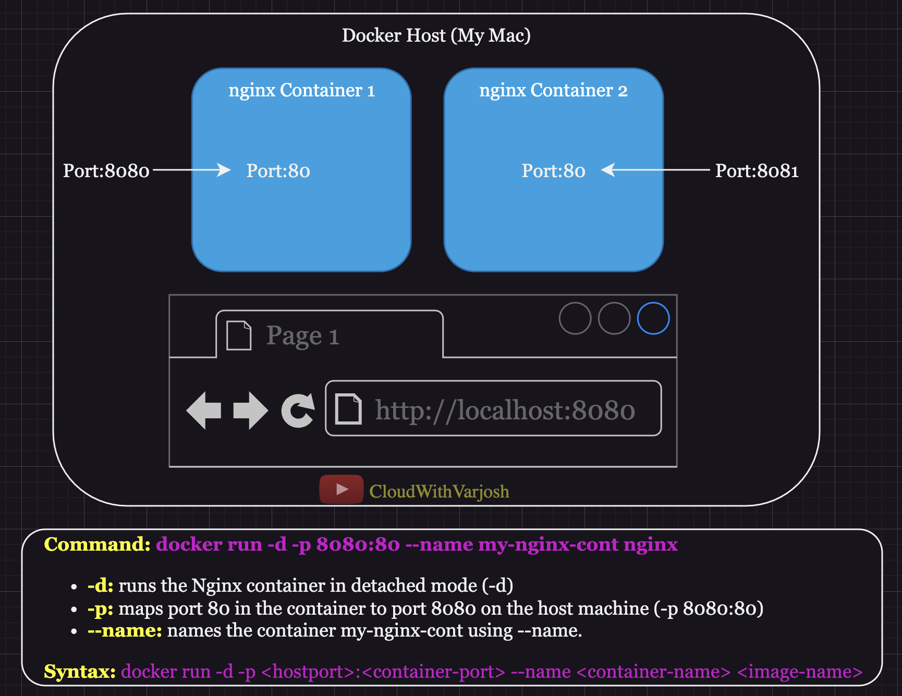

# 03 · Docker Recap II: Dockerfiles, CMD vs ENTRYPOINT, Multi-Stage Builds

> **Level:** ★ foundation
>
> **You will learn:** the key `docker run` flags, every common Dockerfile instruction, the build context and custom Dockerfile names, shell form vs exec form (and why it matters for PID 1 and shutdown), `CMD` vs `ENTRYPOINT` vs `RUN`, compiled vs interpreted languages, multi-stage builds, which instructions create layers, and best practices. Most importantly: **how `ENTRYPOINT`/`CMD` become `command`/`args` in a Kubernetes Pod.**
>
> **You need:** topic 02.

---

## ⚡ Core: the 10-minute version

**The idea.** A **Dockerfile** is the recipe for an image: start from a base (`FROM`), copy your code (`COPY`), install things (`RUN`), and say what runs when the container starts (`ENTRYPOINT`/`CMD`). Two details matter most for Kubernetes:
- **`ENTRYPOINT`/`CMD` map straight onto a Pod's `command`/`args`.**
- **Exec form** (`["python","app.py"]`) makes your app PID 1, so it receives the stop signal and shuts down cleanly.

**Picture it.** ENTRYPOINT is the appliance (a coffee machine); CMD is the default button pressed (espresso). Kubernetes can swap either.

**The one thing to know.**

```dockerfile
FROM python:3.13-slim
WORKDIR /app
COPY app.py .
RUN pip install --no-cache-dir flask
ENTRYPOINT ["python"]      # Kubernetes `command:` replaces this
CMD ["app.py"]             # Kubernetes `args:` replaces this
```

**Try it now:**
1. Build: `docker build -t demo:1 .` (with any small app).
2. Run it, then override CMD: `docker run --rm demo:1 --version`.
3. In a Pod spec, the same override is `args: ["--version"]` (you'll do this in topic 18).

**You've got it if you can:** explain `command` vs `args` in Kubernetes terms, and why exec form matters for graceful shutdown.

> 📖 **That's the core.** On a first pass, do the mini-lab and move on to the next topic. Everything below is the **full reference**: come back for the details, the edge cases, interview answers and exam-level depth.

---

## What it is

A **Dockerfile** is a text file of instructions that tells Docker how to **build an image**: which base to start from, which files to copy in, which commands to run while building, and which command to start when a container runs.

```dockerfile
FROM ubuntu:latest
CMD echo "Hello, Docker!"
```

- `FROM ubuntu:latest` = start from the Ubuntu image (the **base image**).
- `CMD echo "Hello, Docker!"` = when a container starts, run this command.

---

## Why it exists

Writing the build steps down as code makes images **repeatable** (everyone gets the same result), **reviewable** (it lives in Git), and **automatable** (CI pipelines run `docker build`). Kubernetes depends on this: every image it runs came from a Dockerfile (or a similar build tool), and many Pod problems trace back to Dockerfile choices: the wrong user, a shell that swallows signals, a huge image that pulls slowly.

---

## Analogy

Day 05's **pizza analogy** for build vs runtime:

1. **Build stage:** to make the pizza you need tools and raw ingredients: a measuring cup, an oven, dough, cheese, toppings. They're **essential for preparing** it, but you don't serve them.
2. **Runtime stage:** once it's baked, you only need **the finished pizza**. The tools and leftovers stay in the kitchen.

A **multi-stage build** is exactly that: build with all the tools in one stage, then serve only the finished app in a small final image.

---

## How it works inside

### Each instruction builds on the previous one

`docker build` runs the instructions top to bottom. Instructions that change the filesystem (`RUN`, `COPY`, `ADD`) produce a new **layer**: a compressed set of file changes. The image is a stack of layers plus a small **config** (default command, env vars, working directory, user, exposed ports). When a container starts, the runtime stacks the layers with **overlayfs** and adds a thin writable layer on top (your Docker notes, topic [07](../../Docker/notes/07-image-layers-and-overlayfs.md)).

**What Kubernetes reads from the image config:** the default `ENTRYPOINT`, `CMD`, `WORKDIR`, `ENV` and `USER`. A Pod can override all of them.

### The build context

The **build context** is the folder you pass at the end of `docker build` (often `.`). Docker sends **everything in it** to the builder, and `COPY`/`ADD` can only read files inside it.

- Files **outside** the context can't be used in the build.
- Use a **`.dockerignore`** file to leave out things like `.git`, `node_modules` and test data. That makes builds faster and stops secrets leaking into images.

### Shell form vs exec form (and PID 1)

| Feature | Shell form | Exec form |
|---|---|---|
| **Syntax** | `CMD <command>` | `CMD ["executable", "param1", "param2"]` |
| **Execution** | Runs through a shell: `/bin/sh -c "<command>"` | Runs the program directly, no shell |
| **Environment variables** | `$VAR` is expanded by the shell | No shell, so no `$VAR` expansion (unless you call a shell yourself) |
| **PID 1 and signals** | The **shell** is PID 1. `sh` doesn't forward signals, so your app never sees `SIGTERM`. | **Your app** is PID 1 and receives signals directly. |
| **Complex commands** | Supports pipes and chaining (`&&`, `\|\|`) | Simple commands only |
| **When to use** | You really need shell features | Almost always (default choice) |
| **Example** | `CMD echo "Hello World"` | `CMD ["echo", "Hello World"]` |

**Why this matters in Kubernetes:** when Kubernetes stops a Pod (deleting it, rolling update, node drain), it sends **`SIGTERM`** to PID 1 in each container, waits a **grace period** (30 s by default), then sends **`SIGKILL`** (topic 19). With **shell form**, `SIGTERM` goes to `sh`, which ignores it. Your app is killed hard after 30 s: requests are dropped and every rollout is slow. **Use exec form.** (If you must use a shell script, end it with `exec "$@"` or `exec myapp` so the app replaces the shell as PID 1.)

---

## Commands / YAML

### Key `docker run` flags



```bash
docker run -d -p 8080:80 --name my-nginx-cont nginx
```

| Flag | Meaning |
|---|---|
| `-d` (detached) | Run in the background; your terminal is free. |
| `-p 8080:80` (publish) | Host port **8080** → container port **80** (nginx's default). Open `http://localhost:8080`. |
| `--name my-nginx-cont` | A fixed name instead of a random one. |

**Kubernetes mapping:** there's no `-p` in a Pod. A container's port is reachable on the **Pod's own IP**, and you expose it with a **Service** (topics 30–31). `containerPort` in a Pod spec is mostly informational, just like `EXPOSE`.

### Dockerfile instructions (Day 03, plus WORKDIR)

| Instruction | What it does | Example |
|---|---|---|
| `FROM` | Base image to build on. | `FROM ubuntu:latest` |
| `WORKDIR` | Sets (and creates) the working directory for later instructions and for the container. | `WORKDIR /app` |
| `COPY` | Copies files/folders from the build context into the image. Nothing else. | `COPY app.py /app/app.py` |
| `ADD` | Like `COPY`, but also **auto-extracts local archives** (`.tar.gz`) and can fetch URLs. Prefer `COPY` unless you need extraction. | `ADD app.tar.gz /app` |
| `RUN` | Runs a command **at build time**; the result is saved as a layer. | `RUN apt-get update && apt-get install -y nginx` |
| `EXPOSE` | **Documents** the port the app listens on. Doesn't open or publish anything; you still need `-p`. | `EXPOSE 5000` |
| `CMD` | **Default** command (or default arguments) when the container starts. Replaced by anything you type after the image name in `docker run`. | `CMD ["python", "app.py"]` |
| `ENTRYPOINT` | The **fixed** program the container runs. `docker run` arguments are **appended** to it. Replace it only with `--entrypoint`. | `ENTRYPOINT ["nginx", "-g", "daemon off;"]` |

### Example: a Flask app (Day 03, files in `Day 03/`)

`app.py`:

```python
from flask import Flask

app = Flask(__name__)

@app.route("/")
def home():
    return "Hello, Docker!"

if __name__ == "__main__":
    app.run(host="0.0.0.0", port=5000)
```

- `host="0.0.0.0"` = listen on **all** network interfaces. If an app listens only on `127.0.0.1`, nothing outside its own network namespace can reach it. In Kubernetes that means the Service and probes can't reach it either: a classic "connection refused" bug.

`Dockerfile`:

```dockerfile
# Use a lightweight Python image as the base
FROM python:3.9-slim
# Set the working directory inside the container
WORKDIR /app
# Copy the application file from the host to the container
ADD app.py /app/app.py
# Install the necessary Python library
RUN pip install flask
# Expose the port where the app will listen
EXPOSE 5000
# Specify the default command to run the application
CMD ["python", "app.py"]
```

> ✅ **Correct today** ([C1](#c1)): Python 3.9 reached end-of-life in October 2025 and gets no security fixes. Use a supported version such as `python:3.13-slim`. Also prefer `COPY` over `ADD` for plain files (Docker's own best-practice guidance).

### Custom Dockerfile names

The default name is `Dockerfile`. Use others with **`-f`**:

```bash
docker build -t <image-name> -f <path-to-custom-dockerfile> <build-context>
docker build -t entry-image -f /path/to/custom-dockerfile /path/to/build-context
```

- `-t <image-name>` = name/tag the result.
- `-f <path>` = which Dockerfile to use.
- `<build-context>` = the folder whose files the build can use. It can be different from where the Dockerfile lives.

Why use custom names:
- **Environment-specific builds:** `Dockerfile.dev` vs `Dockerfile.prod`.
- **Complex projects:** different services need different Dockerfiles.
- **Clarity:** the name says what the file is for.

### CMD vs ENTRYPOINT vs RUN

| Aspect | `CMD` | `ENTRYPOINT` | `RUN` |
|---|---|---|---|
| **Purpose** | Default command at container start | Command that always runs at container start | Command run while **building** the image |
| **When it runs** | Container start | Container start | Image build |
| **Override** | Replaced entirely by `docker run <image> <command>` | Arguments are **appended**; replace only with `--entrypoint` | Can't be overridden; its result is baked into the image |
| **Forms** | Shell and exec | Shell and exec (exec strongly recommended) | Shell and exec |
| **Typical use** | Default script/server start | A wrapper or fixed program | Install dependencies, set up the image |
| **Exec example** | `CMD ["python", "app.py"]` | `ENTRYPOINT ["python", "app.py"]` | `RUN ["apt-get", "install", "-y", "curl"]` |
| **Shell example** | `CMD python app.py` | `ENTRYPOINT python app.py` (avoid) | `RUN apt-get update && apt-get install -y python3` |
| **Multiple?** | Only the **last** `CMD` counts | Only the last counts. Combine with `CMD` to give **default arguments**. | Many allowed; each makes a layer |

> ✅ **Correct today** ([C2](#c2)): `ENTRYPOINT` *accepts* shell form (`ENTRYPOINT python app.py`), but shell form **ignores `CMD` and any `docker run` arguments**, and runs your app under `/bin/sh -c`, so it won't get signals. That's why you should always use exec form for `ENTRYPOINT`.

The Day 04 practice Dockerfiles (in `Day 04/`) show every combination:

| File | Dockerfile | `docker run img` | `docker run img yahoo.com` |
|---|---|---|---|
| `cmd` | `CMD ["ping","-c","4","google.com"]` | pings google.com | **replaces** CMD → tries to run program `yahoo.com` → error |
| `entrypoint` | `ENTRYPOINT ["ping","-c","4","google.com"]` | pings google.com | **appends** → `ping -c 4 google.com yahoo.com` (ping complains) |
| `ec` | `ENTRYPOINT ["ping","-c","4"]` + `CMD ["google.com"]` | `ping -c 4 google.com` | `ping -c 4 yahoo.com` ✅ (CMD = default argument) |
| `entrypoint-practice` | `ENTRYPOINT ["echo","This is ENTRYPOINT"]` | prints the text | prints the text plus your arguments |

The `ec` pattern (ENTRYPOINT = program, CMD = default arguments) is the most useful one.

### ⭐ How this becomes `command` and `args` in Kubernetes

This mapping is a classic interview and exam question:

| Dockerfile | Kubernetes container field | Effect |
|---|---|---|
| `ENTRYPOINT` | `command:` | Setting `command` **replaces** the image's ENTRYPOINT |
| `CMD` | `args:` | Setting `args` **replaces** the image's CMD |

```yaml
containers:
- name: pinger
  image: my-ec-image          # ENTRYPOINT ["ping","-c","4"], CMD ["google.com"]
  args: ["kubernetes.io"]     # runs: ping -c 4 kubernetes.io
```

- `command` only → replaces ENTRYPOINT, and the image's CMD is **ignored**.
- `args` only → keeps ENTRYPOINT, replaces CMD.
- Both → full control.
- Note: Kubernetes doesn't run a shell either. `command: ["echo $HOME"]` won't expand `$HOME`; use `command: ["sh", "-c", "echo $HOME"]`. Kubernetes' own `$(VAR_NAME)` syntax does expand variables defined in the container's `env` (topic 34).

### Compiled vs interpreted languages

| | Compiled (Java, C/C++, Go) | Interpreted (Python, JavaScript/Node.js, PHP) |
|---|---|---|
| **How it runs** | Source → machine code (binary) **before** running | An **interpreter** runs the source at runtime |
| **Build stage** | Needed (compilers, build tools) | Usually not, but dependency installs may need compilers |
| **Speed** | Usually faster | Usually slower |
| **Portability** | Binary is tied to CPU architecture/OS | Runs anywhere the interpreter exists |

(Java is in-between: it compiles to bytecode that the JVM runs.)

### Build stage vs runtime stage

| Aspect | Build stage | Runtime stage |
|---|---|---|
| **Purpose** | Prepare the app for deployment | Run the app |
| **Tools** | Compilers, build tools (e.g. `build-essential`) | Only what's needed to run (e.g. Flask) |
| **Image size** | Large | Small |
| **In our example** | Installs `build-essential` | Leaves it out |

Benefits of separating them:
- **Smaller production images:** faster pushes, pulls and deployments, less storage.
- **Better security:** no compilers or shells for an attacker to use; fewer vulnerable packages.
- **Clearer debugging:** build problems and runtime problems are kept apart.

### Multi-stage builds (Day 05, files `Day 05/Dockerfile` and `Day 05/Dockerfile.multi`)

Without multi-stage (`Day 05/Dockerfile`): the build tools end up in the final image:

```dockerfile
FROM python:3.9-slim
WORKDIR /app
COPY app.py app.py
RUN pip install flask  && apt update && apt install -y build-essential
EXPOSE 5000
ENTRYPOINT [ "python" ]
CMD [ "app.py" ]
```

With multi-stage (`Day 05/Dockerfile.multi`):

```dockerfile
# Build Stage: Preparing the application for production
FROM python:3.9-slim AS build
WORKDIR /app
COPY app.py app.py
# Install Flask (required for the app) and build tools (for demonstration)
RUN pip install flask && apt update && apt install -y build-essential

# Runtime Stage: Lightweight image for running the application
FROM python:3.9-slim
WORKDIR /app
# Copy only the necessary files from the build stage
COPY --from=build /app .
# Install Flask in the runtime image
RUN pip install flask
EXPOSE 5000
ENTRYPOINT [ "python" ]
CMD [ "app.py" ]
```

- Several `FROM` lines = several **stages**. `AS build` names a stage.
- `COPY --from=build /app .` = copy files **out of the build stage**. Everything else in that stage (build-essential, caches) is thrown away.
- Only the **last stage** becomes the image.

**A more realistic Python version** (installs dependencies once in the build stage, copies the finished virtual environment):

```dockerfile
FROM python:3.13-slim AS build
WORKDIR /app
RUN python -m venv /venv
COPY requirements.txt .
RUN /venv/bin/pip install --no-cache-dir -r requirements.txt   # may need build tools for C extensions

FROM python:3.13-slim
WORKDIR /app
COPY --from=build /venv /venv
COPY app.py .
USER 10001                        # don't run as root (topic 59)
EXPOSE 5000
ENTRYPOINT ["/venv/bin/python"]
CMD ["app.py"]
```

Multi-stage builds matter most for **compiled** languages: a Go app built in a 900 MB `golang` image can ship as a 10 MB image with only the binary.

### Which instructions create layers

| Create filesystem layers | Only change image metadata (config) |
|---|---|
| `RUN`, `COPY`, `ADD` (and `FROM` brings in the base image's layers) | `CMD`, `ENTRYPOINT`, `WORKDIR`, `EXPOSE`, `ENV`, `LABEL`, `USER`, `VOLUME`, `STOPSIGNAL`, `ARG` |

(`docker history` still shows metadata instructions as `0B` entries; they don't add file data.)

### Best practices (Day 05, plus the ones Kubernetes cares about)

- Combine related commands in one `RUN` with `&&` to reduce layers, and clean caches in the same `RUN`.
- Use `.dockerignore` to keep the build context small.
- Use **multi-stage builds** to drop build-time tools.
- Use **exec form** for `ENTRYPOINT`/`CMD` so the app gets `SIGTERM` (topic 19).
- Run as a **non-root `USER`**: Kubernetes Pod Security rules can refuse root containers (topic 60).
- **Pin base image versions**; never rely on `latest`.
- Log to **stdout/stderr**: that's what `kubectl logs` reads (topic 79).

---

## Hands-on lab

1. In `Day 04/`, build the three ping images and compare:
   ```bash
   cd "Day 04"
   docker build -t demo-cmd -f cmd .
   docker build -t demo-ep  -f entrypoint .
   docker build -t demo-ec  -f ec .
   docker run --rm demo-ec                 # ping -c 4 google.com
   docker run --rm demo-ec kubernetes.io   # ping -c 4 kubernetes.io
   docker run --rm demo-cmd kubernetes.io  # error: "kubernetes.io": executable file not found
   docker run --rm --entrypoint echo demo-ec hi   # replace the ENTRYPOINT entirely
   ```
2. In `Day 05/`, compare image sizes:
   ```bash
   cd "../Day 05"
   docker build -t flask-single -f Dockerfile .
   docker build -t flask-multi  -f Dockerfile.multi .
   docker images | grep flask
   ```
   ```
   flask-multi    latest   ...   160MB
   flask-single   latest   ...   420MB
   ```
   (Sizes are illustrative; the multi-stage one is much smaller because `build-essential` is gone.)
3. See the signal problem: make a shell-form image, `FROM python:3.13-slim` + `CMD python -m http.server`, run it, then `time docker stop <id>`. It takes ~10 s (Docker's grace period) because `sh` ignores `SIGTERM`. Change it to `CMD ["python","-m","http.server"]` and it stops at once. In Kubernetes the same bug costs 30 s per Pod.

---

## Where you'll use it

- Reviewing app teams' Dockerfiles before they go to Kubernetes: non-root user, exec form, small base, pinned tags.
- Overriding `command`/`args` in Pods for debugging (`command: ["sleep","3600"]` to keep a crashing container alive so you can `exec` in).
- Speeding up rollouts and node scale-up by shrinking images.

---

## When it breaks

| Symptom | Likely cause | Fix |
|---|---|---|
| Container exits immediately, `Exit Code 0` | `CMD` is a short command (like `echo`) and the process simply finished. In Kubernetes with `restartPolicy: Always` this becomes `CrashLoopBackOff` even though nothing "crashed". | Run a long-lived process in the foreground. |
| `exec: "xyz": executable file not found in $PATH` | Overrode CMD with something that's not a program (the `demo-cmd` case), or wrong `command:` in a Pod. | Use `args`/ENTRYPOINT correctly. |
| Pod takes 30 s to terminate | Shell-form CMD/ENTRYPOINT, so the app never gets SIGTERM. | Exec form, or `exec` in the entry script. |
| `COPY failed: file not found in build context` | File is outside the context or excluded by `.dockerignore`. | Fix the context path or `.dockerignore`. |
| Image is huge, pulls are slow on new nodes | Build tools and caches in the final image. | Multi-stage, slim base, clean caches. |
| App unreachable from outside the container | App listens on `127.0.0.1`. | Listen on `0.0.0.0`. |

---

## Quick recap

- A Dockerfile is the recipe for an image; `RUN`/`COPY`/`ADD` create layers, the rest set metadata.
- Use **exec form**; shell form makes `sh` PID 1 and breaks graceful shutdown in Kubernetes.
- `ENTRYPOINT` = fixed program, `CMD` = default arguments. In Kubernetes: **`command` replaces ENTRYPOINT, `args` replaces CMD.**
- Multi-stage builds keep tools out of the final image: smaller, faster, safer.

### Interview questions

1. **Q: Difference between CMD and ENTRYPOINT?**
   A: ENTRYPOINT is the program that always runs; CMD gives default arguments (or a default command if there's no ENTRYPOINT). `docker run` arguments replace CMD and are appended to ENTRYPOINT.
2. **Q: How do you override an image's entrypoint in a Pod?**
   A: Set `command:` in the container spec (replaces ENTRYPOINT); `args:` replaces CMD.
3. **Q: Why might a Pod take exactly 30 seconds to terminate?**
   A: The app isn't handling SIGTERM, often because a shell is PID 1 (shell-form CMD), so the kubelet waits the full `terminationGracePeriodSeconds` and then sends SIGKILL.

---

## Appendix: notes on the original course material

This topic was rebuilt from the original CKA course notes. This appendix keeps the audit trail out of your way while you learn.

### Sources

Day 02 (first Dockerfile, build/tag/push/run), Day 03 (flags, instructions, example Dockerfile, shell vs exec form), Day 04 (custom Dockerfile names, build context, CMD vs ENTRYPOINT vs RUN, practice Dockerfiles `cmd`, `entrypoint`, `ec`, `entrypoint-practice`), Day 05 (compiled vs interpreted, build vs runtime stage, pizza analogy, multi-stage builds, layer table, best practices).

### Corrections to the original notes

Each entry shows what the original said and what's true now. In the topic above, each correction appears as a ✅ **Correct today** line or a ⚠️ **Fix to the original** box, linked to its entry here.

<a id="c1"></a>**C1 · Corrected (Days 03 and 05).** the examples use `python:3.9-slim`. **Now:** Python 3.9 reached end-of-life in October 2025 and gets no security fixes. Use a supported version such as `python:3.13-slim`. Also prefer `COPY` over `ADD` for plain files (Docker's own best-practice guidance).

<a id="c2"></a>**C2 · Corrected (Day 04).** the original table said `ENTRYPOINT` supports "**exec form only**" and shell form is "not supported". **Now:** `ENTRYPOINT` *accepts* shell form (`ENTRYPOINT python app.py`), but shell form **ignores `CMD` and any `docker run` arguments**, and runs your app under `/bin/sh -c`, so it won't get signals. That's why you should always use exec form for `ENTRYPOINT`.
