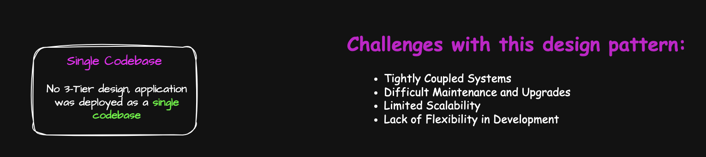
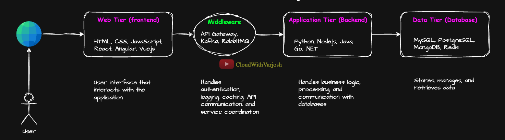
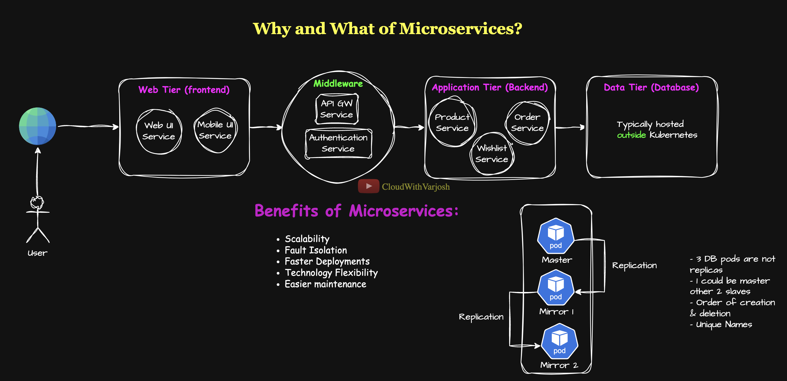
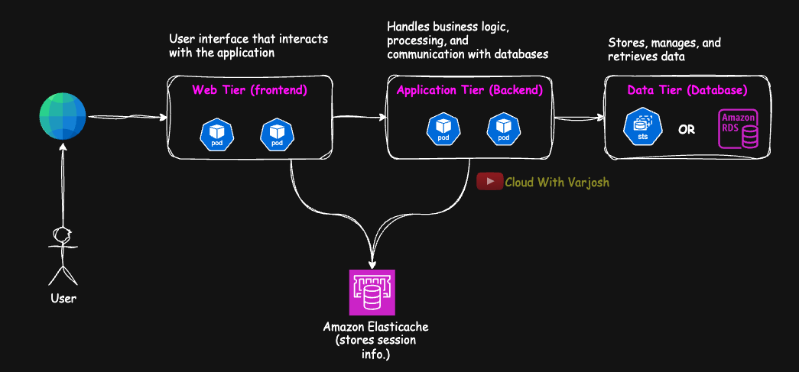
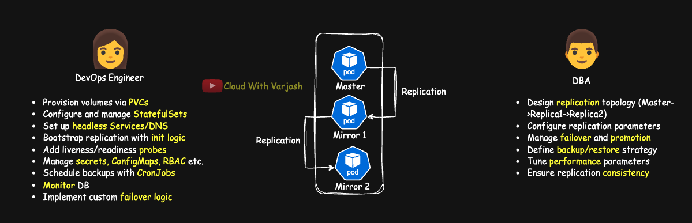
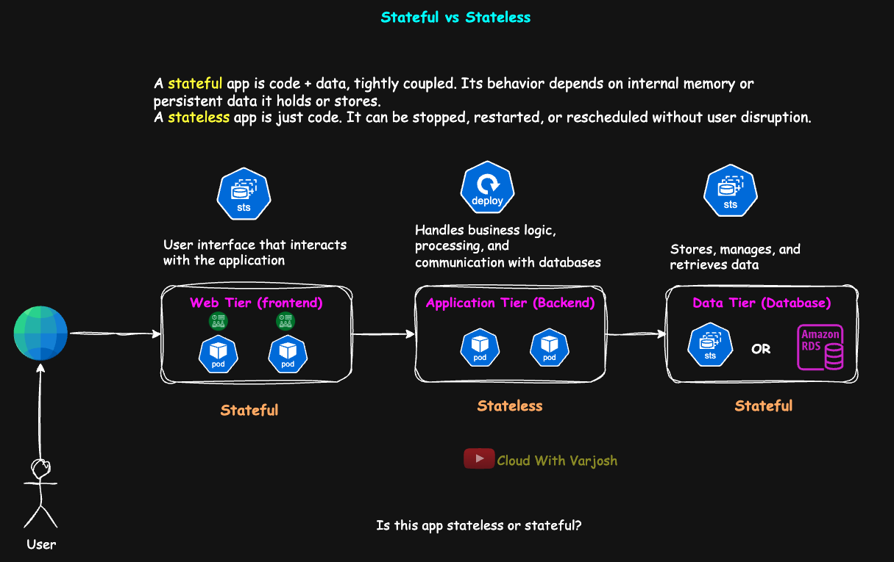
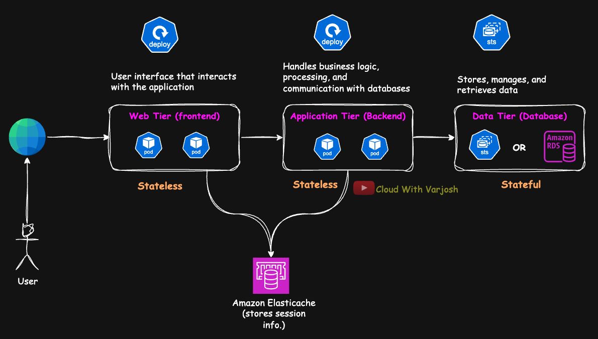

# 05 · How Apps Are Shaped: Monolith, 3-Tier, Microservices, Stateless vs Stateful

> **Level:** ★ foundation
>
> **You will learn:** what a monolith is and why it hurts at scale; the three-tier architecture (frontend, middleware, backend, database); how deployments evolved from one server to three servers to VMs to cloud and Kubernetes; why microservices exist and how they map to Kubernetes objects; the difference between **stateless** and **stateful** components; and where databases should run. This is the "shape" of every app you'll deploy in the rest of these notes.
>
> **You need:** topic 01.

---

## ⚡ Core: the 10-minute version

**The idea.** Before you deploy anything, know the **shape** of the app:
- a **monolith**: one big program;
- **three-tier**: frontend, backend, database;
- **microservices**: many small services, each deployed and scaled on its own.

Then judge every piece as **stateless** (just code: any copy can serve any request, so copies are disposable) or **stateful** (code + data that must survive restarts). In Kubernetes, stateless pieces are usually a **Deployment + Service**; stateful pieces need persistent storage (StatefulSets, operators, or a managed database).

**Picture it.** Stateless workers are like cashiers: any free one can serve you. A stateful database is like your bank's vault: it has to be the same vault every time.

**The one thing to know.** Move state **out of** Pods (into Redis, a database, object storage), so Pods can be killed and replaced freely.

**Try it now** (on paper, 5 minutes):
1. Pick an app you know (e.g. an online shop).
2. List its tiers or services.
3. Mark each one stateless or stateful.
4. Write which Kubernetes object you'd use for each.

**You've got it if you can:** explain stateless vs stateful with an example, and why stateless services scale so easily.

> 📖 **That's the core.** On a first pass, do the mini-lab and move on to the next topic. Everything below is the **full reference**: come back for the details, the edge cases, interview answers and exam-level depth.

---

## What it is

**Software architecture** = how an application is split into parts, and how those parts talk to each other. Four shapes matter for Kubernetes:

1. **Monolith:** the whole app (UI, business logic, data access) is **one codebase, deployed as one unit**.
2. **Three-tier:** the app is split into **layers**: frontend (what users see), backend (business logic), database (stored data), often with **middleware** in between.
3. **Microservices:** the app is split into **many small, independent services**, each doing one job (users, products, orders, wishlist) and talking over APIs (usually HTTP or gRPC).
4. **Stateless vs stateful** is a property of each piece: does it keep **data that matters** inside itself?

---

## Why it exists

Kubernetes objects map directly onto these shapes. A microservice becomes a **Deployment** plus a **Service**. A database becomes a **StatefulSet** (or lives outside the cluster). A shared session store becomes an external cache. If you can't see the shape of an app, you can't decide which Kubernetes objects it needs, how it scales, or what breaks when a Pod dies.

---

## Analogy

- **Monolith = one giant restaurant kitchen** where one chef does everything. If the chef gets sick, nobody eats. To serve more people you must clone the *whole* kitchen.
- **Three-tier = a restaurant with a dining room (frontend), a kitchen (backend) and a pantry (database)**, plus a host desk and cashier in between (middleware).
- **Microservices = a food court.** Each stall does one thing (pizza, noodles, drinks). If the drinks stall closes, you can still buy pizza. Busy stalls add staff without touching the others.
- **Stateless vs stateful:** a **cashier** is stateless: any cashier can serve you. Your **bank account manager** is stateful: they hold *your* history, and swapping them means handing over your file.

---

## How it works inside

### 1. Monolithic architecture



A **monolithic application** is self-contained and tightly integrated: UI, business logic and database access are **one deployment unit**. Simple to start, hard to grow. Modern apps usually avoid it, but you'll meet it in **legacy systems** that were never refactored.

Challenges:
1. **Tightly coupled:** a change in one part can break another.
2. **Hard to maintain and upgrade:** any fix means redeploying everything, with downtime and big test cycles.
3. **Limited scalability:** to scale one busy feature you must scale the whole app, wasting resources.
4. **Slow, inflexible development:** teams block each other in one codebase.

### 2. Three-tier architecture



A **three-tier architecture** separates an application into **three logical layers** for scalability, maintainability and **separation of concerns** (each part has one job).

| Tier | Job | Example technologies |
|---|---|---|
| **Frontend (web tier)** | The user interface | HTML, CSS, JavaScript, React, Angular, Vue.js |
| **Middleware** | Authentication, logging, caching, API routing, service coordination | Express.js, Nginx, API Gateway, Kafka, RabbitMQ |
| **Backend (application tier)** | Business logic; talks to the database | Python, Node.js, Java, Go, .NET |
| **Database (data tier)** | Stores and retrieves data | MySQL, PostgreSQL, MongoDB, Redis |

(Middleware isn't one of the "three" tiers; it sits between them.)

**In an e-commerce website:**
- **Frontend:** the homepage, product listing and cart UI. Clicking "Add to Cart" sends a request to the backend.
- **Middleware** handles:
  - **Authentication and authorization:** OAuth (a standard for delegated login), **JWT** (JSON Web Token, a signed token proving who you are), API keys.
  - **Logging and monitoring:** the ELK stack (Elasticsearch, Logstash, Kibana), Prometheus, Grafana.
  - **Caching:** Redis, Memcached.
  - **Service communication:** API gateways, **message brokers** (queues that pass messages between services).
  - Examples: a **payment gateway** validates cards before the backend sees the order; **rate-limiting** middleware protects APIs from too many requests.
- **Backend:** the order-management system (processes orders, updates inventory, sends confirmation emails); a wishlist service.
- **Database:** user DB (accounts), product DB (items, prices, stock), order-history DB.

### 3. How 3-tier deployments evolved

(These are examples, not a full list. Event-driven and serverless models also exist.)

| Era | Setup | Good | Bad | Example |
|---|---|---|---|---|
| **A. Single server** | Frontend, backend and DB on one physical machine | Simple | Must scale everything together (vertical only); one busy part slows all; server dies → everything dies | A small shop's inventory system that crashes under heavy traffic |
| **B. Three physical servers** (pre-virtualisation) | One server per tier | Performance, fault isolation, independent scaling | Expensive: hardware, power, maintenance ×3 | A bank separating UI, logic and transaction data |
| **C. Virtualisation** | Each tier in its own **VM** on shared hardware (VMware, KVM) | Isolation and flexibility without 3 machines; resources reassigned easily | VMs still slow to create and heavy | A growing startup running 3 VMs on one host |
| **D. Cloud + Kubernetes** | Tiers containerised and run on Kubernetes; managed services for the rest | Automation, fast scaling, efficient packing | Platform complexity | A SaaS company: frontend Pods, backend microservice Deployments, DB on AWS RDS or Cloud SQL |

### 4. Problems with traditional three-tier

1. **Scaling is coarse:** one busy function forces scaling its whole tier.
2. **Single points of failure (SPOF):** one tier failing takes the app down.
3. **Tight coupling inside each tier:** each tier is itself a mini-monolith.
4. **Slow development and deployment:** big, interdependent codebases.
5. **Limited technology choice:** one stack per tier.

### 5. Microservices



**Monolithic e-commerce:** login, payments, catalog, orders and wishlist in one app. If the **wishlist crashes, the whole site may go down.**

**Microservices** split the app into **small, independent services** that talk over APIs. Each can be **scaled, deployed and updated on its own**, and failures are **isolated**: if the **Wishlist Service** goes down, users can still browse and order; only the wishlist is unavailable until it recovers.

- **User Service:** login and profiles.
- **Product Service:** listings and inventory.
- **Order Service:** orders and payments.
- **Wishlist Service:** saved items.

> **Naming:** it's called the "Wishlist **Service**", not "Wishlist Microservice". Microservices are services by definition, so "service" avoids redundancy and matches industry convention. (Don't confuse it with a Kubernetes **Service** object, topic 30, although each microservice usually gets one.)

| Benefit | Explanation |
|---|---|
| **Scalability** | Each service scales independently. |
| **Fault isolation** | One failing service doesn't crash the whole app. |
| **Faster deployment** | Teams deploy independently. |
| **Technology flexibility** | Each service can use a different language. |
| **Easier maintenance** | Smaller codebases are easier to manage and debug. |

The trade-off (interviewers like this): microservices add **network calls, distributed debugging, more deployments, and data consistency problems**. You need good observability, CI/CD and an orchestrator. That's a big reason Kubernetes exists.

### 6. Mapping microservices onto Kubernetes

Each tier can contain several microservices, and **each microservice gets its own Deployment** (topic 25) and usually its own **Service** (topic 30).

| Tier | Microservices | Typical Kubernetes objects |
|---|---|---|
| **Frontend** | Web UI, mobile API front | Deployment + Service, exposed by Ingress/Gateway (69, 72) |
| **Middleware** | API gateway, auth, logging, caching | Deployments, DaemonSets for log agents (27) |
| **Backend** | Order, Payment, Wishlist services | Deployment + ClusterIP Service each, HPA for scaling (48) |
| **Database** | MySQL, PostgreSQL | Usually **outside** the cluster (managed DB), or a StatefulSet/operator (40, 67) |

**A request through an e-commerce app on Kubernetes:**
1. A user opens `https://example.com`.
2. The request reaches the **Ingress controller** (or Gateway), which forwards it to the **frontend Service**.
3. The **frontend** (React/Vue/Angular) calls the **API gateway** (middleware).
4. The **API gateway** forwards to the right backend service, e.g. the **Wishlist Service**.
5. The Wishlist Service reads the **database** and replies.
6. The user sees the updated wishlist.

**Scaling:** each microservice is its own Deployment, so the **HPA (Horizontal Pod Autoscaler)** can add or remove Pods for *that* service based on load (topic 48).

### 7. Stateless vs stateful

- **Stateless:** **just code**. It can be stopped, restarted or moved without hurting users or data. Any copy can serve any request.
- **Stateful:** **code + data, tightly coupled**. Its behaviour depends on data held in memory or on disk.

#### Stateless example



A web app runs as a Deployment with several replicas. A user logs in and lands on **Pod-1**. Pod-1 **doesn't keep the session itself**; it writes it to **Amazon ElastiCache** (a managed Redis). If Pod-1 crashes, the next request goes to **Pod-2**, which reads the session from ElastiCache and carries on. Any Pod can handle any request, and Kubernetes can freely restart, move or scale Pods: **true horizontal scaling and resilience by design**.

#### Stateful example



Databases (PostgreSQL, MySQL, MongoDB) store critical data on a specific volume. They're harder to scale because:
- replicas must coordinate for **data consistency**;
- failover needs **promotion logic** (making a replica the new primary) and replication awareness;
- Kubernetes must preserve **identity, volume bindings and start-up order**: that's what **StatefulSets**, **PersistentVolumeClaims** and **headless Services** provide (topics 38–40).

#### A three-tier app is usually *both*



- **Frontend** stores **session info inside the Pod** (in memory or local files): language, currency, UI mode, location, last page visited.
- **Backend** is **truly stateless**: only code, no runtime data it depends on. Perfect for a Deployment's interchangeable replicas.
- **Database** is **always stateful**: losing its volume or identity breaks data integrity.

**So is the app stateful or stateless? Both.** Most real apps are hybrids.

**The session problem:** if a frontend Pod crashes or is rescheduled, the replacement has none of the old context. Users get logged out or lose their preferences. The frontend is **accidentally stateful**, tied to one Pod's memory.

**Why apps want to be stateless:** easier horizontal scaling, simpler failure handling, a natural fit for Deployments, cheaper in the cloud. So modern designs **move state out of the Pod**.

#### The fix: an external session store



Add a **session store: Amazon ElastiCache (Redis)**, a fast managed in-memory store:
- User logs in on **frontend pod-1** → session written to ElastiCache.
- Pod-1 crashes → **pod-2** reads the session from ElastiCache and continues seamlessly.
- The **frontend is now stateless**: scalable and resilient.

Connecting the **backend** to ElastiCache too makes it a **cache**: recently or frequently used data is served from memory instead of hitting the database every time. This cuts database load and latency. This pattern is called a **middleware cache**.

**Takeaway:**
- **Stateful ≠ only databases.** Frontends and other components can be stateful depending on what they keep.
- Ask: **what state does this component manage, and where is it stored?**
- **Deployments for stateless parts, StatefulSets + PVCs for stateful parts.**
- **Never label a whole app stateful or stateless; break it down tier by tier.**

### 8. Where should databases run?

**Stateful** apps keep information about previous interactions (good for sessions and databases); **stateless** apps don't (good for scaling).

Day 11's view: running databases in Kubernetes is **not the most common production practice**:
- **Stateful workloads are hard to manage:** stable networking, persistent storage and HA setups are needed.
- **Performance:** managed services or dedicated VMs give better storage I/O, backup and replication tooling.
- **HA and backups:** replication, automatic failover and backups are easier with **AWS RDS, Google Cloud SQL, Azure Database**.

> ✅ **Correct today** ([C1](#c1)): Kubernetes *does* provide stable network identity and persistent storage natively through **StatefulSets, headless Services and PersistentVolumes** (topics 38–40). What it doesn't provide by itself is **database-level operations**: replication setup, failover/promotion, backups, upgrades. **Operators** (topic 67, e.g. CloudNativePG for PostgreSQL) automate those, and running databases on Kubernetes with an operator is now common in production. Managed databases are still the simplest choice when you're in the cloud.

Where databases are hosted in production:
- **Cloud-managed services** (RDS, Cloud SQL): scaling and backups handled for you.
- **Dedicated VMs with HA**: full control and tuning.
- **Hybrid**: apps in Kubernetes, database outside. The most common pattern.
- **StatefulSets** in Kubernetes: give each Pod a **unique, persistent identity** across restarts, plus ordered deployment and stable storage. Used for **MySQL/PostgreSQL** and distributed systems like **Kafka** and **ZooKeeper**.

When you'd run a database in Kubernetes:
- **Development and testing**, where persistence isn't critical.
- With a **Kubernetes-native database operator** (MySQL Operator, PostgreSQL operators). An **Operator** is a custom controller that automates deployment, scaling and day-2 management, encoding a DBA's knowledge into software (topic 67).
- **Small self-managed** setups with low operational complexity.

---

## Commands / YAML

The shapes above become objects like these (you'll write them for real in later topics):

```yaml
# Stateless backend microservice: interchangeable replicas
apiVersion: apps/v1
kind: Deployment
metadata:
  name: wishlist
spec:
  replicas: 3                      # any replica can serve any request
  selector: { matchLabels: { app: wishlist } }
  template:
    metadata: { labels: { app: wishlist } }
    spec:
      containers:
      - name: app
        image: shop/wishlist:2.4
        env:
        - name: SESSION_STORE      # state lives OUTSIDE the Pod
          value: redis://sessions.cache.internal:6379
---
apiVersion: v1
kind: Service                      # one stable name for all replicas
metadata:
  name: wishlist
spec:
  selector: { app: wishlist }
  ports: [{ port: 80, targetPort: 8080 }]
```

- `replicas: 3` works only because the app is stateless.
- `SESSION_STORE` points at an external store, so killing a Pod loses nothing.
- The Service gives the API gateway one name (`wishlist`) to call. Topic 30 explains it.

---

## Hands-on lab (thought exercise + quick check)

1. Pick an app you know (or the e-commerce example). For each component write: *tier*, *state it keeps*, *where that state lives*, *Kubernetes object you'd use*. Example: `cart UI | frontend | session | Redis (external) | Deployment`.
2. Find the accidental state: anything written to local disk or memory that users would miss if the Pod died (uploads, sessions, caches that are slow to rebuild). Decide where each should go (object storage, Redis, a database).
3. Later, in topic 25, kill a Pod of a stateless Deployment and watch traffic continue. In topic 40, delete a StatefulSet Pod and watch it come back with **the same name and the same volume**.

---

## Where you'll use it

- **Design reviews:** "Can we run 3 replicas of this?" is really "is it stateless?"
- **Migrating legacy apps to Kubernetes:** finding sticky sessions and local files is the first job.
- **Choosing database hosting:** managed service vs operator vs StatefulSet.
- **Interviews:** "Explain monolith vs microservices", "how do you make a web tier stateless?"

---

## When it breaks

| Symptom | Architecture cause | Fix |
|---|---|---|
| Users logged out randomly after scaling or a deploy | Sessions stored in Pod memory | External session store (Redis) |
| Uploaded files disappear after a Pod restart | Written to the container filesystem | Object storage or a PersistentVolume |
| One slow feature slows the whole site | Monolith or tight coupling | Split it out; timeouts and circuit breakers |
| Scaling the DB with `replicas: 3` corrupted data | A database run as a Deployment | StatefulSet with replication, or an operator, or a managed DB |
| A microservice outage cascades | Synchronous calls without timeouts or retries | Timeouts, retries with backoff, graceful degradation |

---

## Quick recap

- Monolith → three-tier → microservices: smaller, independent pieces that scale and fail separately.
- Each microservice usually = **Deployment + Service** in Kubernetes.
- **Stateless = just code; stateful = code + data.** Most apps are hybrids; judge each tier.
- Move state out of Pods (Redis, databases, object storage) so Pods are disposable.
- Databases: managed service, or StatefulSet + operator in Kubernetes.

### Interview questions

1. **Q: What makes a service "stateless"?**
   A: It doesn't keep data it depends on inside the Pod: any replica can serve any request, and a Pod can be killed or moved without losing anything. State lives in external stores.
2. **Q: Deployment or StatefulSet for a database, and why?**
   A: StatefulSet: it gives each replica a stable name, stable DNS and its own persistent volume that follows it, plus ordered start-up. Deployments treat Pods as interchangeable and share volume templates poorly.
3. **Q: Downsides of microservices?**
   A: More moving parts, network latency and failures between services, distributed tracing/debugging, data consistency across services, and heavier CI/CD and platform needs.

---

## Appendix: notes on the original course material

This topic was rebuilt from the original CKA course notes. This appendix keeps the audit trail out of your way while you learn.

### Sources

Day 11 (all), Day 44 (stateless vs stateful, three-tier example, session problem, ElastiCache redesign, takeaway), Day 40 (stateless vs stateful definitions and examples).

### Corrections to the original notes

Each entry shows what the original said and what's true now. In the topic above, each correction appears as a ✅ **Correct today** line or a ⚠️ **Fix to the original** box, linked to its entry here.

<a id="c1"></a>**C1 · Corrected (Day 11).** the original said databases need stable networking, persistent storage and HA "which **Kubernetes doesn't handle natively**". **Now:** Kubernetes *does* provide stable network identity and persistent storage natively through **StatefulSets, headless Services and PersistentVolumes** (topics 38–40). What it doesn't provide by itself is **database-level operations**: replication setup, failover/promotion, backups, upgrades. **Operators** (topic 67, e.g. CloudNativePG for PostgreSQL) automate those, and running databases on Kubernetes with an operator is now common in production. Managed databases are still the simplest choice when you're in the cloud.
