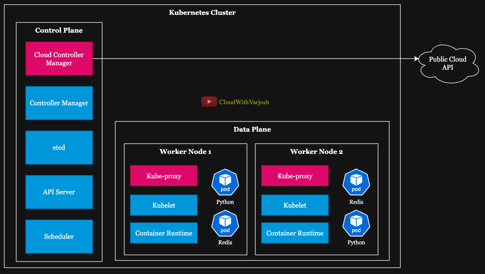
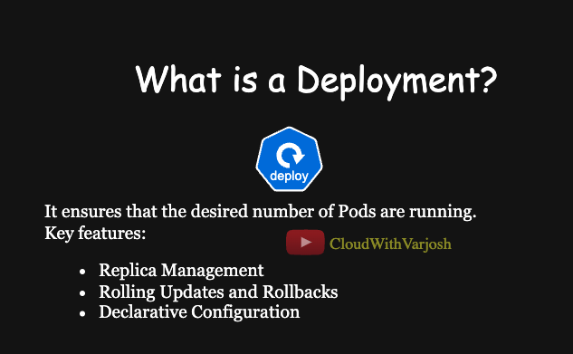
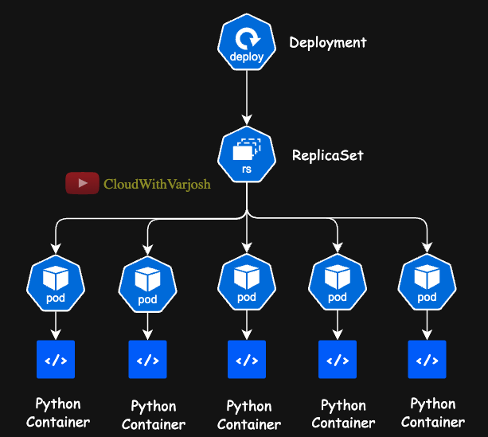
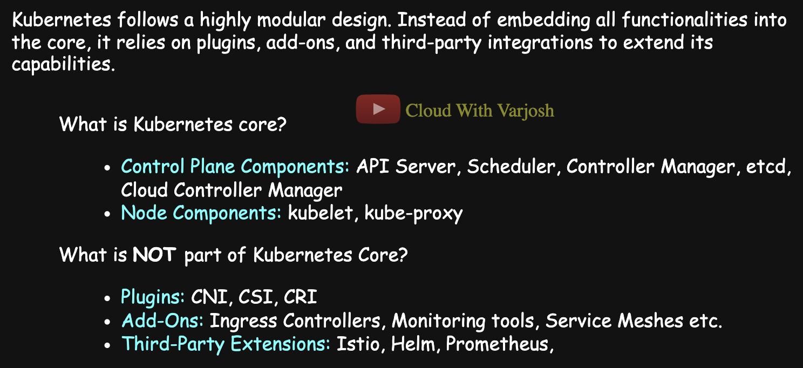

# 06 · The Cluster at a Glance

> **Level:** ★ foundation
>
> **You will learn:** what a cluster is made of (control plane + worker nodes), what each component does in one sentence, what a Kubernetes **object** is, the **spec vs status** idea, how Deployments wrap ReplicaSets wrap Pods wrap containers, and the difference between the Kubernetes "core" and its plugins and add-ons. Topics 07–09 then zoom into each part.
>
> **You need:** topics 01 and 04.

---

## ⚡ Core: the 10-minute version

**The idea.** A Kubernetes **cluster** has two halves:
- the **control plane**, the brain: the **API server** (the single front door), **etcd** (the database of everything), the **scheduler** (picks a node for each Pod) and the **controller manager** (loops that fix differences);
- the **worker nodes**, which run your containers using the **kubelet** (node agent), a **container runtime** (containerd) and **kube-proxy** (Service networking).

Everything you create is an **object** with a **spec** (what you want) and a **status** (what's true now).

**Picture it.** The control plane is head office with a ledger (etcd) and managers (controllers); nodes are branch offices whose site managers (kubelets) do the actual work.

**The one thing to know.** The ownership chain you'll see everywhere:

```text
Deployment → ReplicaSet → Pod → container(s)
```

**Try it now:**
1. `kubectl get nodes -o wide`
2. `kubectl get pods -n kube-system`: spot the API server, etcd, scheduler, controller manager, CoreDNS, kube-proxy.
3. `kubectl create deployment web --image=nginx`, then `kubectl get deploy,rs,pods`: see the chain.

**You've got it if you can:** name every control-plane and node component in one sentence each, and explain spec vs status.

> 📖 **That's the core.** On a first pass, do the mini-lab and move on to the next topic. Everything below is the **full reference**: come back for the details, the edge cases, interview answers and exam-level depth.

---

## What it is

A **Kubernetes cluster** is a set of machines split into two roles:

1. **Control plane:** the **brain**. It stores the desired state, decides where things run and constantly fixes differences. It runs no apps (normally).
2. **Worker nodes** (or just **nodes**): the **muscle**. They run your containers.

> ✅ **Correct today** ([C1](#c1)): Kubernetes stopped using "master" years ago. The official terms are **control plane** and **(worker) node**, and kubeadm labels control-plane nodes `node-role.kubernetes.io/control-plane` (the old `master` label and taint were removed in v1.25). You'll still hear "master" from people and old docs.



### Control plane components

| Component | One-line job |
|---|---|
| **kube-apiserver** (API server) | The **front door**: every request from users, tools and other components goes through it. It authenticates, authorises, validates, and stores objects in etcd. |
| **etcd** | A distributed **key-value database** that stores **all cluster state** (every object). |
| **kube-scheduler** | Picks a **node** for every new Pod, based on resources and rules. |
| **kube-controller-manager** | Runs many **controllers**: loops that make actual state match desired state (replicas, nodes, endpoints, garbage collection…). |
| **cloud-controller-manager** (CCM) | Talks to the **cloud provider's API**: creates cloud load balancers, labels nodes with zones, removes nodes whose VMs were deleted. Only present on cloud clusters. |

### Node components

| Component | One-line job |
|---|---|
| **kubelet** | The **agent on every node**: watches the API server for Pods assigned to its node, makes the runtime start them, reports their status back. |
| **Container runtime** | Actually pulls images and runs containers: **containerd** or **CRI-O** (topic 08). |
| **kube-proxy** | Programs the node's packet rules (iptables/nftables) so **Service** IPs reach the right Pods (topic 32). Some CNIs replace it. |

Plus, on every cluster, two **essential add-ons**: a **CNI plugin** (gives Pods IPs and connects them, topic 29) and **CoreDNS** (cluster DNS, topic 33).

> ✅ **Correct today** ([C2](#c2)): Podman is a Docker-like tool for humans, **not** a Kubernetes (CRI) runtime, and **rkt ("Rocket")** was archived in 2020. Supported CRI runtimes are **containerd** and **CRI-O** (plus sandboxed variants like gVisor and Kata that plug in *under* them). Docker Engine only works through the extra **cri-dockerd** adapter (topic 08).

> ✅ **Correct today** ([C3](#c3)): kube-proxy only programs **Service load-balancing rules**. **Service discovery** (finding a Service by name) is **CoreDNS**'s job, and Pod-to-Pod routing is the **CNI plugin**'s job.

### Control plane vs data plane

The worker side is often called the **data plane**, because that's where application traffic flows.

| Feature | Control plane | Data plane |
|---|---|---|
| **Responsibility** | Manages the cluster | Runs applications |
| **Components** | etcd, API server, scheduler, controller manager, cloud controller manager | kubelet, kube-proxy, container runtime |
| **Location** | Dedicated machines, usually 3 for high availability (topic 78) | Every worker node |
| **Focus** | Orchestration, management, control | Running apps and managing their resources |

Note: control-plane machines **also** run a kubelet and a runtime, because on kubeadm clusters the control-plane components themselves run as Pods (static Pods, topic 42).

### Objects: the things you create

Everything you create in Kubernetes is an **object** (also called a **resource**): a record stored in etcd that describes something you want. Pod, Deployment, Service, ConfigMap, Namespace… are all **kinds** of objects.

Almost every object has two big parts:
- **`spec`** = the **desired state**: what *you* want ("3 replicas of nginx:1.29").
- **`status`** = the **actual state**: what *the cluster* reports ("2 ready replicas"). Controllers write it; you never do.

Controllers spend their lives moving `status` towards `spec`.

### Deployments wrap ReplicaSets wrap Pods wrap containers





- A **Pod** wraps one or more **containers**. It's the **smallest deployable unit** in Kubernetes. Its containers share one **network namespace** (one IP, `localhost`) and can share **volumes** (topic 18).
- A **ReplicaSet** wraps **Pods**: it keeps a fixed number of identical Pods running, recreating any that fail (topic 24).
- A **Deployment** wraps **ReplicaSets**: it handles **versions, rolling updates and rollbacks** by creating a new ReplicaSet for each version and shifting Pods across (topic 25).

You almost always create **Deployments** and let Kubernetes create the rest.

### Core vs extensions



Kubernetes is **modular**. The **core** (the components above) does orchestration. Everything else plugs in through **standard interfaces** or runs **on top** as normal workloads, so the core stays small:

- **Plugins**: CNI (networking), CSI (storage), CRI (runtimes).
- **Add-ons**: CoreDNS, Ingress/Gateway controllers, metrics-server, dashboards.
- **Third-party extensions**: Helm, Prometheus, Istio, operators.

Topic 09 covers these in depth.

---

## Why it exists

Splitting **brain** from **muscle** lets each scale and fail separately:
- You can add 100 worker nodes without touching the control plane's design.
- If a worker dies, the control plane notices and reschedules its Pods elsewhere.
- If the control plane briefly goes down, **running Pods keep running**: kubelets and runtimes don't need the API server to keep existing containers alive. You just can't make changes until it's back.

---

## Analogy

An **airport**:
- **Control tower (control plane)** decides which plane uses which runway and gate. It doesn't fly planes.
  - The **API server** is the **radio**: every message goes through it.
  - **etcd** is the **flight log**: the single source of truth.
  - The **scheduler** **assigns gates**.
  - **Controllers** are **supervisors** who keep checking "is every scheduled flight where it should be?" and fix it if not.
- **Gates and ground crews (nodes)** do the physical work.
  - The **kubelet** is the **gate manager** who reads assignments from the radio and gets the plane boarded.
  - The **container runtime** is the **ground crew**.
  - **kube-proxy** is the **signage** that sends passengers for "Flight 42" to the right gate.

---

## How it works inside

**Everyone talks only to the API server.** Components never talk to etcd directly (except the API server itself), and they rarely talk to each other. Instead, each component **watches** the API server for the objects it cares about and **writes** its results back:

```
                        ┌──────────── control plane ────────────┐
 kubectl ─HTTPS─▶ kube-apiserver ◀───▶ etcd
                    ▲   ▲   ▲
       watch/update │   │   │ watch/update
          scheduler ┘   │   └ controller-manager (Deployment, ReplicaSet, Node… controllers)
                        │
          ┌─────────────┴─────────────── worker node ───────────────┐
          │ kubelet ──CRI──▶ containerd ──▶ runc ──▶ containers      │
          │ kube-proxy ──▶ iptables/nftables rules                   │
          └──────────────────────────────────────────────────────────┘
```

This **hub-and-spoke** design means:
- etcd only needs one trusted client (the API server).
- Every change passes the same security checks (authentication, authorisation, admission; topics 54–58).
- Components are **loosely coupled**: you can replace the scheduler, add new controllers, or add new object types (CRDs, topic 66) without changing anything else.

Topic 10 traces a full `kubectl apply` through all of this, step by step.

---

## Commands / YAML

You'll build a cluster in topic 11. These are the commands you'll use to look at it:

```bash
kubectl get nodes -o wide
```

```
NAME                  STATUS   ROLES           AGE   VERSION   INTERNAL-IP   OS-IMAGE                         CONTAINER-RUNTIME
lab-control-plane     Ready    control-plane   5m    v1.37.0   172.18.0.3    Debian GNU/Linux 12 (bookworm)   containerd://2.1.3
lab-worker            Ready    <none>          5m    v1.37.0   172.18.0.2    Debian GNU/Linux 12 (bookworm)   containerd://2.1.3
lab-worker2           Ready    <none>          5m    v1.37.0   172.18.0.4    Debian GNU/Linux 12 (bookworm)   containerd://2.1.3
```

- `ROLES control-plane` = this node runs the control-plane Pods; `<none>` = an ordinary worker.
- `VERSION` = the **kubelet** version on that node.
- `CONTAINER-RUNTIME` = the CRI runtime and its version.

```bash
kubectl get pods -n kube-system
```

```
NAME                                        READY   STATUS    RESTARTS   AGE
coredns-7c65d6cfc9-8xk2p                    1/1     Running   0          5m
coredns-7c65d6cfc9-qz7lm                    1/1     Running   0          5m
etcd-lab-control-plane                      1/1     Running   0          5m
kindnet-4bqzv                               1/1     Running   0          5m
kube-apiserver-lab-control-plane            1/1     Running   0          5m
kube-controller-manager-lab-control-plane   1/1     Running   0          5m
kube-proxy-7nqfh                            1/1     Running   0          5m
kube-scheduler-lab-control-plane            1/1     Running   0          5m
```

- `-n kube-system` = look in the `kube-system` **namespace** (a folder for system objects, topic 26).
- `etcd-…`, `kube-apiserver-…`, `kube-controller-manager-…`, `kube-scheduler-…` = the control plane, running **as Pods** on the control-plane node (static Pods, topic 42). The suffix is the node name.
- `coredns-…` = cluster DNS (a Deployment with 2 replicas).
- `kindnet-…` = kind's CNI plugin (one per node, a DaemonSet).
- `kube-proxy-…` = one per node (a DaemonSet, topic 27).

---

## Hands-on lab

After topic 11 creates your kind cluster, come back and:

1. Run the two commands above and match each Pod to a component in the tables.
2. Count the `kube-proxy` and `kindnet` Pods: one per node. Why? (They configure each node locally.)
3. See which node each runs on: `kubectl get pods -n kube-system -o wide`.
4. Prove "running Pods survive a control-plane outage": create a Pod (`kubectl run test --image=nginx`), then stop the API server for a moment by moving its manifest out of `/etc/kubernetes/manifests` on the control-plane node (topic 42 explains this). `kubectl` stops working, but `docker exec lab-worker crictl ps` still shows nginx running. Move the manifest back.

---

## Where you'll use it

- **Every incident** starts with "which component is responsible for this?"
- **Interviews**: "Explain the Kubernetes architecture" is the most common question of all.
- **Managed Kubernetes** (EKS/GKE/AKS): the cloud runs the control plane for you; you see only the nodes. You still need to know what the hidden parts do.

---

## When it breaks

| Symptom | Component to suspect |
|---|---|
| `kubectl` hangs or `connection refused` | API server (or your kubeconfig) — topic 82 |
| Pods stay `Pending` forever | Scheduler, or no node has room — topics 42, 82 |
| Deployment doesn't create Pods | Controller manager — topic 82 |
| Node `NotReady` | kubelet or runtime on that node, or CNI — topic 83 |
| Service IP doesn't work | kube-proxy rules or CNI — topics 32, 83 |
| Everything is slow or errors about "etcdserver" | etcd (disk latency, quorum) — topics 77, 82 |

---

## Quick recap

- Cluster = **control plane** (API server, etcd, scheduler, controller manager, CCM) + **nodes** (kubelet, runtime, kube-proxy) + add-ons (CNI, CoreDNS).
- **Everything goes through the API server**; only it talks to etcd.
- Objects have **spec** (desired) and **status** (actual); controllers reconcile them.
- Deployment → ReplicaSet → Pod → container.

### Interview questions

1. **Q: What runs on a worker node?**
   A: kubelet, a container runtime (containerd/CRI-O), kube-proxy (unless replaced by the CNI), and the CNI plugin's agent.
2. **Q: What happens to running Pods if the control plane goes down?**
   A: They keep running; kubelets keep containers alive. But nothing new can be scheduled or changed, failed Pods aren't replaced by controllers, and Services stop reacting to changes until the control plane recovers.
3. **Q: Who writes an object's `status`?**
   A: The controllers and kubelets responsible for it, through the API server. Users write `spec`.

---

## Appendix: notes on the original course material

This topic was rebuilt from the original CKA course notes. This appendix keeps the audit trail out of your way while you learn.

### Sources

Day 07 (What is a Deployment, Kubernetes architecture, control plane, worker nodes, component lists, control plane vs data plane table), Day 25 (introduction, core vs extended architecture, what is Kubernetes core).

### Corrections to the original notes

Each entry shows what the original said and what's true now. In the topic above, each correction appears as a ✅ **Correct today** line or a ⚠️ **Fix to the original** box, linked to its entry here.

<a id="c1"></a>**C1 · Corrected (Day 07).** the original described "a **master-worker** architecture". **Now:** Kubernetes stopped using "master" years ago. The official terms are **control plane** and **(worker) node**, and kubeadm labels control-plane nodes `node-role.kubernetes.io/control-plane` (the old `master` label and taint were removed in v1.25). You'll still hear "master" from people and old docs.

<a id="c2"></a>**C2 · Corrected (Day 07).** the original listed runtimes as "containerd, CRI-O, **Podman, Rocket**". **Now:** Podman is a Docker-like tool for humans, **not** a Kubernetes (CRI) runtime, and **rkt ("Rocket")** was archived in 2020. Supported CRI runtimes are **containerd** and **CRI-O** (plus sandboxed variants like gVisor and Kata that plug in *under* them). Docker Engine only works through the extra **cri-dockerd** adapter (topic 08).

<a id="c3"></a>**C3 · Corrected (Day 07).** "kube-proxy … handles network routing and **service discovery**". **Now:** kube-proxy only programs **Service load-balancing rules**. **Service discovery** (finding a Service by name) is **CoreDNS**'s job, and Pod-to-Pod routing is the **CNI plugin**'s job.
