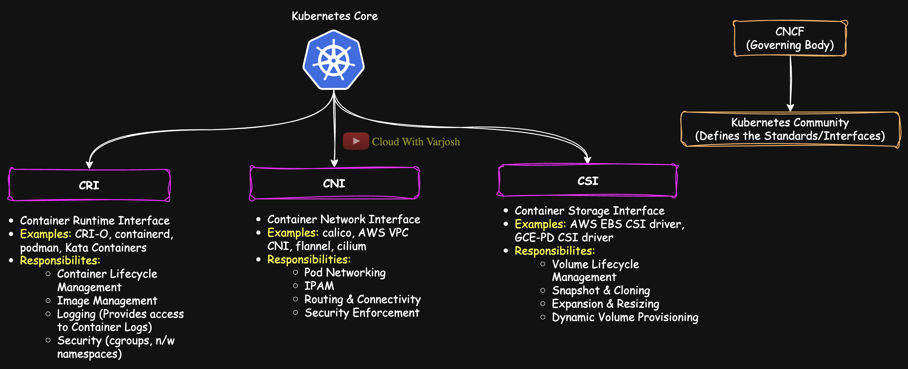

# 09 · Plugins, Interfaces and Add-ons: CRI, CNI, CSI and Beyond

> **Level:** ★★ intermediate
>
> **You will learn:** why Kubernetes is built as a small core plus plugins; the three standard plugin interfaces (CRI for runtimes, CNI for networking, CSI for storage), what each one is responsible for, the popular implementations, and how they're called; the difference between plugins, add-ons and third-party extensions; and the other extension points (CRDs, admission webhooks, scheduler plugins, the aggregation layer).
>
> **You need:** topics 06–08.

---

## ⚡ Core: the 10-minute version

**The idea.** Kubernetes keeps its core small and lets plugins do specialised work through three standard interfaces:
- **CRI** (Container Runtime Interface): runs containers (containerd, CRI-O);
- **CNI** (Container Network Interface): gives Pods IPs and connects them (Calico, Cilium, kindnet);
- **CSI** (Container Storage Interface): provides disks and volumes (EBS, Ceph, local-path).

**Add-ons** (CoreDNS, ingress controllers, metrics-server) run *on* the cluster as Pods. Extension points like CRDs and admission webhooks let you add whole new features.

**Picture it.** Kubernetes is a laptop with standard ports: USB-C for power (CRI), network (CNI) and storage (CSI). Any compliant device plugs in.

**The one thing to know.** Find the plugins in your cluster:

```bash
kubectl get pods -n kube-system -o wide       # CNI, CoreDNS, kube-proxy Pods
kubectl get csidrivers; kubectl get storageclass
docker exec lab-worker ls /etc/cni/net.d /opt/cni/bin
```

**Try it now:** run the three commands and match each thing you see to CRI, CNI, CSI or "add-on".

**You've got it if you can:** say what each interface is responsible for, and name one implementation of each.

> 📖 **That's the core.** On a first pass, do the mini-lab and move on to the next topic. Everything below is the **full reference**: come back for the details, the edge cases, interview answers and exam-level depth.

---

## What it is

Kubernetes has a **core** (API server, etcd, scheduler, controller manager, kubelet, kube-proxy) that handles orchestration. Everything else is added from outside:



1. **Plugins**: code that implements a **standard interface** the core calls:
   - **CRI** (Container Runtime Interface): how the kubelet runs containers.
   - **CNI** (Container Network Interface): how Pods get network interfaces and IPs.
   - **CSI** (Container Storage Interface): how volumes are created, attached and mounted.
2. **Add-ons**: workloads that run **inside** the cluster to provide features: CoreDNS, Ingress/Gateway controllers, metrics-server, monitoring stacks (Prometheus, Grafana), service meshes (Istio, Linkerd).
3. **Third-party extensions**: tools around and on top of Kubernetes: **Helm** (package manager, topic 65), **Prometheus** (monitoring, topic 80), **Istio** (service mesh, topic 74), operators (topic 67).

The interface **specifications** (CNI, CSI) and the CRI API are developed by the Kubernetes and CNCF communities. **Anyone** can write a plugin that follows the spec, and it will work with Kubernetes.

---

## Why it exists

From Day 25, Kubernetes is plugin-based for:
- **Interoperability:** it works with many network, storage and runtime solutions without building them into the core.
- **Flexibility and vendor neutrality:** you pick the best tool for your environment and aren't locked into one vendor.
- **Innovation:** plugin authors improve their products on their own release schedules, with no Kubernetes changes needed.
- **Scalability and maintainability:** each part is scaled and upgraded independently, and the core stays small and stable.

**Example:** **Cilium**, a CNI plugin using **eBPF** (small programs safely loaded into the Linux kernel), adds network security and deep observability **without** any change to Kubernetes' networking model.

History makes the point: storage drivers used to be compiled **into** Kubernetes ("in-tree"). Every cloud's bug was Kubernetes' bug, and fixes waited for a Kubernetes release. Moving them out to CSI drivers (topic 38) fixed that.

---

## Analogy

**Wall sockets and plugs.** The building (Kubernetes) provides standard sockets (CRI, CNI, CSI). Any appliance with the right plug (containerd, Calico, the EBS CSI driver) works, from any manufacturer. You can swap a kettle without rewiring the house. **Add-ons** are the furniture you bring in; **third-party extensions** are the services you hire (cleaners, security).

---

## How it works inside

### CRI: covered in topic 08

The kubelet calls a runtime over **gRPC** on a Unix socket: `RunPodSandbox`, `CreateContainer`, `PullImage`… Implementations: containerd, CRI-O (with gVisor/Kata underneath as needed).

### CNI: how a Pod gets its network

CNI is a **very simple spec**: a plugin is an **executable** file. The runtime runs it with environment variables (`CNI_COMMAND=ADD`, `CNI_NETNS=/var/run/netns/…`, `CNI_IFNAME=eth0`) and JSON config on stdin. The plugin:
1. creates the interface in the Pod's network namespace (usually a **veth pair**, topic 04),
2. asks its **IPAM** (IP Address Management) part for an IP from the node's Pod range,
3. sets routes,
4. prints the result (IP, gateway) as JSON.

On Pod deletion the runtime calls `CNI_COMMAND=DEL`.

- Binaries live in **`/opt/cni/bin/`**; config in **`/etc/cni/net.d/`** (the runtime uses the first file alphabetically).
- Most CNI products also run a **DaemonSet agent** on each node (for routes between nodes, network policy, BGP, eBPF programs) and sometimes a controller.
- The full Pod-networking story is topic 29.

### CSI: how volumes reach Pods

A **CSI driver** is a set of gRPC services, usually deployed as:
- a **controller** Deployment (talks to the storage backend's API: `CreateVolume`, `DeleteVolume`, `ControllerPublishVolume` = attach to a node, snapshots, expansion), plus Kubernetes "sidecar" helpers (external-provisioner, external-attacher, external-resizer, external-snapshotter) that watch Kubernetes objects and call the driver;
- a **node** DaemonSet (on every node: `NodeStageVolume` = format/mount once per node, `NodePublishVolume` = bind-mount into the Pod's directory). The kubelet calls it through a Unix socket registered under `/var/lib/kubelet/plugins/`.

Topics 38–39 walk through a PVC from creation to mount.

### Responsibilities (Day 25, corrected where needed)

*(Indicative, not exhaustive.)*

**CRI: manages the container lifecycle**
- Pulls images from registries.
- Starts, stops and deletes containers.
- Sets up Pod networking by calling the CNI plugin.
- Captures container logs.
- Applies CPU and memory limits (cgroups) as instructed by the kubelet.
- Talks to Kubernetes through standardised gRPC APIs.

**CNI: manages Pod networking**
- Assigns IP addresses to Pods.
- Connects Pods across nodes (routes, overlays, BGP).
- Enforces **NetworkPolicies** (if the plugin supports them; topic 61).
- Integrates with cloud and on-prem networks (e.g. AWS VPC CNI gives Pods real VPC IPs).
- Exposes network metrics and flow observability (Cilium Hubble, Calico).

> ✅ **Correct today** ([C1](#c1)): DNS-based service discovery is done by **CoreDNS** (an add-on, topic 33), and Service load balancing by **kube-proxy** (or a CNI that replaces it). The CNI spec itself only covers attaching Pods to the network. Some CNIs (Cilium) *add* Service load balancing, but DNS stays with CoreDNS.

**CSI: manages storage for Pods**
- Dynamically provisions persistent storage.
- Attaches/detaches and mounts/unmounts volumes.
- Handles volume expansion, snapshots and clones (backups use snapshots).
- Keeps data across Pod restarts and rescheduling.
- Integrates with cloud and on-prem storage.
- Handles access modes (single-node vs multi-node access).

### Popular implementations (Day 25 tables, updated)

**CNI plugins (networking)**

| Plugin | Description |
|---|---|
| **Calico** | Network policies and **BGP** routing (Border Gateway Protocol: how routers share routes); also VXLAN overlays and an eBPF data plane. Popular for security-focused setups. |
| **Cilium** | **eBPF**-based; high performance, can replace kube-proxy, strong observability (Hubble) and security (L7 policies). Default in GKE Dataplane V2 and many platforms. |
| **Flannel** | Lightweight and simple (VXLAN overlay); **no NetworkPolicy support** on its own. |
| **AWS VPC CNI** | Gives Pods real IPs from the AWS VPC (default on EKS). |
| **kindnet** | kind's built-in simple CNI (recent versions support basic NetworkPolicy). |
| ~~Weave Net~~ | Provided encrypted Pod-to-Pod traffic. |

> ✅ **Correct today** ([C2](#c2)): Weaveworks shut down in early 2024 and **Weave Net is no longer maintained**. Don't choose it for new clusters. Cilium (WireGuard/IPsec) and Calico (WireGuard) provide encrypted Pod traffic.

**CSI drivers (storage)**

| Driver | Description |
|---|---|
| **Amazon EBS CSI** | AWS block storage; dynamic provisioning (topics 39–40 use it). |
| **Amazon EFS CSI** | AWS shared file storage (ReadWriteMany). |
| **Azure Disk CSI** | Azure persistent disks. |
| **Google PD CSI** | Google Cloud Persistent Disks; snapshots and resizing. |
| **Ceph RBD / CephFS CSI** | Scalable distributed storage; snapshots and cloning. |
| **Portworx CSI** | Enterprise storage: HA, backups, replication. |
| **OpenEBS CSI** | Cloud-native storage, optimised for local PVs. |
| **Longhorn CSI** | Rancher/SUSE's distributed block storage; snapshots and DR. |

**CRI runtimes**: see topic 08 (containerd, CRI-O, Kata, gVisor).

### Overview of the three interfaces

| Interface | Purpose | Key features | Common implementations |
|---|---|---|---|
| **CSI** | External storage without changing the Kubernetes core | Decouples storage drivers from Kubernetes; snapshots, expansion, lifecycle; gRPC calls such as `CreateVolume`, `DeleteVolume` | AWS EBS CSI, GCE PD CSI, Ceph RBD CSI |
| **CNI** | Standard way to set up Pod networking | Pod interfaces and IP allocation; (plugin-specific) network policy and encryption | Calico, Cilium, AWS VPC CNI, Flannel |
| **CRI** | Standard way for the kubelet to drive runtimes | Container lifecycle: image pull, create, start, stop, logs | containerd, CRI-O |

(Day 25's row also listed Weave Net, Podman and Docker; see the corrections here and in topic 08.)

### Other extension points (where they're covered)

| Extension point | What it lets you add | Topic |
|---|---|---|
| **CustomResourceDefinitions (CRDs)** | New object types (`kind: BackupPolicy`) | 66 |
| **Custom controllers / operators** | New automation loops | 66–67 |
| **Admission webhooks / ValidatingAdmissionPolicy** | Custom validation and mutation of requests | 58 |
| **Authentication and authorization webhooks** | External identity and policy systems | 54, 56 |
| **Scheduler plugins / extra schedulers** | Custom placement logic | 42 |
| **API aggregation** | Whole new API servers behind the main one (e.g. metrics-server) | 48 |
| **Device plugins / DRA** (Dynamic Resource Allocation) | GPUs and other hardware | 41 |
| **kubectl plugins** | New `kubectl <name>` commands (via `krew`) | 16 |

---

## Commands / YAML

On a kind node:

```bash
docker exec lab-worker ls /opt/cni/bin /etc/cni/net.d
```

```
/etc/cni/net.d:
10-kindnet.conflist

/opt/cni/bin:
host-local  loopback  portmap  ptp
```

- `10-kindnet.conflist` = the active CNI config (lowest filename wins).
- `ptp` = "point-to-point" plugin (creates a veth pair); `host-local` = an IPAM plugin (hands out IPs from the node's range); `portmap` = supports `hostPort`.

```bash
docker exec lab-worker cat /etc/cni/net.d/10-kindnet.conflist
```

```json
{
  "cniVersion": "0.3.1",
  "name": "kindnet",
  "plugins": [
    {
      "type": "ptp",
      "ipMasq": false,
      "ipam": {
        "type": "host-local",
        "dataDir": "/run/cni-ipam-state",
        "routes": [ { "dst": "0.0.0.0/0" } ],
        "ranges": [ [ { "subnet": "10.244.1.0/24" } ] ]
      },
      "mtu": 1500
    },
    { "type": "portmap", "capabilities": { "portMappings": true } }
  ]
}
```

- `plugins` = a **chain**: first `ptp` (with `host-local` IPAM), then `portmap`.
- `subnet 10.244.1.0/24` = this node's Pod IP range. Each node gets a different one.

CSI drivers registered in a cluster:

```bash
kubectl get csidrivers
```

```
NAME              ATTACHREQUIRED   PODINFOONMOUNT   STORAGECAPACITY   MODES        AGE
ebs.csi.aws.com   true             false            false             Persistent   30d
```

(On kind you'll see none: it uses the simple `rancher.io/local-path` provisioner instead; topic 39.)

CRI runtime info:

```bash
docker exec lab-worker crictl info | grep -E '"runtimeType"|"NetworkReady"' -A0
```

---

## Hands-on lab

1. Inspect the CNI files on a kind node (above). Then find a Pod's IP with `kubectl get pod -o wide` and check it's inside that node's `subnet`.
2. Watch a CNI `ADD` happen: on the node, `journalctl -u containerd -f | grep -i cni` while you `kubectl run cni-test --image=nginx` on that node.
3. See what breaks without a CNI: create a kind cluster with `networking: { disableDefaultCNI: true }` (topic 61 does this to install Calico). Nodes stay `NotReady` and Pods stay `Pending`/`ContainerCreating` until you install one.
4. List the add-ons in your cluster: `kubectl get deploy,ds -A`. Classify each as core, plugin agent or add-on.

---

## Where you'll use it

- **Choosing a CNI** for a new cluster (policy support, eBPF, encryption, cloud integration).
- **Choosing storage** (block vs file, cloud vs on-prem, snapshots).
- **Debugging** sandbox creation failures (CNI) and volume attach/mount failures (CSI).
- **Interviews**: "What is CNI/CSI/CRI and why does Kubernetes use them?"

---

## When it breaks

| Symptom | Plugin at fault | First checks |
|---|---|---|
| Node `NotReady`: "cni plugin not initialized" | CNI not installed / config missing | `/etc/cni/net.d`, CNI DaemonSet Pods |
| Pod `ContainerCreating`: "failed to setup network for sandbox" | CNI agent crashing, IP pool exhausted | CNI Pod logs, IPAM state |
| NetworkPolicy has no effect | CNI doesn't enforce policy (e.g. Flannel) | Use Calico/Cilium (topic 61) |
| PVC `Pending`: "waiting for a volume to be created by external provisioner" | CSI controller missing or failing | CSI controller Pods/logs (topic 38) |
| Pod stuck: "AttachVolume.Attach failed" / "MountVolume failed" | CSI controller or node plugin; cloud permissions | `kubectl describe pod`, CSI node Pod logs |
| "failed to create containerd task" | CRI runtime / runc problem | containerd logs (topic 08) |

---

## Quick recap

- Small core + plugins: **CRI** (runtimes), **CNI** (Pod networking), **CSI** (storage); plus add-ons (CoreDNS, Ingress, monitoring) and third-party tools (Helm, Prometheus, Istio).
- CNI plugins are executables called by the runtime with `ADD`/`DEL`; CSI drivers are gRPC services with controller + node parts.
- Plugin design gives interoperability, vendor neutrality, independent upgrades and innovation.
- Weave Net is unmaintained; dockershim is gone; DNS is CoreDNS's job, not CNI's.

### Interview questions

1. **Q: What is the CNI, and who calls it?**
   A: A spec for plugins that attach Pods to the network and assign IPs. The container runtime calls the plugin executable (ADD/DEL) when it creates or deletes a Pod sandbox.
2. **Q: Why did Kubernetes move storage drivers to CSI?**
   A: In-tree drivers tied every storage vendor's code and bugs to Kubernetes releases. CSI lets vendors ship and fix drivers independently through a standard gRPC interface.
3. **Q: Your NetworkPolicies are ignored. Why might that be?**
   A: The installed CNI doesn't enforce NetworkPolicy (e.g. plain Flannel). The API accepts the objects, but nothing implements them.

---

## Appendix: notes on the original course material

This topic was rebuilt from the original CKA course notes. This appendix keeps the audit trail out of your way while you learn.

### Sources

Day 25 (introduction, extensions beyond the core, plugins, CRI/CNI/CSI tables and responsibilities, add-ons, third-party extensions, overview of interfaces, why plugin-based, key takeaways, conclusion). The same sections reappear verbatim in `Storage-In-Kubernetes-Masterclass/README.md` (a merge of Days 24–28).

### Corrections to the original notes

Each entry shows what the original said and what's true now. In the topic above, each correction appears as a ✅ **Correct today** line or a ⚠️ **Fix to the original** box, linked to its entry here.

<a id="c1"></a>**C1 · Corrected (Day 25).** the original said CNI "supports **service discovery and DNS resolution**". **Now:** DNS-based service discovery is done by **CoreDNS** (an add-on, topic 33), and Service load balancing by **kube-proxy** (or a CNI that replaces it). The CNI spec itself only covers attaching Pods to the network. Some CNIs (Cilium) *add* Service load balancing, but DNS stays with CoreDNS.

<a id="c2"></a>**C2 · Corrected (Day 25).** Weave Net was listed as a current option. **Now:** Weaveworks shut down in early 2024 and **Weave Net is no longer maintained**. Don't choose it for new clusters. Cilium (WireGuard/IPsec) and Calico (WireGuard) provide encrypted Pod traffic.

### Official references

Official docs for this topic (from the reference list of `Storage-In-Kubernetes-Masterclass`):

- [Compute, storage and networking extensions (CRI, CNI, CSI)](https://kubernetes.io/docs/concepts/extend-kubernetes/compute-storage-net/)
- [CSI volumes](https://kubernetes.io/docs/concepts/storage/volumes/#csi)
- [List of CSI drivers](https://kubernetes-csi.github.io/docs/drivers.html)
