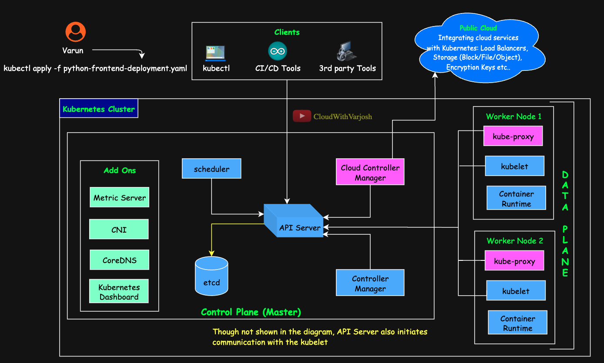

# 10 · What Happens After `kubectl apply`: The End-to-End Trace

> **Level:** ★★ intermediate
>
> **You will learn:** every step from typing `kubectl apply -f deploy.yaml` to containers running on a node, and how self-healing happens afterwards: kubectl → API server (authentication, authorisation, admission, validation) → etcd → Deployment controller → ReplicaSet controller → scheduler → kubelet → CRI runtime → CNI → containers → status flowing back. This is the most-asked "explain the internals" interview question.
>
> **You need:** topics 06–09.

---

## ⚡ Core: the 10-minute version

**The idea.** `kubectl apply -f deploy.yaml` only **records your wish**. Then a relay race starts:
1. The **API server** authenticates, authorises, runs admission checks, validates, and saves to **etcd**.
2. The **Deployment controller** creates a ReplicaSet; the **ReplicaSet controller** creates Pods.
3. The **scheduler** assigns each Pod a node.
4. That node's **kubelet** asks containerd to pull the image and start containers; **CNI** gives the Pod an IP.
5. Status flows back. Ready Pods are added to their Service's endpoints.

If a Pod dies later, the ReplicaSet controller notices it's short and starts another: that's self-healing.

**Picture it.** Ordering food in an app: the order is accepted at once, but the kitchen, courier and doorbell happen afterwards, each by a different worker.

**The one thing to know.** Watch the race happen:

```bash
kubectl get events --watch &
kubectl create deployment trace --image=nginx
# Scheduled → Pulling → Pulled → Created → Started
```

**Try it now:**
1. Run the commands above.
2. `kubectl get deploy,rs,pods -o wide` to see each link.
3. Delete the Pod and watch a replacement appear. Clean up with `kubectl delete deploy trace`.

**You've got it if you can:** tell the whole story in order, naming the component at each step. It's the most common Kubernetes interview question.

> 📖 **That's the core.** On a first pass, do the mini-lab and move on to the next topic. Everything below is the **full reference**: come back for the details, the edge cases, interview answers and exam-level depth.

---

## What it is

A **trace** of the journey your manifest takes through the cluster. Nothing in Kubernetes calls the next component directly. Each component **writes to the API server**, and the next component **notices through a watch**. Seeing this chain lets you tell *which link is broken* when something doesn't start.



---

## Why it exists

When a Pod doesn't appear, or stays `Pending`, or `ContainerCreating`, or `CrashLoopBackOff`, each state tells you **how far along the chain it got**:

| What you see | Chain got as far as |
|---|---|
| `kubectl apply` returns an error | API server rejected it (authn/authz/admission/validation) |
| Deployment exists, no ReplicaSet | Deployment controller (controller manager) |
| ReplicaSet exists, no Pods | ReplicaSet controller, or admission blocked Pod creation (quota, Pod Security) |
| Pod `Pending`, no node | Scheduler |
| Pod has a node, `ContainerCreating` | kubelet → CNI / volumes / image pull |
| `ErrImagePull` / `ImagePullBackOff` | Runtime pulling the image |
| `CrashLoopBackOff` | Your app started and exited |
| `Running` but `0/1 READY` | Readiness probe failing |

---

## Analogy

Ordering in a **restaurant with a ticket rail**:
1. You give your order to the **front desk** (API server): they check you're a customer, you're allowed to order, and the order makes sense, then pin a ticket on the **rail** (etcd).
2. The **head chef** (Deployment controller) sees "table 7 wants a 3-course menu" and writes a **prep ticket** (ReplicaSet).
3. The **line cook lead** (ReplicaSet controller) sees the prep ticket and writes **3 plate tickets** (Pods).
4. The **expediter** (scheduler) writes a **station number** on each plate ticket.
5. Each **station cook** (kubelet) watches for tickets with their station number, gets the ingredients (pulls images), sets up the plate (network, volumes) and cooks (starts containers), then marks the ticket "ready".
6. If a plate is dropped, the line cook lead sees only 2 plates and writes another ticket. Nobody had to tell them.

---

## How it works inside

### Step 1: You run `kubectl apply`

```bash
kubectl apply -f python-frontend-deployment.yaml
```

kubectl:
1. Reads your **kubeconfig** (`~/.kube/config`) to find the API server URL and your credentials (client certificate or token; topic 12).
2. Parses the YAML locally (syntax errors fail here).
3. Works out the change. With client-side apply it compares your file, the live object and the `last-applied-configuration` annotation to compute a patch. With `--server-side`, the API server does the merge and tracks **field ownership** (topic 15).
4. Sends an **HTTPS** request (`POST` to create, `PATCH` to update) to `/apis/apps/v1/namespaces/default/deployments`.

> ✅ **Correct today** ([C1](#c1)): kubectl only parses the YAML. **Schema validation is done by the API server.** Since v1.27, kubectl's `--validate` (default `strict`) asks the **server** to reject unknown or duplicate fields. kubectl also doesn't know your custom resources' schemas; only the API server does.

### Step 2: The API server processes the request

1. **Authentication**: who are you? (client cert CN, token…; topic 54)
2. **Authorisation**: may this user `create` `deployments` in `default`? (RBAC; topic 57)
3. **Mutating admission**: plugins and webhooks may **change** the object (set defaults, inject sidecars).
4. **Schema validation**: is it a valid `apps/v1` Deployment? Required fields present?
5. **Validating admission**: policy checks (ResourceQuota, Pod Security, Kyverno/Gatekeeper; topics 58, 60).
6. **Storage**: writes the Deployment (desired state: metadata, replicas, Pod template) to **etcd**.
7. **Response**: returns success, and kubectl prints `deployment.apps/python-frontend created`.
8. **Notifies watchers** that a new Deployment exists.

> ✅ **Correct today** ([C2](#c2)): **admission control** (mutating and validating) is a core step between authorisation and storage. It's where quotas, Pod Security, default ServiceAccounts and policy engines act. A request can pass RBAC and still be rejected by admission.

**Important:** at this point **only a record exists**. Nothing is running. `kubectl apply` returns before any Pod exists.

### Step 3: The Deployment controller creates a ReplicaSet

The **Deployment controller** (inside kube-controller-manager):
1. Is **watching** Deployments through the API server and sees the new one.
2. Compares **desired state** (a ReplicaSet matching this Pod template, with N replicas) with **actual state** (no ReplicaSet yet).
3. Asks the API server to **create a ReplicaSet** named `<deployment>-<pod-template-hash>` (e.g. `python-frontend-6d4b7c9f8`), with an **ownerReference** pointing to the Deployment. The API server stores it in etcd (after the same authn/authz/admission checks, as the controller's own identity).
4. **Updates the Deployment's status** to reflect reality:
   - `replicas`: Pods that exist,
   - `readyReplicas`: Pods whose containers are running **and passing readiness checks**,
   - `availableReplicas`: Pods that have been ready for at least `minReadySeconds` (default 0, so usually the same as ready),
   - `updatedReplicas`: Pods on the newest template.

> ✅ **Correct today** ([C3](#c3)): it's the other way round. **Available** is the *strictest* count: a Pod is available only when it is **ready** and has stayed ready for `minReadySeconds`. Pods that exist but aren't running yet count only towards `replicas`.

### Step 4: The ReplicaSet controller creates Pods

The **ReplicaSet controller**:
1. Watches ReplicaSets and Pods **through the API server** (never etcd directly).
2. Sees the new ReplicaSet wants 3 Pods, and 0 Pods match its selector.
3. Asks the API server to **create 3 Pod objects** (from the template, with ownerReferences to the ReplicaSet). The API server runs admission on each Pod (this is where Pod Security and ResourceQuota usually reject things) and stores them in etcd.

At this stage **only Pod objects exist** in etcd. They have **no `nodeName`** and no containers. `kubectl get pods` shows them as `Pending`.

### Step 5: The scheduler assigns nodes

The **scheduler**:
1. Watches for Pods with **no `nodeName`**.
2. For each Pod: **filters** nodes (enough requested CPU/memory free, taints/tolerations, node affinity, ports, volume zones), then **scores** the rest (topic 07).
3. Posts a **Binding** for the chosen node. The API server sets `spec.nodeName` on the Pod and stores it in etcd.

(Day 07 describes the scheduler "updating the Pod object" and the API server "updating the Pod in etcd with the nodeName". Both are describing this same binding step.)

If no node fits, the Pod stays `Pending` with a `FailedScheduling` event.

### Step 6: The kubelet on that node starts the Pod

The **kubelet** on the chosen node:
1. Is **watching** the API server for Pods with `nodeName = <me>` and receives the Pod.
2. Reads the full spec: containers, images, volumes, resources, probes, security settings.
3. Through the **CRI**, asks the runtime (containerd/CRI-O) to:
   - **create the Pod sandbox**: the pause container and network namespace. The **runtime calls the CNI plugin**, which creates the veth pair and assigns the Pod IP (topic 29);
   - **pull images** from the registry (unless already present, per `imagePullPolicy`, topic 20);
   - create and start **init containers** one by one, then the **app containers**.
4. Meanwhile the kubelet itself **mounts volumes** (Secrets, ConfigMaps, emptyDir, PVs via CSI) and creates the **cgroups** for the Pod's requests and limits.
5. Starts running **probes** (topic 22).

> ✅ **Correct today** ([C4](#c4)): the kubelet asks the **runtime** to create the sandbox, and the **runtime** invokes the CNI plugin. (Volumes, on the other hand, are mounted by the kubelet, using CSI drivers for persistent ones.)

### Step 7: Status flows back, and the loop keeps running

1. The kubelet writes **`Pod.status`** to the API server: Pod IP, phase `Running`, each container's state, conditions (`PodScheduled`, `Initialized`, `ContainersReady`, `Ready`). It keeps updating it as probes pass or fail.
2. The **EndpointSlice controller** sees the Pod is **Ready** and adds its IP to any matching Service's EndpointSlices, so traffic can reach it (topic 32).
3. The ReplicaSet and Deployment controllers update their statuses: `readyReplicas: 3`.

**Who does what after the Pod is running (Day 07, step 7):**
- **Deployment controller**: manages ReplicaSets (rollouts, scaling). It does **not** recreate individual Pods.
- **ReplicaSet controller**: watches Pods through the API server. If a Pod fails, is deleted or its node dies, it sees the count is short and **creates a replacement Pod**, which goes through steps 5–7 again.
- **kubelet**: watches container health on its node, restarts containers in place (per `restartPolicy`), and reports status to the API server, which stores it in etcd.

### The whole chain in one picture

```
kubectl ─POST─▶ API server: authn → authz → mutate → validate → admit → etcd ✓ "created"
                     │ watch event
                     ▼
         Deployment controller ─create─▶ ReplicaSet          (stored in etcd)
                     │ watch event
                     ▼
         ReplicaSet controller ─create─▶ Pod ×3 (no nodeName) (stored in etcd)
                     │ watch event
                     ▼
         Scheduler: filter → score ─bind─▶ Pod.spec.nodeName = node-2
                     │ watch event
                     ▼
         kubelet@node-2 ─CRI─▶ containerd: sandbox (+CNI → IP) → pull → init → containers
                     │
                     ▼
         kubelet ─status─▶ API server: Running, IP, Ready=True
                     │ watch event
                     ▼
         EndpointSlice controller adds the IP to the Service → traffic flows
```

---

## Commands / YAML

The manifest:

```yaml
apiVersion: apps/v1
kind: Deployment
metadata:
  name: python-frontend
spec:
  replicas: 3
  selector:
    matchLabels: { app: python-frontend }
  template:
    metadata:
      labels: { app: python-frontend }
    spec:
      containers:
      - name: web
        image: nginx:1.29
        resources:
          requests: { cpu: 50m, memory: 64Mi }
```

Watch the chain happen. In terminal 1:

```bash
kubectl get events -w --field-selector involvedObject.kind!=Node
```

In terminal 2:

```bash
kubectl apply -f deploy.yaml
```

Terminal 1 (trimmed):

```
0s  Normal  ScalingReplicaSet  deployment/python-frontend             Scaled up replica set python-frontend-6d4b7c9f8 from 0 to 3
0s  Normal  SuccessfulCreate   replicaset/python-frontend-6d4b7c9f8   Created pod: python-frontend-6d4b7c9f8-k2xjp
0s  Normal  Scheduled          pod/python-frontend-6d4b7c9f8-k2xjp    Successfully assigned default/python-frontend-6d4b7c9f8-k2xjp to lab-worker2
0s  Normal  Pulling            pod/python-frontend-6d4b7c9f8-k2xjp    Pulling image "nginx:1.29"
3s  Normal  Pulled             pod/python-frontend-6d4b7c9f8-k2xjp    Successfully pulled image "nginx:1.29" in 2.9s
3s  Normal  Created            pod/python-frontend-6d4b7c9f8-k2xjp    Created container: web
3s  Normal  Started            pod/python-frontend-6d4b7c9f8-k2xjp    Started container web
```

Each line is one link in the chain:

| Event reason | Emitted by | Step |
|---|---|---|
| `ScalingReplicaSet` | Deployment controller | 3 |
| `SuccessfulCreate` | ReplicaSet controller | 4 |
| `Scheduled` | Scheduler | 5 |
| `Pulling` / `Pulled` / `Created` / `Started` | kubelet | 6 |

See the ownership chain:

```bash
kubectl get pod python-frontend-6d4b7c9f8-k2xjp -o jsonpath='{.metadata.ownerReferences[0].kind}/{.metadata.ownerReferences[0].name}{"\n"}'
```

```
ReplicaSet/python-frontend-6d4b7c9f8
```

Watch the API calls kubectl makes:

```bash
kubectl apply -f deploy.yaml -v=6 2>&1 | grep -E 'GET|PATCH|POST'
```

```
I1117 10:02:11.123456  GET https://127.0.0.1:41365/apis/apps/v1/namespaces/default/deployments/python-frontend 200 OK in 8 milliseconds
I1117 10:02:11.141234  PATCH https://127.0.0.1:41365/apis/apps/v1/namespaces/default/deployments/python-frontend?fieldManager=kubectl-client-side-apply&fieldValidation=Strict 200 OK in 12 milliseconds
```

- `-v=6` = verbose level that prints each HTTP request. `-v=8` also prints bodies.
- `fieldValidation=Strict` = the server-side validation mentioned in Step 1.

---

## Hands-on lab

On your kind cluster:

1. Run the event watch and `kubectl apply` above. Map every event to a step.
2. **Self-healing:** `kubectl delete pod -l app=python-frontend --wait=false` (deletes all 3). Watch `kubectl get pods -w`: new Pods with new names appear at once (ReplicaSet controller).
3. **Break the scheduler link:** scale to 50 replicas with a huge request, `kubectl set resources deploy python-frontend --requests=cpu=2`. Some Pods stay `Pending`; `kubectl describe pod <pending>` shows `FailedScheduling … Insufficient cpu`.
4. **Break the kubelet/runtime link:** `kubectl set image deploy/python-frontend web=nginx:does-not-exist`. The new Pods show `ErrImagePull` → `ImagePullBackOff` (step 6), while the old ones keep running (topic 25 explains why).
5. **Break the API link:** add an unknown field (`spec.replicaz: 3`) and apply: `Error from server (BadRequest): … unknown field "spec.replicaz"`.
6. Clean up: `kubectl delete deploy python-frontend`.

---

## Where you'll use it

- **Every troubleshooting session**: find the last successful step, then debug the next one.
- **Interviews**: "What happens when you run `kubectl apply`/create a Deployment?" Walk the chain with authn/authz/admission, etcd, controllers, scheduler, kubelet, CRI, CNI.
- **Designing policy**: knowing that Pods are created by the ReplicaSet controller explains why quota or Pod Security errors appear on the **ReplicaSet's** events, not in your `kubectl apply` output.

---

## When it breaks

| Symptom | Broken link | Debug |
|---|---|---|
| `Error from server (Forbidden)` on apply | Authorisation (RBAC) | `kubectl auth can-i create deploy` (topic 57) |
| `admission webhook … denied the request` | Admission policy | Read the message; check policies (topic 58) |
| Deployment `READY 0/3`, **no Pods at all** | Pods rejected at creation (quota, Pod Security) | `kubectl describe rs <name>` → `FailedCreate` events |
| Pods `Pending` | Scheduler: no node fits | `kubectl describe pod` → `FailedScheduling` (topic 42) |
| `ContainerCreating` for minutes | CNI, volume mount or Secret missing | `kubectl describe pod` events (topic 21) |
| `ErrImagePull`/`ImagePullBackOff` | Runtime can't pull | Image name, tag, registry auth (topics 20, 62) |
| `CrashLoopBackOff` | App exits | `kubectl logs --previous` (topic 21) |
| `Running` but not `READY` | Readiness probe | `kubectl describe pod` (topic 22) |

---

## Quick recap

- `kubectl apply` only **records desired state**; it returns before anything runs.
- API server: authn → authz → **admission** → validation → etcd → notify watchers.
- Deployment controller → ReplicaSet; ReplicaSet controller → Pods; scheduler → `nodeName`; kubelet → CRI → runtime (→ CNI) → containers.
- Status flows back the same way; Ready Pods are added to Service EndpointSlices.
- Self-healing = the ReplicaSet controller noticing fewer Pods than desired.

### Interview questions

1. **Q: Walk me through what happens when you create a Deployment.**
   A: kubectl sends it to the API server, which authenticates, authorises, runs admission and validation, and stores it in etcd. The Deployment controller creates a ReplicaSet; the ReplicaSet controller creates Pods; the scheduler binds each Pod to a node; that node's kubelet asks the runtime via CRI to create the sandbox (CNI gives an IP), pull images and start containers; the kubelet reports status back; the EndpointSlice controller adds ready Pods to Services.
2. **Q: A Deployment shows 0/3 ready and there are no Pods. Where do you look?**
   A: `kubectl describe rs` for `FailedCreate` events: Pod creation was probably rejected by admission (ResourceQuota, LimitRange, Pod Security, a webhook) or a ServiceAccount is missing.
3. **Q: Does the scheduler start containers?**
   A: No. It only sets `nodeName` through a Binding. The kubelet on that node starts the containers.

---

## Appendix: notes on the original course material

This topic was rebuilt from the original CKA course notes. This appendix keeps the audit trail out of your way while you learn.

### Sources

Day 07 (Kubernetes Deployment workflow, steps 1–7), Day 15 (prerequisite: revisiting the deployment workflow).

### Corrections to the original notes

Each entry shows what the original said and what's true now. In the topic above, each correction appears as a ✅ **Correct today** line or a ⚠️ **Fix to the original** box, linked to its entry here.

<a id="c1"></a>**C1 · Corrected (Day 07).** the original said kubectl "validates the YAML for syntax **and basic Kubernetes schema correctness** … then sends the **validated** Deployment object". **Now:** kubectl only parses the YAML. **Schema validation is done by the API server.** Since v1.27, kubectl's `--validate` (default `strict`) asks the **server** to reject unknown or duplicate fields. kubectl also doesn't know your custom resources' schemas; only the API server does.

<a id="c2"></a>**C2 · Corrected (Day 07).** the original listed only authentication/authorisation, validation and storage. **Now:** **admission control** (mutating and validating) is a core step between authorisation and storage. It's where quotas, Pod Security, default ServiceAccounts and policy engines act. A request can pass RBAC and still be rejected by admission.

<a id="c3"></a>**C3 · Corrected (Day 07).** the original defined **available Pods** as "Pods that have been created **but might not be running yet**". **Now:** it's the other way round. **Available** is the *strictest* count: a Pod is available only when it is **ready** and has stayed ready for `minReadySeconds`. Pods that exist but aren't running yet count only towards `replicas`.

<a id="c4"></a>**C4 · Corrected (Day 07).** the original listed "configure networking using the CNI plugin" as a kubelet action. **Now:** the kubelet asks the **runtime** to create the sandbox, and the **runtime** invokes the CNI plugin. (Volumes, on the other hand, are mounted by the kubelet, using CSI drivers for persistent ones.)
