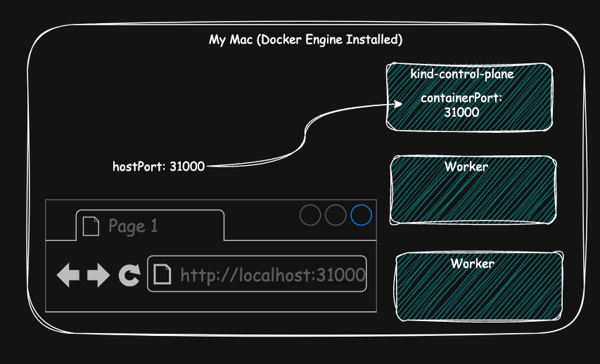

# 11 · Building Your Lab: kind (and minikube)

> **Level:** ★ foundation
>
> **You will learn:** how to install `kubectl` and **kind** (Kubernetes IN Docker) on your WSL2 Docker setup; create single- and multi-node clusters from the CLI and from a config file; pin the Kubernetes version with node images; expose NodePorts to your laptop with `extraPortMappings`; what a kind "node" really is; how minikube compares; and how to reset everything. Every lab in these notes uses the cluster you build here.
>
> **You need:** topics 02 and 06; Docker Engine in WSL2 (your Docker notes, topic [04](../../Docker/notes/04-installing-docker.md)).

---

## ⚡ Core: the 10-minute version

**The idea.** **kind** (Kubernetes IN Docker) builds a real Kubernetes cluster on your laptop, where each "node" is a Docker container running containerd and the kubelet. It's fast to create, cheap to throw away, and perfect for every lab in these notes. A **config file** describes the cluster (how many nodes, which Kubernetes version, which ports to expose), so you can recreate it identically any time.

**Picture it.** kind is a model railway: real trains and tracks, just small enough to fit on a table.

**The one thing to know.**

```yaml
# kind.yaml
kind: Cluster
apiVersion: kind.x-k8s.io/v1alpha4
nodes:
- role: control-plane
  extraPortMappings:
  - { containerPort: 30080, hostPort: 30080 }   # reach NodePort 30080 at localhost:30080
- role: worker
- role: worker
```

**Try it now:**
1. `kind create cluster --name lab --config kind.yaml`
2. `kubectl get nodes`, then `docker ps`: the nodes are containers.
3. `kind delete cluster --name lab` when you want a fresh start.

**You've got it if you can:** create a multi-node cluster from a file, explain what a kind node really is, and expose a NodePort to your machine.

> 📖 **That's the core.** On a first pass, do the mini-lab and move on to the next topic. Everything below is the **full reference**: come back for the details, the edge cases, interview answers and exam-level depth.

---

## What it is

- **kind** (**K**ubernetes **IN** **D**ocker) creates a real Kubernetes cluster where **each node is a Docker container**. Inside each node container run systemd, containerd, the kubelet and, on the control-plane node, the control-plane static Pods. It's the tool the Kubernetes project itself uses to test Kubernetes.
- **minikube** creates a local cluster in a VM or a container. It's friendlier for single-node use and has many add-ons.
- **kubectl** is the command-line client for any cluster (topic 12).

kind is ideal for learning **CKA-style administration**: multi-node clusters, static Pods, kubelet, etcd, certificates are all real.

---

## Why it exists

You need a cluster you can **break and rebuild in a minute** without paying for cloud VMs. kind gives you:
- multi-node clusters on one laptop,
- an exact Kubernetes version (to match the CKA exam or production),
- disposable clusters for each experiment,
- clusters defined in a **config file**, so they're reproducible.

---

## Analogy

kind is a **flight simulator**. The cockpit (Kubernetes) is real: real instruments, real procedures. But the "plane" (each node) is a container on your laptop, so crashing it costs nothing and you can reset in seconds.

---

## How it works inside

```
WSL2 Ubuntu
└── Docker Engine
    ├── container "lab-control-plane"  (image kindest/node:v1.37.0)
    │     systemd → containerd → kubelet → static Pods: etcd, kube-apiserver, scheduler, controller-manager
    ├── container "lab-worker"          systemd → containerd → kubelet → your Pods
    └── container "lab-worker2"         systemd → containerd → kubelet → your Pods
    (all on a Docker network named "kind")
```

When you run `kind create cluster`:
1. kind pulls the **node image** `kindest/node:<version>` (it already contains the Kubernetes binaries and images).
2. Starts one Docker container per node on a Docker bridge network called `kind`.
3. Runs **kubeadm init** inside the control-plane container and **kubeadm join** in workers (the same tool you'll use on real VMs in topic 75).
4. Installs **kindnet** (CNI) and a simple storage provisioner (`local-path`).
5. Publishes the API server on a random port of `127.0.0.1` on your machine and **writes a kubeconfig entry** to `~/.kube/config`, then switches your current context to it.

Because nodes are containers, `docker exec -it lab-worker bash` puts you "on the node", where `crictl`, `systemctl`, `journalctl` and `/etc/kubernetes` all work like on a real server.

**Ports:** a NodePort Service (topic 31) opens a port on every node. But kind nodes are containers on a Docker network, so your laptop can't reach that port unless you **map** it from your host into the node container at creation time with **`extraPortMappings`** (like `docker run -p`).

---

## Commands / YAML

### Install (WSL2 Ubuntu)

Official guides: [kubectl installation](https://kubernetes.io/docs/tasks/tools/) and [kind quick start](https://kind.sigs.k8s.io/docs/user/quick-start/).

```bash
# kubectl (match your cluster's minor version, ±1)
curl -LO "https://dl.k8s.io/release/v1.37.0/bin/linux/amd64/kubectl"
sudo install -m 0755 kubectl /usr/local/bin/kubectl
kubectl version --client

# kind
curl -Lo ./kind https://kind.sigs.k8s.io/dl/latest/kind-linux-amd64   # or a pinned release
sudo install -m 0755 kind /usr/local/bin/kind
kind version
```

```
Client Version: v1.37.0
Kustomize Version: v5.7.1
kind v0.31.0 go1.25.4 linux/amd64
```

(Versions are illustrative. Check the kind release notes for which node images a kind version supports.)

### Scenario 1: a cluster from a config file (Day 08, `my-first-cluster`)

`Day 08/kind-cluster.yaml`:

```yaml
kind: Cluster
apiVersion: kind.x-k8s.io/v1alpha4

# Specify the Kubernetes version by using a specific node image.
# See https://hub.docker.com/r/kindest/node/tags and https://github.com/kubernetes-sigs/kind/releases
nodes:
  - role: control-plane
    image: kindest/node:v1.37.0@sha256:a1ed56cfb0e7b93589bdf97c8cd566405a265939e3620fc4f5de89adff580ae5
  - role: worker
    image: kindest/node:v1.37.0@sha256:a1ed56cfb0e7b93589bdf97c8cd566405a265939e3620fc4f5de89adff580ae5
  - role: worker
    image: kindest/node:v1.37.0@sha256:a1ed56cfb0e7b93589bdf97c8cd566405a265939e3620fc4f5de89adff580ae5
```

- `kind: Cluster`, `apiVersion: kind.x-k8s.io/v1alpha4` = this is **kind's** config format (not a Kubernetes object, but it uses the same style).
- `nodes` = one entry per node; `role` = `control-plane` or `worker`.
- `image` = the node image, which fixes the **Kubernetes version** (v1.37.0). The `@sha256:` **digest** pins the exact image bytes so it can't change under you. Use the digest listed in the kind release notes for your kind version.

```bash
kind create cluster --name my-first-cluster --config kind-cluster.yaml
```

```
Creating cluster "my-first-cluster" ...
 ✓ Ensuring node image (kindest/node:v1.37.0) 🖼
 ✓ Preparing nodes 📦 📦 📦
 ✓ Writing configuration 📜
 ✓ Starting control-plane 🕹️
 ✓ Installing CNI 🔌
 ✓ Installing StorageClass 💾
 ✓ Joining worker nodes 🚜
Set kubectl context to "kind-my-first-cluster"
You can now use your cluster with:

kubectl cluster-info --context kind-my-first-cluster
```

Each line is a step from "How it works inside". Note the context name: `kind-` + cluster name.

**Why config files are preferred:**
- **Version control**: track and roll back changes in Git.
- **Declarative**: consistent, reproducible, easy to manage across environments.
- **Shareable**: the whole team uses the same setup.
- **Single source of truth**: fewer differences and mistakes from manual setup.

This isn't just about kind. **Terraform, Ansible, Helm and Kubernetes** all work from manifest or config files. YAML is the most common format for its readability; many tools also accept **JSON**.

### Scenario 2: a cluster from the CLI only (Day 08, `my-second-cluster`)

```bash
kind create cluster --name my-second-cluster
```

- Creates a **single-node** cluster (one control-plane node that also runs your Pods).
- Uses the **default node image** for your kind version (the latest Kubernetes it supports). Override it with `--image kindest/node:v1.36.x`.
- Quicker, but you lose the versioning, reproducibility and maintainability of a config file.

### Naming in kind

kind gives the **cluster, the user and the context** in your kubeconfig the **same name** (`kind-my-first-cluster`). That can be confusing. In production these are usually **different** (e.g. cluster `prod-eu1`, user `tushar@corp`, context `prod-eu1-admin`). You'll see distinct names with kubeadm in topic 75, and topic 12 explains clusters, users and contexts.

### Check, delete, recreate

```bash
kind get clusters                              # list kind clusters
kind delete cluster --name my-first-cluster    # remove one (deletes its node containers and kubeconfig entry)
```

```
my-first-cluster
my-second-cluster
Deleting cluster "my-first-cluster" ...
Deleted nodes: ["my-first-cluster-control-plane" "my-first-cluster-worker" "my-first-cluster-worker2"]
```

### A cluster with NodePort access (Day 12, `Day 12/kind-cluster.yaml`)



```yaml
kind: Cluster
apiVersion: kind.x-k8s.io/v1alpha4
nodes:
  - role: control-plane
    image: kindest/node:v1.37.0@sha256:a1ed56cfb0e7b93589bdf97c8cd566405a265939e3620fc4f5de89adff580ae5
    extraPortMappings:
      - containerPort: 31000   # port inside the kind node container
        hostPort: 31000        # port on your machine; if this were 9090 you'd browse localhost:9090
  - role: worker
    image: kindest/node:v1.37.0@sha256:a1ed56cfb0e7b93589bdf97c8cd566405a265939e3620fc4f5de89adff580ae5
  - role: worker
    image: kindest/node:v1.37.0@sha256:a1ed56cfb0e7b93589bdf97c8cd566405a265939e3620fc4f5de89adff580ae5
```

```bash
kind create cluster --name my-second-cluster --config kind-cluster.yaml
```

- **`containerPort`** = the port inside the kind node container that receives the traffic.
- **`hostPort`** = the port on your machine mapped to it.
- With this, a **NodePort Service using `nodePort: 31000`** (topic 31) is reachable from your machine at `http://127.0.0.1:31000`. Traffic goes host:31000 → control-plane container:31000 → kube-proxy's NodePort rule → a Pod (even one on a worker node).

> ✅ **Correct today** ([C1](#c1)): only the ports you list in `extraPortMappings` are mapped. With this config, **only 31000** is reachable from the host, so your Service must use `nodePort: 31000` (or you add a mapping for 30950). To expose a range, list several mappings. For other ports, use `kubectl port-forward` (topic 21).

### My recommended lab config (used from here on)

`lab.yaml`:

```yaml
kind: Cluster
apiVersion: kind.x-k8s.io/v1alpha4
name: lab
nodes:
  - role: control-plane
    image: kindest/node:v1.37.0      # add the @sha256 digest from the kind release notes
    extraPortMappings:
      - { containerPort: 31000, hostPort: 31000 }
      - { containerPort: 31001, hostPort: 31001 }
      - { containerPort: 80,    hostPort: 8080 }   # for Ingress/Gateway labs
  - role: worker
    image: kindest/node:v1.37.0
  - role: worker
    image: kindest/node:v1.37.0
```

```bash
kind create cluster --config lab.yaml
kubectl get nodes
```

```
NAME                STATUS   ROLES           AGE   VERSION
lab-control-plane   Ready    control-plane   60s   v1.37.0
lab-worker          Ready    <none>          40s   v1.37.0
lab-worker2         Ready    <none>          40s   v1.37.0
```

### Behind the scenes: nodes are containers

```bash
docker ps --format 'table {{.Names}}\t{{.Image}}\t{{.Ports}}'
```

```
NAMES               IMAGE                  PORTS
lab-control-plane   kindest/node:v1.37.0   0.0.0.0:31000-31001->31000-31001/tcp, 0.0.0.0:8080->80/tcp, 127.0.0.1:41365->6443/tcp
lab-worker          kindest/node:v1.37.0
lab-worker2         kindest/node:v1.37.0
```

- `127.0.0.1:41365->6443` = the API server (port 6443 in the container) published on a random local port. That URL is in your kubeconfig.
- Your `extraPortMappings` appear as normal Docker port mappings.

### minikube (alternative)

```bash
minikube start --kubernetes-version=v1.37.0 --nodes=3 --driver=docker
minikube service <svc-name> --url      # get a reachable URL for a NodePort Service
minikube addons enable ingress         # one-command add-ons
minikube ssh                           # shell into the node
minikube delete
```

| | kind | minikube |
|---|---|---|
| Nodes | Docker containers | VM or container |
| Multi-node | Easy, config file | Supported (`--nodes`) |
| Built for | Testing Kubernetes itself, CI, CKA practice | Developer convenience |
| Add-ons | Install yourself | `minikube addons` |
| Reaching Services | `extraPortMappings` or port-forward | `minikube service`, `minikube tunnel` |
| LoadBalancer Services | Needs cloud-provider-kind/MetalLB | `minikube tunnel` |

---

## Hands-on lab

1. Install kubectl and kind; create the `lab` cluster above.
2. `kubectl cluster-info` → note the API server URL (`https://127.0.0.1:<port>`).
3. `docker exec -it lab-control-plane bash`, then:
   - `ls /etc/kubernetes/manifests` (the control plane's static Pod files),
   - `crictl ps` (the control plane's containers),
   - `exit`.
4. Create a second, single-node cluster: `kind create cluster --name scratch`. Run `kubectl config get-contexts` and see two contexts, with `*` marking the current one (topic 12).
5. Delete it: `kind delete cluster --name scratch`.
6. Optional: create `Day 12/kind-cluster.yaml`'s cluster and keep it for topic 31's NodePort lab.

---

## Where you'll use it

- **Every lab** in these notes.
- **CI pipelines**: spin up kind in GitHub Actions to test Helm charts and operators against a real API server.
- **Version testing**: run the next Kubernetes version locally before upgrading production.
- **CKA practice**: kubeadm-based nodes, static Pods and certificates behave like the exam's clusters.

---

## When it breaks

| Symptom | Cause | Fix |
|---|---|---|
| `failed to create cluster: … Cannot connect to the Docker daemon` | Docker isn't running in WSL2 | `sudo systemctl start docker` (or start Docker Desktop) |
| Stuck at "Starting control-plane", kubelet errors about cgroups | Old WSL kernel or cgroup v1 | Update WSL (`wsl --update`); ensure cgroup v2 |
| `too many open files` / Pods failing on bigger clusters | inotify limits | `sudo sysctl fs.inotify.max_user_watches=524288 fs.inotify.max_user_instances=512` |
| `curl 127.0.0.1:<nodePort>` refused | Port not in `extraPortMappings` | Recreate with the mapping, or use `kubectl port-forward` |
| `kubectl` talks to the wrong cluster | Current context points elsewhere | `kubectl config use-context kind-lab` (topic 12) |
| Node image pull is very slow | ~1 GB image | Pull once; reuse the same version |

---

## Quick recap

- kind = Kubernetes in Docker: each node is a container running systemd, containerd and the kubelet, bootstrapped with kubeadm.
- Define clusters in a **config file** (versioned, reproducible); pin the node image (+ digest) to fix the Kubernetes version.
- `extraPortMappings` maps host ports into the node container, so NodePorts **listed there** are reachable from your machine.
- kind writes a kubeconfig context named `kind-<cluster>`; cluster, user and context share that name.

### Interview questions

1. **Q: How does kind run a multi-node cluster on one machine?**
   A: Each node is a privileged Docker container running systemd, containerd and the kubelet; kind bootstraps them with kubeadm and installs a simple CNI.
2. **Q: Why define clusters (or anything) in config files instead of CLI flags?**
   A: Version control, reproducibility, review and sharing: one declarative source of truth.
3. **Q: How do you reach a NodePort Service on kind from your laptop?**
   A: Map that node port to a host port with `extraPortMappings` when creating the cluster, or use `kubectl port-forward`.

---

## Appendix: notes on the original course material

This topic was rebuilt from the original CKA course notes. This appendix keeps the audit trail out of your way while you learn.

### Sources

Day 08 (installation links, first and second cluster scenarios, config-file benefits, naming note), Day 12 (check/delete/create kind cluster, `extraPortMappings`), files `Day 08/kind-cluster.yaml`, `Day 12/kind-cluster.yaml`.

### Corrections to the original notes

Each entry shows what the original said and what's true now. In the topic above, each correction appears as a ✅ **Correct today** line or a ⚠️ **Fix to the original** box, linked to its entry here.

<a id="c1"></a>**C1 · Corrected (Day 12).** the original example said a NodePort Service "running inside the cluster on port **30950**" would be reachable at `http://127.0.0.1:30950`. **Now:** only the ports you list in `extraPortMappings` are mapped. With this config, **only 31000** is reachable from the host, so your Service must use `nodePort: 31000` (or you add a mapping for 30950). To expose a range, list several mappings. For other ports, use `kubectl port-forward` (topic 21).
