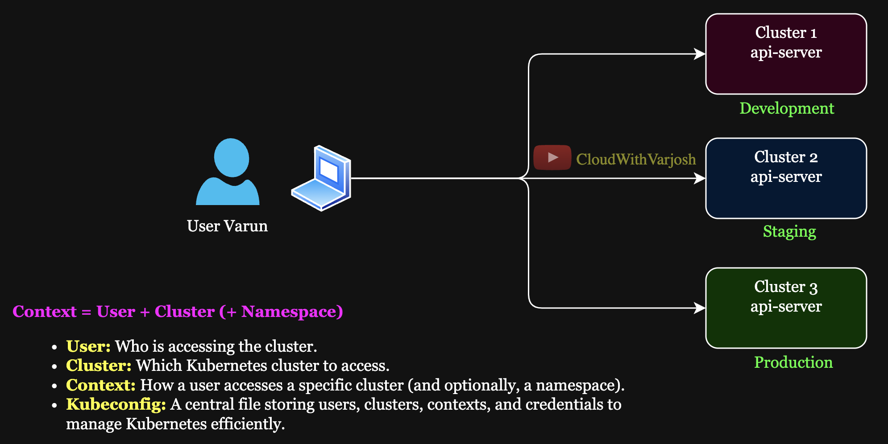

# 12 · kubectl, kubeconfig and Contexts (the Basics)

> **Level:** ★ foundation
>
> **You will learn:** what `kubectl` is and how its commands are shaped; what a **kubeconfig** file is (clusters, users, contexts); how to switch between dev, staging and prod clusters safely; how to set a default namespace; and the handful of `kubectl config` commands you'll use daily. The certificate details inside a kubeconfig come later (topic 52), after you've learned TLS.
>
> **You need:** topic 11 (a running kind cluster).

---

## ⚡ Core: the 10-minute version

**The idea.** `kubectl` is the command-line client for the Kubernetes API. It finds clusters through a **kubeconfig** file (`~/.kube/config`), which has three lists:
- **clusters**: the API address and CA certificate;
- **users**: your credentials;
- **contexts**: a cluster + user + default namespace.

The **current context** decides which cluster every command hits. That's why checking it before typing a dangerous command is a lifelong habit.

**Picture it.** A kubeconfig is a keyring; each context is one labelled key ("prod-admin"). `use-context` is choosing which key is in your hand.

**The one thing to know.**

```bash
kubectl config get-contexts                     # all contexts, * = current
kubectl config use-context kind-lab             # switch
kubectl config set-context --current --namespace=dev   # default namespace for this context
kubectl get pods -n kube-system --context kind-lab     # one-off overrides
```

**Try it now:**
1. Run the commands above.
2. Create a second kind cluster and switch between the two.
3. Run `kubectl config view --minify` to see what the current context contains.

**You've got it if you can:** explain clusters/users/contexts, and switch cluster and namespace safely.

> 📖 **That's the core.** On a first pass, do the mini-lab and move on to the next topic. Everything below is the **full reference**: come back for the details, the edge cases, interview answers and exam-level depth.

---

## What it is

- **`kubectl`** ("kube-control" or "kube-cuttle") is the command-line client for the Kubernetes API. Every `kubectl` command becomes one or more HTTPS requests to the API server (topic 10).
- A **kubeconfig** file tells kubectl **where** the cluster is and **who** you are. The default location is `~/.kube/config`.
- A kubeconfig has three lists and one pointer:
  - **clusters**: name + API server URL + the CA certificate to trust it.
  - **users**: name + credentials (client certificate and key, a token, or an exec plugin that fetches a token).
  - **contexts**: name + (one cluster, one user, optionally a default **namespace**).
  - **current-context**: which context kubectl uses right now.

A **context** is just a **saved combination**: "talk to *this* cluster, as *this* user, in *this* namespace".

A **namespace** (full topic: 26) is a **virtual cluster inside a physical cluster**: a logical folder that separates resources so several apps or environments (dev, staging, prod) can share one cluster without name clashes. Each app can run in its own namespace. You need just this one-line idea for now.

---

## Why it exists

Real engineers work with **many clusters**: dev, staging, prod, maybe in several regions. Without contexts you'd have to pass the server URL, certificate and namespace on every command, and you'd eventually run a command against **production by accident**. Contexts make "which cluster am I on?" explicit and switchable in one command.

---

## Analogy

A kubeconfig is your **phone's contact list plus SIM cards**:
- **clusters** = the **phone numbers** of the offices you can call (with a way to verify it's really them: the CA).
- **users** = your **SIM cards**: each proves who you are to a particular office.
- **contexts** = **speed-dial buttons**: "button 1 = call the dev office using my work SIM, and ask for the dev department".
- **current-context** = the **button you pressed last**. Every call goes there until you press another.

---

## How it works inside

### The scenario



Varun wants to reach three clusters from his laptop:
1. **Cluster 1**: development
2. **Cluster 2**: staging
3. **Cluster 3**: production

He creates one context per cluster in his kubeconfig:
- **Cluster details**: API server URL, the certificate authority to trust.
- **User details**: how he authenticates: a client certificate, a token, or an external login plugin.
- **Namespace** (optional): the default namespace for that context. It can still be overridden per command.

> ✅ **Correct today** ([C1](#c1)): username/password (**basic auth**) was **removed from Kubernetes in v1.19**. Users authenticate with client certificates, bearer tokens, or OIDC / exec plugins such as `aws eks get-token` (topic 54).

Then he switches with `kubectl config use-context dev-context`, `staging-context` or `prod-context`.

### How kubectl decides where to send a request

1. **Which kubeconfig?** The `--kubeconfig` flag; else the **`KUBECONFIG`** environment variable (it can list several files, merged together); else `~/.kube/config`.
2. **Which context?** The `--context` flag; else `current-context`.
3. From the context: take the **cluster** (URL, CA) and **user** (credentials) and the **namespace** (else `default`; the `-n`/`--namespace` flag overrides it).
4. Open a TLS connection to the URL, verify the server with the CA, present the user's credentials, send the request.

### kubectl command shape

```
kubectl  <verb>   <resource-type>  [name]  [flags]
kubectl  get      pods             web-1   -n shop -o wide
```

- **Verbs:** `get`, `describe`, `create`, `apply`, `edit`, `delete`, `logs`, `exec`, `explain`, `scale`, `rollout`…
- **Resource types** have short names: `po` (pods), `deploy`, `svc`, `ns`, `no` (nodes), `cm` (configmaps). List them with `kubectl api-resources` (topic 14).
- **Global flags:** `-n <ns>` (namespace), `-A` (all namespaces), `-o yaml|json|wide|name` (output, topic 16), `--context`, `-l key=value` (label selector, topic 17).

---

## Commands / YAML

### An example kubeconfig

```yaml
apiVersion: v1
kind: Config
clusters:
- name: cluster-1
  cluster:
    server: https://cluster-1-api-server
    certificate-authority-data: <certificate-data>
- name: cluster-2
  cluster:
    server: https://cluster-2-api-server
    certificate-authority-data: <certificate-data>
- name: cluster-3
  cluster:
    server: https://cluster-3-api-server
    certificate-authority-data: <certificate-data>
users:
- name: varun-user
  user:
    client-certificate-data: <client-cert-data>
    client-key-data: <client-key-data>
contexts:
- name: dev-context
  context:
    cluster: cluster-1
    user: varun-user
    namespace: dev
- name: staging-context
  context:
    cluster: cluster-2
    user: varun-user
    namespace: staging
- name: prod-context
  context:
    cluster: cluster-3
    user: varun-user
    namespace: prod
current-context: dev-context
```

- `server` = the API server URL.
- `certificate-authority-data` = base64 of the CA certificate used to **verify the API server** (so you don't talk to an impostor).
- `client-certificate-data` / `client-key-data` = base64 of **your** certificate and private key: your identity (topics 51–54). **Anyone with this file is you.** Protect it like a password.
- Here one user is reused for three clusters. In reality each cluster usually has its own CA, so you'd have one user entry per cluster.
- `current-context: dev-context` = commands go to cluster-1, namespace `dev`, until you switch.

### Daily `kubectl config` commands

```bash
kubectl config current-context                 # which context am I using?
kubectl config get-contexts                    # list all contexts
```

```
CURRENT   NAME              CLUSTER     AUTHINFO     NAMESPACE
*         dev-context       cluster-1   varun-user   dev
          prod-context      cluster-3   varun-user   prod
          staging-context   cluster-2   varun-user   staging
```

- `*` = the current context. `AUTHINFO` = the user entry. `NAMESPACE` = that context's default namespace.

```bash
kubectl config use-context dev-context         # switch to Cluster 1
kubectl config use-context staging-context     # switch to Cluster 2
kubectl config use-context prod-context        # switch to Cluster 3
```

```
Switched to context "prod-context".
```

Override the namespace for one command:

```bash
kubectl get pods --namespace=dev               # or: -n dev
```

Set a default namespace for the current context:

```bash
kubectl config set-context --current --namespace=app1-ns
```

```
Context "kind-lab" modified.
```

- `--current` = change the context you're using now. From now on `kubectl get pods` means `-n app1-ns`.

Run one command against another context without switching:

```bash
kubectl --context prod-context get nodes
```

See the merged config (secrets hidden):

```bash
kubectl config view --minify          # only the current context's cluster/user
```

```yaml
apiVersion: v1
clusters:
- cluster:
    certificate-authority-data: DATA+OMITTED
    server: https://127.0.0.1:41365
  name: kind-lab
contexts:
- context:
    cluster: kind-lab
    user: kind-lab
  name: kind-lab
current-context: kind-lab
kind: Config
users:
- name: kind-lab
  user:
    client-certificate-data: DATA+OMITTED
    client-key-data: DATA+OMITTED
```

- `DATA+OMITTED` = kubectl hides the base64 blobs. `--raw` shows them; never paste that output anywhere.
- Note kind's naming: cluster, context and user are all `kind-lab` (topic 11).

### Why contexts matter (Day 08, "Leveraging contexts properly")

- **Switch easily** between clusters with `use-context`.
- **Namespace management**: each context can carry its own default namespace; `-n` still overrides.
- **Keep `current-context` correct** and check it often (`kubectl config current-context`), especially before destructive commands.
- **Efficient and safe**: commands such as `kubectl get pods` go to the right cluster without retyping cluster or user details, which prevents running a command against the wrong cluster.

### Production safety habits

- Show the context in your shell prompt (`kube-ps1`) or use `kubectx`/`kubens` to switch quickly.
- Give production contexts obvious names (`PROD-eu1-admin`) and a **read-only default user**.
- Use a separate kubeconfig file for prod (`KUBECONFIG=~/.kube/prod kubectl …`) so it's never your default.

---

## Hands-on lab

1. `kubectl config get-contexts`: you should see `kind-lab` (and any other kind clusters).
2. Create a second cluster (`kind create cluster --name staging`). Note that kind switched you to it. Switch back: `kubectl config use-context kind-lab`.
3. Set a default namespace and see the effect:
   ```bash
   kubectl create namespace app1-ns
   kubectl config set-context --current --namespace=app1-ns
   kubectl run test --image=nginx
   kubectl get pods                 # shows test (in app1-ns)
   kubectl get pods -n default      # doesn't
   kubectl config set-context --current --namespace=default
   ```
4. Run a command on the other cluster without switching: `kubectl --context kind-staging get nodes`.
5. Look at the file: `kubectl config view --minify`. Find the `server` URL and match its port to `docker ps` (topic 11).
6. Clean up: `kind delete cluster --name staging; kubectl delete ns app1-ns`.

---

## Where you'll use it

- **Every day**: switching between dev/stage/prod or many customer clusters.
- **CKA exam**: every task starts with "use context X". Forgetting to switch is a classic way to lose marks.
- **Managed clusters**: `aws eks update-kubeconfig`, `gcloud container clusters get-credentials` and `az aks get-credentials` all just **add entries** to your kubeconfig.
- **CI/CD**: pipelines get a kubeconfig (ideally a short-lived token) as a secret.

---

## When it breaks

| Symptom | Cause | Fix |
|---|---|---|
| `The connection to the server localhost:8080 was refused` | kubectl found **no kubeconfig** (8080 is its built-in fallback) | Check `~/.kube/config` exists or set `KUBECONFIG` |
| `Unable to connect … dial tcp 127.0.0.1:41365: connect: connection refused` | Cluster is down/deleted, or a stale context | `kind get clusters`; switch context |
| `x509: certificate signed by unknown authority` | Wrong `certificate-authority-data` (e.g. cluster rebuilt) | Re-fetch the kubeconfig |
| `error: You must be logged in to the server (Unauthorized)` | Credentials expired or wrong | Refresh token/cert (topic 54) |
| `Error from server (Forbidden)` | Authenticated, but RBAC says no | Topic 57 |
| Resource "not found" but you know it exists | Wrong **namespace** in the context | `-n <ns>` or `-A`; check `get-contexts` |
| Changed prod by mistake | Wrong current-context | Prompt indicator, separate prod kubeconfig |

---

## Quick recap

- kubeconfig = **clusters** (where + CA), **users** (credentials), **contexts** (cluster + user + namespace), **current-context**.
- `kubectl config get-contexts / use-context / current-context / set-context --current --namespace=…`.
- `--context` and `-n` override per command; `KUBECONFIG` can merge several files.
- A kubeconfig with embedded credentials **is** your identity; protect it.

### Interview questions

1. **Q: What is a Kubernetes context?**
   A: A named combination of a cluster, a user and an optional default namespace in the kubeconfig; `current-context` selects which one kubectl uses.
2. **Q: kubectl says "connection to the server localhost:8080 was refused". Why?**
   A: It couldn't find any kubeconfig, so it fell back to `localhost:8080`. Point `KUBECONFIG` at the right file or create `~/.kube/config`.
3. **Q: How do you avoid running commands on production by mistake?**
   A: Clear context names, a prompt showing the current context, a separate prod kubeconfig, read-only default credentials, and always checking `current-context` before destructive commands.

---

## Appendix: notes on the original course material

This topic was rebuilt from the original CKA course notes. This appendix keeps the audit trail out of your way while you learn.

### Sources

Day 08 (managing contexts for multiple clusters, scenario, how contexts work, example kubeconfig, leveraging contexts, namespace note), Day 32 (kubeconfig/context basics; the rest is in topic 52).

### Corrections to the original notes

Each entry shows what the original said and what's true now. In the topic above, each correction appears as a ✅ **Correct today** line or a ⚠️ **Fix to the original** box, linked to its entry here.

<a id="c1"></a>**C1 · Corrected (Day 08).** the original listed "username/password" as a user authentication method. **Now:** username/password (**basic auth**) was **removed from Kubernetes in v1.19**. Users authenticate with client certificates, bearer tokens, or OIDC / exec plugins such as `aws eks get-token` (topic 54).
