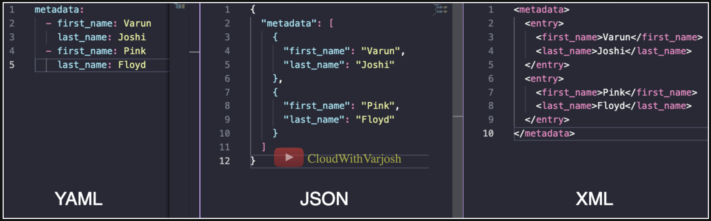

# 13 · YAML and the Anatomy of a Kubernetes Manifest

> **Level:** ★ foundation
>
> **You will learn:** YAML from zero (scalars, dictionaries, lists, nesting, indentation rules, quoting traps), how YAML compares with JSON and XML, and the five top-level fields of every Kubernetes manifest (`apiVersion`, `kind`, `metadata`, `spec`, `status`), using a two-container Pod as the example. Plus the tools that catch YAML mistakes before the cluster does.
>
> **You need:** topics 06 and 12.

---

## ⚡ Core: the 10-minute version

**The idea.** Kubernetes objects are written in **YAML**, a format where **indentation shows structure**. It has three building blocks:
- **scalars**: `name: web`;
- **dictionaries**: key/value groups;
- **lists**: lines starting with `- `.

Every Kubernetes manifest has the same top-level fields: `apiVersion` (which API), `kind` (what object), `metadata` (name, labels), `spec` (what you want). The cluster adds `status` (what's true now).

**Picture it.** YAML is an outline: indenting a line makes it a sub-point of the line above.

**The one thing to know.**

```yaml
apiVersion: v1            # which API group/version
kind: Pod                 # what you're creating
metadata:
  name: web
  labels: { app: web }
spec:                     # your desired state
  containers:             # a list...
  - name: nginx           # ...of dictionaries
    image: nginx:1.27
    ports:
    - containerPort: 80
```

**Try it now:**
1. Save the YAML as `pod.yaml` and run `kubectl apply -f pod.yaml`.
2. Break the indentation of `image:` and apply again: read the error.
3. Run `kubectl get pod web -o yaml | less` and find the `status:` the cluster added.

**You've got it if you can:** write a Pod manifest from memory using **spaces, never tabs**, and quote values like `"1.20"` or `"yes"`.

> 📖 **That's the core.** On a first pass, do the mini-lab and move on to the next topic. Everything below is the **full reference**: come back for the details, the edge cases, interview answers and exam-level depth.

---

## What it is

**YAML** (**Y**AML **A**in't **M**arkup **L**anguage) is a **human-readable data serialization language**. "**Data serialization**" means turning structured data (dictionaries, lists and combinations of them) into text that both **humans can read** and **machines can parse**.

- The recursive name stresses that YAML is **not** a markup language like XML (no `<tags>`). It's about **data**, not document formatting.
- Structure comes from **indentation** (spaces, **never tabs**) and **line breaks**.
- Used everywhere in DevOps: **Kubernetes, Terraform** (for some configs), **Helm, Ansible, Prometheus**, GitHub Actions, Docker Compose.
- **Simple**: easy to read and write.

A **Kubernetes manifest** is a YAML (or JSON) file describing one or more objects you want in the cluster. You'll hear many names for the same thing: **manifest files** (most common), configuration files, deployment files, resource files, YAML files, K8s configuration files, Kubernetes YAML files, spec files, definition files.

---

## Why it exists

Kubernetes is **declarative** (topic 15): you describe the desired state in a file, and controllers make it real. That file must be precise for the machine and readable for the humans who review it in Git. YAML is the compromise; Kubernetes converts it to JSON before sending it to the API server.

---

## Analogy

YAML is an **outline** in a notebook. Indentation shows what belongs under what, just like sub-bullets. A dash is a bullet point in a list. A colon is "label: value". If you indent a line wrongly, it suddenly belongs to a different heading, and the meaning changes.

---

## How it works inside

### YAML vs JSON vs XML

| Feature | YAML | JSON | XML |
|---|---|---|---|
| **Readability** | Very human-readable (indentation) | Machine-friendly, less human-friendly | Verbose tags, less readable |
| **Syntax** | Indentation and line breaks | Braces `{}`, brackets `[]`, quotes | `<tag>…</tag>` |
| **Comments** | Yes (`#`) | **No** | `<!-- comment -->` |
| **Usage** | Config files (Kubernetes, Ansible) | APIs, web apps | Legacy systems, document standards |
| **Extensions** | `.yaml` / `.yml` | `.json` | `.xml` |
| **Representation** | Simple and concise | Balanced | Flexible but verbose |



**Key fact:** YAML 1.2 is a **superset of JSON**: any JSON document is valid YAML. kubectl converts your YAML to **JSON** before sending it; the API server stores objects in etcd as protobuf. `kubectl get -o json` and `-o yaml` show the same object two ways.

### The three building blocks

Every piece of YAML is built from **key-value pairs**. The **value** decides the type:

1. **Scalars**: a single value. "Scalar" is the umbrella term for the primitive types:
   - **String**: text. Quotes are optional but help with special characters or spaces (`Hello, World!` or `"Hello, World!"`).
   - **Integer**: whole numbers (`42`, `-7`).
   - **Float**: decimals (`3.14`, `-0.5`).
   - **Boolean**: `true` / `false`.
   - **Null**: no value, `null` (or `~`).
2. **Dictionaries (maps)**: an **unordered** collection of key-value pairs; values can be nested dictionaries.
3. **Lists (sequences)**: an **ordered** collection; each item starts with `-` on its own line.

**Key-value rules** for keys you invent yourself:
- `:` (colon + space) separates key and value.
- Separate words with hyphens or underscores (`first_name`, `my-app`).
- Use lowercase; avoid spaces and special characters.

> ⚠️ **Fix to the original** ([C1](#c1)): "use lowercase letters for keys" is a good convention **for your own YAML**, but **Kubernetes' keys are camelCase and case-sensitive**: `apiVersion`, `containerPort`, `imagePullPolicy`, `matchLabels`. Writing `apiversion` or `containerport` is an error (`unknown field`). Copy Kubernetes field names exactly.

### Examples (Day 09, `Day 09/practice.yaml`)

**Scalars:**

```yaml
first_name: Prakash     # string
height: 5.9             # float
roll_number: 9          # integer
is_engineer: true       # boolean
pending_dues: null      # null
```

**Dictionary:** `address` is a key whose value is a dictionary:

```yaml
address:
  flat_number: x-001
  street: that_street
  state: that_state
  country: that_country
```

**List:** `hobbies` is a key whose value is a list:

```yaml
hobbies:
  - singing
  - traveling
  - dancing
```

Use consistent indentation (2 spaces is the Kubernetes convention).

**Case 1: nested dictionary and nested list**

```yaml
address:
  flat_number: x-001
  contact:                    # nested dictionary inside address
    phone: "000111222"
    email: prakash@example.com
hobbies:
  - singing
  - traveling
  - dancing
  - sports:                   # a list item that is a dictionary whose value is a list
      - cricket
      - football
```

> ✅ **Correct today** ([C2](#c2)): a value with **leading zeros** is risky. Kubernetes' YAML library follows YAML 1.1 rules, where a leading `0` can mean an **octal** number, so `000111222` may not be read as you expect (and the zeros are lost as an integer anyway). Phone numbers, ZIP codes, version strings and IDs must be **quoted strings**: `phone: "000111222"`.

**Case 2: dictionary with a nested list, and list with nested dictionaries**

```yaml
education:                    # dictionary with a nested list
  degrees:
    - degree: Bachelors
      field: Computer Science
    - degree: Masters
      field: Data Science
work_experience:              # list with nested dictionaries
  - company: ABC Corp
    role: DevOps Engineer
    duration: 3 years
  - company: XYZ Inc
    role: DevOps Consultant
    duration: 2 years
```

- `education` is a key whose value is a **dictionary**. Its key `degrees` holds a **list of 2 items**; each item is a **dictionary** with 2 pairs (`degree`, `field`).
- `work_experience` is a key whose value is a **list of 2 items**; each item is a **dictionary** with 3 pairs (`company`, `role`, `duration`).

**This "list of dictionaries" shape is everywhere in Kubernetes**: `containers`, `ports`, `env`, `volumes`, `rules`.

### YAML traps that bite Kubernetes users

| Trap | Example | What happens | Fix |
|---|---|---|---|
| Tabs | a tab before `image:` | Parse error | Spaces only |
| Wrong indentation | `image:` under `ports:` | Field lands in the wrong place, or `unknown field` | Align carefully; use an editor with YAML support |
| Booleans in YAML 1.1 | `value: yes`, `on`, `off`, `no` | Becomes `true`/`false`. Env var values must be **strings**, so you get an error | Quote: `value: "yes"` |
| Numbers as strings | `value: 8080` in `env` | Error: env values must be strings | `value: "8080"` |
| Leading zeros, versions | `version: 1.10` | Becomes float `1.1` | Quote it |
| `:` in a value | `cmd: echo a: b` | Parse error | Quote the whole value |
| Duplicate keys | two `labels:` | Last one wins silently, or a strict-validation error | Remove the duplicate |
| Multiple documents | several objects in one file | Need `---` between them | Separate with `---` |

**Multi-line strings** (useful for config files in ConfigMaps, topic 34):

```yaml
keep_newlines: |        # literal block: newlines kept
  line one
  line two
fold_newlines: >        # folded block: newlines become spaces
  this is one
  long line
```

### The anatomy of every Kubernetes manifest

```yaml
apiVersion: <group/version>   # which API defines this kind (topic 14)
kind: <Kind>                  # what type of object
metadata:                     # identity: name, namespace, labels, annotations
  name: ...
spec:                         # desired state (you write this)
  ...
status:                       # actual state (the cluster writes this; never put it in your files)
  ...
```

| Field | Meaning |
|---|---|
| `apiVersion` | API **group and version**, e.g. `v1` (core group), `apps/v1`, `networking.k8s.io/v1` (topic 14) |
| `kind` | The object type, e.g. `Pod`, `Deployment`, `Service` (case-sensitive, CamelCase) |
| `metadata` | `name` (unique per kind per namespace), `namespace`, `labels` (for selecting, topic 17), `annotations` (notes for tools), plus server-set fields (`uid`, `resourceVersion`, `creationTimestamp`, `ownerReferences`) |
| `spec` | Desired state; each kind has its own schema (`kubectl explain`, topic 14) |
| `status` | Actual state, written by controllers/kubelet |

(A few kinds don't use `spec`: ConfigMaps and Secrets have `data`, RBAC Roles have `rules`.)

---

## Commands / YAML

### The two-container Pod (Day 09, `Day 09/pod.yaml`)

```yaml
apiVersion: v1                    # string scalar
kind: Pod                         # string scalar
metadata:                         # dictionary
  name: my-pod-2                  # string scalar
  labels:                         # nested dictionary
    app: nginx
    environment: development
spec:                             # dictionary
  containers:                     # list (of dictionaries)
    - name: nginx-container
      image: nginx
      ports:                      # nested list
        - containerPort: 80       # integer scalar
    - name: sidecar-container
      image: busybox
      args: ["sleep", "3600"]     # list in flow (JSON-style) syntax
```

**What it means (Kubernetes view, Day 09):**
- `apiVersion` and `kind` = the type of resource (a core-group `v1` Pod).
- `metadata` = information about the Pod: its name and labels.
- `spec` = the **desired state** of the Pod.
- `containers` = the containers that run inside the Pod. Each has its own `name`, `image` and optionally `ports`.
- `args: ["sleep","3600"]` = arguments for busybox's default entrypoint, keeping the container alive for an hour (topic 03: `args` replaces CMD).

**What it is (YAML view, Day 09):**
- `apiVersion` → key with a string scalar `v1`; `kind` → string scalar `Pod`.
- `metadata` → a dictionary containing:
  - `name` → string scalar `my-pod-2`;
  - `labels` → a nested dictionary with `app: nginx` and `environment: development`.
- `spec` → a dictionary containing `containers` → a **list of 2 items**:
  - item 1: a dictionary with `name: nginx-container`, `image: nginx`, and `ports` → a nested list with one dictionary `containerPort: 80` (integer);
  - item 2: a dictionary with `name: sidecar-container`, `image: busybox`, and `args` → a nested list of 2 strings, `"sleep"` and `"3600"`. (The file version writes `args` in block style, one `-` per item. Same data.)

> Production note: `image: nginx` means `nginx:latest`. Always pin a tag (`nginx:1.29`) in real manifests (topic 20).

### See the same object as JSON

```bash
kubectl apply -f "Day 09/pod.yaml"
kubectl get pod my-pod-2 -o json | head -20
```

```json
{
    "apiVersion": "v1",
    "kind": "Pod",
    "metadata": {
        "creationTimestamp": "2026-11-17T10:30:12Z",
        "labels": {
            "app": "nginx",
            "environment": "development"
        },
        "name": "my-pod-2",
        "namespace": "default",
        "resourceVersion": "48211",
        "uid": "3f1c9a52-7d8e-4c1b-9a0f-2b6e5d4c3a21"
    },
    "spec": {
        "containers": [
```

- The server **added** `namespace: default`, `uid`, `resourceVersion` and `creationTimestamp`, and many `spec` defaults (`restartPolicy: Always`, `dnsPolicy`, `terminationGracePeriodSeconds`…). That's why `kubectl get -o yaml` output is much longer than your file.

### Catch mistakes before applying

```bash
kubectl apply -f pod.yaml --dry-run=client     # parse locally, nothing sent
kubectl apply -f pod.yaml --dry-run=server     # full server validation + admission, nothing saved
yamllint pod.yaml                              # style and syntax lint (pip install yamllint)
```

```
Error from server (BadRequest): error when creating "pod.yaml": Pod in version "v1" cannot be handled as a Pod: strict decoding error: unknown field "spec.containers[0].imagee"
```

- `--dry-run=server` is the best check: it runs real validation and admission policies without creating anything.
- Online/editor tools: [YAML Lint](https://www.yamllint.com/) and the **VS Code YAML extension** (with Kubernetes schemas) highlight errors as you type.
- `kubeconform` validates manifests against Kubernetes JSON schemas in CI, without a cluster.

---

## Hands-on lab

1. Save `Day 09/practice.yaml` and load it with Python to see the data structure: `python3 -c 'import yaml,json,sys;print(json.dumps(yaml.safe_load(open("practice.yaml")),indent=1))'`. Check that `phone` lost its zeros unless quoted.
2. Apply `Day 09/pod.yaml`. Run `kubectl get pod my-pod-2 -o yaml` and list the fields the server added.
3. Break it on purpose, one at a time, and run `kubectl apply --dry-run=server -f`:
   - replace two spaces with a tab,
   - rename `containerPort` to `containerport`,
   - indent `image:` under `ports:`,
   - add `env: [{name: DEBUG, value: yes}]`.
   Read each error message.
4. Put a Pod and a Service in one file separated by `---` and apply it once.
5. Clean up: `kubectl delete pod my-pod-2`.

---

## Where you'll use it

- Writing every manifest, Helm value file, Kustomize overlay and CI pipeline.
- **Code reviews**: spotting wrong indentation or unquoted booleans.
- **CKA exam**: generating YAML with `--dry-run=client -o yaml` (topic 15) and editing it quickly in vim.

---

## When it breaks

| Error | Meaning |
|---|---|
| `error converting YAML to JSON: yaml: line 7: found character that cannot start any token` | Usually a **tab** |
| `yaml: line 9: mapping values are not allowed in this context` | Bad indentation or an unquoted `:` |
| `strict decoding error: unknown field "…"` | Typo or wrong case in a Kubernetes field name, or field at the wrong level |
| `cannot unmarshal bool into Go struct field EnvVar.value of type string` | Unquoted `yes`/`true`/number in an env value |
| `no matches for kind "Deployment" in version "v1"` | Wrong `apiVersion` (should be `apps/v1`; topic 14) |
| Object applied but a setting is ignored | Field indented under the wrong parent, so it's attached somewhere harmless |

---

## Quick recap

- YAML = indentation-based data: **scalars, dictionaries, lists**, nested freely; spaces only; `---` separates documents.
- YAML is a superset of JSON; kubectl sends JSON to the API server.
- Quote anything that looks like a number, boolean or has leading zeros.
- Every manifest: `apiVersion`, `kind`, `metadata`, `spec` (you) and `status` (cluster). Kubernetes keys are camelCase.

### Interview questions

1. **Q: What are the required top-level fields in a Kubernetes manifest?**
   A: `apiVersion`, `kind`, `metadata` (at least `name`), and usually `spec`. `status` is written by the cluster.
2. **Q: Why might `value: yes` in an env var fail?**
   A: YAML 1.1 parses `yes` as a boolean, but env values must be strings; quote it.
3. **Q: How do you validate a manifest without creating it?**
   A: `kubectl apply --dry-run=server -f file.yaml` (full validation and admission), or `kubeconform`/`yamllint` in CI.

---

## Appendix: notes on the original course material

This topic was rebuilt from the original CKA course notes. This appendix keeps the audit trail out of your way while you learn.

### Sources

Day 09 (introduction to YAML, YAML vs JSON vs XML, basic data structures, key-value rules, scalars, dictionaries, lists, advanced cases, Pod manifest example and explanation, different names for configuration files), files `Day 09/pod.yaml`, `Day 09/practice.yaml`.

### Corrections to the original notes

Each entry shows what the original said and what's true now. In the topic above, each correction appears as a ✅ **Correct today** line or a ⚠️ **Fix to the original** box, linked to its entry here.

<a id="c1"></a>**C1 · Corrected (Day 09).** "use lowercase letters for keys" is a good convention **for your own YAML**, but **Kubernetes' keys are camelCase and case-sensitive**: `apiVersion`, `containerPort`, `imagePullPolicy`, `matchLabels`. Writing `apiversion` or `containerport` is an error (`unknown field`). Copy Kubernetes field names exactly.

<a id="c2"></a>**C2 · Corrected (Day 09).** the original wrote `phone: 000111222  # Integer scalar`. **Now:** a value with **leading zeros** is risky. Kubernetes' YAML library follows YAML 1.1 rules, where a leading `0` can mean an **octal** number, so `000111222` may not be read as you expect (and the zeros are lost as an integer anyway). Phone numbers, ZIP codes, version strings and IDs must be **quoted strings**: `phone: "000111222"`.
