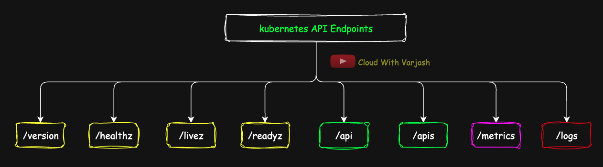

# 14 · The Kubernetes API: Groups, Versions, Resources and Endpoints

> **Level:** ★★ intermediate
>
> **You will learn:** the difference between the Kubernetes **API** and the **API server**; the endpoint map (`/api`, `/apis`, `/version`, `/healthz`, `/livez`, `/readyz`, `/metrics`); resource vs non-resource endpoints; the **core** and **named** API groups and why core objects use `apiVersion: v1`; API versions (alpha/beta/GA) and deprecation; how URLs are built; calling the API with `curl` (with and without credentials) and through `kubectl proxy`; and the discovery commands `kubectl api-resources`, `api-versions` and `explain`.
>
> **You need:** topics 07, 12 and 13.

---

## ⚡ Core: the 10-minute version

**The idea.** Everything in Kubernetes is a **REST API**, and `kubectl` is just a client for it. The **API server** hosts the API and checks every request.
- **Core** objects (Pods, Services, ConfigMaps) live under `/api/v1`, which is why their `apiVersion` is just `v1`.
- Everything else lives in **named groups** under `/apis/<group>/<version>`, e.g. Deployments in `apps/v1`.
- Versions mature **alpha → beta → GA**, and old versions eventually get removed.

**Picture it.** The API is a library catalogue with sections (groups) and editions (versions); kubectl is the librarian who fetches things for you.

**The one thing to know.**

```bash
kubectl api-resources | head          # every kind, its group, short name, namespaced?
kubectl explain deployment.spec.strategy
kubectl get --raw /apis/apps/v1 | head -c 300; echo
kubectl get pods -v=6                 # shows the real HTTP request kubectl makes
```

**Try it now:**
1. Run the four commands.
2. Run `kubectl proxy &`, then `curl localhost:8001/api/v1/namespaces/default/pods`.
3. Stop the proxy with `kill %1`.

**You've got it if you can:** explain why a Pod is `v1` but a Deployment is `apps/v1`, and use `explain` to discover any field.

> 📖 **That's the core.** On a first pass, do the mini-lab and move on to the next topic. Everything below is the **full reference**: come back for the details, the edge cases, interview answers and exam-level depth.

---

## What it is

The **Kubernetes API** is the **primary interface** to your cluster. Creating a Pod, scaling a Deployment, checking a status: it's all API calls.

- It's **RESTful** and **resource-based**: every object is a **URL**, and you act on it with standard **HTTP verbs**:
  - `GET` = read (or list) a resource,
  - `POST` = create,
  - `PUT` / `PATCH` = update (replace / partially change),
  - `DELETE` = remove.
- Tools such as `kubectl` are just **REST clients**: `kubectl get pods` becomes `GET /api/v1/namespaces/default/pods` over **HTTPS**, authenticated with your kubeconfig credentials and authorised by policies like RBAC.

**API vs API server:**
- The **Kubernetes API** is the **logical interface**: the set of REST endpoints (`/api`, `/apis`, `/healthz`…) that expose the cluster's state.
- The **API server** (kube-apiserver) is the **component** that serves that API **and** wraps it in controls: **authentication**, **authorisation**, **admission control**, **schema validation**, and more.
- So the API server is both the **gateway** to the cluster and its **gatekeeper**, enforcing checks before anything reaches etcd. kubectl, controllers and kubelets all use this same path.

> ✅ **Correct today** ([C1](#c1)): **admission control** (mutating and validating) is part of it: authentication → authorisation → mutating admission → schema validation → validating admission → persist to etcd (topic 07).

---

## Why it exists

Everything in Kubernetes talks through this one API, so understanding its shape lets you:
- read any manifest (`apiVersion` makes sense),
- debug "no matches for kind X in version Y" errors,
- use the API directly from scripts, CI, monitoring and your own controllers,
- plan upgrades when API versions are removed.

---

## Analogy

The API is a **library's catalogue system**:
- **API groups** = the **sections** (Fiction, Science, History). The oldest books are in a section with no sign at all (the **core group**).
- **Versions** = **editions** of a book (v1beta1, v1). New editions keep old content readable for a while, then old editions are withdrawn.
- **Resources** = the **book titles** (pods, deployments).
- The **API server** is the **librarian**: checks your library card (authentication), whether you may borrow that book (authorisation), and whether your request form is filled in correctly (validation and admission).

---

## How it works inside

### The endpoint map



| Endpoint | What it serves |
|---|---|
| `/version` | API server version. |
| `/healthz`, `/livez`, `/readyz` | Health of the **API server itself**. `/livez` and `/readyz` are preferred; `/healthz` is the legacy one. Add `?verbose` to see each check. |
| `/api` | The **core API group** (group name `""`): Pods, Services, ConfigMaps, Secrets, Namespaces, Nodes, PVs, PVCs… |
| `/apis` | All **named API groups**: `apps`, `rbac.authorization.k8s.io`, `networking.k8s.io`… Most modern resources live here. |
| `/metrics` | API server metrics in **Prometheus format**, for Prometheus or any compatible scraper. |
| `/openapi/v3` | Machine-readable schemas for every type (what `kubectl explain` uses). |
| `/logs` | ❌ **Not** how `kubectl logs` works. `kubectl logs` goes API server → **kubelet**'s `/containerLogs/…` endpoint. The API server's `/logs` path exposes its own log files only when certain logging flags are set (e.g. `--logtostderr=false`, `--log-dir`). |

**Resource vs non-resource endpoints:**
- **Resource endpoints** (`/api`, `/apis`): expose **objects** and support CRUD (create, read, update, delete) with HTTP verbs.
- **Non-resource endpoints** (`/version`, `/healthz`, `/livez`, `/readyz`, `/metrics`): metadata and utilities, no objects. RBAC grants access to these with `nonResourceURLs` (topic 57).

**Who can read the health and version endpoints?** On kubeadm and kind clusters, anonymous requests are allowed and the built-in `system:public-info-viewer` ClusterRole lets anyone read `/version`, `/healthz`, `/livez` and `/readyz`. `/metrics` needs authorisation. Hardened or managed clusters may disable anonymous access, so don't rely on it.

### API groups

Kubernetes organises its API into **groups** so features can be developed and versioned independently.

**1. Core group** ("legacy" group): no group name (technically the empty string `""`), served at **`/api/v1`**. The foundational objects: **Pods, Services, ConfigMaps, Secrets, Namespaces, Nodes, PersistentVolumes (PVs), PersistentVolumeClaims (PVCs), ServiceAccounts, Events, ReplicationControllers**. In a manifest: `apiVersion: v1`. Example: list all Pods at `/api/v1/pods`.

**2. Named groups**: served at **`/apis/<group>/<version>`**, so the core doesn't bloat. Examples:

| Group/version | Resources |
|---|---|
| `apps/v1` | Deployments, StatefulSets, ReplicaSets, DaemonSets |
| `batch/v1` | Jobs, CronJobs |
| `rbac.authorization.k8s.io/v1` | Roles, ClusterRoles, RoleBindings, ClusterRoleBindings |
| `autoscaling/v2` | HorizontalPodAutoscalers (with scaling policies) |
| `networking.k8s.io/v1` | Ingress, IngressClass, NetworkPolicies |
| `policy/v1` | PodDisruptionBudgets |
| `certificates.k8s.io/v1` | CertificateSigningRequests (CSRs) |
| `admissionregistration.k8s.io/v1` | Validating/MutatingWebhookConfigurations, ValidatingAdmissionPolicies |
| `apiextensions.k8s.io/v1` | CustomResourceDefinitions (CRDs) |
| `storage.k8s.io/v1` | StorageClasses, VolumeAttachments, CSIDrivers |
| `discovery.k8s.io/v1` | EndpointSlices |
| `gateway.networking.k8s.io/v1` | Gateway API (installed as CRDs, topic 72) |

> ✅ **Correct today** ([C2](#c2)): PodSecurityPolicy was only ever in `policy/v1beta1` and was **removed entirely in v1.25**. Its replacement is **Pod Security Admission** (topic 60). `policy/v1` contains PodDisruptionBudgets (and the Eviction subresource).

Each **group/version** (like `apps/v1`) is a versioned API surface, which keeps old clients working while allowing new versions to change.

### Why core objects say `apiVersion: v1`

When Kubernetes started, there was **only one group** (today's core group), served at `/api/v1`, so manifests simply said `apiVersion: v1`. When named groups were added (`/apis/GROUP/VERSION`), their manifests had to name both: `apiVersion: apps/v1`. To keep old manifests valid, **the core group's syntax never changed**. It has a name (`""`), but it's never shown.

**Why not `apiVersion: /api/v1` or `apis/networking.k8s.io/v1`?** Because `apiVersion` **isn't a URL**. It only identifies **group/version**: `v1` for the core group, `networking.k8s.io/v1` for NetworkPolicy. The API server maps it to the right path internally.

### API versions and maturity

| Level | Example | Meaning |
|---|---|---|
| **Alpha** | `v1alpha1` | Experimental, **off by default**, may change or vanish without notice. |
| **Beta** | `v1beta1` | Well tested. **New beta APIs are off by default since v1.24**; must be enabled. Will change or be replaced by GA. |
| **GA (stable)** | `v1`, `v2` | Supported for many releases; won't be removed within a major version. |

**Deprecation policy:** beta APIs are supported for at least 9 months / 3 releases after deprecation, then **removed**. Upgrades fail for manifests using removed versions (e.g. `extensions/v1beta1` Ingress, removed in v1.22; `policy/v1beta1` PodSecurityPolicy, removed in v1.25). Tools such as `kubent` (kube-no-trouble) or `pluto` scan for deprecated APIs before upgrades (topic 76). The API server also returns a **warning header** when you use a deprecated version.

### URL structure (Day 35, "API paths")

```
/<root>/<group>/<version>/namespaces/<namespace>/<resource>/<name>[/<subresource>]
```

- `GET /api/v1/namespaces/default/pods`: list Pods in `default` (core group).
- `POST /apis/apps/v1/namespaces/prod/deployments`: create a Deployment in `prod`.
- `GET /apis/rbac.authorization.k8s.io/v1/clusterroles/admin`: a **cluster-scoped** resource (no `namespaces/` part).
- **Subresources**: `/pods/web/log`, `/pods/web/exec`, `/deployments/web/scale`, `/pods/web/status`. RBAC can grant them separately (`pods/log`, topic 57).

**Namespaced vs cluster-scoped resources:** Pods, Services, Deployments, ConfigMaps live **in a namespace**. Nodes, PersistentVolumes, Namespaces, ClusterRoles, StorageClasses, CRDs are **cluster-wide**.

### What `kubectl get pods` actually does

1. Reads the kubeconfig → cluster URL + credentials (topic 12).
2. **Discovery**: fetches the list of API groups and resources (cached in `~/.kube/cache/discovery`) to learn that `pods` = core `v1`, namespaced.
3. Sends `GET https://<server>/api/v1/namespaces/<ns>/pods` (with paging, `?limit=500`).
4. The API server authenticates, authorises, reads from **etcd** (or its watch cache) and returns **JSON**.
5. kubectl formats the JSON into the familiar table (or YAML/JSON with `-o`).

**YAML ↔ JSON:** you write YAML; kubectl converts it to JSON for the API; the API returns JSON; `-o yaml` converts back for humans. That's why JSONPath queries (topic 16) work on the JSON shape of objects.

### The API is extensible

- **CRDs** add new resource types under your own group (topic 66).
- **Aggregated API servers** add whole groups served by other programs (`metrics.k8s.io` from metrics-server, topic 48).

---

## Commands / YAML

### Discovery

```bash
kubectl api-resources | head -8
```

```
NAME                  SHORTNAMES   APIVERSION   NAMESPACED   KIND
bindings                           v1           true         Binding
componentstatuses     cs           v1           false        ComponentStatus
configmaps            cm           v1           true         ConfigMap
endpoints             ep           v1           true         Endpoints
events                ev           v1           true         Event
limitranges           limits       v1           true         LimitRange
namespaces            ns           v1           false        Namespace
```

- `NAME` = what goes in the URL and in RBAC rules (lower-case plural).
- `SHORTNAMES` = abbreviations for kubectl (`kubectl get cm`).
- `APIVERSION` = group/version to put in manifests.
- `NAMESPACED` = `true` for namespaced, `false` for cluster-scoped.
- `KIND` = what goes in the `kind:` field.

Useful filters:

```bash
kubectl api-resources --namespaced=false            # cluster-scoped resources
kubectl api-resources --api-group=apps              # one group
kubectl api-resources -o wide                       # adds VERBS (get, list, watch, create…)
kubectl api-versions | grep -E 'apps|autoscaling'   # every group/version the server offers
```

```
apps/v1
autoscaling/v1
autoscaling/v2
```

### `kubectl explain`: built-in field documentation

```bash
kubectl explain deployment.spec.strategy
```

```
GROUP:      apps
KIND:       Deployment
VERSION:    v1

FIELD: strategy <DeploymentStrategy>

DESCRIPTION:
    The deployment strategy to use to replace existing pods with new ones.

FIELDS:
  rollingUpdate	<RollingUpdateDeployment>
    Rolling update config params. Present only if DeploymentStrategyType =
    RollingUpdate.

  type	<string>
  enum: Recreate, RollingUpdate
    Type of deployment. Can be "Recreate" or "RollingUpdate". Default is
    RollingUpdate.
```

- Reads the **API server's own OpenAPI v3 schema** (fetched from the cluster, then cached), so it's always correct for **your** version, including CRDs. It is *not* offline: with no reachable cluster it fails.
- `kubectl explain pod.spec --recursive | less` shows the whole field tree. **Allowed in the CKA exam and faster than searching the docs.**

### Calling the API with curl, unauthenticated

```bash
kubectl config view --minify | grep server          # 1. find the API server URL
curl https://127.0.0.1:41365/version                 # 2. fails: your machine doesn't trust the cluster's CA
```

```
curl: (60) SSL certificate problem: unable to get local issuer certificate
```

```bash
curl -k https://127.0.0.1:41365/version              # 3. -k = skip certificate verification (labs only!)
```

```json
{
  "major": "1",
  "minor": "37",
  "gitVersion": "v1.37.0",
  "platform": "linux/amd64"
}
```

```bash
curl -k https://127.0.0.1:41365/readyz      # also /livez, /healthz
```

```
ok
```

- The TLS error happens because the API server's certificate is signed by the **cluster's own CA** (Certificate Authority: the organisation that vouches for certificates; topic 51), which your OS doesn't know. `-k` skips that check. **Never use it in production scripts**; use `--cacert`.

### Calling the API with curl, authenticated

A **client certificate** is a digital ID card signed by the cluster's CA; with its matching **private key** it proves who you are (full story in topics 51–54). Your kubeconfig contains them base64-encoded. Extract, decode, and use them:

```bash
kubectl config view --raw --minify -o jsonpath='{.users[0].user.client-certificate-data}' | base64 -d > client.crt
kubectl config view --raw --minify -o jsonpath='{.users[0].user.client-key-data}'         | base64 -d > client.key
kubectl config view --raw --minify -o jsonpath='{.clusters[0].cluster.certificate-authority-data}' | base64 -d > ca.crt

curl https://127.0.0.1:41365/api \
  --cert client.crt \        # your client certificate (who you are)
  --key client.key \         # its private key (proves the certificate is yours)
  --cacert ca.crt            # the CA that signed the API server's certificate (trust it)
```

```json
{
  "kind": "APIVersions",
  "versions": ["v1"],
  "serverAddressByClientCIDRs": [{ "clientCIDR": "0.0.0.0/0", "serverAddress": "172.18.0.3:6443" }]
}
```

- Delete `client.key` afterwards: it's an admin credential.

**Bearer tokens:** instead of certificates you can send `Authorization: Bearer <token>` (used by ServiceAccounts and many users). Topic 55 covers tokens.

### `kubectl proxy`: the easy way

- Starts a **local HTTP proxy** on your machine.
- You call `http://127.0.0.1:8001/...` with plain HTTP; the proxy **authenticates with your kubeconfig** and forwards the request to the real API server over **HTTPS**.
- No certificates or tokens to handle by hand.

```bash
kubectl proxy                     # terminal 1
```

```
Starting to serve on 127.0.0.1:8001
```

```bash
curl -s http://127.0.0.1:8001/api/v1/namespaces/default/pods | head      # terminal 2
curl -s http://127.0.0.1:8001/apis/apps/v1/namespaces/kube-system/deployments/coredns | grep '"replicas"'
```

```
    "replicas": 2,
```

The local hop is HTTP, but the proxy-to-API-server hop is HTTPS. Anyone on your machine who can reach port 8001 acts as **you**, so don't bind it to other interfaces.

### See every API call kubectl makes

```bash
kubectl get deploy coredns -n kube-system -v=6 2>&1 | grep GET
```

```
GET https://127.0.0.1:41365/apis/apps/v1/namespaces/kube-system/deployments/coredns 200 OK in 7 milliseconds
```

```bash
kubectl get --raw /apis/apps/v1 | head -c 300      # raw GET through kubectl's auth
```

---

## Hands-on lab

1. Run `kubectl api-resources` and find: the group of `cronjobs`, `ingresses` and `roles`; three cluster-scoped resources; the short name of `persistentvolumeclaims`.
2. `kubectl explain pod.spec.containers.resources` and `kubectl explain deploy.spec --recursive | grep -i surge`.
3. curl `/version` and `/readyz` with `-k`, then `/api` with certificates (as above). Try `/api/v1/namespaces/default/pods` without credentials and read the `403 Forbidden` for `system:anonymous`.
4. Start `kubectl proxy` and list Deployments in `kube-system` via curl. Then **create** a Namespace with a POST:
   ```bash
   curl -s -X POST http://127.0.0.1:8001/api/v1/namespaces \
     -H 'Content-Type: application/json' \
     -d '{"apiVersion":"v1","kind":"Namespace","metadata":{"name":"from-curl"}}'
   kubectl get ns from-curl
   ```
5. Write a Deployment with `apiVersion: v1` and apply it; read the `no matches for kind` error. Fix it to `apps/v1`.
6. Clean up: `kubectl delete ns from-curl; rm client.crt client.key ca.crt`.

---

## Where you'll use it

- **Writing manifests**: correct `apiVersion` for each kind.
- **Upgrades**: finding deprecated/removed API versions before they break deployments.
- **Automation**: scripts, CI jobs and operators calling the API (client-go, Python client, curl).
- **RBAC**: rules list API groups, resources, subresources and verbs exactly as they appear here (topic 57).
- **CKA exam**: `kubectl explain` instead of searching docs.

---

## When it breaks

| Error | Cause | Fix |
|---|---|---|
| `no matches for kind "Deployment" in version "v1"` | Wrong group/version | `kubectl api-resources \| grep -i deployment` → `apps/v1` |
| `no matches for kind "Ingress" in version "extensions/v1beta1"` | API version removed after an upgrade | Migrate to `networking.k8s.io/v1` (`kubectl convert` plugin can help) |
| `the server doesn't have a resource type "gateways"` | CRDs not installed | Install the CRDs (topic 73) |
| `403 Forbidden … User "system:anonymous"` | No credentials sent | Use `--cert/--key`, a token or `kubectl proxy` |
| `SSL certificate problem` | Client doesn't trust the cluster CA | `--cacert ca.crt` |
| `Warning: … is deprecated in v1.X+, unavailable in v1.Y+` | Using a deprecated API | Update manifests before upgrading |

---

## Quick recap

- The **API** is the REST interface; the **API server** hosts it and adds authn, authz, admission and validation.
- `/api/v1` = core group (`apiVersion: v1`); `/apis/<group>/<version>` = named groups (`apps/v1`…).
- Versions mature alpha → beta → GA; removed versions break manifests on upgrade.
- Discover with `api-resources`, `api-versions`, `explain`; call directly with curl (certs/tokens) or `kubectl proxy`.

### Interview questions

1. **Q: Why is a Pod `apiVersion: v1` but a Deployment `apps/v1`?**
   A: Pods are in the original core group (empty name, served at `/api/v1`); Deployments belong to the named `apps` group served at `/apis/apps/v1`. The core group's syntax was kept for backward compatibility.
2. **Q: How does `kubectl logs` get logs?**
   A: kubectl calls the API server's `pods/log` subresource; the API server proxies to the kubelet on the Pod's node, which reads the container log file.
3. **Q: How would you find which API version of a resource your cluster supports?**
   A: `kubectl api-resources` (shows the preferred version per resource) and `kubectl api-versions`; `kubectl explain <kind>` shows the version it documents.

---

## Appendix: notes on the original course material

This topic was rebuilt from the original CKA course notes. This appendix keeps the audit trail out of your way while you learn.

### Sources

Day 35 (introduction, the API as the engine, API vs API server, key pointers, endpoints overview, resource vs non-resource, API groups, why the core group name isn't shown, curl access unauthenticated/authenticated, bearer token note, `kubectl proxy`, API paths, key points). Day 59 ("behind the scenes of `kubectl get pods`", YAML ↔ JSON).

### Corrections to the original notes

Each entry shows what the original said and what's true now. In the topic above, each correction appears as a ✅ **Correct today** line or a ⚠️ **Fix to the original** box, linked to its entry here.

<a id="c1"></a>**C1 · Corrected (Day 35).** the key pointers described the pipeline as "authentication → authorization → validation → execution". **Now:** **admission control** (mutating and validating) is part of it: authentication → authorisation → mutating admission → schema validation → validating admission → persist to etcd (topic 07).

<a id="c2"></a>**C2 · Corrected (Day 35).** the list showed "`policy/v1` → PodDisruptionBudgets, **PodSecurityPolicies (deprecated)**". **Now:** PodSecurityPolicy was only ever in `policy/v1beta1` and was **removed entirely in v1.25**. Its replacement is **Pod Security Admission** (topic 60). `policy/v1` contains PodDisruptionBudgets (and the Eviction subresource).
