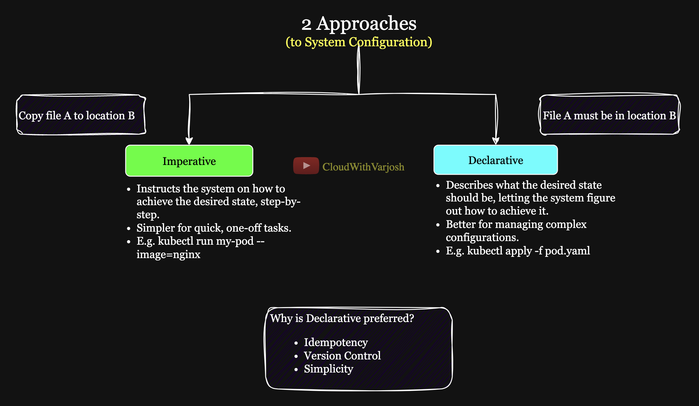

# 15 · Imperative vs Declarative: Creating and Changing Objects

> **Level:** ★ foundation
>
> **You will learn:** the two ways to manage Kubernetes objects and why declarative wins for real work; every way to create and change objects (`run`, `create`, `apply`, `replace`, `edit`, `patch`, `set`, `scale`, `delete`, `diff`); `--dry-run=client|server -o yaml` to generate manifests fast (the #1 CKA time-saver); temporary debug Pods with `--rm -it`; and how `kubectl apply` merges changes (client-side vs server-side apply, field managers).
>
> **You need:** topics 13 and 14.

---

## ⚡ Core: the 10-minute version

**The idea.** There are two ways to manage objects:
- **imperative**: tell the cluster what to **do** (`kubectl create`, `scale`, `delete`);
- **declarative**: write what you **want** in a file and let `kubectl apply` work out the changes.

Declarative is the real-world standard: files live in Git, can be reviewed, and re-applying them is safe. Imperative commands are perfect for quick tests and for **generating YAML** to start from.

**Picture it.** Imperative is giving a taxi driver turn-by-turn directions; declarative is typing the destination into the GPS.

**The one thing to know.**

```bash
kubectl create deployment web --image=nginx --dry-run=client -o yaml > web.yaml   # generate
kubectl apply -f web.yaml        # create or update to match the file
kubectl diff -f web.yaml         # preview what apply would change
```

**Try it now:**
1. Generate and apply `web.yaml`.
2. Change `replicas` in the file, then run `kubectl diff -f web.yaml` and `kubectl apply -f web.yaml`.
3. Apply again: nothing changes (it's idempotent).

**You've got it if you can:** explain why declarative wins in teams, and generate any manifest with `--dry-run=client -o yaml`.

> 📖 **That's the core.** On a first pass, do the mini-lab and move on to the next topic. Everything below is the **full reference**: come back for the details, the edge cases, interview answers and exam-level depth.

---

## What it is



Two fundamental approaches to configuring any system:

1. **Imperative**: tell the system **how**, step by step, like an instruction manual.
   - Kubernetes: `kubectl run my-pod --image=nginx`. This directly **performs an action** (create a Pod) rather than describing an end state.
   - General: "copy file A to location B, then run command C".
2. **Declarative**: describe the **desired state**; the system works out how to get there.
   - Kubernetes: write `pod.yaml` describing the Pod (name, image, resources…) and run `kubectl apply -f pod.yaml`. Kubernetes **reconciles** the actual state with the file.
   - General: "make sure file A exists at location B with these permissions".

---

## Why it exists

**Why declarative is preferred in Kubernetes:**
- **Idempotency**: applying the same configuration again gives the same result. Nothing is duplicated, and an error doesn't occur because "it already exists".
- **Simplicity**: easier to read, write and maintain; you focus on the **outcome**, not the steps.
- **Version control**: files live in Git, so changes are reviewed, tracked and easy to roll back. The foundation of GitOps (topic 68).

**Why imperative commands still matter:**
- **Daily troubleshooting**: spin up a test Pod or Service in seconds to check connectivity or network policies.
- **CKA exam**: generate YAML quickly with `--dry-run=client -o yaml > file.yaml` instead of typing it.
- **Real-world checks**: test accessibility, deploy temporary resources, verify configurations.

| Aspect | Imperative | Declarative |
|---|---|---|
| **Definition** | Tells the system *how*, step by step | Describes *what* the end state is |
| **Example** | `kubectl run nginx-pod --image=nginx` | `kubectl apply -f nginx-pod.yaml` |
| **Focus** | The individual commands | The final desired state |
| **Ease of use** | Simple for quick one-off tasks | Better for complex configurations |
| **Idempotency** | Not by default (re-running `create` fails with "already exists") | Idempotent by design |
| **Scalability** | Hard for many resources | Scales with version-controlled manifests |
| **Error-prone** | More human error (manual commands) | Fewer errors (reviewed, predefined files) |
| **Use case** | Quick tests, temporary setups | Long-term infrastructure, repeatable deployments |
| **Tooling** | CLI commands | YAML/JSON files + `kubectl apply`, Helm, Kustomize, GitOps |

**Best practice:** use imperative commands to **generate** YAML, then manage the YAML **declaratively**.

---

## Analogy

- **Imperative** = giving a taxi driver **turn-by-turn directions**. If you forget a turn or the road is closed, you're lost.
- **Declarative** = giving the driver **the address**. They pick the route, re-route around closures, and you can hand the same address to any driver and get the same result.

---

## How it works inside

### The three management styles

| Style | Commands | Notes |
|---|---|---|
| **Imperative commands** | `kubectl run`, `create deployment`, `expose`, `scale`, `set image`, `label`, `delete` | No file; fastest; no history |
| **Imperative object configuration** | `kubectl create -f`, `replace -f`, `delete -f` | Uses files, but each command is an action; `replace` overwrites the **whole** object |
| **Declarative object configuration** | `kubectl apply -f` (files or folders), `kubectl diff -f` | Merges changes; idempotent; the standard for real work |

Don't mix them on the same object carelessly: changes made with `kubectl edit`/`scale` are **overwritten** the next time someone runs `kubectl apply` with the file (unless the file doesn't set that field).

### How `kubectl apply` merges

`apply` must work out **what to change** without deleting fields that other actors set (e.g. the HPA changing `replicas`, or defaults the server added).

- **Client-side apply** (the default): kubectl stores the last file you applied in the annotation **`kubectl.kubernetes.io/last-applied-configuration`**. On the next apply it compares three things: **your new file**, **the last-applied annotation**, and **the live object**. That's a **three-way merge**:
  - a field in the new file → set it;
  - a field in last-applied but **removed** from the new file → **delete it**;
  - a field only in the live object (set by someone else) → **leave it alone**.
- **Server-side apply** (`kubectl apply --server-side`, GA since v1.22): the API server does the merge and records **who owns each field** in `metadata.managedFields` (a "field manager" per actor, e.g. `kubectl`, `kube-controller-manager`, `helm`). If you try to change a field another manager owns, you get a **conflict** unless you pass `--force-conflicts`. Controllers, operators and GitOps tools increasingly use it.

### Dry runs

| Flag | Where it runs | What it checks | Creates anything? |
|---|---|---|---|
| `--dry-run=client` | Only in kubectl | Builds the object locally; basic parsing | No; with `-o yaml` it **prints the manifest** |
| `--dry-run=server` | Sent to the API server | Full **schema validation and admission control** (quotas, policies, webhooks) | No: not saved to etcd |

> ✅ **Correct today** ([C1](#c1)): it barely validates. It just builds the object in kubectl without asking the server, so it won't catch wrong field names, quota or policy problems. Use `--dry-run=server` (or `kubectl apply --dry-run=server`) for real validation.

### `kubectl diff`: see before you change

`kubectl diff -f file.yaml` asks the server for a **server-side dry run** and shows a unified diff between the live object and what it would become. Use it before every production `apply`.

---

## Commands / YAML

### Generate a Deployment manifest

```bash
kubectl create deployment backend-deploy \
  --image=hashicorp/http-echo \
  --replicas=3 \
  --port=5678 \
  --dry-run=client -o yaml > backend-deploy.yaml
```

- `--image` = container image (`hashicorp/http-echo`, a tiny web server that replies with fixed text).
- `--replicas=3` = 3 Pods for high availability.
- `--port=5678` = the container's listening port (`containerPort`).
- `--dry-run=client -o yaml` = don't create it; print the YAML; `>` saves it.

```yaml
apiVersion: apps/v1
kind: Deployment
metadata:
  creationTimestamp: null
  labels:
    app: backend-deploy
  name: backend-deploy
spec:
  replicas: 3
  selector:
    matchLabels:
      app: backend-deploy
  strategy: {}
  template:
    metadata:
      creationTimestamp: null
      labels:
        app: backend-deploy
    spec:
      containers:
      - image: hashicorp/http-echo
        name: http-echo
        ports:
        - containerPort: 5678
        resources: {}
status: {}
```

- kubectl automatically labels the Pods `app: backend-deploy` (the Deployment name) and uses that as the selector.
- Remove the noise (`creationTimestamp: null`, `resources: {}`, `strategy: {}`, `status: {}`) and add what you need. Day 13 added the response text:
  ```yaml
          args:
            - "-text=Hello from Backend"
  ```
  and changed the labels to `app: backend` (files `Day 13/backend-deploy.yaml`, `Day 13/frontend-deploy.yaml`, used again in topic 30).

The same for the frontend:

```bash
kubectl create deployment frontend-deploy --image=nginx --replicas=3 --port=80 \
  --dry-run=client -o yaml > frontend-deploy.yaml
```

### Create Pods imperatively

```bash
kubectl run nginx-pod \
  --image=nginx \
  --restart=Never \
  --labels="app=nginx,env=production"
kubectl get pods --show-labels
```

```
NAME        READY   STATUS    RESTARTS   AGE   LABELS
nginx-pod   1/1     Running   0          8s    app=nginx,env=production
```

- `nginx-pod` = Pod name; `--image` = image.
- `--restart=Never` = the Pod's `restartPolicy: Never`: if the container exits, it isn't restarted (topic 19).
- `--labels` = comma-separated `key=value` labels (topic 17).

Generate a Pod manifest instead:

```bash
kubectl run my-nginx --image=nginx --restart=Never --labels=app=test-pod \
  --dry-run=client -o yaml > test-pod.yaml
```

**Day 13 note on labels:** `kubectl run` can set any Pod labels. `kubectl create deployment` has **no flag** for custom Pod labels: it always uses `app=<name>`, so you edit the generated YAML for anything else.

### Temporary troubleshooting Pod

```bash
kubectl run test-pod --rm -it --restart=Never --labels=app=test-pod --image=nginx -- /bin/sh
```

```
If you don't see a command prompt, try pressing enter.
# curl -s backend-svc:9090
Hello from Backend
# exit
pod "test-pod" deleted
```

- `--rm` = delete the Pod as soon as you exit.
- `-it` = interactive terminal (`-i` keep stdin open, `-t` allocate a TTY).
- `-- /bin/sh` = everything after `--` is the command to run in the container (replaces the image's command).
- Handy debug images: `busybox:1.37` (`wget`, `nslookup`), `curlimages/curl`, `nicolaka/netshoot` (every network tool).

### Other imperative commands you'll use

```bash
kubectl create namespace dev
kubectl create configmap app-cfg --from-literal=MODE=prod
kubectl create secret generic db --from-literal=password=s3cr3t
kubectl create job once --image=busybox:1.37 -- echo hi
kubectl create cronjob tick --image=busybox:1.37 --schedule="*/5 * * * *" -- date
kubectl scale deployment backend-deploy --replicas=5
kubectl set image deployment/backend-deploy http-echo=hashicorp/http-echo:1.0
kubectl label pod nginx-pod tier=web
kubectl annotate deployment backend-deploy owner=team-a
kubectl delete pod nginx-pod --grace-period=0 --force   # last resort (topic 19)
```

All of them accept `--dry-run=client -o yaml`.

### Declarative workflow

```bash
kubectl apply -f backend-deploy.yaml          # create or update
kubectl apply -f k8s/                         # every file in a folder
kubectl apply -f k8s/ -R                      # including subfolders
kubectl diff -f backend-deploy.yaml           # preview changes
kubectl delete -f backend-deploy.yaml         # delete what the file describes
```

After changing `replicas: 3` to `4` in the file:

```bash
kubectl diff -f backend-deploy.yaml
```

```
-  replicas: 3
+  replicas: 4
```

```bash
kubectl apply -f backend-deploy.yaml
```

```
deployment.apps/backend-deploy configured
```

- `created` = new object; `configured` = changed; `unchanged` = already matched (idempotency).

### Edit, patch, replace

```bash
kubectl edit deployment backend-deploy          # opens the live object in $EDITOR; saves = update
kubectl patch deployment backend-deploy -p '{"spec":{"replicas":2}}'                  # strategic merge patch
kubectl patch deployment backend-deploy --type=json \
  -p '[{"op":"replace","path":"/spec/template/spec/containers/0/image","value":"nginx:1.29"}]'
kubectl replace -f backend-deploy.yaml          # overwrite the whole object
kubectl replace --force -f pod.yaml             # delete + recreate (for fields that can't change)
```

- Many Pod fields are **immutable** (you can't change a running Pod's ports or most of its spec). `kubectl edit pod` then saves a copy in `/tmp/kubectl-edit-*.yaml`; use `kubectl replace --force -f` on that file. Changing a **Deployment** is the normal way: it creates new Pods.
- Set your editor: `export KUBE_EDITOR=vim` (or nano).

### CKA speed setup

```bash
alias k=kubectl
export do="--dry-run=client -o yaml"      # k run web --image=nginx $do > web.yaml
export now="--force --grace-period=0"     # k delete pod web $now
source <(kubectl completion bash); complete -o default -F __start_kubectl k
```

---

## Hands-on lab

1. Generate the backend Deployment YAML as above, clean it, add `args: ["-text=Hello from Backend"]`, apply it.
2. Apply the same file again: `unchanged`. Run `kubectl create -f` on it: `AlreadyExists`. That's idempotency vs imperative.
3. Change `replicas` in the file; run `kubectl diff`, then `apply`.
4. Scale imperatively with `kubectl scale --replicas=6`, then re-run `kubectl apply -f` with the file: the replicas go back to the file's value (the file wins).
5. Look at the annotation: `kubectl get deploy backend-deploy -o jsonpath='{.metadata.annotations.kubectl\.kubernetes\.io/last-applied-configuration}'`.
6. Try server-side apply: `kubectl apply --server-side -f backend-deploy.yaml`, then `kubectl get deploy backend-deploy -o yaml --show-managed-fields | grep manager:`.
7. Validate a broken file with `--dry-run=client` (passes!) and `--dry-run=server` (fails) to see the difference.
8. Run the temporary debug Pod and `exit`; confirm it's gone.
9. Clean up: `kubectl delete deploy backend-deploy`.

---

## Where you'll use it

- **Production**: declarative manifests in Git, applied by CI or a GitOps controller (topic 68). Imperative changes are emergencies only, and must be copied back into Git.
- **Debugging**: `kubectl run --rm -it` test Pods; `kubectl scale` during incidents.
- **CKA exam**: generate with `$do`, edit, apply. Never type a manifest from scratch.

---

## When it breaks

| Symptom | Cause | Fix |
|---|---|---|
| `Error from server (AlreadyExists)` | `create` on an existing object | Use `apply`, or delete first |
| Your manual `scale`/`edit` disappears | Someone ran `apply` (or GitOps synced) with the file | Change the file, not the live object |
| `Apply failed with 1 conflict: conflict with "kube-controller-manager"` | Server-side apply field-ownership conflict | Don't set that field, or `--force-conflicts` deliberately |
| `field is immutable` / `Forbidden: pod updates may not change fields other than…` | Editing an immutable field | Change the owning Deployment, or `replace --force` |
| `--dry-run=client` passed but `apply` fails | Client dry run doesn't validate against the server | Use `--dry-run=server` |
| `kubectl apply` warns "missing the kubectl.kubernetes.io/last-applied-configuration annotation" | Object was created with `create`/`run` | Harmless; apply adds the annotation and patches it |

---

## Quick recap

- **Imperative** = actions (`run`, `create`, `scale`); **declarative** = desired state in files (`apply`).
- Declarative is idempotent, reviewable and versioned; imperative is fast for tests and YAML generation.
- `--dry-run=client -o yaml` generates manifests; `--dry-run=server` truly validates; `kubectl diff` previews.
- `apply` does a three-way merge (client-side) or field-ownership merge (server-side).

### Interview questions

1. **Q: Difference between `kubectl create -f` and `kubectl apply -f`?**
   A: `create` is imperative and fails if the object exists; `apply` is declarative: it creates or updates by merging the file into the live object, and is idempotent.
2. **Q: What does `--dry-run=server` give you that `--dry-run=client` doesn't?**
   A: Full server-side processing (schema validation, defaulting and admission control including quotas, policies and webhooks) without persisting the object.
3. **Q: You scaled a Deployment manually during an incident, and an hour later it scaled back. Why?**
   A: A declarative source (CI `kubectl apply`, Helm upgrade or GitOps sync) re-applied the manifest's `replicas`. The fix is to change the source of truth, or let an HPA own replicas and remove `replicas` from the file.

---

## Appendix: notes on the original course material

This topic was rebuilt from the original CKA course notes. This appendix keeps the audit trail out of your way while you learn.

### Sources

Day 09 (imperative vs declarative, why declarative is preferred, comparison table), Day 13 (why imperative commands matter, important flags, generating a Deployment, creating Pods with labels, test Pods, temporary troubleshooting Pods, key takeaways). Day 13's Service commands are in topic 30; its labels section is in topic 17.

### Corrections to the original notes

Each entry shows what the original said and what's true now. In the topic above, each correction appears as a ✅ **Correct today** line or a ⚠️ **Fix to the original** box, linked to its entry here.

<a id="c1"></a>**C1 · Corrected (Day 13).** "`--dry-run=client` **validates** the command locally". **Now:** it barely validates. It just builds the object in kubectl without asking the server, so it won't catch wrong field names, quota or policy problems. Use `--dry-run=server` (or `kubectl apply --dry-run=server`) for real validation.
