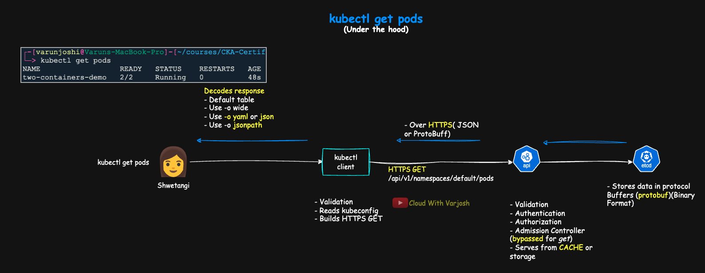

# 16 · kubectl Output: `-o wide/yaml/json`, JSONPath, custom-columns, sort-by

> **Level:** ★★ intermediate
>
> **You will learn:** how to pull exactly the data you need out of the cluster: every `-o` output format; JSONPath from zero (root `$`, dots, `[index]`, `[*]`, filters `?()`, `{range}{end}` loops, newlines, quoting awkward keys); `-o jsonpath-as-json` and `jq`; `custom-columns`; `--sort-by`; label and field selectors to filter first; and `kubectl get --watch`, `events` and `top`. These are daily skills and appear in almost every CKA task.
>
> **You need:** topics 13 and 14.

---

## ⚡ Core: the 10-minute version

**The idea.** `kubectl get` can show more than its default table:
- `-o wide`: extra columns;
- `-o yaml` / `-o json`: the whole object;
- **JSONPath**: exactly the fields you ask for.

JSONPath walks the object like a path: `.metadata.name`, `.spec.containers[0].image`, `[*]` for every item, and `[?(@.x=="y")]` to filter. It's how you script against Kubernetes and answer exam questions fast.

**Picture it.** `-o yaml` is the whole phone book; JSONPath is asking for one person's number.

**The one thing to know.**

```bash
kubectl get pods -o jsonpath='{.items[*].metadata.name}'; echo
kubectl get pods -o jsonpath='{range .items[*]}{.metadata.name}{"\t"}{.status.podIP}{"\n"}{end}'
kubectl get pods -o custom-columns=NAME:.metadata.name,NODE:.spec.nodeName
kubectl get pods --sort-by=.metadata.creationTimestamp
```

**Try it now:**
1. Run each command on your cluster.
2. Write one that prints every container image in `kube-system`.
3. Write one that prints node names with their internal IP.

**You've got it if you can:** read a field path from `-o yaml` and turn it into a JSONPath, including the `.items` wrapper that list output adds.

> 📖 **That's the core.** On a first pass, do the mini-lab and move on to the next topic. Everything below is the **full reference**: come back for the details, the edge cases, interview answers and exam-level depth.

---

## What it is

`kubectl get` shows a **summary table** by default. The API actually returns a **full JSON object** with hundreds of fields. **Output options** choose what you see:

| Flag | Shows |
|---|---|
| (none) | Summary table |
| `-o wide` | The table plus a few extra columns (Pod IP, node…) |
| `-o yaml` / `-o json` | The **full object** |
| `-o name` | Just `kind/name` (great for scripts) |
| `-o jsonpath='{…}'` | **Only the fields you ask for** |
| `-o jsonpath-as-json='{…}'` | Same, but printed as **valid JSON** |
| `-o custom-columns=…` | Your own table |
| `-o kyaml` | KYAML, a stricter, less ambiguous YAML style (stable in v1.37) |

**JSONPath** is a small **query language for navigating JSON**: start at the root and pick nested fields, array items, or only items that match a filter. kubectl applies it to the **decoded API object**.

---

## Why it exists

Real clusters have **thousands** of Pods, Deployments, Services, ConfigMaps and Secrets. Scrolling full JSON every time is slow. JSONPath gives you **surgical reads**: "every image running in prod", "which node is each Pod on", "which Pods aren't Running". It's perfect for scripts, quick decisions and the exam's "write the answer to /opt/out.txt" tasks.

---

## Analogy

The full object is a **thick encyclopaedia**. `-o yaml` hands you the whole book. JSONPath is the **index at the back**: "Volume `spec`, chapter `containers`, every entry, line `image`". You get exactly the lines you want without reading the book.

---

## How it works inside

### Behind the scenes of `kubectl get pods`



When you run `kubectl get pods`:

1. **kubectl builds the request.**
   - It reads the kubeconfig (cluster URL, CA, credentials) and opens **HTTPS** to the API server.
   - **Reads** (GET/LIST): it sends `GET /api/v1/namespaces/<ns>/pods` (or the all-namespaces path for `-A`) with an `Accept` header (e.g. `application/json;as=Table`, asking the server to pre-build the table). **No request body.**
   - **Writes** (CREATE/UPDATE/PATCH): your manifest (YAML or JSON) is **serialized to JSON** and sent as the **request body** with a `Content-Type` such as `application/json`, or for patches `application/strategic-merge-patch+json`, `application/merge-patch+json`, `application/json-patch+json`. JSON input is sent as-is.
2. **The API server processes it**: authentication → authorisation (RBAC) → admission (which effectively doesn't apply to reads). It serves lists from its in-memory **watch cache** when warm, otherwise from **etcd**, where objects are stored as **protobuf**.
3. **The response comes back** over HTTPS using **content negotiation**: **protobuf** for many built-in types, **JSON** for others (tables, discovery, many CRDs).
4. **kubectl decodes and renders**: default table, `-o wide`, full `-o yaml/json`, or only your **JSONPath** fields.

**Why this matters:**
- JSONPath runs on the **decoded object inside kubectl**, so the wire format (protobuf or JSON) doesn't matter.
- The default view is a summary. Use `-o yaml/json` for everything, or JSONPath for specific fields.
- What you write in YAML maps 1:1 to JSON fields: `.spec.containers[*].image` is the same path in both.

### YAML ↔ JSON

- **JSON**: a text **data interchange** format: objects `{}` and arrays `[]`, **double-quoted keys and strings**, **no comments**.
- **YAML**: a human-readable **serialization language** for configuration: indentation, `-` for list items, `#` comments, multi-line strings, anchors.
- **All JSON is valid YAML** (YAML 1.2 is a superset of JSON); not all YAML is JSON.
- kubectl accepts both. Writes go as **JSON** bodies; reads come back as JSON or protobuf; etcd stores protobuf.
- **For queries and automation, think in JSON**: JSONPath, `jq` and the API docs all use it.

| Feature | YAML | JSON |
|---|---|---|
| Readability | Human-friendly | Machine-friendly, explicit |
| Syntax | Indentation + `-` | `{}` objects, `[]` arrays, commas |
| Comments | Yes | No |
| Typical use | Config files (K8s, Ansible) | APIs, tooling, payloads |
| Extensions | `.yml` / `.yaml` | `.json` |
| Style | Concise | Explicit |

**Mental model:** YAML indentation = JSON braces/brackets; YAML `-` items = JSON array elements. Both represent the same data, can be converted without loss, and use the same field paths.

**The same Pod both ways (Day 59, `Day 59/pod.json`):**

```yaml
apiVersion: v1
kind: Pod
metadata:
  name: two-containers-demo
  namespace: default
  labels:
    app: two-containers
spec:
  containers:
    - name: web
      image: nginx:1.27
      ports:
        - containerPort: 80
    - name: helper
      image: busybox:1.36
      args:
        - sh
        - -c
        - while true; do echo two-containers running; sleep 10; done
```

```json
{
  "apiVersion": "v1",
  "kind": "Pod",
  "metadata": {
    "name": "two-containers-demo",
    "namespace": "default",
    "labels": { "app": "two-containers" }
  },
  "spec": {
    "containers": [
      { "name": "web", "image": "nginx:1.27", "ports": [ { "containerPort": 80 } ] },
      { "name": "helper", "image": "busybox:1.36",
        "args": ["sh","-c","while true; do echo two-containers running; sleep 10; done"] }
    ]
  }
}
```

**Why JSON starts with `{` here, and when you'll see `[`:**
- A manifest is **one resource**, so its JSON is a **top-level object** `{…}`.
- API **list** responses are also objects, e.g. `{"kind":"PodList","items":[…]}`. The array is **inside**, under **`items`**. That's why list queries start with `.items`.
- You'll only see a top-level `[` after you **extract** an array yourself (e.g. `jq '.items'`) or from non-Kubernetes APIs.

### JSONPath operators

| Operator | Meaning | Example |
|---|---|---|
| `$` | **Root** of the document (kubectl lets you omit it) | `$.kind` |
| `.` | Child field | `$.metadata.name` |
| `[n]` | Array **index** (from 0) | `$.spec.containers[0]` |
| `[*]` | **All** array elements | `$.spec.containers[*].image` |
| `?()` | **Filter** array elements; `@` = the current element | `$.spec.containers[?(@.name=="web")]` |
| `..` | Recursive descent (any depth) | `$..image` |
| `[start:end]` | Slice | `.items[0:2]` |

Kubernetes examples on `pod.json`:
- Kind → `$.kind`
- Name → `$.metadata.name`
- All container names → `$.spec.containers[*].name`
- Image of `web` → `$.spec.containers[?(@.name=="web")].image`
- Port of `web` → `$.spec.containers[?(@.name=="web")].ports[*].containerPort`

**kubectl's extras:**
- Wrap expressions in `{}`: `-o jsonpath='{.metadata.name}'`. Text outside `{}` is printed literally.
- `{range <array>}…{end}` = loop.
- `{"\n"}` and `{"\t"}` = newline and tab.
- Keys containing dots or slashes must be **quoted** (or escaped): `.metadata.annotations."checksum/config"`, or `.metadata.annotations.kubectl\.kubernetes\.io/last-applied-configuration`.

---

## Commands / YAML

### Practise on a file first

Day 59 uses a JSONPath CLI (`jsonpath pod.json '$.kind'`). `jq` is installed almost everywhere and does the same job:

```bash
jq -r '.kind' "Day 59/pod.json"                                         # Pod
jq -r '.metadata.labels.app' "Day 59/pod.json"                          # two-containers
jq -r '.spec.containers[].image' "Day 59/pod.json"                      # nginx:1.27 / busybox:1.36
jq -r '.spec.containers[0].image' "Day 59/pod.json"                     # nginx:1.27
jq -r '.spec.containers[] | select(.name=="web") | .ports[].containerPort' "Day 59/pod.json"   # 80
```

Or test JSONPath directly with kubectl on the file without a cluster object: `kubectl create -f "Day 59/pod.json" --dry-run=client -o jsonpath='{.spec.containers[*].name}'` → `web helper`.

The Day 59 JSONPath equivalents:

```bash
jsonpath pod.json '$.metadata.namespace'
jsonpath pod.json '$.spec.containers[*].ports[*].containerPort'
jsonpath pod.json '$.spec.containers[*].args'
jsonpath pod.json '$.spec.containers[?(@.name=="web")].image'
```

### General form

```bash
kubectl get <kind> [<name>] [-n <ns>] -o jsonpath='{<JSONPath>}'
kubectl get <kind> -o jsonpath-as-json='{<JSONPath>}'      # valid JSON output (pipe to jq)
```

Use **single quotes** around the template so the shell doesn't expand anything.

### Pods

```bash
kubectl get pods -o jsonpath='{.items[*].metadata.name}{"\n"}'
```

```
web-6d4b7c9f8-k2xjp web-6d4b7c9f8-p9qzt web-6d4b7c9f8-x7m2c
```

- `.items` = the array in the list response; `[*]` = every element; `{"\n"}` = newline at the end.

```bash
kubectl get pod web-6d4b7c9f8-k2xjp -o jsonpath='{.status.podIP}{"\t"}{.spec.nodeName}{"\n"}'
```

```
10.244.2.5	lab-worker2
```

```bash
kubectl get pods -A -o jsonpath='{range .items[*]}{.metadata.namespace}{"/"}{.metadata.name}{"\t"}{.spec.containers[*].image}{"\n"}{end}'
```

```
default/web-6d4b7c9f8-k2xjp	nginx:1.29
kube-system/coredns-7c65d6cfc9-8xk2p	registry.k8s.io/coredns/coredns:v1.12.1
```

- `{range .items[*]}…{end}` = for each Pod, print this line.

### Deployments

```bash
kubectl get deploy web -o jsonpath='{.spec.template.spec.containers[*].image}{"\n"}'
kubectl get deploy web -o jsonpath='{.spec.replicas}{" / "}{.status.readyReplicas}{"\n"}'
```

```
nginx:1.29
3 / 3
```

- `.spec.template` = the Pod template inside the Deployment.

### Services and endpoints

```bash
kubectl get svc web -o jsonpath='{.spec.clusterIP}{"\t"}{.spec.ports[*].port}{"\n"}'
kubectl get svc web -o jsonpath='{.spec.ports[*].nodePort}{"\n"}'
kubectl get endpoints web -o jsonpath='{range .subsets[*].addresses[*]}{.ip}{"\n"}{end}'
```

> ⚠️ **Fix to the original** ([C1](#c1)): the last command reads the **Endpoints** API, which is **deprecated since v1.33** in favour of **EndpointSlices** (topic 32). It still works today, but the modern equivalent is:
> ```bash
> kubectl get endpointslices -l kubernetes.io/service-name=web \
>   -o jsonpath='{range .items[*].endpoints[*]}{.addresses[0]}{"\t"}{.conditions.ready}{"\n"}{end}'
> ```

### Nodes

```bash
kubectl get nodes -o jsonpath='{.items[*].metadata.name}{"\n"}'
kubectl get nodes -o jsonpath='{range .items[*]}{.metadata.name}{"\t"}{range .status.conditions[*]}{.type}{"="}{.status}{" "}{end}{"\n"}{end}'
```

```
lab-control-plane	MemoryPressure=False DiskPressure=False PIDPressure=False Ready=True
lab-worker	MemoryPressure=False DiskPressure=False PIDPressure=False Ready=True
```

- A **nested** `range`: for each node, loop over its conditions.

Just the Ready status, using a filter:

```bash
kubectl get nodes -o jsonpath='{range .items[*]}{.metadata.name}{"\t"}{.status.conditions[?(@.type=="Ready")].status}{"\n"}{end}'
```

### ConfigMaps and Secrets

```bash
kubectl get cm app-cfg -o jsonpath='{.data.key\.with\.dots}{"\n"}'          # or {.data."key.with.dots"}
kubectl get secret db -o jsonpath='{.data.password}' | base64 -d; echo      # Secret data is base64
```

### Quick legend

- `.items` = the array of objects in a list response (`PodList.items`).
- `[*]` = wildcard over an array.
- `{range X}{…}{end}` = iterate over `X`.
- `{"\n"}` / `{"\t"}` = newline / tab.
- Quote tricky keys: `.metadata.annotations."checksum/config"`.

### Filter first: selectors

Narrow the list on the **server** first, then use JSONPath:

```bash
kubectl get pods -l app=web -o jsonpath='{.items[*].metadata.name}'                           # label selector (topic 17)
kubectl get pods --field-selector=status.phase=Running -o jsonpath='{.items[*].metadata.name}' # field selector
kubectl get pods -A --field-selector spec.nodeName=lab-worker                                  # Pods on one node
kubectl get events --field-selector type=Warning
```

- **Field selectors** filter on a few built-in fields (`metadata.name`, `metadata.namespace`, `status.phase`, `spec.nodeName`, …), unlike labels which you choose yourself.
- Filters inside JSONPath work too: `{.items[?(@.status.phase=="Running")].metadata.name}`.

### Valid JSON and jq

```bash
kubectl get pods -o jsonpath-as-json='{.items[*].metadata.name}' | jq length
kubectl get pods -o json | jq -r '.items[] | select(.status.phase=="Running") | .metadata.name'
```

When a template gets complicated, switch to `-o json | jq`: it's more powerful (functions, conditions, math).

### custom-columns: your own tables

```bash
kubectl get pods -o custom-columns='NAME:.metadata.name,NODE:.spec.nodeName,IP:.status.podIP,IMAGE:.spec.containers[*].image'
```

```
NAME                  NODE          IP           IMAGE
web-6d4b7c9f8-k2xjp   lab-worker2   10.244.2.5   nginx:1.29
web-6d4b7c9f8-p9qzt   lab-worker    10.244.1.7   nginx:1.29
```

- Each column = `HEADER:<jsonpath without {}>`. No `.items`: custom-columns already loops over items.

### sort-by

```bash
kubectl get pods --sort-by=.metadata.creationTimestamp
kubectl get pods -A --sort-by='.status.containerStatuses[0].restartCount'
kubectl get pv --sort-by=.spec.capacity.storage
kubectl get events -A --sort-by=.lastTimestamp
```

### Watching and live views

```bash
kubectl get pods -w                 # stream changes
kubectl get pods -o wide --watch-only
kubectl events -A --types=Warning   # newer events command
kubectl top pods -A --sort-by=memory   # needs metrics-server (topic 48)
```

### Plugins

`kubectl krew install <plugin>` adds commands such as `kubectl neat` (strips server-added fields from YAML), `ctx`/`ns`, `tree` (show owner hierarchy). Any executable named `kubectl-<name>` on your PATH becomes `kubectl <name>`.

---

## Hands-on lab

1. Apply `Day 59/pod.json` (`kubectl apply -f "Day 59/pod.json"`). Then:
   - print its kind and name: `-o jsonpath='{.kind}{"/"}{.metadata.name}{"\n"}'`;
   - print both container images, one per line, using `range`;
   - print the `web` container's port with a filter.
2. Create `kubectl create deploy web --image=nginx:1.29 --replicas=3`. Print `"<pod>\t<node>"` for every Pod.
3. Find every image running in the cluster, sorted and unique:
   `kubectl get pods -A -o jsonpath='{range .items[*]}{range .spec.containers[*]}{.image}{"\n"}{end}{end}' | sort -u`
4. Make a custom-columns table: name, phase, restarts (`.status.containerStatuses[0].restartCount`).
5. Exam-style: write the names of all nodes to `/tmp/nodes.txt`, one per line.
6. Clean up: `kubectl delete pod two-containers-demo; kubectl delete deploy web`.

---

## Where you'll use it

- **Scripts and CI**: extract a Service IP, a Secret value, the current image tag.
- **Incidents**: "which Pods restarted most?", "which node runs this Pod?", "what image is prod running?".
- **CKA**: many tasks ask you to save specific output to a file.

---

## When it breaks

| Problem | Cause | Fix |
|---|---|---|
| Empty output, no error | Wrong path (typo, or missing `.items` on a list) | Check with `-o json \| less` |
| `error: error parsing jsonpath …` | Missing `{}` or bad quotes | Wrap in `'{…}'` |
| Bash expands `$` or `!` | Double quotes around the template | Use single quotes |
| Annotation/label key with `/` or `.` returns nothing | Unquoted key | `."key/with.dots"` or escape dots with `\.` |
| Everything on one line | No newline | Add `{"\n"}`, or use `range` |
| Output isn't valid JSON | Plain `jsonpath` joins values with spaces | `-o jsonpath-as-json` or `-o json \| jq` |

---

## Quick recap

- Default table < `-o wide` < `-o yaml/json` (everything) — or **JSONPath** for exactly what you need.
- Operators: `$`, `.`, `[n]`, `[*]`, `?(@.x=="y")`; kubectl adds `{range}{end}`, `{"\n"}`, quoting for tricky keys.
- List responses keep objects under `.items`.
- Filter first with `-l` and `--field-selector`; use `custom-columns`, `--sort-by`, and `jq` for complex cases.

### Interview questions

1. **Q: Print each Pod's name and node, one per line.**
   A: `kubectl get pods -o jsonpath='{range .items[*]}{.metadata.name}{"\t"}{.spec.nodeName}{"\n"}{end}'`.
2. **Q: Why do list queries start with `.items`?**
   A: List responses are objects (e.g. `PodList`) with the objects in an `items` array.
3. **Q: Label selector vs field selector?**
   A: Label selectors filter on user-defined labels; field selectors filter on a small set of built-in fields like `status.phase`, `spec.nodeName` or `metadata.name`.

---

## Appendix: notes on the original course material

This topic was rebuilt from the original CKA course notes. This appendix keeps the audit trail out of your way while you learn.

### Sources

Day 59 (introduction, prerequisites, behind the scenes of `kubectl get pods`, why it matters, YAML ↔ JSON definitions/similarities/differences/side-by-side, why the top `{`, why JSONPath, what JSONPath is, core operators, Kubernetes examples, practising locally, using JSONPath with kubectl, essentials, live examples for Pods/Deployments/Services/Nodes/ConfigMaps/Secrets, quick legend, pro tips), file `Day 59/pod.json`.

### Corrections to the original notes

Each entry shows what the original said and what's true now. In the topic above, each correction appears as a ✅ **Correct today** line or a ⚠️ **Fix to the original** box, linked to its entry here.

<a id="c1"></a>**C1 · Corrected (Day 59).** the last command reads the **Endpoints** API, which is **deprecated since v1.33** in favour of **EndpointSlices** (topic 32). It still works today, but the modern equivalent is:
```bash
kubectl get endpointslices -l kubernetes.io/service-name=web \
  -o jsonpath='{range .items[*].endpoints[*]}{.addresses[0]}{"\t"}{.conditions.ready}{"\n"}{end}'
```
