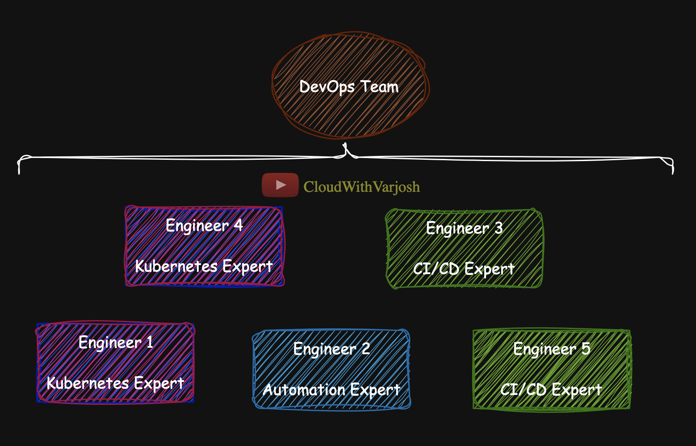
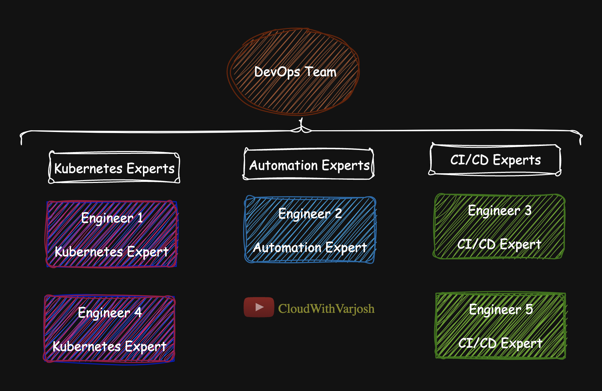
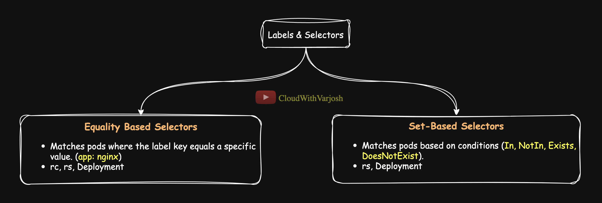

# 17 · Labels, Selectors and Annotations

> **Level:** ★ foundation
>
> **You will learn:** what labels are and why almost every Kubernetes feature depends on them; equality-based and set-based selectors (`=`, `!=`, `in`, `notin`, exists, does-not-exist) on the command line and in YAML (`matchLabels`, `matchExpressions`); the recommended `app.kubernetes.io/*` labels; annotations and how they differ from labels; and the rules for label keys and values.
>
> **You need:** topics 13 and 15.

---

## ⚡ Core: the 10-minute version

**The idea.** **Labels** are key/value tags on objects (`app: web`, `env: prod`). **Selectors** are filters over those labels. This is how Kubernetes links things together:
- a Service finds its Pods by selector;
- a ReplicaSet counts its Pods by selector;
- a NetworkPolicy targets Pods by selector.

**Annotations** also hold key/values, but they're notes for tools and humans, and you can't select on them.

**Picture it.** Labels are coloured stickers on boxes; a selector is "bring me every box with a red **and** a round sticker".

**The one thing to know.**

```bash
kubectl label pod web env=dev
kubectl get pods -l app=web,env=dev            # equality-based
kubectl get pods -l 'env in (dev,qa)'          # set-based
kubectl get pods --show-labels
```

```yaml
selector:
  matchLabels: { app: web }
  matchExpressions:
  - { key: env, operator: In, values: [dev, qa] }   # all conditions are ANDed
```

**Try it now:**
1. Create two Pods with different labels.
2. Select each one, then both, using `-l`.
3. Remove a label with `kubectl label pod web env-`.

**You've got it if you can:** explain why a typo in a label silently disconnects a Service from its Pods.

> 📖 **That's the core.** On a first pass, do the mini-lab and move on to the next topic. Everything below is the **full reference**: come back for the details, the edge cases, interview answers and exam-level depth.

---

## What it is

- **Labels** are **key-value pairs** attached to objects (Pods, Nodes, Services, anything) for **logical grouping and selection**. Example: `app=nginx`, `env=production`, `tier=frontend`.
- **Selectors** are **filters** that pick objects by their labels: "all Pods with `app=nginx`".
- **Annotations** are also key-value pairs, but for **non-identifying information**: notes for humans and tools, such as change causes, build info, links, or configuration for controllers. **You can't select by annotations.**

**Kubernetes features built on labels and selectors:** ReplicationControllers, ReplicaSets, Deployments, StatefulSets, DaemonSets, **Services** (which Pods get traffic), Jobs, CronJobs, **NetworkPolicies** (which Pods a rule applies to), plus PodDisruptionBudgets, node selection and affinity, HPAs (through their targets) and many more. **You'll use labels in almost every topic from here on.**

---

## Why it exists

Kubernetes objects are **loosely coupled**. A ReplicaSet doesn't keep a list of "my Pods by name", and a Service doesn't list "my backend IPs". Instead they say "**whatever has these labels**". That means:
- Pods can be replaced (new names, new IPs) and are still found automatically.
- One Pod can belong to many groupings at once (a Service, a NetworkPolicy, a PDB).
- You can slice the cluster any way you like: by app, team, environment, version, cost centre.

---

## Analogy

The **team-expertise analogy**:



A DevOps team of 5 engineers: **2 Kubernetes experts, 1 automation expert, 2 CI/CD experts**. Each engineer's expertise is a **label**: `Kubernetes Expert`, `Automation Expert`, `CI/CD Expert`.



To find people by expertise, you apply a **selector**: "find all Kubernetes experts". You immediately get the right group **without knowing their names**. If a new Kubernetes expert joins tomorrow, the same selector finds them too. That's exactly how a Service finds new Pods.

---

## How it works inside

### Label syntax rules

- **Key** = optional **prefix** + `/` + **name**: `app.kubernetes.io/name`, or just `app`.
  - Name: up to 63 characters; letters, digits, `-`, `_`, `.`; must start and end with a letter or digit.
  - Prefix: a DNS subdomain (≤ 253 chars). The prefixes `kubernetes.io/` and `k8s.io/` are reserved for Kubernetes itself.
- **Value**: up to 63 characters, same character rules, may be empty.
- Labels live in `metadata.labels`; annotations in `metadata.annotations`.

### Two kinds of selectors



1. **Equality-based**: match an exact value. Operators `=` (or `==`) and `!=`.
   - `app=k8s` → objects labelled `app=k8s`.
   - `env!=prod` → objects whose `env` isn't `prod` (**including objects with no `env` label at all**).
2. **Set-based**: match against a set of values, or presence. Operators `in`, `notin`, exists, does-not-exist.
   - `role in (dev, test)` → `role` is `dev` or `test`.
   - `tier` → the `tier` label exists (any value).
   - `!debug` → no `debug` label.

Several requirements separated by commas are **ANDed**: `app=web,env in (prod,stage)`. There is no OR across different keys (use set-based `in` for OR on one key).

| Selector type | Supported by | Description |
|---|---|---|
| **Equality-based** | ReplicationController, ReplicaSet, Deployment, Service… | Label key equals a value (`app: nginx`) |
| **Set-based** | ReplicaSet, Deployment, StatefulSet, DaemonSet, Job, NetworkPolicy, PDB… | `In`, `NotIn`, `Exists`, `DoesNotExist` |

**Note:** a **Service's** `selector` and a **ReplicationController's** `selector` are plain maps: **equality only**. Newer objects use a `LabelSelector` with `matchLabels` and/or `matchExpressions`.

### In YAML: `matchLabels` and `matchExpressions`

Equality-based:

```yaml
selector:
  matchLabels:
    app: nginx
```

Set-based operators:

| Operator | Description | Example |
|---|---|---|
| `In` | Value is in the set | Pods where `app` is `nginx` or `apache` |
| `NotIn` | Value is not in the set (or the label is missing) | Pods where `environment` is **not** `development` |
| `Exists` | The key is present, any value | Pods where `tier` is defined |
| `DoesNotExist` | The key is absent | Pods where `debug` is **not** defined |

```yaml
selector:
  matchExpressions:
    - { key: app,         operator: In,           values: [nginx, apache] }
    - { key: environment, operator: NotIn,        values: [development] }
    - { key: tier,        operator: Exists }
    - { key: debug,       operator: DoesNotExist }
```

- `matchLabels` and `matchExpressions` can be used together; **all** conditions must match (AND).
- `Exists`/`DoesNotExist` take **no** `values`.
- The full ReplicaSet using this selector is in topic 24 (`Day 10/set-based.yaml`).

### How controllers use selectors (and the trap)

A ReplicaSet counts **every Pod in its namespace that matches its selector**, no matter who created it (Day 10: "any Pod with matching labels becomes part of the rc, regardless of how it was created"). So:
- If you hand-create a Pod with `app=nginx` next to a ReplicaSet selecting `app=nginx` with `replicas: 3` and 3 Pods already running, the ReplicaSet sees 4 and **deletes one**.
- Remove the label from a running Pod (`kubectl label pod x app-`) and the ReplicaSet no longer counts it: it creates a replacement, and the old Pod keeps running **orphaned**. That's a handy debugging trick: pull a misbehaving Pod out of a Service and its ReplicaSet without killing it.
- For workload controllers (Deployment, ReplicaSet, StatefulSet, DaemonSet, Job), the selector must match the Pod template's labels, and in `apps/v1` the selector is **immutable** after creation.

Controllers also set **ownerReferences** on what they create, so they don't fight over Pods that happen to match several selectors.

### Recommended labels

Kubernetes recommends a common set so tools (dashboards, Helm, Argo CD) can understand your apps:

| Label | Example | Meaning |
|---|---|---|
| `app.kubernetes.io/name` | `mysql` | Application name |
| `app.kubernetes.io/instance` | `mysql-prod` | This particular installation |
| `app.kubernetes.io/version` | `8.4.3` | App version |
| `app.kubernetes.io/component` | `database` | Role in the architecture |
| `app.kubernetes.io/part-of` | `shop` | The higher-level app it belongs to |
| `app.kubernetes.io/managed-by` | `Helm` | Tool managing it |

Kubernetes also sets well-known labels itself: on nodes `kubernetes.io/hostname`, `kubernetes.io/os`, `node-role.kubernetes.io/control-plane`, `topology.kubernetes.io/zone`; on Pods created by Deployments `pod-template-hash`; on every namespace `kubernetes.io/metadata.name`.

### Annotations

Annotations attach **arbitrary metadata** that **doesn't identify** the object:
- They **don't change the object's behaviour directly** (though controllers may read them).
- They're for informational or operational metadata: deployment change causes, build info (git SHA, CI job URL), links to dashboards or runbooks, owner contacts, operational notes.
- Values can be **large** (total size up to 256 KiB per object) and contain any characters, unlike labels.

Common annotations you'll meet:

| Annotation | Used by |
|---|---|
| `kubernetes.io/change-cause` | Shown in `kubectl rollout history` (topic 25) |
| `kubectl.kubernetes.io/last-applied-configuration` | Client-side apply (topic 15) |
| `deployment.kubernetes.io/revision` | Deployment revision number on ReplicaSets |
| `prometheus.io/scrape: "true"` | Some Prometheus setups (topic 80) |
| `alb.ingress.kubernetes.io/scheme` | AWS Load Balancer Controller config (topic 70) |
| `kubectl.kubernetes.io/default-container` | Which container `kubectl logs/exec` picks by default |

**Labels vs annotations:**

| | Labels | Annotations |
|---|---|---|
| Purpose | Identify, group, **select** | Describe, configure tools |
| Selectable | Yes | No |
| Size/characters | Short, restricted | Large, any |
| Examples | `app=web`, `env=prod` | change cause, git SHA, controller settings |

---

## Commands / YAML

### Add, change, remove labels

```bash
kubectl run nginx-pod --image=nginx --restart=Never --labels="app=nginx,env=production"
kubectl get pods --show-labels
```

```
NAME        READY   STATUS    RESTARTS   AGE   LABELS
nginx-pod   1/1     Running   0          5s    app=nginx,env=production
```

```bash
kubectl label pod nginx-pod tier=web                 # add
kubectl label pod nginx-pod env=staging --overwrite  # change (needs --overwrite)
kubectl label pod nginx-pod tier-                    # remove (key followed by -)
kubectl label nodes lab-worker disktype=ssd          # label a node (topic 44)
```

### Select on the command line

```bash
kubectl get pods -l app=nginx                         # equality
kubectl get pods -l 'env!=production'
kubectl get pods -l 'env in (staging,production)'     # set-based (quote it!)
kubectl get pods -l 'tier'                            # has a tier label
kubectl get pods -l '!debug'                          # no debug label
kubectl get pods -l app=nginx,tier=web                # AND
kubectl get pods -L app,env                           # show these labels as columns
kubectl delete pods -l env=test                       # act on a whole group
```

```
NAME        READY   STATUS    RESTARTS   AGE   APP     ENV
nginx-pod   1/1     Running   0          2m    nginx   staging
```

- `-l` (`--selector`) filters; `-L` (`--label-columns`) adds columns.
- Quote set-based expressions so the shell doesn't interpret `(`, `)` or `!`.

### Day 13 note on labels

- `kubectl run` sets any Pod labels you like with `--labels`.
- `kubectl create deployment` **can't** set custom Pod labels via flags; it always uses `app=<deployment-name>`. Generate the YAML with `--dry-run=client -o yaml` and edit both `selector.matchLabels` and `template.metadata.labels` (topic 15).
- Labelling a Deployment with `kubectl label deploy x foo=bar` labels the **Deployment object**, not its Pods. Pod labels come from `spec.template.metadata.labels`.

### Annotations

```bash
kubectl annotate deployment web owner="team-payments" runbook="https://wiki/runbooks/web"
kubectl annotate deployment web owner-                 # remove
kubectl get deploy web -o jsonpath='{.metadata.annotations}{"\n"}'
```

```yaml
metadata:
  name: web
  labels:
    app.kubernetes.io/name: web
    app.kubernetes.io/part-of: shop
    env: production
  annotations:
    kubernetes.io/change-cause: "Upgrade to 2.4.1"
    owner: team-payments
```

---

## Hands-on lab

1. Create five Pods representing the Day 10 team:
   ```bash
   for n in k8s-1 k8s-2; do kubectl run $n --image=nginx --labels=expertise=kubernetes; done
   kubectl run auto-1 --image=nginx --labels=expertise=automation
   for n in cicd-1 cicd-2; do kubectl run $n --image=nginx --labels=expertise=cicd; done
   ```
2. Select: `kubectl get pods -l expertise=kubernetes`; then `-l 'expertise in (automation,cicd)'`; then `-l 'expertise!=kubernetes'`.
3. Add a `senior=true` label to two Pods and find "senior Kubernetes experts" with `-l expertise=kubernetes,senior=true`.
4. Orphan a Pod: `kubectl create deploy web --image=nginx --replicas=2`, then remove a Pod's `app` label (`kubectl label pod <pod> app-`). Run `kubectl get pods -L app`: 3 Pods, one without the label and no longer owned (check its `ownerReferences`).
5. Annotate `web` with an owner and read it back with JSONPath.
6. Clean up: `kubectl delete pods -l expertise; kubectl delete deploy web; kubectl delete pod -l '!app'` (careful: check the list with `get` first).

---

## Where you'll use it

- Wiring **Services, NetworkPolicies, PDBs and HPAs** to the right Pods.
- **Operations**: `kubectl logs -l app=web --all-containers`, `kubectl delete pods -l app=web` to restart a group, `kubectl get pods -l team=payments -A`.
- **Cost and ownership**: `team`, `cost-center` labels for chargeback; Kyverno/Gatekeeper policies that **require** certain labels (topic 58).
- **Incident trick**: pull a broken Pod out of a Service by relabelling it, then debug it live.

---

## When it breaks

| Symptom | Cause | Fix |
|---|---|---|
| Service has **no endpoints** | Service selector doesn't match Pod labels (typo, different case) | Compare `kubectl get svc x -o yaml` selector with `kubectl get pods --show-labels` |
| `selector does not match template labels` on create | Workload's selector ≠ template labels | Make them match |
| `field is immutable` when changing a Deployment selector | `apps/v1` selectors can't change | Create a new Deployment |
| ReplicaSet deletes your hand-made Pod | Your Pod's labels matched its selector | Use unique labels for test Pods |
| Two Deployments fight over Pods | Overlapping selectors | Make selectors unique per workload |
| `kubectl label` error "already has a value" | Changing an existing key | Add `--overwrite` |
| Selector `-l env in (a,b)` errors in the shell | Unquoted parentheses | Quote the expression |

---

## Quick recap

- Labels = identifying key-value pairs; selectors = filters over labels; nearly every Kubernetes link (Service → Pods, ReplicaSet → Pods, NetworkPolicy → Pods) is a selector.
- Equality (`=`, `!=`) vs set-based (`in`, `notin`, exists, `!key`); in YAML `matchLabels` + `matchExpressions`, all ANDed.
- Controllers adopt **any** matching Pod; selectors in `apps/v1` are immutable.
- Annotations = non-identifying metadata for humans and tools; not selectable.

### Interview questions

1. **Q: How does a Service know which Pods to send traffic to?**
   A: Its `selector` matches Pod labels; the EndpointSlice controller keeps a list of ready Pods matching that selector.
2. **Q: Labels vs annotations?**
   A: Labels identify and are used by selectors (short, restricted syntax); annotations hold arbitrary non-identifying metadata for tools and humans and can't be selected on.
3. **Q: What happens if you remove the selector label from a Pod owned by a ReplicaSet?**
   A: The ReplicaSet stops counting it, creates a replacement, and the relabelled Pod keeps running as an orphan (also dropping out of any Service that selected it).

---

## Appendix: notes on the original course material

This topic was rebuilt from the original CKA course notes. This appendix keeps the audit trail out of your way while you learn.

### Sources

Day 10 (labels and selectors, the team-expertise analogy, features that use them, equality vs set-based categories, equality-based vs set-based table, operator table, annotations definition and characteristics), Day 13 (labels: what you need to know, verifying labels).
