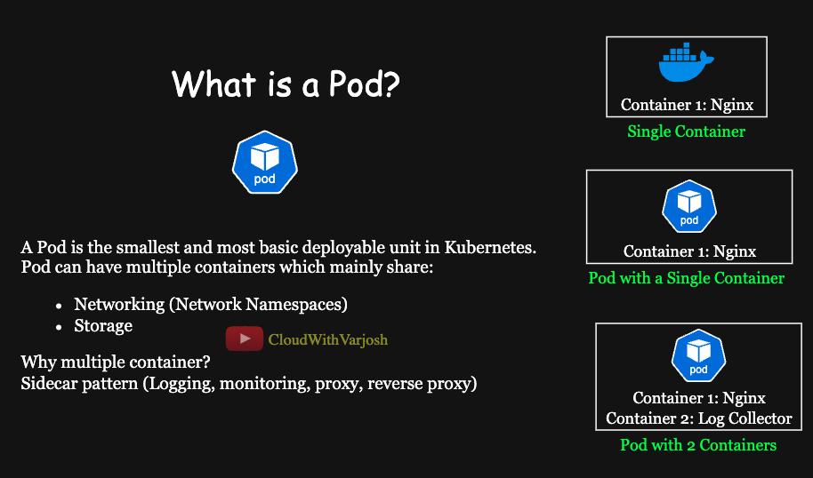

# 18 · Pods: The Smallest Unit in Kubernetes

> **Level:** ★ foundation
>
> **You will learn:** what a Pod is and why Kubernetes uses Pods instead of plain containers; what the containers in a Pod share (network namespace, IP, `localhost`, volumes, IPC) and what they don't; the pause (sandbox) container, seen live on a node; the main Pod spec fields; Pod IPs and why they change; why you almost never create bare Pods; and the everyday Pod commands (`get`, `describe`, `logs`, `exec`, `delete`, `port-forward`, `cp`).
>
> **You need:** topics 04, 10, 13 and 17.

---

## ⚡ Core: the 10-minute version

**The idea.** A **Pod** is the smallest thing Kubernetes runs: one or more containers that **share a network** (one IP, so they reach each other on `localhost`) and can share volumes. A hidden **pause** container holds the shared network namespace. Pods are disposable: when one is replaced, the new Pod gets a **new IP**. That's why you reach Pods through Services and create them through controllers like Deployments, not by hand.

**Picture it.** A Pod is a flat shared by roommates: one front door (IP), one address, a shared kitchen (volumes).

**The one thing to know.** The everyday Pod commands:

```bash
kubectl run web --image=nginx:1.27
kubectl get pods -o wide            # IP and node
kubectl describe pod web            # events at the bottom
kubectl logs web                    # add -f to follow, --previous after a crash
kubectl exec -it web -- sh          # shell inside
kubectl port-forward pod/web 8080:80
kubectl delete pod web
```

**Try it now:**
1. Run each command in order.
2. While port-forwarding, run `curl localhost:8080`.
3. Delete the Pod and notice nothing brings it back (it's a bare Pod).

**You've got it if you can:** explain what containers in one Pod share, and why bare Pods aren't used in production.

> 📖 **That's the core.** On a first pass, do the mini-lab and move on to the next topic. Everything below is the **full reference**: come back for the details, the edge cases, interview answers and exam-level depth.

---

## What it is

A **Pod** is the **smallest deployable unit** in Kubernetes. It's a wrapper around **one or more containers** that:
- are always **scheduled together on the same node**,
- **share one network namespace**: one IP address, one set of ports, one `localhost`,
- can **share volumes** (directories mounted into several containers),
- share IPC (shared memory) and the hostname,
- are **started, stopped and deleted together**.



Most Pods have **one** container. Extra containers are **helpers** tightly bound to the main one: a log shipper, a proxy, an init step (topic 23).

---

## Why it exists

Why not schedule bare containers?
- Some processes **must** sit next to each other: a web server and the agent that reloads its config, an app and its local proxy. They need to talk over `localhost` and share files, and they must land on the same machine. A Pod gives them a shared "logical host".
- Kubernetes needs one **unit to schedule, network, and give an IP**. Containers come and go (restarts); the Pod is the stable envelope with the IP and the volumes.
- It mirrors the old "one VM runs a few cooperating processes" model, without the VM.

---

## Analogy

A Pod is a **flat** shared by flatmates (containers):
- one **street address** (the Pod IP); visitors can't tell which flatmate answers;
- they call each other on the **internal intercom** (`localhost`);
- they share the **kitchen** (volumes) but each has their own **bedroom** (own filesystem from their image, own processes);
- two flatmates can't both use the **same doorbell number** (port);
- the **lease** (pause container) is held separately, so a flatmate moving out and back in doesn't change the address.

---

## How it works inside

### What's shared and what isn't

| Resource | Shared between containers in a Pod? |
|---|---|
| Network namespace (IP, ports, `localhost`, routes) | **Yes** |
| IPC namespace (shared memory) | **Yes** |
| UTS namespace (hostname = Pod name) | **Yes** |
| Volumes | **Yes**, if each container mounts them |
| PID namespace (see each other's processes) | **No** by default; yes with `shareProcessNamespace: true` |
| Filesystem (root `/`) | **No**: each container has its own, from its own image |
| cgroups (CPU/memory limits) | Each container has its own, inside one Pod-level cgroup |

So: two containers in one Pod **can't both listen on port 80**, and container A reaches container B at `localhost:<port>`.

### The sandbox (pause) container

From topic 04: when the kubelet starts a Pod, the runtime first creates the **Pod sandbox**: a tiny **pause** container (`registry.k8s.io/pause`) that just sleeps and **holds the network, IPC and UTS namespaces**. The CNI plugin gives that namespace its `eth0` and IP. Each app container is then started **inside** those namespaces.

Consequences:
- If an app container crashes and restarts, the Pod **keeps its IP**: the sandbox never went away.
- If the **Pod** is deleted and recreated (e.g. by a ReplicaSet), the new Pod gets a **new sandbox and a new IP**.

### Pod IPs are not stable

Each Pod gets an IP from its node's Pod range (topic 29). Every **new Pod gets a new IP**, and Pods are replaced all the time (rollouts, node failures, scaling). **Never hard-code Pod IPs.** That's why **Services** exist (topic 30): a stable IP and DNS name in front of a changing set of Pods.

### Bare Pods vs managed Pods

A Pod you create directly (a "bare" or "naked" Pod) is **not self-healing**:
- if its node dies, the Pod is gone, and nothing recreates it;
- you can't change most of its spec (Pod specs are largely **immutable**);
- no rolling updates.

So in practice you create **controllers** that create Pods for you: **Deployments** (stateless apps, topic 25), **StatefulSets** (40), **DaemonSets** (27), **Jobs/CronJobs** (28). Bare Pods are for tests and debugging.

### The key Pod spec fields

```yaml
apiVersion: v1
kind: Pod
metadata:
  name: web
  labels: { app: web }
spec:
  containers:                       # one or more app containers
  - name: nginx
    image: nginx:1.29
    ports: [{ containerPort: 80 }]  # informational, like EXPOSE
    env: [{ name: MODE, value: "prod" }]              # topic 34
    resources:                                        # topic 41
      requests: { cpu: 100m, memory: 128Mi }
      limits:   { memory: 256Mi }
    readinessProbe: { httpGet: { path: /, port: 80 } } # topic 22
    volumeMounts: [{ name: cache, mountPath: /cache }]
  initContainers: []                # run before app containers (topic 23)
  volumes: [{ name: cache, emptyDir: {} }]            # topic 37
  restartPolicy: Always             # topic 19
  terminationGracePeriodSeconds: 30 # topic 19
  serviceAccountName: default       # identity for API access (topic 55)
  nodeSelector: {}                  # where it may run (topics 42–46)
  securityContext: {}               # users, capabilities (topic 59)
```

---

## Commands / YAML

### Create and list (Day 09's basic commands)

```bash
kubectl apply -f pod.yaml                 # create from a file
kubectl run web --image=nginx:1.29        # create imperatively (topic 15)
kubectl get pods                          # list Pods
kubectl get pods -o wide                  # with IP and node
```

```
NAME   READY   STATUS    RESTARTS   AGE   IP           NODE          NOMINATED NODE   READINESS GATES
web    1/1     Running   0          20s   10.244.1.4   lab-worker    <none>           <none>
```

| Column | Meaning |
|---|---|
| `READY 1/1` | Containers ready / total (readiness probes included) |
| `STATUS` | A summary: the phase or the most important container reason (`Running`, `Pending`, `CrashLoopBackOff`, `Completed`…; topic 19) |
| `RESTARTS` | Total container restarts in this Pod |
| `IP` | The Pod's IP (shared by its containers) |
| `NODE` | Where it was scheduled |
| `NOMINATED NODE` | A node reserved for it during preemption (topic 47) |
| `READINESS GATES` | Extra readiness conditions from external controllers (e.g. AWS LB controller) |

### Describe: the most useful command

```bash
kubectl describe pod web
```

```
Name:             web
Namespace:        default
Node:             lab-worker/172.18.0.2
Labels:           run=web
Status:           Running
IP:               10.244.1.4
Containers:
  web:
    Image:          nginx:1.29
    State:          Running
      Started:      Tue, 17 Nov 2026 10:41:03 +0000
    Ready:          True
    Restart Count:  0
Conditions:
  Type                        Status
  PodReadyToStartContainers   True
  Initialized                 True
  Ready                       True
  ContainersReady             True
  PodScheduled                True
Events:
  Type    Reason     Age   From               Message
  ----    ------     ----  ----               -------
  Normal  Scheduled  25s   default-scheduler  Successfully assigned default/web to lab-worker
  Normal  Pulling    24s   kubelet            Pulling image "nginx:1.29"
  Normal  Pulled     21s   kubelet            Successfully pulled image "nginx:1.29" in 3.1s
  Normal  Created    21s   kubelet            Created container: web
  Normal  Started    21s   kubelet            Started container web
```

- **Containers → State** = `Waiting` (with a reason), `Running` or `Terminated` (with exit code); topic 19.
- **Conditions** = the Pod's checklist (sandbox ready, init done, containers ready, scheduled).
- **Events** = the story so far, **the first place to look** when something's wrong (topic 21). Events are kept for about **1 hour** by default.

### Logs

```bash
kubectl logs web                     # current container's stdout/stderr
kubectl logs web -c sidecar          # a specific container in a multi-container Pod
kubectl logs -f web                  # follow (stream) live
kubectl logs web --previous          # the PREVIOUS (crashed) instance; essential for CrashLoopBackOff
kubectl logs web --since=10m --tail=50 --timestamps
kubectl logs -l app=web --all-containers --prefix   # many Pods by label
```

### Exec into a container

```bash
kubectl exec -it web -- /bin/bash                 # interactive shell
kubectl exec -it web -c sidecar -- /bin/sh        # a specific container
kubectl exec web -- cat /etc/resolv.conf          # one command, no TTY
```

- `--` separates kubectl's flags from the command to run.
- Minimal images (distroless) have **no shell**; use `kubectl debug` (topic 21).

### Delete

```bash
kubectl delete pod web               # graceful: SIGTERM, wait, SIGKILL (topic 19)
kubectl delete pod -l app=web        # by label
```

### More daily commands

```bash
kubectl port-forward pod/web 8080:80          # localhost:8080 → Pod port 80 (through the API server)
kubectl cp web:/etc/nginx/nginx.conf ./nginx.conf   # copy files out (needs tar in the image)
kubectl get pod web -o yaml                   # full object (spec + status)
kubectl explain pod.spec.containers           # field docs (topic 14)
kubectl top pod web                           # CPU/memory (needs metrics-server, topic 48)
```

---

## Hands-on lab: see the shared namespace and the sandbox

1. Create a two-container Pod (Day 09's `Day 09/pod.yaml`: nginx + busybox sleeping):
   ```bash
   kubectl apply -f "Day 09/pod.yaml"
   kubectl get pod my-pod-2 -o wide
   ```
2. Prove they share the network: from the **busybox** container, fetch nginx on `localhost`:
   ```bash
   kubectl exec my-pod-2 -c sidecar-container -- wget -qO- localhost:80 | head -4
   ```
   ```
   <!DOCTYPE html>
   <html>
   <head>
   <title>Welcome to nginx!</title>
   ```
3. Prove they don't share processes or filesystems:
   ```bash
   kubectl exec my-pod-2 -c sidecar-container -- ps          # only busybox's processes
   kubectl exec my-pod-2 -c sidecar-container -- ls /etc/nginx   # No such file
   ```
4. Same IP for both: `kubectl exec my-pod-2 -c sidecar-container -- ip addr show eth0`, and compare with `kubectl get pod -o wide`.
5. Find the sandbox on the node (replace the node name with the one from step 1):
   ```bash
   docker exec lab-worker crictl pods --name my-pod-2
   docker exec lab-worker crictl ps --pod $(docker exec lab-worker crictl pods --name my-pod-2 -q)
   ```
   One sandbox, two containers.
6. Restart a container without losing the IP: `kubectl exec my-pod-2 -c nginx-container -- nginx -s stop`. Watch `RESTARTS` go to 1 and the **IP stay the same**. Then `kubectl delete pod my-pod-2` and re-apply: the **new** Pod has a **different IP**.
7. Port-forward and browse: `kubectl port-forward pod/my-pod-2 8080:80`, then `curl localhost:8080`.

---

## Where you'll use it

- **Every workload** runs in Pods, even when you create Deployments or Jobs.
- **Debugging**: `describe`, `logs --previous`, `exec`, `port-forward` are your daily tools.
- **Design**: deciding what goes in one Pod (tightly coupled helpers) vs separate Pods (independently scalable services).

---

## When it breaks

| Symptom | Likely cause | Topic |
|---|---|---|
| `Pending` | No node fits (resources, taints, affinity), or PVC not bound | 21, 42 |
| `ContainerCreating` for long | Image pulling, CNI not ready, volume or Secret missing | 21 |
| `ErrImagePull` / `ImagePullBackOff` | Wrong image or tag, private registry | 20, 21 |
| `CrashLoopBackOff` | App keeps exiting | 21 |
| `Running` but `0/1` ready | Readiness probe failing | 22 |
| `bind: address already in use` in logs | Two containers in one Pod use the same port | This topic |
| Pod disappeared after a node failure | It was a bare Pod; nothing recreated it | 24–25 |
| `error: unable to upgrade connection` on exec/logs | API server can't reach the kubelet (port 10250) | 83 |

---

## Quick recap

- A Pod = one or more containers that share a **network namespace (one IP, `localhost`)**, IPC, hostname and volumes, held together by the **pause/sandbox** container.
- Container restart keeps the Pod IP; **a new Pod gets a new IP**, so use Services.
- Bare Pods don't self-heal; use Deployments/StatefulSets/DaemonSets/Jobs.
- Daily commands: `get -o wide`, `describe`, `logs [-c] [--previous] [-f]`, `exec -it -- sh`, `port-forward`, `delete`.

### Interview questions

1. **Q: Why does Kubernetes schedule Pods, not containers?**
   A: Some containers must be co-located and share network and storage; the Pod gives them one IP, `localhost`, shared volumes and a single scheduling and lifecycle unit.
2. **Q: Two containers in one Pod both want port 8080. What happens?**
   A: The second fails with "address already in use" because they share the network namespace; give them different ports.
3. **Q: Why does a Pod keep its IP when a container restarts but not when the Pod is recreated?**
   A: The IP belongs to the sandbox's network namespace; container restarts reuse the sandbox, while a new Pod gets a new sandbox and a new IP.

---

## Appendix: notes on the original course material

This topic was rebuilt from the original CKA course notes. This appendix keeps the audit trail out of your way while you learn.

### Sources

Day 07 (What is a Pod, network namespaces), Day 09 (basic Pod-related commands; the two-container Pod manifest is in topic 13).
