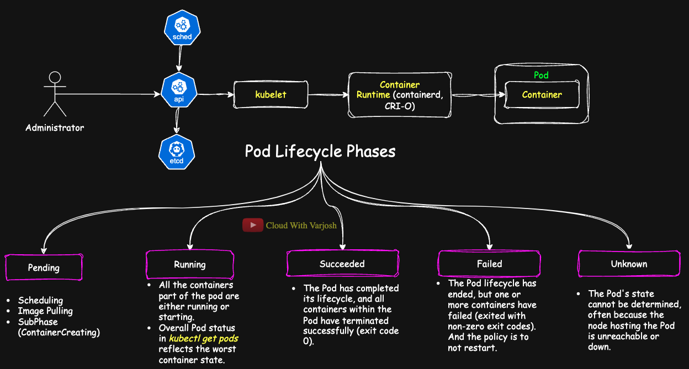
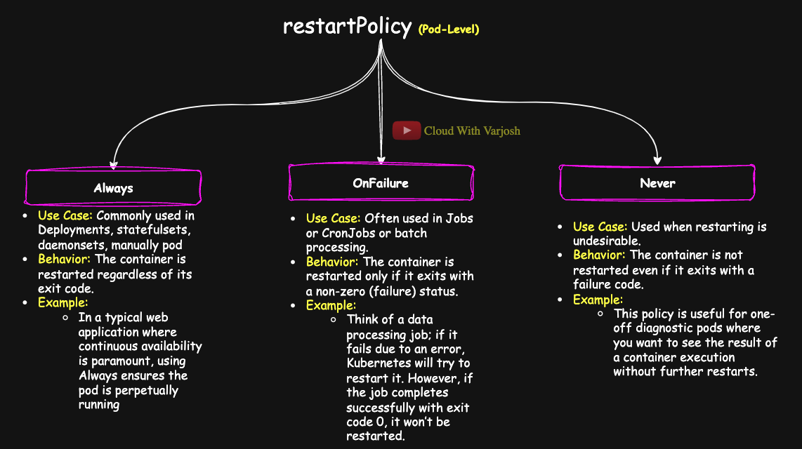
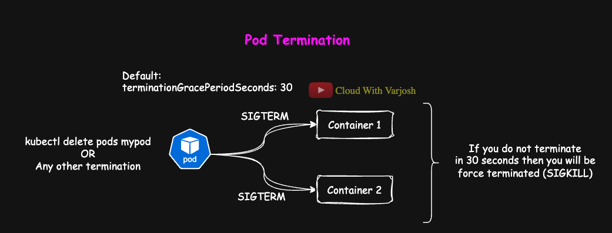

# 19 · Pod Lifecycle, Restart Policies and Graceful Termination

> **Level:** ★★ intermediate
>
> **You will learn:** the five Pod **phases** (Pending, Running, Succeeded, Failed, Unknown), container **states** (Waiting, Running, Terminated) and Pod **conditions**; why `kubectl get pods` shows `Completed` or `CrashLoopBackOff` when those aren't phases; the three **restart policies** and the restart back-off; exactly what happens when a Pod is deleted (SIGTERM, grace period, preStop hooks, endpoint removal, SIGKILL); force deletion and its risks; and how to write apps that shut down cleanly.
>
> **You need:** topics 03, 04 and 18.

---

## ⚡ Core: the 10-minute version

**The idea.** A Pod moves through **phases**: `Pending` (waiting to be scheduled or to pull images) → `Running` → `Succeeded` or `Failed`. What `kubectl get pods` shows in STATUS is often a more specific **reason**, such as `ContainerCreating`, `CrashLoopBackOff` or `Completed`.
- **`restartPolicy`** decides whether crashed containers restart: `Always` (default), `OnFailure` or `Never`. Restarts back off from 10 s up to 5 min.
- **When a Pod is deleted**: it's removed from Service endpoints, the `preStop` hook runs, the app gets **SIGTERM**, and after the grace period (30 s default) it gets **SIGKILL**.

**Picture it.** Closing time at a shop: lock the door to new customers (endpoints), announce closing (SIGTERM), give people 30 minutes, then switch the lights off (SIGKILL).

**The one thing to know.**

```yaml
spec:
  terminationGracePeriodSeconds: 30
  containers:
  - name: app
    image: nginx:1.27
    lifecycle:
      preStop: { sleep: { seconds: 5 } }   # let load balancers stop sending traffic first
```

**Try it now:**
1. Run a Pod with `command: ["sh","-c","exit 1"]` and watch the restarts back off (`kubectl get pod -w`).
2. Delete a normal Pod and time how long it stays `Terminating`.
3. Compare with `kubectl delete pod x --grace-period=0 --force` (labs only).

**You've got it if you can:** walk through exactly what happens when a Pod is deleted.

> 📖 **That's the core.** On a first pass, do the mini-lab and move on to the next topic. Everything below is the **full reference**: come back for the details, the edge cases, interview answers and exam-level depth.

---

## What it is

A Pod goes through a **lifecycle** from creation to deletion. Kubernetes describes it at three levels:

| Level | Field | Values |
|---|---|---|
| **Pod phase** (one word for the whole Pod) | `status.phase` | `Pending`, `Running`, `Succeeded`, `Failed`, `Unknown` |
| **Container state** (per container) | `status.containerStatuses[].state` | `Waiting` (with reason), `Running`, `Terminated` (with exit code and reason) |
| **Pod conditions** (checklist) | `status.conditions[]` | `PodScheduled`, `PodReadyToStartContainers`, `Initialized`, `ContainersReady`, `Ready` |

Two policies control behaviour:
- **`restartPolicy`**: what the kubelet does when a container exits.
- **`terminationGracePeriodSeconds`** (+ `preStop` hooks): how long a container gets to shut down cleanly.

---

## Why it exists

Reading lifecycle information correctly is how you debug almost every Pod problem: "Pending" means a different thing from "ContainerCreating", which means a different thing from "CrashLoopBackOff". And graceful termination is what makes rolling updates, scale-downs and node drains **invisible to users**: no dropped requests, no half-written data.

---

## Analogy

A **restaurant table booking**:
- **Pending** = booked, but the table isn't set yet (finding a table = scheduling; laying cutlery = pulling images, mounting volumes).
- **Running** = guests are eating.
- **Succeeded** = guests finished and paid.
- **Failed** = guests walked out unhappy.
- **Unknown** = the waiter lost contact with that section of the restaurant.

**Closing time** (deletion) = staff announce "we're closing" (**SIGTERM**). Guests finish their meal within the grace period. After that, the lights go off (**SIGKILL**).

---

## How it works inside

### 1. Pod phases



**Pending**: the Pod is accepted by the cluster, but one or more containers aren't running yet. Includes:
- **Scheduling**: picking a node (resources, constraints, policies).
- **Image pulling**: fetching images not already on the node.
- **Container creation** (shown as **`ContainerCreating`**): the runtime (containerd/CRI-O) sets up the sandbox, network, volumes, environment variables and Secrets.

Common causes of long Pending: not enough cluster resources; unsatisfiable constraints (affinity, taints); image pull delays or errors (`ErrImagePull`, `ImagePullBackOff`). Debug with `kubectl describe pod` → Events: `FailedScheduling`, `Failed to pull image`.

**`ContainerCreating`** is the final preparation step before Running: pulling the image (if not cached), setting up storage volumes and networking, initialising environment variables and Secrets. (It's a container **waiting reason**, shown in the STATUS column; the phase is still `Pending`.)

**Running**: the Pod is bound to a node, all containers have been created, and **at least one** container is running, starting or restarting.

**Succeeded**: **all** containers terminated **successfully** (exit code 0) and won't restart. Terminal. Typical for Jobs, CronJobs and one-shot Pods.

**Failed**: all containers terminated, and **at least one failed** (non-zero exit code, or killed by the system), and won't be restarted (`restartPolicy: Never`, or `OnFailure` gave up via a Job). Terminal; a controller may create a **new** Pod.

**Unknown**: the state can't be obtained, usually because the **node is unreachable**. Rare; points to infrastructure problems.

| Phase | Description |
|---|---|
| **Pending** | Accepted; containers not yet running (scheduling, image pull, ContainerCreating) |
| **Running** | Bound to a node; containers created; at least one running/starting/restarting |
| **Succeeded** | All containers exited 0; no restarts |
| **Failed** | All containers terminated; at least one non-zero; no automatic restart |
| **Unknown** | Can't determine state; usually node communication failure |

### 2. The STATUS column is not the phase

`kubectl get pods` shows a **summary**: if any container has a notable reason, it shows that **reason**, roughly the **"worst" container state**.

- A Pod with 4 containers, 3 `Running` and 1 `ErrImagePull`, shows **`ErrImagePull`**, so problems are highlighted immediately.
- Values you'll see in STATUS that are **reasons, not phases**: `ContainerCreating`, `PodInitializing`, `Init:0/2`, `ErrImagePull`, `ImagePullBackOff`, `CrashLoopBackOff`, `OOMKilled`, `Error`, `Completed`, `Terminating`, `Evicted`.

**`Succeeded` vs `Completed`:**
- **`Succeeded`** is the official **phase** (`kubectl describe pod` shows `Status: Succeeded`).
- **`Completed`** is the friendly word in the **STATUS column** of `kubectl get pods` (the container's terminated reason).

### 3. Container states and exit codes

| State | Reason examples | Meaning |
|---|---|---|
| `Waiting` | `ContainerCreating`, `ErrImagePull`, `ImagePullBackOff`, `CrashLoopBackOff`, `CreateContainerConfigError` | Not running yet; the reason says why |
| `Running` | — | Started at `startedAt` |
| `Terminated` | `Completed` (exit 0), `Error` (non-zero), `OOMKilled` (exit 137), `ContainerCannotRun` | Finished; has `exitCode`, `startedAt`, `finishedAt` |

`lastState` keeps the **previous** termination, which is how you see why a restarted container died.

Common exit codes: `0` success; `1` app error; `126` command not executable; `127` command not found; `137` = 128 + 9 (SIGKILL; often OOM); `143` = 128 + 15 (SIGTERM, a normal graceful stop).

### 4. Restart policies



`spec.restartPolicy` is set **per Pod** and applies to all its (app) containers. The kubelet restarts containers **in place**, on the same node, in the same Pod; it does **not** create a new Pod.

**1. `Always`** (the **default** for Pods)
- Restart the container **whatever** the exit code (0 or not).
- For long-running services: web servers, APIs, workers.
- Used by **Deployments, ReplicaSets, StatefulSets, DaemonSets**: their Pod templates **must** use `Always`.

```yaml
apiVersion: apps/v1
kind: Deployment
metadata:
  name: web-server-deployment
spec:
  replicas: 3
  selector: { matchLabels: { app: web-server } }
  template:
    metadata: { labels: { app: web-server } }
    spec:
      restartPolicy: Always        # the default; the only value allowed in a Deployment
      containers:
      - name: nginx
        image: nginx:1.29
```

**2. `OnFailure`**
- Restart **only** if the container exits **non-zero**. Exit 0 → done.
- For batch tasks that may hit transient errors: **Jobs, CronJobs**, sometimes standalone Pods.
- Example: a data-processing job fails on a corrupted file and is retried.

```yaml
apiVersion: batch/v1
kind: Job
metadata:
  name: batch-job-example
spec:
  template:
    spec:
      restartPolicy: OnFailure
      containers:
      - name: processor
        image: my-batch-job:1.0
```

**3. `Never`**
- **Never** restart, whatever the exit code.
- For one-off diagnostics or debugging, where you want to inspect the result or logs after exit.
- Used by standalone Pods and sometimes Jobs (then the **Job controller** creates a **new Pod** for each retry, instead of restarting the container; topic 28).

```yaml
apiVersion: v1
kind: Pod
metadata:
  name: diagnostic-pod
spec:
  restartPolicy: Never
  containers:
  - name: debug-container
    image: busybox:1.37
    command: ["nslookup", "kubernetes.default.svc.cluster.local"]
```

`Day 22/pod.yaml` is a Job with `restartPolicy: Never` that just echoes `Hello, Kubernetes!`.

| Policy | Use case | Where it's used | Details |
|---|---|---|---|
| **Always** | Continuous availability | **Default for Pods**; required by Deployments, ReplicaSets, StatefulSets, DaemonSets | Restarts forever, any exit code; long-running workloads |
| **OnFailure** | Batch work that should retry | Jobs, CronJobs, standalone Pods | Restarts only on non-zero exit; stops on success |
| **Never** | One-off diagnostics | Standalone Pods, Jobs | No restarts at all; must be set explicitly |

> ✅ **Correct today** ([C1](#c1)): Jobs and CronJobs have **no default**: you **must** set `restartPolicy` to `OnFailure` or `Never` (`Always` is rejected). For Pods the default is `Always`. Also, since **native sidecar containers** (GA in v1.33, topic 23), an **init container** can set its own `restartPolicy: Always`. That's the one per-container exception.

**Restart back-off.** Restarts aren't instant. The kubelet waits **10 s, 20 s, 40 s… up to 5 minutes** between restarts (exponential back-off). While waiting, the container shows **`CrashLoopBackOff`**. If a container then runs for **10 minutes** without crashing, the back-off resets. (Newer releases are tuning these numbers: alpha features shorten the initial delay and let you configure the maximum per node.)

### 5. What happens when you delete a Pod



`kubectl delete pod <pod-name>` starts a **graceful termination**, not an abrupt shutdown:

1. The API server sets `metadata.deletionTimestamp` and `deletionGracePeriodSeconds` (from the Pod's `terminationGracePeriodSeconds`, default **30**). The Pod shows **`Terminating`**.
2. **In parallel:**
   - The **EndpointSlice controller** marks the Pod **not ready / terminating**, so Services, kube-proxy, Ingress controllers and load balancers **stop sending new traffic** to it (this takes a moment to spread).
   - The **kubelet** sees the deletion and starts stopping the containers:
     a. runs each container's **`preStop` hook** (if defined), and the grace-period clock is already ticking;
     b. sends **SIGTERM** to PID 1 in each container (through the runtime);
     c. waits for the containers to exit, up to the end of the grace period.
3. If anything is still running when the grace period ends, the kubelet sends **SIGKILL**.
4. The kubelet tells the API server the containers are gone; the Pod object is **removed** from etcd.

**SIGTERM** means: "time to shut down gracefully: wrap up ongoing tasks". This is the window for closing connections, flushing caches or buffers, and finishing in-flight requests. **SIGKILL** can't be caught; the process just dies.

**The race condition (why `preStop: sleep` exists).** Steps 2a and 2b happen **at the same time**. If your app exits immediately on SIGTERM, some clients may still be routed to it for a second or two (load balancers and kube-proxy on other nodes haven't caught up yet), and they get errors. The common fix is a short **`preStop` sleep** so the Pod keeps serving while it's removed from the endpoints:

```yaml
spec:
  terminationGracePeriodSeconds: 45     # must be longer than preStop + app shutdown time
  containers:
  - name: web
    image: nginx:1.29
    lifecycle:
      preStop:
        sleep:
          seconds: 10                   # native sleep action (GA in v1.32); no shell needed
```

(Before the native `sleep` action, people used `exec: { command: ["sh","-c","sleep 10"] }`, which requires a shell in the image.)

**Graceful nginx example:** nginx receiving SIGTERM stops accepting new connections and finishes current requests. If that takes longer than the grace period, SIGKILL ends it.

```yaml
apiVersion: v1
kind: Pod
metadata:
  name: nginx-graceful
spec:
  terminationGracePeriodSeconds: 30
  containers:
  - name: nginx
    image: nginx:1.29
```

> Note: nginx actually treats SIGTERM as a *fast* shutdown and **SIGQUIT** as the graceful one; the official image sets `STOPSIGNAL SIGQUIT`, and Kubernetes now also lets you set a container's stop signal in the Pod spec (`lifecycle.stopSignal`, beta). The principle is the same: the app gets a signal, then the grace period, then SIGKILL.

> (Day 22's example named the Pod `nginx- graceful`, with a space, which is an invalid name; fixed here to `nginx-graceful`.)

**Rules for apps:** handle SIGTERM (stop accepting work, finish in-flight work, close connections, exit 0); make sure your app **is PID 1** or receives the signal (exec form, topic 03); keep shutdown shorter than the grace period.

### 6. Force deletion

```bash
kubectl delete pod mypod --force --grace-period=0
```

- `--force` = **remove the Pod object from the API server immediately**, without waiting for the kubelet to confirm the containers are gone.
- `--grace-period=0` = request immediate termination.
- Kubernetes doesn't send UNIX signals itself; the **kubelet** asks the **runtime** (containerd/CRI-O) to stop the containers.

> ✅ **Correct today** ([C2](#c2)): > - Modern kubectl treats **`--force` without a grace period as `--grace-period=0`**, and the docs require `--grace-period=0` with `--force`.
> - Plain `--grace-period=0` **without** `--force` is converted to **1 second** (a normal, fast graceful delete), to prevent accidental data loss.
> - A force delete only removes the **API object** at once. On the node, the kubelet still stops the containers with a **short grace period** when it notices. If the node is unreachable, the containers **may keep running** indefinitely.
>
> **Why that's dangerous:** a replacement Pod with the **same name** (StatefulSets, topic 40) can start elsewhere while the old one is still running and writing to the same storage, which can corrupt data. Use force delete only when a node is truly dead, or for stuck test Pods.

| Command | API object | On the node | Use |
|---|---|---|---|
| `kubectl delete pod mypod` | Removed after the kubelet confirms | preStop → SIGTERM → grace period → SIGKILL | Normal |
| `kubectl delete pod mypod --grace-period=5` | Same | Same with a 5 s grace period | Speed up a slow shutdown |
| `kubectl delete pod mypod --force --grace-period=0` | Removed **immediately** | Stopped with a minimal grace period when the kubelet gets to it; may keep running if the node is unreachable | Stuck Pods on dead nodes; never casually for StatefulSets |

### 7. Pod conditions

| Condition | True when |
|---|---|
| `PodScheduled` | Bound to a node |
| `PodReadyToStartContainers` | Sandbox and network created (GA in v1.35) |
| `Initialized` | All init containers succeeded |
| `ContainersReady` | All containers are ready |
| `Ready` | The Pod can serve traffic (ContainersReady + any readiness gates). Only Ready Pods get Service traffic. |

---

## Commands / YAML

### Demo 1: a short-lived Pod

```bash
kubectl get pods -w                                           # terminal 1
kubectl run ubuntu-1 --image=ubuntu --restart=Never -- ls     # terminal 2
```

```
NAME       READY   STATUS              RESTARTS   AGE
ubuntu-1   0/1     Pending             0          0s
ubuntu-1   0/1     ContainerCreating   0          0s
ubuntu-1   0/1     Completed           0          3s
```

- `ls` finishes so fast that you may **never see `Running`**: the Pod goes straight to `Completed` (phase `Succeeded`).

### Demo 2: a longer Pod

```bash
kubectl run ubuntu-2 --image=ubuntu --restart=Never -- sleep 5
```

```
ubuntu-2   0/1     Pending             0          0s
ubuntu-2   0/1     ContainerCreating   0          0s
ubuntu-2   1/1     Running             0          2s
ubuntu-2   0/1     Completed           0          7s
```

- `sleep 5` lasts long enough to see `Running` before `Completed`.

(Day 22 named both demo Pods `ubuntu-2`; run Demo 2 after deleting the first, or use different names as here.)

### Read the lifecycle fields directly

```bash
kubectl get pod ubuntu-2 -o jsonpath='{.status.phase}{"\t"}{.status.containerStatuses[0].state.terminated.reason}{"\t"}{.status.containerStatuses[0].state.terminated.exitCode}{"\n"}'
```

```
Succeeded	Completed	0
```

Crash-looping container: see the previous termination:

```bash
kubectl get pod crashy -o jsonpath='{.status.containerStatuses[0].lastState.terminated}{"\n"}'
```

```
{"containerID":"containerd://9f…","exitCode":1,"finishedAt":"2026-11-17T11:02:13Z","reason":"Error","startedAt":"2026-11-17T11:02:12Z"}
```

### Quick debugging workflow

```bash
kubectl get pods                          # Pending? Running? Completed? ErrImagePull? CrashLoopBackOff?
kubectl describe pod <pod-name>           # Events, Conditions, each container's State/Last State
kubectl logs <pod-name> -c <container>    # app output (add --previous after a crash)
```

Topic 21 turns this into a full method.

---

## Hands-on lab

1. Run Demo 1 and Demo 2 while watching with `kubectl get pods -w`.
2. Restart policies side by side:
   ```bash
   kubectl run always --image=busybox:1.37 -- sh -c 'sleep 3; exit 1'           # default Always
   kubectl run onfail --image=busybox:1.37 --restart=OnFailure -- sh -c 'sleep 3; exit 0'
   kubectl run never  --image=busybox:1.37 --restart=Never -- sh -c 'sleep 3; exit 1'
   kubectl get pods -w
   ```
   `always` → restarts and soon shows `CrashLoopBackOff`, with growing gaps between restarts; `onfail` → `Completed`; `never` → `Error` (phase Failed).
3. Grace period in action: create a Pod that ignores SIGTERM:
   ```bash
   kubectl run stubborn --image=busybox:1.37 -- sh -c 'trap "" TERM; sleep 3600'
   time kubectl delete pod stubborn
   ```
   It takes ~30 s (SIGTERM ignored → SIGKILL at the deadline). Repeat with `--grace-period=5`: ~5 s.
4. A Pod that shuts down cleanly:
   ```bash
   kubectl run polite --image=busybox:1.37 -- sh -c 'trap "echo bye; exit 0" TERM; while true; do sleep 1; done'
   time kubectl delete pod polite            # ~1 s
   ```
5. Add a native `preStop: sleep: {seconds: 10}` to a Pod and time its deletion: about 10 s plus shutdown.
6. Clean up: `kubectl delete pod always onfail never ubuntu-1 ubuntu-2`.

---

## Where you'll use it

- **Rolling updates and scale-downs** without errors: SIGTERM handling, preStop sleeps, sensible grace periods.
- **Node drains** during upgrades (topic 76): every Pod is evicted with graceful termination.
- **Jobs**: choosing `OnFailure` vs `Never` (topic 28).
- **Debugging**: phases, reasons and exit codes tell you where to look.

---

## When it breaks

| Symptom | Meaning | Fix |
|---|---|---|
| `CrashLoopBackOff` | Container keeps exiting; kubelet is backing off | `kubectl logs --previous`, exit code (topic 21) |
| Container exits 0 and restarts forever | `restartPolicy: Always` with a short-lived command | Use a Job, or `--restart=Never` |
| Pod stuck in `Terminating` | Finalizer blocking deletion, or node unreachable, or kubelet stuck | Check `metadata.finalizers`; node health; force delete only if the node is dead |
| 502/connection errors during every rollout | App exits immediately on SIGTERM before endpoints update | `preStop` sleep; handle SIGTERM gracefully |
| Every Pod takes exactly 30 s to stop | App ignores SIGTERM (shell as PID 1) | Exec form; trap SIGTERM (topic 03) |
| Exit code 137 | SIGKILL: OOM or grace period exceeded | Check `reason: OOMKilled` (topic 41) |
| Phase `Unknown` | Node not reporting | Check the node (topic 83) |

---

## Quick recap

- Phases: **Pending → Running → Succeeded/Failed** (+ Unknown). STATUS shows reasons like `ContainerCreating`, `CrashLoopBackOff`, `Completed`.
- `restartPolicy`: **Always** (default; required by Deployments etc.), **OnFailure**, **Never** (Jobs must choose one of the last two); restarts back off 10 s → 5 min.
- Deletion: endpoints removed **and** preStop → SIGTERM → grace (30 s) → SIGKILL. Use a preStop sleep to avoid the endpoint race.
- Force delete removes the API object immediately; containers may linger. Dangerous for stateful apps.

### Interview questions

1. **Q: What's the difference between `Succeeded` and `Completed`?**
   A: `Succeeded` is the Pod phase (all containers exited 0); `Completed` is the container's terminated reason shown in the STATUS column of `kubectl get pods`.
2. **Q: Walk through what happens when a Pod is deleted.**
   A: The API server sets a deletion timestamp; the Pod is removed from EndpointSlices while the kubelet runs preStop hooks and sends SIGTERM; after the grace period (default 30 s) anything left gets SIGKILL; then the object is removed.
3. **Q: Why might users see errors during a rolling update even though the app handles SIGTERM?**
   A: Endpoint removal and SIGTERM happen in parallel; proxies and load balancers may still route to the Pod for a short time after it stops accepting connections. A preStop sleep keeps it serving until routing has converged.

---

## Appendix: notes on the original course material

This topic was rebuilt from the original CKA course notes. This appendix keeps the audit trail out of your way while you learn.

### Sources

Day 22 (introduction; pod deletion and termination signals; graceful nginx example; force delete and the force-delete table; restart policies Always/OnFailure/Never with examples and summary table; Pod lifecycle phases; ContainerCreating; multi-container status; Succeeded vs Completed; phase summary table; Demo 1 and Demo 2; quick debugging workflow), file `Day 22/pod.yaml`. Day 22's image pull policies are in topic 20; its error table and debugging workflow are in topic 21.

### Corrections to the original notes

Each entry shows what the original said and what's true now. In the topic above, each correction appears as a ✅ **Correct today** line or a ⚠️ **Fix to the original** box, linked to its entry here.

<a id="c1"></a>**C1 · Corrected (Day 22).** the summary table said `OnFailure` is the "**default** for Jobs and CronJobs" and listed "Standalone Pods (Manual)" under Always. **Now:** Jobs and CronJobs have **no default**: you **must** set `restartPolicy` to `OnFailure` or `Never` (`Always` is rejected). For Pods the default is `Always`. Also, since **native sidecar containers** (GA in v1.33, topic 23), an **init container** can set its own `restartPolicy: Always`. That's the one per-container exception.

<a id="c2"></a>**C2 · Corrected (Day 22).** the original table said `--force` alone "still respects the 30 s grace period", and that `--force --grace-period=0` makes the kubelet "kill the container instantly". **Now:**
- Modern kubectl treats **`--force` without a grace period as `--grace-period=0`**, and the docs require `--grace-period=0` with `--force`.
- Plain `--grace-period=0` **without** `--force` is converted to **1 second** (a normal, fast graceful delete), to prevent accidental data loss.
- A force delete only removes the **API object** at once. On the node, the kubelet still stops the containers with a **short grace period** when it notices. If the node is unreachable, the containers **may keep running** indefinitely.

**Why that's dangerous:** a replacement Pod with the **same name** (StatefulSets, topic 40) can start elsewhere while the old one is still running and writing to the same storage, which can corrupt data. Use force delete only when a node is truly dead, or for stuck test Pods.
