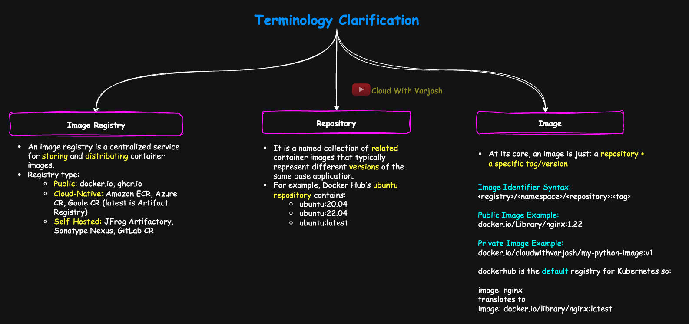
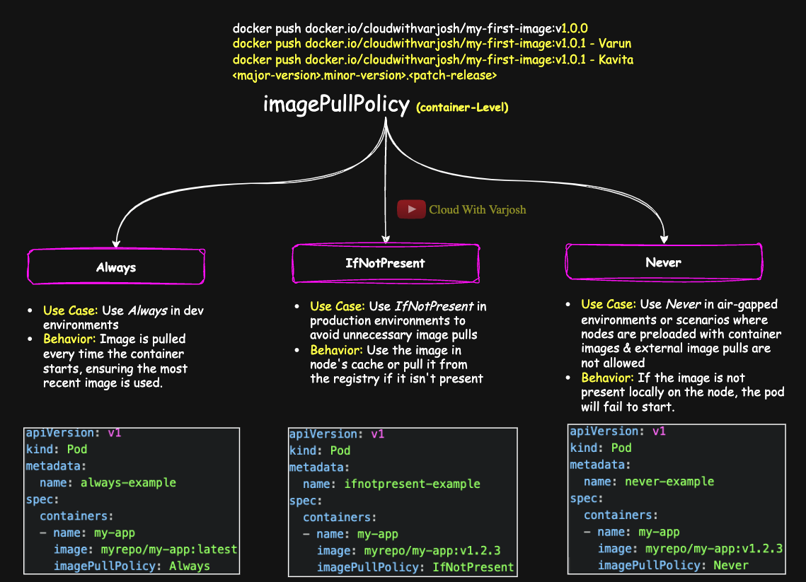

# 20 · Images in Kubernetes: Names, Tags, Digests and `imagePullPolicy`

> **Level:** ★ foundation
>
> **You will learn:** the vocabulary of registries, repositories, images and tags; how Kubernetes fills in defaults for image names; why tags are mutable and digests aren't; the three `imagePullPolicy` values (`Always`, `IfNotPresent`, `Never`), how the default is chosen, and what each really does on the node; how the kubelet pulls images and caches them; and which policy to use where.
>
> **You need:** topics 02 and 18.

---

## ⚡ Core: the 10-minute version

**The idea.** An image reference is `registry/namespace/repository:tag`, with missing parts filled in (`nginx` → `docker.io/library/nginx:latest`).
- **Tags can be moved** to point at different images, so production should pin versioned tags, ideally with a **digest** (`@sha256:…`, which never changes).
- **`imagePullPolicy`** decides when the node pulls: `Always` (check the registry every start), `IfNotPresent` (only if missing), `Never` (local only). If you don't set it, `latest` or no tag means `Always`; anything else means `IfNotPresent`.

**Picture it.** A tag is a sticky note saying "latest edition"; a digest is the book's ISBN.

**The one thing to know.**

```yaml
containers:
- name: web
  image: nginx:1.27.3@sha256:<digest>    # exact, repeatable
  imagePullPolicy: IfNotPresent          # be explicit
```

**Try it now:**
1. Run a Pod with `image: nginx` and check its `imagePullPolicy` in `-o yaml`. It's `Always`.
2. Do the same with `nginx:1.27`: it's `IfNotPresent`.
3. Use a non-existent tag and read the `ErrImagePull` event.

**You've got it if you can:** predict the default pull policy for any image, and explain why `latest` is risky.

> 📖 **That's the core.** On a first pass, do the mini-lab and move on to the next topic. Everything below is the **full reference**: come back for the details, the edge cases, interview answers and exam-level depth.

---

## What it is



| Term | Meaning | Example |
|---|---|---|
| **Image registry** | A central service that **stores, distributes and manages** images. Nodes (via the runtime) pull from it. | `docker.io`, `ghcr.io`, ECR |
| **Repository** | A **named collection** of related images: different **versions or variants** of one app. | `ubuntu`, `cloudwithvarjosh/my-python-image` |
| **Tag** | A **label for one version** inside a repository. | `22.04`, `v1`, `latest` |
| **Image** | A **versioned snapshot** of an app or environment: base OS layer, libraries, binaries, config files, entrypoint. In everyday terms, an image = **repository + tag**. | `ubuntu:22.04` |
| **Digest** | The image's **content hash** (`sha256:…`). Changes if a single byte changes. | `nginx@sha256:4f…` |

### Registries

| Type | Examples |
|---|---|
| **Public** | `docker.io` (Docker Hub), `ghcr.io` (GitHub Container Registry), `quay.io` |
| **Cloud-native** | `*.amazonaws.com` (Amazon ECR), `*.pkg.dev` (Google Artifact Registry; legacy `*.gcr.io` names redirect to it), `*.azurecr.io` (Azure Container Registry) |
| **Self-hosted** | Harbor, Sonatype Nexus, JFrog Artifactory, GitLab Container Registry |

They support private and public access and tag-based versioning, and integrate with Kubernetes through **`imagePullSecrets`**, **workload identity / node credential providers**, or access tokens (topic 62).

### Repositories and tags

- `ubuntu:20.04`, `ubuntu:22.04`, `ubuntu:latest` all belong to the **`ubuntu` repository**; each **tag** is a release. It's like Git tags on a Git repository.
- Repositories are **scoped under a namespace** (a Docker Hub user or organisation).
- A repository **without a tag** means `:latest`; relying on that is discouraged in production.
- **Tags are mutable**: they can be moved to point at a different image at any time. Use specific tags (`v1.2.3`) and, for full safety, **digests**.

**Repository identifier:** `<registry>/<namespace>/<repository>`, e.g. `docker.io/cloudwithvarjosh/my-python-image`; add a tag for a version: `…:v1`, `…:v2`.

**Image identifier:** `<registry>/<namespace>/<repository>:<tag>`

| Component | Value | Description |
|---|---|---|
| Registry | `docker.io` | Where to pull from |
| Namespace | `cloudwithvarjosh` | Docker Hub user or organisation |
| Repository | `my-python-image` | The app's image name |
| Tag | `v1` | The version |

Optionally pinned by digest: `docker.io/library/nginx:1.29@sha256:<digest>` (if both are given, the **digest wins**).

### Defaults in Kubernetes

- No **registry** → `docker.io`.
- No **namespace** → `library/` (Docker Hub official images).
- No **tag** → `latest`.

So `image: nginx` means `docker.io/library/nginx:latest`.

Explicit examples:

```yaml
image: docker.io/cloudwithvarjosh/my-python-image:v1
image: ghcr.io/my-org/app:v2
image: us-docker.pkg.dev/my-project/my-repo/my-api:1.4.0      # Artifact Registry (Day 45 showed gcr.io/my-project/my-api:latest)
image: myregistry.azurecr.io/team/app:v3
image: <aws_account>.dkr.ecr.us-west-2.amazonaws.com/my-image:stable
```

The layered naming makes images unambiguous and lets you **promote the same image** through dev, test and prod by changing only the tag (or better, by deploying the same digest).

> **Critical note:** not every vendor follows the flat `<registry>/<namespace>/<repository>:<tag>` shape. **Amazon ECR** puts the account ID and region in the registry host (`123456789012.dkr.ecr.us-east-1.amazonaws.com/myapp:latest`). **Harbor** allows nested project paths (`harbor.mycompany.com/dev/backend/app:v1`). Check vendor conventions before writing scripts that parse image names.

---

## Why it exists

The image name decides **exactly what code runs** in production, and the pull policy decides **when a node asks the registry again**. Get them wrong and you'll see the classic problems: "I pushed a fix but the Pod still runs the old code", "some Pods run version A and some run B", `ImagePullBackOff` because of registry rate limits, or Pods that can't start in an air-gapped cluster.

---

## Analogy

A **tag** is a **sticky note** saying "latest edition" on a book in a library: a librarian can move the note to a different book at any time. A **digest** is the book's **ISBN plus a fingerprint of every page**: it can only ever mean that exact book. `imagePullPolicy` is your rule for when to **ask the library again** versus using the copy already on your desk.

---

## How it works inside

### How a node pulls an image

1. The kubelet receives the Pod and reads each container's `image` and `imagePullPolicy`.
2. It asks the runtime (via CRI `ImageStatus`) whether the image is already on the node.
3. Depending on the policy, it calls CRI **`PullImage`**, passing any registry credentials (topic 62).
4. containerd resolves the tag to a **manifest** (by asking the registry), checks which **layers** it already has, downloads only the missing ones, and unpacks them into its snapshot store.
5. The container starts from the **digest** that was resolved. `kubectl get pod -o jsonpath='{.status.containerStatuses[*].imageID}'` shows the exact digest each container runs.

Images are cached **per node**. A new node starts with an empty cache, so the first Pod pays the full pull time. The kubelet **garbage-collects** unused images when disk usage passes its thresholds.

### The three pull policies



**1. `Always`**: contact the registry **every time a container starts** (new Pod or container restart).
- If the tag now points to a new digest → download the new layers.
- If the digest is unchanged → **use the cached layers** (only the small manifest is fetched).
- Use it when tags are reused (`latest`, `dev`), mainly in **development**.

```yaml
apiVersion: v1
kind: Pod
metadata:
  name: always-example
spec:
  containers:
  - name: my-app
    image: myrepo/my-app:latest
    imagePullPolicy: Always
```

**2. `IfNotPresent`**: pull **only if the image isn't on the node**.
- Faster starts and less registry traffic.
- Best for specific, immutable tags (`my-app:v1.2.3`): the usual **production** choice.

```yaml
apiVersion: v1
kind: Pod
metadata:
  name: ifnotpresent-example
spec:
  containers:
  - name: my-app
    image: myrepo/my-app:v1.2.3
    imagePullPolicy: IfNotPresent
```

**3. `Never`**: **never** contact the registry; the image must already be on the node.
- If it's missing, the container fails with **`ErrImageNeverPull`**.
- For **air-gapped** environments with pre-loaded images, or tests where you load images yourself (e.g. `kind load docker-image`).

```yaml
apiVersion: v1
kind: Pod
metadata:
  name: never-example
spec:
  containers:
  - name: my-app
    image: myrepo/my-app:v1.2.3
    imagePullPolicy: Never
```

### How the default is chosen (Day 22, completed)

If you don't set `imagePullPolicy`, the API server fills it in **when the object is created**:

| Image reference | Default policy |
|---|---|
| Tag is `:latest`, or **no tag** at all (`myrepo/my-app`) | `Always` |
| A specific tag (`myrepo/my-app:v1.2.3`) | `IfNotPresent` |
| A **digest** (`myrepo/my-app@sha256:…`) | `IfNotPresent` |

The default is set **once**: changing a Deployment's tag from `v1` to `latest` later doesn't change an already-defaulted `IfNotPresent` in its template. **Best practice: set `imagePullPolicy` explicitly** so the behaviour is obvious.

### Which policy to use

| Policy | When to use |
|---|---|
| **Always** | **Development**, to always get the newest image; when using `latest` or frequently updated tags. Also a security option: it makes every start re-check registry access (see below). |
| **IfNotPresent** | **Production**: faster starts, fewer pulls; with specific, immutable tags like `v1.2.3`. |
| **Never** | **Air-gapped** systems or nodes with **pre-loaded** images; controlled tests that must not touch a registry. |

### Key considerations

1. **Avoid `latest` in production.** `Always` + `latest` can run different code on different Pods if the tag moves between their starts. Use **versioned tags or digests** for stable, reproducible deployments and rollbacks.
2. **Pre-load images for faster start-up** in air-gapped or latency-sensitive environments; combine with `Never` (or `IfNotPresent`) for tight control. Pre-pulling via a DaemonSet or baking images into node images also speeds up autoscaling.
3. **Bandwidth.**

> ✅ **Correct today** ([C1](#c1)): with `Always`, the kubelet still **reuses cached layers**: it only fetches the small manifest to check the digest, and downloads layers only if the image actually changed. The real costs of `Always` are **one registry round-trip per container start**, **registry rate limits** (Docker Hub), and **Pods failing to start if the registry is down**. Those are the reasons to prefer `IfNotPresent` with immutable tags in production.

**Security note:** with `IfNotPresent`, a Pod could use an image that **another** Pod's credentials pulled onto the node earlier. Kubernetes is closing this gap: the kubelet can now re-verify credentials for cached images (`KubeletEnsureSecretPulledImages`, beta ⚠️ *check its stage and default for your version*). Multi-tenant clusters may also enforce `Always` with the **AlwaysPullImages** admission plugin (topic 58).

---

## Commands / YAML

See the defaulted policy and the exact image a Pod runs:

```bash
kubectl run p1 --image=nginx
kubectl run p2 --image=nginx:1.29
kubectl get pod p1 p2 -o custom-columns='NAME:.metadata.name,IMAGE:.spec.containers[0].image,POLICY:.spec.containers[0].imagePullPolicy,IMAGEID:.status.containerStatuses[0].imageID'
```

```
NAME   IMAGE        POLICY         IMAGEID
p1     nginx        Always         docker.io/library/nginx@sha256:4f…
p2     nginx:1.29   IfNotPresent   docker.io/library/nginx@sha256:9a…
```

- `IMAGEID` = the **resolved digest**; it's the truth about what's running.

Pin a Deployment to a digest:

```bash
kubectl set image deploy/web web=nginx:1.29@sha256:9a…
```

Images on a node, and loading local images into kind:

```bash
docker exec lab-worker crictl images | head -3
kind load docker-image my-app:dev --name lab        # copies a local image into every kind node
```

```
IMAGE                         TAG       IMAGE ID        SIZE
docker.io/library/nginx       1.29      a8758716bb6aa   72.4MB
registry.k8s.io/pause         3.10      873ed75102791   320kB
```

Then use it with `imagePullPolicy: Never` (or `IfNotPresent` with a non-latest tag).

---

## Hands-on lab

1. Create `p1` and `p2` as above and check their policies and image IDs.
2. Build and load a local image into kind:
   ```bash
   cd "Day 03" && docker build -t flask-demo:dev . && kind load docker-image flask-demo:dev --name lab
   kubectl run flask --image=flask-demo:dev --image-pull-policy=Never
   kubectl get pod flask        # Running, without any registry
   ```
3. Same Pod with `--image-pull-policy=Always`: it fails with `ErrImagePull` (there's no `flask-demo` on Docker Hub). That proves `Always` really contacts the registry.
4. `kubectl run ghost --image=busybox:1.37 --image-pull-policy=Never` on a node that doesn't have busybox yet → `ErrImageNeverPull`.
5. Typo a tag: `kubectl run typo --image=nginx:1.299` → `ErrImagePull` → `ImagePullBackOff`; read the event with `kubectl describe pod typo` (`manifest unknown` / `not found`).
6. Clean up: `kubectl delete pod p1 p2 flask ghost typo`.

---

## Where you'll use it

- **Release management**: tag strategy (semver + git SHA), digest pinning in GitOps (topic 68), rollbacks that really restore the old code.
- **Performance**: image size and caching drive Pod start time and autoscaling speed.
- **Air-gapped and regulated** environments: internal registries, pre-loaded images, `Never`.
- **Security**: supply-chain controls (signed images, allowed registries) build on exact image references (topic 63).

---

## When it breaks

| Symptom | Cause | Fix |
|---|---|---|
| `ErrImagePull`, then `ImagePullBackOff` | Wrong name/tag, private repo without credentials, registry down, rate limit | `kubectl describe pod` → event message; fix name, add credentials (topic 62) |
| `ErrImageNeverPull` | `imagePullPolicy: Never` and the image isn't on that node | Pre-load the image, or change the policy |
| `InvalidImageName` | Uppercase letters or bad characters in the reference | Fix the name (repositories must be lowercase) |
| New code pushed, Pods still run old code | Same tag reused with `IfNotPresent` | Use new tags per build, or digests; restart with `kubectl rollout restart` only as a stopgap |
| Different Pods run different code under one tag | Mutable tag + `Always`, pulled at different times | Immutable tags or digests |
| `toomanyrequests` from Docker Hub | Anonymous pull rate limit | Authenticate, use a mirror or pull-through cache |
| Pods slow to start on new nodes | Large images, cold cache | Smaller images, pre-pulling, image streaming |

---

## Quick recap

- Name = `registry/namespace/repository:tag[@digest]`; defaults `docker.io`, `library/`, `latest`; vendors like ECR and Harbor differ.
- Tags are **mutable**; digests are **immutable**. Production uses versioned tags and ideally digests.
- `Always` = check the registry on every start (reuses cached layers); `IfNotPresent` = pull only if missing; `Never` = local only.
- Default: `latest`/no tag → `Always`; other tags or digests → `IfNotPresent`. Set it explicitly.

### Interview questions

1. **Q: What's the default `imagePullPolicy` for `nginx:1.29` and for `nginx`?**
   A: `IfNotPresent` for `nginx:1.29`; `Always` for `nginx` (implicit `latest`).
2. **Q: Why are digests preferred over tags in production?**
   A: Tags can be moved to different images; a digest is a content hash that always identifies the same bytes, making deployments reproducible and tamper-evident.
3. **Q: Does `imagePullPolicy: Always` re-download the whole image on every restart?**
   A: No. It checks the manifest with the registry and downloads only layers that aren't cached; unchanged images start from cache.

---

## Appendix: notes on the original course material

This topic was rebuilt from the original CKA course notes. This appendix keeps the audit trail out of your way while you learn.

### Sources

Day 22 (image pull policies: Always, IfNotPresent, Never; default behaviour; which to use; key considerations), Day 45 (section 1 nomenclature: image registry, repository, repository identifier, image, image identifier syntax, defaulting behaviour in Kubernetes, explicit examples, critical note on vendor formats). Private-registry authentication (Day 45 sections 2–5) is in topic 62.

### Corrections to the original notes

Each entry shows what the original said and what's true now. In the topic above, each correction appears as a ✅ **Correct today** line or a ⚠️ **Fix to the original** box, linked to its entry here.

<a id="c1"></a>**C1 · Corrected (Day 22).** the original warned that `Always` causes frequent full pulls that "increase bandwidth consumption and impact cluster performance". **Now:** with `Always`, the kubelet still **reuses cached layers**: it only fetches the small manifest to check the digest, and downloads layers only if the image actually changed. The real costs of `Always` are **one registry round-trip per container start**, **registry rate limits** (Docker Hub), and **Pods failing to start if the registry is down**. Those are the reasons to prefer `IfNotPresent` with immutable tags in production.
