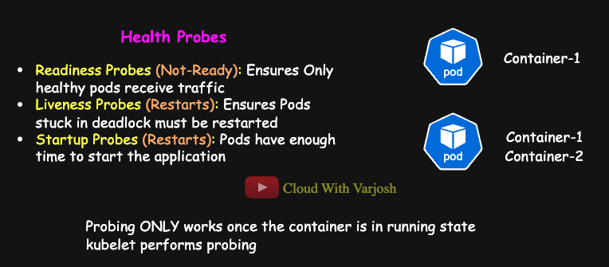
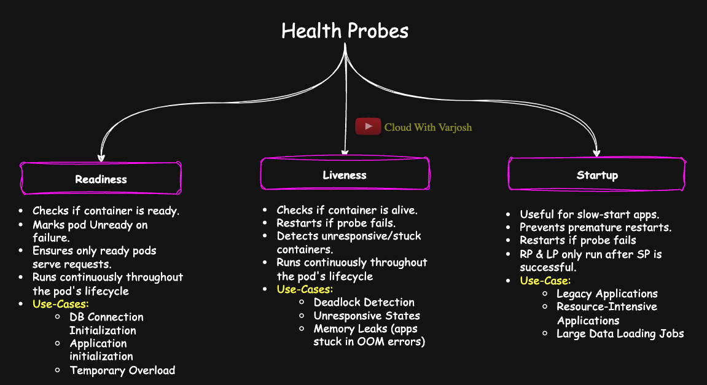
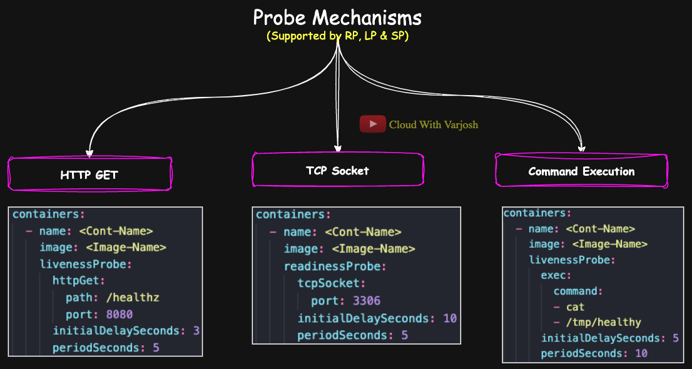

# 22 · Health Probes: Readiness, Liveness and Startup

> **Level:** ★★ intermediate
>
> **You will learn:** the three probe types and exactly what the kubelet does when each fails; the four probe mechanisms (HTTP GET, TCP socket, exec, gRPC); every timing parameter and how to calculate time-to-restart; how probes behave in multi-container Pods; how readiness connects to Services; and the production rules that stop probes from causing outages.
>
> **You need:** topics 18, 19 and 21. (Services appear briefly; topic 30 covers them. For now: a **Service** is a stable address that load-balances to **ready** Pods.)

---

## ⚡ Core: the 10-minute version

**The idea.** **Probes** let the kubelet check your app's health:
- **readiness**: may this Pod receive traffic? If it fails, the Pod is removed from Service endpoints but **not restarted**.
- **liveness**: is the app stuck? If it fails, the **container is restarted**.
- **startup**: gives slow-starting apps time; the other probes wait until it passes.

Checks can be an HTTP request, a TCP connect, a command, or gRPC.

**Picture it.** Readiness is the "open/closed" sign on a shop door; liveness is the fire alarm that forces a restart; startup is the "opening soon" sign.

**The one thing to know.**

```yaml
startupProbe:   { httpGet: { path: /healthz, port: 8080 }, failureThreshold: 30, periodSeconds: 5 }
readinessProbe: { httpGet: { path: /ready,   port: 8080 }, periodSeconds: 5 }
livenessProbe:  { httpGet: { path: /healthz, port: 8080 }, periodSeconds: 10 }
```

**Try it now:**
1. Give an nginx Pod a readiness probe on a path that doesn't exist and watch `READY 0/1` (it isn't restarted).
2. Change it to a liveness probe and watch the RESTARTS count climb.
3. Fix the path and see it recover.

**You've got it if you can:** explain what each probe does when it fails, and why liveness must never depend on a database or other external service.

> 📖 **That's the core.** On a first pass, do the mini-lab and move on to the next topic. Everything below is the **full reference**: come back for the details, the edge cases, interview answers and exam-level depth.

---

## What it is



A **probe** is a health check the **kubelet** runs against a container, on a timer, from the node. Probes let Kubernetes:
- send traffic only to **healthy, ready** Pods, and
- give unhealthy containers time to **recover**, or **restart** them when they're stuck.



| Probe | Question it answers | On failure |
|---|---|---|
| **Readiness** (RP) | "Can this container serve traffic **right now**?" | Pod marked **NotReady** → **removed from Service endpoints**. **No restart.** |
| **Liveness** (LP) | "Is this container **alive**, or stuck?" | **Container restarted** by the kubelet. |
| **Startup** | "Has this slow app **finished starting**?" | Until it succeeds, readiness and liveness **don't run**. If it fails past its threshold → **container restarted**. |

---

## Why it exists

A process can be **running** but **useless**:
- still loading data or warming caches (not **ready**),
- temporarily unable to reach its database (not ready, but will recover),
- **deadlocked** or stuck in an infinite loop (not **alive**; only a restart helps).

Without probes, Kubernetes only knows "the process exists", so it sends traffic to Pods that can't answer and never restarts hung ones.

**Why configure both readiness and liveness:**
- **Readiness** doesn't restart: **transient** problems (high load, a short DB outage) don't cause needless restarts; the Pod recovers on its own while traffic goes elsewhere.
- **Liveness** is for **fatal, unrecoverable** states where a restart is the only fix, so hung Pods don't sit idle wasting resources.
- Without readiness: traffic reaches Pods with temporary failures and users see errors.
- Without liveness: stuck Pods stay stuck forever.

---

## Analogy

A **restaurant**:
- **Startup probe** = "is the kitchen set up yet?" Nobody checks food quality until the kitchen has opened (however long that takes).
- **Readiness probe** = the **"open / closed" sign**. A busy kitchen flips it to "closed" for a few minutes: customers go to other branches, and nobody is fired.
- **Liveness probe** = the manager checking whether the chef has **collapsed**. If so, a new chef is called in (restart).

---

## How it works inside

### Who probes, and what happens next

1. The **kubelet** on the Pod's node runs every probe (the network checks come **from the node** to the Pod IP).
2. Results update the container's `ready` flag (readiness), or trigger a **restart** (liveness, startup).
3. When a container's readiness changes, the Pod's **`Ready` condition** changes, and the **EndpointSlice controller** adds or removes the Pod's IP from every Service that selects it (topic 32). That's how readiness controls traffic.
4. A liveness or startup failure → the kubelet **kills the container** (normal termination: SIGTERM, grace period, SIGKILL) and restarts it according to `restartPolicy`, with back-off.

### The four mechanisms (Day 23 + gRPC)



| Mechanism | Success when | Good for |
|---|---|---|
| **`httpGet`** | HTTP status **200–399** | Web apps with a health endpoint |
| **`tcpSocket`** | A TCP connection **can be opened** | Databases, non-HTTP servers (e.g. port 3306) |
| **`exec`** | The command **exits 0** | Anything you can check with a command (a file exists, a CLI health check) |
| **`grpc`** | The gRPC Health Checking Protocol returns `SERVING` (GA since v1.27) | gRPC services |

```yaml
livenessProbe:                     # HTTP GET
  httpGet: { path: /healthz, port: 8080 }
  initialDelaySeconds: 3
  periodSeconds: 5
---
readinessProbe:                    # TCP socket
  tcpSocket: { port: 3306 }
  initialDelaySeconds: 10
  periodSeconds: 5
---
livenessProbe:                     # exec: the app creates /tmp/healthy when healthy
  exec: { command: ["cat", "/tmp/healthy"] }
  initialDelaySeconds: 5
  periodSeconds: 10
---
livenessProbe:                     # gRPC
  grpc: { port: 9090 }
```

Notes:
- `exec` probes fork a process **inside the container** every period. On busy nodes many exec probes cost CPU; prefer HTTP/TCP/gRPC.
- `httpGet` can take `scheme: HTTPS` (it doesn't verify the certificate), `host`, and `httpHeaders`.
- `port` can be a number or a **named** container port (`port: http`).

### Timing parameters

| Property | Meaning | Default | Example |
|---|---|---|---|
| `initialDelaySeconds` | Wait after the container starts before the first probe | `0` | `5` → first probe after 5 s |
| `periodSeconds` | Interval between probes | `10` | `10` → every 10 s |
| `timeoutSeconds` | Max wait for a response | `1` | `2` → fail if no reply in 2 s |
| `successThreshold` | Consecutive successes to count as success | `1` (**must be 1** for liveness and startup) | `3` → ready after 3 passes |
| `failureThreshold` | Consecutive failures to count as failure | `3` | `5` → fail after 5 misses |
| `terminationGracePeriodSeconds` (probe-level) | Grace period used when **this** probe kills the container (liveness/startup) | Pod's value | `10` |

**Time to act** ≈ `initialDelaySeconds + periodSeconds × failureThreshold` (plus timeouts). For example, a liveness probe with `period 10, threshold 3` restarts a hung container about **30 s** after it hangs.

**Startup budget** = `failureThreshold × periodSeconds`. Day 23's example `30 × 10 s` gives the app **up to 300 s (5 minutes)** to start.

### The startup probe in detail

**Problem it solves:** `initialDelaySeconds` is a guess. Too high wastes time on every start; too low and liveness kills a slow app **before** it ever finishes starting, which causes a crash loop. Legacy apps and JVMs often take a **variable** time to start.

```yaml
startupProbe:
  httpGet: { path: /healthz, port: 8080 }
  failureThreshold: 30     # up to 30 attempts…
  periodSeconds: 10        # …10 s apart = 300 s to start
```

- The probe tries every 10 s, up to 30 times.
- As soon as it **succeeds once**, it stops, and **readiness and liveness take over**.

> ✅ **Correct today** ([C1](#c1)): when a startup probe exceeds its `failureThreshold`, the kubelet **kills the container and restarts it** according to `restartPolicy` (with back-off), exactly like a liveness failure. Day 23's own comparison table (below) states this correctly.

### Behaviour in multi-container Pods

1. **Pod and containers:** the STATUS column shows the **most severe container state**, e.g. `Error` (a container crashed or is misconfigured), `ImagePullBackOff`, `CrashLoopBackOff`, `RunContainerError` (catch-all for runtime failures such as a command that can't execute).
2. **Startup probe:** each container's startup probe runs **independently**. A failing one only affects **that** container; its readiness and liveness probes don't start, and other containers carry on.
3. **Readiness:** if **any** container is not ready, the **whole Pod is NotReady** and is removed from Service endpoints, so no partial service is offered. No restart.
4. **Liveness:** container-specific. Only the failing **container** is restarted; the others keep running.

> ✅ **Correct today** ([C2](#c2)): the **phase** is `Running` once all containers are created and **at least one** is running (topic 19). What requires **all** containers is **readiness** (`READY 2/2`, the `Ready` condition).

> ✅ **Correct today** ([C3](#c3)): the kubelet restarts the **container**, inside the same Pod (same name, same IP, same node). The Pod is never recreated by a probe.

### Comprehensive comparison

| Aspect | Startup probe | Readiness probe | Liveness probe |
|---|---|---|---|
| **Purpose** | Give **slow-starting apps** time to start | Is the Pod **ready for traffic**? | Is the container **alive and working**? |
| **When it starts** | **Immediately** after the container starts (after `initialDelaySeconds`) | After the startup probe succeeds (if configured) | After the startup probe succeeds (if configured) |
| **Failure behaviour** | Container **killed and restarted** after the threshold | Pod **marked unready**, removed from Service load balancing; **not restarted** | Container **killed and restarted** after the threshold |
| **Effect on traffic** | None directly (the Pod isn't Ready yet anyway) | **Stops traffic** to the Pod | None directly |
| **Common use** | Legacy apps, slow boots, unpredictable start times | Apps that need dependencies/config loaded before serving | Stuck apps, deadlocks, frozen threads |
| **Recovery** | Restart during initialisation | **No restart**; waits for the probe to pass | Restart |
| **Runs until** | First success → hands over to RP and LP | Continuously for the container's life | Continuously for the container's life |
| **Runs again after a restart?** | **Yes** | **Yes** | **Yes** |
| **Mechanisms** | HTTP GET, TCP, exec, gRPC | Same | Same |
| **Best practice** | Use for unpredictable boot times | **Always** in production | Use for unrecoverable failures, carefully |
| **Admin benefit** | Avoids premature restarts | Unready Pods get no load | Automatic recovery |
| **Resources while failing** | Uses CPU/memory during start-up | Pod consumes resources but gets no traffic | Consumes resources until restarted |
| **Typical example** | Java apps taking >60 s, legacy monoliths | App waiting for a DB connection or config | Deadlock, frozen app, memory leak |

### Production rules (learned the hard way)

1. **Liveness must not check dependencies.** If `/healthz` checks the database and the database blips, **every** Pod fails liveness and restarts at once, turning a short DB outage into a full outage. Liveness = "is **this process** healthy?"; readiness may check critical dependencies (carefully).
2. **Liveness thresholds should be generous** (several failures, timeouts above 1 s). A GC pause or CPU throttling (topic 41) can make a 1-second timeout fail.
3. **Use a startup probe** instead of a huge `initialDelaySeconds` on liveness.
4. **Readiness on every Service-backed container.** Combine it with graceful shutdown (topic 19).
5. Don't use the same endpoint and settings for readiness and liveness: make liveness slower and more tolerant.
6. A liveness probe that can never fail is better than one that fails wrongly. If unsure, leave liveness off and rely on readiness + crash restarts.

---

## Commands / YAML

### Demo 1: readiness with exec (Day 23, `Day 23/rp.yaml`)

**Objective:** stop traffic to the Pod until it's ready.

```yaml
apiVersion: v1
kind: Pod
metadata:
  name: readiness-probe-demo
spec:
  containers:
  - name: busybox-app
    image: busybox:1.37
    command: ["sh", "-c", "touch /tmp/ready; sleep 3600"]  # create /tmp/ready, stay alive for 1 h
    readinessProbe:
      exec:
        command: ["cat", "/tmp/ready"]   # passes while the file exists
      initialDelaySeconds: 5             # first probe after 5 s
      periodSeconds: 5                   # then every 5 s
      failureThreshold: 1                # one failure → NotReady
```

Test:

```bash
kubectl apply -f "Day 23/rp.yaml"
kubectl exec -it readiness-probe-demo -- rm /tmp/ready      # simulate "not ready"
kubectl get pod readiness-probe-demo                        # within ~5 s:
```

```
NAME                   READY   STATUS    RESTARTS   AGE
readiness-probe-demo   0/1     Running   0          40s
```

- `0/1` READY but still `Running` with **0 restarts**: readiness never restarts anything.

Recover:

```bash
kubectl exec -it readiness-probe-demo -- touch /tmp/ready
kubectl get pod readiness-probe-demo                        # 1/1 again after the next probe
```

### Demo 2: liveness with HTTP GET (Day 23, `Day 23/lp.yaml`)

**Objective:** restart the container when it becomes unhealthy.

```yaml
apiVersion: v1
kind: Pod
metadata:
  name: liveness-probe-demo
  labels: { test: liveness }
spec:
  containers:
  - name: liveness
    image: registry.k8s.io/e2e-test-images/agnhost:2.40
    args: ["liveness"]            # this test server returns 200 on /healthz for 10 s, then 500
    livenessProbe:
      httpGet:
        path: /healthz
        port: 8080
        httpHeaders:
        - name: Custom-Header     # custom header sent with each probe
          value: Awesome
      initialDelaySeconds: 3      # first probe 3 s after start
      periodSeconds: 3            # every 3 s
      timeoutSeconds: 1           # no reply within 1 s = failure
      failureThreshold: 1         # one failure → restart (the file version uses the default 3)
```

```bash
kubectl apply -f "Day 23/lp.yaml"
kubectl get pod liveness-probe-demo -w
kubectl describe pod liveness-probe-demo | tail -5
```

```
NAME                  READY   STATUS    RESTARTS     AGE
liveness-probe-demo   1/1     Running   0            8s
liveness-probe-demo   1/1     Running   1 (1s ago)   20s
...
  Warning  Unhealthy  9s (x3 over 15s)  kubelet  Liveness probe failed: HTTP probe failed with statuscode: 500
  Normal   Killing    9s                kubelet  Container liveness failed liveness probe, will be restarted
```

**Expected:** `/healthz` returns 200 for the first 10 s, then 500 (that's how the test app is built). The probe fails, the kubelet restarts the **container**, and the cycle repeats, with growing back-off until `CrashLoopBackOff` appears between restarts.

### Demo 3: startup probe with TCP (Day 23, `Day 23/sp.yaml`)

**Objective:** give a slow start-up (installing packages first) enough time before other probes run.

```yaml
apiVersion: v1
kind: Pod
metadata:
  name: startup-probe-demo
spec:
  containers:
  - name: tcp-app
    image: ubuntu:24.04
    command:
    - sh
    - -c
    - |
      apt update && \
      apt install -y netcat-openbsd && \
      nc -l -p 9444 && \
      sleep 3600
    startupProbe:
      tcpSocket:
        port: 9444          # is something listening on 9444 yet?
      failureThreshold: 15  # up to 15 failed attempts…
      periodSeconds: 5      # …every 5 s = 75 s budget
```

- `apt update && apt install -y netcat-openbsd`: slow dependency installation (simulates a slow-starting app).
- `nc -l -p 9444`: **Netcat** (`nc`) in **listen** mode (`-l`) on **port 9444** (`-p 9444`): a stand-in TCP server.
- `sleep 3600`: keeps the container alive afterwards.
- The startup probe keeps checking port 9444. Once `nc` listens, the probe succeeds and the container is never restarted unnecessarily.
- Detail: `nc -l` exits after its first connection closes (the probe's), so the port closes, and `sleep 3600` runs. That's fine because the startup probe has already succeeded and there's no liveness probe. With a liveness `tcpSocket` probe on 9444, it would then fail.
- Try `failureThreshold: 2` to see a startup failure: the container is **restarted** before the install finishes.

### Multi-container status example (`Day 23/test.yaml.yml`)

```yaml
apiVersion: v1
kind: Pod
metadata:
  name: test
spec:
  containers:
  - name: nginx
    image: nginx
  - name: supporter
    image: yughy          # an image that doesn't exist
```

```
NAME   READY   STATUS             RESTARTS   AGE
test   1/2     ImagePullBackOff   0          30s
```

nginx runs, but the Pod's STATUS shows the worst container state (`ImagePullBackOff`), and `1/2` READY means the Pod isn't Ready, so it would get no Service traffic.

### See readiness drive endpoints

```bash
kubectl create deploy web --image=nginx:1.29 --replicas=2
kubectl expose deploy web --port=80
kubectl patch deploy web --type=json -p '[{"op":"add","path":"/spec/template/spec/containers/0/readinessProbe","value":{"httpGet":{"path":"/ready.html","port":80},"periodSeconds":2}}]'
kubectl get endpointslices -l kubernetes.io/service-name=web -o wide    # no ready endpoints: /ready.html is 404
POD=$(kubectl get pod -l app=web -o name | head -1)
kubectl exec $POD -- sh -c 'echo ok > /usr/share/nginx/html/ready.html'
kubectl get endpointslices -l kubernetes.io/service-name=web -o wide    # that Pod's IP appears
```

---

## Hands-on lab

1. Run the three demos above and the multi-container example.
2. For the liveness demo, compute the expected time between restarts from the settings, then compare with `kubectl get pod -w`.
3. Build the "liveness checks the database" anti-pattern: a Deployment of 3 replicas whose liveness `exec` checks `nslookup some-db` against a Service you then delete. Watch **all** replicas restart. Change it to a readiness probe and see Pods go NotReady **without** restarting.
4. Endpoints demo (above): watch readiness add and remove Pod IPs.
5. Clean up: `kubectl delete pod readiness-probe-demo liveness-probe-demo startup-probe-demo test; kubectl delete deploy,svc web`.

---

## Where you'll use it

- **Every production Deployment**: readiness for zero-downtime rollouts (a new Pod gets traffic only when ready); liveness for self-healing; startup for slow apps.
- **Rolling updates** (topic 25) wait for new Pods to become Ready before removing old ones, so a broken readiness probe **stalls** a rollout safely.
- **Incident reviews**: many "everything restarted at once" incidents are bad liveness probes.

---

## When it breaks

| Symptom | Cause | Fix |
|---|---|---|
| Pod `Running` but `0/1` READY forever | Readiness fails: wrong path/port, app not listening on `0.0.0.0`, dependency down | `kubectl describe pod` → `Readiness probe failed: …`; curl the endpoint from a debug Pod |
| Restart loop, events `Liveness probe failed … context deadline exceeded` | Timeout too short (GC pauses, CPU throttling), or app genuinely hung | Raise `timeoutSeconds`/`failureThreshold`; check CPU limits |
| Slow app restarts before it ever becomes ready | Liveness starts too early | Add a startup probe |
| All replicas restart together | Liveness depends on a shared dependency | Remove dependency checks from liveness |
| `Startup probe failed: dial tcp …:9444: connect: connection refused` repeatedly, then restart | Startup budget too small | Increase `failureThreshold × periodSeconds` |
| `Readiness probe errored: … exec: "curl": executable file not found` | Exec probe uses a tool missing from the image | Use `httpGet`, or a tool the image has |
| Rollout stuck at "1 old replicas are pending termination" | New Pods never become Ready | Fix the readiness probe or the app (topic 25) |

---

## Quick recap

- **Readiness** → traffic on/off (EndpointSlices), no restart. **Liveness** → restart the **container**. **Startup** → protects slow starts; blocks the others until it passes; restarts on failure.
- Mechanisms: `httpGet` (200–399), `tcpSocket`, `exec` (exit 0), `grpc`.
- Defaults: delay 0, period 10, timeout 1, success 1, failure 3. Time to act ≈ delay + period × failureThreshold.
- In multi-container Pods, any not-ready container makes the Pod NotReady; liveness restarts only the failing container.
- Liveness should never depend on external systems.

### Interview questions

1. **Q: Readiness vs liveness?**
   A: Readiness decides whether a Pod receives Service traffic (failure = removed from endpoints, no restart); liveness decides whether a container should be restarted (failure = kubelet restarts it).
2. **Q: When do you need a startup probe?**
   A: For apps with long or unpredictable start times: it holds off liveness/readiness until the app has started, preventing liveness from killing it mid-start, without a fixed large `initialDelaySeconds`.
3. **Q: Why is checking the database in a liveness probe dangerous?**
   A: A database outage makes every replica fail liveness and restart simultaneously, amplifying a dependency problem into a full outage; restarts don't fix the database.

---

## Appendix: notes on the original course material

This topic was rebuilt from the original CKA course notes. This appendix keeps the audit trail out of your way while you learn.

### Sources

Day 23 (introduction, types of probes, why both readiness and liveness, timer parameters, multi-container behaviour, comprehensive comparison table, probe mechanisms, conclusion, readiness demo, liveness demo, startup demo), files `Day 23/rp.yaml`, `lp.yaml`, `sp.yaml`, `test.yaml.yml`.

### Corrections to the original notes

Each entry shows what the original said and what's true now. In the topic above, each correction appears as a ✅ **Correct today** line or a ⚠️ **Fix to the original** box, linked to its entry here.

<a id="c1"></a>**C1 · Corrected (Day 23).** the startup example said that if all 30 attempts fail, "Kubernetes will mark the pod as failed and stop trying… **No restart happens** because the app never started properly". **Now:** when a startup probe exceeds its `failureThreshold`, the kubelet **kills the container and restarts it** according to `restartPolicy` (with back-off), exactly like a liveness failure. Day 23's own comparison table (below) states this correctly.

<a id="c2"></a>**C2 · Corrected (Day 23).** "a pod is marked **Running only when all containers** within it are successfully running". **Now:** the **phase** is `Running` once all containers are created and **at least one** is running (topic 19). What requires **all** containers is **readiness** (`READY 2/2`, the `Ready` condition).

<a id="c3"></a>**C3 · Corrected (Day 23).** several places say "when the liveness probe fails, **the pod is restarted**". **Now:** the kubelet restarts the **container**, inside the same Pod (same name, same IP, same node). The Pod is never recreated by a probe.
