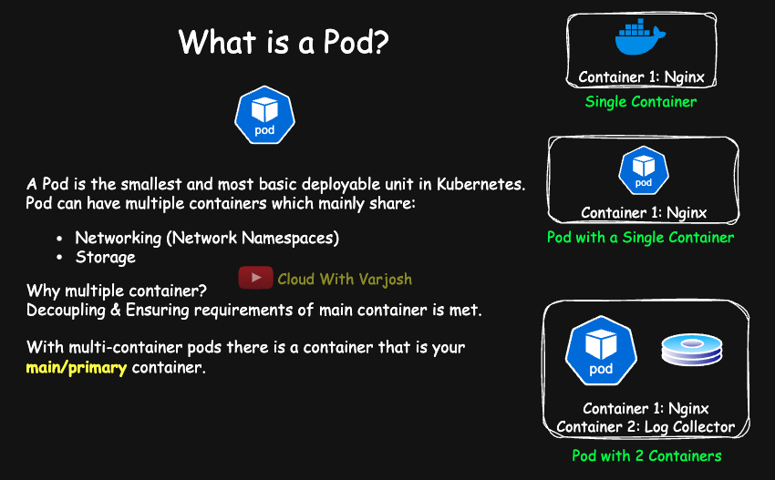
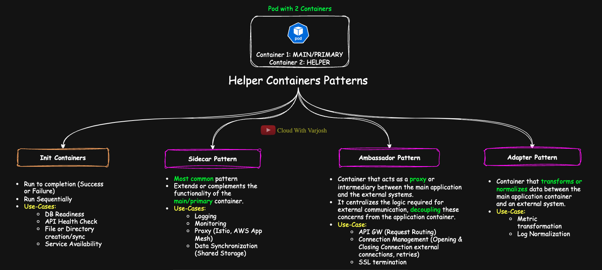
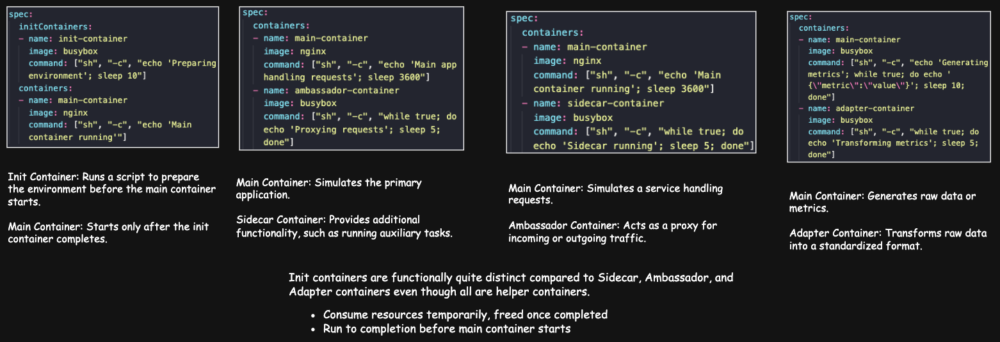

# 23 · Multi-Container Pods: Init Containers, Native Sidecars, Ambassador and Adapter

> **Level:** ★★ intermediate
>
> **You will learn:** why some containers belong in the same Pod; what they share; the four classic patterns (init, sidecar, ambassador, adapter); exactly how **init containers** run; **native sidecar containers** (init containers with `restartPolicy: Always`, GA in v1.33) and the problems they fix (start order, shutdown order, Jobs that never finish); and three demos (an API pre-check, a two-step init with a Service check, a health-logging sidecar).
>
> **You need:** topics 18, 19 and 22. Two short previews: a **volume** is a directory defined at Pod level that containers can mount; `emptyDir` is an empty scratch volume that lives as long as the Pod (topic 37). A **Service** gives Pods a stable DNS name (topic 30).

---

## ⚡ Core: the 10-minute version

**The idea.** Put several containers in one Pod only when they're **tightly coupled helpers** of one app. They share the network and any volumes you give them.
- **Init containers** run first, one at a time, and must succeed before the app starts (wait for a database, fetch config).
- **Sidecars** run alongside the app (log shippers, proxies). Today's **native sidecars** are init containers with `restartPolicy: Always`: they start before the app and stop after it.

**Picture it.** A food truck: someone preps the ingredients before opening (init), and an assistant keeps working next to the cook all day (sidecar).

**The one thing to know.**

```yaml
spec:
  initContainers:
  - name: wait-db
    image: busybox:1.37
    command: ["sh","-c","until nslookup db; do sleep 2; done"]
  - name: log-shipper              # native sidecar
    image: busybox:1.37
    restartPolicy: Always
    command: ["sh","-c","tail -F /logs/app.log"]
    volumeMounts: [{ name: logs, mountPath: /logs }]
  containers:
  - name: app
    image: busybox:1.37
    command: ["sh","-c","while true; do date >> /logs/app.log; sleep 2; done"]
    volumeMounts: [{ name: logs, mountPath: /logs }]
  volumes: [{ name: logs, emptyDir: {} }]
```

**Try it now:**
1. Apply this Pod.
2. Watch it stay in `Init:0/2` until you create a Service named `db` (`kubectl create service clusterip db --tcp=80`).
3. Then run `kubectl logs <pod> -c log-shipper`.

**You've got it if you can:** explain init vs sidecar containers, and when a second container belongs in the same Pod.

> 📖 **That's the core.** On a first pass, do the mini-lab and move on to the next topic. Everything below is the **full reference**: come back for the details, the edge cases, interview answers and exam-level depth.

---

## What it is

A **multi-container Pod** is a Pod with **more than one container**. Usually there's **one main container** (the application) plus one or more **helper containers** that prepare its environment or extend it. They:
- share the **network namespace** (they talk over `localhost`),
- can share **volumes** (if the Pod defines them),
- work together towards **one purpose**.

| Resource | Shared? | Details |
|---|---|---|
| **Network namespace** | ✅ Yes | Same IP; reach each other on `localhost:<port>` |
| **Volumes** | ✅ Yes | Defined at Pod level; any container that mounts one sees the same data (e.g. a sidecar reads logs the main app writes) |
| **PID namespace** | ❌ No (by default) | Each container sees only its own processes; share with `shareProcessNamespace: true` |
| **Root filesystem** | ❌ No | Each container has its own; share files only via mounted volumes |
| **Environment variables** | ❌ No | Per container; the same ConfigMap/Secret can be loaded into several |

> ✅ **Correct today** ([C1](#c1)): `hostPID: true` makes the containers share the **node's** process namespace (a big security risk), not each other's. To let containers **in a Pod** see each other's processes, set **`shareProcessNamespace: true`** on the Pod.

---

## Why it exists



**Why not just separate Pods?** A Pod is a **shared execution environment**, ideal when containers must work **tightly together**:
1. They share **network and storage**, so communication is local and fast.
2. Their **start-up and shutdown** can be coordinated.
3. One unit is simpler to operate than several scattered Pods that must always be placed and scaled together.

**Rule of thumb:** put containers in one Pod only if they **must** run on the same machine, share files or `localhost`, and **scale together 1:1**. Independently scalable services belong in separate Pods.

---

## Analogy

A **rally car team** in one car:
- **Init containers** = the **pit crew before the start**: fuel up, check tyres, one task after another. The race can't start until they're done, and they don't ride along.
- **Sidecar** = the **co-driver**: in the car the whole time, reading notes and logging the route.
- **Ambassador** = the **radio operator** who handles all calls to the outside world on the driver's behalf.
- **Adapter** = the **translator** who converts the driver's notes into the format the race officials require.

---

## How it works inside

### The patterns




#### 1. Init containers

**Start-up containers** that run **before** the app containers, for initialisation:
- preparing configuration or the environment,
- **waiting for dependencies** (APIs, databases),
- running **pre-checks** so the app starts in a good state.

How they run:
- They run **one at a time, in the order listed**, and each must **run to completion and exit 0** before the next starts.
- App containers start only after **all** init containers succeed.
- If an init container **fails**, the kubelet **restarts it** (according to the Pod's `restartPolicy`, with back-off), and the Pod shows `Init:CrashLoopBackOff`. With `restartPolicy: Never`, a failed init container makes the **whole Pod fail**.
- They support resources, volumes and security settings, but **not** readiness/liveness/startup probes (they're meant to finish).
- When a Pod **restarts entirely** (e.g. the sandbox is recreated), init containers run again, so they must be **idempotent** (safe to run twice).

> ✅ **Correct today** ([C2](#c2)): a failing init container is **retried** (the Pod stays in `Init:…` with back-off) unless `restartPolicy: Never`, in which case the Pod is marked **Failed**. The main containers start only after every init container has **succeeded**.

**Use cases:** database readiness or schema migrations before start; external API health checks; creating required directories or files; fetching secrets or config from external systems; cleaning temporary files from previous runs.

#### 2. Sidecar

Containers that **extend or complement** the main container and run **alongside it** for the Pod's whole life.

**Use cases:**
- **Logging**: ship logs to a central system (Fluentd, Fluent Bit).
- **Monitoring**: export metrics for Prometheus.
- **Proxying**: handle traffic in and out (Envoy in Istio, AWS App Mesh). A sidecar proxy can intercept the Pod's traffic, produce telemetry, and encrypt connections (mTLS).
- **Data sync**: sync files or config to or from external locations (e.g. git-sync).

#### 3. Ambassador

A proxy that sits between the **main container and external systems**, for **outgoing** communication. The app talks to `localhost`; the ambassador handles the real connection.

**Use cases:**
1. **Routing/abstraction**: the app calls `localhost:6379`, and the ambassador decides which real Redis shard or environment to talk to.
2. **Connection management**: pooling and optimising connections to databases or APIs (e.g. a PgBouncer or cloud SQL proxy next to the app for PostgreSQL).
3. **Security**: terminating or originating TLS, adding authentication (e.g. obtaining OAuth tokens) before requests leave the Pod.

**Examples:** an ambassador proxying requests to **Amazon RDS**, **Amazon SQS**, or a cloud API gateway, so the app doesn't need credentials or TLS logic.

> Clarification (Day 21 listed "API gateways: proxy external client requests to internal services"): that describes **incoming** traffic to a whole system, which is a separate gateway component (Ingress/Gateway, topics 69–73), not an ambassador. An ambassador handles **this Pod's outbound** calls.

| Aspect | Sidecar | Ambassador |
|---|---|---|
| **Scope** | Internal cluster communication and in-Pod helpers | Communication with **external** systems |
| **Main use** | Enhance the main container (logging, monitoring, service-mesh proxy) | Mediate between the Pod and outside services |
| **Example** | Envoy managing traffic between microservices | A proxy to an external API or database |

(An ambassador is really a specialised sidecar; the names describe intent.)

#### 4. Adapter

Converts or **normalises data** between the main container and the outside world, for compatibility.

**Use cases:** metric transformation (custom app metrics → Prometheus format); log normalisation (reformat logs for a central system).

**Example:** an adapter reads the app's JSON metrics and exposes them in Prometheus format for scraping.

### Init vs helper containers

| Aspect | Init containers | Sidecar / ambassador / adapter |
|---|---|---|
| **Lifecycle** | Run to completion **before** the main container starts | Run **alongside** the main container for the Pod's life |
| **Order** | Before app containers, **sequentially** | Classic: start **in parallel** with the app (no order guarantee). Native sidecars: start **before** the app (below). |
| **Dependency on success** | App won't start until **all** succeed | App runs independently (but may rely on their function) |
| **Restart behaviour** | Retried if they fail, until success | Follow the Pod's `restartPolicy`; native sidecars always restart |
| **Purpose** | Setup, bootstrapping, precondition checks | Enhance, complement or adapt runtime behaviour |
| **Resources** | Used **temporarily**, freed afterwards | Used **for the Pod's lifetime** |
| **Use cases** | DB migrations, config fetch, waiting for dependencies, permission setup | Log collection, service-mesh proxying, external communication, metric/log adaptation |
| **Interaction** | Prepare shared volumes/environment; not active later | Interact live with the app via shared network and volumes |
| **Network** | Share the namespace, only while running | Share the namespace and communicate all the time |
| **Failure impact** | Pod doesn't proceed | Pod keeps running; that feature (logging, proxying) degrades |

**All these patterns can coexist in one Pod:** init containers + a sidecar + an adapter, mixed as needed. The helpers do auxiliary work so the main container can focus on its core logic.

### Native sidecar containers (GA in v1.33)

**The old problems with "sidecar = just another container in `containers:`":**
1. **No start order**: the app may start before its proxy is ready, so its first requests fail.
2. **No stop order**: on deletion, all containers get SIGTERM together, so the log shipper may exit before the app has written its last logs, or the proxy before the app's last requests finish.
3. **Jobs never complete**: a Job's Pod finishes only when **all** containers exit, but a logging sidecar runs forever.
4. Sidecars **couldn't be used in init containers' time window** (e.g. a proxy needed by an init container that runs migrations).

**The fix:** declare the sidecar in **`initContainers`** with **`restartPolicy: Always`**:

```yaml
spec:
  initContainers:
  - name: log-shipper              # a NATIVE sidecar
    image: fluent/fluent-bit:4.0
    restartPolicy: Always          # ← this one field makes it a sidecar
    volumeMounts: [{ name: logs, mountPath: /var/log/app }]
  containers:
  - name: app
    image: my-app:1.0
    volumeMounts: [{ name: logs, mountPath: /var/log/app }]
  volumes:
  - name: logs
    emptyDir: {}
```

What changes:
- **Start:** it starts in `initContainers` order, and the kubelet moves on to the next init container as soon as the sidecar has **started** (and passed its **startup probe**, if any). It doesn't wait for it to finish. So it's running **before** later init containers and the app.
- **Runs** for the whole Pod life and is **restarted** if it exits, whatever the Pod's `restartPolicy`.
- **Probes:** native sidecars **can** have readiness, liveness and startup probes; their readiness counts towards the Pod's readiness.
- **Stop:** on termination, the app containers are stopped **first**; sidecars are stopped **after** them, in **reverse** order.
- **Jobs:** the Pod completes when the **app containers** finish; native sidecars are then stopped and don't block completion.

Service meshes (Istio) and logging agents now use native sidecars.

---

## Commands / YAML

### Demo 1: init container pre-checks an API (Day 21, `Day 21/init-c.yaml`)

**Scenario:** the app depends on `https://kubernetes.io` being reachable; check that before starting.

```yaml
apiVersion: v1
kind: Pod
metadata:
  name: init-demo
spec:
  initContainers:
  - name: check-api
    image: curlimages/curl:8.16.0
    command:
      - sh
      - -c
      - |
        echo 'Checking API availability...'
        sleep 25
        until curl -s https://kubernetes.io > /dev/null; do
          echo 'Waiting for API...'
          sleep 5
        done
        echo 'API is accessible, proceeding to main-app container!'
  containers:
  - name: main-app
    image: nginx:1.29
```

**Explained:**
- `curlimages/curl` = a small image with `curl`.
- `sh -c` = run the whole block as one shell script (loops, several commands).
- `|` = a YAML **block scalar**: everything indented under it is **one multi-line string**, line breaks kept (topic 13). Much more readable than one long line.
- `echo 'Checking…'` = start message.
- `sleep 25` = a deliberate 25-second pause so you can watch the `Init` status.
- `until curl -s https://kubernetes.io > /dev/null; do … done` = repeat until curl **succeeds** (exit 0). `-s` = silent; `> /dev/null` = throw away the page content.
- Inside the loop: print "Waiting for API…", wait 5 s, retry. `done` ends the loop body.
- The final `echo` runs only after the loop exits successfully, so it signals the check passed.
- **main-app** (nginx) starts only after the init container exits 0.

(Day 21's files and README use `:latest` image tags; they're pinned here.)

Run it:

```bash
kubectl apply -f "Day 21/init-c.yaml"
kubectl get pods -w
```

```
NAME        READY   STATUS            RESTARTS   AGE
init-demo   0/1     Init:0/1          0          3s
init-demo   0/1     PodInitializing   0          30s
init-demo   1/1     Running           0          32s
```

- `Init:0/1` = 0 of 1 init containers completed. `PodInitializing` = init done, app containers starting.

```bash
kubectl logs init-demo -c check-api
```

```
Checking API availability...
API is accessible, proceeding to main-app container!
```

```bash
kubectl logs init-demo -c main-app      # nginx's start-up logs
```

> ⚠️ **Fix to the original** ([C3](#c3)): the "how to run" steps used `kubectl apply -f api-check-demo.yaml` and `kubectl logs api-check-demo …`, but the Pod is named **`init-demo`** (and `init-demo-2` in the extended demo). Use the Pod names from the manifests, as above. Day 21 also said the main container "prints a message confirming the app has started"; plain nginx just logs its normal start-up lines.

### Demo 2: two init containers: an API and a Service (Day 21, `Day 21/2-init-c.yaml` + `Day 21/svc.yaml`)

**Scenario:** also ensure an internal Service, `main-app-svc`, exists (its DNS name resolves) before the app starts.

```yaml
apiVersion: v1
kind: Pod
metadata:
  name: init-demo-2
  labels:
    app: main-app
spec:
  initContainers:
  - name: check-api
    image: curlimages/curl:8.16.0
    command:
      - sh
      - -c
      - |
        echo 'Checking external API availability...'
        sleep 15
        until curl -s https://kubernetes.io > /dev/null; do
          echo 'Waiting for external API...'
          sleep 5
        done
        echo 'External API is accessible, proceeding to next init container!'
  - name: check-svc
    image: curlimages/curl:8.16.0
    command:
      - sh
      - -c
      - |
        echo 'Checking main-app Service availability...'
        until nslookup main-app-svc.default.svc.cluster.local; do
          echo 'Waiting for Service DNS resolution...'
          sleep 5
        done
        echo 'Service is reachable, proceeding to main-app container!'
  containers:
  - name: main-app
    image: nginx:1.29
---
apiVersion: v1
kind: Service
metadata:
  name: main-app-svc
spec:
  selector:
    app: main-app
  ports:
  - protocol: TCP
    port: 80
    targetPort: 80
```

**`check-svc` explained:**
- `sh -c` runs the block as one script.
- `until nslookup main-app-svc.default.svc.cluster.local; do` = keep looping until the Service's DNS name **resolves** (exit 0). That's the Service's full DNS name: `<service>.<namespace>.svc.cluster.local` (topic 33).
- Inside: print "Waiting for Service DNS resolution…", `sleep 5` so you don't flood DNS, retry; `done` ends the loop.
- Final `echo` = success; the init container exits 0 and the app starts.
- **In summary:** the app is blocked until `main-app-svc` exists: dependency readiness handled by an init container.
- The Service's `selector: app: main-app` matches this Pod's own label, so once it's Ready the Service also routes to it.

(The README's version adds `> /dev/null` after `nslookup` to keep logs clean, and uses `sleep 25`; the file uses `sleep 15`.)

Run it in either order and observe:

```bash
kubectl apply -f "Day 21/2-init-c.yaml"      # Pod first: it waits at Init:1/2
kubectl logs init-demo-2 -c check-svc -f      # "Waiting for Service DNS resolution..."
kubectl apply -f "Day 21/svc.yaml"            # create the Service → the loop ends
kubectl logs init-demo-2 -c check-api
kubectl logs init-demo-2 -c main-app
```

**Key takeaway:** init containers give you **controlled start-up**: the environment is prepared and dependencies are present before the app runs.

### Demo 3: sidecar logs the app's health (Day 21, `Day 21/sidecar.yaml`)

```yaml
apiVersion: v1
kind: Pod
metadata:
  name: sidecar-logging-demo
spec:
  restartPolicy: Never          # in the file; the README version omits it (default Always)
  containers:
  - name: main-app              # the application
    image: nginx:1.29
    ports:
    - containerPort: 80
  - name: health-logger         # the sidecar
    image: curlimages/curl:8.16.0
    command:
    - sh
    - -c
    - |
      while true; do
        curl -s http://localhost:80 > /dev/null && echo 'Main app is healthy' || echo 'Main app is unhealthy'
        sleep 5
      done
```

**Explained:**
- `while true; do … done` = an infinite loop.
- `curl -s http://localhost:80 > /dev/null` = silently request nginx **over the shared network namespace** (`localhost` is the same for both containers).
- `&& echo 'Main app is healthy'` runs **only if curl succeeded** (exit 0); `|| echo 'Main app is unhealthy'` runs **only if it failed**. `&&` = "and then, on success", `||` = "or else, on failure".
- `sleep 5` = check every 5 s.

```bash
kubectl apply -f "Day 21/sidecar.yaml"
kubectl logs sidecar-logging-demo -c health-logger
```

```
Main app is healthy
Main app is healthy
```

Simulate a failure:

```bash
kubectl exec -it sidecar-logging-demo -c main-app -- /bin/sh
# inside:
kill 1          # stop nginx (PID 1 in that container)
```

```bash
kubectl logs sidecar-logging-demo -c health-logger --tail=3
```

```
Main app is unhealthy
Main app is unhealthy
```

- With the file's `restartPolicy: Never`, nginx **stays dead**, so the sidecar keeps reporting "unhealthy". With the default `Always`, the kubelet restarts nginx within seconds and the logger goes back to "healthy". Try both. (Depending on the shell, `kill 1` from inside may be ignored by nginx; `nginx -s stop` always works.)

### Convert it to a native sidecar

```yaml
spec:
  initContainers:
  - name: health-logger
    image: curlimages/curl:8.16.0
    restartPolicy: Always
    command: ["sh","-c","while true; do curl -s localhost:80 >/dev/null && echo healthy || echo unhealthy; sleep 5; done"]
  containers:
  - name: main-app
    image: nginx:1.29
```

`kubectl get pod` shows `READY 2/2`; `kubectl describe` lists the logger under **Init Containers** with `Restart Policy: Always`.

---

## Hands-on lab

1. Run Demo 1 and watch `Init:0/1 → PodInitializing → Running`.
2. Run Demo 2 **without** the Service first and confirm it waits at `Init:1/2`; then create the Service.
3. Make an init container fail: change Demo 1's URL to `https://does-not-exist.invalid` and remove the loop (`curl -sf https://does-not-exist.invalid`). Watch `Init:Error` → `Init:CrashLoopBackOff`. Then set `restartPolicy: Never` and see the Pod go to `Init:Error` and stay there (phase Failed).
4. Run Demo 3 with `restartPolicy: Never` and then `Always`.
5. **Job + sidecar problem:** create a Job whose Pod has a classic sidecar (`sleep infinity`) next to `echo done`; the Job never completes. Turn the sidecar into a native sidecar; the Job completes.
6. Clean up: `kubectl delete pod init-demo init-demo-2 sidecar-logging-demo; kubectl delete svc main-app-svc`.

---

## Where you'll use it

- **Service meshes** (Istio/Linkerd) inject proxy sidecars (topic 74).
- **Logging and monitoring** agents as sidecars, or exporters as adapters (topic 80).
- **Init containers** for DB migrations, waiting for dependencies, fixing volume permissions, fetching config or certificates.
- **Cloud database proxies** (Cloud SQL Auth Proxy, RDS proxies) as ambassadors.

---

## When it breaks

| Symptom | Cause | Fix |
|---|---|---|
| Stuck in `Init:0/N` | Init container waiting forever (dependency missing) | `kubectl logs <pod> -c <init>`; create the dependency or fix the check |
| `Init:CrashLoopBackOff` | Init container exits non-zero repeatedly | Its logs; it must exit 0 |
| `Init:Error` and Pod Failed | Init failed with `restartPolicy: Never` | Fix and recreate |
| Job never completes | Classic sidecar never exits | Native sidecar (`initContainers` + `restartPolicy: Always`) |
| App fails its first requests after start | App started before its proxy sidecar | Native sidecar with a startup probe |
| Lost last log lines on shutdown | Log sidecar stopped at the same time as the app | Native sidecar (stops after the app) |
| `logs` error "a container name must be specified" | Multi-container Pod | Add `-c <name>` (or set the `kubectl.kubernetes.io/default-container` annotation) |
| Port conflict | Two containers bind the same port | Different ports (shared network namespace) |

---

## Quick recap

- Multi-container Pods share **network and volumes** (not filesystems, env, or PIDs by default); use them only for tightly coupled helpers.
- **Init containers** run **sequentially to success** before the app; failures are retried (or fail the Pod with `Never`).
- Patterns: **sidecar** (extend), **ambassador** (proxy outbound to external systems), **adapter** (transform output).
- **Native sidecars** = `initContainers` + `restartPolicy: Always`: start before the app, stop after it, don't block Jobs.

### Interview questions

1. **Q: How do init containers differ from regular containers?**
   A: They run one at a time, before the app containers, and must exit 0; they have no probes and don't keep running. App containers start only when all have succeeded.
2. **Q: What is a native sidecar and what problems does it solve?**
   A: An init container with `restartPolicy: Always`. It starts before the app (respecting a startup probe), keeps running and restarting, is stopped after the app containers, and doesn't block Job completion.
3. **Q: When would you not put two containers in one Pod?**
   A: When they don't need to share localhost/files, or need to scale independently. They should be separate Deployments connected by a Service.

---

## Appendix: notes on the original course material

This topic was rebuilt from the original CKA course notes. This appendix keeps the audit trail out of your way while you learn.

### Sources

Day 21 (introduction, why multi-container Pods, what they are, shared resources table, patterns: init, sidecar, ambassador, sidecar vs ambassador, adapter, init vs helpers table, conclusion, init container demo, extended two-init demo with Service, key takeaway, summary, sidecar demo), files `Day 21/init-c.yaml`, `2-init-c.yaml`, `svc.yaml`, `sidecar.yaml`.

### Corrections to the original notes

Each entry shows what the original said and what's true now. In the topic above, each correction appears as a ✅ **Correct today** line or a ⚠️ **Fix to the original** box, linked to its entry here.

<a id="c1"></a>**C1 · Corrected (Day 21).** the table said PID isolation applies "unless configured otherwise (e.g. **`hostPID`**)". **Now:** `hostPID: true` makes the containers share the **node's** process namespace (a big security risk), not each other's. To let containers **in a Pod** see each other's processes, set **`shareProcessNamespace: true`** on the Pod.

<a id="c2"></a>**C2 · Corrected (Day 21).** "init containers always run to completion (success or failure)… if any init container fails, the main container never starts". **Now:** a failing init container is **retried** (the Pod stays in `Init:…` with back-off) unless `restartPolicy: Never`, in which case the Pod is marked **Failed**. The main containers start only after every init container has **succeeded**.

<a id="c3"></a>**C3 · Corrected (Day 21).** the "how to run" steps used `kubectl apply -f api-check-demo.yaml` and `kubectl logs api-check-demo …`, but the Pod is named **`init-demo`** (and `init-demo-2` in the extended demo). Use the Pod names from the manifests, as above. Day 21 also said the main container "prints a message confirming the app has started"; plain nginx just logs its normal start-up lines.
