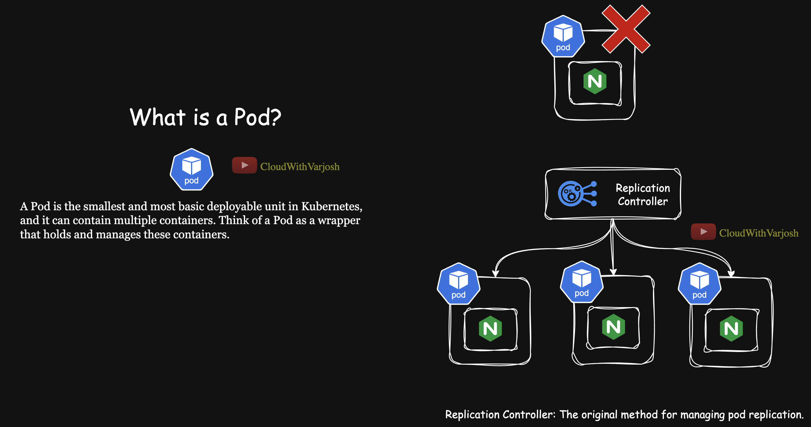
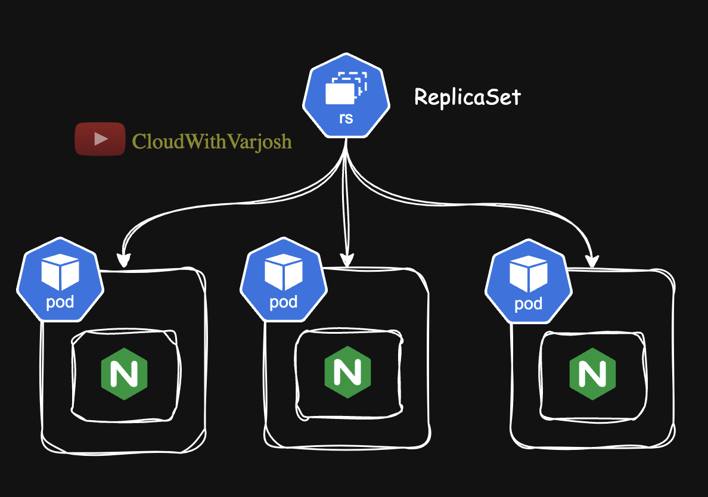
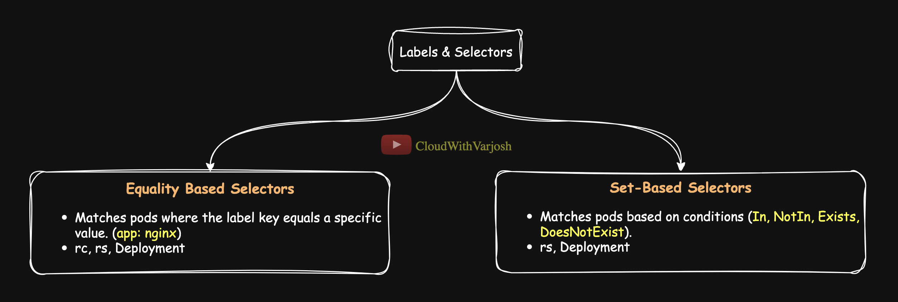

# 24 · ReplicationController → ReplicaSet: Keeping N Pods Alive

> **Level:** ★ foundation
>
> **You will learn:** how Kubernetes keeps a fixed number of identical Pods running; the legacy **ReplicationController** (rc) and its replacement the **ReplicaSet** (rs); equality-based vs set-based selectors in real manifests; how a ReplicaSet adopts, creates and deletes Pods (and the traps that come with that); scaling; and why you'll almost always let a **Deployment** manage ReplicaSets for you.
>
> **You need:** topics 17 and 18.

---

## ⚡ Core: the 10-minute version

**The idea.** A **ReplicaSet** keeps a set number of identical Pods running. It counts Pods matching its **selector**, creates more from its template if there are too few, and deletes extras if there are too many. Its predecessor, the **ReplicationController**, is legacy. You rarely create ReplicaSets yourself: **Deployments** create and manage them for you, adding rolling updates.

**Picture it.** A ReplicaSet is a thermostat set to "3 Pods": it switches Pods on or off until the room is at 3.

**The one thing to know.**

```yaml
apiVersion: apps/v1
kind: ReplicaSet
metadata: { name: web }
spec:
  replicas: 3
  selector: { matchLabels: { app: web } }        # what it counts
  template:                                       # what it creates
    metadata: { labels: { app: web } }            # must match the selector
    spec: { containers: [ { name: nginx, image: nginx:1.27 } ] }
```

**Try it now:**
1. Apply it and delete a Pod: it comes back.
2. Run a bare Pod with the label `app=web`: the ReplicaSet adopts it and deletes one Pod to stay at 3.
3. Change the image in the template: existing Pods don't change. That's why Deployments exist.

**You've got it if you can:** explain how a ReplicaSet uses its selector, and why you use Deployments instead.

> 📖 **That's the core.** On a first pass, do the mini-lab and move on to the next topic. Everything below is the **full reference**: come back for the details, the edge cases, interview answers and exam-level depth.

---

## What it is

- A **ReplicationController (rc)** ensures that a **specified number of Pod replicas** are running at all times. It's the original (now legacy) way to do this.
- A **ReplicaSet (rs)** is the **improved version**: same job, but it supports **set-based selectors** (`In`, `NotIn`, `Exists`, `DoesNotExist`) and lives in the `apps/v1` API group. ReplicaSets are usually **managed by Deployments**, which add rolling updates and rollbacks.

Both work the same way: **any Pod whose labels match the selector** counts towards the replica count, **no matter how it was created**.

Find their API details:

```bash
kubectl api-resources | grep -E 'replication|replicasets|deployments'
```

```
NAME                     SHORTNAMES   APIVERSION   NAMESPACED   KIND
replicationcontrollers   rc           v1           true         ReplicationController
replicasets              rs           apps/v1      true         ReplicaSet
deployments              deploy       apps/v1      true         Deployment
```

This tells you each object's API group/version, kind and short name (topic 14).

---

## Why it exists

A bare Pod dies with its node and never comes back (topic 18). For a service to stay up you need **N copies, always**, spread over nodes, with something that **replaces** lost copies automatically. That "something" is a controller running the reconciliation loop from topic 07:

```
desired = spec.replicas
actual  = number of matching, active Pods
if actual < desired: create Pods from spec.template
if actual > desired: delete surplus Pods
```

---

## Analogy

A **headcount rule** at a call centre: "there must always be 3 people on the phones". The supervisor (ReplicaSet) doesn't care **who** they are, only that **3 people wearing the call-centre badge** (label) are working. If one leaves, a new one is hired from the job description (template). If a 4th person with the same badge sits down, one is sent home.

---

## How it works inside

### ReplicationController



`Day 10/rc.yaml`:

```yaml
apiVersion: v1                 # core group: RCs are that old
kind: ReplicationController
metadata:
  name: nginx-rc
spec:
  replicas: 3                  # desired number of Pods
  selector:                    # a plain map: equality-based only
    app: nginx
  template:                    # the Pod blueprint
    metadata:
      labels:                  # must satisfy the selector
        app: nginx
        environment: development
    spec:
      containers:
        - name: nginx-container
          image: nginx
```

- `selector` is a simple map (`app: nginx`): **equality-based only**.
- If `selector` is omitted, an RC defaults it to the template's labels.

**How it works:**

```bash
kubectl apply -f "Day 10/rc.yaml"          # 1. create
kubectl get rc                               # 2. verify
kubectl describe rc nginx-rc
kubectl get pods --selector app=nginx
kubectl scale rc nginx-rc --replicas=4       # 3. scale
```

```
NAME       DESIRED   CURRENT   READY   AGE
nginx-rc   3         3         3       20s
```

- `DESIRED` = `spec.replicas`; `CURRENT` = Pods that exist; `READY` = Pods passing readiness.

**Imperative creation:** older kubectl could create an RC imperatively (`kubectl create rc …`, or `kubectl run --generator=run/v1`). That shortcut **no longer exists** in modern kubectl because RCs are rarely used now. You can still create RCs from YAML.

> ⚠️ **Status:** ReplicationController is **legacy**. It's still in the API (core `v1`), but you should use a **Deployment** (which manages ReplicaSets) for everything new. You'll mostly meet RCs in old manifests and exam questions.

### ReplicaSet



`Day 10/rs.yaml`:

```yaml
apiVersion: apps/v1
kind: ReplicaSet
metadata:
  name: nginx-rs
spec:
  replicas: 3
  selector:
    matchLabels:               # LabelSelector: matchLabels and/or matchExpressions
      app: nginx
  template:
    metadata:
      labels:
        app: nginx
        environment: development
    spec:
      containers:
        - name: nginx-container
          image: nginx
```

- `selector` is **required** and must match `template.metadata.labels`, otherwise the API rejects it: `selector does not match template labels`.
- In `apps/v1` the selector is **immutable**.

### Selectors: rc vs rs



| Selector type | Supported by | Description |
|---|---|---|
| **Equality-based** | rc, rs, Deployment | Label equals a value (`app: nginx`) |
| **Set-based** | rs, Deployment (not rc) | `In`, `NotIn`, `Exists`, `DoesNotExist` |

Set-based selectors give flexible, fine-grained grouping of Pods (topic 17 explains each operator).

### A set-based ReplicaSet (Day 10, `Day 10/set-based.yaml`)

```yaml
apiVersion: apps/v1
kind: ReplicaSet
metadata:
  name: example-rs
spec:
  replicas: 3
  selector:
    matchExpressions:
      - key: app
        operator: In
        values: [nginx, apache]
      - key: environment
        operator: NotIn
        values: [development]
      - key: tier
        operator: Exists
      - key: debug
        operator: DoesNotExist
  template:
    metadata:
      labels:
        app: nginx
        environment: production
        tier: frontend
        # Do not add a "debug" label here; it would break the selector.
    spec:
      containers:
        - name: nginx-container
          image: nginx
```

**Explanation:**
1. `.spec.selector.matchExpressions`: select Pods where `app` is `nginx` **or** `apache`, **and** `environment` is **not** `development`, **and** a `tier` label **exists**, **and** there's **no** `debug` label.
2. `.spec.template.metadata.labels`: the labels on Pods this ReplicaSet creates. They **must satisfy** every rule above.
3. **Pods created** get `app: nginx`, `environment: production`, `tier: frontend`, and no `debug`.
4. **Replicas:** keeps **3** of them running.

`Day 10/rs-set-based.yaml` is a shorter variant: selector `app In (nginx, apache)` with template label `app: apache`, showing that **any** value in the set satisfies `In`.

### What the ReplicaSet controller really does

1. **Lists Pods** in its namespace that match the selector, ignoring Pods that are terminating or already **owned by another controller** (checked via `metadata.ownerReferences`).
2. **Adopts** matching orphan Pods (sets itself as their owner), even ones you created by hand.
3. Compares the count with `replicas`; **creates** Pods from the template or **deletes** extras. When deleting, it prefers Pods that are not yet scheduled, not ready, or newer, and spreads deletions across nodes.
4. Writes `status.replicas`, `readyReplicas`, `availableReplicas`.

Consequences:
- Deleting a Pod → a new one is created (with a **new name and IP**).
- A hand-made Pod with matching labels → adopted, and the surplus Pod is deleted.
- Removing the label from a Pod → it's **released** (orphaned) and a replacement is created (topic 17).
- `kubectl delete rs nginx-rs` deletes its Pods too (cascading delete via the garbage collector). `kubectl delete rs nginx-rs --cascade=orphan` keeps the Pods running, unowned.

### Updating the image: no rolling update

If you change the image of an **rc** (e.g. `kubectl set image rc/nginx-rc nginx-container=nginx:1.29`), the controller **keeps the existing Pods**. Only **newly created** Pods (after a delete or scale-up) use the new image. A **ReplicaSet without a Deployment** behaves the same way: existing Pods aren't replaced. That's why ReplicaSets alone are no good for releases, and why **Deployments** exist (topic 25).

### rc vs rs vs Deployment

| Feature | ReplicationController | ReplicaSet | Deployment |
|---|---|---|---|
| **Selectors** | Equality-based only | Equality and set-based | Equality and set-based |
| **Updates** | Manual (existing Pods keep the old template) | Manual (same) | **Automated rolling updates and rollbacks** |
| **Scaling** | Manual/imperative (or HPA) | Manual/imperative (or HPA) | Declarative; HPA-friendly |
| **API** | `v1` (core) | `apps/v1` | `apps/v1` |
| **Use case** | **Legacy** workloads | Managed **by Deployments**; rarely created directly | **What you use** for stateless apps (and CI/CD) |

---

## Commands / YAML

```bash
kubectl apply -f "Day 10/rs.yaml"
kubectl get rs nginx-rs -o wide
```

```
NAME       DESIRED   CURRENT   READY   AGE   CONTAINERS        IMAGES   SELECTOR
nginx-rs   3         3         3       15s   nginx-container   nginx    app=nginx
```

```bash
kubectl scale rs nginx-rs --replicas=5          # imperative scale
kubectl get pods -l app=nginx --show-labels
kubectl describe rs nginx-rs | tail -6
```

```
Events:
  Type    Reason            Age   From                   Message
  ----    ------            ----  ----                   -------
  Normal  SuccessfulCreate  40s   replicaset-controller  Created pod: nginx-rs-7k2xq
  Normal  SuccessfulCreate  40s   replicaset-controller  Created pod: nginx-rs-p9d4m
  Normal  SuccessfulCreate  40s   replicaset-controller  Created pod: nginx-rs-z8wtn
  Normal  SuccessfulCreate  5s    replicaset-controller  Created pod: nginx-rs-b2l7c
```

- Pod names = ReplicaSet name + a random 5-character suffix.

Check a Pod's owner:

```bash
kubectl get pod nginx-rs-7k2xq -o jsonpath='{.metadata.ownerReferences[0].kind}/{.metadata.ownerReferences[0].name}{"\n"}'
```

```
ReplicaSet/nginx-rs
```

---

## Hands-on lab

1. Apply `Day 10/rc.yaml`; scale it to 4; delete one Pod and watch it come back with a new name.
2. Change the RC's image with `kubectl set image rc/nginx-rc nginx-container=nginx:1.29`. Run `kubectl get pods -o custom-columns=NAME:.metadata.name,IMAGE:.spec.containers[0].image`: the old Pods still run `nginx`. Delete one: the replacement runs `nginx:1.29`. That's the "no rolling update" problem.
3. Delete the RC; apply `Day 10/rs.yaml`.
4. **Adoption trap:** `kubectl run intruder --image=busybox:1.37 --labels=app=nginx -- sleep 3600`. Watch it get adopted and the surplus Pod deleted. (Which Pod got deleted?)
5. **Release a Pod:** `kubectl label pod <one-rs-pod> app=debug --overwrite` → the RS creates a replacement; the relabelled Pod keeps running unowned.
6. Apply `Day 10/set-based.yaml` and `Day 10/rs-set-based.yaml` (delete `nginx-rs` first, as the latter reuses that name). Then try adding `debug: "true"` to `set-based.yaml`'s template: the API rejects it because the template no longer matches the selector.
7. Delete with `--cascade=orphan` and see the Pods survive the ReplicaSet.
8. Clean up: `kubectl delete rs --all; kubectl delete pod -l 'app in (nginx,apache,debug)'; kubectl delete pod intruder --ignore-not-found`.

---

## Where you'll use it

- **Reading Deployments**: every Deployment works through ReplicaSets; `kubectl get rs` shows a Deployment's revisions (topic 25).
- **Debugging**: Pod-creation errors (quota, Pod Security) appear as `FailedCreate` events on the **ReplicaSet**, not the Deployment (topic 10).
- **Exams and legacy clusters**: RCs and bare ReplicaSets still appear.

---

## When it breaks

| Symptom | Cause | Fix |
|---|---|---|
| `selector does not match template labels` | Template labels don't satisfy the selector | Align them |
| `field is immutable` when changing `spec.selector` | apps/v1 selectors can't change | Create a new ReplicaSet/Deployment |
| Your test Pod disappears | Adopted by a ReplicaSet with a matching selector and deleted as surplus | Use unique labels |
| Image changed but Pods still old | RC/RS don't roll Pods | Use a Deployment (or delete Pods) |
| `DESIRED 3 CURRENT 0` | Pod creation rejected | `kubectl describe rs` → `FailedCreate` events (quota, LimitRange, Pod Security, missing ServiceAccount) |
| Two controllers fight | Overlapping selectors | Unique selectors per workload |

---

## Quick recap

- rc and rs keep **N matching Pods** running by creating/deleting Pods from a template.
- rc = legacy, core `v1`, **equality selectors only**; rs = `apps/v1`, **set-based selectors** too.
- They adopt **any** matching Pod; selectors are immutable; changing the template doesn't replace existing Pods.
- Use **Deployments**; they manage ReplicaSets and add rolling updates and rollbacks.

### Interview questions

1. **Q: Difference between a ReplicationController and a ReplicaSet?**
   A: A ReplicaSet supports set-based selectors (`In`, `NotIn`, `Exists`, `DoesNotExist`) and is in `apps/v1`; an RC supports only equality selectors and is legacy. Both maintain a replica count.
2. **Q: Why shouldn't you create ReplicaSets directly?**
   A: Changing a ReplicaSet's template doesn't update existing Pods, so there are no rolling updates or rollbacks. Deployments manage ReplicaSets to provide those.
3. **Q: What happens if you create a Pod whose labels match an existing ReplicaSet's selector?**
   A: The ReplicaSet adopts it; if that puts it above `replicas`, it deletes one of its Pods to return to the desired count.

---

## Appendix: notes on the original course material

This topic was rebuilt from the original CKA course notes. This appendix keeps the audit trail out of your way while you learn.

### Sources

Day 10 (section 1 checking object details with `api-resources`; section 2 ReplicationController: what it is, manifest, how it works, imperative note; section 3 ReplicaSet: what it is, manifest, equality vs set-based selectors, set-based example and explanation; the rc/rs note on image updates; section 5 differences table), files `Day 10/rc.yaml`, `rs.yaml`, `rs-set-based.yaml`, `set-based.yaml`. Labels and selectors theory is in topic 17; Deployments in topic 25.
