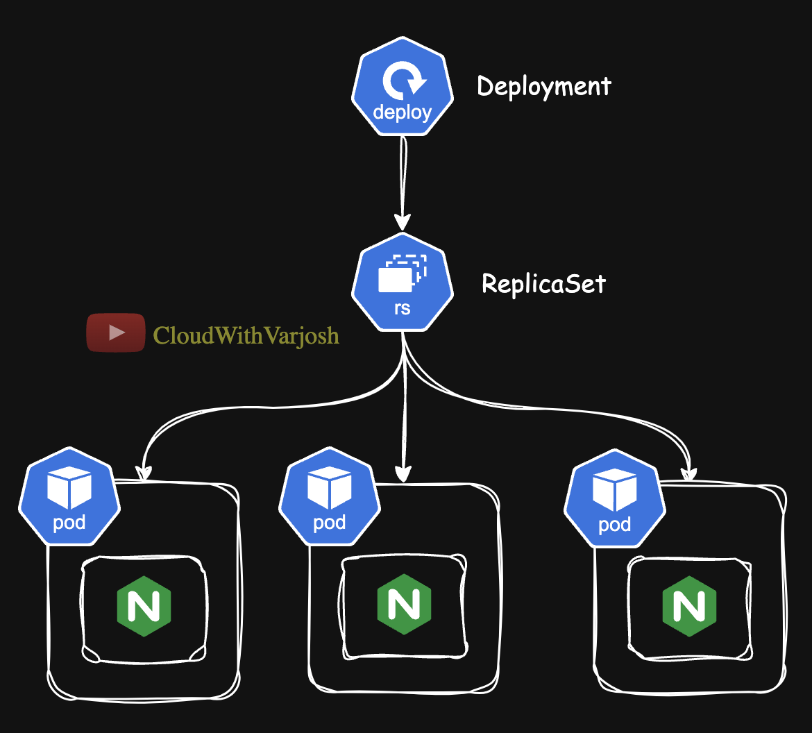

# 25 · Deployments: Rolling Updates, Rollbacks and Release Strategies

> **Level:** ★★ intermediate
>
> **You will learn:** what a Deployment adds on top of ReplicaSets; exactly how a rolling update shifts Pods between ReplicaSets (and how `maxSurge`, `maxUnavailable`, readiness, `minReadySeconds` and `progressDeadlineSeconds` control it); the `Recreate` strategy; revision history, change causes and rollbacks (and how revision numbers really behave); pause/resume and `rollout restart`; and how blue-green and canary releases are done on top of Deployments.
>
> **You need:** topics 17, 19, 22 and 24.

---

## ⚡ Core: the 10-minute version

**The idea.** A **Deployment** runs your stateless app and updates it safely.
- When you change the Pod template (e.g. a new image), it creates a **new ReplicaSet** and gradually shifts Pods from old to new: a **rolling update**, controlled by `maxSurge` (extra Pods allowed) and `maxUnavailable` (missing Pods allowed).
- New Pods only count once they're **Ready**.
- Every change is a **revision**, so you can roll back.

**Picture it.** Replacing the crew of a running ship a few sailors at a time, never leaving the deck unstaffed.

**The one thing to know.**

```bash
kubectl create deployment web --image=nginx:1.26 --replicas=4
kubectl set image deploy/web nginx=nginx:1.27      # rolling update
kubectl rollout status deploy/web
kubectl rollout history deploy/web
kubectl rollout undo deploy/web                     # back to the previous revision
```

**Try it now:**
1. Run the commands while watching `kubectl get rs -w` in another terminal: see the old ReplicaSet scale down as the new one scales up.
2. Set a non-existent image and watch the rollout stall.
3. Undo it.

**You've got it if you can:** explain how a rolling update moves Pods between ReplicaSets, and how to roll back.

> 📖 **That's the core.** On a first pass, do the mini-lab and move on to the next topic. Everything below is the **full reference**: come back for the details, the edge cases, interview answers and exam-level depth.

---

## What it is



A **Deployment** builds on ReplicaSets and adds:
- **Rolling updates** and **rollbacks**,
- automated updates of Pods when the template changes,
- simplified scaling and management.

It's **the** object for running stateless applications.

```yaml
apiVersion: apps/v1
kind: Deployment
metadata:
  name: nginx-deployment
spec:
  replicas: 3
  selector:
    matchLabels:
      app: nginx
  template:
    metadata:
      labels:
        app: nginx
    spec:
      containers:
        - name: nginx-container
          image: nginx:1.29
```

**How Deployments build on ReplicaSets:** a Deployment **manages ReplicaSets** and creates a **new ReplicaSet for each new version** of the Pod template. Shifting Pods from the old ReplicaSet to the new one is what gives **updates without downtime**.

---

## Why it exists

Topic 24 showed the problem: changing a ReplicaSet's template doesn't touch existing Pods. Releasing a new version by hand (create new Pods, wait until they're healthy, remove old ones, keep the old version around in case you need to go back) is exactly what the Deployment controller automates, safely, every time.

---

## Analogy

Replacing the **tyres of a bus while it keeps driving** (it's a strange bus with many wheels). You add one new wheel (**surge**), check it's holding (**readiness**), then remove one old wheel (**unavailable**), and repeat. If a new wheel wobbles, you stop, and you still have the old wheels in the garage (**old ReplicaSets at 0 replicas**) to put back (**rollback**).

---

## How it works inside

### Each template change = a new ReplicaSet

- The Deployment controller hashes the Pod template into **`pod-template-hash`** (e.g. `6d4b7c9f8`). It names the ReplicaSet `<deployment>-<hash>` and adds the hash as a **label** on the ReplicaSet's selector and its Pods, so ReplicaSets of different versions never select each other's Pods.
- Changing **anything in `spec.template`** (image, env, resources, labels, annotations) → new hash → **new ReplicaSet** → a **rollout**.
- Changing `replicas` alone is **scaling**, not a rollout: no new ReplicaSet.
- Old ReplicaSets are kept, scaled to **0**, for rollback. How many are kept: `revisionHistoryLimit` (default **10**).

### The RollingUpdate strategy (default)

```yaml
spec:
  strategy:
    type: RollingUpdate
    rollingUpdate:
      maxSurge: 25%          # how many EXTRA Pods above replicas during the update
      maxUnavailable: 25%    # how many Pods BELOW replicas may be unavailable
  minReadySeconds: 0         # a new Pod must stay Ready this long to count as "available"
  progressDeadlineSeconds: 600   # mark the rollout as failed if no progress for 10 min
```

- `maxSurge` and `maxUnavailable` accept numbers or percentages. Surge is **rounded up**, unavailable **rounded down**, and both can't be 0.
- With `replicas: 4` and the defaults: surge = 1, unavailable = 1. So at any moment there are **at most 5 Pods** and **at least 3 available**.

**The loop:**
1. Scale the **new** ReplicaSet up by as much as `maxSurge` allows.
2. Wait until new Pods are **available** (Ready for `minReadySeconds`; readiness probes from topic 22 decide this).
3. Scale the **old** ReplicaSet down as much as `maxUnavailable` allows.
4. Repeat until new = `replicas` and old = 0.

```
replicas=4, maxSurge=1, maxUnavailable=1
old RS: 4 → 3 → 2 → 1 → 0
new RS: 0 → 1 → 2 → 3 → 4      (each step waits for new Pods to be Ready)
```

**Common settings:**
- `maxSurge: 1, maxUnavailable: 0`: never drop below full capacity (the safest; needs spare cluster room).
- `maxSurge: 0, maxUnavailable: 1`: no extra Pods (when the cluster is full, or with licence limits).

**Readiness is the safety brake.** If new Pods never become Ready (bad image, crash, failing probe), the rollout **stops**: old Pods are only removed as new ones become available, so most capacity stays on the old version. After `progressDeadlineSeconds` the Deployment's `Progressing` condition turns `False` with reason `ProgressDeadlineExceeded`. Kubernetes **does not roll back automatically**; you (or your CD tool) must.

### The Recreate strategy

```yaml
spec:
  strategy:
    type: Recreate
```

**All old Pods are killed first**, then new ones are created. That means **downtime**, but the two versions **never run at the same time**. Use it when versions can't coexist: incompatible database schema changes, a single-writer app using a `ReadWriteOnce` volume (topic 38), or licence limits.

### Revisions, change causes and rollbacks

- Each ReplicaSet carries the annotation `deployment.kubernetes.io/revision: "N"`.
- `kubectl rollout history` lists revisions and their **`CHANGE-CAUSE`**, taken from the annotation **`kubernetes.io/change-cause`** on the Deployment at the time of that rollout.

**Annotations** are key-value pairs for **arbitrary, non-identifying metadata** (unlike labels, which are for selection and grouping). They don't change an object's behaviour directly, and they hold informational or operational data: deployment changes, build info, links to external resources, operational notes (topic 17).

**Rollback** (`kubectl rollout undo`) copies the **old revision's Pod template back into the Deployment**, which triggers a normal rolling update to it.

> ⚠️ **Fix to the original** ([C1](#c1)): "when you perform a rollback, Kubernetes scales down the current ReplicaSet to 0 and scales up the ReplicaSet associated with the revision you're rolling back to". That's what you **see**, but two details matter:
> 1. The rollback is a **rolling update** (it respects `maxSurge`/`maxUnavailable` and readiness), not an instant switch.
> 2. The old revision **gets a new revision number**: rolling back from revision 3 to revision 1 turns revision 1 into **revision 4**, and "1" disappears from the history. So `--to-revision=1` won't work twice.

> ℹ️ `kubectl … --record` (which used to fill `change-cause` automatically) is **deprecated** and no longer used. Set `kubernetes.io/change-cause` in the manifest or with `kubectl annotate`.

### Pause and resume

`kubectl rollout pause` stops the controller from acting on template changes; `resume` continues. Why:
- **Making several changes**: pause, change image + env + resources, resume. **One** rollout instead of three partial ones.
- **Investigating issues**: if a problem appears mid-rollout, pause to investigate before continuing.

Resuming applies all pending changes from where it stopped. (Scaling still works while paused.)

### Restart without changing anything

`kubectl rollout restart deployment/<name>` adds a timestamp annotation (`kubectl.kubernetes.io/restartedAt`) to the template, which causes a **normal rolling restart**: new Pods, zero downtime. Useful after rotating a mounted Secret that the app only reads at start-up.

### Release strategies on top of Deployments

| Strategy | How | Built-in? |
|---|---|---|
| **Rolling update** | Gradually replace Pods | Yes (default) |
| **Recreate** | Stop all, then start all | Yes |
| **Blue-green** | Run two full Deployments (`app=web, version=blue` and `version=green`); switch the **Service selector** from blue to green in one step; switch back to roll back | Manual (two Deployments + one Service), or Argo Rollouts |
| **Canary** | Send a **small share** of traffic to the new version, watch metrics, then increase | Roughly: two Deployments behind one Service, share ∝ replica counts (e.g. 9 stable + 1 canary ≈ 10%). Precisely: weighted routing with Gateway API (topic 72), a service mesh (topic 74), or **Argo Rollouts / Flagger** for automated analysis and promotion |

---

## Commands / YAML

### Rolling updates and rollbacks with change causes (Day 10, `Day 10/deploy.yaml`)

**Step 1: the Deployment with a change cause**

```yaml
apiVersion: apps/v1
kind: Deployment
metadata:
  name: nginx-deployment
  annotations:
    kubernetes.io/change-cause: "Initial release with nginx 1.19"
spec:
  replicas: 3
  selector:
    matchLabels:
      app: nginx
  template:
    metadata:
      labels:
        app: nginx
        environment: development
    spec:
      containers:
        - name: nginx-container
          image: nginx:1.19
```

- `kubernetes.io/change-cause` records **why** this revision exists.
- The image is **nginx 1.19**. (Old versions are used on purpose so the demo can upgrade through them.)

**Step 2: check the history**

```bash
kubectl apply -f "Day 10/deploy.yaml"
kubectl rollout history deployment nginx-deployment
```

```
deployment.apps/nginx-deployment
REVISION  CHANGE-CAUSE
1         Initial release with nginx 1.19
```

**Step 3: upgrade to 1.20**

```bash
kubectl set image deployment nginx-deployment nginx-container=nginx:1.20
kubectl annotate deployments.apps nginx-deployment kubernetes.io/change-cause="Upgraded nginx 1.19 to 1.20"
kubectl rollout history deployment nginx-deployment
```

```
REVISION  CHANGE-CAUSE
1         Initial release with nginx 1.19
2         Upgraded nginx 1.19 to 1.20
```

- `kubectl set image deployment <name> <container>=<image>` changes the template → new ReplicaSet → rollout.
- Annotate **right after**, so the new revision picks up the cause. (Strictly, the cause is copied to the ReplicaSet when the controller next syncs, so annotate quickly, or better, put both changes in the file.)
- **In production:** change the **image and change-cause in the manifest** and `kubectl apply` it, so the config stays declarative, version-controlled and consistent.
- `kubectl describe deployment nginx-deployment` also shows the annotation.

**Step 4: upgrade to 1.21**

```bash
kubectl set image deployment nginx-deployment nginx-container=nginx:1.21
kubectl annotate deployments.apps nginx-deployment kubernetes.io/change-cause="Upgraded nginx 1.20 to 1.21"
kubectl rollout history deployment nginx-deployment
```

```
REVISION  CHANGE-CAUSE
1         Initial release with nginx 1.19
2         Upgraded nginx 1.19 to 1.20
3         Upgraded nginx 1.20 to 1.21
```

**Step 5: roll back**

```bash
kubectl rollout undo deployment nginx-deployment --to-revision=1   # to a specific revision
kubectl rollout undo deployment nginx-deployment                   # or simply to the previous one
```

- `--to-revision` is needed for a **specific** revision; without it you go to the **previous** one.

**Good to know:** each update (e.g. `kubectl set image`) creates a **new ReplicaSet**; the old one is scaled to 0 and the new one up to `replicas`. A rollback scales the current ReplicaSet down and the target revision's ReplicaSet back up, making it active again (through a rolling update, as corrected above).

**Step 6: verify**

```bash
kubectl describe deployment nginx-deployment | grep -E 'Image|change-cause'
kubectl rollout history deployment nginx-deployment
kubectl get rs -l app=nginx
```

```
    Image:      nginx:1.19
REVISION  CHANGE-CAUSE
2         Upgraded nginx 1.19 to 1.20
3         Upgraded nginx 1.20 to 1.21
4         Initial release with nginx 1.19

NAME                          DESIRED   CURRENT   READY   AGE
nginx-deployment-5d6b8c7f9    3         3         3       6m
nginx-deployment-7f4c9d8b6    0         0         0       4m
nginx-deployment-8a2e1c4d3    0         0         0       2m
```

- Revision 1 is now **revision 4** (see the correction above). Its ReplicaSet (`…5d6b8c7f9`) is active again: the **same** ReplicaSet object was reused, because the template hash matches.

**Key pointers:**
1. Always record `kubernetes.io/change-cause` to make management and debugging easier.
2. `kubectl rollout history` shows revisions (add `--revision=N` to see that revision's template).
3. Roll back to any kept revision with `--to-revision`.

### Watching a rollout

```bash
kubectl rollout status deployment/nginx-deployment
```

```
Waiting for deployment "nginx-deployment" rollout to finish: 1 out of 3 new replicas have been updated...
Waiting for deployment "nginx-deployment" rollout to finish: 2 out of 3 new replicas have been updated...
Waiting for deployment "nginx-deployment" rollout to finish: 1 old replicas are pending termination...
deployment "nginx-deployment" successfully rolled out
```

- It exits non-zero if the progress deadline is exceeded, which makes it perfect for CI/CD gates.

```bash
kubectl get deploy nginx-deployment
```

```
NAME               READY   UP-TO-DATE   AVAILABLE   AGE
nginx-deployment   3/3     3            3           8m
```

- `READY` = ready/desired; `UP-TO-DATE` = Pods on the newest template; `AVAILABLE` = ready for at least `minReadySeconds`.

### Important Deployment commands

| Task | Command |
|---|---|
| Create imperatively | `kubectl create deployment nginx-deployment --image=nginx:1.19` |
| List | `kubectl get deployments` |
| Describe | `kubectl describe deployment nginx-deployment` |
| Update image | `kubectl set image deployment/nginx-deployment nginx-container=nginx:1.20` |
| Scale | `kubectl scale deployment/nginx-deployment --replicas=5` |
| Rollout history | `kubectl rollout history deployment/nginx-deployment` |
| Annotate | `kubectl annotate deployment nginx-deployment kubernetes.io/change-cause="Upgraded nginx 1.19 to 1.20"` |
| Roll back | `kubectl rollout undo deployment/nginx-deployment --to-revision=1` |
| Edit | `kubectl edit deployment <name>` |
| Get YAML | `kubectl get deployment <name> -o yaml` |
| Delete | `kubectl delete deployment nginx-deployment` |
| Status | `kubectl rollout status deployment/<name>` |
| Pause / resume | `kubectl rollout pause deployment/<name>` / `kubectl rollout resume deployment/<name>` |
| Rolling restart | `kubectl rollout restart deployment/<name>` |

### Blue-green in 20 lines

```yaml
# Service points at "blue" now
apiVersion: v1
kind: Service
metadata: { name: web }
spec:
  selector: { app: web, version: blue }
  ports: [{ port: 80, targetPort: 80 }]
```

```yaml
# Two Deployments that differ only in name, version label and image
apiVersion: apps/v1
kind: Deployment
metadata: { name: web-blue }
spec:
  replicas: 3
  selector: { matchLabels: { app: web, version: blue } }
  template:
    metadata: { labels: { app: web, version: blue } }
    spec: { containers: [{ name: web, image: "nginx:1.28" }] }
---
apiVersion: apps/v1
kind: Deployment
metadata: { name: web-green }
spec:
  replicas: 3
  selector: { matchLabels: { app: web, version: green } }
  template:
    metadata: { labels: { app: web, version: green } }
    spec: { containers: [{ name: web, image: "nginx:1.29" }] }
```

```bash
# test green directly (port-forward to a green Pod), then switch all traffic in one step:
kubectl patch svc web -p '{"spec":{"selector":{"app":"web","version":"green"}}}'
# instant rollback:
kubectl patch svc web -p '{"spec":{"selector":{"app":"web","version":"blue"}}}'
```

---

## Hands-on lab

1. Do Day 10's steps 1–6 with `Day 10/deploy.yaml`. After the rollback, run `kubectl rollout history` and find revision 4.
2. Watch the ReplicaSets move during an update: in one terminal `kubectl get rs -l app=nginx -w`; in another `kubectl set image deploy/nginx-deployment nginx-container=nginx:1.29`.
3. **Broken rollout:** `kubectl set image deploy/nginx-deployment nginx-container=nginx:9.99`. See `kubectl rollout status` hang, the old Pods keep serving, and `kubectl get pods` show `ImagePullBackOff` for one new Pod only (limited by `maxSurge`). Set `progressDeadlineSeconds: 60` and watch `kubectl describe deploy` show `ProgressDeadlineExceeded`. Fix it with `kubectl rollout undo`.
4. Set `strategy: {type: Recreate}`, change the image, and watch all Pods terminate before new ones start.
5. Pause, make three changes (image, an env var, a resource request), resume: one new ReplicaSet, not three.
6. Do the blue-green switch with two Deployments and one Service; curl the Service from a test Pod during the switch.
7. Clean up: `kubectl delete deploy --all; kubectl delete svc web`.

---

## Where you'll use it

- **Every stateless service** in production; CI/CD pipelines run `kubectl apply` / `helm upgrade` and then `kubectl rollout status` as a gate.
- **Incident response**: `kubectl rollout undo` is the fastest fix for a bad release (but fix Git afterwards, or GitOps will re-apply the bad version).
- **Capacity planning**: `maxSurge` needs spare room in the cluster during releases.

---

## When it breaks

| Symptom | Cause | Fix |
|---|---|---|
| `rollout status` hangs, new Pods `ImagePullBackOff`/`CrashLoopBackOff` | Bad image or app | `rollout undo`; fix and redeploy |
| Rollout stuck, new Pods Running but `0/1` | Readiness probe never passes | Fix the probe/app (topic 22) |
| `ProgressDeadlineExceeded` | No progress within `progressDeadlineSeconds` | Investigate; undo |
| Rollout stuck with old Pods still Terminating | Long grace periods / preStop | Expected; check `terminationGracePeriodSeconds` |
| New Pods `Pending` during rollout | No room for surge Pods | Add capacity or use `maxSurge: 0` |
| Users see errors during every rollout | No readiness probe, or no graceful shutdown | Readiness + preStop sleep + SIGTERM handling (topics 19, 22) |
| `rollout undo --to-revision=1` says revision not found | It was renumbered after an earlier undo, or pruned by `revisionHistoryLimit` | Check `rollout history` |
| Rollback undone minutes later | GitOps/CI re-applied the manifest | Revert in Git |

---

## Quick recap

- Deployment → ReplicaSets (one per template version, named by `pod-template-hash`) → Pods.
- RollingUpdate: `maxSurge` (extra Pods) and `maxUnavailable` (missing Pods), gated by **readiness** and `minReadySeconds`; `progressDeadlineSeconds` marks stuck rollouts. **Recreate** = downtime but no version overlap.
- History via `kubernetes.io/change-cause`; `rollout undo [--to-revision]` is itself a rolling update and renumbers the revision.
- `rollout status / pause / resume / restart`; blue-green and canary via labels, Services, or tools like Argo Rollouts.

### Interview questions

1. **Q: How does a Deployment perform a rolling update?**
   A: It creates a new ReplicaSet for the new template and alternately scales it up (bounded by maxSurge) and the old one down (bounded by maxUnavailable), only counting new Pods once they're Ready/available.
2. **Q: A rollout is stuck. What do you check?**
   A: `kubectl rollout status`, `kubectl describe deploy` (conditions), new Pods' status/events/logs (image pull, crash, readiness), and whether surge Pods are Pending for lack of capacity; then fix or `rollout undo`.
3. **Q: RollingUpdate vs Recreate: when do you use Recreate?**
   A: When two versions must not run at once (incompatible schema or protocol, a single-writer RWO volume), accepting brief downtime.

---

## Appendix: notes on the original course material

This topic was rebuilt from the original CKA course notes. This appendix keeps the audit trail out of your way while you learn.

### Sources

Day 10 (section 4 Deployments: what, manifest, how they build on ReplicaSets, annotations, rolling updates and rollbacks steps 1–6, key pointers, important commands, pause and resume; the rc/rs/Deployment table is in topic 24), file `Day 10/deploy.yaml`. Day 07's Deployment-wraps-ReplicaSet picture is in topic 06.

### Corrections to the original notes

Each entry shows what the original said and what's true now. In the topic above, each correction appears as a ✅ **Correct today** line or a ⚠️ **Fix to the original** box, linked to its entry here.

<a id="c1"></a>**C1 · Corrected (Day 10).** "when you perform a rollback, Kubernetes scales down the current ReplicaSet to 0 and scales up the ReplicaSet associated with the revision you're rolling back to". That's what you **see**, but two details matter:
1. The rollback is a **rolling update** (it respects `maxSurge`/`maxUnavailable` and readiness), not an instant switch.
2. The old revision **gets a new revision number**: rolling back from revision 3 to revision 1 turns revision 1 into **revision 4**, and "1" disappears from the history. So `--to-revision=1` won't work twice.
