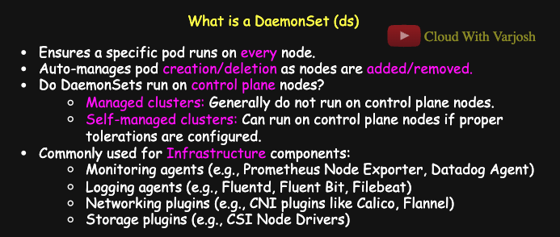

# 27 · DaemonSets: One Pod per Node

> **Level:** ★★ intermediate
>
> **You will learn:** what a DaemonSet guarantees and how its controller places Pods; the classic node agents (kube-proxy, CNI, CSI node plugins, log and metric collectors, security agents); why DaemonSets often need tolerations (with a short preview of taints) and why kube-proxy tolerates everything; running a DaemonSet on only some nodes; DaemonSet rolling updates; and a dummy logging agent demo with a `hostPath` volume.
>
> **You need:** topics 18, 24, 25 and 26. Two short previews:
> - A **taint** is a "keep away" mark on a node; only Pods with a matching **toleration** may be scheduled there. Control-plane nodes are tainted `node-role.kubernetes.io/control-plane:NoSchedule` (full details in topic 43).
> - A **`hostPath`** volume mounts a directory **from the node** into the Pod (topic 38).

---

## ⚡ Core: the 10-minute version

**The idea.** A **DaemonSet** runs **one Pod on every node** (or on every node you select), and adds a Pod automatically when a new node joins. It's used for **node agents**: kube-proxy, the CNI plugin, log collectors, monitoring agents, storage drivers. To also run on control-plane nodes, which are tainted, its Pods need a matching **toleration**.

**Picture it.** A security guard posted at every building on campus: build a new building, and a guard shows up there too.

**The one thing to know.**

```yaml
apiVersion: apps/v1
kind: DaemonSet
metadata: { name: node-agent }
spec:
  selector: { matchLabels: { app: node-agent } }
  template:
    metadata: { labels: { app: node-agent } }
    spec:
      tolerations:
      - { key: node-role.kubernetes.io/control-plane, operator: Exists, effect: NoSchedule }
      containers:
      - { name: agent, image: busybox:1.37, command: ["sh","-c","while true; do hostname; sleep 30; done"] }
```

**Try it now:**
1. Apply it and run `kubectl get pods -o wide`: one Pod per node.
2. Remove the toleration and re-apply: the control-plane node loses its Pod.
3. Run `kubectl get ds -n kube-system` to see the DaemonSets your cluster already uses.

**You've got it if you can:** explain what DaemonSets are for, and why they often need tolerations.

> 📖 **That's the core.** On a first pass, do the mini-lab and move on to the next topic. Everything below is the **full reference**: come back for the details, the edge cases, interview answers and exam-level depth.

---

## What it is



A **DaemonSet** makes sure that **one copy of a Pod runs on every (eligible) node** in the cluster:
- When a **new node joins**, a Pod is automatically scheduled onto it.
- When a **node is removed**, its DaemonSet Pod is **garbage-collected**.
- If you **delete** a DaemonSet Pod by hand, the DaemonSet controller **recreates** it straight away.
- **Deleting the DaemonSet** removes all the Pods it created.

"Every **eligible** node" = every node that the Pod is allowed on: nodes matching its `nodeSelector`/affinity and whose taints it tolerates.

The name comes from Unix **daemons**: background services that run on every machine.

---

## Why it exists

Some software must run **on each node**, because it works **with that node**: its network rules, its disks, its log files, its kernel events. A Deployment can't guarantee "exactly one per node, including nodes added later". A DaemonSet does, with zero manual work when the cluster grows or shrinks.

**Use cases:** cluster-wide system services such as
- **monitoring agents** (Prometheus Node Exporter, Datadog Agent),
- **logging agents** (Fluentd, Fluent Bit, Filebeat),
- **networking plugins** (Calico, Flannel, Cilium agents),
- **storage plugins** (CSI node drivers),
- **security agents** (Falco runtime security),
- **telemetry collectors** (OpenTelemetry Collector).

They're rolled out across **existing and new nodes automatically**.

---

## Analogy

A **smoke detector in every room** of a hotel. When a new room is built, a detector is fitted; when a room is demolished, its detector goes too. You don't "scale" smoke detectors; you have **one per room**. Some rooms (the control-plane "server rooms") have a "staff only" sign (a taint), and only detectors certified for those rooms (with a toleration) go there.

---

## How it works inside

1. The **DaemonSet controller** (in kube-controller-manager) watches Nodes and its DaemonSets.
2. For each node, it checks whether its Pod **should** run there (node selector, affinity, taints/tolerations) and whether it already does.
3. If one is missing, it creates a Pod with **node affinity pinned to that node** (`matchFields: metadata.name = <node>`). The **default scheduler** then binds it (since v1.12). The Pod still goes through the normal scheduler, so priority and preemption apply.
4. DaemonSet Pods automatically get several **tolerations** so they stay put when a node has problems: `node.kubernetes.io/not-ready`, `unreachable` (NoExecute), `disk-pressure`, `memory-pressure`, `pid-pressure`, `unschedulable` (NoSchedule) and, for host-network Pods, `network-unavailable`. That's why DaemonSet Pods survive `kubectl drain`, which ignores them with `--ignore-daemonsets` (topic 76).
5. There's no `replicas` field. The "replica count" is the number of eligible nodes.

### kube-proxy: a DaemonSet you've used all along

kube-proxy (Service-to-Pod networking, topics 08 and 32) must run on **every** node, so it's a DaemonSet:

```bash
kubectl get daemonsets.apps -n kube-system kube-proxy
kubectl get pods -n kube-system -o wide | grep -i kube-proxy
```

```
NAME         DESIRED   CURRENT   READY   UP-TO-DATE   AVAILABLE   NODE SELECTOR            AGE
kube-proxy   3         3         3       3            3           kubernetes.io/os=linux   3d
```

- `DESIRED 3` = 3 eligible nodes. `NODE SELECTOR kubernetes.io/os=linux` = only Linux nodes (Windows nodes run a different proxy).

### DaemonSets for CNIs and CSIs

Most networking and storage plugins ship node components as DaemonSets:
- **CNI plugins**: AWS VPC CNI, Azure CNI, Calico, Flannel, Cilium.
- **CSI node plugins**: AWS EBS CSI, AWS EFS CSI, GCP PD CSI, and others.

So every node, old or new, can handle Pod traffic, volume attachments and mounts.

### DaemonSets and control-plane nodes

**Will a DaemonSet run on the control-plane node?** It depends on the cluster:
- **Managed Kubernetes** (EKS, GKE, AKS): the control plane is **fully managed and hidden**. Your DaemonSets **never** run there; you only see worker nodes.
- **Self-managed** (kubeadm, kind): control-plane nodes are normal nodes with the **taint** `node-role.kubernetes.io/control-plane:NoSchedule`. A DaemonSet runs there only if it has a matching **toleration**.

```bash
kubectl describe node lab-control-plane | grep Taints
```

```
Taints:             node-role.kubernetes.io/control-plane:NoSchedule
```

kube-proxy's DaemonSet tolerates it like this:

```yaml
tolerations:
  - operator: Exists
```

**What `operator: Exists` with no `key` means:**
- **No key** = tolerate **any** taint, whatever its key, value or source.
- **No `effect`** either = tolerate **every** effect.
- kube-proxy must run on **all** nodes: control plane, workers, custom-tainted nodes. Kubernetes can't know what taints a cluster uses, so instead of listing them, kube-proxy says: "I don't care what taints the node has; I must run there anyway."

### Running on only some nodes

```yaml
spec:
  template:
    spec:
      nodeSelector:
        gpu: "true"               # only nodes labelled gpu=true (topic 44)
```

Label a node later (`kubectl label node lab-worker gpu=true`) and the DaemonSet creates a Pod there; remove the label and the Pod is deleted.

### Updating a DaemonSet

```yaml
spec:
  updateStrategy:
    type: RollingUpdate          # default
    rollingUpdate:
      maxUnavailable: 1          # replace one node's Pod at a time (number or %)
      maxSurge: 0                # >0 starts the new Pod before killing the old (not with hostPort)
```

- `RollingUpdate`: change the template → Pods are replaced node by node. `kubectl rollout status/history/undo ds/<name>` work as for Deployments.
- `OnDelete`: new Pods are created only when you delete old ones yourself (manual, careful upgrades of critical agents like CNIs).

---

## Commands / YAML

### Demo: a dummy logging agent (Day 29, `Day 29/ds.yaml`)

The agent "collects logs" by printing a message every 30 seconds. **Best practice:** put system-level DaemonSets in a **dedicated namespace** for organisation and access control.

**Step 1: create a namespace**

```bash
kubectl create namespace logging-ns
```

**Step 2: switch your context to it** (no more `-n logging-ns`):

```bash
kubectl config set-context --current --namespace=logging-ns
```

**Step 3: apply the DaemonSet**

```yaml
apiVersion: apps/v1
kind: DaemonSet
metadata:
  name: log-collector
  namespace: logging-ns          # system agents in their own namespace
  labels:
    app: log-collector
spec:
  selector:
    matchLabels:
      app: log-collector         # which Pods this DaemonSet owns
  template:
    metadata:
      labels:
        app: log-collector
    spec:
      tolerations:
        - key: "node-role.kubernetes.io/control-plane"
          operator: "Exists"
          effect: "NoSchedule"
          # allow these Pods onto control-plane nodes, which are tainted NoSchedule
      containers:
        - name: log-collector
          image: busybox:1.37
          command: ["/bin/sh", "-c", "while true; do echo 'Collecting logs...'; sleep 30; done"]
          # an endless loop printing a message every 30 s = a fake log collector
          resources:
            requests:            # the scheduler reserves at least this much (topic 41)
              cpu: "50m"
              memory: "50Mi"
            limits:              # the container may not use more than this
              cpu: "100m"
              memory: "100Mi"
          volumeMounts:
            - name: varlog
              mountPath: /var/log          # the node's /var/log appears here
      volumes:
        - name: varlog
          hostPath:
            path: /var/log                 # directory ON THE NODE
            type: Directory                # must already exist and be a directory
```

```bash
kubectl apply -f "Day 29/ds.yaml"
```

**About `hostPath`:** it gives direct access to the node's `/var/log`, simulating real log collection. A real agent (Fluentd, Fluent Bit, Filebeat) would read those files and **ship** them to a central destination: file storage (NFS, EFS), object storage (S3, GCS) or a logging platform (Elasticsearch, Loki, Splunk), so logs are persisted, searchable, and available for audits, troubleshooting and monitoring. (`hostPath` is powerful and risky; Pod Security usually forbids it for normal apps; topic 60.)

**Step 4: verify**

```bash
kubectl get daemonset
kubectl describe daemonset log-collector
kubectl get pods -o wide
```

```
NAME            DESIRED   CURRENT   READY   UP-TO-DATE   AVAILABLE   NODE SELECTOR   AGE
log-collector   3         3         3       3            3           <none>          11m

NAME                  READY   STATUS    RESTARTS   AGE   IP            NODE
log-collector-4krdf   1/1     Running   0          11m   10.244.1.26   lab-worker
log-collector-bzsln   1/1     Running   0          11m   10.244.2.43   lab-worker2
log-collector-nvvz4   1/1     Running   0          11m   10.244.0.5    lab-control-plane
```

**One Pod per node, including the control plane**, thanks to the toleration.

```bash
kubectl logs log-collector-4krdf
kubectl exec log-collector-4krdf -- ls /var/log      # the node's log directory
```

### Bonus: watch re-creation

```bash
kubectl delete pod log-collector-4krdf
kubectl get pods -o wide
```

A new Pod appears **on the same node** within seconds: the DaemonSet controller keeps one Pod on every node.

Clean up, and reset your context:

```bash
kubectl delete ns logging-ns
kubectl config set-context --current --namespace=default
```

---

## Hands-on lab

1. Run the demo. Then remove the `tolerations` block and re-apply: the control-plane Pod is deleted, and `DESIRED` drops to 2.
2. Add `nodeSelector: {logging: "on"}`. `DESIRED` becomes 0. Label one worker `logging=on` and watch exactly one Pod appear.
3. Rolling update: change the echo text and watch `kubectl rollout status ds/log-collector` replace Pods one node at a time.
4. Add a node (a 4th kind node needs cluster re-creation; alternatively, cordon and uncordon has no effect on DaemonSets, so try it and see).
5. Drain a worker: `kubectl drain lab-worker --ignore-daemonsets`. The DaemonSet Pod stays (it tolerates `unschedulable`). Uncordon afterwards.

---

## Where you'll use it

- Installing **observability agents** (node-exporter, Fluent Bit, OpenTelemetry), **security agents** (Falco, CrowdStrike), and **network/storage plugins** (Helm charts for these create DaemonSets).
- **Debugging node-level problems**: is the CNI/CSI DaemonSet Pod healthy on **that** node?
- Capacity planning: every DaemonSet's requests are taken from **every** node.

---

## When it breaks

| Symptom | Cause | Fix |
|---|---|---|
| `DESIRED` lower than node count | nodeSelector/affinity excludes nodes, or untolerated taints | Check `kubectl describe node` taints and labels; add tolerations |
| DaemonSet Pod `Pending` on one node | Node has no room for its requests | Free resources; give agents a high PriorityClass (topic 47) |
| A node has no CNI/CSI Pod after joining | Taints on new nodes (e.g. GPU/dedicated) not tolerated by the plugin | Add tolerations (or `operator: Exists`) to system DaemonSets |
| `hostPath` mount fails: `hostPath type check failed` | Path missing or wrong `type` | Fix the path or use `DirectoryOrCreate` |
| Rolling update stuck | New Pod not becoming Ready on a node | `kubectl rollout status ds/x`; the Pod's events and logs |
| Rejected by Pod Security | `hostPath`, `hostNetwork` or privileged in a restricted namespace | Run agents in a namespace labelled `privileged` (topic 60) |

---

## Quick recap

- A DaemonSet runs **one Pod on each eligible node**, adding and removing Pods as nodes come and go.
- Used for node agents: kube-proxy, CNI, CSI node plugins, logging, monitoring, security.
- Control-plane nodes are tainted; tolerate the taint to run there. `operator: Exists` with no key tolerates **everything** (kube-proxy).
- Limit with `nodeSelector`/affinity; update with `RollingUpdate` (`maxUnavailable`, `maxSurge`) or `OnDelete`.

### Interview questions

1. **Q: How is a DaemonSet different from a Deployment?**
   A: A Deployment runs N interchangeable replicas wherever the scheduler puts them; a DaemonSet runs exactly one Pod per eligible node, scaling automatically with the number of nodes.
2. **Q: Why does kube-proxy run on control-plane nodes when normal Pods don't?**
   A: Its DaemonSet has a toleration with `operator: Exists` and no key, which tolerates every taint, including the control-plane NoSchedule taint.
3. **Q: Do DaemonSets run on EKS/GKE control-plane nodes?**
   A: No. The managed control plane isn't visible as nodes, so DaemonSets run only on worker nodes.

---

## Appendix: notes on the original course material

This topic was rebuilt from the original CKA course notes. This appendix keeps the audit trail out of your way while you learn.

### Sources

Day 29 (understanding DaemonSets, use cases, kube-proxy as a DaemonSet, CNIs and CSIs, DaemonSets and control-plane nodes, `operator: Exists` explained, key takeaways, logging-agent demo steps 1–4, bonus re-creation exercise; the comparison table is shared with topic 28), file `Day 29/ds.yaml`.
