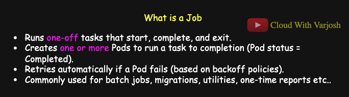
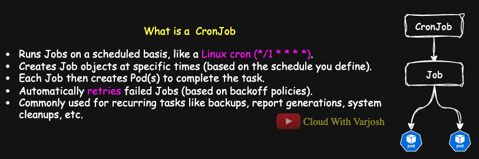

# 28 · Jobs and CronJobs: Run-to-Completion and Scheduled Work

> **Level:** ★★ intermediate
>
> **You will learn:** how a **Job** runs Pods until a task succeeds (completions, parallelism, `backoffLimit`, `activeDeadlineSeconds`, `ttlSecondsAfterFinished`, indexed Jobs, pod failure policies); who restarts what (kubelet vs Job controller); how a **CronJob** creates Jobs on a schedule (cron syntax, time zones, concurrency policy, missed runs, history limits); and how Deployment, DaemonSet, Job and CronJob compare.
>
> **You need:** topics 19, 24 and 27.

---

## ⚡ Core: the 10-minute version

**The idea.** A **Job** runs Pods until a task **finishes successfully** (a backup, a migration, a batch run), retrying failures up to `backoffLimit`. A **CronJob** creates Jobs on a **schedule** written in cron syntax (`"0 2 * * *"` = 02:00 every day). Jobs must use `restartPolicy: Never` or `OnFailure`, because "always restart" makes no sense for work that's meant to end.

**Picture it.** A Job is a one-off contractor who leaves when the work is done; a CronJob is the cleaning company booked every night.

**The one thing to know.**

```bash
kubectl create job hello --image=busybox:1.37 -- sh -c 'echo hello; sleep 5'
kubectl create cronjob tick --image=busybox:1.37 --schedule='*/1 * * * *' -- date
kubectl get jobs,cronjobs,pods
kubectl logs job/hello
```

**Try it now:**
1. Run the commands and watch the Job complete.
2. Wait 2–3 minutes and see the CronJob create a Job every minute.
3. Create a Job whose command fails (`exit 1`) and watch the retries until `backoffLimit`.
4. Clean up the CronJob.

**You've got it if you can:** choose between a Deployment, Job and CronJob for a task, and read a cron schedule.

> 📖 **That's the core.** On a first pass, do the mini-lab and move on to the next topic. Everything below is the **full reference**: come back for the details, the edge cases, interview answers and exam-level depth.

---

## What it is

Deployments run **long-lived** services. Sometimes you need **one-off tasks** that **start, finish and exit**:

- A **Job** creates **one or more Pods** to **run a task to completion**. When the required number of Pods have **succeeded**, the Job is **complete**.
  - If a Pod **fails**, the Job controller **retries** (up to a back-off limit).
  - If a Pod **succeeds**, it isn't restarted.
- A **CronJob** creates **Jobs on a schedule**, like Linux **crontab** (the Linux cron scheduler; see your Linux notes, topic [039](../../linux-mastery-rhel/notes/039-job-scheduling-cron-and-timers.md)).

> ✅ **Correct today** ([C1](#c1)): the current CKA curriculum doesn't list them by name, but its "workloads" domain covers them in practice, and tasks using Jobs/CronJobs do appear. They're core in CKAD and in real production work, so learn them fully.

---

## Why it exists

**Jobs are for:**
- **Batch jobs**: large data processing or file transformation that must finish even if a node dies midway.
- **Database migrations**: apply schema changes **once**, without manual steps.
- **Temporary utilities**: clean-up scripts, backups.
- **One-time reports**: sales summaries, audits, tracked and controlled.

**CronJobs are for:** scheduled database backups, nightly reports, log rotation or clean-up, scheduled notifications.

A plain Pod can run a task too, but it isn't retried if its node dies, has no retry limit or deadline, and leaves no clear "done/failed" record. Jobs add all of that.

---

## Analogy

- A **Job** is a **work order**: "paint 10 fences; up to 3 painters at a time; if a painter fails, send another, but give up after 4 failures". The order is closed when 10 fences are done.
- A **CronJob** is the **office calendar** that issues a new work order **every night at 2 AM**.

---

## How it works inside

### Who restarts what (Day 29, the key distinction)

- The **kubelet** restarts **containers inside an existing Pod**, and only when `restartPolicy` is `Always` or `OnFailure` (topic 19). Example: in a ReplicaSet's Pod, a crashed container is restarted in the same Pod on the same node. With `OnFailure`, only non-zero exits are restarted.
- The **kubelet never recreates Pods.** Once a Pod has failed or completed, it's done. Creating **new** Pods is the job of **controllers**: ReplicaSets, Deployments, **Jobs**.
- **In a Job:**
  - `restartPolicy: Never` → a failed container isn't restarted; the **Pod** becomes `Failed`; the **Job controller** sees it and creates a **new Pod** (if `backoffLimit` allows).
  - `restartPolicy: OnFailure` → the **kubelet** restarts the container **in the same Pod**; the Pod's restarts count towards `backoffLimit`.
  - Jobs **require** `Never` or `OnFailure` (`Always` is rejected).

**Key reminder:** the kubelet restarts containers (with `Always`/`OnFailure`); controllers like Jobs and ReplicaSets create replacement **Pods**.

`Never` is easier to debug (each failed attempt leaves a Pod whose logs you can read); `OnFailure` reuses the Pod (faster, but logs from earlier attempts are only available via `--previous`).

### Job fields



| Field | Meaning | Default |
|---|---|---|
| `completions` | Successful Pods needed for the Job to succeed | 1 |
| `parallelism` | Max Pods running at the same time | 1 |
| `backoffLimit` | Failed attempts allowed before the Job is marked **Failed** (retries back off: 10 s, 20 s, 40 s… up to 6 min) | 6 |
| `activeDeadlineSeconds` | Hard time limit for the whole Job; then all Pods are killed and the Job fails (`DeadlineExceeded`) | none |
| `ttlSecondsAfterFinished` | Delete the Job (and, by cascade, its Pods) this many seconds after it finishes (success **or** failure) | none (kept forever) |
| `completionMode` | `NonIndexed`, or `Indexed`: each Pod gets a unique index `0..completions-1` (env var `JOB_COMPLETION_INDEX`), useful for splitting work | `NonIndexed` |
| `backoffLimitPerIndex` | (Indexed Jobs) retries per index instead of for the whole Job | — |
| `podFailurePolicy` | Rules such as "exit code 42 → fail the Job immediately" or "Pod disrupted by node drain → don't count it" | — |
| `successPolicy` | (Indexed) declare success early, e.g. when index 0 succeeds | — |
| `suspend` | `true` = pause the Job (no new Pods) | false |

**Patterns:**
- `completions: 1, parallelism: 1` → a single task (migration).
- `completions: 10, parallelism: 3` → 10 work items, 3 at a time.
- `completions` unset, `parallelism: N` → a **work queue**: Pods pull items from a queue and the Job finishes when one succeeds and all have exited.
- `completionMode: Indexed` → static work partitioning (Pod 0 processes shard 0, …).

**Status:** `kubectl get job` shows `COMPLETIONS 2/2` and `STATUS Complete` (or `Failed`, `Running`, `Suspended`). The Job adds the conditions `Complete` or `Failed`, plus `SuccessCriteriaMet`/`FailureTarget` during termination.

### CronJobs



A CronJob **doesn't run Pods directly**. It's a **scheduler**: at each scheduled time the **CronJob controller** creates a **Job** from `jobTemplate`, and that Job runs the Pods (with retries, `backoffLimit` and so on as usual).

| Field | Meaning | Default |
|---|---|---|
| `schedule` | Cron expression (below) | required |
| `timeZone` | IANA time zone, e.g. `Asia/Kolkata` (GA since v1.27) | the controller manager's zone (usually UTC) |
| `concurrencyPolicy` | If the previous Job is still running: `Allow` (run both), `Forbid` (skip the new run), `Replace` (kill the old, start the new) | `Allow` |
| `startingDeadlineSeconds` | If a run is missed (controller down, cluster paused), still start it if no more than this many seconds late | none |
| `successfulJobsHistoryLimit` / `failedJobsHistoryLimit` | How many finished Jobs to keep | 3 / 1 |
| `suspend` | Pause scheduling | false |

**`ttlSecondsAfterFinished` in a CronJob's job template:** when a Job created by the CronJob finishes (success or failure), Kubernetes waits for the TTL (e.g. 60 s) and then **deletes the Job object**; its Pods are garbage-collected afterwards. That keeps the cluster tidy when the CronJob runs often. (The history limits also prune old Jobs.)

**Quick summary:**
- **CronJob** → creates a **Job** at the scheduled time.
- **Job** → runs the Pods and handles retries and failures.
- `ttlSecondsAfterFinished` → deletes the Job after it finishes; its Pods are cleaned up afterwards.

### Cron expressions

| Position | Field | Allowed values | Meaning |
|---|---|---|---|
| 1 | **Minute** | 0–59 | Minute of the hour |
| 2 | **Hour** | 0–23 | Hour of the day (24-hour) |
| 3 | **Day of month** | 1–31 | Day of the month |
| 4 | **Month** | 1–12 | Month (1 = January) |
| 5 | **Day of week** | 0–6 | Day of the week (0 = Sunday) |

- `*` = every value. Lists: `1,3,5`. Ranges: `1-5`. Steps: `*/5` = every 5 units.
- Kubernetes also accepts macros: `@hourly`, `@daily`, `@weekly`, `@monthly`, `@yearly`.

```text
 ┌───────────── minute (0 - 59)
 │ ┌───────────── hour (0 - 23)
 │ │ ┌───────────── day of month (1 - 31)
 │ │ │ ┌───────────── month (1 - 12)
 │ │ │ │ ┌───────────── day of week (0 - 6) (Sunday=0)
 │ │ │ │ │
 * * * * * <command to run>
```

| Expression | Meaning | Example use |
|---|---|---|
| `*/5 * * * *` | Every 5 minutes | Health checks, light frequent jobs |
| `0 * * * *` | Every hour at minute 0 | Hourly backups or reports |
| `0 2 * * *` | Every day at 2 AM | Nightly backups, log archiving |
| `0 0 * * 0` | Every Sunday at midnight | Weekly clean-up, billing resets |
| `30 9 * * 1-5` | 9:30 AM, Monday–Friday | Business-hours notifications |

Use **[Crontab Guru](https://crontab.guru/)** to build and check expressions.

> ✅ **Correct today** ([C2](#c2)): without `timeZone`, schedules use the **time zone of the kube-controller-manager process**, which is UTC on most clusters (and always on managed ones), so the advice "assume UTC" is usually right. But since v1.27 you can set **`spec.timeZone: "Asia/Kolkata"`** explicitly, which is the reliable way.

**Gotchas:**
- Schedules aren't exact to the second; a run can start a few seconds late.
- If the controller is down at schedule time and more than **100** runs were missed, the CronJob stops scheduling (to avoid a flood) unless `startingDeadlineSeconds` is set.
- With `concurrencyPolicy: Allow`, slow Jobs can **pile up**. Use `Forbid` for backups.
- Make Jobs **idempotent**: in rare cases a run can happen twice, or not at all.

---

## Commands / YAML

### Job demo (Day 29, `Day 29/job.yaml`)

**Step 1: the manifest**

```yaml
apiVersion: batch/v1
kind: Job
metadata:
  name: hello-job
spec:
  ttlSecondsAfterFinished: 60   # delete the Job (and its Pods) 60 s after it finishes
  completions: 2                # 2 Pods must succeed
  parallelism: 2                # up to 2 at once (with 1 they would run one after another)
  backoffLimit: 4               # give up after 4 failed attempts → Job Failed
  template:
    spec:
      containers:
        - name: hello
          image: busybox:1.37
          command: ["/bin/sh", "-c", "echo Hello from the Job! && sleep 10"]
      restartPolicy: Never      # kubelet won't restart; the Job controller creates new Pods for retries
```

- `completions: 1` would need one success; `2` needs two (sequentially or in parallel, depending on `parallelism`).
- `parallelism: 2` with `completions: 2` → both Pods run at the same time.

> ⚠️ **Fix to the original** ([C3](#c3)): the files use `command: ["bin/sh", …]`, a **relative** path that only works because busybox's working directory happens to be `/`. Use the absolute path `/bin/sh`.

**Step 2: deploy**

```bash
kubectl apply -f "Day 29/job.yaml"
```

**Step 3: verify**

```bash
kubectl get jobs
kubectl get pods -o wide
kubectl describe job hello-job
```

```
NAME        STATUS     COMPLETIONS   DURATION   AGE
hello-job   Complete   2/2           14s        20s

NAME              READY   STATUS      RESTARTS   AGE
hello-job-7tq2k   0/1     Completed   0          20s
hello-job-c9xvd   0/1     Completed   0          20s
```

```bash
kubectl logs job/hello-job        # logs from one of its Pods
```

```
Hello from the Job!
```

About 60 s after completion, the Job and its Pods disappear (`ttlSecondsAfterFinished`).

Imperative alternatives:

```bash
kubectl create job once --image=busybox:1.37 -- echo hi
kubectl create job manual-backup --from=cronjob/hello-cronjob    # run a CronJob's template now
kubectl wait --for=condition=complete job/once --timeout=120s    # block until done (CI)
```

### CronJob demo (Day 29, `Day 29/cronjob.yaml`)

**Step 1: the manifest**

```yaml
apiVersion: batch/v1
kind: CronJob
metadata:
  name: hello-cronjob
spec:
  schedule: "*/1 * * * *"          # every minute
  # timeZone: "Asia/Kolkata"       # optional, explicit time zone
  concurrencyPolicy: Forbid        # don't overlap runs (default Allow)
  jobTemplate:                     # a full Job spec
    spec:
      backoffLimit: 4              # retries per Job
      ttlSecondsAfterFinished: 60  # delete each finished Job (and then its Pods) after 60 s
      completions: 2               # each run needs 2 successful Pods…
      parallelism: 2               # …running at the same time
      template:
        spec:
          containers:
            - name: hello
              image: busybox:1.37
              command: ["/bin/sh", "-c", "echo Hello from CronJob! && sleep 10"]
          restartPolicy: Never
```

> ✅ **Correct today** ([C4](#c4)): it deletes the **Job**, and its Pods are removed by cascading deletion. (Day 29's own explanation further down says this correctly.) In `Day 29/cronjob.yaml` the TTL line is commented out, so cleanup there relies on the history limits (3 successful, 1 failed). `concurrencyPolicy: Forbid` is added here for safety; Day 29's version uses the default `Allow`.

**Steps 2–3: deploy and verify**

```bash
kubectl apply -f "Day 29/cronjob.yaml"
kubectl get cronjob
kubectl get jobs --watch
kubectl get pods -o wide
```

```
NAME            SCHEDULE      TIMEZONE   SUSPEND   ACTIVE   LAST SCHEDULE   AGE
hello-cronjob   */1 * * * *   <none>     False     0        12s             3m

NAME                     STATUS     COMPLETIONS   DURATION   AGE
hello-cronjob-29384121   Complete   2/2           13s        2m12s
hello-cronjob-29384122   Complete   2/2           12s        72s
hello-cronjob-29384123   Running    0/2           12s        12s
```

- A **new Job every minute**, named `<cronjob>-<scheduled time in minutes since the Unix epoch>`.

Pause it: `kubectl patch cronjob hello-cronjob -p '{"spec":{"suspend":true}}'`.

### Deployment vs DaemonSet vs Job vs CronJob

| Aspect | Deployment | DaemonSet | Job | CronJob |
|---|---|---|---|---|
| **Purpose** | Long-running stateless apps; scaling; rolling updates | One Pod on every (or selected) node | Run a task once to successful completion | Run Jobs on a schedule |
| **Common uses** | Web servers, APIs, frontends | Node monitoring, logging agents, network/storage plugins | DB migrations, batch work, backups, one-time tasks | Nightly backups, report generation, log rotation |
| **Examples** | Node.js API, nginx, React app backend | kube-proxy, Fluentd, Calico, AWS EBS CSI node plugin | Back up a DB, clean temp files, one-off notification | Nightly DB backup, weekly log rotation, monthly invoices |
| **restartPolicy** | Always | Always | OnFailure / Never | OnFailure / Never |
| **Finishes?** | Never | Never | Yes | Each Job does; the CronJob doesn't |

---

## Hands-on lab

1. Run the Job demo; then set `parallelism: 1` and watch the two Pods run **one after the other**.
2. A failing Job: `command: ["/bin/sh","-c","exit 1"]`, `backoffLimit: 2`, `restartPolicy: Never`. Count the failed Pods (3 attempts) and read `kubectl describe job` (`BackoffLimitExceeded`). Repeat with `OnFailure` and see **one** Pod with restarts instead.
3. Add `activeDeadlineSeconds: 5` to a Job that sleeps 30 s → `DeadlineExceeded`.
4. An Indexed Job: `completions: 3, parallelism: 3, completionMode: Indexed` with `echo "I am $JOB_COMPLETION_INDEX"`. Check each Pod's logs.
5. Run the CronJob, then trigger it manually with `kubectl create job --from=cronjob/hello-cronjob now`.
6. Set `timeZone: "Asia/Kolkata"` and a schedule a couple of minutes ahead in IST; confirm it fires.
7. Clean up: `kubectl delete cronjob hello-cronjob; kubectl delete job --all`.

---

## Where you'll use it

- **Database migrations** before or during deploys (often as Helm hooks, topic 65, or Argo CD sync hooks).
- **Backups** (`pg_dump` to S3 nightly), **reports**, **certificate or token rotation**, **clean-up** tasks.
- **Batch and ML** workloads (indexed Jobs; Kueue for queueing).
- **etcd backups** on self-managed clusters can be a CronJob (topic 77).

---

## When it breaks

| Symptom | Cause | Fix |
|---|---|---|
| `spec.template.spec.restartPolicy: Unsupported value: "Always"` | Jobs need `Never` or `OnFailure` | Set one of them |
| Job `Failed`, reason `BackoffLimitExceeded` | Task kept failing | `kubectl logs` of the failed Pods; fix the task |
| Job `Failed`, `DeadlineExceeded` | `activeDeadlineSeconds` too short, or a hung task | Increase or fix |
| Hundreds of completed Pods/Jobs pile up | No TTL, high history limits | `ttlSecondsAfterFinished`, history limits |
| CronJob never runs | Wrong schedule/time zone, `suspend: true`, or too many missed starts | `kubectl describe cronjob` events; set `startingDeadlineSeconds` |
| Runs overlap and overload the DB | `concurrencyPolicy: Allow` with slow Jobs | `Forbid` or `Replace` |
| Job never completes | A sidecar container never exits | Native sidecar (topic 23) |
| Job Pods `Pending` | Requests too big or quota exhausted | Topic 41 |

---

## Quick recap

- **Job** = run Pods to successful completion: `completions`, `parallelism`, `backoffLimit`, `activeDeadlineSeconds`, `ttlSecondsAfterFinished`; `Indexed` mode for partitioned work.
- `restartPolicy` must be `Never` (Job controller makes new Pods) or `OnFailure` (kubelet restarts containers in place).
- **CronJob** = creates Jobs on a cron `schedule`; set `timeZone`, `concurrencyPolicy`, history limits, `startingDeadlineSeconds`.
- Make scheduled tasks idempotent.

### Interview questions

1. **Q: `restartPolicy: Never` vs `OnFailure` in a Job?**
   A: With Never, a failed container fails its Pod and the Job controller creates a new Pod for each retry; with OnFailure, the kubelet restarts the container inside the same Pod. Both count towards backoffLimit.
2. **Q: How do you stop a CronJob's runs overlapping?**
   A: `concurrencyPolicy: Forbid` (skip the new run while the previous one is active) or `Replace` (kill the old run, start the new).
3. **Q: How do you keep the cluster from filling with finished Jobs?**
   A: `ttlSecondsAfterFinished` on the Job (or the CronJob's jobTemplate), plus `successfulJobsHistoryLimit`/`failedJobsHistoryLimit` on CronJobs.

---

## Appendix: notes on the original course material

This topic was rebuilt from the original CKA course notes. This appendix keeps the audit trail out of your way while you learn.

### Sources

Day 29 (Jobs and CronJobs intro, what is a Job, uses, Job demo steps 1–3 with detailed behaviour and key reminder, what is a CronJob, `ttlSecondsAfterFinished`, quick summary, cron expression fields, visual cheat sheet, common expressions, UTC tip, CronJob demo steps 1–3, Deployment vs DaemonSet vs Job vs CronJob table), files `Day 29/job.yaml`, `Day 29/cronjob.yaml`.

### Corrections to the original notes

Each entry shows what the original said and what's true now. In the topic above, each correction appears as a ✅ **Correct today** line or a ⚠️ **Fix to the original** box, linked to its entry here.

<a id="c1"></a>**C1 · Corrected (Day 29).** "Jobs and CronJobs are **not part of the CKA exam** curriculum". **Now:** the current CKA curriculum doesn't list them by name, but its "workloads" domain covers them in practice, and tasks using Jobs/CronJobs do appear. They're core in CKAD and in real production work, so learn them fully.

<a id="c2"></a>**C2 · Corrected (Day 29).** "Kubernetes CronJobs use **UTC** time internally, not your local timezone". **Now:** without `timeZone`, schedules use the **time zone of the kube-controller-manager process**, which is UTC on most clusters (and always on managed ones), so the advice "assume UTC" is usually right. But since v1.27 you can set **`spec.timeZone: "Asia/Kolkata"`** explicitly, which is the reliable way.

<a id="c3"></a>**C3 · Corrected (Day 29).** the files use `command: ["bin/sh", …]`, a **relative** path that only works because busybox's working directory happens to be `/`. Use the absolute path `/bin/sh`.

<a id="c4"></a>**C4 · Corrected (Day 29).** the README's comment says `ttlSecondsAfterFinished` "automatically deletes the **Pod** 60 seconds after it completes". **Now:** it deletes the **Job**, and its Pods are removed by cascading deletion. (Day 29's own explanation further down says this correctly.) In `Day 29/cronjob.yaml` the TTL line is commented out, so cleanup there relies on the history limits (3 successful, 1 failed). `concurrencyPolicy: Forbid` is added here for safety; Day 29's version uses the default `Allow`.
