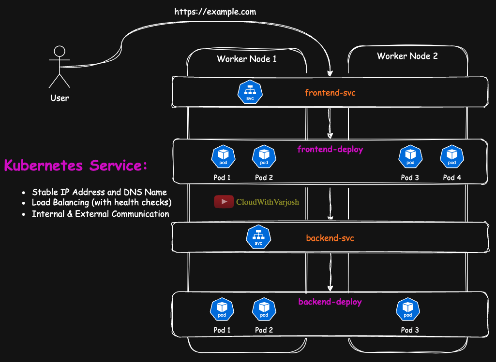
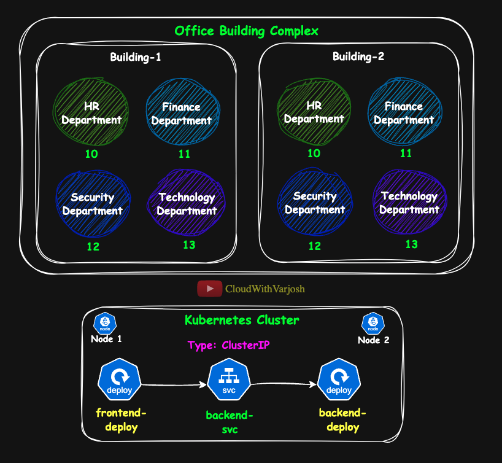
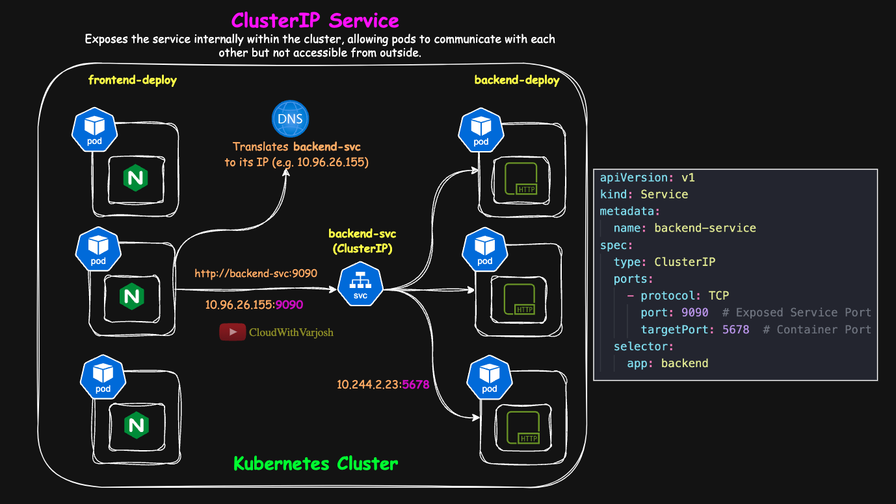

# 30 · Services I: Why Services Exist, and ClusterIP

> **Level:** ★ foundation
>
> **You will learn:** the problem Services solve (Pods come and go, and their IPs change); what a Service gives you (a stable virtual IP, a DNS name, load balancing over **ready** Pods); the Service types at a glance; the **ClusterIP** type in depth, with `port` vs `targetPort` vs `containerPort`; the frontend → backend demo; and creating Services imperatively (`kubectl expose`, `kubectl create service`).
>
> **You need:** topics 17, 22, 25 and 29.

---

## ⚡ Core: the 10-minute version

**The idea.** Pods come and go, and each new Pod gets a new IP. A **Service** gives a group of Pods (chosen by label selector) **one stable virtual IP and DNS name**, and spreads traffic across the Pods that are **ready**. The default type, **ClusterIP**, is reachable only inside the cluster. A Service forwards from its `port` to the Pods' `targetPort`.

**Picture it.** A company's main phone number: callers dial one number, and the switchboard rings whichever employee is free, even if staff change daily.

**The one thing to know.**

```yaml
apiVersion: v1
kind: Service
metadata: { name: backend }
spec:
  selector: { app: backend }           # which Pods
  ports:
  - { port: 80, targetPort: 5678 }     # Service port → container port
```

```bash
kubectl get endpointslices -l kubernetes.io/service-name=backend   # the Pods behind it
```

**Try it now:**
1. `kubectl create deployment backend --image=hashicorp/http-echo:1.0 -- /http-echo -text=hi -listen=:5678`
2. Apply the Service, then `kubectl run t --rm -it --image=busybox:1.37 --restart=Never -- wget -qO- backend`.
3. Scale the Deployment to 3 and watch the EndpointSlice grow.

**You've got it if you can:** explain why Services exist, `port` vs `targetPort`, and how a Service finds its Pods.

> 📖 **That's the core.** On a first pass, do the mini-lab and move on to the next topic. Everything below is the **full reference**: come back for the details, the edge cases, interview answers and exam-level depth.

---

## What it is



A **Service** is a Kubernetes object that gives a **set of Pods** (chosen by a **label selector**) a **stable communication endpoint**:
- **a fixed virtual IP** (the **ClusterIP**) and a **DNS name**, so clients find the Pods even though Pod IPs change;
- **load balancing** across the matching, **ready** Pods;
- **internal and external access**: Pods reach each other inside the cluster, and some Service types expose apps to the outside world.

**Service types:**

| Type | Reachable from | Topic |
|---|---|---|
| **ClusterIP** (default) | Inside the cluster only | This topic |
| **NodePort** | Outside, via `<any-node-IP>:<30000-32767>` | 31 |
| **LoadBalancer** | Outside, via a cloud load balancer | 31 |
| **ExternalName** | Inside: a DNS alias to an external name | 31 |
| **Headless** (`clusterIP: None`) | DNS returns Pod IPs directly; no virtual IP | 31, 33, 40 |

---

## Why it exists

Pods are **ephemeral**: created, destroyed and rescheduled all the time. Two challenges follow.

**Challenge 1: Pod IPs keep changing.** Every **new** Pod (after a crash on a dead node, a rollout or scaling) gets a **new IP** (topic 18). Hard-coding Pod IPs can't work.

**Challenge 2: Pods need to be exposed.** Some Pods must be reachable from **other Pods** (internal); some from **outside** the cluster (external). Something has to provide reliable access in both cases.

> ✅ **Correct today** ([C1](#c1)): a **container restart** inside the same Pod keeps the IP (the sandbox survives, topic 18). It's a **new Pod** (rescheduled, replaced, rolled out) that gets a new IP. The conclusion is the same: never depend on Pod IPs.

> ✅ **Correct today** ([C2](#c2)): Pods **can** always talk to each other directly by IP (the flat network model, topic 29). What Kubernetes doesn't give you without a Service is a **stable address and load balancing** in front of a changing set of Pods. Services solve **discovery**, not connectivity.

### Example: frontend talks to backend

**Step 1: a user requests the frontend.** The user visits `https://example.com`; the request reaches **`frontend-svc`**, which forwards it to one of the **frontend-deploy** Pods.

**Step 2: the frontend calls the backend.** The frontend Pods **don't know** the backend Pod IPs (they change). They call **`http://backend-svc`**, and **`backend-svc`** forwards each request to one of the **backend-deploy** Pods.

```
Without Services (doesn't work reliably):
User ---> Frontend Pod (IP keeps changing) ---> Backend Pod (IP keeps changing)

With Services (works):
User ---> frontend-svc ---> Frontend Pod ---> backend-svc ---> Backend Pod
```

- `frontend-svc` = a stable entry point for users.
- `backend-svc` = a stable name the frontend can always call.

---

## Analogy

Day 12's **office building complex**:



| Analogy | Kubernetes |
|---|---|
| Office building complex | Cluster |
| Individual buildings | Nodes (worker/control plane) |
| Departments (HR, Finance…) | Pods |
| Internal phone extensions | **ClusterIP Services** (internal communication) |

The complex has **two buildings**; each has **four departments**: HR, Finance, Security and Technology, on **extensions 10, 11, 12 and 13**.
- HR reaches Finance by dialling **extension 11**, whichever building or desk Finance staff happen to sit at today.
- The **internal phone system** works **only inside the complex**: no outside calls.

**In Kubernetes:** a **ClusterIP Service** lets Pods inside the cluster reach each other through an **internal-only IP**, like an extension number.

```
HR (Pod) → Extension 11 (ClusterIP) → Finance (Pod)
```

---

## How it works inside

### The Service object and its ports

```yaml
apiVersion: v1
kind: Service
metadata:
  name: backend-svc
spec:
  type: ClusterIP              # default; may be omitted
  selector:
    app: backend               # send traffic to READY Pods with this label
  ports:
    - protocol: TCP            # TCP (default), UDP or SCTP
      port: 9090               # the port clients use on the Service (ClusterIP:9090)
      targetPort: 5678         # the port the container listens on (a number, or a named containerPort)
```

| Field | Where | Meaning |
|---|---|---|
| `port` | Service | What **clients** connect to: `backend-svc:9090` |
| `targetPort` | Service | Where traffic is sent **on the Pod**. Defaults to the same value as `port`. Can be a **name** (`targetPort: http`) matching a named `containerPort`, so the Pod's real port can change without editing the Service. |
| `containerPort` | Pod spec | **Documentation** of the port the app listens on (like `EXPOSE`). Not required for traffic to work. |
| `nodePort` | Service (NodePort/LB) | Port opened on every node (topic 31) |

### What happens when you create a Service

1. The API server **allocates a ClusterIP** from the Service CIDR (`--service-cluster-ip-range`, e.g. `10.96.0.0/16`). It's a **virtual IP**: no interface anywhere has it, and you can't ping it (topic 32).
2. The **EndpointSlice controller** finds Pods matching the selector and lists the **ready** ones' IPs and target ports in **EndpointSlice** objects. It keeps them updated as Pods come, go, or change readiness (topic 22).
3. **kube-proxy** on every node watches Services and EndpointSlices and programs kernel rules: "packets to `10.96.41.120:9090` → DNAT to one of `10.244.1.7:5678`, `10.244.2.3:5678`, …".
4. **CoreDNS** answers `backend-svc.<namespace>.svc.cluster.local` → the ClusterIP (topic 33).
5. A client Pod calls `backend-svc:9090` → DNS → ClusterIP → the **node's kernel** rewrites the destination to a chosen Pod IP → the packet travels over the Pod network (topic 29) → the backend Pod.

**Key characteristics of ClusterIP:**
- **Internal-only:** reachable only from inside the cluster.
- **Automatic DNS:** a stable name (`backend-svc`) instead of an IP.
- **Load balancing across Pods:** traffic is spread over the healthy (ready) Pods. (Precisely: kube-proxy **programs** the rules and the **kernel** does the balancing; topic 32 has the correction.)
- **Simpler Pod communication:** service-to-service calls never need Pod IPs.

### The ClusterIP demo: NGINX frontend → http-echo backend



**Architecture:**
1. **Frontend:** NGINX on port 80.
2. **Backend:** `hashicorp/http-echo` on port **5678**, a tiny HTTP server that replies with fixed text.

**How the frontend reaches the backend:**
- Frontend Pods call **`backend-svc:9090`**.
- **CoreDNS** resolves `backend-svc` to its ClusterIP (e.g. `10.96.26.155`).
- The request is forwarded to one backend Pod (in Day 12's diagram, the 3rd Pod, `10.244.2.23:5678`).

Manifests (`Day 12/backend.yaml`; the frontend Deployment is in `Day 12/frontend.yaml`):

```yaml
apiVersion: apps/v1
kind: Deployment
metadata:
  name: frontend-deploy
spec:
  replicas: 3
  selector:
    matchLabels:
      app: frontend
  template:
    metadata:
      labels:
        app: frontend
    spec:
      containers:
        - name: frontend-container
          image: nginx:1.29
---
apiVersion: apps/v1
kind: Deployment
metadata:
  name: backend-deploy
spec:
  replicas: 3
  selector:
    matchLabels:
      app: backend
  template:
    metadata:
      labels:
        app: backend
    spec:
      containers:
      - name: backend-container
        image: hashicorp/http-echo
        args:
          - "-text=Hello from Backend"     # http-echo listens on 5678 by default
---
apiVersion: v1
kind: Service
metadata:
  name: backend-svc
spec:
  type: ClusterIP
  ports:
    - protocol: TCP
      port: 9090        # exposed Service port
      targetPort: 5678  # container port
  selector:
    app: backend
```

**Key takeaways:** ClusterIP is for **internal** communication; **CoreDNS** resolves Service names to ClusterIPs; **kube-proxy** sets up the routing and load balancing; this demo showed NGINX reaching an HTTP backend through a ClusterIP Service.

---

## Commands / YAML

### Apply and inspect

```bash
kubectl apply -f "Day 12/backend.yaml"
kubectl create deploy frontend-deploy --image=nginx:1.29 --replicas=3   # or apply Day 12/frontend.yaml (it also has a NodePort Service, topic 31)
kubectl get svc backend-svc -o wide
```

```
NAME          TYPE        CLUSTER-IP     EXTERNAL-IP   PORT(S)    AGE   SELECTOR
backend-svc   ClusterIP   10.96.26.155   <none>        9090/TCP   15s   app=backend
```

```bash
kubectl describe svc backend-svc
```

```
Name:              backend-svc
Namespace:         default
Selector:          app=backend
Type:              ClusterIP
IP:                10.96.26.155
Port:              <unset>  9090/TCP
TargetPort:        5678/TCP
Endpoints:         10.244.1.7:5678,10.244.2.3:5678,10.244.2.23:5678
Session Affinity:  None
```

- **`Endpoints`** = the ready Pod IPs behind the Service. **Empty = your selector matches nothing ready**: the #1 Service bug.

```bash
kubectl get endpointslices -l kubernetes.io/service-name=backend-svc
```

```
NAME                ADDRESSTYPE   PORTS   ENDPOINTS                            AGE
backend-svc-7xk2p   IPv4          5678    10.244.1.7,10.244.2.3,10.244.2.23    15s
```

### Test from a frontend Pod

```bash
FE=$(kubectl get pod -l app=frontend -o name | head -1)
kubectl exec $FE -- curl -s backend-svc:9090
```

```
Hello from Backend
```

Run it several times: requests spread over the three backend Pods (http-echo answers identically, so add `-text=$(POD_NAME)` via the downward API, topic 37, if you want to see which Pod answered).

### Imperative Services

**Backend:**

```bash
kubectl create deployment backend-deploy --image=hashicorp/http-echo --replicas=3 --port=5678 \
  --dry-run=client -o yaml > backend-deploy.yaml
# edit: add args ["-text=Hello from Backend"], set labels to app: backend, then:
kubectl apply -f backend-deploy.yaml

kubectl expose deployment backend-deploy \
  --type=ClusterIP \
  --port=9090 \
  --target-port=5678 \
  --name=backend-svc \
  --dry-run=client -o yaml >> backend-deploy.yaml
```

- `--type=ClusterIP` = internal-only.
- `--port=9090` = the Service port; `--target-port=5678` = the container port.
- `>>` **appends** to the file. Then (Day 13's manual steps) add the YAML separator `---` between the two objects and adjust labels as needed.
- `kubectl expose` copies the **selector from the Deployment**, so the Service matches its Pods automatically.

**Frontend (NodePort, topic 31):**

```bash
kubectl create deployment frontend-deploy --image=nginx --replicas=3 --port=80 \
  --dry-run=client -o yaml > frontend-deploy.yaml
kubectl apply -f frontend-deploy.yaml
kubectl expose deployment frontend-deploy --type=NodePort --port=80 --target-port=80 \
  --name=frontend-svc --dry-run=client -o yaml >> frontend-deploy.yaml
# add `nodePort: 31000` under ports, and a `---` separator
```

The finished files are `Day 13/backend-deploy.yaml` and `Day 13/frontend-deploy.yaml`.

> ⚠️ **Fix to the original** ([C3](#c3)):
> 1. `kubectl expose deployment … --dry-run=client` **still reads the Deployment from the API server** to copy its selector, so it fails with `deployments.apps "backend-deploy" not found` if you've only *generated* the Deployment YAML and not applied it. Apply the Deployment first (as above), or use `kubectl create service`, which doesn't need it.
> 2. "You **cannot** specify `nodePort` imperatively" is only true for `kubectl expose`. **`kubectl create service nodeport`** has a `--node-port` flag:
>    ```bash
>    kubectl create service nodeport frontend-svc --tcp=80:80 --node-port=31000 --dry-run=client -o yaml
>    ```
>    Note that `kubectl create service` sets the selector to `app=<service-name>` (`app: frontend-svc`), so you usually edit the selector afterwards.

```bash
kubectl create service clusterip backend-svc --tcp=9090:5678 --dry-run=client -o yaml
```

```yaml
apiVersion: v1
kind: Service
metadata:
  labels:
    app: backend-svc
  name: backend-svc
spec:
  ports:
  - name: 9090-5678
    port: 9090
    protocol: TCP
    targetPort: 5678
  selector:
    app: backend-svc        # ← edit to app: backend
  type: ClusterIP
```

**Key takeaways:** imperative commands are great for **quick tests** and **generating YAML**; `--dry-run=client` builds locally, `--dry-run=server` validates on the server; `kubectl expose` can't set `nodePort` (but `kubectl create service nodeport` can); generate, then edit.

---

## Hands-on lab

1. Deploy the backend and its Service from `Day 12/backend.yaml`, plus a frontend Deployment.
2. `kubectl describe svc backend-svc`: note the three endpoints. Scale the backend to 5 and watch the endpoints grow; scale to 0 and watch them empty.
3. From a frontend Pod: `curl backend-svc:9090` (works), `curl <ClusterIP>:9090` (works), `ping <ClusterIP>` (**fails**: a ClusterIP is virtual and only handles the Service's ports; topic 32).
4. **Break the selector:** `kubectl patch svc backend-svc -p '{"spec":{"selector":{"app":"backendx"}}}'`. Endpoints become `<none>` and curl fails with connection refused/timeout. Fix it.
5. **Break the targetPort:** set `targetPort: 8080`. Endpoints exist, but connections are refused. Fix it.
6. Use a named port: add `ports: [{name: http, containerPort: 5678}]` to the backend Pod template and set the Service's `targetPort: http`.
7. Do the Day 13 imperative flow end to end (including the `expose` failure when the Deployment isn't applied yet).
8. Clean up: `kubectl delete deploy backend-deploy frontend-deploy; kubectl delete svc backend-svc`.

---

## Where you'll use it

- **Every microservice** gets a ClusterIP Service; other services call it by name (`http://orders.shop.svc:8080`).
- Ingress/Gateway controllers route external traffic to **ClusterIP** Services (topics 69–73).
- Readiness + Services = zero-downtime rollouts (topics 22, 25).

---

## When it breaks

| Symptom | Cause | Fix |
|---|---|---|
| `Endpoints: <none>` | Selector doesn't match Pod labels, or no Pod is Ready | Compare `svc.spec.selector` with `kubectl get pods --show-labels`; fix readiness |
| Endpoints present, `connection refused` | Wrong `targetPort`, or app listening on `127.0.0.1` | Set `targetPort` to the real port; listen on `0.0.0.0` |
| `Could not resolve host: backend-svc` | Service in another namespace, or DNS problem | `backend-svc.<ns>` (topic 26); DNS debugging (topic 33) |
| Timeouts to the ClusterIP from every Pod | kube-proxy not running/programming rules, or NetworkPolicy | Topic 32 |
| `ping` to a ClusterIP fails | Normal in iptables/nftables mode: ClusterIPs only answer on Service ports. (In **IPVS** mode the ClusterIP is bound to the `kube-ipvs0` dummy interface, so ping **does** answer, and it proves nothing about the backends.) | Test with curl/nc on the port |
| `expose` fails: `deployments.apps "x" not found` | Deployment not created yet | Apply it first, or use `kubectl create service` |

---

## Quick recap

- Pods are ephemeral and new Pods get new IPs; a **Service** gives them a **stable virtual IP + DNS name** and **load-balances over ready Pods** selected by labels.
- `port` (on the Service) → `targetPort` (on the Pod); `containerPort` is documentation.
- ClusterIP = internal only, the default; endpoints are maintained in EndpointSlices; kube-proxy programs the node rules; CoreDNS provides the name.
- Imperative: `kubectl expose` (copies the selector; needs the workload to exist), `kubectl create service <type> --tcp=port:target [--node-port]`.

### Interview questions

1. **Q: Why do we need Services if Pods can reach each other by IP?**
   A: Pod IPs change whenever Pods are replaced, and there are usually several replicas; a Service gives a stable name and virtual IP and load-balances across the current ready Pods.
2. **Q: `port` vs `targetPort` vs `containerPort`?**
   A: `port` is the Service's port that clients use; `targetPort` is where traffic is sent on the Pod; `containerPort` documents the container's listening port and is optional.
3. **Q: A Service exists but nothing answers. First check?**
   A: `kubectl describe svc` / EndpointSlices: if there are no endpoints, the selector doesn't match ready Pods; if there are endpoints, check `targetPort` and that the app listens on all interfaces.

---

## Appendix: notes on the original course material

This topic was rebuilt from the original CKA course notes. This appendix keeps the audit trail out of your way while you learn.

### Sources

Day 12 (the problem, challenges 1 and 2, the solution, frontend/backend example, with/without Services, key takeaways, ClusterIP: office-complex analogy, characteristics, NGINX + http-echo demo, manifests, key takeaways), Day 13 (imperative commands for backend and frontend Services, manual edits, key takeaways), files `Day 12/backend.yaml`, `Day 13/backend-deploy.yaml`, `Day 13/frontend-deploy.yaml`. NodePort, LoadBalancer and ExternalName are in topic 31; the internals in topic 32; DNS in topic 33.

### Corrections to the original notes

Each entry shows what the original said and what's true now. In the topic above, each correction appears as a ✅ **Correct today** line or a ⚠️ **Fix to the original** box, linked to its entry here.

<a id="c1"></a>**C1 · Corrected (Day 12).** challenge 1 says "every time a pod is **restarted**, it gets a new IP". **Now:** a **container restart** inside the same Pod keeps the IP (the sandbox survives, topic 18). It's a **new Pod** (rescheduled, replaced, rolled out) that gets a new IP. The conclusion is the same: never depend on Pod IPs.

<a id="c2"></a>**C2 · Corrected (Day 12).** the key takeaways say "Kubernetes **does not provide automatic communication between pods**; we need Services". **Now:** Pods **can** always talk to each other directly by IP (the flat network model, topic 29). What Kubernetes doesn't give you without a Service is a **stable address and load balancing** in front of a changing set of Pods. Services solve **discovery**, not connectivity.

<a id="c3"></a>**C3 · Corrected (Day 13).** 1. `kubectl expose deployment … --dry-run=client` **still reads the Deployment from the API server** to copy its selector, so it fails with `deployments.apps "backend-deploy" not found` if you've only *generated* the Deployment YAML and not applied it. Apply the Deployment first (as above), or use `kubectl create service`, which doesn't need it.
2. "You **cannot** specify `nodePort` imperatively" is only true for `kubectl expose`. **`kubectl create service nodeport`** has a `--node-port` flag:
   ```bash
   kubectl create service nodeport frontend-svc --tcp=80:80 --node-port=31000 --dry-run=client -o yaml
   ```
   Note that `kubectl create service` sets the selector to `app=<service-name>` (`app: frontend-svc`), so you usually edit the selector afterwards.
