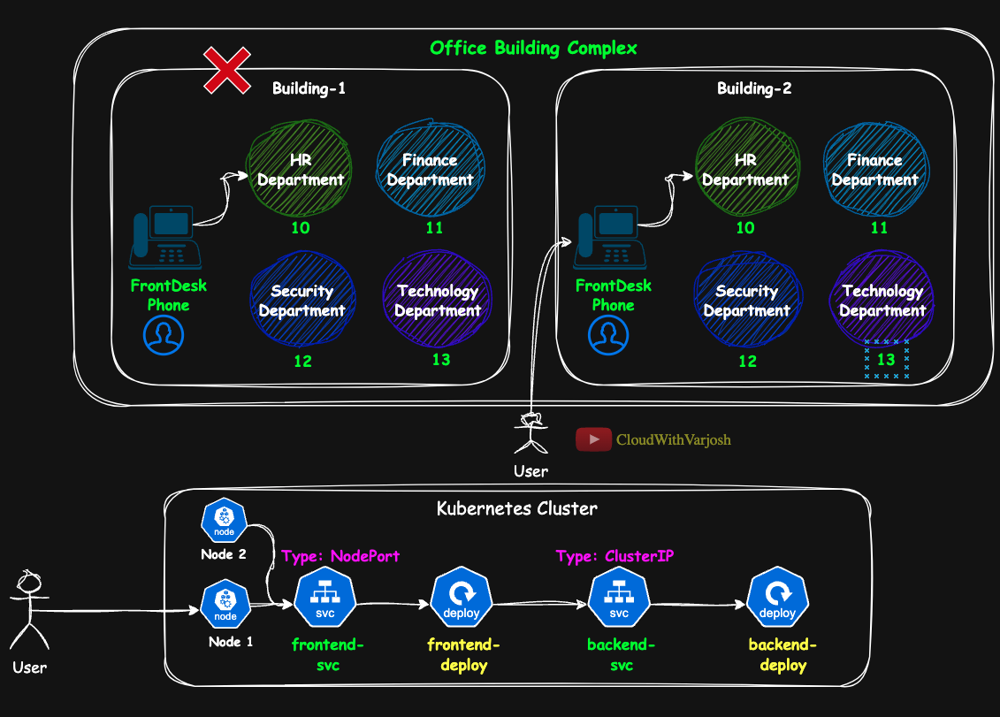
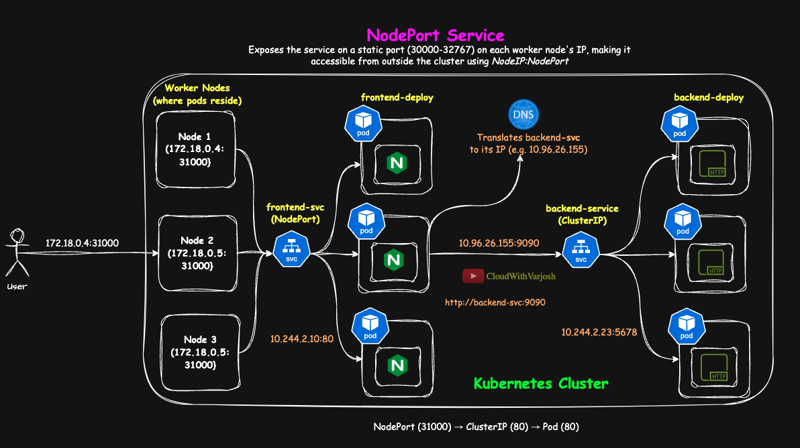
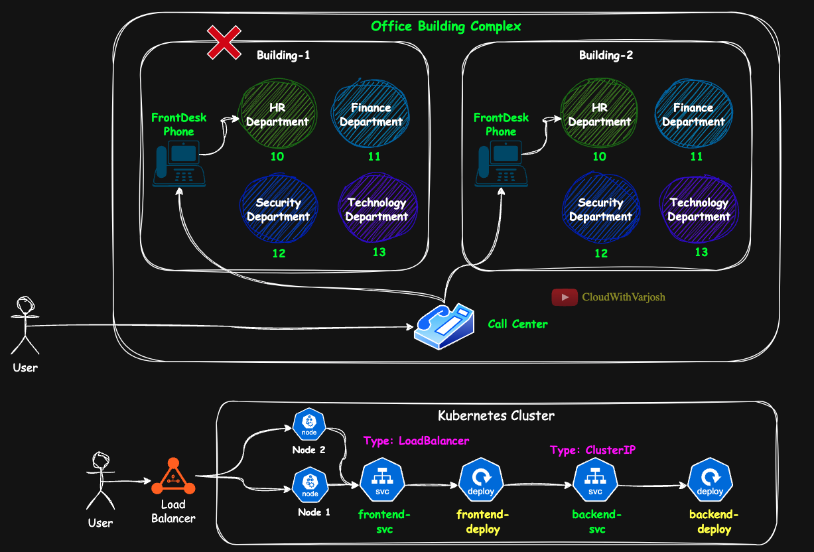
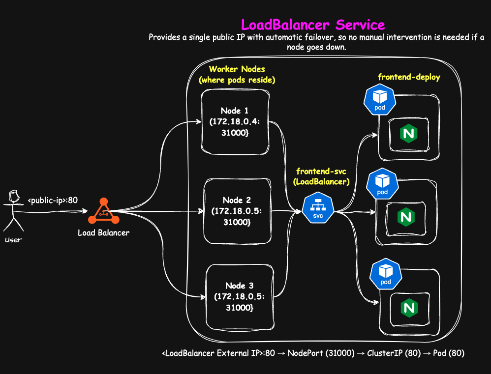
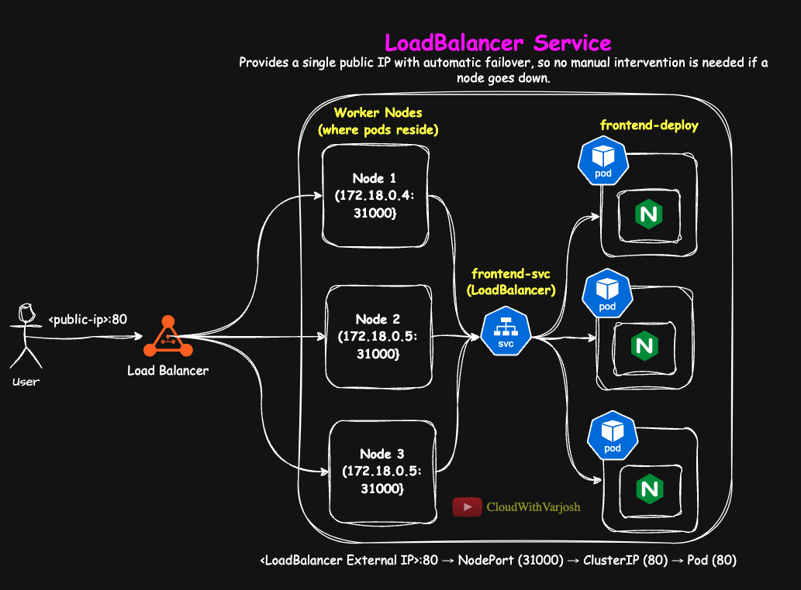
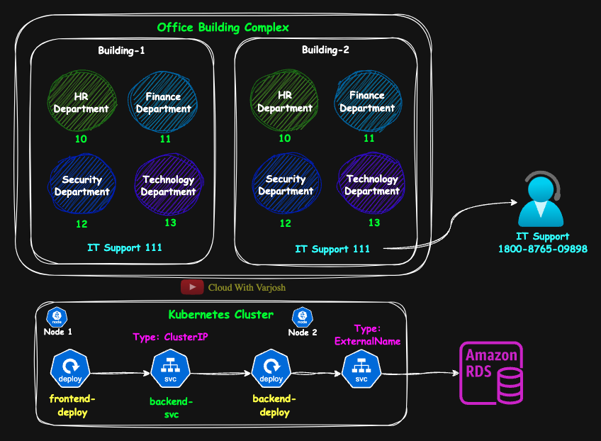
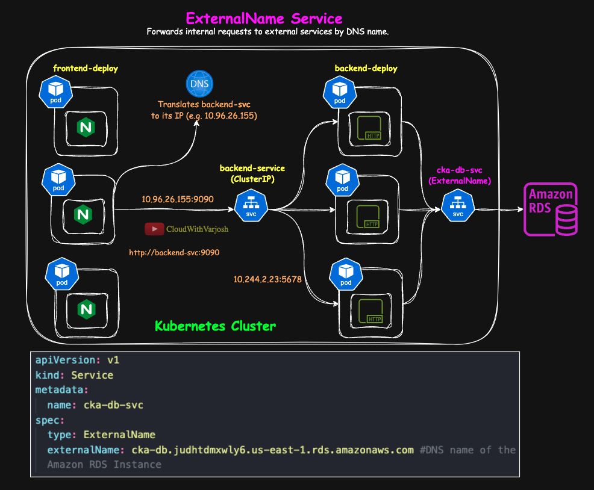

# 31 · Services II: NodePort, LoadBalancer, ExternalName, Headless and Friends

> **Level:** ★★ intermediate
>
> **You will learn:** how **NodePort** exposes a Service on every node; how **LoadBalancer** gets a real cloud load balancer (and what happens on kind or bare metal); how **ExternalName** aliases an outside DNS name (and its traps); **headless** Services; Services **without selectors**; multi-port Services, `sessionAffinity`, `externalTrafficPolicy` and `internalTrafficPolicy`; and the full request flow for each type.
>
> **You need:** topics 11 (kind `extraPortMappings`) and 30.

---

## ⚡ Core: the 10-minute version

**The idea.** ClusterIP only works inside the cluster. To let the outside in, or to change how a Service resolves, there are four other forms:
- **NodePort** opens the same port (30000–32767) on **every node**.
- **LoadBalancer** asks your cloud for a real load balancer in front of those nodes. On kind or bare metal it stays `<pending>` unless something like MetalLB provides one.
- **ExternalName** is just a DNS alias to an outside name.
- **Headless** (`clusterIP: None`) has no virtual IP: DNS returns the Pod IPs directly. StatefulSets need this.

**Picture it.** NodePort is a side door into every building; LoadBalancer is a receptionist in front of all the buildings; ExternalName is call forwarding; headless is a directory listing everyone's direct line.

**The one thing to know.**

```yaml
spec:
  type: NodePort
  selector: { app: web }
  ports:
  - { port: 80, targetPort: 80, nodePort: 30080 }   # reachable on <any-node-ip>:30080
```

**Try it now** (with topic 11's kind config, which maps 30080):
1. `kubectl create deployment web --image=nginx`
2. Apply the Service above.
3. `curl localhost:30080`.
4. Create a `type: LoadBalancer` Service and see `EXTERNAL-IP <pending>`.

**You've got it if you can:** pick the right Service type for "internal only", "quick external test", "cloud production" and "StatefulSet peers".

> 📖 **That's the core.** On a first pass, do the mini-lab and move on to the next topic. Everything below is the **full reference**: come back for the details, the edge cases, interview answers and exam-level depth.

---

## What it is

| Type | One line | Typical use |
|---|---|---|
| **NodePort** | Opens the **same port (30000–32767) on every node**; traffic to `<any-node-IP>:<nodePort>` reaches the Service | Labs, on-prem behind your own load balancer, a building block for LoadBalancer |
| **LoadBalancer** | Also asks the **cloud** for an **external load balancer** that sends traffic to the nodes (or Pods) | Exposing Ingress/Gateway controllers or TCP/UDP services on cloud |
| **ExternalName** | A **DNS alias** (`CNAME`) from an in-cluster name to an external hostname; no proxying | Pointing apps at an external DB/API by a cluster-local name |
| **Headless** (`clusterIP: None`) | **No virtual IP**; DNS returns the **Pod IPs** directly | StatefulSets, client-side load balancing, service discovery |

Each type **builds on** the previous ones: a LoadBalancer Service is also a NodePort and a ClusterIP Service.

---

## Why it exists

ClusterIP only works inside the cluster. Users, partner systems and external load balancers need a way **in** (NodePort, LoadBalancer). Apps also need clean ways to reach things **outside** (ExternalName, selector-less Services), or to see every Pod individually (headless).

---

## Analogy

Day 12 extends the **office complex** analogy:

| Analogy | Kubernetes |
|---|---|
| Office complex | Cluster |
| Buildings | Nodes |
| Departments | Pods |
| Internal extensions | ClusterIP Services |
| **Front-desk phone numbers** | **NodePort** Services |
| **Call centre** | **LoadBalancer** Service |
| **IT Support (111)** | **ExternalName** Service |

---

## How it works inside

### NodePort



A **NodePort** Service allows **external access** using a node's IP and a fixed port:

```
http://<NodeIP>:<NodePort>
```

**Analogy:** each building now has a **front-desk phone number**. An **external caller** keeps the front-desk numbers of **both** buildings, so they can reach any department even if one building is closed. When they call, the **receptionist forwards** the call to the right department's **internal extension**.

**In Kubernetes:** a NodePort Service exposes the internal (ClusterIP) Service on a **fixed port on every node**. If **one node goes down**, the user must **manually switch** to another node's IP.

```
User → Building-1 front desk (NodePort) → Extension 10 (ClusterIP) → HR (Pod)
If Building-1 is down:
User → Building-2 front desk (NodePort) → Extension 10 (ClusterIP) → HR (Pod)
```

**Key characteristics:**
- **External access** via `NodeIP:NodePort`.
- **Works on every node**, whether or not a Pod for that Service runs there.
- **Built on ClusterIP**: conceptually, NodePort traffic is forwarded to the Service and then to a Pod.
- **Fixed port range 30000–32767** (the API server's `--service-node-port-range`), chosen to avoid clashes with system and ephemeral ports. It's configurable, but best left alone.

> ✅ **Correct today** ([C1](#c1)): kube-proxy opens NodePorts on **every node that runs kube-proxy**, including control-plane nodes on kubeadm/kind (unless restricted with kube-proxy's `nodePortAddresses`). And "NodePort forwards to the ClusterIP service" is a good mental model, but in the kernel there is no second hop: the NodePort rule **DNATs straight to a Pod IP** (topic 32).

**Choosing the port:** for NodePort and LoadBalancer Services you can **omit `nodePort`** and Kubernetes picks a free one from 30000–32767. These notes set **`nodePort: 31000`** explicitly because the kind cluster only maps host port **31000** into the node (topic 11), which keeps access predictable and avoids conflicts in a learning setup.

**Demo (Day 12, `Day 12/frontend.yaml`):**

```yaml
apiVersion: apps/v1
kind: Deployment
metadata:
  name: frontend-deploy
spec:
  replicas: 3
  selector:
    matchLabels:
      app: frontend
  template:
    metadata:
      labels:
        app: frontend
    spec:
      containers:
      - name: frontend-container
        image: nginx:1.29
        ports:
        - containerPort: 80     # nginx serves on 80
---
apiVersion: v1
kind: Service
metadata:
  name: frontend-svc
spec:
  type: NodePort
  selector:
    app: frontend
  ports:
    - protocol: TCP
      port: 80          # ClusterIP Service port
      targetPort: 80    # container port
      nodePort: 31000   # opened on every node (30000-32767)
```

**Request flow:**



Assume a node IP `172.18.0.4`, `nodePort` 31000, ClusterIP `10.96.45.120`, and a frontend Pod `frontend-pod3` at `10.244.2.10`.
1. The user opens `http://172.18.0.4:31000`.
2. The NodePort Service, listening on **all** nodes, forwards to its ClusterIP `10.96.45.120:80` (conceptually).
3. The Service load-balances to a running Pod, e.g. `frontend-pod3` at `10.244.2.10:80`.
4. The Pod handles the request and the response goes back to the user.

Because every node listens, `curl http://172.18.0.5:31000` (another node) works too. On kind, from your laptop: `curl http://localhost:31000` (via `extraPortMappings`).

### LoadBalancer

A **LoadBalancer** Service provides a **single external address** for an application. It **builds on NodePort and ClusterIP** and adds **automatic load balancing and failover** across nodes.



**Analogy:** a **call centre** with **one easy number**. A caller asks for HR; the call centre forwards to **any healthy building's front desk**, whose receptionist dials HR's extension.

```
User → Call centre (LoadBalancer) → Any front desk (NodePort) → Extension 10 (ClusterIP) → HR (Pod)
```

**In Kubernetes:**
- Creating a `type: LoadBalancer` Service makes the **cloud-controller-manager** (or a cloud LB controller) **ask the cloud** (AWS, GCP, Azure) for a load balancer and an address.
- The load balancer sends traffic to the Service's **NodePort** on the nodes (or directly to Pod IPs in "IP target" modes).
- The NodePort/ClusterIP rules deliver it to a Pod.
- The address appears in `status.loadBalancer.ingress` and in `EXTERNAL-IP`.

```yaml
apiVersion: v1
kind: Service
metadata:
  name: frontend-svc
spec:
  type: LoadBalancer
  selector:
    app: frontend          # (Day 12's example used app: my-app)
  ports:
    - protocol: TCP
      port: 80             # port on the LB and the ClusterIP
      targetPort: 80       # container port
      nodePort: 31000      # optional; auto-assigned if omitted
```

**Behind the scenes:**





*(12i.png is in the original `images/` folder, but no original note referenced it.)* It shows the same flow for `frontend-svc`: the user hits `<public-ip>:80`, the load balancer spreads traffic across the nodes' NodePort 31000, and the Service forwards to the frontend Pods. If a node goes down, the LB fails over automatically.

```
<LoadBalancer external IP>:80 → NodePort 31000 (any node) → ClusterIP :80 → Pod :80
```

1. **LoadBalancer**: the cloud provides an external address.
2. **NodePort**: port 31000 on all nodes.
3. **ClusterIP**: internal virtual IP.
4. **Pods**: serve on port 80.

**Details that matter in practice:**
- The address may be an **IP** (GCP, Azure) or a **DNS hostname** (AWS ELB/NLB).
- Cloud-specific behaviour is set with **annotations** (internal vs internet-facing, NLB vs CLB, health checks, TLS). On EKS the **AWS Load Balancer Controller** handles `type: LoadBalancer` with NLBs (topic 70).
- `spec.loadBalancerClass` picks which controller implements it; `allocateLoadBalancerNodePorts: false` skips NodePorts when the LB targets Pod IPs directly.
- **Each LoadBalancer Service = one cloud LB = cost.** Ten apps → ten LBs. That's the main reason Ingress/Gateway exist.
- **kind / bare metal:** nothing provisions an LB, so `EXTERNAL-IP` stays **`<pending>`** forever unless you install **cloud-provider-kind**, **MetalLB** (announces IPs on your LAN via ARP or BGP), or **kube-vip**.

> ✅ **Correct today** ([C2](#c2)): LoadBalancer Services are **very common** in production, just not one per HTTP app. Typically **one** LoadBalancer Service exposes the **Ingress or Gateway controller**, which then does URL/host routing and TLS for many apps (topics 69–73), and non-HTTP services (TCP/UDP: databases, MQTT, game servers) use LoadBalancer Services directly.

### ExternalName

An **ExternalName** Service **maps an in-cluster Service name to an external DNS name**:
- It does **not** create a proxy, endpoints, or a ClusterIP.
- CoreDNS simply returns a **CNAME** record (a DNS alias) pointing at the external name.



**Analogy:** each building has an **IT Support number, 111**. Dialling 111 connects you **straight to an external IT company**, without knowing their real number.

```
User → IT Support 111 (ExternalName) → IT Support (external service)
```

```yaml
apiVersion: v1
kind: Service
metadata:
  name: cka-db-svc
spec:
  type: ExternalName
  externalName: cka-db.judhtdmxwly6.us-east-1.rds.amazonaws.com   # the Amazon RDS endpoint
```

**Scenario:**



Backend Pods need an external **Amazon RDS** database. Instead of hard-coding the RDS DNS name, create `cka-db-svc`; the app connects to **`cka-db-svc:3306`**.

**Why it's useful:**
- If the RDS instance changes (a new DNS name), **only the Service changes**, not the app code or Deployment config.
- It **decouples configuration from the application**: more maintainable and flexible.

**When to use:** connecting workloads to external services by a **simple alias**: third-party APIs, legacy systems, external databases such as RDS. Apps use the internal DNS name and Kubernetes handles the redirection.

> ✅ **Correct today** ([C3](#c3)): MySQL on 3306 doesn't speak HTTP, so the right form is a database URL, e.g. `mysql://cka-db-svc:3306/appdb` (or host `cka-db-svc`, port 3306 in your driver).
>
> **Traps with ExternalName:**
> - **HTTP/HTTPS:** the client still sends `Host: cka-db-svc` and **TLS SNI** `cka-db-svc`. Many HTTPS endpoints reject that, or the TLS certificate (issued for the real hostname) fails verification. ExternalName works best for **non-HTTP protocols**, or when the client sets the real hostname itself.
> - `externalName` must be a **DNS name**, not an IP. For a fixed external IP, use a Service **without a selector** plus a manual EndpointSlice (below).
> - There's **no port remapping** and no load balancing: DNS only.

### Headless Services

```yaml
spec:
  clusterIP: None          # ← headless
  selector: { app: mysql }
  ports: [{ port: 3306 }]
```

- **No virtual IP, no kube-proxy rules.** DNS for the Service returns **the IPs of all ready Pods** (A/AAAA records).
- With a **StatefulSet**, each Pod also gets its **own stable DNS name**: `mysql-0.mysql.<ns>.svc.cluster.local` (topics 33 and 40).
- Used for databases and clustered systems where clients must reach a **specific** member, and for client-side load balancing (gRPC, Cassandra drivers).

### Services without selectors

A Service with **no `selector`** gets **no automatic endpoints**. You create the **EndpointSlice** yourself, e.g. to give an external IP-based database a cluster-internal name and port:

```yaml
apiVersion: v1
kind: Service
metadata: { name: legacy-db }
spec:
  ports: [{ name: pg, port: 5432, targetPort: 5432 }]
---
apiVersion: discovery.k8s.io/v1
kind: EndpointSlice
metadata:
  name: legacy-db-1
  labels: { kubernetes.io/service-name: legacy-db }   # links it to the Service
addressType: IPv4
ports: [{ name: pg, port: 5432 }]
endpoints:
- addresses: ["192.168.10.25"]
```

Pods now connect to `legacy-db:5432` and reach `192.168.10.25` through normal Service NAT.

### Other useful Service fields

| Field | Effect |
|---|---|
| Multiple `ports` | Each must have a `name` (e.g. `http`, `metrics`) |
| `sessionAffinity: ClientIP` (+ `sessionAffinityConfig.clientIP.timeoutSeconds`, default 10800) | Same client IP → same Pod ("sticky sessions" at L4) |
| `externalTrafficPolicy: Local` (NodePort/LB) | Only send to Pods **on the node that received the traffic**: **preserves the client source IP** and avoids an extra hop, but nodes without a ready Pod drop it (the cloud LB health check then skips those nodes). Default `Cluster`: any Pod, but the source IP is SNATed to a node IP. |
| `internalTrafficPolicy: Local` | For in-cluster clients, only use Pods on the **same node** (e.g. node-local agents) |
| `trafficDistribution: PreferClose` | Prefer endpoints in the same zone (topology-aware routing) to cut cross-zone cost and latency |
| `externalIPs` | Accept traffic for an IP you route to the nodes yourself (rarely used; a security risk; often blocked by admission policy) |
| `ipFamilyPolicy` / `ipFamilies` | IPv4, IPv6, or dual-stack Services |

### Summary of request flows

```
ClusterIP (internal only):
  HR (Pod) → Extension 11 (ClusterIP) → Finance (Pod)

NodePort (external access, manual node choice):
  User → Building-1 front desk (NodePort) → Extension 10 (ClusterIP) → HR (Pod)
  If Building-1 is down:
  User → Building-2 front desk (NodePort) → Extension 10 (ClusterIP) → HR (Pod)

LoadBalancer (single address, automatic failover):
  User → Call centre (LoadBalancer) → any available front desk (NodePort) → Extension 10 (ClusterIP) → HR (Pod)

ExternalName (alias to an external service):
  Internal call → IT Support 111 (ExternalName) → IT Support (external service)
```

---

## Commands / YAML

```bash
kubectl apply -f "Day 12/frontend.yaml"
kubectl get svc frontend-svc
```

```
NAME           TYPE       CLUSTER-IP     EXTERNAL-IP   PORT(S)        AGE
frontend-svc   NodePort   10.96.45.120   <none>        80:31000/TCP   10s
```

- `80:31000/TCP` = Service port 80, NodePort 31000.

```bash
kubectl get nodes -o wide | awk '{print $1, $6}'      # node InternalIPs
docker exec lab-worker curl -s -o /dev/null -w '%{http_code}\n' http://172.18.0.4:31000
curl -s localhost:31000 | head -4                     # from your laptop (kind extraPortMappings)
```

Change it to a LoadBalancer on kind:

```bash
kubectl patch svc frontend-svc -p '{"spec":{"type":"LoadBalancer"}}'
kubectl get svc frontend-svc
```

```
NAME           TYPE           CLUSTER-IP     EXTERNAL-IP   PORT(S)        AGE
frontend-svc   LoadBalancer   10.96.45.120   <pending>     80:31000/TCP   2m
```

- `<pending>` forever on plain kind (no LB implementation). Run `cloud-provider-kind` (a small binary from the kind project) on your machine and an external IP appears.

ExternalName:

```bash
kubectl create service externalname ext-api --external-name=api.github.com
kubectl run t --rm -it --image=busybox:1.37 --restart=Never -- nslookup ext-api
```

```
ext-api.default.svc.cluster.local	canonical name = api.github.com
Name:	api.github.com
Address: 140.82.121.6
```

Headless:

```bash
kubectl create deploy hl --image=nginx:1.29 --replicas=3
kubectl expose deploy hl --port=80 --cluster-ip=None
kubectl run t --rm -it --image=busybox:1.37 --restart=Never -- nslookup hl
```

```
Name:	hl.default.svc.cluster.local
Address: 10.244.1.12
Name:	hl.default.svc.cluster.local
Address: 10.244.2.9
Name:	hl.default.svc.cluster.local
Address: 10.244.2.10
```

---

## Hands-on lab

1. Apply `Day 12/frontend.yaml` on the kind cluster from topic 11 and browse `http://localhost:31000`.
2. From inside the `kind` Docker network, curl **each** node's IP on 31000, including the control-plane node: all work.
3. Change `nodePort` to 30950 and confirm it **isn't** reachable from your laptop (not mapped; topic 11's correction). Set it back.
4. Patch to `LoadBalancer` and see `<pending>`. Optionally run cloud-provider-kind and get a real IP.
5. Set `externalTrafficPolicy: Local`, scale the frontend to 1, and find which node's NodePort still answers (only the node with the Pod).
6. Create the ExternalName and headless Services above and compare `nslookup` outputs.
7. Create a selector-less Service + EndpointSlice pointing at `1.1.1.1:80` and `curl` it from a Pod.
8. Clean up: `kubectl delete -f "Day 12/frontend.yaml"; kubectl delete svc ext-api hl legacy-db --ignore-not-found; kubectl delete deploy hl`.

---

## Where you'll use it

- **Cloud production:** one LoadBalancer Service for the Ingress/Gateway controller; extra ones for TCP services; NodePort mostly as an implementation detail.
- **On-prem:** NodePort behind F5/HAProxy, or MetalLB for LoadBalancer.
- **Migrations:** ExternalName or selector-less Services point at legacy systems while apps move into Kubernetes.
- **Stateful systems:** headless Services for StatefulSets (topic 40).

---

## When it breaks

| Symptom | Cause | Fix |
|---|---|---|
| NodePort unreachable from outside | Firewall/security group blocks 30000–32767; kind port not mapped | Open the ports; `extraPortMappings` |
| `provided port is already allocated` | `nodePort` used by another Service | Pick another, or omit it |
| `provided port is not in the valid range` | `nodePort` outside 30000–32767 | Use the range |
| LoadBalancer `EXTERNAL-IP <pending>` | No cloud controller / MetalLB, or cloud permissions/quota/subnet tags | `kubectl describe svc` events; install an LB implementation |
| Client IP in app logs is a node IP | `externalTrafficPolicy: Cluster` SNATs | `externalTrafficPolicy: Local` (or PROXY protocol on the LB) |
| `Local` policy: some requests time out | LB sends to nodes without a ready Pod (health checks misconfigured) | Fix LB health checks on `healthCheckNodePort` |
| ExternalName HTTPS fails with certificate/host errors | SNI/Host header carries the alias name | Use the real hostname in the client, or an egress proxy |
| Day 58 #8 scenarios (NodePort/LB not reachable) | — | Topic 83 |

---

## Quick recap

- **NodePort:** same port (30000–32767) on every node → Service → Pod. Optional explicit `nodePort`.
- **LoadBalancer:** cloud LB → NodePort (or Pods) → Pod; one LB per Service; `<pending>` without an implementation; usually fronts an Ingress/Gateway controller.
- **ExternalName:** a DNS CNAME alias only; mind HTTP Host/SNI.
- **Headless:** `clusterIP: None` → DNS returns Pod IPs; per-Pod names for StatefulSets.
- Useful knobs: `externalTrafficPolicy: Local` (source IP), `sessionAffinity: ClientIP`, `internalTrafficPolicy`, selector-less Services with manual EndpointSlices.

### Interview questions

1. **Q: NodePort vs LoadBalancer?**
   A: NodePort opens a port on every node; clients must pick a node IP and handle failures. LoadBalancer additionally provisions an external load balancer with one address that health-checks nodes and spreads traffic.
2. **Q: Why does a LoadBalancer Service show `<pending>` on bare metal?**
   A: Nothing implements it: there's no cloud controller to create a load balancer. Install MetalLB, kube-vip, or a similar controller.
3. **Q: What's a headless Service for?**
   A: It has no ClusterIP; DNS returns the individual Pod IPs (and per-Pod names with StatefulSets), so clients can address specific members or load-balance themselves.

---

## Appendix: notes on the original course material

This topic was rebuilt from the original CKA course notes. This appendix keeps the audit trail out of your way while you learn.

### Sources

Day 12 (NodePort: definition, analogy, characteristics, the note on explicit `nodePort: 31000`, frontend demo, step-by-step flow; LoadBalancer: definition, analogy, manifest, behind the scenes, production note; ExternalName: definition, analogy, manifest, RDS scenario, why useful, when to use; summary of request flows; key takeaways), file `Day 12/frontend.yaml`. Day 12's kind setup is in topic 11.

### Corrections to the original notes

Each entry shows what the original said and what's true now. In the topic above, each correction appears as a ✅ **Correct today** line or a ⚠️ **Fix to the original** box, linked to its entry here.

<a id="c1"></a>**C1 · Corrected (Day 12).** "the service is available on every **worker** node". **Now:** kube-proxy opens NodePorts on **every node that runs kube-proxy**, including control-plane nodes on kubeadm/kind (unless restricted with kube-proxy's `nodePortAddresses`). And "NodePort forwards to the ClusterIP service" is a good mental model, but in the kernel there is no second hop: the NodePort rule **DNATs straight to a Pod IP** (topic 32).

<a id="c2"></a>**C2 · Corrected (Day 12).** "You typically **won't see LoadBalancer services used directly in production**… instead you'll find Ingress controllers". **Now:** LoadBalancer Services are **very common** in production, just not one per HTTP app. Typically **one** LoadBalancer Service exposes the **Ingress or Gateway controller**, which then does URL/host routing and TLS for many apps (topics 69–73), and non-HTTP services (TCP/UDP: databases, MQTT, game servers) use LoadBalancer Services directly.

<a id="c3"></a>**C3 · Corrected (Day 12).** the example connection string was `http://cka-db-svc:3306`. **Now:** MySQL on 3306 doesn't speak HTTP, so the right form is a database URL, e.g. `mysql://cka-db-svc:3306/appdb` (or host `cka-db-svc`, port 3306 in your driver).

**Traps with ExternalName:**
- **HTTP/HTTPS:** the client still sends `Host: cka-db-svc` and **TLS SNI** `cka-db-svc`. Many HTTPS endpoints reject that, or the TLS certificate (issued for the real hostname) fails verification. ExternalName works best for **non-HTTP protocols**, or when the client sets the real hostname itself.
- `externalName` must be a **DNS name**, not an IP. For a fixed external IP, use a Service **without a selector** plus a manual EndpointSlice (below).
- There's **no port remapping** and no load balancing: DNS only.
