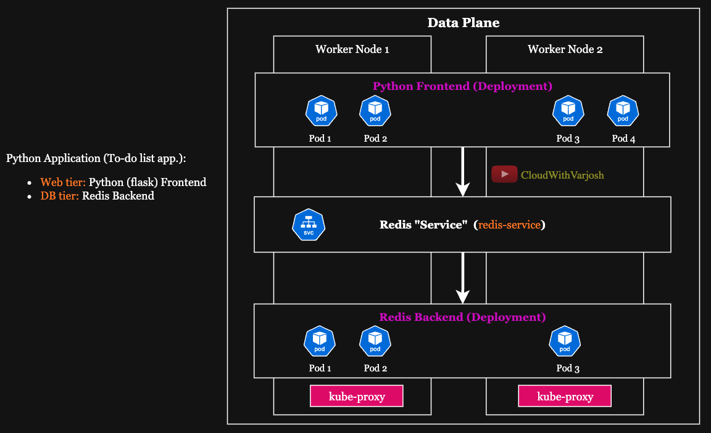

# 32 · Inside a Service: kube-proxy, iptables/nftables/IPVS, EndpointSlices and conntrack

> **Level:** ★★★ advanced
>
> **You will learn:** what really happens to a packet sent to a Service; how the EndpointSlice controller and kube-proxy cooperate; kube-proxy's modes (**iptables**, **nftables**, **IPVS** (deprecated), and eBPF replacements such as Cilium); the actual NAT chains on a node; the role of **conntrack** in replies; how NodePort and `externalTrafficPolicy` work at packet level; and a method for "the Service doesn't work".
>
> **You need:** topics 04, 08, 29, 30 and 31.

---

## ⚡ Core: the 10-minute version

**The idea.** A Service's ClusterIP isn't a real machine: nothing listens on it. **kube-proxy** on every node watches Services and their **EndpointSlices** (the ready Pod IPs). It writes kernel rules (nftables or iptables) saying "packets to ClusterIP:port → pick one of these Pod IPs". The **kernel** rewrites each packet (DNAT) and remembers the choice (conntrack), so replies flow back. kube-proxy itself never touches your traffic.

**Picture it.** kube-proxy is the person who updates a mail-forwarding list. The post office (kernel) does the actual redirecting.

**The one thing to know.**

```bash
kubectl get endpointslices -l kubernetes.io/service-name=web -o wide    # who's behind the Service
docker exec lab-worker sh -c 'nft list ruleset 2>/dev/null | grep -c . || iptables-save -t nat | grep -c KUBE'
kubectl -n kube-system logs ds/kube-proxy | head -5                       # which mode it uses
```

**Try it now:**
1. Create a Deployment plus a Service.
2. Run the commands above.
3. Scale to 0 and see the EndpointSlice empty out. The ClusterIP still exists but nothing answers.

**You've got it if you can:** explain why you can't ping a ClusterIP, and what "empty endpoints" means.

> 📖 **That's the core.** On a first pass, do the mini-lab and move on to the next topic. Everything below is the **full reference**: come back for the details, the edge cases, interview answers and exam-level depth.

---

## What it is

A **ClusterIP is virtual**: no interface owns it, nothing listens on it. It "works" because **every node has kernel rules** that rewrite packets addressed to `ClusterIP:port` into packets addressed to a **real Pod IP:targetPort**. That rewrite is **DNAT** (Destination NAT).

Three parts cooperate:

| Part | Job |
|---|---|
| **EndpointSlice controller** (in kube-controller-manager) | Keeps **EndpointSlice** objects listing the **ready** (and terminating) Pod IPs and ports behind each Service |
| **kube-proxy** (DaemonSet, one per node) | **Watches** Services and EndpointSlices and **programs the kernel** (iptables, nftables or IPVS rules) on its node |
| **Linux kernel** (netfilter + conntrack) | Does the actual **DNAT/SNAT and load balancing** on every packet, and remembers each connection's translation |

**kube-proxy is not in the data path.** It writes rules and steps away.

---

## Why it exists

Putting a real proxy process in front of every Service would add latency and a failure point on every node. Kernel rules are fast and survive kube-proxy restarts. Knowing this layer is what lets you debug "the Service resolves but times out", and it's a favourite deep interview topic.

---

## Analogy

kube-proxy is the **person who programs the office phone switchboard** at night. When you dial extension 11 (the ClusterIP), it isn't that person who connects you: the **switchboard** (the kernel) does it instantly from the rules they wrote. If they go home sick, calls still connect using yesterday's rules. Only **new** changes stop being applied.

---

## How it works inside

### EndpointSlices

```bash
kubectl get endpointslice -l kubernetes.io/service-name=backend-svc -o yaml
```

```yaml
addressType: IPv4
endpoints:
- addresses: ["10.244.1.7"]
  conditions: { ready: true, serving: true, terminating: false }
  nodeName: lab-worker
  targetRef: { kind: Pod, name: backend-deploy-7d9c8f5b6-4xkqz }
  zone: ""
- addresses: ["10.244.2.3"]
  conditions: { ready: false, serving: false, terminating: false }   # failing readiness → not used
ports:
- port: 5678
  protocol: TCP
```

- One slice holds up to 100 endpoints by default; big Services have many slices. This replaced the single huge **Endpoints** object, which didn't scale (every change resent the whole list to every node).
- `conditions.ready` comes from Pod readiness (topic 22). `terminating`/`serving` let proxies keep using terminating-but-still-serving Pods when nothing else is available.

> ✅ **Correct today** ([C1](#c1)): kube-proxy has used **EndpointSlices** (`discovery.k8s.io/v1`) since v1.21, and the old **Endpoints** API is **deprecated since v1.33** (still served and mirrored for compatibility, but new tools should use EndpointSlices).

### kube-proxy modes

| Mode | How | Status |
|---|---|---|
| **iptables** | One chain per Service and per endpoint in the `nat` table; random probability rules pick an endpoint | Default on most clusters today; rule updates get slow with tens of thousands of Services |
| **nftables** | Uses nftables **maps/sets**: one lookup instead of a long rule list; faster updates | **GA since v1.33**; the recommended successor; planned to become the default |
| **IPVS** | Kernel L4 load balancer with hash tables and algorithms (rr, lc, sh…) | **Deprecated in v1.37** (planned to be disabled by default around v1.40 and removed around v1.43); migrate to nftables |
| ~~userspace~~ | kube-proxy itself proxied connections | **Removed in v1.26** (that's where the name "proxy" came from) |
| **eBPF replacement** | The CNI (Cilium, Calico eBPF) does Service load balancing in eBPF; **no kube-proxy at all** | Common in modern platforms (GKE Dataplane V2, many EKS setups) |

Check the mode: `kubectl -n kube-system get cm kube-proxy -o yaml | grep mode` (empty = iptables), or `curl -s localhost:10249/proxyMode` on a node.

### The iptables path, step by step (ClusterIP)

A client Pod `10.244.1.5` sends to `backend-svc` → `10.96.26.155:9090`:

```
1. nat PREROUTING  → KUBE-SERVICES
2. KUBE-SERVICES   : match dst 10.96.26.155 tcp dpt:9090 → jump KUBE-SVC-ABCD…
3. KUBE-SVC-ABCD…  : statistic mode random probability 0.333 → KUBE-SEP-1  (endpoint 1)
                     statistic mode random probability 0.500 → KUBE-SEP-2  (endpoint 2)
                     (otherwise)                             → KUBE-SEP-3  (endpoint 3)
4. KUBE-SEP-2      : DNAT to 10.244.2.3:5678
5. routing         : 10.244.2.0/24 via node lab-worker2 → CNI carries the packet (topic 29)
6. conntrack       : records  10.244.1.5:41234 → 10.96.26.155:9090  ⇄  10.244.2.3:5678
7. reply           : backend replies to 10.244.1.5; conntrack on the client's node rewrites
                     the source back to 10.96.26.155:9090 (un-DNAT) so the client sees the Service IP
```

- The probabilities (1/3, then 1/2 of the rest, then all the rest) give each endpoint **equal odds**: random, per connection, **not** round-robin, and not least-connections.
- Balancing is **per connection**, not per request. A long-lived HTTP/2 or gRPC connection sticks to one Pod. Use client-side balancing, a headless Service, or a service mesh/L7 proxy for request-level balancing.
- Pods that aren't **ready** aren't in the chains (unless none are ready and terminating Pods are still serving).
- **Hairpin**: if a Pod is chosen as the backend of a Service it called itself, an extra **masquerade** (SNAT) rule makes the reply come back correctly.

### NodePort path

```
packet to <nodeIP>:31000
  → KUBE-NODEPORTS : dpt 31000 → KUBE-EXT-… (external traffic chain)
  → mark for masquerade (when externalTrafficPolicy: Cluster)
  → KUBE-SVC-… → KUBE-SEP-… → DNAT to a Pod IP (maybe on another node)
  → POSTROUTING KUBE-POSTROUTING: SNAT source to this node's IP
```

- **`externalTrafficPolicy: Cluster`** (default): any Pod on any node; the source is **SNATed** to the node IP so the reply returns via the same node. The Pod sees the **node's** IP, not the client's.
- **`externalTrafficPolicy: Local`**: only **local** Pods are used, so there's **no SNAT**: the Pod sees the **real client IP**. A node with no local ready Pod drops the traffic; kube-proxy exposes a `healthCheckNodePort` so cloud LBs skip such nodes.

### conntrack

**conntrack** is the kernel's connection-tracking table: for every flow it stores the original and translated addresses, so **only the first packet** of a connection traverses the NAT rules; the rest (and the replies) are translated from the table.

Production consequences:
- **Table full** → new connections dropped, `nf_conntrack: table full, dropping packet` in `dmesg`. Raise `nf_conntrack_max` (kube-proxy sets it from `conntrack.maxPerCore`) or reduce connection churn.
- **Stale UDP entries** after a backend Pod dies can black-hole DNS for a while; kube-proxy clears UDP conntrack entries for removed endpoints.
- The well-known **"5-second DNS delay"** came from a race when two UDP packets (A and AAAA queries) from the same socket raced through conntrack/DNAT; mitigations are NodeLocal DNSCache (topic 33), `single-request-reopen`, or TCP for DNS.

### Day 07's Python → Redis flow, corrected



**1. Python frontend → Redis Service.** The frontend connects to the Redis Service by its **DNS name**. **CoreDNS** (which replaced kube-dns as the default DNS server) translates the name to the Service's ClusterIP.

**2. kube-proxy's role.**

| Day 07 said | What really happens |
|---|---|
| "**Interception:** kube-proxy on the node intercepts the outgoing traffic to the Redis ClusterIP" | The **kernel's netfilter rules** (written earlier by kube-proxy) match the packet. kube-proxy doesn't see any traffic. |
| "**Service-to-Pod mapping:** kube-proxy looks at the Service's **Endpoint** object" | kube-proxy watched **EndpointSlices** beforehand and turned them into rules. At packet time, the **rules** pick a Pod. |
| "**Load balancing:** selects a Redis Pod (round-robin or IPVS algorithms)" | iptables/nftables: **random** per connection; IPVS (deprecated): its scheduler (round-robin by default). Done by the kernel. |
| "**Health checks:** ensures the selected Redis Pod is healthy" | kube-proxy does **no health checks**. The **kubelet's readiness probes** decide readiness; unready Pods are left out of EndpointSlices, so they're not in the rules. |
| "**Traffic redirection:** kube-proxy modifies the packet's destination IP and port" | The **kernel** performs the **DNAT**. |

**3. CNI's role (Day 07, correct).**
- **Network setup:** every Pod (frontend and Redis) has a unique IP and connectivity.
- **Traffic routing:** after the DNAT, the packet (now to a Redis Pod IP) travels through the CNI's routes or tunnels to the right node and Pod, on the same or a different node.

**4. Redis Pod response.** The Redis Pod processes the request and replies to the frontend Pod's IP.

**5. Return path.**

> ✅ **Correct today** ([C2](#c2)): kube-proxy is never in the path, in either direction. What actually happens on the way back: the reply (from the Redis Pod IP) hits the **conntrack** entry created by the first packet, and the kernel **reverses the DNAT** (rewrites the source back to the ClusterIP:port) so the frontend sees a reply from the address it called. Without that un-DNAT, the client would drop the reply as unexpected.

**Key roles:**
- **CNI:** the base network: IP assignment, routing and connectivity for all Pods, on the same or different nodes.
- **kube-proxy:** the **traffic director's programmer**: it implements the Service's routing and load-balancing **rules** on every node, sending requests to **ready** Redis Pods.
- **Redis Service:** a stable abstraction (ClusterIP + DNS name) that hides changing Pod IPs.

**The step-by-step example flow:**
1. The Python frontend Pod sends a request to `redis-service:6379` (DNS → ClusterIP).
2. ~~kube-proxy intercepts~~ **The node's netfilter rules (programmed by kube-proxy from EndpointSlices)** match the ClusterIP and pick a ready Redis Pod.
3. The kernel **DNATs** the packet to that Pod, and the CNI delivers it.
4. The Redis Pod processes it and replies; **conntrack** reverses the translation on the way back.

**Additional considerations:**
- **CNI plugins** such as **Calico (eBPF mode)** and **Cilium** can handle Service routing themselves (eBPF), **replacing kube-proxy entirely**.
- The **Service type** (ClusterIP, NodePort, LoadBalancer) changes the entry point (NodePort/LB traffic arrives at a node from outside), but the core mechanism (rules → DNAT → CNI) is the same.

> ✅ **Correct today** ([C3](#c3)): kube-proxy **programs** the rules; the **kernel** distributes and forwards the traffic.

---

## Commands / YAML

### Look at the real rules (iptables mode, on a kind node)

```bash
SVCIP=$(kubectl get svc backend-svc -o jsonpath='{.spec.clusterIP}')
docker exec lab-worker iptables -t nat -S KUBE-SERVICES | grep $SVCIP
```

```
-A KUBE-SERVICES -d 10.96.26.155/32 -p tcp -m comment --comment "default/backend-svc cluster IP" -m tcp --dport 9090 -j KUBE-SVC-OGQPOTBHHZMRDA43
```

```bash
docker exec lab-worker iptables -t nat -S KUBE-SVC-OGQPOTBHHZMRDA43
```

```
-A KUBE-SVC-OGQPOTBHHZMRDA43 ! -s 10.244.0.0/16 -d 10.96.26.155/32 -p tcp --dport 9090 -j KUBE-MARK-MASQ
-A KUBE-SVC-OGQPOTBHHZMRDA43 -m statistic --mode random --probability 0.33333333349 -j KUBE-SEP-AAAA
-A KUBE-SVC-OGQPOTBHHZMRDA43 -m statistic --mode random --probability 0.50000000000 -j KUBE-SEP-BBBB
-A KUBE-SVC-OGQPOTBHHZMRDA43 -j KUBE-SEP-CCCC
```

```bash
docker exec lab-worker iptables -t nat -S KUBE-SEP-AAAA
```

```
-A KUBE-SEP-AAAA -s 10.244.1.7/32 -j KUBE-MARK-MASQ                    # hairpin case
-A KUBE-SEP-AAAA -p tcp -m tcp -j DNAT --to-destination 10.244.1.7:5678
```

- `KUBE-MARK-MASQ` for sources outside the Pod CIDR = traffic from a node or outside gets SNATed so replies come back through this node.

### nftables mode equivalent

```bash
docker exec lab-worker nft list map ip kube-proxy service-ips | head
```

```
map service-ips {
    type ipv4_addr . inet_proto . inet_service : verdict
    elements = { 10.96.26.155 . tcp . 9090 : goto service-OGQPOTBH-default/backend-svc/tcp/, … }
}
```

### Watch conntrack entries

```bash
docker exec lab-worker conntrack -L -d $SVCIP 2>/dev/null | head -3
```

```
tcp 6 117 TIME_WAIT src=10.244.1.5 dst=10.96.26.155 sport=41234 dport=9090 src=10.244.2.3 dst=10.244.1.5 sport=5678 dport=41234 [ASSURED] mark=0 use=1
```

- First tuple = what the client sent; second tuple = the expected reply (from the real Pod `10.244.2.3:5678`).

### kube-proxy health and config

```bash
kubectl -n kube-system get ds kube-proxy
kubectl -n kube-system logs -l k8s-app=kube-proxy --tail=20
kubectl -n kube-system get cm kube-proxy -o yaml | grep -E 'mode|clusterCIDR'
docker exec lab-worker curl -s localhost:10249/proxyMode
```

```
iptables
```

---

## Hands-on lab

1. Create the backend Deployment and `backend-svc` (topic 30). Walk the iptables chain from `KUBE-SERVICES` to the three `KUBE-SEP` DNAT rules.
2. Scale the backend to 5 and re-list the `KUBE-SVC` chain: new probabilities (1/5, 1/4, 1/3, 1/2, rest).
3. Make one Pod unready (add a failing readiness probe to it) and watch its `KUBE-SEP` disappear.
4. **kube-proxy isn't in the path:** `kubectl -n kube-system delete pod -l k8s-app=kube-proxy` (or stop it on one node). Existing Services still work. Create a **new** Service while kube-proxy is down on a node: it doesn't work **on that node** until kube-proxy is back.
5. `externalTrafficPolicy` and the client IP: expose nginx as NodePort, curl it from another node's network namespace, and read nginx's access log (node IP vs real IP) with `Cluster` vs `Local`.
6. Long-lived connections: from a Pod, open one keep-alive connection and send many requests (`curl` with several URLs in one invocation); they all hit the same backend.
7. Optional: recreate kind with `networking: { kubeProxyMode: "nftables" }` and inspect the nftables maps.

---

## Where you'll use it

- **Debugging Service timeouts and refusals** in production.
- **Scaling large clusters**: moving from iptables to nftables (or IPVS → nftables now that IPVS is deprecated), or to Cilium's kube-proxy replacement.
- **Preserving client IPs** for logging and security (`externalTrafficPolicy: Local`, PROXY protocol).
- **gRPC/HTTP2 balancing problems**: knowing L4 balancing is per connection.

---

## When it breaks

### Pod-to-Pod across nodes / Service ClusterIP not reachable (Day 58 #3)

**Problem:** Pods on different nodes can't talk, or `curl http://<svc>:<port>` (or the ClusterIP) fails.

| Likely cause | Fix |
|---|---|
| **Service has no endpoints** (selector mismatch, Pods not Ready) | Fix the Service **selector** to match Pod labels; make sure backends are Running and Ready |
| **`targetPort` wrong / app not listening** | Set `targetPort` to the container's real port (or make the app listen on the declared one) |
| **kube-proxy not programming rules** (DaemonSet unhealthy) | Check the kube-proxy DaemonSet; restart/roll it out |
| **NetworkPolicy blocking traffic** | Inspect policies in the namespace; add an allow rule (topic 61) |
| Cross-node Pod traffic broken (CNI) | Topic 29 |

Checks:

```bash
# Service and backends
kubectl get svc <svc> -o wide
kubectl describe svc <svc>                       # selector, port/targetPort
kubectl get endpointslices -l kubernetes.io/service-name=<svc> -o wide
kubectl get pods -l <svc-selector> -o wide       # Ready? correct labels?

# kube-proxy health
kubectl -n kube-system get ds kube-proxy -o wide
kubectl -n kube-system logs -l k8s-app=kube-proxy --tail=100

# NetworkPolicies in the namespace
kubectl get netpol
```

Fix and verify:

```bash
kubectl patch svc <svc> -p '{"spec":{"selector":{"app":"<correct-label>"}}}'        # empty endpoints
kubectl patch svc <svc> --type=json -p '[{"op":"replace","path":"/spec/ports/0/targetPort","value":8080}]'   # wrong targetPort
kubectl -n kube-system rollout restart ds/kube-proxy                                # kube-proxy unhealthy
# NetworkPolicy blocking: adjust or (temporarily, to verify) allow all in the namespace

kubectl get endpointslices -l kubernetes.io/service-name=<svc> -o wide
kubectl run curl --image=busybox:1.37 --rm -it --restart=Never -- sh -c 'wget -qO- http://<svc>:<port> || echo FAIL'
```

**Example:** endpoints show `<none>` → fix the selector to match the Pod label (e.g. `app=web`) → endpoints appear → `wget http://<svc>:<port>` succeeds.

> ⚠️ **Fix to the original** ([C4](#c4)): the original targetPort patch, `kubectl patch svc <svc> -p '{"spec":{"ports":[{"port":80,"targetPort":8080}]}}'`, is a strategic-merge patch on the `ports` list. It works for a single-port Service, but with several ports it can drop or merge entries unexpectedly. The JSON-patch form above (or `kubectl edit svc`) is safer.

### More Service-internals failures

| Symptom | Cause | Fix |
|---|---|---|
| Works from some nodes only | kube-proxy broken on those nodes; stale rules | That node's kube-proxy logs; restart it |
| Intermittent drops under load | conntrack table full | Raise `nf_conntrack_max`; reduce connection churn (keep-alives) |
| One Pod gets all the gRPC traffic | L4 per-connection balancing + long-lived HTTP/2 connections | Client-side LB (headless), service mesh, or periodic reconnects |
| NodePort works but the app sees node IPs | `externalTrafficPolicy: Cluster` | Use `Local` |
| After moving off IPVS, odd leftovers | Old IPVS rules/interfaces (`kube-ipvs0`) remain | `kube-proxy --cleanup`, or reboot the node during migration |

---

## Quick recap

- ClusterIP = **virtual**; each node's **kernel** DNATs `ClusterIP:port → PodIP:targetPort` using rules kube-proxy programs from **EndpointSlices** (ready Pods only).
- Modes: **iptables** (default), **nftables** (GA, the future), **IPVS** (deprecated v1.37), or **eBPF** replacements (Cilium).
- **conntrack** remembers translations; replies are un-DNATed. kube-proxy is never in the packet path and does no health checking.
- Balancing is random per **connection**. `externalTrafficPolicy: Local` keeps client IPs but needs local Pods.

### Interview questions

1. **Q: Does traffic to a Service pass through kube-proxy?**
   A: No. kube-proxy only programs iptables/nftables/IPVS rules from Services and EndpointSlices; the kernel matches packets and DNATs them to Pod IPs, and conntrack handles replies.
2. **Q: How does a Service avoid sending traffic to unhealthy Pods?**
   A: The kubelet's readiness probes set Pod readiness; the EndpointSlice controller marks unready endpoints, and kube-proxy only includes ready ones in the rules. kube-proxy itself doesn't health-check.
3. **Q: Why is IPVS mode being deprecated, and what replaces it?**
   A: The nftables mode now gives similar scalability (map lookups, fast updates) with less maintenance burden; IPVS was deprecated in v1.37 in favour of nftables (or eBPF replacements).

---

## Appendix: notes on the original course material

This topic was rebuilt from the original CKA course notes. This appendix keeps the audit trail out of your way while you learn.

### Sources

Day 07 ("Python frontend, Redis Service, kube-proxy and CNI interaction": DNS lookup, kube-proxy's role, CNI's role, Redis response, return path, key roles, the example Pod-to-Pod flow, additional considerations), corrected here. Day 58 (scenario 3: Pod-to-Pod across nodes / Service ClusterIP not reachable). Day 12's statements about kube-proxy load balancing are corrected here too.

### Corrections to the original notes

Each entry shows what the original said and what's true now. In the topic above, each correction appears as a ✅ **Correct today** line or a ⚠️ **Fix to the original** box, linked to its entry here.

<a id="c1"></a>**C1 · Corrected (Day 07 and others).** the notes describe kube-proxy reading "the Service's **Endpoint** object". **Now:** kube-proxy has used **EndpointSlices** (`discovery.k8s.io/v1`) since v1.21, and the old **Endpoints** API is **deprecated since v1.33** (still served and mirrored for compatibility, but new tools should use EndpointSlices).

<a id="c2"></a>**C2 · Corrected (Day 07).** "the return traffic takes the reverse path directly, **avoiding kube-proxy**, because the connection is already established". **Now:** kube-proxy is never in the path, in either direction. What actually happens on the way back: the reply (from the Redis Pod IP) hits the **conntrack** entry created by the first packet, and the kernel **reverses the DNAT** (rewrites the source back to the ClusterIP:port) so the frontend sees a reply from the address it called. Without that un-DNAT, the client would drop the reply as unexpected.

<a id="c3"></a>**C3 · Corrected (Day 12).** "kube-proxy **distributes traffic** among the healthy backend pods" and "the request is forwarded to one of the backend pods **by kube-proxy**". **Now:** kube-proxy **programs** the rules; the **kernel** distributes and forwards the traffic.

<a id="c4"></a>**C4 · Corrected (Day 58).** the original targetPort patch, `kubectl patch svc <svc> -p '{"spec":{"ports":[{"port":80,"targetPort":8080}]}}'`, is a strategic-merge patch on the `ports` list. It works for a single-port Service, but with several ports it can drop or merge entries unexpectedly. The JSON-patch form above (or `kubectl edit svc`) is safer.
