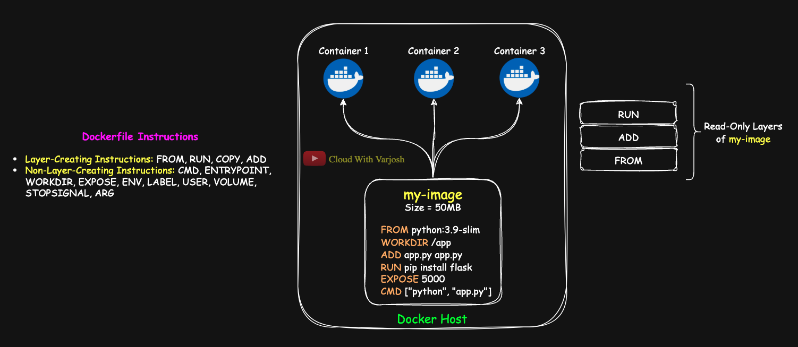
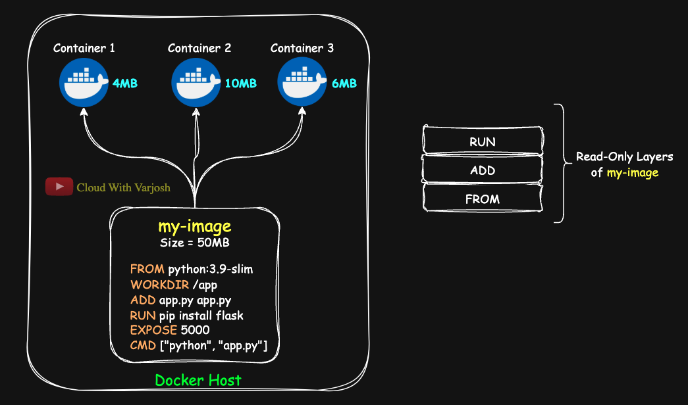
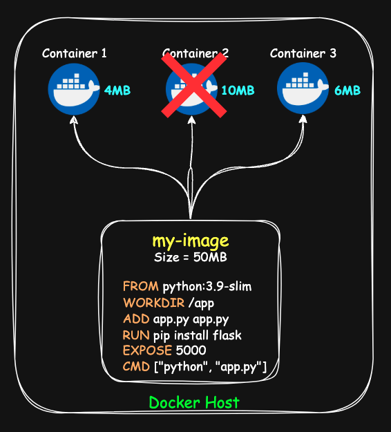
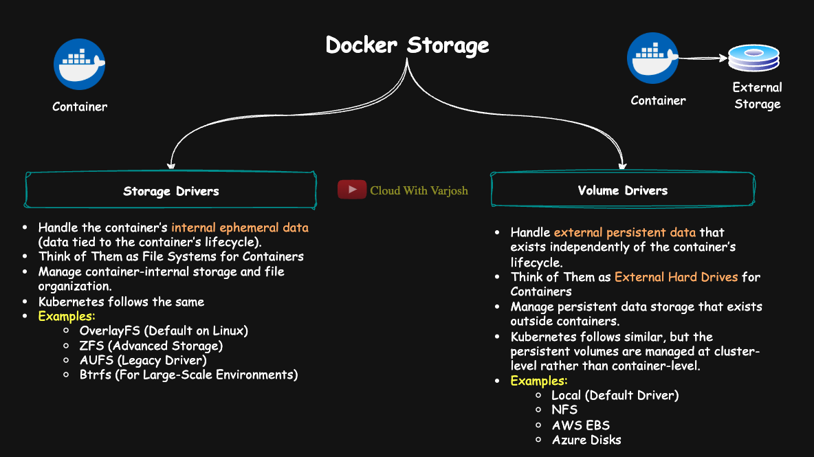
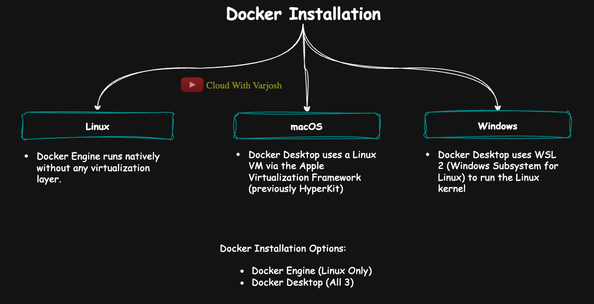

# 36 · Docker Storage Recap: Layers, the Writable Layer and Volumes

> **Level:** ★ foundation
>
> **You will learn:** where a container's files live (read-only image layers + one writable layer = "delta data"); how image sharing saves disk; why delta data disappears when a container is removed; storage drivers (overlay2 / snapshotters) vs volume drivers; how Docker storage differs on Linux, macOS and Windows; Docker volumes, bind mounts and tmpfs; and exactly how each idea maps to Kubernetes volumes, PVs, PVCs and CSI.
>
> **You need:** topics 02–04. Your Docker notes (topics [07](../../Docker/notes/07-image-layers-and-overlayfs.md), [23](../../Docker/notes/23-container-data.md)–[25](../../Docker/notes/25-bind-mounts-tmpfs-permissions.md)) go deeper.

---

## ⚡ Core: the 10-minute version

**The idea.** A container's filesystem is the image's **read-only layers** plus one thin **writable layer**. Anything the container writes goes into that layer, and it **disappears** when the container is replaced. Data that must survive belongs on a **volume**. Docker's named volume, bind mount and tmpfs map to Kubernetes' **PVC**, **hostPath** and memory-backed **emptyDir**. In Kubernetes even a container **restart** starts with a fresh writable layer.

**Picture it.** A writable layer is a whiteboard wiped at every restart; a volume is a notebook you keep.

**The one thing to know.**

```bash
docker run --name t busybox sh -c 'echo hi > /data.txt'
docker diff t                    # A /data.txt : only in the writable layer
docker rm t                      # ...and now it's gone
docker volume create keep; docker run --rm -v keep:/data busybox sh -c 'echo hi > /data/x'
```

**Try it now:**
1. Run the commands above.
2. Run a second container with `-v keep:/data` and `cat /data/x`: the data survived.

**You've got it if you can:** explain the writable layer, and why stateful data needs a volume.

> 📖 **That's the core.** On a first pass, do the mini-lab and move on to the next topic. Everything below is the **full reference**: come back for the details, the edge cases, interview answers and exam-level depth.

---

## What it is

When a container runs, its filesystem is built from:
1. **Read-only image layers**: the files from the image, shared by every container using that image.
2. **One writable layer per container**: every file the container creates or changes at runtime. Day 24 calls this **delta data**: the changes on top of the image.

**Volumes** are storage **outside** that layered filesystem, mounted into the container at a path, so their data survives the container.

---

## Why it exists

Containers are meant to be **disposable**: replaced on every deploy, crash or reschedule. If data lived only in the writable layer, every replacement would lose it. Understanding this in Docker makes Kubernetes storage (topics 37–40) obvious: **Kubernetes Pods are even more disposable**, so it has a full storage system to keep data outside them.

---

## Analogy

The image layers are a **printed textbook** shared by the whole class; nobody writes in it. Each student gets a **transparent sheet** laid over the pages (the writable layer) to scribble on. When the student leaves, their sheet goes in the bin. A **volume** is the student's own **notebook** kept in a locker: it stays even if the student is replaced.

---

## How it works inside

### Layers



A host (VM or laptop) with Docker Engine runs three containers from the same image, `my-image` (about 50 MB, a round number for simplicity), built from the Day 03 Dockerfile:

```dockerfile
FROM python:3.9-slim
WORKDIR /app
ADD app.py app.py
RUN pip install flask
EXPOSE 5000
CMD ["python", "app.py"]
```

Layer-creating vs metadata instructions (topic 03):

| Layer-creating | Non-layer-creating (metadata) |
|---|---|
| `FROM`, `RUN`, `COPY`, `ADD` | `CMD`, `ENTRYPOINT`, `WORKDIR`, `EXPOSE`, `ENV`, `LABEL`, `USER`, `VOLUME`, `STOPSIGNAL`, `ARG` |

In this Dockerfile:
- **Layers:** `FROM python:3.9-slim` (the base image's layers), `ADD app.py app.py`, `RUN pip install flask`.
- **Metadata only:** `WORKDIR /app`, `EXPOSE 5000`, `CMD [...]`.

More layer-creating instructions and leftover build tools = bigger images. That's why **multi-stage builds** (topic 03) help.

Inspect the layers:

```bash
docker image history my-image
```

```
IMAGE          CREATED        CREATED BY                                      SIZE      COMMENT
dbc9f6d3b551   17 hours ago   CMD ["python" "app.py"]                         0B        buildkit.dockerfile.v0
<missing>      17 hours ago   EXPOSE map[5000/tcp:{}]                         0B        buildkit.dockerfile.v0
<missing>      17 hours ago   RUN /bin/sh -c pip install flask # buildkit     11.5MB    buildkit.dockerfile.v0
<missing>      17 hours ago   ADD app.py app.py # buildkit                    170B      buildkit.dockerfile.v0
<missing>      17 hours ago   WORKDIR /app                                    0B        buildkit.dockerfile.v0
<missing>      3 months ago   FROM python:3.9-slim                            97.1MB    debuerreotype 0.15
```

- Each line = one instruction; `SIZE` = how much data that layer adds. `0B` lines are metadata.
- `<missing>` = intermediate layers that weren't built locally (pulled or built by BuildKit). Normal, not an error.

### How containers use the layers

1. **Read-only layers** are **shared**: three containers from a 50 MB image still use 50 MB for the image.
2. **Writable layer**: each container's own changes (delta data), unique to it.

Under the hood this is **overlayfs**: the image layers are the read-only "lower" directories, the container's layer is the writable "upper" directory, and the container sees the merged view. Changing an image file **copies it up** into the writable layer first (copy-on-write). (Topic 04; Docker notes topic [07](../../Docker/notes/07-image-layers-and-overlayfs.md).)

### Storage calculation



- Shared image layers: **50 MB**.
- Container 1 adds 4 MB, Container 2 adds 10 MB, Container 3 adds 6 MB → delta **20 MB**.
- **Total on disk: 50 + 20 = 70 MB** (not 3 × 50 + 20).

Kubernetes nodes work the same way: many Pods from one image share its layers, and each container's writable layer counts towards the node's **ephemeral storage** (topic 37).

### Losing the writable layer



> ✅ **Correct today** ([C1](#c1)): a **stopped** Docker container keeps its writable layer (`docker start` brings it back with the data). The data is lost when the container is **removed** (`docker rm`, `--rm`, or replaced by a new container on redeploy). **In Kubernetes** the effect is what Day 24 describes: when a container **restarts**, the kubelet creates a **new** container with a **fresh** writable layer, so delta data is gone even on a simple crash-restart.

Hence the **need for persistent storage**: Docker offers **volumes** that keep data **outside** the container so it survives stops, restarts and deletions.

### Storage drivers vs volume drivers



**1. Storage drivers: the container's own filesystem (ephemeral)**
- **Purpose:** manage the image layers and the writable layer, i.e. **ephemeral** container data that disappears with the container.
- **Analogy:** the container's **filesystem implementation**.
- **Responsibilities:** manage the container's layers (image + runtime changes); organise files and keep storage operations efficient.
- **Kubernetes connection:** Kubernetes nodes use the same mechanism through **containerd** or **CRI-O**, which use **snapshotters** (overlayfs by default) for container filesystems.
- **Examples:**
  - **overlay2 / overlayfs**: the default on modern Linux; stacks read-only and writable layers.
  - **AUFS**: legacy; replaced by overlayfs (simpler, faster). **Removed** from current Docker releases.
  - **ZFS**: snapshots, compression, scalable storage.
  - **Btrfs**: snapshots, quotas, subvolumes.
- **Why it matters:** efficient for **ephemeral** data, but **not** designed for persistence.

Check yours: `docker info` → `Storage Driver: overlay2`. (With Docker Engine 29's default **containerd image store**, `docker info` shows the containerd **overlayfs snapshotter** instead; same idea. See your Docker notes, topic [07](../../Docker/notes/07-image-layers-and-overlayfs.md).)

**2. Volume drivers: persistent data outside the container**
- **Purpose:** store data **outside** the container's lifecycle, surviving restarts, failures and deletions.
- **Analogy:** **external hard drives** for containers.
- **Responsibilities:** keep data outside the writable layer; allow **sharing** between containers; integrate with external storage (cloud disks, network filesystems).
- **Kubernetes connection:** Kubernetes manages **PersistentVolumes (PVs)** at the **cluster** level; apps request storage with **PersistentVolumeClaims (PVCs)**; **CSI drivers** connect the real backends (topics 38–39).
- **Examples:** `local` (the default: a directory on the host), **NFS** (shared across hosts), **AWS EBS**, **Azure Disks** (through volume plugins).
- **Why it matters:** decouples data from containers; integrates with external systems; gives portability, scalability and reliability.

Check: `docker volume inspect <name>` → `"Driver": "local"`.

**Kubernetes storage vs Docker volumes:** Docker uses **volumes** for persistent data and **storage drivers** for temporary container files. Kubernetes, built for many machines, adds:
- **PersistentVolumes (PVs)**: think "shared hard drives for your apps";
- **PersistentVolumeClaims (PVCs)**: an app **asks** for storage and Kubernetes finds or creates it;
- **CSI drivers** behind the scenes to talk to AWS EBS, Azure Disks, NFS and others.

For temporary container data, Kubernetes nodes still use overlayfs, exactly like Docker.

### Docker on Linux, macOS and Windows



Containers need a **Linux kernel** (namespaces, cgroups, overlayfs).

- **Linux:** Docker Engine runs **natively**; volumes live on the host under **`/var/lib/docker/volumes`**.
- **macOS and Windows:** no Linux kernel, so **Docker Desktop** runs a lightweight Linux VM:

| OS | How Docker Desktop gets Linux |
|---|---|
| macOS | A Linux VM using the **Apple Virtualization Framework** (previously HyperKit) |
| Windows | **WSL 2** (Windows Subsystem for Linux), a real Linux kernel in a light VM |

**Can you install Docker Engine directly on macOS/Windows?** ❌ Not like on Linux: Docker Engine needs Linux kernel features (cgroups, namespaces, overlayfs). (Windows Server can run **Windows** containers natively, a different thing.) **Your setup** runs a real Docker Engine **inside WSL2 Ubuntu**, which behaves like a Linux server (Docker notes, topic [04](../../Docker/notes/04-installing-docker.md)).

**Docker Desktop on Linux** is possible but usually pointless: it still creates a VM, adding overhead compared with running Docker Engine directly.

### Docker volumes

**Benefits:**
1. **Persistence**: data survives container restarts and removals.
2. **Sharing**: several containers can use the same data.
3. **Performance and scale**: volume drivers can use faster or external storage.

**Where they live:** `/var/lib/docker/volumes/<name>/_data` on a Linux Docker host. On macOS/Windows they're **inside the Docker Desktop VM**, not on your normal filesystem.

**Types:**

| Type | Use case | Pros | Cons | Kubernetes equivalent |
|---|---|---|---|---|
| **Named volume** | Docker-managed (`my-vol`) | Easy, portable, survives container deletion | Abstract path; backups need an extra step | **PVC** (topic 38) |
| **Bind mount** | A specific host directory mounted into the container | Full control, live sync, great for development | Tied to host paths; permission issues | **`hostPath`** (topic 38, risky) |
| **tmpfs mount** | In-memory, temporary | Fast, never written to disk | Not persistent | **`emptyDir: {medium: Memory}`** (topic 37) |

Production prefers **named volumes** (managed, portable, persistent); development likes **bind mounts** to sync source code.

---

## Commands / YAML

### The named-volume demo

```bash
docker volume create my-vol
docker run -d --name my-cont-1 -v my-vol:/app my-image
docker exec -it my-cont-1 bash
cd /app
echo "This is my delta data" > file.txt
cat file.txt            # ✅ exists
exit
docker rm -f my-cont-1  # delete the container
sudo cat /var/lib/docker/volumes/my-vol/_data/file.txt
```

```
This is my delta data
```

The container is gone, but its data isn't: **data is decoupled from the container's lifecycle.**

(Day 24's text says it creates `my-cont-2` but the commands create `my-cont-1`; use one name consistently.)

### Reaching volume data on macOS/Windows Docker Desktop

The `/var/lib/docker/volumes` path is inside the VM, so:

```bash
docker run -it --rm -v my-vol:/app alpine sh     # mount the volume in a throwaway container
ls -l /app
docker cp my-cont-1:/app/file.txt .              # or copy a file out of a container that uses it
```

Bind-mount host folders:

```bash
docker run -v /Users/yourname/data:/app/data ...      # macOS
docker run -v C:\Users\yourname\data:/app/data ...    # Windows
docker run -v /home/tushar/data:/app/data ...         # Linux / WSL2
```

### See the same layers on a Kubernetes node

```bash
docker exec lab-worker crictl imagefsinfo | grep -E 'mountpoint|usedBytes' | head -3
docker exec lab-worker sh -c 'mount | grep overlay | head -2'
```

```
overlay on /run/containerd/io.containerd.runtime.v2.task/k8s.io/9a3e…/rootfs type overlay (rw,relatime,lowerdir=/var/lib/containerd/io.containerd.snapshotter.v1.overlayfs/snapshots/42/fs:…,upperdir=…/snapshots/57/fs,workdir=…/snapshots/57/work)
```

- `lowerdir` = read-only image layers; `upperdir` = this container's writable layer.

---

## Hands-on lab

1. Build `my-image` from `Day 03/` and run `docker image history my-image`.
2. Run three containers from it; write files of different sizes in each; check `docker ps -s` (`SIZE` = writable layer; `virtual` = including shared image).
3. `docker stop` one container and `docker start` it again: the data is still there. `docker rm` it: gone. (That's the correction above.)
4. Do the named-volume demo.
5. On a kind node, list the overlay mounts of running containers (above).
6. In Kubernetes: `kubectl run w --image=busybox:1.37 -- sh -c 'echo hi > /data.txt; sleep 5; exit 1'`. After the restart, `kubectl exec w -- cat /data.txt` fails: **the restarted container has a fresh writable layer**. That's why topic 37 exists.

---

## Where you'll use it

- Understanding why Pods lose data on restart and choosing the right Kubernetes volume type.
- Node disk sizing: images + writable layers + logs + emptyDirs all share the node's disk.
- Debugging "disk pressure" evictions (topic 47) and image garbage collection (topic 08).

---

## When it breaks

| Symptom | Cause | Fix |
|---|---|---|
| Data lost after container replacement | Written to the writable layer | Use a volume (Docker) / PVC (Kubernetes) |
| Host disk filling up | Large writable layers, unused images, logs | `docker system df`, prune; in Kubernetes: ephemeral-storage limits, image GC |
| Permission denied on a bind mount | Host UID/GID differ from the container user | Match UIDs, adjust permissions (Docker notes topic [25](../../Docker/notes/25-bind-mounts-tmpfs-permissions.md); Kubernetes `fsGroup`, topic 59) |
| Can't find `/var/lib/docker/volumes` on a Mac | It's inside the Docker Desktop VM | Use a helper container or `docker cp` |

---

## Quick recap

- Container filesystem = shared **read-only image layers** + a per-container **writable layer** (delta data), via overlayfs.
- Storage drivers/snapshotters handle that ephemeral filesystem; **volumes** hold data that must survive.
- Docker named volume ≈ Kubernetes PVC; bind mount ≈ `hostPath`; tmpfs ≈ memory-backed `emptyDir`.
- In Kubernetes, even a container **restart** gives a fresh writable layer, so anything worth keeping needs a volume.

### Interview questions

1. **Q: Why don't ten containers from a 500 MB image use 5 GB?**
   A: Image layers are read-only and shared; each container only adds its own writable layer for changes.
2. **Q: A container wrote a file, crashed, and Kubernetes restarted it. Is the file still there?**
   A: No: the restart creates a new container with a fresh writable layer. Data must go to a volume (emptyDir survives container restarts; PVCs survive Pod replacement).
3. **Q: Storage driver vs volume driver?**
   A: The storage driver (overlayfs) builds each container's layered, ephemeral filesystem; volume drivers (CSI in Kubernetes) provide persistent storage outside the container's lifecycle.

---

## Appendix: notes on the original course material

This topic was rebuilt from the original CKA course notes. This appendix keeps the audit trail out of your way while you learn.

### Sources

Day 24 (introduction and delta data; storage in Docker; layers in a Dockerfile and the layer table; example layers; inspecting layers; how containers use layers; storage calculation; data loss in writable layers; need for persistent storage; storage drivers; volume drivers; Kubernetes storage vs Docker volumes note; Docker on Linux/macOS/Windows; understanding volumes and benefits; where volumes are stored; the named-volume demo; note for macOS/Windows; types of volumes; conclusion).

### Corrections to the original notes

Each entry shows what the original said and what's true now. In the topic above, each correction appears as a ✅ **Correct today** line or a ⚠️ **Fix to the original** box, linked to its entry here.

<a id="c1"></a>**C1 · Corrected (Day 24).** the original said that if Container 2 **stops**, its 10 MB of delta data is lost. **Now:** a **stopped** Docker container keeps its writable layer (`docker start` brings it back with the data). The data is lost when the container is **removed** (`docker rm`, `--rm`, or replaced by a new container on redeploy). **In Kubernetes** the effect is what Day 24 describes: when a container **restarts**, the kubelet creates a **new** container with a **fresh** writable layer, so delta data is gone even on a simple crash-restart.
