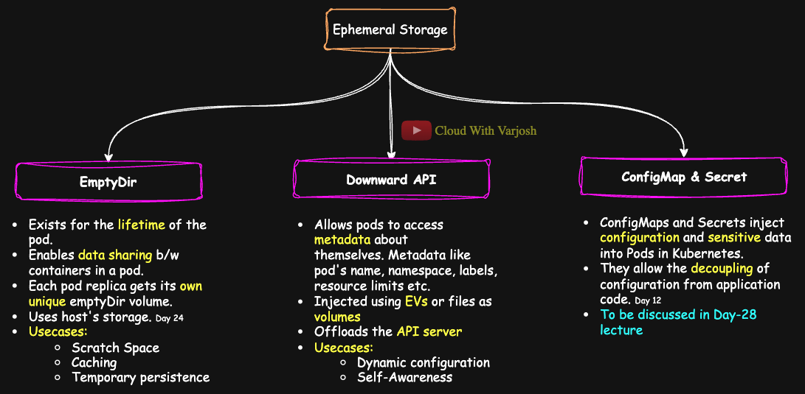

# 37 · Ephemeral Volumes: emptyDir, the Downward API and Projected Volumes

> **Level:** ★★ intermediate
>
> **You will learn:** what "ephemeral" means for Pod storage; **`emptyDir`** (shared scratch space, disk- or memory-backed, size limits, what survives what); the **Downward API** (giving a Pod its own name, namespace, labels, IP and resource limits as env vars or files); **projected volumes** (several sources in one directory, including the ServiceAccount token); **ephemeral-storage** requests and limits and why Pods get evicted for disk; and generic ephemeral volumes and image volumes.
>
> **You need:** topics 18, 34–36.

---

## ⚡ Core: the 10-minute version

**The idea.** Some storage only needs to live as long as the **Pod**:
- **emptyDir**: an empty directory shared by the Pod's containers. It survives container restarts and is deleted with the Pod. `medium: Memory` puts it in RAM.
- **Downward API**: gives the Pod facts about itself (name, namespace, labels, limits) as env vars or files.
- **Projected volumes**: combine ConfigMaps, Secrets, Downward API data and ServiceAccount tokens in one directory.

**Picture it.** emptyDir is a shared desk drawer in a hotel room: there for your whole stay, cleared at check-out.

**The one thing to know.**

```yaml
spec:
  containers:
  - name: app
    image: busybox:1.37
    command: ["sh","-c","echo $POD_NAME > /scratch/me; sleep 3600"]
    env:
    - name: POD_NAME
      valueFrom: { fieldRef: { fieldPath: metadata.name } }   # Downward API
    volumeMounts: [{ name: scratch, mountPath: /scratch }]
  volumes:
  - name: scratch
    emptyDir: { sizeLimit: 100Mi }
```

**Try it now:**
1. Apply the Pod, then `kubectl exec` and `cat /scratch/me`.
2. Kill the container process (`kubectl exec <p> -- kill 1`): the file survives the restart.
3. Delete the Pod: the file is gone.

**You've got it if you can:** say what survives a container restart vs a Pod deletion for emptyDir.

> 📖 **That's the core.** On a first pass, do the mini-lab and move on to the next topic. Everything below is the **full reference**: come back for the details, the edge cases, interview answers and exam-level depth.

---

## What it is

**Ephemeral storage** is storage whose data lives **only as long as the Pod**. When the Pod is deleted, the data goes too. Kubernetes ephemeral volume types:

| Type | Gives the container | Typical use |
|---|---|---|
| **`emptyDir`** | An empty directory, created when the Pod lands on a node | Scratch space, caches, sharing files between containers in a Pod |
| **`downwardAPI`** | Files with the Pod's own metadata | Self-aware apps and sidecars |
| **`configMap` / `secret`** | Files from those objects (topics 34–35) | Configuration, credentials |
| **`projected`** | Several of the above (+ ServiceAccount token, cluster trust bundles) combined in one directory | Neat config dirs; token mounting |
| **Generic ephemeral volume** | A PVC created and deleted **with** the Pod | Large scratch space from a StorageClass |
| **`image`** (beta) | Files from an OCI image, read-only | Shipping models, data or plugins as images |

Plus the **container writable layers** themselves (topic 36), which also count as ephemeral storage.



---

## Why it exists

Each container's writable layer is **private** and is **wiped on every container restart** (topic 36). Pods often need:
- a place **several containers** can share (an app writes logs, a sidecar ships them; topic 23),
- scratch space that **survives container restarts** (a cache that would be slow to rebuild),
- information **about the Pod itself** without calling the API server.

---

## Analogy

- **`emptyDir`** = a **shared desk** in a team's meeting room. Everyone in the room (containers in the Pod) can use it. If someone steps out and comes back (container restart), the papers are still there. When the meeting room is given back (Pod deleted), the desk is cleared.
- **Downward API** = the **name badge and department card** handed to each employee on arrival, so they know who and where they are without phoning HR (the API server).

---

## How it works inside

### emptyDir

- Created **empty** when the Pod is **assigned to a node**; it exists for the **Pod's lifetime** on that node.
- **Survives container restarts**; **deleted** when the Pod is removed from the node (deletion, eviction, rescheduling).
- **Per Pod**: in a Deployment, **each replica gets its own, isolated** emptyDir. Replicas don't share it.
- **Where the data lives:**
  - default (`emptyDir: {}`): on the **node's disk** under `/var/lib/kubelet/pods/<pod-uid>/volumes/kubernetes.io~empty-dir/<name>/`;
  - `medium: Memory`: a **tmpfs** in RAM: very fast, but the bytes **count against the container's memory limit** (and the node's memory), and vanish on node reboot.
- **`sizeLimit`**: if usage exceeds it, the kubelet **evicts the Pod**.

**Day 24 recap:** if a Pod has three containers from the **same image**, they share the **read-only image layers** but each has its **own writable layer**, so one container's changes are **invisible** to the others. Mount the **same emptyDir** into all three, and they get a **shared writable space** to collaborate during the Pod's lifetime.

**Why use it:** scratch space (a temporary workspace for processing), caching, temporary computations, where persistence isn't needed.

### Downward API

The **Downward API** lets a container read **metadata about its own Pod**: name, namespace, labels, annotations, resource requests/limits, and more. It's delivered as **environment variables** or **files in a volume**. In a Deployment, each Pod gets **its own** values.

**Why:**
- **Dynamic configuration**: apps read Pod-specific values (labels, limits) at runtime.
- **Self-awareness**: a Pod knows its name, namespace and resource limits.
- **Simpler configuration**: no hard-coding or manual setup.

**Did you know?** **Sidecars** (topic 23) such as logging, monitoring and proxy agents rely heavily on the Downward API. Without it they'd have to **poll the API server** for "which Pod am I in?", adding load and network overhead. Example: a monitoring sidecar collecting metrics for Pods in `app1-ns` must know **which Pod and namespace** it's in to label the data correctly; the Downward API injects that locally, making the container **self-aware**.

**Fields you can expose:**

| Source | Via env (`fieldRef`) | Via volume file |
|---|---|---|
| `metadata.name`, `metadata.namespace`, `metadata.uid` | ✅ | ✅ |
| `metadata.labels['key']`, `metadata.annotations['key']` (one key) | ✅ | ✅ |
| `metadata.labels`, `metadata.annotations` (all) | ❌ | ✅ |
| `spec.nodeName`, `spec.serviceAccountName`, `status.hostIP`, `status.podIP`, `status.podIPs` | ✅ | ❌ |
| Resources (`resourceFieldRef`): `requests.cpu`, `limits.memory`, `limits.ephemeral-storage`… | ✅ | ✅ |

**Env vs file:** env vars are fixed at container start; **volume files update** if labels or annotations change (same atomic symlink mechanism as ConfigMaps).

### Projected volumes

A **projected** volume merges several sources into **one directory**:

```yaml
volumes:
- name: all-in-one
  projected:
    sources:
    - configMap: { name: app-config }
    - secret: { name: app-secret }
    - downwardAPI:
        items:
        - path: labels
          fieldRef: { fieldPath: metadata.labels }
    - serviceAccountToken:          # a short-lived, auto-rotated token (topic 55)
        path: token
        audience: vault
        expirationSeconds: 3600
```

**Every Pod already has one:** the default ServiceAccount token at `/var/run/secrets/kubernetes.io/serviceaccount/` is a projected volume (`token` + `ca.crt` + `namespace`), named `kube-api-access-xxxxx` (topic 55).

### ephemeral-storage: the node's disk is a shared resource

A container's writable layer, its logs (`/var/log/pods`) and disk-backed emptyDirs all consume the **node's disk**. You can request and limit it like CPU and memory (topic 41):

```yaml
resources:
  requests: { ephemeral-storage: "1Gi" }   # the scheduler only picks nodes with this much allocatable disk
  limits:   { ephemeral-storage: "2Gi" }   # exceed it → the kubelet EVICTS the Pod
```

If the node itself runs low on disk, the kubelet sets **`DiskPressure`** and **evicts** Pods, heaviest users first (topic 47).

### Generic ephemeral volumes

When `emptyDir` on the node's disk isn't enough (too small, too slow), ask for a **real volume** whose lifetime is tied to the Pod:

```yaml
volumes:
- name: scratch
  ephemeral:
    volumeClaimTemplate:
      spec:
        accessModes: ["ReadWriteOnce"]
        storageClassName: fast-ssd       # topic 39
        resources: { requests: { storage: 50Gi } }
```

A PVC named `<pod>-scratch` is created with the Pod and **deleted** with it.

### Image volumes (beta)

```yaml
volumes:
- name: model
  image:
    reference: registry.example.com/models/llm:v3
    pullPolicy: IfNotPresent
```

Mounts an OCI image's files **read-only**: handy for ML models or data shipped through your existing registry. (Beta since v1.33; needs runtime support.)

---

## Commands / YAML

### Demo 1: emptyDir shared by two containers

```yaml
apiVersion: v1
kind: Pod
metadata:
  name: emptydir-example
spec:
  containers:
  - name: busybox-container
    image: busybox:1.37
    command: ["/bin/sh", "-c", "sleep 3600"]   # stay alive for an hour
    volumeMounts:
    - mountPath: /data                         # where the volume appears in THIS container
      name: temp-storage                       # must match a name under volumes:
  - name: busybox-container-2
    image: busybox:1.37
    command: ["/bin/sh", "-c", "sleep 3600"]
    volumeMounts:
    - mountPath: /data
      name: temp-storage
  volumes:
  - name: temp-storage
    emptyDir: {}                               # a temporary directory that lives as long as the Pod
```

(`Day 26/emptyDir.yaml` is the same Pod with containers named `busybox` and `busybox-2`; adjust the `-c` names below if you apply the file.)

**Verify:**

```bash
kubectl apply -f emptydir.yaml
kubectl exec emptydir-example -c busybox-container -- sh -c 'echo "What a file!" > /data/myfile.txt'   # step 1: write
kubectl exec emptydir-example -c busybox-container-2 -- cat /data/myfile.txt                         # step 2: read
```

```
What a file!
```

**Key takeaway:** both containers share the emptyDir. That's impossible with their own writable layers, which are isolated; `emptyDir` enables file sharing between containers in a Pod.

Extra checks:

```bash
# survives a container restart:
kubectl exec emptydir-example -c busybox-container -- kill 1
kubectl exec emptydir-example -c busybox-container -- cat /data/myfile.txt     # still there (after it restarts)
# where it lives on the node:
NODE=$(kubectl get pod emptydir-example -o jsonpath='{.spec.nodeName}')
UID_=$(kubectl get pod emptydir-example -o jsonpath='{.metadata.uid}')
docker exec $NODE ls /var/lib/kubelet/pods/$UID_/volumes/kubernetes.io~empty-dir/temp-storage
```

Memory-backed with a size limit:

```yaml
  volumes:
  - name: fast-cache
    emptyDir:
      medium: Memory
      sizeLimit: 256Mi
```

### Demo 2: Downward API as environment variables (Day 26, `Day 26/downwardapi-1.yaml`)

```yaml
apiVersion: v1
kind: Pod
metadata:
  name: downwardapi-example
  labels:
    app: demo
spec:
  containers:
  - name: metadata-container
    image: busybox:1.37
    command: ["/bin/sh", "-c", "env && sleep 3600"]   # print all env vars, then sleep
    env:
    - name: POD_NAME
      valueFrom:
        fieldRef:
          fieldPath: metadata.name        # this Pod's name
    - name: POD_NAMESPACE
      valueFrom:
        fieldRef:
          fieldPath: metadata.namespace   # this Pod's namespace
    - name: NODE_NAME
      valueFrom:
        fieldRef:
          fieldPath: spec.nodeName        # (extra) the node it runs on
    - name: MEM_LIMIT
      valueFrom:
        resourceFieldRef:
          resource: limits.memory         # (extra) its memory limit, in bytes
```

```bash
kubectl exec downwardapi-example -- env | grep -E 'POD_|NODE_|MEM_'
```

```
POD_NAME=downwardapi-example
POD_NAMESPACE=default
NODE_NAME=lab-worker
MEM_LIMIT=8222982144
```

- `POD_NAME` and `POD_NAMESPACE` come from the Pod's own metadata.
- With no memory limit set, `limits.memory` reports the **node's allocatable memory**.

### Demo 3: Downward API as files (Day 26, `Day 26/downwardapi-2.yaml`)

```yaml
apiVersion: v1
kind: Pod
metadata:
  name: downwardapi-volume
  labels:
    app: good_app
    owner: hr
  annotations:
    version: "good_version"
spec:
  containers:
  - name: metadata-container
    image: busybox:1.37
    command: ["/bin/sh", "-c", "cat /etc/podinfo/* && sleep 3600"]  # print the metadata files, then sleep
    volumeMounts:
    - name: downwardapi-volume
      mountPath: /etc/podinfo
  volumes:
  - name: downwardapi-volume
    downwardAPI:
      items:
      - path: "labels"                     # file /etc/podinfo/labels
        fieldRef:
          fieldPath: metadata.labels
      - path: "annotations"                # file /etc/podinfo/annotations
        fieldRef:
          fieldPath: metadata.annotations
```

**Step 1: look at the files**

```bash
kubectl exec -it downwardapi-volume -- /bin/sh
cd /etc/podinfo
ls -l
```

```
annotations -> ..data/annotations
labels -> ..data/labels
```

These are **symbolic links** into a hidden `..data/` directory, which allows **atomic updates** (the kubelet writes a new timestamped directory and swaps the `..data` link).

> ✅ **Correct today** ([C1](#c1)): a `downwardAPI` volume is its own volume type. The `..data` symlink mechanism is the kubelet's shared "atomic writer", used by **all** of `configMap`, `secret`, `downwardAPI` and `projected` volumes (which is why ConfigMap mounts look the same, topic 34). A `projected` volume can *include* Downward API items, but isn't required.

**Step 2: read them**

```bash
cat labels
cat annotations
```

```
app="good_app"
owner="hr"
kubectl.kubernetes.io/last-applied-configuration="{\"apiVersion\":\"v1\",…}"
version="good_version"
```

- Labels come straight from the Pod's metadata.
- If you created the Pod with `kubectl apply`, the **annotations** file also contains kubectl's `last-applied-configuration` annotation (topic 15). With `kubectl create -f` you'd see just `version="good_version"`.

**Step 3: see them in the logs** (the container printed them at start-up):

```bash
kubectl logs downwardapi-volume
```

**Live updates:** change a label (`kubectl label pod downwardapi-volume owner=finance --overwrite`), wait about a minute, `cat labels` again: updated. (An env var never would be.)

### ConfigMaps and Secrets (Day 26 preview)

ConfigMaps and Secrets inject configuration and sensitive data into Pods. The objects themselves live independently of Pods, but when **mounted as volumes**, the **mounted copy is ephemeral**: it exists only for the Pod's lifetime. They **decouple configuration from code** and handle sensitive data more safely across many Pods. Full details: topics 34 and 35.

---

## Hands-on lab

1. Run Demos 1–3.
2. In Demo 1, delete the Pod and recreate it: the file is **gone** (emptyDir lives and dies with the Pod).
3. Fill a memory-backed emptyDir past the container's memory limit: `dd if=/dev/zero of=/cache/big bs=1M count=300` with a 200Mi limit → `OOMKilled`.
4. Set `sizeLimit: 50Mi` on a disk emptyDir and write 100 MiB → watch the kubelet **evict** the Pod (`kubectl describe pod`: `Usage of EmptyDir volume "…" exceeds the limit`).
5. Add `resources.limits.ephemeral-storage: 100Mi` and write 200 MiB into the **container's root filesystem** (not a volume) → evicted for ephemeral-storage.
6. Build a projected volume combining a ConfigMap, a Secret and labels; `ls -l` the directory.
7. Clean up all the demo Pods.

---

## Where you'll use it

- **Sidecar patterns**: app writes logs/files to an emptyDir, a sidecar reads them (topic 23).
- **Caches and temp files** for apps with read-only root filesystems (topic 59): mount an emptyDir at `/tmp`.
- **Self-aware apps and agents**: tracing, metrics labels, licensing by Pod name, sizing thread pools from `limits.cpu`.
- **Disk-pressure prevention**: ephemeral-storage requests and limits on noisy workloads.

---

## When it breaks

| Symptom | Cause | Fix |
|---|---|---|
| Data missing after Pod rescheduled | emptyDir is per-Pod, per-node | Use a PVC for data that must survive (topic 38) |
| `OOMKilled` with a `medium: Memory` emptyDir | tmpfs pages count towards the memory limit | Raise the limit, or use disk |
| Pod `Evicted`: `ephemeral local storage usage exceeds the total limit` | Writable layer + logs + emptyDir over `limits.ephemeral-storage` | Raise the limit, log less, clean temp files |
| Pod `Evicted`: `The node was low on resource: ephemeral-storage` | Node disk pressure | Bigger node disks, image GC, limits on heavy Pods (topic 47) |
| Downward API env var never changes | Env vars are set at start | Use a downwardAPI volume |
| `fieldRef` error: `unsupported fieldPath` for labels in env | All labels can only be a file | Use `metadata.labels['key']` for one label in env, or a volume |

---

## Quick recap

- **emptyDir**: per-Pod scratch space shared by its containers; survives container restarts, dies with the Pod; disk or `medium: Memory`; `sizeLimit`.
- **Downward API**: Pod metadata and resources as env vars (fixed) or files (updatable); lets sidecars avoid polling the API server.
- **Projected volumes** combine ConfigMaps, Secrets, Downward API and SA tokens in one directory; the default SA token is one.
- **ephemeral-storage** requests/limits protect node disks; over-limit Pods are evicted.

### Interview questions

1. **Q: How can two containers in a Pod share files?**
   A: Mount the same volume, typically an `emptyDir`, into both; their own writable layers are isolated.
2. **Q: Does emptyDir data survive a container restart? A Pod deletion?**
   A: Yes for container restarts (same Pod on the same node); no for Pod deletion or rescheduling.
3. **Q: How does an app learn its own Pod name and namespace?**
   A: Through the Downward API: `fieldRef` env vars (`metadata.name`, `metadata.namespace`) or a `downwardAPI` volume.

---

## Appendix: notes on the original course material

This topic was rebuilt from the original CKA course notes. This appendix keeps the audit trail out of your way while you learn.

### Sources

Day 26 (introduction, ephemeral storage, emptyDir: what/why, Day 24 writable-layer recap, emptyDir demo and verification, key takeaway; Downward API: what/why, "did you know" on sidecars, env-var demo, files-via-volume demo with symlinks, logs verification; ConfigMaps and Secrets preview; conclusion), files `Day 26/emptyDir.yaml`, `downwardapi-1.yaml`, `downwardapi-2.yaml`. The same sections reappear verbatim in `Storage-In-Kubernetes-Masterclass/README.md` (a merge of Days 24–28).

### Corrections to the original notes

Each entry shows what the original said and what's true now. In the topic above, each correction appears as a ✅ **Correct today** line or a ⚠️ **Fix to the original** box, linked to its entry here.

<a id="c1"></a>**C1 · Corrected (Day 26).** the original says the symlinks exist "because Kubernetes uses a **projected volume** with the Downward API". **Now:** a `downwardAPI` volume is its own volume type. The `..data` symlink mechanism is the kubelet's shared "atomic writer", used by **all** of `configMap`, `secret`, `downwardAPI` and `projected` volumes (which is why ConfigMap mounts look the same, topic 34). A `projected` volume can *include* Downward API items, but isn't required.

### Official references

Official docs for this topic (from the reference list of `Storage-In-Kubernetes-Masterclass`):

- [Kubernetes volumes](https://kubernetes.io/docs/concepts/storage/volumes/)
- [`emptyDir`](https://kubernetes.io/docs/concepts/storage/volumes/#emptydir)
- [Downward API as volume files](https://kubernetes.io/docs/tasks/inject-data-application/downward-api-volume-expose-pod-information/)
