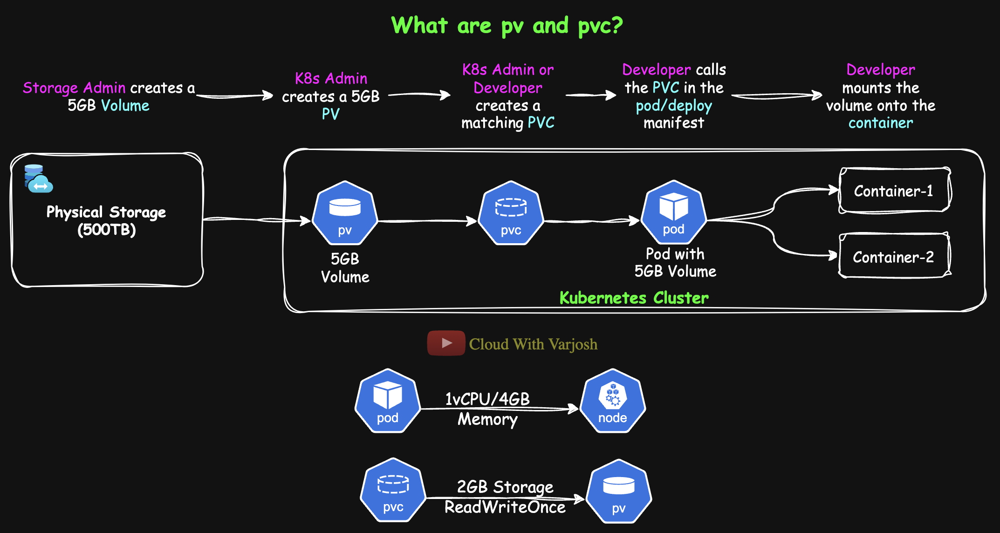
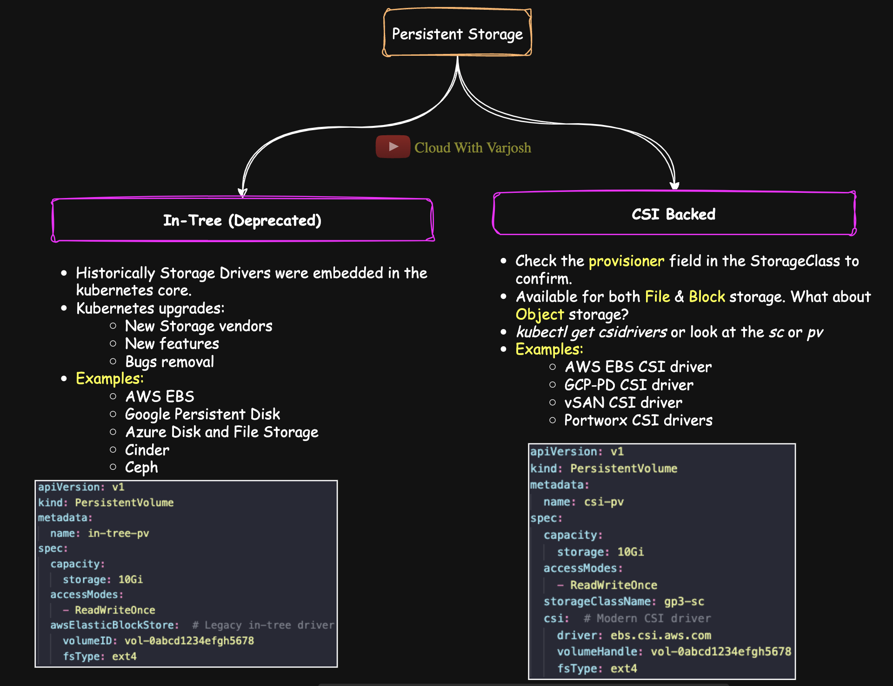
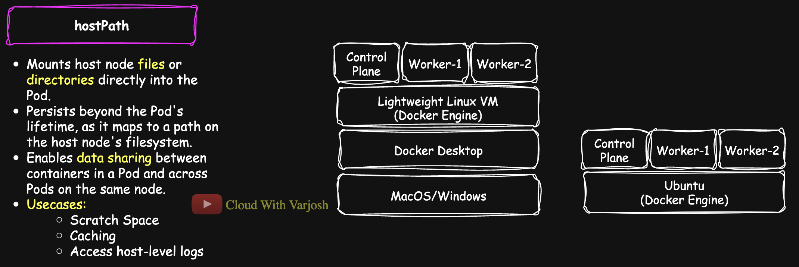
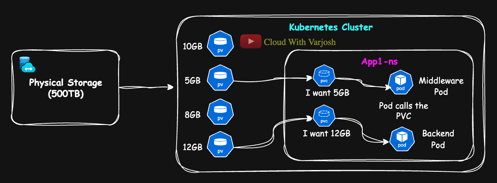

# 38 · Persistent Storage: In-Tree → CSI, hostPath, local, PV and PVC

> **Level:** ★★ intermediate
>
> **You will learn:** how Kubernetes storage moved from built-in ("in-tree") plugins to CSI drivers; `hostPath` (what it is, where it lives on kind, why it's dangerous) and `local` volumes; **PersistentVolumes** (PVs) and **PersistentVolumeClaims** (PVCs): scope, the 1:1 binding, the full manual-provisioning workflow, access modes (RWO, ROX, RWX, RWOP), block vs file vs object storage, volume modes, reclaim policies, every binding condition, and the PV/PVC lifecycle states; plus a static-provisioning demo with `Retain`.
>
> **You need:** topics 09 (CSI), 26, 36 and 37.

---

## ⚡ Core: the 10-minute version

**The idea.** For data that must outlive Pods, Kubernetes splits storage into two objects:
- a **PersistentVolume (PV)**: a real piece of storage, cluster-wide;
- a **PersistentVolumeClaim (PVC)**: a request for storage ("10Gi, single-node read-write") in a namespace.

Kubernetes **binds** a PVC to a matching PV, and Pods mount the **PVC**. Access modes say who can use it: **RWO** (one node), **RWX** (many nodes), **RWOP** (one Pod). The reclaim policy says what happens when the claim is deleted (`Delete` or `Retain`).

**Picture it.** A PV is a parking space; a PVC is your parking permit; the Pod is the car that uses whatever space the permit gets.

**The one thing to know.**

```yaml
apiVersion: v1
kind: PersistentVolumeClaim
metadata: { name: data }
spec:
  accessModes: [ReadWriteOnce]
  resources: { requests: { storage: 1Gi } }
---
# in the Pod:
#   volumes: [{ name: data, persistentVolumeClaim: { claimName: data } }]
```

**Try it now** (kind has a default StorageClass):
1. Apply the PVC.
2. Create a Pod that mounts it and writes a file.
3. `kubectl get pvc,pv`: Bound.
4. Delete and recreate the Pod: the file is still there.

**You've got it if you can:** explain PV vs PVC, binding, the access modes and the reclaim policies.

> 📖 **That's the core.** On a first pass, do the mini-lab and move on to the next topic. Everything below is the **full reference**: come back for the details, the edge cases, interview answers and exam-level depth.

---

## What it is

Kubernetes separates **storage** from **compute** with two objects:

| Object | Scope | Who creates it | Meaning |
|---|---|---|---|
| **PersistentVolume (PV)** | **Cluster-wide** | An admin (static) or a provisioner (dynamic, topic 39) | "Here is a real piece of storage: 5 GiB on this NFS share / this EBS volume / this disk" |
| **PersistentVolumeClaim (PVC)** | **Namespaced** | A developer / the app's manifests | "My app needs 2 GiB, read-write, from this kind of storage" |

The PVC is **bound** to a matching PV; Pods then mount the **PVC** (never the PV directly).



**Pods use node resources** (CPU, memory, network) to run. When a Pod needs **persistent storage**, it asks for it with a **PVC**, which is satisfied by a **PV** (the real backend). Separating the two lets Kubernetes manage compute and storage independently.

---

## Why it exists

- Data must outlive **Pods**, which come and go (topic 36).
- App teams shouldn't need to know storage details (NFS server IPs, EBS volume IDs). They **claim** storage by size and features; admins (or automation) **provide** it.
- One manifest should work in any cluster: the PVC says *what*, the cluster decides *where*.

---

## Analogy

A **car park**. PVs are the **parking spaces** (some covered, some for large vehicles, some EV-charging). A PVC is your **parking ticket request**: "one standard space, covered". The attendant (the binder) gives you **one specific space**, and while you hold that ticket nobody else can use it (1:1). When you hand the ticket back, the reclaim policy decides whether the space is **cleaned and destroyed** (`Delete`) or **left as it is** with your stuff in it until someone deals with it (`Retain`).

---

## How it works inside

### 1. From in-tree plugins to CSI



**In-tree volume plugins (legacy):** storage drivers compiled **into Kubernetes itself**. Drawbacks:
- maintenance tied to Kubernetes releases;
- vendors couldn't ship updates independently;
- a storage-driver bug could affect Kubernetes core.

Examples: `awsElasticBlockStore`, `azureDisk`, `azureFile`, `gcePersistentDisk`, `nfs`, `glusterfs`, `rbd` (Ceph RADOS Block Device), `iscsi`, `fc` (Fibre Channel).

**CSI (Container Storage Interface), the modern standard:** a vendor-neutral spec developed in the CNCF community (topic 09). Benefits:
- **Independent updates**: vendors ship drivers without waiting for Kubernetes.
- **Faster development** of features and fixes.
- **Advanced features**: snapshots, resizing, cloning, volume health monitoring.
- **Easy integration** for custom storage.

Driver examples: AWS EBS (`ebs.csi.aws.com`), GCE PD (`pd.csi.storage.gke.io`), Azure Disk (`disk.csi.azure.com`), Ceph CSI, OpenEBS (cStor, Jiva…), Portworx, vSphere CSI.

> ✅ **Correct today** ([C1](#c1)): it went further. Through **CSI migration**, the in-tree **cloud** plugins (AWS EBS, Azure Disk/File, GCE PD, OpenStack Cinder, vSphere) were **removed from Kubernetes' code** between v1.26 and v1.31. Old manifests that still say `awsElasticBlockStore:` are **translated** to the matching CSI driver, so that **CSI driver must be installed**. Some generic in-tree types (`nfs`, `iscsi`, `fc`, `hostPath`, `local`) remain in-tree; several obscure ones (glusterfs, flocker, quobyte, storageos…) were removed entirely.

**The same EBS volume, old and new:**

```yaml
# In-tree (legacy; now translated to CSI automatically)
apiVersion: v1
kind: PersistentVolume
metadata:
  name: in-tree-pv
spec:
  capacity:
    storage: 10Gi                       # this PV offers 10 GiB
  accessModes:
    - ReadWriteOnce                     # read-write by one node
  awsElasticBlockStore:                 # legacy in-tree AWS EBS plugin
    volumeID: vol-0abcd1234efgh5678     # existing EBS volume
    fsType: ext4                        # must match the filesystem on the volume
```

```yaml
# CSI (the modern way)
apiVersion: v1
kind: PersistentVolume
metadata:
  name: csi-pv
spec:
  capacity:
    storage: 10Gi
  accessModes:
    - ReadWriteOnce
  storageClassName: gp3-sc              # the class this PV belongs to (binding/matching; topic 39)
  csi:
    driver: ebs.csi.aws.com             # which CSI driver handles it
    volumeHandle: vol-0abcd1234efgh5678 # the volume's ID in the backend
    fsType: ext4
```

**File, block and object storage:**
- **File and block** storage are **mountable** as volumes through CSI drivers, from vendors like NetApp and Dell EMC and from AWS, Azure and GCP: dynamic provisioning, snapshots, resizing.
- **Object storage** (Amazon S3, Azure Blob, Google Cloud Storage) works differently (whole objects over an HTTP API, no POSIX filesystem), so Kubernetes doesn't natively mount it. **Use the provider's SDKs/APIs from the app** for uploads, downloads, versioning, replication. (FUSE-based CSI drivers such as Mountpoint for S3 exist, with limitations.)
- Whatever the storage (EBS, NFS, iSCSI), the modern way is **through a CSI driver**.

### 2. hostPath and local

**`hostPath`**: mounts a file or directory **from the node's filesystem** into the Pod.
- **Node-specific**: every Pod **on that node** that mounts the same path sees the same data (cross-Pod sharing on one node); Pods on **other** nodes see their node's own, different directory.
- **Uses**: debugging, reading host files (logs, configs), node agents (topic 27), single-node labs.
- **In-tree only** (no CSI version).
- **Why Kubernetes says avoid it:**
  - **Security risk**: a Pod mounting `/`, `/etc` or `/var/run/containerd/containerd.sock` effectively owns the node. Pod Security's `baseline`/`restricted` levels forbid hostPath (topic 60).
  - **No portability**: the data is tied to one node; reschedule the Pod and its data is gone (or different).
  - **Better alternatives**: PVs/PVCs, or **local** PVs.
- **emptyDir vs hostPath:** an emptyDir is shared by containers **within one Pod** only; a hostPath directory can be shared by **any Pod on the same node** that mounts it.

**`local` volumes**: a **whole disk or partition attached to a specific node**, exposed as a **PV with node affinity**:
- the scheduler places Pods that use it **on that node** (unlike hostPath, which has no scheduling awareness);
- used on-prem and for fast local NVMe (databases that replicate themselves);
- in-tree, or via CSI-based local provisioners (OpenEBS LocalPV, TopoLVM, local-path).

```yaml
apiVersion: v1
kind: PersistentVolume
metadata: { name: local-pv-node1 }
spec:
  capacity: { storage: 100Gi }
  accessModes: [ReadWriteOnce]
  persistentVolumeReclaimPolicy: Retain
  storageClassName: local-nvme
  local: { path: /mnt/disks/nvme0 }
  nodeAffinity:                          # REQUIRED for local PVs: which node has this disk
    required:
      nodeSelectorTerms:
      - matchExpressions:
        - { key: kubernetes.io/hostname, operator: In, values: [worker-1] }
```

### 3. hostPath on kind: where the file really is



| Platform | Docker Engine runs | `hostPath` points to |
|---|---|---|
| **Ubuntu/Linux** | Natively | Inside the **kind node container**, whose filesystem lives on the Linux host's Docker storage |
| **macOS/Windows** (Docker Desktop) | In a Linux VM (Apple Virtualization/HyperKit, or WSL2) | Inside the **kind node container** in that VM, **not** your Mac/Windows filesystem and not the VM's own root |

> ✅ **Correct today** ([C2](#c2)): with **kind**, a "node" is **always a container**, on Linux too. `hostPath: /tmp/hostfile` refers to `/tmp/hostfile` **inside the kind node container** (`docker exec lab-worker ls /tmp/hostfile`), not on your Ubuntu host, unless you explicitly map a host directory into the node with kind's `extraMounts`. On a real (non-kind) Linux node, hostPath is the node's real filesystem.

**Why it matters:** files written through a hostPath on kind exist only inside that node container, aren't visible on your host, and vanish when the cluster or node container is deleted. Fine for demos; never for real data.

### 4. PV and PVC details

**PersistentVolume:**
- Storage provisioned **manually by an admin** or **dynamically by a StorageClass**.
- Exists **independently of Pods**; can be retained or reused after Pods are deleted.
- Properties: **capacity**, **access modes**, **reclaim policy**, **storage class**, **volume mode**, optional **node affinity**.

**PersistentVolumeClaim:**
- A **request for storage** by a user, the way a Pod requests CPU/memory.
- On creation, Kubernetes looks for a PV that satisfies it (or provisions one).
- **Binding process:**
  1. **Admin** provisions PVs (or sets up StorageClasses for dynamic provisioning).
  2. **Developer** creates a **PVC** (a separate object, referenced from the Pod spec) with the needed size and modes.
  3. **Kubernetes** binds the PVC to a suitable PV, making the storage available to Pods.

**Scope:**



- **PVs are cluster-scoped** (like Nodes and StorageClasses): not in any namespace. Check with `kubectl api-resources | grep persistentvolume`.
- **PVCs are namespaced** (like Pods). Only Pods **in the PVC's namespace** can use it.

**Why that matters:** a PVC `data-pvc` in `app1-ns` bound to some PV can only be used by Pods in `app1-ns`. A Pod in `app2-ns` referencing it fails: `persistentvolumeclaims "data-pvc" not found`, because from `app2-ns` it doesn't exist.

**Strict 1:1 binding:**
- A PVC binds to **one** PV, and a PV to **one** PVC.
- When bound, the PV's **`claimRef`** is filled in (the PVC's name, namespace and UID), so no other PVC can claim it until it's explicitly released.
- A 2 GiB claim bound to a 5 GiB PV gets the **whole 5 GiB** PV: the remaining 3 GiB isn't split off for anyone else.

**Additional key points:**
- PVCs **request**; PVs **fulfil** the request if capacity, access mode and storage class match.
- A bound PVC stays bound until the PVC is deleted (or the PV is manually reclaimed/deleted).
- The **reclaim policy** (`Retain`, `Delete`, deprecated `Recycle`) decides what happens to the PV after its PVC is deleted.

### 5. The manual (static) provisioning workflow

| Step | Who | Action | Notes |
|---|---|---|---|
| 1 | **Developer** | Needs 5 GiB of persistent storage | Asks via a PVC or by contacting the Kubernetes admin |
| 2 | **Kubernetes admin** | Coordinates with the storage admin | Backend could be SAN/NAS via iSCSI, NFS… |
| 3 | **Storage admin** | Allocates a volume from, say, a 500 TiB pool | Creating a LUN (a logical disk on a SAN), an NFS export, etc. |
| 4 | **Kubernetes admin** | Creates a **PV** representing it | Capacity, `accessModes`, `volumeMode`, `storageClassName`… |
| 5 | **Developer** | Creates a **PVC** asking for 5 GiB with certain modes | Must match the PV |
| 6 | **Kubernetes** | **Binds** the PVC to a suitable PV | Matching: class, access mode, volume mode, size… |
| 7 | **Pod** | References the **PVC** in `volumes` and mounts it | The Pod never deals with the PV directly |

**Important notes:** PVs are cluster-scoped; PVCs are namespaced; a PV can be claimed by only one PVC; the Pod must be in the PVC's namespace; the physical storage is reached through in-tree drivers (legacy) or **CSI drivers** (`ebs.csi.aws.com`, `azurefile.csi.azure.com`…).

Developers usually create PVCs themselves, and with **StorageClasses** (topic 39) PVs are **created automatically**, removing steps 1–4 entirely: **dynamic provisioning**.

### 6. Access modes

Access modes say how a volume can be mounted **across nodes**:

| Mode | Short | Meaning | Example use | Typical storage |
|---|---|---|---|---|
| **ReadWriteOnce** | RWO | Read-write by **one node** (several Pods **on that node** can share it) | Databases needing exclusive access | **Block**: Amazon EBS, GCP PD, Azure Managed Disks |
| **ReadOnlyMany** | ROX | Read-only by **many nodes** | Shared static data, read-only datasets | **File**: NFS, Azure Files (some block storage can attach read-only to many nodes) |
| **ReadWriteMany** | RWX | Read-write by **many nodes** | CMS uploads, shared app data, log aggregation | **File**: Amazon EFS, Azure Files, NFS, CephFS |
| **ReadWriteOncePod** | RWOP | Read-write by **one Pod in the whole cluster** | Strict single-writer workloads | **Block** with CSI support (e.g. EBS CSI) |

> ✅ **Correct today** ([C3](#c3)): it was introduced as alpha in v1.22 and reached **GA (stable) in v1.29**. It's only for **CSI** volumes.

Access modes are a **promise about what the storage supports**, matched at binding. RWO is enforced at **attach** time (a second node can't attach the disk; you get `Multi-Attach error`). RWOP is enforced by the scheduler and kubelet across the whole cluster.

### 7. Block vs file storage

**Block storage**: raw blocks, formatted and used like a single disk. **Low latency, high performance**: databases, transactional systems.
- Examples: Amazon EBS, GCP Persistent Disk, Dell EMC block arrays.
- Generally **attached to one node at a time**, so RWO or RWOP.
- *Analogy:* a **USB drive** plugged into one computer: fast and reliable, but not shared.

**File storage**: a **shared filesystem** over the network (NFS, SMB).
- Examples: Amazon EFS, Azure Files, on-prem NFS.
- Built for **concurrent multi-node access**: ROX and RWX.
- *Analogy:* a **network drive** many computers use at once.

**Key differences:**
1. **Multi-node access**: block is single-node; file is multi-node.
2. **Access modes**: RWO/RWOP for block; RWX for file.
3. **Use cases**: block for databases and high-performance exclusive storage; file for shared web content, CMSs, shared config and assets.

Rule of thumb: **"Many"** in an access mode usually means **file** storage underneath.

### 8. Volume mode

- **`Filesystem`** (default): the volume is formatted (ext4, xfs) and mounted as a directory.
- **`Block`**: the Pod gets a **raw block device** (`volumeDevices:` with a `devicePath` instead of `volumeMounts:`), and the app formats and manages it. Used by databases or storage software wanting direct control over I/O.
- PVC and PV must use the **same** `volumeMode`.

### 9. Reclaim policies

What happens to a **PV** when its **PVC is deleted**:

**1. `Delete`** (the usual default for dynamically provisioned storage)
- The PV **and the backend storage** (cloud disk, block volume) are **deleted**.
- Good in the cloud: no orphaned, paid-for disks.
- Example: AWS EBS, GCP PD, Azure Disk volumes from CSI dynamic provisioning.

**2. `Retain`** (manual reuse)
- The PV remains, in state **`Released`**; **the data is kept**.
- An admin must either delete and clean up the volume, or make the PV reusable by **removing its `claimRef`**.
- Uses: **audit and compliance**, **manual data recovery**, important data that must never vanish by accident.

**3. `Recycle`** (**deprecated**)
- Used to wipe the volume with a basic `rm -rf` and make the PV `Available` again.
- Deprecated because it couldn't do secure erasure or custom cleanup (such as snapshot-based restores); dynamic provisioning replaces it.

> ⚠️ **Corrected** ([C5](#c5)): Recycle is **deprecated, not removed**, and its deprecation has nothing to do with "v1.20". The API still accepts `persistentVolumeReclaimPolicy: Recycle`, but the docs list it as working **only for `nfs` and `hostPath`** volumes. Don't use it; use `Delete` with dynamic provisioning (topic 39), or `Retain` and clean up yourself.

| Policy | Behaviour | Best for | Common in |
|---|---|---|---|
| **Delete** | Deletes the PV and the storage | Cloud dynamic provisioning | AWS EBS, GCP PD, Azure Disk |
| **Retain** | Keeps the PV and data; manual cleanup | Backups, audit, recovery | On-prem, long-term data |
| **Recycle** (deprecated) | Wipe and reuse | Not recommended | Legacy |

You can **change** the policy of an existing PV (e.g. switch a dynamically provisioned PV from `Delete` to `Retain` before deleting its PVC):

```bash
kubectl patch pv <pv-name> -p '{"spec":{"persistentVolumeReclaimPolicy":"Retain"}}'
```

### 10. Binding conditions

For a PVC to bind to a PV, **all** of these must hold:

| Condition | Requirement |
|---|---|
| **Storage class** | `storageClassName` matches (or both empty, i.e. `""`) |
| **Access modes** | The PV supports the requested modes |
| **Capacity** | PV size **≥** requested size |
| **Volume mode** | Same `volumeMode` (`Filesystem` or `Block`) |
| **PV state** | `Available` (not already bound) |
| **claimRef** | If the PV has a `claimRef`, only **that** PVC can bind (pre-binding) |
| **Selector** (optional) | If the PVC has `spec.selector`, the PV's labels must match |
| **Binding mode** | From the StorageClass: `Immediate` binds at once; `WaitForFirstConsumer` waits until a Pod using the PVC is scheduled (topic 39) |

Example:

| Condition | PVC asks | PV must have |
|---|---|---|
| Capacity | 10Gi | ≥ 10Gi |
| Access mode | ReadWriteMany | ReadWriteMany |
| Storage class | `fast-ssd` | `fast-ssd` |
| State | Unbound (Pending) | Available |
| Volume mode | Filesystem | Filesystem |

If several PVs match, the binder picks the **smallest** one that fits.

**Lifecycle states:** PV: `Available` → `Bound` → (PVC deleted) `Released` → deleted, or made `Available` again by an admin; `Failed` if automatic reclamation failed. PVC: `Pending` → `Bound` (`Lost` if its PV disappeared).

**Protection:** a PVC used by a running Pod, or a PV bound to a PVC, gets a **finalizer** (`kubernetes.io/pvc-protection`, `kubernetes.io/pv-protection`), so deleting it leaves it `Terminating` until it's no longer in use. That prevents data loss from accidental deletes.

### 11. The default StorageClass trap (Day 27 kind/minikube note)

kind ships a **default StorageClass** (`standard`, provisioner `rancher.io/local-path`). A PVC that **omits** `storageClassName` gets the **default class written into it** by the `DefaultStorageClass` admission plugin, so it **won't bind to a static PV without a class**. It waits for dynamic provisioning instead.

```bash
kubectl get storageclasses
```

```
NAME                 PROVISIONER             RECLAIMPOLICY   VOLUMEBINDINGMODE      ALLOWVOLUMEEXPANSION   AGE
standard (default)   rancher.io/local-path   Delete          WaitForFirstConsumer   false                  27d
```

Day 27's approach: **back up and temporarily delete** the default class for the static demo:

```bash
kubectl get sc standard -o yaml > sc.yaml     # backup (Day 27/sc.yaml is such a backup)
kubectl delete sc standard
```

```
storageclass.storage.k8s.io "standard" deleted
```

**Cleaner alternative (recommended):** keep the default class and set **`storageClassName: ""`** in the PVC. An explicit empty string means "**no class**: bind only to PVs without a class" and disables defaulting for that claim.

---

## Commands / YAML

### Demo 1: hostPath and same-node sharing

```yaml
apiVersion: v1
kind: Pod
metadata:
  name: hostpath-example
spec:
  containers:
  - name: busybox-container
    image: busybox:1.37
    command: ["sh", "-c", "cat /data && sleep 3600"]   # print the file, then sleep
    volumeMounts:
    - mountPath: /data              # the host FILE appears here
      name: host-volume
  volumes:
  - name: host-volume
    hostPath:
      path: /tmp/hostfile
      type: FileOrCreate            # create an empty file if it doesn't exist
```

```bash
kubectl apply -f hostpath.yaml
kubectl exec -it hostpath-example -- sh -c 'echo "Hey you!!" > /data'
kubectl get pods -o wide            # note the node, e.g. lab-worker2
```

**hostPath `type` values:** `""` (no check), `DirectoryOrCreate`, `Directory` (must exist), `FileOrCreate`, `File`, `Socket`, `CharDevice`, `BlockDevice`. See the [hostPath volume types](https://kubernetes.io/docs/concepts/storage/volumes/#hostpath-volume-types) docs.

**Verify from another Pod on the same node** (pin it with `nodeName`, topic 42):

```yaml
apiVersion: v1
kind: Pod
metadata:
  name: hostpath-verify
spec:
  nodeName: lab-worker2             # same node as hostpath-example (Day 27 used my-second-cluster-worker2)
  containers:
  - name: busybox-container
    image: busybox:1.37
    command: ["sh", "-c", "cat /data && sleep 3600"]
    volumeMounts:
    - mountPath: /data
      name: host-volume
  volumes:
  - name: host-volume
    hostPath:
      path: /tmp/hostfile
      type: FileOrCreate
```

```bash
kubectl exec hostpath-verify -- cat /data
```

```
Hey you!!
```

Both Pods use the **same file on the node**. `Day 27/hostpath.yaml` (`hostpath-example-3`, pinned to `my-second-cluster-worker`, i.e. a **different** worker) shows the opposite: on another node the file is empty, because each node has its own `/tmp/hostfile`. On kind: `docker exec lab-worker2 cat /tmp/hostfile`.

### Demo 2: static PV + PVC + Pod with `Retain`

**Step 1: the PV** (`Day 27/pv.yaml`):

```yaml
apiVersion: v1
kind: PersistentVolume
metadata:
  name: example-pv
spec:
  capacity:
    storage: 5Gi                          # offers 5 GiB
  accessModes:
    - ReadWriteOnce                       # one node at a time
  persistentVolumeReclaimPolicy: Retain   # keep the PV and data when the PVC is deleted
  hostPath:
    path: /mnt/data                       # a node directory (demo only!)
```

With `Retain`, deleting the PVC **doesn't** delete the PV or its data: it's kept for **manual recovery or reassignment** by an admin.

```bash
kubectl apply -f "Day 27/pv.yaml"
kubectl get pv
kubectl describe pv example-pv
```

```
NAME         CAPACITY   ACCESS MODES   RECLAIM POLICY   STATUS      CLAIM   STORAGECLASS   AGE
example-pv   5Gi        RWO            Retain           Available                          5s
```

**Step 2: the PVC** (`Day 27/pvc.yaml`, plus the recommended empty class):

```yaml
apiVersion: v1
kind: PersistentVolumeClaim
metadata:
  name: example-pvc
spec:
  storageClassName: ""          # bind to class-less PVs only (needed if a default StorageClass exists)
  accessModes:
    - ReadWriteOnce
  resources:
    requests:
      storage: 2Gi              # at least 2 GiB (≤ the PV's 5 GiB)
```

No StorageClass is involved, so it binds to any compatible class-less PV: `example-pv` (5 GiB ≥ 2 GiB).

```bash
kubectl apply -f pvc.yaml
kubectl get pvc
```

```
NAME          STATUS   VOLUME       CAPACITY   ACCESS MODES   STORAGECLASS   AGE
example-pvc   Bound    example-pv   5Gi        RWO                           3s
```

- `CAPACITY 5Gi`: the claim gets the **whole** PV.

> ✅ **Correct today** ([C4](#c4)): for static PVs without a StorageClass, binding happens **as soon as the PVC is created** (as shown above), before any Pod exists. Only a StorageClass with `volumeBindingMode: WaitForFirstConsumer` delays binding until a Pod is scheduled (topic 39).

**Step 3: a Pod that uses the PVC** (`Day 27/pod.yaml`):

```yaml
apiVersion: v1
kind: Pod
metadata:
  name: example-pod
spec:
  containers:
    - name: nginx-container
      image: nginx:1.29
      volumeMounts:
        - mountPath: /usr/share/nginx/html   # where the volume appears
          name: persistent-storage
  volumes:
    - name: persistent-storage
      persistentVolumeClaim:
        claimName: example-pvc               # the claim, not the PV
```

```bash
kubectl apply -f "Day 27/pod.yaml"
kubectl describe pod example-pod | grep -A3 Volumes:
```

**Final verification:** `kubectl get pv` / `describe pv example-pv`; `kubectl get pvc` / `describe pvc example-pvc`; `kubectl describe pod example-pod`. The PVC is bound to the PV and the Pod mounts it.

**Watch `Retain` in action:**

```bash
kubectl exec example-pod -- sh -c 'echo persistent > /usr/share/nginx/html/index.html'
kubectl delete pod example-pod
kubectl delete pvc example-pvc
kubectl get pv example-pv
```

```
NAME         CAPACITY   ACCESS MODES   RECLAIM POLICY   STATUS     CLAIM                 STORAGECLASS   AGE
example-pv   5Gi        RWO            Retain           Released   default/example-pvc                  6m
```

- `Released`: still holds the data and still remembers its old claim. A **new** PVC **won't** bind to it until you clear the claimRef:

```bash
kubectl patch pv example-pv --type=json -p '[{"op":"remove","path":"/spec/claimRef"}]'
kubectl get pv example-pv          # Available again: the data is still in /mnt/data on that node
```

---

## Hands-on lab

1. Run Demo 1 on kind; check where the file really lives with `docker exec <node> cat /tmp/hostfile`. Then run `Day 27/hostpath.yaml` (change `nodeName` to a different worker) and see an empty file.
2. Run Demo 2 with `storageClassName: ""`. Then try it **without** that line (with kind's default class present): the PVC gets `storageClassName: standard`, ignores `example-pv`, and dynamically provisions its own PV instead (topic 39).
3. Create a PVC asking for 10Gi: `Pending` (no PV ≥ 10Gi, no class). Read `kubectl describe pvc` events.
4. Create a PVC asking for `ReadWriteMany`: `Pending` (the PV is RWO only).
5. Delete the PVC while a Pod uses it: it stays `Terminating` (pvc-protection) until the Pod is gone.
6. Reuse a `Released` PV by clearing its claimRef, and confirm the old data is still there.
7. Clean up: `kubectl delete pod --all; kubectl delete pvc --all; kubectl delete pv example-pv`.

---

## Where you'll use it

- **Databases and stateful apps** (with StatefulSets, topic 40).
- **On-prem clusters**: static PVs over NFS/iSCSI, local PVs on NVMe.
- **Migrations and recovery**: re-attaching existing cloud disks with static PVs (`volumeHandle`), `Retain` for safety.
- **CKA**: creating PVs/PVCs, binding by class and size, mounting into Pods, reclaim policies.

---

## When it breaks

| Symptom | Cause | Fix |
|---|---|---|
| PVC `Pending`: "no persistent volumes available for this claim and no storage class is set" | No matching PV (size, mode, class) | Create a matching PV, or use a StorageClass |
| PVC `Pending` and ignores your static PV | PVC was given the **default** StorageClass | `storageClassName: ""` |
| PVC `Pending`: "waiting for first consumer to be created before binding" | `WaitForFirstConsumer` class | Normal; create the Pod (topic 39) |
| Pod `ContainerCreating`: `Multi-Attach error for volume … already exclusively attached to one node` | RWO volume still attached to another node (old Pod not gone, node down) | Wait for detach; delete the old Pod; for dead nodes, the attach/detach controller's timeout or a forced detach |
| `persistentvolumeclaims "x" not found` | PVC in another namespace | Same namespace as the Pod |
| PV stuck `Released` | `Retain` policy | Clean up, or remove `claimRef` to reuse |
| PVC/PV stuck `Terminating` | Protection finalizer: still in use | Delete the Pod using it first |
| Data gone after deleting a PVC | `Delete` reclaim policy | Use `Retain` (or patch it before deleting); back up (topic 77) |

---

## Quick recap

- **In-tree → CSI**: cloud in-tree plugins are gone (translated to CSI); install the CSI driver.
- **hostPath** = node's filesystem (node-specific, risky; on kind it's inside the node container). **local** PVs = node disks with node affinity.
- **PV** (cluster-scoped storage) ← 1:1 → **PVC** (namespaced request) ← mounted by Pods in the same namespace.
- Binding needs matching **class, access mode, volume mode, capacity ≥, Available**; `storageClassName: ""` avoids the default-class trap.
- Access modes: **RWO** (one node), **ROX**, **RWX** (many nodes; file storage), **RWOP** (one Pod; GA v1.29). Reclaim: **Delete**, **Retain**, ~~Recycle~~.

### Interview questions

1. **Q: PV vs PVC?**
   A: A PV is a cluster-scoped piece of real storage; a PVC is a namespaced request for storage. Kubernetes binds them 1:1 and Pods mount the PVC.
2. **Q: Your PVC is Pending. What do you check?**
   A: `kubectl describe pvc` events; whether any PV matches class, access mode, volume mode and size; whether a default StorageClass was applied; whether the class uses WaitForFirstConsumer; whether the provisioner/CSI driver is running.
3. **Q: RWO vs RWOP?**
   A: RWO allows read-write mounting on a single node (multiple Pods on that node can share it); RWOP restricts it to a single Pod in the entire cluster.

---

## Appendix: notes on the original course material

This topic was rebuilt from the original CKA course notes. This appendix keeps the audit trail out of your way while you learn.

### Sources

Day 27 (introduction; evolution from in-tree to CSI; in-tree plugins and examples; CSI and its benefits and drivers; hostPath and local special cases; transitioning with in-tree vs CSI PV examples; key takeaways on file/block/object; persistent storage and hostPath; hostPath in kind on Linux vs macOS/Windows; hostPath demo and cross-Pod verification; PVs and PVCs; scope and relationships; 1:1 binding and `claimRef`; additional key points; example scenario; manual provisioning flow; important notes; access modes; block vs file storage; reclaim policies; choosing a policy; binding conditions and tables; the kind/minikube default StorageClass note; PV/PVC demo with Retain), files `Day 27/hostpath.yaml`, `pv.yaml`, `pvc.yaml`, `pod.yaml`. StorageClasses (rest of Day 27) are in topic 39. The same sections reappear verbatim in `Storage-In-Kubernetes-Masterclass/README.md` (a merge of Days 24–28).

### Corrections to the original notes

Each entry shows what the original said and what's true now. In the topic above, each correction appears as a ✅ **Correct today** line or a ⚠️ **Fix to the original** box, linked to its entry here.

<a id="c1"></a>**C1 · Corrected (Day 27).** "starting with Kubernetes 1.21, most in-tree volume plugins were officially deprecated, and CSI became the default". **Now:** it went further. Through **CSI migration**, the in-tree **cloud** plugins (AWS EBS, Azure Disk/File, GCE PD, OpenStack Cinder, vSphere) were **removed from Kubernetes' code** between v1.26 and v1.31. Old manifests that still say `awsElasticBlockStore:` are **translated** to the matching CSI driver, so that **CSI driver must be installed**. Some generic in-tree types (`nfs`, `iscsi`, `fc`, `hostPath`, `local`) remain in-tree; several obscure ones (glusterfs, flocker, quobyte, storageos…) were removed entirely.

<a id="c2"></a>**C2 · Corrected (Day 27).** the original table says that on Ubuntu/Linux, `hostPath` points to "the host's actual filesystem (e.g. `/tmp/hostfile`)". **Now:** with **kind**, a "node" is **always a container**, on Linux too. `hostPath: /tmp/hostfile` refers to `/tmp/hostfile` **inside the kind node container** (`docker exec lab-worker ls /tmp/hostfile`), not on your Ubuntu host, unless you explicitly map a host directory into the node with kind's `extraMounts`. On a real (non-kind) Linux node, hostPath is the node's real filesystem.

<a id="c3"></a>**C3 · Corrected (Day 27).** RWOP was described as "introduced in v1.29". **Now:** it was introduced as alpha in v1.22 and reached **GA (stable) in v1.29**. It's only for **CSI** volumes.

<a id="c4"></a>**C4 · Corrected (Day 27).** Step 3 said "when this Pod is created, Kubernetes will bind the PVC to the appropriate PV… the PVC status should change from Pending to Bound". **Now:** for static PVs without a StorageClass, binding happens **as soon as the PVC is created** (as shown above), before any Pod exists. Only a StorageClass with `volumeBindingMode: WaitForFirstConsumer` delays binding until a Pod is scheduled (topic 39).

<a id="c5"></a>**C5 · Corrected (Day 27 / Storage masterclass).** "**Recycle (Deprecated in Kubernetes v1.20+)** … It was **removed** in favor of dynamic provisioning". **Now:** Recycle is **deprecated but not removed**, and the deprecation isn't tied to v1.20. The API still accepts it, and the Kubernetes docs list it as supported only by `nfs` and `hostPath` volumes. The recommended replacement is dynamic provisioning (`Delete`) or `Retain` with your own cleanup.

### Official references

Official docs for this topic (from the reference list of `Storage-In-Kubernetes-Masterclass`):

- [`hostPath`](https://kubernetes.io/docs/concepts/storage/volumes/#hostpath)
- [Persistent Volumes](https://kubernetes.io/docs/concepts/storage/persistent-volumes/)
- [PersistentVolumeClaims](https://kubernetes.io/docs/concepts/storage/persistent-volumes/#persistentvolumeclaims)
- [Access modes](https://kubernetes.io/docs/concepts/storage/persistent-volumes/#access-modes)
- [Volume mode](https://kubernetes.io/docs/concepts/storage/persistent-volumes/#volume-mode)
- [Reclaiming (reclaim policy)](https://kubernetes.io/docs/concepts/storage/persistent-volumes/#reclaiming)
- [CSI volumes](https://kubernetes.io/docs/concepts/storage/volumes/#csi)
- [List of CSI drivers](https://kubernetes-csi.github.io/docs/drivers.html)
