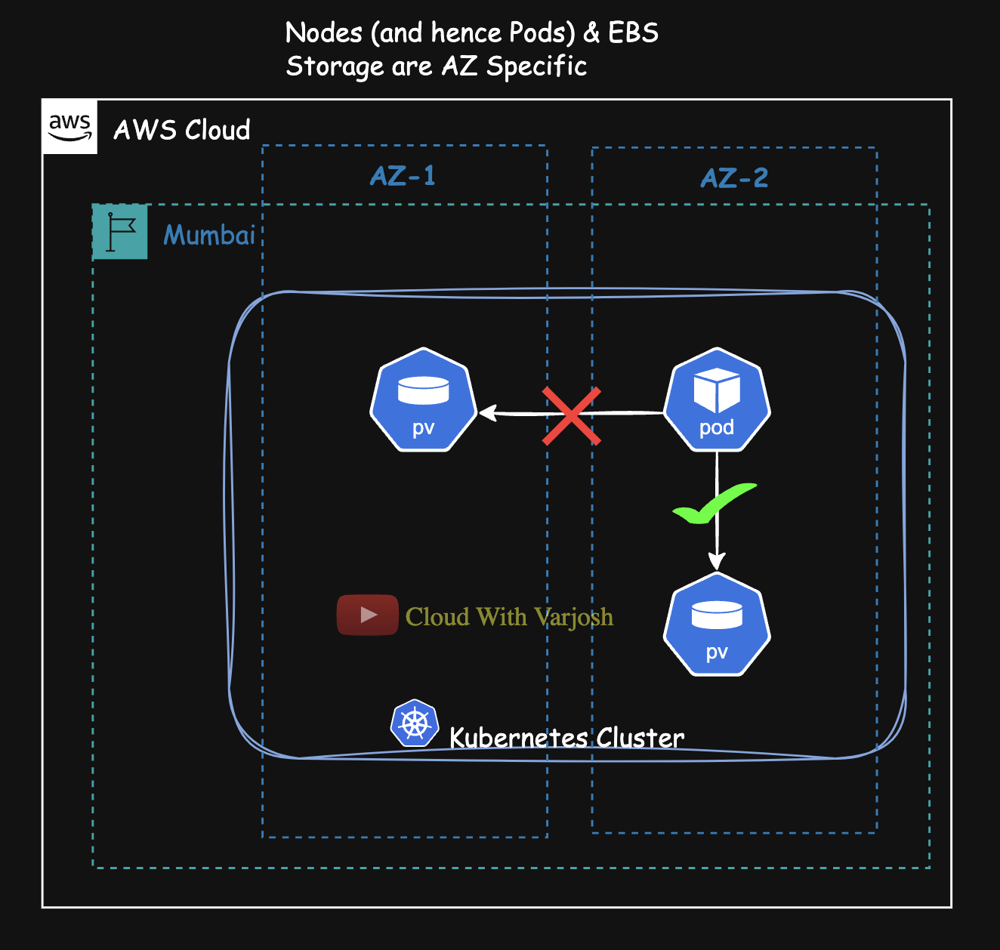

# 39 · StorageClasses and Dynamic Provisioning

> **Level:** ★★ intermediate
>
> **You will learn:** what a StorageClass is and why it replaced hand-made PVs; its fields (`provisioner`, `parameters`, `reclaimPolicy`, `volumeBindingMode`, `allowVolumeExpansion`, `mountOptions`, `allowedTopologies`); the default StorageClass; **WaitForFirstConsumer** and multi-zone clusters; the full dynamic-provisioning flow through the CSI sidecars, the attach/detach controller and the kubelet; volume **expansion**; **snapshots** and clones; VolumeAttributesClasses; and the kind `local-path` demo.
>
> **You need:** topics 09 and 38.

---

## ⚡ Core: the 10-minute version

**The idea.** Making PVs by hand doesn't scale. A **StorageClass** describes a *kind* of storage (which driver, which disk type) so volumes are created **on demand**: a PVC names a class, and the CSI driver provisions a new disk and its PV automatically (**dynamic provisioning**). One class can be the **default**. `volumeBindingMode: WaitForFirstConsumer` waits until a Pod is scheduled, so the disk is created in the right zone.

**Picture it.** A StorageClass is a menu item ("fast SSD, 3 copies"); a PVC is an order; the provisioner is the kitchen that cooks it.

**The one thing to know.**

```yaml
apiVersion: storage.k8s.io/v1
kind: StorageClass
metadata: { name: fast }
provisioner: rancher.io/local-path        # kind's provisioner; ebs.csi.aws.com on EKS, etc.
reclaimPolicy: Delete
volumeBindingMode: WaitForFirstConsumer
allowVolumeExpansion: true
```

**Try it now:**
1. `kubectl get storageclass`: see kind's default.
2. Create a PVC without a Pod: it stays `Pending` (waiting for a consumer).
3. Add a Pod that uses it: a PV appears automatically.
4. Delete the PVC and watch the PV disappear (`Delete` policy).

**You've got it if you can:** explain dynamic provisioning, the default class, and why `WaitForFirstConsumer` matters.

> 📖 **That's the core.** On a first pass, do the mini-lab and move on to the next topic. Everything below is the **full reference**: come back for the details, the edge cases, interview answers and exam-level depth.

---

## What it is

A **StorageClass** describes a **kind of storage** the cluster can create **on demand**: "gp3 SSD in AWS", "fast NVMe local disk", "shared NFS". When a PVC asks for that class, the class's **provisioner** creates the backend volume **and** a matching PV automatically. That's **dynamic provisioning**:

- **Purpose:** define storage backends and their parameters (disk types, reclaim policies, binding modes).
- **Dynamic provisioning:** a PVC referencing a class → a PV is created for it automatically.
- **Flexibility:** many classes can coexist (high-performance SSDs, cheap HDDs, shared file storage…).

---

## Why it exists

**Why StorageClasses:**
1. They **automate PV creation**: no tickets to storage admins, no pre-created PVs (topic 38's steps 1–4 disappear).
2. They offer **multiple storage tiers** cleanly.
3. They **optimise placement**, especially across **Availability Zones** (AZs: separate data centres in a cloud region).

**What moves where:** a StorageClass takes over most of what you used to write into PVs by hand (backend type, parameters, reclaim policy). But **size, access modes and volumeMode still come from the PVC**.

---

## Analogy

A StorageClass is a **menu item** at a restaurant ("gp3 SSD, medium"). You don't walk into the kitchen and build your plate (a static PV); you **order** from the menu (a PVC with `storageClassName`), and the kitchen (the provisioner) cooks it to order. `WaitForFirstConsumer` is the kitchen waiting until **you've sat down** before cooking, so the plate is served at **your** table (zone), not somewhere else.

---

## How it works inside

### The fields

```yaml
apiVersion: storage.k8s.io/v1
kind: StorageClass
metadata:
  name: ebs-sc-gp3
  annotations:
    storageclass.kubernetes.io/is-default-class: "true"   # optional: make it the default
provisioner: ebs.csi.aws.com          # which provisioner (CSI driver name) creates volumes
parameters:                           # passed to the driver as-is (driver-specific!)
  type: gp3
  encrypted: "true"
reclaimPolicy: Delete                 # copied into each PV it creates (Delete default, or Retain)
volumeBindingMode: WaitForFirstConsumer   # or Immediate (default)
allowVolumeExpansion: true            # let PVCs grow later
mountOptions: ["noatime"]             # filesystem mount options
allowedTopologies:                    # optional: restrict zones
- matchLabelExpressions:
  - key: topology.kubernetes.io/zone
    values: [us-east-1a, us-east-1b]
```

**StorageClasses are cluster-scoped and mostly immutable**: to change parameters, create a new class (existing PVs keep what they were created with).

### Example classes

Two AWS EBS classes coexisting in one cluster:

```yaml
apiVersion: storage.k8s.io/v1
kind: StorageClass
metadata:
  name: ebs-sc-gp3                     # general-purpose SSD
provisioner: ebs.csi.aws.com           # AWS EBS CSI driver
parameters:
  type: gp3                            # gp3 = general-purpose SSD with configurable IOPS/throughput
reclaimPolicy: Delete                  # delete the EBS volume when the PVC is deleted
volumeBindingMode: WaitForFirstConsumer   # create the volume only after the Pod is scheduled
---
apiVersion: storage.k8s.io/v1
kind: StorageClass
metadata:
  name: ebs-sc-io1                     # provisioned-IOPS SSD
provisioner: ebs.csi.aws.com
parameters:
  type: io1                            # high-performance SSD
reclaimPolicy: Delete
volumeBindingMode: WaitForFirstConsumer   # ensures the volume lands in the Pod's AZ
```

**Key points:**
1. **`reclaimPolicy: Delete`** cleans up dynamically provisioned volumes when their PVCs are deleted, preventing orphaned (and billed) disks. It's the usual choice for dynamic storage.
2. **`WaitForFirstConsumer`**:



   - In a multi-AZ cluster, **EBS volumes and EC2 instances are AZ-specific**: a volume in `us-east-1a` can only attach to instances in `us-east-1a`.
   - With **`Immediate`** binding, the volume is created as soon as the PVC exists, in some AZ. If the scheduler then puts the Pod in **another** AZ, the volume **can't be mounted** (the Pod stays Pending with a volume node-affinity conflict).
   - **`WaitForFirstConsumer`** creates the volume **after the Pod is scheduled**, in **that node's zone**, so Pod and volume match. It also avoids paying for volumes no Pod ever uses.

### The dynamic provisioning flow, step by step

```
1. You create a PVC (storageClassName: ebs-sc-gp3, 10Gi, RWO).
   (No class given? The DefaultStorageClass admission plugin fills in the default class.)
2. WaitForFirstConsumer → the PVC stays Pending ("waiting for first consumer").
3. You create a Pod using the PVC. The scheduler picks a node, taking the class's topology into account,
   and records it on the PVC (annotation volume.kubernetes.io/selected-node).
4. The CSI driver's controller has an "external-provisioner" sidecar watching PVCs for its driver.
   It calls the driver's CreateVolume (here: the AWS API creates a gp3 EBS volume in the node's AZ).
5. The provisioner creates a PV (name pvc-<PVC-UID>) with csi.volumeHandle = vol-…, nodeAffinity = that zone,
   reclaimPolicy from the class, and binds it to the PVC.
6. The attach/detach controller (in kube-controller-manager) creates a VolumeAttachment; the
   "external-attacher" sidecar calls ControllerPublishVolume (AWS: attach the EBS volume to the EC2 instance).
7. The kubelet on the node calls the CSI node plugin (a DaemonSet):
   NodeStageVolume (format if new, mount once per node) → NodePublishVolume (bind-mount into the Pod's directory).
8. The container starts with the volume mounted at its mountPath.
```

Deletion runs in reverse: Pod gone → unpublish/unstage → detach → (PVC deleted + `Delete` policy) → `DeleteVolume` in the backend → PV removed.

**Dynamically provisioned PV names** look like `pvc-24d1f4ee-d3f8-40eb-8120-21f232087a19` (the PVC's UID), not human names.

### The default StorageClass

- Marked with the annotation `storageclass.kubernetes.io/is-default-class: "true"`.
- PVCs **without** `storageClassName` get it automatically. `storageClassName: ""` explicitly means **no class** (static binding only; topic 38).
- Exactly **one** default is expected. If several are marked, the newest wins (with a warning).
- Managed clusters come with one (EKS: `gp2`/`gp3` depending on setup; GKE: `standard-rwo`; AKS: `managed-csi`); kind: `standard` (`rancher.io/local-path`).

### Volume expansion

If the class has `allowVolumeExpansion: true`, you can **grow** a PVC by editing `spec.resources.requests.storage`:
1. The "external-resizer" sidecar calls the driver's `ControllerExpandVolume` (the cloud disk grows).
2. The kubelet expands the **filesystem** (`NodeExpandVolume`), online for most drivers.
3. The PVC's `status.capacity` updates.

You **can't shrink** volumes. (If a resize request was too big and failed, newer versions let you lower it back to a size that's still ≥ the original.)

### Snapshots and clones

With a CSI driver that supports them and the **snapshot controller + CRDs** installed:

```yaml
apiVersion: snapshot.storage.k8s.io/v1
kind: VolumeSnapshotClass
metadata: { name: ebs-snap }
driver: ebs.csi.aws.com
deletionPolicy: Delete
---
apiVersion: snapshot.storage.k8s.io/v1
kind: VolumeSnapshot
metadata: { name: db-snap-2026-11-17 }
spec:
  volumeSnapshotClassName: ebs-snap
  source: { persistentVolumeClaimName: data-mysql-0 }
---
# restore = a NEW PVC created from the snapshot
apiVersion: v1
kind: PersistentVolumeClaim
metadata: { name: data-restored }
spec:
  storageClassName: ebs-sc-gp3
  dataSource:
    name: db-snap-2026-11-17
    kind: VolumeSnapshot
    apiGroup: snapshot.storage.k8s.io
  accessModes: [ReadWriteOnce]
  resources: { requests: { storage: 20Gi } }
```

**Cloning:** `dataSource: { kind: PersistentVolumeClaim, name: existing-pvc }` creates a new PVC as a copy of an existing one (same namespace and class).

Snapshots are **crash-consistent** (like pulling the plug): databases should be flushed/frozen first, or use database-level backups too (topic 77).

### VolumeAttributesClass (modify performance in place)

`VolumeAttributesClass` (GA in v1.34) lets you change **mutable** parameters such as IOPS and throughput of an existing volume by pointing the PVC at a different attributes class, without recreating it (driver support required; e.g. EBS gp3 IOPS).

---

## Commands / YAML

### Dynamic provisioning in action

**PVC** referencing `ebs-sc-gp3`:

```yaml
apiVersion: v1
kind: PersistentVolumeClaim
metadata:
  name: ebs-csi-pvc
spec:
  accessModes:
    - ReadWriteOnce               # one node read-write
  resources:
    requests:
      storage: 10Gi               # minimum capacity
  storageClassName: ebs-sc-gp3    # the class → dynamic provisioning
```

**PV** created **automatically** by the CSI driver (you don't write this; it's shown so you know what appears):

```yaml
apiVersion: v1
kind: PersistentVolume
metadata:
  name: pvc-7b4c…                 # (Day 27 called it ebs-csi-pv; real dynamic PVs are named pvc-<uid>)
spec:
  capacity:
    storage: 10Gi
  volumeMode: Filesystem          # default: formatted filesystem
  accessModes:
    - ReadWriteOnce
  persistentVolumeReclaimPolicy: Delete   # from the StorageClass
  storageClassName: ebs-sc-gp3            # the class that made it
  csi:
    driver: ebs.csi.aws.com               # the driver that provisioned it
    volumeHandle: vol-0abcd1234efgh5678   # the EBS volume ID
    fsType: ext4
  nodeAffinity:                           # added by the driver: only nodes in this zone can use it
    required:
      nodeSelectorTerms:
      - matchExpressions:
        - { key: topology.kubernetes.io/zone, operator: In, values: [us-east-1a] }
```

**Pod** using the PVC:

```yaml
apiVersion: v1
kind: Pod
metadata:
  name: ebs-csi-pod
spec:
  containers:
    - name: app-container
      image: nginx:1.29
      volumeMounts:
        - mountPath: /usr/share/nginx/html
          name: ebs-storage
  volumes:
    - name: ebs-storage
      persistentVolumeClaim:
        claimName: ebs-csi-pvc
```

**Key takeaways:** StorageClasses simplify storage with dynamic provisioning; `reclaimPolicy: Delete` cleans up; `WaitForFirstConsumer` aligns volumes and Pods in multi-AZ setups; together, classes + PVCs + dynamic provisioning give flexible, efficient storage.

### Demo on kind

**Step 1: restore the default class** (if you deleted it for topic 38's demo):

```bash
kubectl apply -f sc.yaml           # your backup; Day 27/sc.yaml is an example backup (a List with one StorageClass)
```

(If applying an old backup complains about `resourceVersion`/`uid`, delete those fields first, or recreate the cluster.)

**Step 2: a PVC with no class:**

```yaml
apiVersion: v1
kind: PersistentVolumeClaim
metadata:
  name: example-pvc
spec:
  accessModes:
    - ReadWriteOnce
  resources:
    requests:
      storage: 2Gi
```

```bash
kubectl apply -f pvc.yaml
kubectl get pvc
```

```
NAME          STATUS    VOLUME   CAPACITY   ACCESS MODES   STORAGECLASS   AGE
example-pvc   Pending                                      standard       5s
```

- No class given → the **default** (`standard`) was applied.
- **`Pending`**: no PV exists yet. Why?

```bash
kubectl describe sc standard
```

```yaml
metadata:
  annotations:
    storageclass.kubernetes.io/is-default-class: "true"
provisioner: rancher.io/local-path
reclaimPolicy: Delete
volumeBindingMode: WaitForFirstConsumer
```

**Step 3: `WaitForFirstConsumer`** delays creating the PV **until a Pod is scheduled**: cost and placement optimisation (in AWS, a volume in AZ-1 would be useless to a Pod in AZ-2).

**Step 4: a Pod using it:**

```yaml
apiVersion: v1
kind: Pod
metadata:
  name: example-pod
spec:
  containers:
    - name: nginx-container
      image: nginx:1.29
      volumeMounts:
        - mountPath: /usr/share/nginx/html
          name: persistent-storage
  volumes:
    - name: persistent-storage
      persistentVolumeClaim:
        claimName: example-pvc
```

When the Pod is scheduled, the local-path provisioner creates a PV on that node, and the PVC becomes **Bound**.

**Step 5: verify:**

```bash
kubectl get pv
kubectl get pvc
```

```
NAME                                       CAPACITY   ACCESS MODES   RECLAIM POLICY   STATUS   CLAIM                 STORAGECLASS   AGE
pvc-24d1f4ee-d3f8-40eb-8120-21f232087a19   2Gi        RWO            Delete           Bound    default/example-pvc   standard       6m

NAME          STATUS   VOLUME                                     CAPACITY   ACCESS MODES   STORAGECLASS   AGE
example-pvc   Bound    pvc-24d1f4ee-d3f8-40eb-8120-21f232087a19   2Gi        RWO            standard       6m
```

**Key takeaways:**
1. **Default StorageClass**: PVCs without a class use it (`is-default-class` annotation).
2. **`WaitForFirstConsumer`**: no PV until a Pod is scheduled; good placement and cost.
3. **`reclaimPolicy: Delete`**: PVs (and data) are removed with their PVCs.

**What local-path actually does:** it creates a **hostPath-style directory** on the chosen node (`/var/local-path-provisioner/pvc-…`) and a PV with **node affinity** to that node. The "2Gi" is **not enforced** (it's just a directory). Good for labs and CI; not real production storage.

```bash
kubectl get pv -o jsonpath='{.items[0].spec.hostPath.path}{"\n"}{.items[0].spec.nodeAffinity.required.nodeSelectorTerms[0].matchExpressions[0].values[0]}{"\n"}'
```

```
/var/local-path-provisioner/pvc-24d1f4ee-…_default_example-pvc
lab-worker
```

---

## Hands-on lab

1. Run the kind demo (Steps 1–5); find the PV's directory on the node with `docker exec lab-worker ls /var/local-path-provisioner`.
2. Delete the Pod, then the PVC: the PV and the directory disappear (`Delete`).
3. Create a second class `retain-local` (same provisioner, `reclaimPolicy: Retain`) and repeat: the PV stays `Released`.
4. Make a class with `volumeBindingMode: Immediate` and watch the PVC bind **before** any Pod exists.
5. Try to expand a PVC on `standard` (`kubectl patch pvc example-pvc -p '{"spec":{"resources":{"requests":{"storage":"5Gi"}}}}'`): rejected, because `allowVolumeExpansion` is false.
6. (Cloud, optional) On EKS with the EBS CSI driver: create `ebs-sc-gp3`, a PVC and a Pod; watch the EBS volume appear in the AWS console in the Pod's AZ; take a VolumeSnapshot and restore it into a new PVC.
7. Clean up.

---

## Where you'll use it

- **Every cloud cluster**: app teams create PVCs; StorageClasses (gp3, premium SSD, EFS, file shares) decide the rest.
- **Platform design**: offering tiers (fast/standard/shared), encryption, zone restrictions, a sensible default.
- **Operations**: expanding volumes as data grows, snapshots before risky changes, `Retain` for critical data.

---

## When it breaks

| Symptom | Cause | Fix |
|---|---|---|
| PVC `Pending`: `waiting for first consumer to be created before binding` | Normal with WaitForFirstConsumer | Create the Pod |
| PVC `Pending`: `waiting for a volume to be created … by external provisioner "ebs.csi.aws.com"` for a long time | CSI controller not installed/crashing, or missing cloud permissions (IAM) | Check the CSI controller Pods and logs |
| PVC `Pending`: `storageclass.storage.k8s.io "x" not found` | Typo or missing class | Fix the name / create the class |
| Pod `Pending`: `volume node affinity conflict` | Volume in one zone, Pod forced to another (Immediate binding, or node selectors) | Use WaitForFirstConsumer; align node selectors |
| Expansion stuck: `FileSystemResizePending` | Waiting for the kubelet to grow the filesystem (some drivers need a Pod restart) | Restart the Pod if the driver requires it |
| PVCs get an unexpected class | Default StorageClass applied | Specify a class, or `""` for static PVs |
| Lots of orphaned cloud disks | `Retain` classes, or PVs deleted before PVCs | Clean up; prefer `Delete` for disposable data |

---

## Quick recap

- A **StorageClass** = provisioner + parameters + reclaimPolicy + binding mode (+ expansion, mount options, topologies); PVCs choose it with `storageClassName`.
- **Dynamic provisioning**: PVC → (Pod scheduled, for WFFC) → CSI provisioner creates the volume + PV `pvc-<uid>` → attach → kubelet stage/publish → mounted.
- **`WaitForFirstConsumer`** keeps volumes in the Pod's zone; **`Delete`** cleans up; one **default** class serves class-less PVCs.
- Expansion (`allowVolumeExpansion`), snapshots/clones (`VolumeSnapshot`, `dataSource`), VolumeAttributesClass for performance changes.

### Interview questions

1. **Q: What does `volumeBindingMode: WaitForFirstConsumer` solve?**
   A: Zonal storage: it delays volume creation until the Pod is scheduled, so the volume is created in the same zone as the node; Immediate binding can create it in a zone the Pod can't use.
2. **Q: Walk through dynamic provisioning with a CSI driver.**
   A: PVC created → (after scheduling, for WFFC) the external-provisioner calls CreateVolume → a PV is created and bound → the attach/detach controller and external-attacher attach it to the node → the kubelet calls the node plugin to stage (format/mount) and publish it into the Pod.
3. **Q: How do you grow a PVC?**
   A: The StorageClass must allow expansion; edit the PVC's requested size; the CSI resizer grows the backend volume and the kubelet grows the filesystem. Volumes can't be shrunk.

---

## Appendix: notes on the original course material

This topic was rebuilt from the original CKA course notes. This appendix keeps the audit trail out of your way while you learn.

### Sources

Day 27 (StorageClasses and dynamic provisioning: what, why, example gp3/io1 classes, key points on reclaim policy and WaitForFirstConsumer, dynamic provisioning in action with PVC/PV/Pod, key takeaways; StorageClass demo steps 1–5 and takeaways; conclusion), file `Day 27/sc.yaml`. The same sections reappear verbatim in `Storage-In-Kubernetes-Masterclass/README.md` (a merge of Days 24–28).

### Official references

Official docs for this topic (from the reference list of `Storage-In-Kubernetes-Masterclass`):

- [StorageClasses](https://kubernetes.io/docs/concepts/storage/storage-classes/)
- [Volume binding mode](https://kubernetes.io/docs/concepts/storage/storage-classes/#volume-binding-mode)
