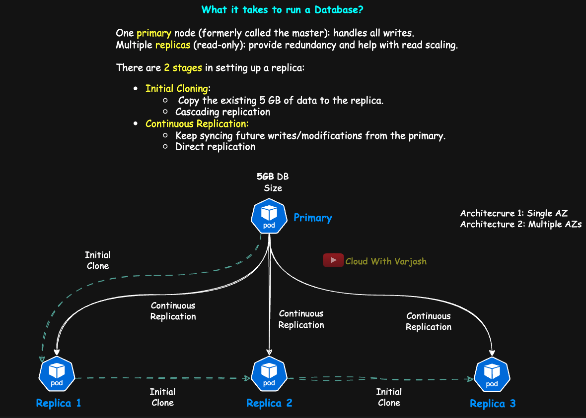
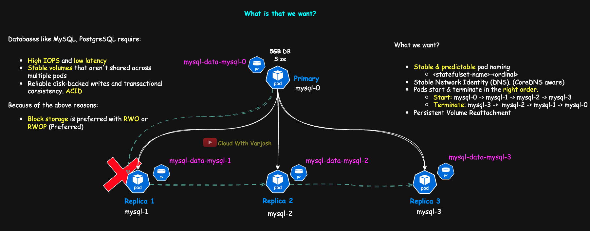
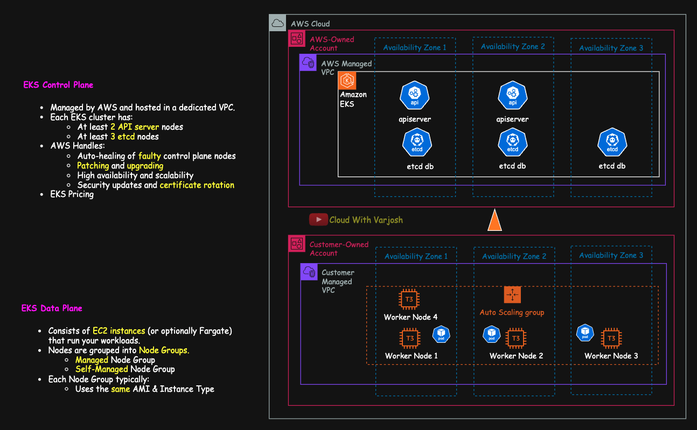
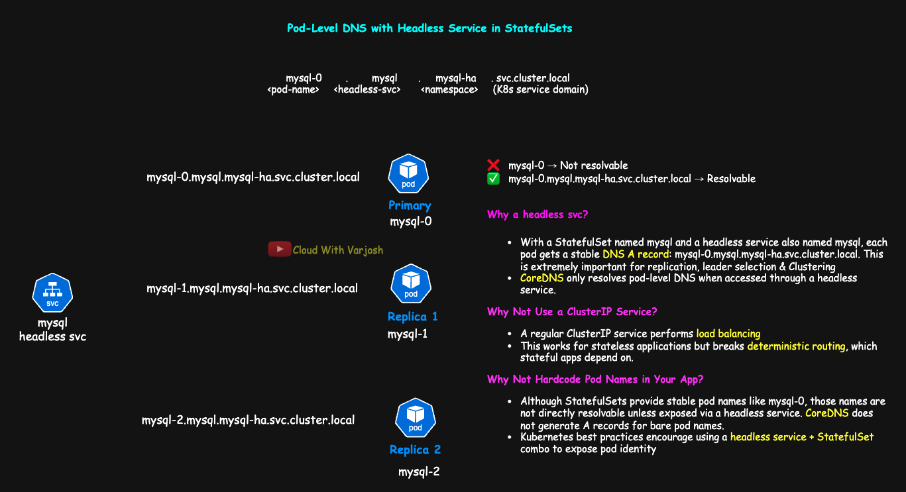

# 40 · StatefulSets: Stable Identity, Stable Storage, Ordered Operations

> **Level:** ★★★ advanced
>
> **You will learn:** what running a replicated database really needs (cloning, replication, stable identities); why Deployments can't provide it; the four StatefulSet guarantees (stable names, stable DNS via a headless Service, ordered start/stop, a volume per Pod via `volumeClaimTemplates`); pod management policies, update strategies (partitioned rollouts, `OnDelete`) and PVC retention policies; what happens when a node dies; storage choices for databases (block storage, RWOP); a production-style MySQL StatefulSet on a 3-AZ EKS cluster, plus a chaos test; and the DevOps vs DBA split.
>
> **You need:** topics 05 (stateless vs stateful), 31 (headless Services), 33 (DNS), 38–39 (PV/PVC/StorageClass). One preview: **pod anti-affinity** is a scheduling rule "don't put me next to Pods with label X" in a given failure domain (node or zone); topic 46 covers it fully.

---

## ⚡ Core: the 10-minute version

**The idea.** Databases and clustered systems need each replica to keep a **stable identity** and **its own data**. A **StatefulSet** gives you:
- stable names (`db-0`, `db-1`…);
- stable DNS names through a **headless** Service;
- ordered start and stop;
- **one persistent volume per Pod** that follows it across restarts (`volumeClaimTemplates`).

A Deployment can't do any of these. Real database operations (replication, failover, backups) are added by **operators** (topic 67).

**Picture it.** A Deployment's Pods are interchangeable taxis; a StatefulSet's Pods are named ships, each with its own logbook.

**The one thing to know.**

```yaml
apiVersion: apps/v1
kind: StatefulSet
metadata: { name: db }
spec:
  serviceName: db                     # a headless Service named db must exist
  replicas: 3
  selector: { matchLabels: { app: db } }
  template:
    metadata: { labels: { app: db } }
    spec: { containers: [ { name: c, image: busybox:1.37, command: ["sh","-c","hostname > /data/id; sleep 3600"], volumeMounts: [ { name: data, mountPath: /data } ] } ] }
  volumeClaimTemplates:
  - metadata: { name: data }
    spec: { accessModes: [ReadWriteOnce], resources: { requests: { storage: 1Gi } } }
```

**Try it now:**
1. Create a headless Service (`clusterIP: None`, selector `app: db`) and the StatefulSet.
2. Watch the Pods start in order with `kubectl get pods -w`.
3. Delete `db-1`: it comes back with the same name and the same PVC.

**You've got it if you can:** list the four StatefulSet guarantees, and say why databases need them.

> 📖 **That's the core.** On a first pass, do the mini-lab and move on to the next topic. Everything below is the **full reference**: come back for the details, the edge cases, interview answers and exam-level depth.

---

## What it is

A **StatefulSet** is a workload controller for **stateful applications**, where **persistent data, stable identity and ordered behaviour** matter. Unlike Deployments, which treat Pods as interchangeable and disposable, a StatefulSet:
- gives each Pod a **sticky identity**: `mysql-0`, `mysql-1`, `mysql-2`;
- gives each Pod a **stable DNS name** (with a **headless Service**);
- gives each Pod **its own PVC**, which follows it across restarts and rescheduling;
- **creates, scales and deletes Pods in order**;
- supports **peer-aware** systems: replication, quorum, sharding.

**Typical users:** databases (**MySQL, PostgreSQL, MongoDB**), messaging (**Kafka, RabbitMQ**), distributed storage and search (**Cassandra, Elasticsearch, ZooKeeper**), replicated caches (**Redis Cluster**).

**Its partners:** a **headless Service** (stable per-Pod DNS) and **`volumeClaimTemplates`** (one PVC per Pod).

---

## Why it exists

### What running a production database takes



A production database cluster (MySQL, PostgreSQL, MongoDB) usually has:
- **one primary** (formerly "master"): takes **all writes**;
- **several read-only replicas**: redundancy and read scaling.

Say the primary already holds **5 GB** of data. Adding a replica has **two stages**:

**1. Initial clone**: copy the existing 5 GB to the new replica. To spare the primary from several big transfers:
- Replica-1 clones **from the primary**;
- Replica-2 clones **from Replica-1**;
- Replica-3 clones **from Replica-2**, and so on.

This **cascading (chained) cloning** reduces load on the primary and allows replicas to be provisioned in parallel.

**2. Continuous replication**: after cloning, each replica follows a **change stream**: the **WAL** (write-ahead log) in PostgreSQL, **binlogs** in MySQL, the **oplog** in MongoDB.
- **Direct (star) replication**: every replica follows the **primary**. Most common and **preferred**: low lag, simple config.
- **Chained (cascading) replication**: Replica-1 ← primary, Replica-2 ← Replica-1… Lower load on the primary, but **lag adds up at each hop** and there are **more failure points** (if Replica-1 dies, Replica-2 breaks).
- Most systems use **chained cloning** but **direct replication** for ongoing sync.

### What happens if a replica crashes



Replica-1 crashes and Kubernetes reschedules it. If it comes back with a **new name or DNS name**, the **primary won't recognise it** and replication breaks, because databases configure replication with **fixed identifiers**:
- hostnames (`mysql-1`),
- server IDs (MySQL),
- replication slots (PostgreSQL).

These are stored on the primary. A replica returning as `mysql-4` looks like a **new, unauthorised** node.

**So in Kubernetes you need:**
- a **stable identity** per replica Pod (same name, same DNS);
- each Pod **reattaching its own volume** (its local database state);
- Pods starting in the **right order** (primary first, then replicas).

**Deployments give none of these**: random Pod names, no creation order.

### The four Deployment limitations

1. **No predictable Pod names**: Deployments create names like `mysql-5f69b67f96-dx2ml`. Replication targets need static hostnames; cluster membership needs consistent identity; connection strings need specific roles (`mysql-0` = primary). Without stable names, replicas can't find the primary and bootstrapping is unreliable.
2. **No stable DNS per Pod**: Kubernetes doesn't create DNS records for Pod **names**; CoreDNS creates records for Services (ClusterIP or headless). So there's no reliable way to reach a specific Pod across restarts, a rescheduled Pod gets a new IP and name, and peer discovery (Kafka, MySQL replication, Elasticsearch) fails.
3. **No ordered start/stop**: Deployments create and delete Pods **in parallel**. Replicas may start before the primary is ready (sync failures); shutdown order can cause **data loss or corruption**; some systems require strict bootstrap order (node-0 before node-1).
4. **No per-Pod volumes**: in a Deployment, all replicas share **one** PVC (if the access mode even allows it) or you wire PVCs by hand. Stateful systems need **one volume per Pod**, **guaranteed reattachment** to the right identity, and **isolation** between replicas. Otherwise a reschedule can cause data mismatches or volume conflicts.

**Identity, DNS, ordering and volume mapping** are exactly what StatefulSets were built for.

---

## Analogy

A **hospital ward with numbered beds**. Patients (Pods) are assigned **Bed 0, Bed 1, Bed 2**, not "whichever bed is free". Each bed has its own **locker** (PVC) that stays with the bed number. If the patient in Bed 1 goes for surgery and comes back, they return to **Bed 1, with the same locker**. Admissions happen **in order** (Bed 0 first), and discharges happen **in reverse**. The nurses' station list (headless Service) has a **direct line to each bed** by number.

---

## How it works inside

### The four guarantees

**1. Stable, predictable names**: `<statefulset-name>-<ordinal>`. With `name: mysql` and 3 replicas: `mysql-0` (often the primary), `mysql-1`, `mysql-2`. Essential for replication, peer discovery and static configs.

**2. Stable network identity (DNS)**: pair the StatefulSet with a **headless Service** (`clusterIP: None`) and set **`spec.serviceName`** to it. Each Pod then gets a stable DNS A record:

```
<pod-name>.<headless-service>.<namespace>.svc.cluster.local
mysql-0.mysql.mysql-ha.svc.cluster.local
```

It stays the same across restarts (the **IP** behind it can change; the **name** doesn't). Under the hood the StatefulSet controller sets each Pod's `hostname: mysql-0` and `subdomain: mysql`, and CoreDNS creates the record from the headless Service's endpoints (topic 33).

| Feature | Provided by | Purpose |
|---|---|---|
| `mysql-0`, `mysql-1`… | **StatefulSet** | Identity and ordinal ordering |
| `mysql-0.mysql.<ns>.svc.cluster.local` | **Headless Service** | Stable DNS for discovery across the cluster |

Both are needed for reliable communication.

**3. Ordered deployment and termination**: with the default **`podManagementPolicy: OrderedReady`**:
- **Creation in order**: `mysql-1` is created only after `mysql-0` is **Running and Ready**;
- **Deletion and scale-down in reverse**: the highest ordinal first (`mysql-2`, then `mysql-1`…);
- so the **primary initialises before replicas**, and shutdowns are graceful.

`Parallel` starts and stops all Pods at once: faster, for systems that don't need ordering (it affects scaling only; updates still go one at a time).

**4. A volume per Pod that reattaches**: **`volumeClaimTemplates`** is a PVC blueprint. The controller creates **one PVC per Pod**, named **`<template-name>-<pod-name>`**: `mysql-data-mysql-0`, `mysql-data-mysql-1`… When a Pod is recreated (even on another node, within the volume's zone), it **gets the same PVC back**. PVCs are **kept** when Pods or the StatefulSet are deleted (by default; see retention policy below).

| # | Characteristic | Description |
|---|---|---|
| 1 | **Stable names** | `<statefulset>-<ordinal>`, e.g. `mysql-0` |
| 2 | **Stable DNS** | `mysql-0.mysql.mysql-ha.svc.cluster.local` via a headless Service |
| 3 | **Ordered start/stop** | Start 0→N, stop N→0 |
| 4 | **Volume reattachment** | Each Pod gets its PVC back after rescheduling (same zone) |
| 5 | **volumeClaimTemplates** | One PVC per Pod, named `mysql-data-mysql-2`, managed for you |

| Feature | Deployment | StatefulSet |
|---|---|---|
| Stable Pod names | ❌ | ✅ `-0`, `-1`… |
| Ordered start/stop | ❌ | ✅ |
| Storage per Pod | Limited (manual) | ✅ volumeClaimTemplates |
| Stable DNS identity | ❌ | ✅ |
| Suitable for databases | ❌ Not recommended | ✅ Designed for it |

### Updates and retention

```yaml
spec:
  updateStrategy:
    type: RollingUpdate           # default: replace Pods in REVERSE order, one at a time, waiting for Ready
    rollingUpdate:
      partition: 2                # only Pods with ordinal >= 2 are updated → canary on mysql-2
      # maxUnavailable: 1         # (beta ⚠️ verify the stage for your version) update several at once
  # type: OnDelete                # the controller updates a Pod only when YOU delete it (manual, careful DB upgrades)
  persistentVolumeClaimRetentionPolicy:   # GA since v1.32
    whenDeleted: Retain           # StatefulSet deleted → keep PVCs (default) or Delete them
    whenScaled: Retain            # scaled down → keep the removed Pods' PVCs (default) or Delete them
  ordinals:
    start: 0                      # first ordinal (useful when migrating StatefulSets between clusters)
```

- **Partitioned rollouts**: set `partition: 2` to update only `mysql-2`, check it, then lower the partition to roll the rest. A built-in canary.
- Scaling **down** does **not** delete PVCs by default; scaling back **up** reuses them, so the data is still there.
- Changing `volumeClaimTemplates` of an existing StatefulSet isn't allowed (it's immutable). To change sizes, edit each PVC (if the class allows expansion), or recreate the StatefulSet with `--cascade=orphan` (keeping Pods and PVCs) and the new template.

### When a node dies

StatefulSets guarantee **at most one** Pod per identity. If a node becomes **unreachable**, Kubernetes can't know whether `mysql-1` is really dead or just cut off, so it **won't** start a second `mysql-1` elsewhere (that could corrupt data). The old Pod stays `Terminating`/`Unknown` until:
- the **Node object is deleted** (cloud: the cloud-controller-manager deletes it when the VM is terminated, which is what happens in Demo 2), or
- an admin **force-deletes** the Pod after confirming the node is really down (topic 19), or
- the admin applies the **`node.kubernetes.io/out-of-service`** taint to the dead node (**non-graceful node shutdown**, GA): Pods are deleted and volumes detached, so they can move.

Also, an RWO volume can only attach to a node in **its own zone**: the replacement Pod can only go to another node in the **same AZ**.

### Storage for databases

**Why block storage:** databases need
- **high IOPS and low latency** for intensive, transactional reads and writes;
- **reliable, disk-backed writes and transactional consistency** (ACID durability and atomicity);
- **a volume per Pod**, never shared, to avoid filesystem conflicts.

**ACID** = the guarantees of a reliable transaction:
- **Atomicity**: all or nothing;
- **Consistency**: moves the database from one valid state to another (constraints, triggers);
- **Isolation**: concurrent transactions don't interfere;
- **Durability**: once committed, it survives crashes.

Critical for banking, inventory and orders.

**ACID vs CAP:** ACID is about **one transaction in a database** (mostly relational). **CAP** is about what's possible in a **distributed system**, which must trade off between **Consistency** (all nodes see the same data at the same time), **Availability** (every request gets a non-error response) and **Partition tolerance** (keeps working when the network splits the cluster). Distributed and NoSQL databases often relax strict ACID for availability or partition tolerance. That's useful when choosing SQL vs NoSQL.

So databases use **block storage** (e.g. Amazon EBS): accessed by **one node at a time**, with better performance for heavy read/write. **File storage** (NFS, SMB) allows many clients but costs IOPS and latency, so it's less suitable for databases.

**Real-world example:** Redis, MySQL or PostgreSQL on **EKS** use **EBS volumes**: dynamically provisioned through StorageClasses, attached to one node at a time, ideal for transactional workloads. EBS supports **RWO** and **RWOP**. **RWOP** means **only one Pod** can mount the volume read-write: intentional, to prevent corruption. That fits StatefulSets perfectly: every Pod has its own disk; no two Pods share one.

| Access mode | Meaning | Use case |
|---|---|---|
| RWO / RWOP | One node / one Pod | Databases, Kafka, Redis |
| ROX | Read-only by many | Shared config, read-only data |
| RWX | Read-write by many | Web servers, shared files |

**Amazon EBS doesn't support RWX**, so database replicas can't share one volume (and shouldn't). For RWX (shared logs, config) use **Amazon EFS**, NFS or **CephFS**, but never for transactional databases.

**Storage behaviour in StatefulSets:** each Pod gets its **own PVC** from the template, and the **Pod ↔ PVC binding is sticky**: even if the Pod moves nodes, it reuses the same volume.

**Why the storage backend must be network-attached:** Pods can be rescheduled to **any node**, so the volume must be able to **re-attach elsewhere**. **Never** use `hostPath`, `emptyDir` or other node-local storage in production for stateful apps: if the node goes, the data goes. Use **Amazon EBS**, **Google PD**, **Azure Disks**, CSI drivers for **SAN/iSCSI**, or software-defined storage (**Ceph, Portworx, Longhorn**). (Local NVMe PVs are an exception for databases that **replicate data themselves** and can rebuild a lost replica, e.g. Cassandra, CockroachDB.)

### Recap: why StatefulSets for databases

| Requirement | StatefulSet's answer |
|---|---|
| High IOPS, reliable storage | Block storage (EBS/PD) via PVCs |
| Consistent identity | Ordinal Pod names |
| Primary before replica | Ordered creation |
| Storage per replica | volumeClaimTemplates |
| Same volume after rescheduling | Retained PVC binding |
| Stable DNS for replication config | `<pod>.<service>.<ns>.svc` |
| Replication survives crashes | Identity never changes |

---

## Commands / YAML

### Demo 1: MySQL StatefulSet on a 3-AZ EKS cluster

**Cluster:** EKS in `us-east-2` (Ohio) across **three AZs** (`us-east-2a/b/c`), **four** `t3.small` worker nodes (a cheap instance type that fits AWS's free-credit tier; unsupported types are greyed out in the console).



**What this demo proves:**

| Capability | Ensures |
|---|---|
| volumeClaimTemplates | Each Pod gets its own persistent volume |
| Pod anti-affinity | Pods spread across AZs |
| WaitForFirstConsumer | Volumes created in each Pod's AZ |
| Headless Service | Predictable DNS like `mysql-0.mysql.mysql-ha.svc.cluster.local` |
| StatefulSet identity | Pods keep volume, name and identity after restarts |

**Prerequisites:**
1. Storage concepts: WaitForFirstConsumer, RWO/RWOP, StorageClasses and PVCs (topics 38–39).
2. **AWS CLI** and **`eksctl`** installed ([AWS CLI guide](https://docs.aws.amazon.com/cli/latest/userguide/getting-started-install.html), [eksctl guide](https://eksctl.io/installation/)).
3. **Create the cluster** (`Day 44/eks-config.yaml`):

```yaml
apiVersion: eksctl.io/v1alpha5
kind: ClusterConfig
metadata:
  name: cwvj-eks-cluster
  region: us-east-2
  tags: { owner: <your-name>, bu: <your-team>, environment: prod, project: statefulsets-training }
availabilityZones: [us-east-2a, us-east-2b, us-east-2c]
iam:
  withOIDC: true                 # IAM OIDC provider (needed for IRSA, topic 70)
managedNodeGroups:
  - name: cwvj-eks-priv-ng
    instanceType: t3.small
    minSize: 4
    maxSize: 5
    privateNetworking: true      # nodes in private subnets
    volumeSize: 20
    iam:
      withAddonPolicies:
        autoScaler: true
        externalDNS: false
        certManager: false
        ebs: true                # node role may manage EBS volumes (for the CSI driver)
        fsx: false
        efs: false
        albIngress: true
        xRay: false
        cloudWatch: false
    labels:
      lifecycle: ec2-autoscaler
```

```bash
eksctl create cluster -f eks-config.yaml
kubectl get nodes --show-labels | grep topology.kubernetes.io/zone
```

3 AZs + 4 nodes = one AZ gets two nodes (Demo 2 needs that).

4. **Install the Amazon EBS CSI driver.** Without it, EBS volumes can't be provisioned or attached, StatefulSet Pods stay `Pending`, and expansion and lifecycle features don't work (topic 09):

```bash
kubectl apply -k "github.com/kubernetes-sigs/aws-ebs-csi-driver/deploy/kubernetes/overlays/stable/?ref=release-1.44"
kubectl get daemonset ebs-csi-node -n kube-system
kubectl get deploy ebs-csi-controller -n kube-system
```

- **`ebs-csi-node`**: DaemonSet on every node; **attaches and mounts** volumes for local Pods.
- **`ebs-csi-controller`**: Deployment; **provisions** volumes and manages their lifecycle through the AWS API.
- The `-k` flag applies a **Kustomize overlay** (topic 64).

> ℹ️ **Current practice:** on EKS, install the driver as the managed **EKS add-on** (`aws eks create-addon --addon-name aws-ebs-csi-driver …`) and give its controller an IAM role through **EKS Pod Identity** or IRSA (topics 54–55), instead of granting EBS permissions to every node's role. Use the driver version the add-on recommends rather than a pinned old branch.

**Step 1: the StorageClass** (`Day 44/01-sc.yaml`)

```yaml
apiVersion: storage.k8s.io/v1
kind: StorageClass
metadata:
  name: ebs-sc-gp3
  annotations:
    storageclass.kubernetes.io/is-default-class: "true"   # the default class
provisioner: ebs.csi.aws.com                                # EBS CSI driver
parameters:
  type: gp3                                                 # gp3 EBS volumes
volumeBindingMode: WaitForFirstConsumer                     # create volumes in the Pod's AZ
reclaimPolicy: Delete                                       # delete the EBS volume with the PVC
allowVolumeExpansion: true                                  # allow growing later
```

```bash
kubectl apply -f 01-sc.yaml
```

**Step 2: a namespace**

```bash
kubectl create namespace mysql-ha
kubectl config set-context --current --namespace=mysql-ha      # default namespace for later commands
```

```
Context "your-user@your-cluster-name" modified.
```

**Why a separate namespace:**
- isolates the database tier from the rest of the app;
- NetworkPolicies/RBAC per namespace can **block frontends from talking to the database directly** (topics 57, 61);
- one database server often hosts **several databases** for different apps/environments, and namespaces segment access cleanly.

Switch back later with `kubectl config set-context --current --namespace=default` (topic 12).

**Step 3: the headless Service** (`Day 44/02-mysql-hs.yaml`)

```yaml
apiVersion: v1
kind: Service
metadata:
  name: mysql
  namespace: mysql-ha
spec:
  clusterIP: None        # headless: no virtual IP, DNS returns Pod IPs
  selector:
    app: mysql
  ports:
    - port: 3306         # MySQL
```

```bash
kubectl apply -f 02-mysql-hs.yaml
```



**Why headless:**
- No load balancing: it **exposes per-Pod DNS records**, so clients reach **specific** Pods.
- StatefulSet `mysql` + headless Service `mysql` → `mysql-0.mysql.mysql-ha.svc.cluster.local`.
- Lets replication, leader election and clustering target specific peers (MySQL, Kafka, Elasticsearch, ZooKeeper).
- Bare Pod names (`mysql-0`) don't resolve on their own.

**Why not a ClusterIP Service:** it **load-balances** to a virtual IP across all Pods. Fine for stateless apps, but it **breaks deterministic routing**: a replica that must sync from the primary can't accept a random Pod. And it has no per-Pod records. (Apps often use **both**: a headless Service for peers, plus a normal Service, e.g. `mysql-read`, that load-balances read-only queries across replicas.)

**Why not hard-code Pod names:** bare names don't resolve without the headless Service; hard-coding couples the app to cluster topology and breaks on failures, updates and recreations; Kubernetes prefers **dynamic discovery**, and a headless Service + StatefulSet gives discoverable, addressable, resilient peers without assumptions about IPs or nodes.

**Step 4: the StatefulSet** (`Day 44/03-mysql-sts.yaml`)

```yaml
apiVersion: apps/v1
kind: StatefulSet
metadata:
  name: mysql
  namespace: mysql-ha
spec:
  serviceName: mysql                  # MUST name the headless Service (gives Pods their DNS)
  replicas: 3
  podManagementPolicy: OrderedReady   # (default) one after another; Parallel = all at once (not for DBs needing order)
  selector:
    matchLabels:
      app: mysql
  template:
    metadata:
      labels:
        app: mysql
    spec:
      terminationGracePeriodSeconds: 10
      # Time to flush buffers, close connections and run shutdown hooks before SIGKILL (default 30).
      # Too low for a write-heavy DB risks unclean shutdowns and corruption (10 s is a demo value).
      affinity:
        podAntiAffinity:                                   # don't co-locate similar Pods…
          requiredDuringSchedulingIgnoredDuringExecution:  # …as a HARD rule
            - labelSelector:
                matchLabels:
                  app: mysql                               # "similar" = other Pods of this StatefulSet
              topologyKey: topology.kubernetes.io/zone     # failure domain = availability zone
      containers:
        - name: mysql
          image: mysql:8.0
          ports:
            - containerPort: 3306
          env:
            - name: MYSQL_ROOT_PASSWORD
              value: "password123"
          volumeMounts:
            - name: mysql-data
              mountPath: /var/lib/mysql    # MySQL's data directory
  volumeClaimTemplates:                    # one PVC per Pod: <template>-<pod>, e.g. mysql-data-mysql-0
    - metadata:
        name: mysql-data
      spec:
        accessModes: ["ReadWriteOncePod"]  # only ONE Pod may mount it (no concurrent access)
        storageClassName: ebs-sc-gp3       # dynamic gp3 EBS volumes
        resources:
          requests:
            storage: 5Gi                   # 5 GiB each, independently provisioned
```

> ⚠️ **Fix to the original** ([C1](#c1)):
> - **`mysql:8.0`** reached end of life in April 2026. Use the current LTS line, e.g. `mysql:8.4`.
> - **`MYSQL_ROOT_PASSWORD` as a plain `value`** puts the password in Git and in the object. Use a Secret (`valueFrom.secretKeyRef`, topic 35).
> - This manifest starts **three independent MySQL servers**. It does **not** configure replication. That's the DBA/operator part (below).
> - Add **readiness/liveness probes** (e.g. `mysqladmin ping`) and resource requests in real use (topics 22, 41).

```bash
kubectl apply -f 03-mysql-sts.yaml
```

**Step 5: switch to the namespace** (if you didn't already): `kubectl config set-context --current --namespace=mysql-ha`.

**Step 6: observe**

```bash
kubectl get pods -o wide -w
kubectl get pvc
kubectl get pv
```

```
NAME      READY   STATUS              RESTARTS   AGE   IP            NODE
mysql-0   0/1     ContainerCreating   0          10s   <none>        ip-10-0-1-23.us-east-2.compute.internal
mysql-0   1/1     Running             0          45s   10.0.1.57     ip-10-0-1-23…
mysql-1   0/1     Pending             0          0s    <none>        <none>
mysql-1   0/1     ContainerCreating   0          2s    <none>        ip-10-0-2-41…
…
NAME                 STATUS   VOLUME                                     CAPACITY   ACCESS MODES   STORAGECLASS
mysql-data-mysql-0   Bound    pvc-0c1f…                                  5Gi        RWOP           ebs-sc-gp3
mysql-data-mysql-1   Bound    pvc-7ab2…                                  5Gi        RWOP           ebs-sc-gp3
mysql-data-mysql-2   Bound    pvc-91de…                                  5Gi        RWOP           ebs-sc-gp3
```

**Key observations:**
- Pods start **in sequence**: `mysql-0` → `mysql-1` → `mysql-2`. The next Pod isn't **created** until the previous one is **Running and Ready**.
- **Three EBS volumes** are created, one per Pod (EC2 → Volumes in the AWS console).
- Each PVC lands in a **specific AZ**, because of **WaitForFirstConsumer** (volume created after scheduling) and the **zone anti-affinity** (Pods in different zones).
- With a **hard** zone anti-affinity and only 3 AZs, a **4th** replica stays **Pending**.

**Soft anti-affinity** (if you want extra replicas to schedule anyway):

```yaml
affinity:
  podAntiAffinity:
    preferredDuringSchedulingIgnoredDuringExecution:
      - weight: 100                     # 1–100; higher = stronger preference
        podAffinityTerm:
          labelSelector:
            matchLabels:
              app: mysql
          topologyKey: topology.kubernetes.io/zone
```

The scheduler **tries** to keep `mysql` Pods in different AZs, but with 4 Pods and 3 AZs it still places the 4th in the best available spot: flexibility for low-cost or limited-AZ setups while the first Pods stay highly available.

**Single-AZ clusters:** use `topologyKey: kubernetes.io/hostname` to spread across **nodes** instead of zones (protection from node failures).

**Step 7: simulate failure**

```bash
kubectl delete pod mysql-1
kubectl get pods -w
```

- A new `mysql-1` is created with **the same name**, and **the same PVC** (`mysql-data-mysql-1`) is reattached: data and identity are preserved.

> ✅ **Correct today** ([C2](#c2)): the scheduler has no "same node first" preference. What constrains placement is the **PV's node affinity**: an EBS volume can only attach in **its own AZ**, so the new `mysql-1` can only go to a node **in that AZ** (it often lands on the same node simply because it's the only fit or already has the image). EBS volumes can't move across AZs, which is why `WaitForFirstConsumer` + zonal provisioning makes placement predictable.

**PVC lifecycle:**
1. **PVCs are kept** when the StatefulSet is deleted (by design: identity and data survive controller recreation). Configurable now with `persistentVolumeClaimRetentionPolicy`.
2. **Recreate** the StatefulSet (same name, same template) and the Pods **reattach** to the existing PVCs: `mysql-0` → `mysql-data-mysql-0`, etc. No data loss, no reload.
3. Great for recovery: delete a stuck Pod and it comes back with its volume. **No re-seeding** needed.

**Cleaning up completely:** delete the **StatefulSet** first, then delete its **PVCs** (manually or by script), so you don't leave orphaned PVCs or dangling EBS disks (topic 38).

```bash
kubectl delete sts mysql
kubectl delete pvc mysql-data-mysql-0 mysql-data-mysql-1 mysql-data-mysql-2
# (PVCs get the labels you put in volumeClaimTemplates[].metadata.labels; add app: mysql there
#  and you can delete them all with: kubectl delete pvc -l app=mysql)
```

**Key pointers:**

| Component | Role |
|---|---|
| StatefulSet | Stable identity and start order |
| Headless Service | Per-Pod DNS |
| volumeClaimTemplates | Per-Pod PVCs |
| WaitForFirstConsumer | Volume in the Pod's AZ |
| Pod anti-affinity | Pods spread across AZs |
| gp3 StorageClass + EBS | High-IOPS storage for MySQL |

### Demo 2: chaos test, kill the node

Goal: prove that when the **node** hosting a StatefulSet Pod is destroyed, the Pod is recreated on **another node in the same AZ**, reattaches **the same PVC**, and its **data survives**.

**Step 1: find the AZ with two nodes:**

```bash
kubectl get nodes --show-labels | grep topology.kubernetes.io/zone
```

(or the **Placement** tab in the EC2 console). We need a second node in that AZ to move to.

**Step 2: find the Pod in that AZ:** `kubectl get pods -o wide` (say `mysql-1`).

**Step 3: write data to its volume:**

```bash
kubectl exec -it mysql-1 -- bash
cd /var/lib/mysql
echo "This is CloudWithVarJosh" >> myfile
cat myfile
exit
```

**Step 4: terminate that node's EC2 instance** in the AWS console. Kubernetes detects the failure and reschedules the Pod, **within the same AZ** because of EBS zoning. Watch with `kubectl get pods -w`. The new Pod may sit in `ContainerCreating` for a while as the EBS volume is **detached** from the dead instance and **attached** to the new one.

(It works automatically here because terminating the instance makes the cloud controller **delete the Node object**, which frees the old Pod's identity; see "When a node dies".)

**Step 5: confirm reattachment and data:**

```bash
kubectl exec -it mysql-1 -- cat /var/lib/mysql/myfile
kubectl get pvc mysql-data-mysql-1
```

```
This is CloudWithVarJosh
NAME                 STATUS   VOLUME      CAPACITY   ACCESS MODES   STORAGECLASS   AGE
mysql-data-mysql-1   Bound    pvc-7ab2…   5Gi        RWOP           ebs-sc-gp3     42m
```

The PVC's **AGE** and **VOLUME** are unchanged: the **same EBS volume** was reused.

**Outcome:** PVC identity is **sticky** across restarts; **data survives node loss**; **StatefulSet + EBS + WaitForFirstConsumer** together give fault tolerance.

### The same on kind (no cloud needed)

```bash
kubectl create ns mysql-ha
# use Day 44's Service and StatefulSet, but:
#   storageClassName: standard, accessModes: ["ReadWriteOnce"], topologyKey: kubernetes.io/hostname
kubectl -n mysql-ha get pods -w
kubectl -n mysql-ha run t --rm -it --image=busybox:1.37 --restart=Never -- nslookup mysql-0.mysql
```

(local-path volumes are tied to a node, so a deleted Pod must come back on the **same** node: a nice demonstration of node-local storage's limits.)

### Who does what: DevOps vs DBA

Responsibilities are usually **shared**, and vary with DevOps maturity, criticality and org boundaries.

**DevOps engineer** (Kubernetes and infrastructure):
- provision volumes via **PVCs**;
- configure **StatefulSets** (identity, volume binding, ordering);
- set up **headless Services**;
- define **liveness/readiness probes**;
- manage **Secrets, ConfigMaps, ServiceAccounts, RBAC**;
- schedule **backups** (CronJobs or backup tools);
- verify **connectivity** between apps and the database.

**DBA** (database integrity and tuning):
- design and implement the **replication topology** (Primary → Replica1 → Replica2);
- configure **replication parameters** in the database;
- manage **failover and promotion**;
- define and test **backup and restore**;
- tune **performance** (buffer sizes, query cache, transaction logs);
- ensure **consistency and replication integrity**;
- implement **application-aware failover** (scripts, tools).

**Recommended: Kubernetes Operators** (topic 67): purpose-built controllers that **automate** StatefulSet and PVC provisioning, replication setup, backup/restore, version upgrades, health checks, self-healing and failover. For production databases on Kubernetes, operators (e.g. CloudNativePG, Percona/Oracle MySQL Operator, Strimzi for Kafka) are **highly recommended**.

---

## Hands-on lab

1. Run the kind version above. Check per-Pod DNS: `nslookup mysql-0.mysql.mysql-ha.svc.cluster.local` and `nslookup mysql` (all Pod IPs).
2. Watch ordering: scale to 5 (`kubectl scale sts mysql --replicas=5`). `mysql-3` is created first, and `mysql-4` only once `mysql-3` is Ready. Scale back to 3 and see `mysql-4` deleted before `mysql-3`.
3. Scale down to 1 and back to 3: `mysql-data-mysql-1` and `-2` were kept and are reused.
4. Write a file in `mysql-1`'s volume, delete the Pod, and read it again from the new `mysql-1`.
5. Partitioned update: set `updateStrategy.rollingUpdate.partition: 2`, change the image tag, and see only `mysql-2` update. Lower the partition to 0 to finish.
6. Set `persistentVolumeClaimRetentionPolicy: {whenDeleted: Delete, whenScaled: Delete}`, delete the StatefulSet, and see the PVCs disappear.
7. (EKS, optional) Run Demos 1 and 2 as written; **delete the cluster afterwards** (`eksctl delete cluster -f eks-config.yaml`) to stop charges.

---

## Where you'll use it

- **Databases, queues and clustered systems** in Kubernetes, usually via an **operator** or a **Helm chart** that creates StatefulSets.
- **Disaster drills**: node loss, AZ loss, PVC reattachment.
- **Upgrades** of stateful systems: partitioned rollouts or `OnDelete`.
- **Interviews**: "Deployment vs StatefulSet", "how does a StatefulSet Pod keep its data?", "why a headless Service?".

---

## When it breaks

| Symptom | Cause | Fix |
|---|---|---|
| `mysql-1` never created | `mysql-0` isn't Ready (OrderedReady) | Fix `mysql-0` (probe, crash, PVC) |
| Pod `Pending`: `didn't match pod anti-affinity rules` | Hard anti-affinity with more replicas than zones/nodes | Add zones/nodes or use the preferred rule |
| Pod `Pending`: `volume node affinity conflict` | Its PV is in a zone with no free node | Add capacity in that zone |
| Pod stuck `Terminating`/`Unknown` after a node died | At-most-one semantics | Confirm the node is gone; delete the Node or force-delete the Pod; or the `out-of-service` taint |
| `Multi-Attach error` | Old node still holds the RWO volume | Wait for detach / handle the dead node as above |
| `mysql-0.mysql` doesn't resolve | `serviceName` doesn't match the headless Service, or the Service isn't headless | Fix `serviceName`; `clusterIP: None` |
| Rolling update stuck | A new Pod isn't Ready; StatefulSets wait | Fix it; for broken templates you may need to delete the stuck Pod after fixing the spec |
| `Forbidden: updates to statefulset spec for fields other than …` | Changing immutable fields (volumeClaimTemplates, selector) | Recreate with `--cascade=orphan` |

---

## Quick recap

- StatefulSets give **stable names** (`name-0`…), **stable DNS** (with a headless Service via `serviceName`), **ordered** start/stop, and **one sticky PVC per Pod** (`volumeClaimTemplates`).
- Databases need these for replication identities; Deployments can't provide them.
- Update with RollingUpdate (+ `partition`) or `OnDelete`; PVCs are retained by default (`persistentVolumeClaimRetentionPolicy`).
- Use network block storage (EBS/PD) with WaitForFirstConsumer; RWOP for single-writer safety; never hostPath/emptyDir for production state.
- Node loss: replacement waits until the old Pod is confirmed gone (at most one).
- Operators handle the database-level work (replication, failover, backups).

### Interview questions

1. **Q: Deployment vs StatefulSet?**
   A: Deployments run interchangeable Pods with random names, parallel operations and shared storage; StatefulSets give each Pod a stable ordinal name and DNS entry, ordered creation/deletion, and its own PVC that follows it.
2. **Q: Why does a StatefulSet need a headless Service?**
   A: To give each Pod a stable DNS record (`pod.service.ns.svc`). The StatefulSet sets the Pods' hostname/subdomain, and the headless Service's DNS publishes them without a virtual IP.
3. **Q: A node running `db-1` went down, and `db-1` isn't recreated. Why, and what do you do?**
   A: StatefulSets guarantee at most one Pod per identity; while the node is unreachable, Kubernetes can't confirm `db-1` stopped. After confirming the node is dead, delete the Node object, force-delete the Pod, or apply the `node.kubernetes.io/out-of-service` taint so the Pod and its volume can move.

---

## Appendix: notes on the original course material

This topic was rebuilt from the original CKA course notes. This appendix keeps the audit trail out of your way while you learn.

### Sources

Day 44 (introduction; what it takes to run a database; replication mechanics; initial clone; continuous replication topologies; what happens if a replica crashes; why it matters in Kubernetes; why StatefulSets and the four Deployment limitations; what StatefulSets are and their guarantees; the StatefulSet/headless-Service table; characteristics table; comparison with Deployments; persistent storage, block storage, ACID vs CAP notes, RWOP example, access modes, storage behaviour, shared backends; recap table; Demo 1 on multi-AZ EKS: cluster details, what it proves, prerequisites, eksctl config, EBS CSI driver, Steps 1–7, PVC lifecycle notes, cleanup, key pointers; Demo 2 chaos test; DevOps vs DBA responsibilities; operators recommendation; conclusion), files `Day 44/01-sc.yaml`, `02-mysql-hs.yaml`, `03-mysql-sts.yaml`, `eks-config.yaml`. Day 44's stateless/stateful and ElastiCache sections are in topic 05.

### Corrections to the original notes

Each entry shows what the original said and what's true now. In the topic above, each correction appears as a ✅ **Correct today** line or a ⚠️ **Fix to the original** box, linked to its entry here.

<a id="c1"></a>**C1 · Corrected/updated (Day 44 manifest).** - **`mysql:8.0`** reached end of life in April 2026. Use the current LTS line, e.g. `mysql:8.4`.
- **`MYSQL_ROOT_PASSWORD` as a plain `value`** puts the password in Git and in the object. Use a Secret (`valueFrom.secretKeyRef`, topic 35).
- This manifest starts **three independent MySQL servers**. It does **not** configure replication. That's the DBA/operator part (below).
- Add **readiness/liveness probes** (e.g. `mysqladmin ping`) and resource requests in real use (topics 22, 41).

<a id="c2"></a>**C2 · Corrected (Day 44).** "Kubernetes tries to reschedule the pod on the **same node** first; if that node is unavailable, it chooses another node in the same AZ". **Now:** the scheduler has no "same node first" preference. What constrains placement is the **PV's node affinity**: an EBS volume can only attach in **its own AZ**, so the new `mysql-1` can only go to a node **in that AZ** (it often lands on the same node simply because it's the only fit or already has the image). EBS volumes can't move across AZs, which is why `WaitForFirstConsumer` + zonal provisioning makes placement predictable.
