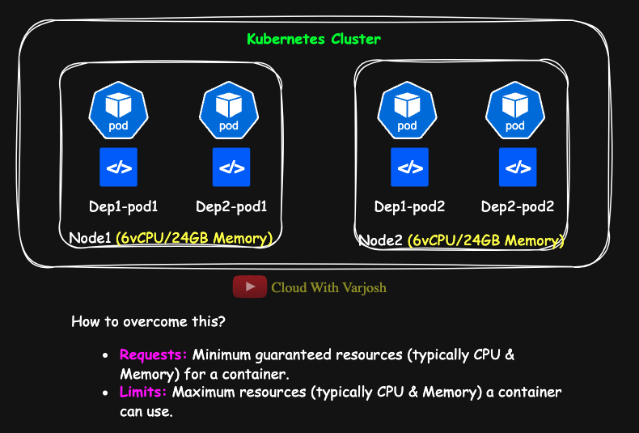
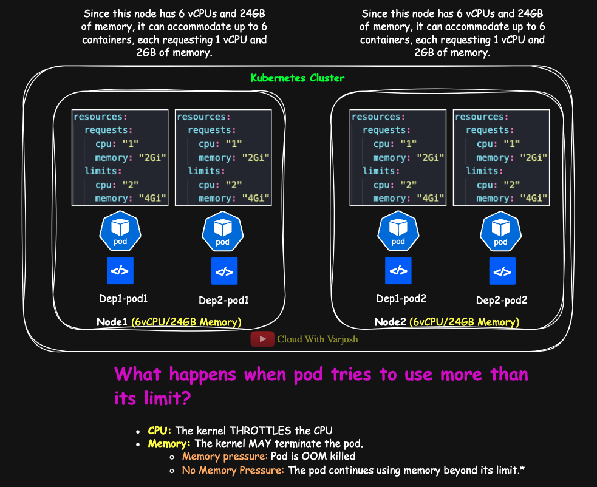
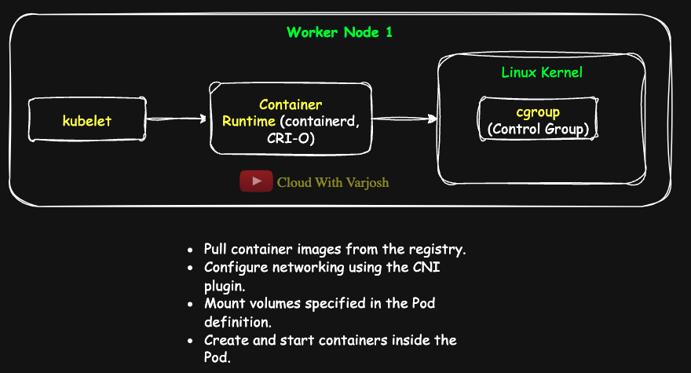
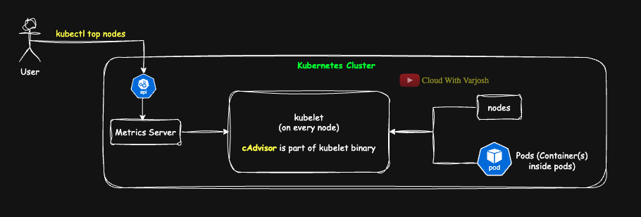

# 41 · Requests, Limits, QoS Classes, LimitRange and ResourceQuota

> **Level:** ★★ intermediate
>
> **You will learn:** the noisy-neighbour problem; what **requests** and **limits** really do (requests → scheduling and CPU share; limits → cgroup caps); resource types and units; capacity vs **allocatable**; CPU throttling vs memory OOM kills (and what the kernel actually does); **QoS classes** (Guaranteed, Burstable, BestEffort) and how they affect eviction and OOM order; how metrics reach `kubectl top` and installing metrics-server; **LimitRange** (defaults and bounds per container) and **ResourceQuota** (totals per namespace); and production sizing advice (including the "no CPU limits" debate).
>
> **You need:** topics 04 (cgroups), 07 (scheduler) and 18.

---

## ⚡ Core: the 10-minute version

**The idea.** Each container declares two numbers:
- **requests**: what it needs. The scheduler places Pods by summing requests, and CPU requests set its share under contention.
- **limits**: the maximum. Too much CPU gets the container **throttled**; too much memory gets it **OOM-killed**.

From these, Kubernetes gives each Pod a **QoS class** (Guaranteed, Burstable, BestEffort), which decides who is evicted first when a node runs short. Per namespace:
- **LimitRange** sets per-container defaults and min/max;
- **ResourceQuota** caps the namespace's totals.

**Picture it.** Requests are a restaurant reservation (a guaranteed seat); limits are the maximum bill your card allows.

**The one thing to know.**

```yaml
resources:
  requests: { cpu: 100m, memory: 128Mi }     # scheduling + guaranteed share
  limits:   { memory: 256Mi }                # hard cap; over it → OOMKilled
```

**Try it now:**
1. Run a Pod with a 50Mi limit that allocates more (`polinux/stress`, `--vm-bytes 100M`) and see `OOMKilled`.
2. Request `cpu: 100` (100 cores) and see it stay `Pending`.
3. Check QoS with `kubectl get pod <p> -o jsonpath='{.status.qosClass}'`.

**You've got it if you can:** explain requests vs limits, CPU throttling vs memory OOM, and the three QoS classes.

> 📖 **That's the core.** On a first pass, do the mini-lab and move on to the next topic. Everything below is the **full reference**: come back for the details, the edge cases, interview answers and exam-level depth.

---

## What it is

Every container can declare, per resource:
- **`requests`**: how much it **needs**. The **scheduler** only places the Pod on a node with that much **unreserved** capacity, and the node **reserves** it.
- **`limits`**: the **most** it may use. The **kernel** (cgroups) enforces it at runtime.

```yaml
resources:
  requests:
    memory: "2Gi"
    cpu: "1"
  limits:
    memory: "4Gi"
    cpu: "2"
```

| | Definition | Enforced by | Impact |
|---|---|---|---|
| **Requests** | The CPU/memory a container needs (its reservation) | **Scheduler** (placement) + kubelet/cgroups (CPU weight) | Decides **which node** the Pod can go to |
| **Limits** | The maximum CPU/memory a container may use | **Kernel** via cgroups | Prevents overuse: CPU throttled, memory OOM-killed |

Kubernetes then sorts Pods into **QoS classes** from these values, which decide who is killed or evicted first when a node runs short.

---

## Why it exists

**The noisy-neighbour problem:**



Two nodes (6 vCPU, 24 GB each); two Deployments with two Pods each, spread over both nodes. **deployment-2** has a bug and starts eating **all** CPU and memory on both nodes. **deployment-1** starves. One workload unfairly hurts the others: a **noisy neighbour**.

**Requests and limits fix it:** requests = what a container needs (reserved); limits = the most it can take.

**Benefits:**
1. **Efficient allocation**: resources are spread sensibly across the cluster.
2. **No starvation**: one workload can't hog everything.
3. **Stability**: the scheduler can place Pods correctly.
4. **Noisy-neighbour mitigation**: misbehaving workloads are contained.

**Applying it:**



With each container requesting **1 vCPU and 2 GB**, a 6 vCPU / 24 GB node fits **six** of them. Even though **memory is still free** (12 GB used), **no more Pods** fit because **CPU requests** are fully allocated. Scheduling is about **requests**, not current usage.

---

## Analogy

A **restaurant**:
- **Request** = a **table reservation**: the restaurant (node) only accepts bookings it has seats for, whether or not you've arrived yet.
- **Limit** = the **maximum order**: you can't order more than that, even if the kitchen is idle. For CPU (drinks), the waiter just **makes you wait** (throttling). For memory (seats), if you try to take more chairs than allowed you're **thrown out** (OOM kill).
- **QoS** = **loyalty tier**: when the restaurant is overbooked, walk-ins without a reservation (BestEffort) leave first, then people who sat beyond their booking (Burstable), and fully booked VIPs (Guaranteed) last.

---

## How it works inside

### Resource types and units

| Resource | Unit | Example |
|---|---|---|
| **CPU** | Cores; **millicores** (`m`): 1000m = 1 core | `500m` = 0.5 core |
| **Memory** | Bytes: `Ki`, `Mi`, `Gi` (powers of 2) or `K`, `M`, `G` (powers of 10) | `512Mi`, `1Gi` |
| **Ephemeral storage** | Bytes | `500Mi`, `2Gi` (topic 37) |
| **GPU** | Vendor extended resource (integer) | `nvidia.com/gpu: 1` |
| **HugePages** | Bytes per page size | `hugepages-2Mi: 512Mi` |
| **Custom devices** | Vendor-specific (device plugins) | `example.com/fpga: 1` |

- `1Gi` = 1024³ bytes; `1G` = 1000³ bytes. Watch out: `memory: 1m` means **one milli-byte**, a classic typo (you wanted `1Mi`).
- Requests and limits are set **per container**. A Pod's request is the **sum** of its containers' requests (plus init-container rules and Pod overhead). Pod-level `resources` (one budget for the whole Pod) also exist now (beta).
- GPUs and other extended resources can't be overcommitted: request = limit.

### Capacity vs allocatable

A node doesn't give all its resources to Pods:

```
Allocatable = Capacity − kube-reserved − system-reserved − eviction threshold
```

- `kube-reserved` / `system-reserved`: for the kubelet, runtime and OS (set in the kubelet config).
- The **eviction threshold** (e.g. `memory.available<100Mi`) is kept free.
- The scheduler compares **sum of requests on the node + new Pod's requests ≤ allocatable**.

So Day 19's "6 vCPU → six 1-vCPU containers" is a simplification: in reality allocatable is a bit lower, and DaemonSets (kube-proxy, CNI) already hold some requests, so you'd fit five.

### Requests at scheduling time

A container requesting `500m` CPU and `256Mi` memory can only go to a node with **at least** that much **unrequested** allocatable CPU and memory. If no node qualifies, the Pod stays **`Pending`** (`0/3 nodes are available: 3 Insufficient cpu`).

### Exceeding requests

**Requests aren't caps.** A container that requests `256Mi` can use more if the node has free memory (say 8 GiB). Kubernetes **reserves** the 256Mi for it; the extra is borrowed, and it's the first thing taken back under pressure (Pods using more than their requests are the first **eviction** candidates; topic 47).

For CPU, the request becomes the cgroup's **`cpu.weight`** (topic 04): when the CPU is **busy**, containers share it **in proportion to their requests**; when it's idle, anyone can use it.

### Exceeding limits

| Resource | Type | What happens over the limit |
|---|---|---|
| **CPU** | **Compressible** (you can give less and the program just runs slower) | **Throttled**: gets fewer CPU cycles; slows down; never killed for CPU |
| **Memory** | **Incompressible** (you can't take memory back from a running program without breaking it) | **OOM-killed** (exit 137, reason `OOMKilled`) |

**CPU throttling, precisely:** the limit becomes `cpu.max` = quota per period (e.g. `90000 100000` = 90 ms of CPU time per 100 ms period for a `900m` limit). A multi-threaded app can use its whole quota in the first few ms of a period and then sits **frozen** until the next period: latency spikes even though average CPU looks fine. You can see it in the cgroup's `cpu.stat` (`nr_throttled`, `throttled_usec`) or Prometheus' `container_cpu_cfs_throttled_*` metrics.

> ✅ **Correct today** ([C1](#c1)): the memory limit is the container cgroup's **`memory.max`**, a **hard cap enforced on that cgroup alone**: node-wide free memory is irrelevant (Day 19's own later section, "Why is the container killed despite no memory pressure?", says this correctly). The "may" comes from what the kernel does **at** the limit: it first tries to **reclaim** the cgroup's own reclaimable memory (file cache). If enough can be freed, nothing dies; if the app's own (anonymous) memory needs more than the limit, the **cgroup OOM killer** kills a process in it, immediately. A container's memory **can't** exceed its limit, not even briefly.

**Why the container is killed even though the node has free memory:**



1. **Memory limits are enforced by cgroups:** the kubelet passes requests and limits to the runtime (containerd, CRI-O), which creates a **cgroup** for the container with those constraints.
2. **The kernel enforces the limit:** if usage would exceed the limit, the **cgroup OOM killer** terminates a process **in that cgroup**, independent of overall node memory: the limit is **per container**, not per node.
3. **Why docs say "may":** the kernel reclaims what it can first (above). For an app that really needs more memory, exceeding the limit means an OOM kill.

So memory limits are **hard, container-level constraints** enforced by the Linux kernel.

If **no limit** is set and the **node** runs out of memory, the **node-level** OOM killer (or the kubelet's eviction, topic 47) chooses victims by **QoS class** and `oom_score_adj` (below).

### Limits without requests, and vice versa

- Only **limits** set → **requests default to the limits**.
- Only **requests** set → no limit (can use any free resources on the node).
- Neither → none; the Pod is **BestEffort** (unless a LimitRange adds defaults).

### QoS classes (Day 46 note, expanded)

Kubernetes assigns each Pod a **QoS (Quality of Service) class** from its requests and limits. It's **separate from Pod priority** (topic 47) and matters during **node resource pressure**: higher classes are **less likely to be evicted or OOM-killed**.

| Class | Rule | Under pressure | `oom_score_adj` |
|---|---|---|---|
| **Guaranteed** | **Every** container has CPU **and** memory requests **= limits** | Killed/evicted **last** | −997 |
| **Burstable** | At least one request or limit set, but not Guaranteed | In between (those using most above their request go first) | 2–999 (scaled by request) |
| **BestEffort** | **No** requests or limits on any container | Killed/evicted **first** | 1000 |

The class shows in `kubectl get pod -o jsonpath='{.status.qosClass}'` and in the cgroup path (`kubepods-burstable.slice`, `kubepods-besteffort.slice`; Guaranteed Pods sit directly under `kubepods.slice`). Guaranteed Pods with **integer** CPU requests can also get **exclusive cores** if the kubelet's static CPU manager policy is enabled (latency-sensitive workloads).

### Metrics: how `kubectl top` works

To see usage you run `kubectl top nodes` / `kubectl top pods`. Without **metrics-server** it fails:

```
error: Metrics API not available
```

**How metrics flow:**



1. **cAdvisor collects** CPU, memory, filesystem and network usage. It's **built into the kubelet** (with data from the CRI runtime); you don't run it separately.
2. **The kubelet exposes** these stats over HTTPS on **port 10250**: historically `/stats/summary` (the Summary API), and `/metrics/resource` (Prometheus format) in newer setups.
3. **Metrics Server scrapes** every kubelet periodically (a **pull** model; nothing is pushed). Since **metrics-server v0.6**, it reads **`/metrics/resource`**; older versions used `/stats/summary`. It keeps only the **latest** values, in memory.
4. **API aggregation:** `kubectl top` calls the API server at **`/apis/metrics.k8s.io/`**; the **aggregation layer** forwards the request to metrics-server, which answers with the latest numbers.

**Why `kubectl top` fails without it:** metrics-server **isn't installed by default** (on kubeadm/kind), so the API server has nothing serving `metrics.k8s.io`. (Managed clusters often pre-install it.) The Metrics API itself graduated to **GA in v1.37**.

**Install metrics-server:**

1. Get the manifest from the [latest release](https://github.com/kubernetes-sigs/metrics-server/releases/latest) (`components.yaml`; `Day 19/components.yaml` is a saved copy).
2. **On kind**, add `--kubelet-insecure-tls` to the Deployment's args, because kind's kubelets use **self-signed serving certificates** that metrics-server doesn't trust:
   ```yaml
   spec:
     containers:
     - args:
       - --cert-dir=/tmp
       - --secure-port=10250
       - --kubelet-preferred-address-types=InternalIP,ExternalIP,Hostname
       - --kubelet-insecure-tls        # LABS ONLY: skips verifying kubelet certificates
   ```
3. Apply it:
   ```bash
   kubectl apply -f https://github.com/kubernetes-sigs/metrics-server/releases/latest/download/components.yaml
   kubectl -n kube-system patch deploy metrics-server --type=json \
     -p '[{"op":"add","path":"/spec/template/spec/containers/0/args/-","value":"--kubelet-insecure-tls"}]'
   ```
   (Day 19 applied the fixed version `v0.7.2/components.yaml`, or a downloaded copy edited by hand. Both work; current releases are 0.8.x, and the default secure port in recent manifests is 10250 rather than Day 19's 443.)
4. Wait a minute, then `kubectl top nodes`. (No data yet? Wait and retry.)
5. Check the Pod: `kubectl get pods -n kube-system | grep metrics-server` → `1/1 Running`.

> In **production**, don't use `--kubelet-insecure-tls`: have kubelets get proper serving certificates (`serverTLSBootstrap: true` + approving their CSRs; topic 53), so metrics-server can verify them. Topic 48 goes deeper into the metrics pipeline and HPA.

### LimitRange

If containers **don't** set requests/limits, an admin can provide **defaults** (and bounds) **per namespace** with a **LimitRange**:

```yaml
apiVersion: v1
kind: LimitRange
metadata:
  name: resource-limits
  namespace: default          # the namespace it applies to
spec:
  limits:
  - type: Container
    default:                  # default LIMITS for containers that set none
      cpu: "2"
      memory: "4Gi"
    defaultRequest:           # default REQUESTS for containers that set none
      cpu: "1"
      memory: "2Gi"
    max:                      # no container may exceed this
      cpu: "4"
      memory: "8Gi"
    min:                      # every container must ask for at least this
      cpu: "500m"
      memory: "512Mi"
```

| Field | Meaning |
|---|---|
| `default` | Limits applied when a container sets none (here 2 CPU / 4Gi) |
| `defaultRequest` | Requests applied when a container sets none (here 1 CPU / 2Gi) |
| `max` | The **largest** value a container may have (4 CPU / 8Gi) |
| `min` | The **smallest** value a container must have (500m / 512Mi) |
| `type: Container` | Applies per **container** (also `Pod` for totals, and `PersistentVolumeClaim` for storage sizes) |

> ✅ **Correct today** ([C2](#c2)): LimitRange is enforced by an **admission** plugin when the Pod is **created**: a Pod violating `min`/`max` is **rejected by the API server** (`forbidden: minimum cpu usage per Container is 500m…`). It never reaches the scheduler. Also, defaults are applied only at **creation**: existing Pods aren't changed when you edit a LimitRange. Optional `maxLimitRequestRatio` caps how far limits may exceed requests.

```bash
kubectl apply -f "Day 19/limitrange.yaml"
kubectl describe limitrange resource-limits
```

```
Name:       resource-limits
Namespace:  default
Type        Resource  Min    Max   Default Request  Default Limit  Max Limit/Request Ratio
----        --------  ---    ---   ---------------  -------------  -----------------------
Container   cpu       500m   4     1                2              -
Container   memory    512Mi  8Gi   2Gi              4Gi            -
```

### ResourceQuota: totals per namespace

A **LimitRange** governs **each container**; a **ResourceQuota** caps the **namespace's total**:

```yaml
apiVersion: v1
kind: ResourceQuota
metadata:
  name: team-a-quota
  namespace: team-a
spec:
  hard:
    requests.cpu: "20"            # sum of all CPU requests in the namespace
    requests.memory: 64Gi
    limits.cpu: "40"
    limits.memory: 128Gi
    pods: "100"                   # object counts…
    services.loadbalancers: "2"
    persistentvolumeclaims: "20"
    requests.storage: 2Ti
    count/deployments.apps: "50"
```

- Enforced at **admission**: a Pod that would push usage over `hard` is **rejected** (`exceeded quota: team-a-quota, requested: requests.cpu=2, used: requests.cpu=19, limited: requests.cpu=20`).
- **Important:** once a quota covers `requests.cpu` (etc.), **every** new Pod in the namespace **must specify** that resource, or it's rejected. That's why quotas usually come with a LimitRange that supplies defaults.
- Scopes and `scopeSelector` can limit a quota to e.g. `BestEffort` Pods or a PriorityClass (topic 47).
- `kubectl describe quota -n team-a` shows `Used` vs `Hard`.

---

## Commands / YAML

### Demo 1: memory requests and limits (Day 19, `Day 19/memory.yaml`)

```yaml
apiVersion: v1
kind: Pod
metadata:
  name: memory-demo
spec:
  containers:
    - name: memory-demo-ctr
      image: polinux/stress
      resources:
        requests:
          memory: "100Mi"       # reserved for scheduling
        limits:
          memory: "200Mi"       # hard cap
      command: ["stress"]
      args: ["--vm", "1", "--vm-bytes", "190M", "--vm-hang", "1"]   # allocate 190M and hold it
```

- `requests.memory: 100Mi`: the node reserves 100 MiB for it.
- `limits.memory: 200Mi`: it can't go above 200 MiB.
- `--vm-bytes 190M`: under the limit, so it **runs fine**.

Now **exceed** the limit:

```yaml
      args: ["--vm", "1", "--vm-bytes", "250M", "--vm-hang", "1"]
```

```bash
kubectl delete pod memory-demo; kubectl apply -f memory.yaml
kubectl get pods -o wide -w
kubectl describe pod memory-demo | grep -A5 'Last State'
```

```
memory-demo   0/1   OOMKilled          0     4s
memory-demo   0/1   CrashLoopBackOff   1     10s

    Last State:     Terminated
      Reason:       OOMKilled
      Exit Code:    137
```

**Check requests and limits:**

```bash
kubectl describe node <node-name>          # "Allocated resources" section
kubectl get pod <pod-name> -o yaml         # the Pod's resources (and status.qosClass)
kubectl describe deployment <deployment>   # the template's requests/limits
```

```
Allocated resources:
  (Total limits may be over 100 percent, i.e., overcommitted.)
  Resource           Requests     Limits
  --------           --------     ------
  cpu                950m (11%)   900m (11%)
  memory             390Mi (4%)   590Mi (7%)
```

- **Requests** can never exceed 100% of allocatable (the scheduler won't allow it); **limits** can, which is **overcommitment**.

### Demo 2: CPU requests and limits (Day 19, `Day 19/cpu.yaml`)

```yaml
apiVersion: v1
kind: Pod
metadata:
  name: cpu-demo
spec:
  containers:
    - name: cpu-container
      image: vish/stress
      resources:
        requests:
          cpu: "500m"        # half a core reserved (the file uses 400m)
        limits:
          cpu: "900m"        # max 0.9 core
      args:
        - -cpus
        - "1"                # try to burn one full CPU
```

- **1 CPU = 1000m**: `500m` = half a CPU; `900m` = 0.9 CPU.
- It tries to use 1 full CPU but is **throttled** at 0.9.

```bash
kubectl apply -f "Day 19/cpu.yaml"
kubectl top pod cpu-demo
```

```
NAME       CPU(cores)   MEMORY(bytes)
cpu-demo   900m         1Mi
```

- Usage is **capped at ~900m**. That's the limit in action. To see the throttling itself, read the cgroup:

```bash
kubectl exec cpu-demo -- cat /sys/fs/cgroup/cpu.max /sys/fs/cgroup/cpu.stat 2>/dev/null | head -6
```

```
90000 100000
usage_usec 41352841
user_usec 41320010
system_usec 32831
nr_periods 460
nr_throttled 455
throttled_usec 4512331
```

- `90000 100000` = 90 ms per 100 ms period = 0.9 CPU.
- `nr_throttled` close to `nr_periods` = throttled almost every period.

### QoS check

```bash
kubectl get pods -o custom-columns='NAME:.metadata.name,QOS:.status.qosClass'
```

```
NAME          QOS
cpu-demo      Burstable
memory-demo   Burstable
```

---

## Hands-on lab

1. Install metrics-server (with `--kubelet-insecure-tls` on kind) and run `kubectl top nodes`.
2. Run Demo 1 at 190M and at 250M; read the exit code and reason.
3. Run Demo 2 and read `cpu.max`/`cpu.stat` inside the container.
4. Make one Pod of each QoS class (no resources; requests only; requests = limits for CPU and memory) and check `status.qosClass`.
5. Apply `Day 19/limitrange.yaml` in a new namespace; create a Pod without resources and check what was injected (`kubectl get pod -o yaml`); try a Pod requesting `100m` (rejected by `min`).
6. Add a ResourceQuota with `requests.cpu: "2"` to that namespace; scale a Deployment until creation fails, and read the `FailedCreate` event on its ReplicaSet (topic 10).
7. Request `cpu: 64` and see `Pending` with `Insufficient cpu`.
8. Clean up.

---

## Where you'll use it

- **Every production workload**: right-sized requests are the basis of scheduling, autoscaling (HPA uses % of request; topic 48) and cost.
- **Multi-tenant platforms**: a LimitRange + ResourceQuota per team namespace.
- **Incidents**: OOMKills, CPU throttling latency, evictions, Pending Pods.

**Best practices:**
- **Always set CPU and memory requests** in production; set **memory limits** too (memory isn't compressible). Many teams set memory **limit = request** for predictability.
- **CPU limits are debated:** they prevent noisy neighbours but cause throttling latency even when nodes are idle. A common modern practice: set CPU **requests**, and set CPU **limits** only where you need hard isolation or Guaranteed QoS.
- Size from data: watch `kubectl top`, Prometheus, or **VPA recommendations** (topic 49).
- Use **LimitRange** for defaults and **ResourceQuota** for team budgets.
- Keep critical system Pods **Guaranteed** or high-priority.

---

## When it breaks

| Symptom | Cause | Fix |
|---|---|---|
| `Pending`: `Insufficient cpu/memory` | Requests too big, or the cluster is full **of requests** (not usage) | Lower requests, add nodes, check `describe node` allocated |
| `OOMKilled`, exit 137 | Container hit its memory limit | Raise the limit, fix leaks, tune heap settings (e.g. JVM `-XX:MaxRAMPercentage`) |
| Latency spikes, CPU usage looks below limit | CFS throttling (bursty threads use the quota early) | Raise or remove the CPU limit; check `nr_throttled` |
| `Evicted`: `The node was low on resource: memory` | Node pressure; Pod using more than its request | Right-size requests; Guaranteed QoS for critical Pods (topic 47) |
| `forbidden: exceeded quota` | ResourceQuota reached | Raise the quota or reduce usage |
| `forbidden: failed quota: must specify limits.cpu…` | Quota requires resources the Pod doesn't set | Set them, or add a LimitRange with defaults |
| `forbidden: minimum memory usage per Container is 512Mi` | LimitRange `min` | Raise the request |
| `kubectl top`: `Metrics API not available` | No metrics-server | Install it |
| metrics-server logs: `x509: cannot validate certificate` | Kubelet self-signed certs | Lab: `--kubelet-insecure-tls`; prod: kubelet serving cert bootstrap |

---

## Quick recap

- **Requests** = reservation: used by the scheduler and as the CPU share; **limits** = cgroup caps: CPU **throttled** (`cpu.max`), memory **OOM-killed** (`memory.max`, per container, regardless of node free memory).
- Allocatable < capacity; scheduling sums **requests**, not usage.
- **QoS**: Guaranteed (req = lim for all) > Burstable > BestEffort (none), for eviction and OOM order.
- `kubectl top` needs **metrics-server** (kubelet `/metrics/resource` → metrics-server → `metrics.k8s.io`).
- **LimitRange** = per-container defaults/min/max (admission); **ResourceQuota** = per-namespace totals (admission; forces Pods to set resources).

### Interview questions

1. **Q: What happens when a container exceeds its CPU limit vs its memory limit?**
   A: CPU is compressible, so it's throttled by the CFS quota and slows down; memory isn't, so the kernel OOM-kills it in its cgroup (exit 137), even if the node has free memory.
2. **Q: How does Kubernetes decide a Pod's QoS class?**
   A: Guaranteed if every container has CPU and memory requests equal to limits; BestEffort if no container sets any; otherwise Burstable. Under node pressure, BestEffort goes first and Guaranteed last.
3. **Q: LimitRange vs ResourceQuota?**
   A: LimitRange sets defaults and min/max per container (or Pod/PVC) in a namespace; ResourceQuota caps the total resources and object counts of the whole namespace. Both are enforced by admission.

---

## Appendix: notes on the original course material

This topic was rebuilt from the original CKA course notes. This appendix keeps the audit trail out of your way while you learn.

### Sources

Day 19 (why requests and limits, benefits, applying them to the example, what they are, resource types, how they work for scheduling and running containers, exceeding requests, exceeding limits, CPU throttling, memory OOM kills, monitoring utilisation, how Kubernetes collects metrics, why `kubectl top` fails, installing metrics-server steps 1–5, memory demo and why the kill happens, checking requests/limits, CPU demo, LimitRange and its fields, applying/verifying, best practices), Day 46 (the note on QoS classes), files `Day 19/memory.yaml`, `cpu.yaml`, `limitrange.yaml`, `components.yaml`.

### Corrections to the original notes

Each entry shows what the original said and what's true now. In the topic above, each correction appears as a ✅ **Correct today** line or a ⚠️ **Fix to the original** box, linked to its entry here.

<a id="c1"></a>**C1 · Corrected (Day 19).** the notes say a container over its memory limit "**may** get killed… OOM kills are not immediately enforced but **reactively** applied by the kernel when **memory pressure** occurs; if there is enough free memory, a container might exceed its limit temporarily". **Now:** the memory limit is the container cgroup's **`memory.max`**, a **hard cap enforced on that cgroup alone**: node-wide free memory is irrelevant (Day 19's own later section, "Why is the container killed despite no memory pressure?", says this correctly). The "may" comes from what the kernel does **at** the limit: it first tries to **reclaim** the cgroup's own reclaimable memory (file cache). If enough can be freed, nothing dies; if the app's own (anonymous) memory needs more than the limit, the **cgroup OOM killer** kills a process in it, immediately. A container's memory **can't** exceed its limit, not even briefly.

<a id="c2"></a>**C2 · Corrected (Day 19).** `min` was described as "the minimum a container must request **to be scheduled**". **Now:** LimitRange is enforced by an **admission** plugin when the Pod is **created**: a Pod violating `min`/`max` is **rejected by the API server** (`forbidden: minimum cpu usage per Container is 500m…`). It never reaches the scheduler. Also, defaults are applied only at **creation**: existing Pods aren't changed when you edit a LimitRange. Optional `maxLimitRequestRatio` caps how far limits may exceed requests.
