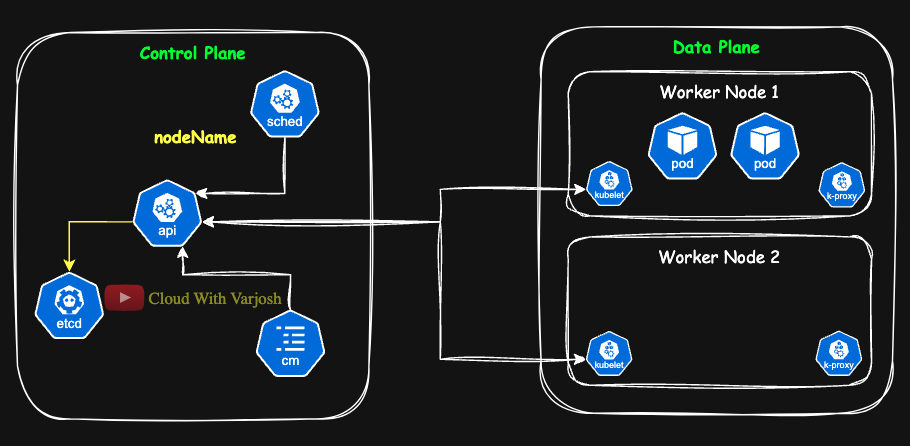

# 42 · The Scheduler, Manual Scheduling and Static Pods

> **Level:** ★★ intermediate
>
> **You will learn:** how the kube-scheduler decides (the scheduling framework: queue → filter → score → bind; plugins and profiles; running a second scheduler); **manual scheduling** with `nodeName` (and the Binding API) and why it ignores taints; **static Pods**: what the kubelet does with `/etc/kubernetes/manifests`, mirror Pods, why `kubectl delete` doesn't remove them, how the control plane itself runs as static Pods, and editing them on kubeadm, kind and real servers.
>
> **You need:** topics 07 (scheduler internals), 08 (kubelet), 10 and 41 (requests). One preview: a **taint** is a "keep away" mark on a node that the **scheduler** respects (topic 43).

---

## ⚡ Core: the 10-minute version

**The idea.** The **scheduler** picks a node for every new Pod: it **filters** out nodes that can't run it (not enough resources, taints, affinity rules), **scores** the rest, and writes the winner's name into the Pod. Two ways around it:
- **Manual scheduling**: set `spec.nodeName` yourself. The scheduler is skipped entirely, taints included.
- **Static Pods**: manifests in a node's `/etc/kubernetes/manifests/` that the **kubelet** runs directly. That's how the control plane itself runs; you see them in kubectl as read-only "mirror Pods".

**Picture it.** The scheduler is a seating host; `nodeName` is walking straight to a table you've chosen; static Pods are staff who always sit at the kitchen table.

**The one thing to know.**

```yaml
spec:
  nodeName: lab-worker2        # bypasses the scheduler
  containers: [ { name: c, image: nginx } ]
```

```bash
docker exec lab-control-plane ls /etc/kubernetes/manifests     # the static Pods
```

**Try it now:**
1. Create the Pod above.
2. Copy a small Pod manifest into a kind node's `/etc/kubernetes/manifests/` (`docker cp`): a mirror Pod named `<pod>-<node>` appears.
3. `kubectl delete` the mirror Pod: it comes back. Remove the file and it's gone.

**You've got it if you can:** describe filter → score → bind, and explain how static Pods differ from normal ones.

> 📖 **That's the core.** On a first pass, do the mini-lab and move on to the next topic. Everything below is the **full reference**: come back for the details, the edge cases, interview answers and exam-level depth.

---

## What it is

- The **kube-scheduler** picks a **node** for every Pod that doesn't have one, based on **resource availability**, **taints and tolerations** (topic 43), **affinity/anti-affinity** (topics 44–46) and more.
- **Manual scheduling** = you set **`spec.nodeName`** yourself, which **bypasses the scheduler completely**.
- **Static Pods** = Pods the **kubelet** creates directly from **manifest files on its node**, without the API server or scheduler. Kubernetes' own control plane runs this way on kubeadm and kind clusters.



---

## Why it exists

- **The scheduler** exists so you never have to choose nodes by hand: it packs Pods efficiently, respects constraints, and spreads load.
- **Manual scheduling** is for:
  - **troubleshooting and debugging**: put a Pod on a specific node to test that node (network, disk, GPU);
  - **node-specific tests**: e.g. a database Pod that must run on the SSD node;
  - **when the scheduler is down**: a fallback way to run Pods.
- **Static Pods** solve the bootstrap problem: **the control plane** (`kube-apiserver`, `etcd`, `kube-scheduler`, `kube-controller-manager`) must run **before** there's an API server or scheduler to create it. Static Pods are **guaranteed to run on a specific node, even if the API server is down**.

---

## Analogy

- **The scheduler** = a **hotel's front desk** assigning rooms by guest needs (size, accessibility, quiet floor).
- **Manual scheduling** = **booking a specific room number** directly: the front desk's rules (including "staff only" signs, i.e. taints) are skipped, though the room still has to physically fit you.
- **Static Pods** = the **night manager's own office**: set up by the building itself (kubelet), always there, listed on the guest board (mirror Pod) for visibility, but you can't check them out at the front desk.

---

## How it works inside

### The scheduling framework

For each unscheduled Pod (`spec.nodeName` empty, `schedulerName` = this scheduler):

1. **Queue**: Pods wait in a **priority queue** (higher priority first; topic 47). Pods that failed scheduling wait in a back-off queue and are retried when the cluster changes.
2. **PreFilter / Filter**: remove nodes that **can't** run the Pod. Main filter plugins:
   - `NodeResourcesFit`: enough **unrequested** CPU/memory/etc. (requests, topic 41);
   - `TaintToleration`: no untolerated `NoSchedule`/`NoExecute` taints (topic 43);
   - `NodeAffinity`: nodeSelector and node affinity (topic 44);
   - `InterPodAffinity`, `PodTopologySpread` (topic 46);
   - `NodePorts`: requested `hostPort` free;
   - `VolumeBinding`, `VolumeZone`, `NodeVolumeLimits`: volumes can attach there (topics 38–39);
   - `NodeUnschedulable`: the node isn't cordoned (topic 76);
   - `NodeName`: if `nodeName` is preset (handled before the scheduler sees it).
3. **PostFilter**: if no node passed, try **preemption** (evict lower-priority Pods; topic 47).
4. **PreScore / Score**: rank feasible nodes 0–100 per plugin, weighted: `NodeResourcesBalancedAllocation`, `NodeResourcesFit` (least or most allocated), `ImageLocality`, preferred affinities, topology spread, taints with `PreferNoSchedule`.
5. **Reserve / Permit**: tentatively claim resources (and wait if a plugin says so, e.g. gang scheduling).
6. **PreBind / Bind**: e.g. provision volumes for `WaitForFirstConsumer` (topic 39), then post a **Binding**, which sets `spec.nodeName`.

For big clusters it doesn't score **every** node: `percentageOfNodesToScore` limits it to a sample once enough feasible nodes are found.

**Profiles and extra schedulers:** the scheduler's config file (`KubeSchedulerConfiguration`) can enable/disable plugins and define **profiles** with different names. A Pod chooses with `spec.schedulerName` (default `default-scheduler`). You can also run a **completely separate scheduler** (e.g. for batch workloads: Volcano, Kueue-integrated schedulers) and point Pods at it.

### Manual scheduling with `nodeName`

Setting `spec.nodeName` in the manifest means:
- the **scheduler never sees the Pod** (it only handles Pods without a node);
- the **kubelet on that node** picks it up directly from the API server;
- **no scheduler filters run**: taints with `NoSchedule`, affinity, topology spread **don't apply**. The kubelet still runs its own **admission** checks: enough allocatable resources, the right OS, and **`NoExecute`** taints (which would evict it).

**It guarantees placement on a particular node**: useful for special hardware or node-specific configuration, and for troubleshooting why a Pod won't schedule normally.

**`nodeName` can only be set at creation.** To bind an **existing** Pending Pod to a node, post a **Binding** object (what the scheduler itself does):

```bash
kubectl create -f - <<'EOF'
apiVersion: v1
kind: Binding
metadata:
  name: pending-pod          # the Pod's name
target:
  apiVersion: v1
  kind: Node
  name: lab-worker2
EOF
```

(It must be sent to the Pod's `binding` subresource; `kubectl create` handles that when the kind is `Binding`. Many people just delete and recreate the Pod with `nodeName`.)

**Non-existent node (Day 15, `Day 15/manual-pod.yaml` uses `my-second-cluster-control-plane-66`):** the Pod stays **`Pending`** because no kubelet with that name will ever pick it up. After a short while the **Pod garbage collector** (a controller in kube-controller-manager) **deletes** Pods bound to nodes that don't exist, to avoid leftovers.

### Running a Pod on the control plane

Change `nodeName` to the control-plane node (`lab-control-plane`) and it runs there. Why does that work, given that control-plane nodes are **tainted** `node-role.kubernetes.io/control-plane:NoSchedule`?
- **The taint is enforced by the scheduler**, and manual scheduling **bypasses the scheduler**. (Topic 43 covers taints.)
- The control-plane node runs a **kubelet** (that's how its own static Pods run) and **kube-proxy**, so it can run any Pod assigned to it, with normal networking.

> ✅ **Correct today** ([C1](#c1)): kind's control-plane node **does** have the `node-role.kubernetes.io/control-plane:NoSchedule` taint (`kubectl describe node lab-control-plane | grep Taints`; topics 27 and 43 rely on it). Manually scheduled Pods land there because **`nodeName` bypasses the scheduler**, which is the component that enforces `NoSchedule`. That's the same explanation Day 15 gives in "How can control plane run workloads?".

### Static Pods

- **Created and managed by the kubelet** on one node, **not** by the API server.
- Defined as ordinary Pod manifests in the kubelet's **`staticPodPath`**: by convention **`/etc/kubernetes/manifests/`** on kubeadm/kind (set in `/var/lib/kubelet/config.yaml`; topic 08).
- The kubelet **watches** that directory: add a file → it starts the Pod; edit the file → it **recreates** the Pod; delete the file → it stops the Pod.
- **Not scheduled** by the scheduler: they run **on the node whose directory holds the file**. Any node can have them (control-plane or worker), and each static Pod is bound to **one** kubelet on **one** node.
- **Can't be managed with `kubectl`** (edit/scale/delete don't stick): change the **file** on the node.
- Restrictions: static Pods **can't** reference other API objects like **ServiceAccounts, ConfigMaps or Secrets** (the kubelet must be able to run them with no API server). Since v1.37 this is enforced strictly.

**Mirror Pods:** to make static Pods **visible** in `kubectl get pods`, the kubelet creates a **mirror Pod** in the API server for each one:
1. The kubelet reads the manifests from `/etc/kubernetes/manifests/`.
2. It creates and runs the static Pod itself, independent of the control plane.
3. It creates a **mirror Pod** object in the API server for visibility.
4. The mirror Pod is **read-only**: you can see it, but edits are rejected, and deleting it is pointless (the kubelet recreates it).

**Mirror Pod names:** `<static-pod-name>-<node-hostname>`, e.g. `nginx-static-pod-my-second-cluster-worker2`, or on your lab cluster `kube-apiserver-lab-control-plane`.

The mirror Pod carries the annotation `kubernetes.io/config.mirror` and an `ownerReferences` entry pointing to the **Node**: that's how you recognise one.

### Manual scheduling vs static Pods

| | Manual scheduling | Static Pods |
|---|---|---|
| Created by | **You**, through the API server | **The kubelet**, from a file |
| Needs the API server | Yes | **No** |
| Scheduler involved | No (`nodeName` preset) | No |
| Use cases | Testing, debugging, specific placement | Control-plane components, must-always-run node workloads |
| How to delete | `kubectl delete pod` | **Remove the manifest file** from `/etc/kubernetes/manifests/` |

---

## Commands / YAML

### Manual scheduling demo

**Step 1: list nodes**

```bash
kubectl get nodes
```

**Step 2: a Pod pinned to a node**

```yaml
apiVersion: v1
kind: Pod
metadata:
  name: nginx-manual
spec:
  nodeName: lab-worker2          # Day 15 used my-second-cluster-worker2
  containers:
    - name: nginx
      image: nginx:1.29
```

**Steps 3–4: apply and verify**

```bash
kubectl apply -f nginx-manual.yaml
kubectl get pods -o wide
```

```
NAME           READY   STATUS    RESTARTS   AGE   IP           NODE
nginx-manual   1/1     Running   0          5s    10.244.2.8   lab-worker2
```

```bash
kubectl get events --field-selector involvedObject.name=nginx-manual
```

- There's **no `Scheduled` event** from `default-scheduler`: the scheduler never touched it.

**Step 5: a node that doesn't exist** (`Day 15/manual-pod.yaml`, with `nodeName: my-second-cluster-control-plane-66`):

```bash
kubectl apply -f "Day 15/manual-pod.yaml"
kubectl get pod nginx-manual-3 -w
```

```
NAME             READY   STATUS    RESTARTS   AGE
nginx-manual-3   0/1     Pending   0          5s
nginx-manual-3   0/1     Terminating   0      45s
```

Pending, then removed by the Pod garbage collector.

**On the control plane:**

```yaml
spec:
  nodeName: lab-control-plane
```

### Static Pod demo

On kind, get "onto" a node with `docker exec` (on real servers: `ssh user@node-ip`, then `sudo`):

```bash
docker exec -it lab-worker2 bash
cat <<EOF > /etc/kubernetes/manifests/static-pod.yaml
apiVersion: v1
kind: Pod
metadata:
  name: nginx-static-pod
spec:
  containers:
    - name: nginx-container
      image: nginx:1.29
      ports:
        - containerPort: 80
EOF
exit
kubectl get pods -A -o wide | grep static
```

```
default   nginx-static-pod-lab-worker2   1/1   Running   0   12s   10.244.2.9   lab-worker2
```

- The name has the **node's hostname appended**: it's the mirror Pod.

**Why `kubectl delete` doesn't remove it:**

```bash
kubectl delete pod nginx-static-pod-lab-worker2
kubectl get pods | grep static          # it's back almost immediately
```

The kubelet sees the mirror Pod gone, while the static Pod's file still exists, so it **recreates** the mirror Pod (the actual containers often never stopped).

**To remove it permanently**, delete the **file**:

```bash
docker exec lab-worker2 rm /etc/kubernetes/manifests/static-pod.yaml
```

### The control plane is static Pods

```bash
docker exec lab-control-plane ls /etc/kubernetes/manifests
docker exec lab-control-plane grep staticPodPath /var/lib/kubelet/config.yaml
```

```
etcd.yaml  kube-apiserver.yaml  kube-controller-manager.yaml  kube-scheduler.yaml
staticPodPath: /etc/kubernetes/manifests
```

- On kubeadm clusters, **changing a control-plane flag = editing these files** (e.g. adding `--encryption-provider-config` in topic 35, admission plugins in topic 58). The kubelet notices and restarts the component.
- **Careful:** a typo in `kube-apiserver.yaml` takes down the API server, so `kubectl` stops working. Debug on the node with `crictl ps -a` and `crictl logs` (topic 82). Always back up the file first, **outside** the manifests directory (a backup **inside** it would be started as a second Pod).

**Accessing static Pod manifests:** in production, nodes are VMs or physical servers (cloud or on-prem), so you **SSH** in:

```bash
ssh user@worker-node-ip
sudo vi /etc/kubernetes/manifests/static-pod.yaml
```

On kind, nodes are containers: use `docker exec -it <node> bash`. On managed clusters (EKS, GKE, AKS) the control plane is hidden and not available to you at all.

### Using a second scheduler profile

```yaml
apiVersion: v1
kind: Pod
metadata: { name: batch-job }
spec:
  schedulerName: my-batch-scheduler   # if no scheduler with this name runs, the Pod stays Pending forever
  containers: [{ name: c, image: busybox:1.37, command: ["sleep","3600"] }]
```

---

## Hands-on lab

1. Run the manual-scheduling demo on a worker and on `lab-control-plane`. Confirm there's no `Scheduled` event.
2. Create a Pod with `nodeName` set to a node that's **cordoned** (`kubectl cordon lab-worker`): it still runs (cordon only affects the scheduler). Uncordon afterwards.
3. Apply `Day 15/manual-pod.yaml` and watch it be garbage-collected.
4. Create the static Pod on `lab-worker2`; try `kubectl delete`, `kubectl edit` (rejected), then remove the file.
5. **Break the scheduler** (as in the exam): on the control-plane node, move `kube-scheduler.yaml` out of `/etc/kubernetes/manifests`. New Pods stay `Pending` with no events; Pods with `nodeName` still run. Move it back.
6. Create a Pod with `schedulerName: nonexistent` and see it stay Pending.
7. Clean up all demo Pods.

---

## Where you'll use it

- **CKA**: classic tasks: "schedule this Pod on node X without the scheduler", "create a static Pod on node01", "fix the broken kube-scheduler/kube-apiserver manifest".
- **kubeadm cluster operations**: every control-plane change is a static Pod manifest edit (topics 35, 53, 58, 75–76, 82).
- **Debugging**: pinning a test Pod to a suspect node.
- **Advanced scheduling**: custom profiles, secondary schedulers for batch/ML.

---

## When it breaks

| Symptom | Cause | Fix |
|---|---|---|
| Pods `Pending`, **no events at all** | Scheduler not running (or `schedulerName` unknown) | Check the kube-scheduler static Pod (topic 82) |
| Pod with `nodeName` stuck `Pending` | Node doesn't exist, or its kubelet is down | Fix the name / node |
| Pod with `nodeName` rejected: `OutOfcpu` / `OutOfmemory` (status `Failed`) | The kubelet's admission: node lacks allocatable resources | Choose another node or lower requests |
| Static Pod doesn't appear | Wrong directory, YAML error, or the kubelet's `staticPodPath` differs | `journalctl -u kubelet`; check the path in the kubelet config |
| Edited a control-plane manifest, API server gone | Typo or bad flag | Fix the file (from your backup); `crictl logs` |
| "Static" Pod keeps coming back after delete | That's by design | Remove the manifest file |
| Two copies of kube-apiserver after a backup | Backup file saved **inside** the manifests directory | Keep backups elsewhere |

---

## Quick recap

- Scheduler: queue → **filter** (resources, taints, affinity, ports, volumes) → **score** → **bind** (`nodeName`); preemption if nothing fits; profiles and `schedulerName` for alternatives.
- **`nodeName`** = manual scheduling: bypasses the scheduler (and therefore `NoSchedule` taints and affinity); the kubelet still checks resources.
- **Static Pods** = kubelet-managed from `/etc/kubernetes/manifests`; visible as read-only **mirror Pods** named `<pod>-<node>`; delete by removing the file; the control plane runs this way.

### Interview questions

1. **Q: How do you run a Pod on a specific node without the scheduler?**
   A: Set `spec.nodeName` at creation (or post a Binding for an existing Pod); the kubelet on that node runs it directly.
2. **Q: What's a static Pod, and how do you delete one?**
   A: A Pod defined by a manifest file in the kubelet's staticPodPath (usually `/etc/kubernetes/manifests`), run by the kubelet without the API server; the API shows a read-only mirror Pod. Delete the file to remove it.
3. **Q: Why can a manually scheduled Pod run on a tainted control-plane node?**
   A: `NoSchedule` taints are enforced by the scheduler; `nodeName` skips the scheduler. (A `NoExecute` taint would still evict it.)

---

## Appendix: notes on the original course material

This topic was rebuilt from the original CKA course notes. This appendix keeps the audit trail out of your way while you learn.

### Sources

Day 15 (prerequisite on the deployment workflow; understanding the scheduler; manual scheduling: why, what, how useful; demo assigning a Pod to a node; non-existent node; running on the control plane; how the control plane can run workloads; static Pods: why, what; mirror Pods and naming; static Pod demo; why `kubectl delete` doesn't remove them; accessing static Pods in production vs kind; manual vs static comparison; summary), file `Day 15/manual-pod.yaml`. Day 15's workflow recap is in topic 10.

### Corrections to the original notes

Each entry shows what the original said and what's true now. In the topic above, each correction appears as a ✅ **Correct today** line or a ⚠️ **Fix to the original** box, linked to its entry here.

<a id="c1"></a>**C1 · Corrected (Day 15).** the summary says "**KIND allows scheduling on the control plane because it has no default taints**". **Now:** kind's control-plane node **does** have the `node-role.kubernetes.io/control-plane:NoSchedule` taint (`kubectl describe node lab-control-plane | grep Taints`; topics 27 and 43 rely on it). Manually scheduled Pods land there because **`nodeName` bypasses the scheduler**, which is the component that enforces `NoSchedule`. That's the same explanation Day 15 gives in "How can control plane run workloads?".
