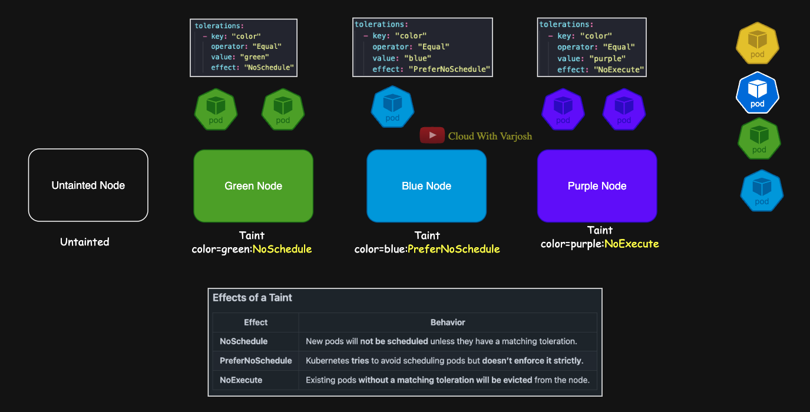

# 43 · Taints and Tolerations: Keeping Pods Off Nodes

> **Level:** ★★ intermediate
>
> **You will learn:** what taints (on nodes) and tolerations (on Pods) are; the three effects (`NoSchedule`, `PreferNoSchedule`, `NoExecute`) and `tolerationSeconds`; the `Equal` and `Exists` operators and matching rules; the **built-in taints** Kubernetes adds itself (not-ready, unreachable, pressure, unschedulable, control-plane) and how they drive evictions after node failures; adding and removing taints; and the "coloured nodes" scenario, including the key fact that **a toleration lets a Pod onto a tainted node but never attracts it there**.
>
> **You need:** topics 41 and 42.

---

## ⚡ Core: the 10-minute version

**The idea.** A **taint** on a node pushes Pods away ("only special Pods here"). A **toleration** on a Pod lets it ignore a matching taint. The effects:
- `NoSchedule`: new Pods without a toleration won't land here;
- `PreferNoSchedule`: avoid this node if possible;
- `NoExecute`: also **evicts** Pods already running.

A toleration is **permission, not attraction**: it lets a Pod onto the node but doesn't send it there. Kubernetes taints nodes itself too: the control plane, unhealthy or unreachable nodes, and nodes under pressure.

**Picture it.** A taint is a "staff only" sign on a door; a toleration is a staff badge. Having the badge doesn't make you go through that door.

**The one thing to know.**

```bash
kubectl taint nodes lab-worker gpu=true:NoSchedule        # add
kubectl taint nodes lab-worker gpu=true:NoSchedule-       # remove (trailing -)
```

```yaml
tolerations:
- { key: gpu, operator: Equal, value: "true", effect: NoSchedule }
```

**Try it now:**
1. Taint `lab-worker` and create a Deployment with 4 replicas: none land there.
2. Add the toleration: some may land there, but not all of them, because tolerations don't attract.
3. Try `NoExecute` and watch running Pods leave.

**You've got it if you can:** explain the three effects, and why a toleration alone doesn't guarantee placement.

> 📖 **That's the core.** On a first pass, do the mini-lab and move on to the next topic. Everything below is the **full reference**: come back for the details, the edge cases, interview answers and exam-level depth.

---

## What it is

- A **taint** is applied to a **node**: "**don't schedule (or keep) Pods here unless they tolerate me**". Format: `key=value:effect`.
- A **toleration** is applied to a **Pod**: "I can **put up with** that taint". It **permits** the Pod onto the node; it **doesn't require or attract** it there.

Together they let admins **keep certain workloads off certain nodes**, with exceptions where needed.

---

## Why it exists

**When you need them:**

| Use case | Explanation |
|---|---|
| **Dedicated nodes** | Taint GPU nodes so only GPU workloads use them |
| **Isolating critical workloads** | Keep critical workloads separate from non-critical ones |
| **Keeping workloads off the control plane** | Control-plane nodes should run only Kubernetes system Pods |
| **Maintenance mode** | Stop new Pods landing on a node under maintenance (`kubectl cordon` does this with a built-in taint) |
| **Node resource problems** | Keep Pods off nodes low on memory/disk/PIDs (Kubernetes adds **pressure** taints automatically) |

---

## Analogy

A taint is a **"Members only" sign** on a club door; a toleration is a **membership card**. Without a card you're turned away (`NoSchedule`). With "Members preferred" (`PreferNoSchedule`), the doorman lets you in only if every other club is full. With "Members only, **and we're checking everyone inside**" (`NoExecute`), non-members already inside are **escorted out**. Having a card for a club **doesn't oblige you to go there**: you might still end up at the club with no sign at all. That's what node affinity (topic 44) fixes.

---

## How it works inside

### Taint effects

| Effect | New Pods without a matching toleration | Pods already running without one |
|---|---|---|
| **`NoSchedule`** | **Not scheduled** there | **Stay** |
| **`PreferNoSchedule`** | Scheduler **tries to avoid** the node (soft) | Stay |
| **`NoExecute`** | Not scheduled | **Evicted** (immediately, or after `tolerationSeconds` if their toleration has one) |

**Important:** taints and tolerations act **at scheduling time**. Tainting a node **doesn't remove** Pods already on it, **except** with **`NoExecute`**, which also evicts running Pods that don't tolerate it.

- `NoSchedule`/`PreferNoSchedule` are checked by the **scheduler** (the `TaintToleration` filter and score plugins; topic 42).
- `NoExecute` is enforced by the **taint-eviction controller** in kube-controller-manager (and checked by the kubelet's admission), so it applies even to Pods placed with `nodeName`.

### Matching rules

A toleration matches a taint when:
- the **keys** are equal (or the toleration has **no key** and `operator: Exists`: it then matches **every** taint, like kube-proxy's DaemonSet in topic 27);
- the **effects** are equal (or the toleration has **no effect**: it matches **all** effects for that key);
- the **operator** is satisfied:

| Operator | Rule |
|---|---|
| **`Equal`** (default) | Key **and** value must match exactly |
| **`Exists`** | Only the key must match; **no `value`** may be given |

A Pod can schedule onto a node only if it tolerates **every** `NoSchedule`/`NoExecute` taint on it. (Untolerated `PreferNoSchedule` taints just lower the node's score.)

> Day 16 says "the effect in the toleration **must match** the effect in the taint". That's right **when** the toleration specifies an effect. A toleration that **omits** `effect` matches **all** effects of that key.

### `tolerationSeconds` (NoExecute only)

```yaml
tolerations:
- key: "node.kubernetes.io/unreachable"
  operator: "Exists"
  effect: "NoExecute"
  tolerationSeconds: 300      # stay up to 5 minutes after the taint appears, then get evicted
```

Without `tolerationSeconds`, a matching `NoExecute` toleration means "**stay forever**".

### Built-in taints Kubernetes manages

| Taint | Added by / when | Effect |
|---|---|---|
| `node-role.kubernetes.io/control-plane` | kubeadm/kind on control-plane nodes | `NoSchedule` |
| `node.kubernetes.io/not-ready` | Node condition `Ready=False` | `NoExecute` (and `NoSchedule`) |
| `node.kubernetes.io/unreachable` | Node controller: heartbeats stopped (`Ready=Unknown`) | `NoExecute` (and `NoSchedule`) |
| `node.kubernetes.io/memory-pressure`, `disk-pressure`, `pid-pressure` | Kubelet pressure conditions | `NoSchedule` |
| `node.kubernetes.io/network-unavailable` | Network not configured | `NoSchedule` |
| `node.kubernetes.io/unschedulable` | `kubectl cordon` (`spec.unschedulable: true`) | `NoSchedule` |
| `node.cloudprovider.kubernetes.io/uninitialized` | Until the cloud controller initialises the node | `NoSchedule` |
| `node.kubernetes.io/out-of-service` | **You**, on a node that's definitely dead (non-graceful shutdown; topic 40) | `NoExecute` |

**How node failure evicts Pods:** the `DefaultTolerationSeconds` admission plugin gives every Pod tolerations for `not-ready` and `unreachable` with **`tolerationSeconds: 300`**. So when a node dies: about 40 s later the node becomes `Unknown` and gets the `unreachable:NoExecute` taint; **5 minutes** after that, its Pods are evicted and controllers recreate them elsewhere. Lower `tolerationSeconds` in critical apps for faster failover. (DaemonSet Pods tolerate these taints without a time limit, so they're never evicted for them.)

---

## Commands / YAML

### Taint syntax

```bash
kubectl taint nodes <node-name> <key>=<value>:<effect>
kubectl taint nodes lab-worker  storage=ssd:NoSchedule
kubectl taint nodes lab-worker2 storage=hdd:NoSchedule
```

`lab-worker` now accepts only Pods tolerating `storage=ssd:NoSchedule`; `lab-worker2` only Pods tolerating `storage=hdd:NoSchedule`. (Day 16's cluster names were `my-second-cluster-worker` and `-worker2`.)

### Toleration syntax

```yaml
tolerations:
  - key: "storage"
    operator: "Equal"
    value: "ssd"
    effect: "NoSchedule"
```

### How they combine

| Node taint | Pod toleration | Result |
|---|---|---|
| `storage=ssd:NoSchedule` | ✅ matching | Pod **can** be scheduled there |
| `storage=ssd:NoSchedule` | ❌ none | Pod **can't** be scheduled there |
| `storage=ssd:NoExecute` | ✅ matching | Pod **stays** |
| `storage=ssd:NoExecute` | ❌ none | Pod is **evicted** |

### Demo

**Setup:** three nodes: `lab-control-plane` (the control plane), `lab-worker`, `lab-worker2`.

**Apply and verify taints:**

```bash
kubectl taint nodes lab-worker storage=ssd:NoSchedule
kubectl taint nodes lab-worker2 storage=hdd:NoSchedule
kubectl describe node lab-worker | grep -i taint
kubectl describe node lab-worker2 | grep -i taint
```

```
Taints:             storage=ssd:NoSchedule
Taints:             storage=hdd:NoSchedule
```

**A Pod with no tolerations:**

```bash
kubectl run mypod --image=nginx
kubectl get pods
kubectl describe pod mypod | tail -4
```

```
NAME    READY   STATUS    RESTARTS   AGE
mypod   0/1     Pending   0          10s

Events:
  Warning  FailedScheduling  10s  default-scheduler  0/3 nodes are available: 1 node(s) had untolerated taint {node-role.kubernetes.io/control-plane: }, 1 node(s) had untolerated taint {storage: hdd}, 1 node(s) had untolerated taint {storage: ssd}. preemption: 0/3 nodes are available: 3 Preemption is not helpful for scheduling.
```

**Why not on the control-plane node either?** Both workers are tainted, and the control-plane node is **tainted by default**:

```bash
kubectl describe node lab-control-plane | grep Taints
```

```
Taints:             node-role.kubernetes.io/control-plane:NoSchedule
```

**Why did manual scheduling onto the control plane work in topic 42?** `nodeName` **bypasses the scheduler**, and taints (`NoSchedule`) are enforced by the scheduler. Key takeaway: taints and tolerations affect **the scheduler's decisions**; with `nodeName`, `NoSchedule` taints are ignored.

**A Deployment with a toleration** (`Day 16/deploy.yaml` uses 5 replicas):

```yaml
apiVersion: apps/v1
kind: Deployment
metadata:
  name: app1-deploy
spec:
  replicas: 3
  selector:
    matchLabels:
      app: app1
  template:
    metadata:
      labels:
        app: app1
    spec:
      tolerations:
        - key: "storage"
          operator: "Equal"
          value: "ssd"
          effect: "NoSchedule"
      containers:
        - name: nginx-container
          image: nginx:1.29
```

All replicas go to `lab-worker` (the only node whose taints they tolerate).

**`Exists`** (also in `Day 16/deploy.yaml`):

```yaml
apiVersion: v1
kind: Pod
metadata:
  name: mypod2
spec:
  containers:
  - name: nginx
    image: nginx:1.29
  tolerations:
    - key: "storage"
      operator: "Exists"        # any value of "storage"
      effect: "NoSchedule"
```

`mypod2` can go to **either** worker.

**Multiple taints and tolerations (Day 16, `Day 16/deploy2.yaml`):**

```bash
kubectl taint nodes lab-worker env=prod:NoSchedule
kubectl taint nodes lab-worker2 env=dev:NoSchedule
```

```yaml
tolerations:
  - key: "storage"
    operator: "Exists"
    effect: "NoSchedule"
  - key: "env"
    operator: "Equal"
    value: "prod"
    effect: "NoSchedule"
```

These Pods tolerate **any** `storage` taint and **only** `env=prod`, so they can run on `lab-worker` (storage=ssd, env=prod) but not `lab-worker2` (env=dev isn't tolerated).

### Removing taints

Add a **`-`** at the end:

```bash
kubectl taint nodes <node-name> <key>=<value>:<effect>-
kubectl taint nodes lab-worker storage=ssd:NoSchedule-
```

Remove all of the demo's taints:

```bash
kubectl taint nodes lab-worker  storage=ssd:NoSchedule-
kubectl taint nodes lab-worker2 storage=hdd:NoSchedule-
kubectl taint nodes lab-worker  env=prod:NoSchedule-
kubectl taint nodes lab-worker2 env=dev:NoSchedule-
kubectl describe node lab-worker | grep -i taints     # Taints: <none>
```

Shortcuts: `kubectl taint nodes lab-worker storage-` removes **every** taint with key `storage` (any value/effect). `kubectl taint nodes lab-worker env=prod:NoSchedule --overwrite` changes an existing taint.

List all taints at once:

```bash
kubectl get nodes -o custom-columns='NODE:.metadata.name,TAINTS:.spec.taints[*].key'
```

### The coloured-nodes scenario



Four nodes:
1. **Green** 🟢: taint `color=green:NoSchedule`. Only Pods tolerating `color=green` may be scheduled. Running: two green Pods.
2. **Blue** 🔵: taint `color=blue:PreferNoSchedule`. The scheduler avoids it when it can. Running: one blue Pod.
3. **Purple** 🟣: taint `color=green:NoExecute`. Pods **without** a matching toleration are **evicted**. Running: two purple Pods.
4. **Untainted** ⚪: a newly added node; any Pod can go there.

**Effect on existing Pods:** Pods on the green (`NoSchedule`) and blue (`PreferNoSchedule`) nodes stay. Pods on the purple node (`NoExecute`) are **evicted** unless they tolerate `color=green:NoExecute`; `tolerationSeconds` can delay that.

**New Pods:**

| Pod | Toleration | Can run on | Typical outcome |
|---|---|---|---|
| **Yellow** | `color=yellow` (matches no taint) | Untainted, Blue | Untainted preferred; Blue only when the untainted node is full (PreferNoSchedule lowers Blue's score) |
| **Normal** | none | Untainted, Blue | Same as yellow: a toleration for a non-existent taint is just like none |
| **Green** | `color=green` | **Green, Untainted**, Blue (and Purple only if the toleration has no effect or includes NoExecute) | **Either Green or Untainted**, decided by normal scoring (free resources etc.); Blue last |
| **Blue** | `color=blue` | Untainted, **Blue** | Untainted or Blue, spread by resources (the toleration removes Blue's score penalty) |

> ✅ **Correct today** ([C1](#c1)): the scheduler has **no preference** for nodes whose taints a Pod tolerates. A toleration only **removes the restriction**; among allowed nodes, the choice comes from normal scoring (resources, spreading, image locality…). Day 16's own test results show this: one green replica happened to land on Green, but ten were **spread over Green and Untainted** by resources; one blue replica landed on Untainted. To make the green Pod **go to** the green node, you must add **node affinity** (topic 44): taints keep others **out**, affinity pulls the right Pods **in** (topic 45).

**Why toleration Pods should end up on their tainted nodes:** imagine the **Green node is reserved for Project A** and the **Untainted node belongs to Project B**. If a Project A Pod lands on Project B's node, it **breaks the intended segregation**. Real-world reasons for such segregation:
- **projects**: dedicated nodes per team;
- **departments**: Finance, HR, IT kept apart;
- **environments**: production separate from development;
- **criticality**: high-performance nodes for mission-critical apps.

Combining **taints, tolerations, node affinity and anti-affinity** enforces these placement policies (topics 44–46).

---

## Hands-on lab

1. Run the Day 16 demo on your kind cluster: taint both workers, create `mypod` (Pending), read the event, deploy `Day 16/deploy.yaml` and `deploy2.yaml`, then remove all the taints.
2. `NoExecute` in action: run a Deployment with 4 replicas, then `kubectl taint nodes lab-worker maint=yes:NoExecute`; watch its Pods on `lab-worker` get evicted and recreated on `lab-worker2`. Remove the taint.
3. `tolerationSeconds`: give a Pod a toleration for `maint=yes:NoExecute` with `tolerationSeconds: 30`, taint its node, and time the eviction.
4. Cordon: `kubectl cordon lab-worker2`, then `kubectl describe node lab-worker2 | grep Taints` (`node.kubernetes.io/unschedulable:NoSchedule`). Uncordon.
5. Simulate a node failure: `docker stop lab-worker2`. Watch `kubectl get nodes` (NotReady after ~40 s), the `unreachable` taint appear, and the Pods evicted after ~5 minutes. `docker start lab-worker2`.
6. Prove "tolerations don't attract": taint `lab-worker` with `color=green:NoSchedule`, deploy 10 replicas tolerating it, and count Pods per node: spread over both workers.

---

## Where you'll use it

- **Dedicated node pools**: GPU, high-memory, spot/preemptible instances (managed node groups often apply taints like `nvidia.com/gpu=present:NoSchedule` or `cloud.google.com/gke-spot=true:NoSchedule`).
- **System nodes**: keep app Pods off nodes reserved for system components.
- **Maintenance**: cordon/drain (topic 76) rely on the unschedulable taint.
- **Failover tuning**: shorter `tolerationSeconds` for `unreachable`/`not-ready` on critical stateless apps.

---

## When it breaks

| Symptom | Cause | Fix |
|---|---|---|
| `Pending`: `node(s) had untolerated taint {…}` | No toleration for some node's taint | Add the toleration, or remove the taint |
| DaemonSet missing on tainted nodes | DaemonSet lacks tolerations | Add tolerations (or `operator: Exists`) (topic 27) |
| Pods evicted unexpectedly | Someone added a `NoExecute` taint, or node pressure/unreachable taints | `kubectl describe node`; events |
| Pods take 5+ minutes to move after a node dies | Default `tolerationSeconds: 300` | Lower it for those Pods; consider faster node monitoring |
| Pods with tolerations land on general nodes | Tolerations don't attract | Add node affinity (topic 45) |
| `error: at least one taint update is required` | Removing a taint that doesn't exist | Check the exact key=value:effect |

---

## Quick recap

- **Taint** (node) repels; **toleration** (Pod) permits. Tolerations never attract.
- Effects: **NoSchedule** (hard, new Pods), **PreferNoSchedule** (soft), **NoExecute** (also evicts running Pods; `tolerationSeconds`).
- Operators: **Equal** (key + value) and **Exists** (key only; no key = everything). An omitted effect matches all effects.
- Built-in taints (control-plane, not-ready/unreachable, pressure, unschedulable) drive scheduling and node-failure evictions (default 300 s).
- `kubectl taint nodes N key=value:Effect` to add, append `-` to remove.

### Interview questions

1. **Q: Difference between NoSchedule and NoExecute?**
   A: NoSchedule stops new Pods without a matching toleration from being scheduled; NoExecute also evicts running Pods that don't tolerate it (optionally after `tolerationSeconds`).
2. **Q: If a Pod tolerates a node's taint, will it be scheduled there?**
   A: Not necessarily: a toleration only allows it. To steer the Pod onto those nodes, also use node affinity or a nodeSelector.
3. **Q: How long until Pods move off a node that suddenly dies, and why?**
   A: Roughly 40 s for the node to be marked unreachable plus the default 300 s `tolerationSeconds` on the `unreachable:NoExecute` taint, then controllers recreate the Pods elsewhere.

---

## Appendix: notes on the original course material

This topic was rebuilt from the original CKA course notes. This appendix keeps the audit trail out of your way while you learn.

### Sources

Day 16 (introduction and use cases; important note on scheduling-time effect; understanding taints, applying them, effects; understanding tolerations, applying them, operators; how they work together; demo: cluster setup, applying and verifying taints, Pods without tolerations, why not on the control plane, why manual scheduling worked, Deployment with tolerations, `Exists`, multiple taints and tolerations, deleting taints; the coloured-nodes scenario: effect on existing Pods, placement for yellow/normal/green/blue Pods; why toleration Pods should prefer tainted nodes and real-world uses; key takeaways), files `Day 16/deploy.yaml`, `deploy2.yaml`.

### Corrections to the original notes

Each entry shows what the original said and what's true now. In the topic above, each correction appears as a ✅ **Correct today** line or a ⚠️ **Fix to the original** box, linked to its entry here.

<a id="c1"></a>**C1 · Corrected (Day 16).** the scenario says the **Green node is the green Pod's "first preference" because it has a matching taint**, and that "pods with tolerations prefer tainted nodes". **Now:** the scheduler has **no preference** for nodes whose taints a Pod tolerates. A toleration only **removes the restriction**; among allowed nodes, the choice comes from normal scoring (resources, spreading, image locality…). Day 16's own test results show this: one green replica happened to land on Green, but ten were **spread over Green and Untainted** by resources; one blue replica landed on Untainted. To make the green Pod **go to** the green node, you must add **node affinity** (topic 44): taints keep others **out**, affinity pulls the right Pods **in** (topic 45).
