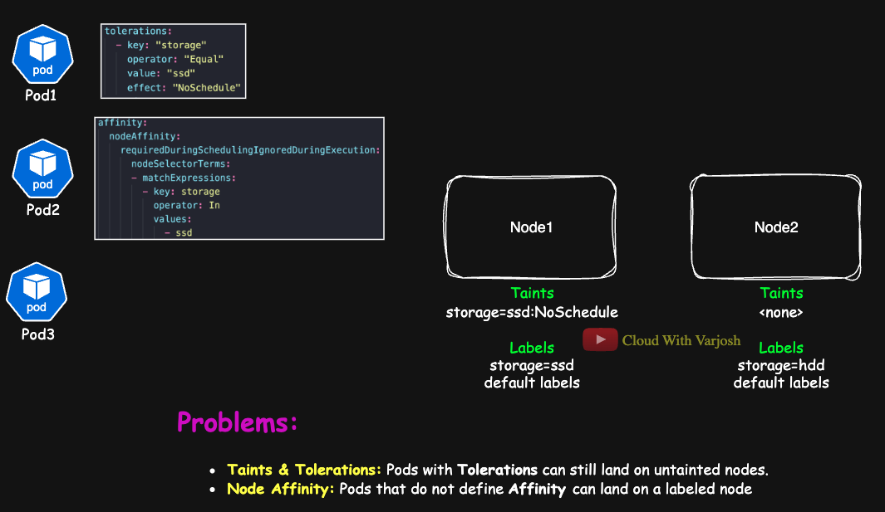

# 45 · Taints vs Affinity: Using Both for Dedicated Nodes

> **Level:** ★★ intermediate
>
> **You will learn:** why taints/tolerations alone and node affinity alone each leave a gap; the classic Node1/Node2 scenario with three Pods; the combined pattern (taint + label on the node, toleration + affinity on the Pod) that gives **predictable, exclusive** placement; and how this is used for GPU pools, team pools and system pools.
>
> **You need:** topics 43 and 44.

---

## ⚡ Core: the 10-minute version

**The idea.** Taints and affinity solve **opposite halves** of one problem:
- a **taint** keeps *other* Pods **out** of a node;
- **affinity** pulls *your* Pod **in** to a node.

Either alone leaves a gap: other Pods can sneak onto your special node, or your Pod can wander elsewhere. For **dedicated nodes** (GPU, licensed software, a team's own nodes), use both: **taint + label** on the node, **toleration + required affinity** on the Pod.

**Picture it.** A VIP room: a bouncer stops everyone else (taint), and the VIP's invitation names that room (affinity).

**The one thing to know.**

```bash
kubectl taint node lab-worker2 dedicated=gpu:NoSchedule
kubectl label node lab-worker2 dedicated=gpu
```

```yaml
tolerations: [ { key: dedicated, operator: Equal, value: gpu, effect: NoSchedule } ]
affinity:
  nodeAffinity:
    requiredDuringSchedulingIgnoredDuringExecution:
      nodeSelectorTerms: [ { matchExpressions: [ { key: dedicated, operator: In, values: [gpu] } ] } ]
```

**Try it now:**
1. Apply the taint and label above.
2. Deploy one "gpu" Pod and one normal Pod.
3. Confirm the gpu Pod is on `lab-worker2` and the normal one is not.

**You've got it if you can:** explain why dedicated nodes need both mechanisms.

> 📖 **That's the core.** On a first pass, do the mini-lab and move on to the next topic. Everything below is the **full reference**: come back for the details, the edge cases, interview answers and exam-level depth.

---

## What it is

Two complementary controls:

| | **Taint + toleration** | **Node affinity / nodeSelector** |
|---|---|---|
| Set on | Taint on the **node**, toleration on the **Pod** | Labels on the **node**, rule on the **Pod** |
| Effect | **Repels** Pods that lack the toleration | **Attracts** the Pod to matching nodes |
| Guarantees | Others stay **out** | This Pod goes **in** |
| Doesn't do | Doesn't force tolerating Pods onto the node | Doesn't stop **other** Pods from using the node |

**Use both** to make a node pool **dedicated**: only the intended Pods may run there, **and** those Pods run only there.

---

## Why it exists

**Why node affinity if we already have taints?**

What we saw with **taints & tolerations** (topic 43):
- Taints **repel** Pods that don't tolerate them.
- But a Pod **with** a toleration can still land on an **untainted** node.
- Taints and tolerations have **nothing to do with node labels**.

What we saw with **node affinity** (topic 44):
- Affinity makes a Pod go only to nodes with **specific labels**.
- But Pods **without** affinity can **also** land on those labelled nodes.
- Affinity doesn't stop **other** Pods from using the node, unless combined with taints.

**So we need both:**
- **Taints** keep **unwanted** Pods off a node.
- **Node affinity** makes sure the **right** Pods land on the right nodes.
- With only one of them, Pods can still end up somewhere unintended.

**Key takeaway:** if a Pod has **both** a toleration and node affinity (matching a node that has both the taint and the label), you can **confidently predict** where it lands.

---

## Analogy

A **VIP lounge at an airport**:
- The **taint** is the **guard at the door**: only people with a lounge pass (toleration) get in. But having a pass doesn't make you go to the lounge; you could sit at the regular gate.
- **Affinity** is the passenger's **own rule**: "I only wait in lounges". But without a guard, ordinary passengers could also wander into the lounge and take the seats.
- **Guard + rule** together: only pass-holders get in, **and** pass-holders always go there.

---

## How it works inside

### The scenario



| Node | Labels | Taints |
|---|---|---|
| **Node1** | `storage=ssd` | `storage=ssd:NoSchedule` |
| **Node2** | `storage=hdd` | none |

> **Note:** nodes also carry **default labels** (`kubernetes.io/hostname`, `topology.kubernetes.io/region`/`zone`, …) that depend on where the cluster runs (AWS, Azure, GCP, on-prem); some are added by the cloud provider (topic 44 lists the common ones).

**Pod1: tolerations only**

```yaml
tolerations:
  - key: "storage"
    operator: "Equal"
    value: "ssd"
    effect: "NoSchedule"
```

- ✅ Can go to **Node1** (tolerates its taint).
- ✅ Can **also** go to **Node2** (untainted).
- 🚨 **Problem:** it should run on SSD, but may land on **Node2 (HDD)**. **Tolerations don't force placement.**

**Pod2: node affinity only**

```yaml
affinity:
  nodeAffinity:
    requiredDuringSchedulingIgnoredDuringExecution:
      nodeSelectorTerms:
      - matchExpressions:
        - key: storage
          operator: In
          values:
            - ssd
```

- ❌ **Not Node1**: it has the label, but also the `storage=ssd:NoSchedule` **taint**, and Pod2 has no toleration.
- ❌ **Not Node2**: no `storage=ssd` label, so affinity fails.
- ⚠️ **Caveat:** even though Node1 matches the affinity **label**, the **taint** blocks it, so **Pod2 stays `Pending`** until it gets a toleration.
- **Common misconception:** "node affinity alone is enough to land a Pod on a specific node". Not when that node is tainted.

**Pod3: neither**

- ✅ Can go to **Node2** (no taints).
- ❌ Can't go to **Node1** (taint).
- 🚨 **Problem:** what if Pod3 really **needs SSD**? It lands on Node2 (HDD), which may be wrong for its workload. The fix there is giving it the right toleration and affinity, i.e. the final solution.

### The final solution: both

```yaml
tolerations:
  - key: "storage"
    operator: "Equal"
    value: "ssd"
    effect: "NoSchedule"
affinity:
  nodeAffinity:
    requiredDuringSchedulingIgnoredDuringExecution:
      nodeSelectorTerms:
      - matchExpressions:
        - key: storage
          operator: In
          values:
          - ssd
```

- ✅ Pods with this spec (Pod1 and Pod2 updated) go **only** to **Node1**.
- ❌ They **won't** go to Node2, even if it has space.
- And Pods **without** the toleration (like Pod3) **can't** use Node1.

| Pod | Toleration | Affinity `storage=ssd` | Node1 (taint+label) | Node2 (plain) |
|---|---|---|---|---|
| Pod1 | ✅ | ❌ | ✅ allowed | ✅ allowed (problem) |
| Pod2 | ❌ | ✅ | ❌ taint | ❌ label |
| Pod3 | ❌ | ❌ | ❌ taint | ✅ |
| **Both** | ✅ | ✅ | ✅ **only here** | ❌ |

### Why not only node affinity?

"If my Pods have affinity, won't they already land on the right nodes?" Yes, **your** Pods will. But as an **administrator** you want **complete control** over **which Pods can run on which nodes**:
- **Taints stop unintended workloads** running on specialised or maintenance nodes.
- **Without taints, Pods with no affinity** can still land on specialised nodes and break the segregation.
- **Taints make it explicit**: only Pods with a toleration may use reserved or critical nodes.
- **Without taints, general workloads may consume** the resources meant for high-priority apps (e.g. an expensive GPU node full of web Pods).
- **Taints add an extra enforcement layer** beyond affinity, which app teams control in their own manifests.

### Key takeaways

| Concept | Behaviour |
|---|---|
| **Taints & tolerations** | Tolerations **allow** Pods onto tainted nodes but **don't guarantee** placement |
| **Node affinity** | Pods with affinity are **forced** onto labelled nodes but **don't repel** other Pods |
| **Pods with neither** | May land on inappropriate nodes |
| **Best practice** | Use **both** for full control |

---

## Commands / YAML

### Build the scenario on kind

```bash
kubectl label nodes lab-worker storage=ssd
kubectl taint nodes lab-worker storage=ssd:NoSchedule
kubectl label nodes lab-worker2 storage=hdd
```

Three Deployments (5 replicas each) for Pod1/Pod2/Pod3, then the combined one:

```yaml
apiVersion: apps/v1
kind: Deployment
metadata:
  name: ssd-only
spec:
  replicas: 5
  selector: { matchLabels: { app: ssd-only } }
  template:
    metadata: { labels: { app: ssd-only } }
    spec:
      tolerations:
      - { key: storage, operator: Equal, value: ssd, effect: NoSchedule }
      affinity:
        nodeAffinity:
          requiredDuringSchedulingIgnoredDuringExecution:
            nodeSelectorTerms:
            - matchExpressions:
              - { key: storage, operator: In, values: [ssd] }
      containers:
      - name: nginx
        image: nginx:1.29
```

```bash
kubectl get pods -o wide -l app=ssd-only --no-headers | awk '{print $7}' | sort | uniq -c
```

```
      5 lab-worker
```

All five on the SSD node. (Run the same count for the tolerations-only Deployment: you'll see a mix of `lab-worker` and `lab-worker2`.)

### Real-world pattern: a GPU node pool

```bash
kubectl label nodes gpu-node-1 accelerator=nvidia-a100
kubectl taint nodes gpu-node-1 nvidia.com/gpu=present:NoSchedule
```

```yaml
spec:
  tolerations:
  - { key: nvidia.com/gpu, operator: Exists, effect: NoSchedule }
  affinity:
    nodeAffinity:
      requiredDuringSchedulingIgnoredDuringExecution:
        nodeSelectorTerms:
        - matchExpressions:
          - { key: accelerator, operator: In, values: [nvidia-a100] }
  containers:
  - name: train
    image: myorg/trainer:2.1
    resources:
      limits: { nvidia.com/gpu: 1 }      # the GPU itself is requested as an extended resource
```

Managed Kubernetes often taints GPU and spot node pools automatically; you just add tolerations and selectors.

---

## Hands-on lab

1. Build the scenario above and deploy Pod1 (tolerations only), Pod2 (affinity only), Pod3 (neither), each as a 5-replica Deployment. Record where each lands (Pod2 stays Pending).
2. Deploy `ssd-only` and confirm all replicas land on `lab-worker` only.
3. Scale `ssd-only` beyond `lab-worker`'s capacity (or give each replica a big CPU request): the extra replicas stay **Pending**, not spilling onto `lab-worker2`. That's the strictness you asked for.
4. Clean up: `kubectl delete deploy --all; kubectl taint nodes lab-worker storage-; kubectl label nodes lab-worker lab-worker2 storage-`.

---

## Where you'll use it

- **Dedicated node pools**: GPU, high-memory, licensed software, PCI/HIPAA-compliant nodes.
- **Team or tenant isolation**: each team's pool tainted `team=X:NoSchedule` and labelled `team=X`.
- **System pools**: CoreDNS, ingress controllers and monitoring on their own nodes.
- **Spot/preemptible capacity**: only interruption-tolerant workloads tolerate the spot taint, and prefer (soft affinity) spot nodes to save money.

---

## When it breaks

| Symptom | Cause | Fix |
|---|---|---|
| Dedicated Pods Pending | Affinity matches only tainted nodes, but no toleration | Add the toleration |
| Dedicated Pods appear on general nodes | Only a toleration, no affinity | Add required affinity |
| Random Pods on the dedicated nodes | Only labels + affinity, no taint | Taint the nodes |
| System DaemonSets missing on the dedicated pool | They don't tolerate your new taint | Add tolerations to them (or `operator: Exists`) |
| Dedicated pool full, Pods Pending | Strict rules + no capacity | Add nodes (Cluster Autoscaler/Karpenter, topic 49) |

---

## Quick recap

- **Taint** = keep others **out**; **toleration** = permission, not attraction.
- **Affinity** = pull this Pod **in**; doesn't keep others out.
- Dedicated nodes = **taint + label** on the node, **toleration + required affinity** on the Pod: predictable and exclusive.

### Interview questions

1. **Q: How do you dedicate nodes to one workload?**
   A: Taint the nodes so other Pods can't schedule there, label them, and give the workload a matching toleration plus a required node affinity (or nodeSelector) for that label.
2. **Q: A Pod has node affinity for a node but stays Pending. Why might that be?**
   A: That node has a taint the Pod doesn't tolerate; affinity doesn't override taints.
3. **Q: Why not rely on node affinity alone for isolation?**
   A: Affinity only constrains the Pods that declare it; any other Pod can still use the node and consume its resources. Taints enforce the restriction for everyone.

---

## Appendix: notes on the original course material

This topic was rebuilt from the original CKA course notes. This appendix keeps the audit trail out of your way while you learn.

### Sources

Day 18 (introduction: why compare; what we observed with taints; what we observed with affinity; why we need both; key takeaway; scenario: cluster setup, Pod1 tolerations only, Pod2 affinity only, important caveat, common misconception, Pod3 neither; the final solution; why not only node affinity and reasons; key takeaways table; conclusion).
