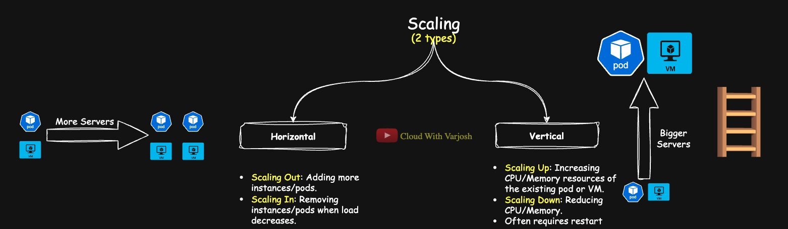
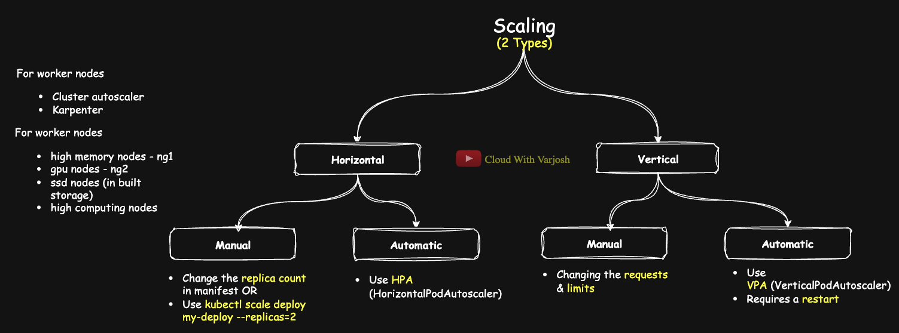
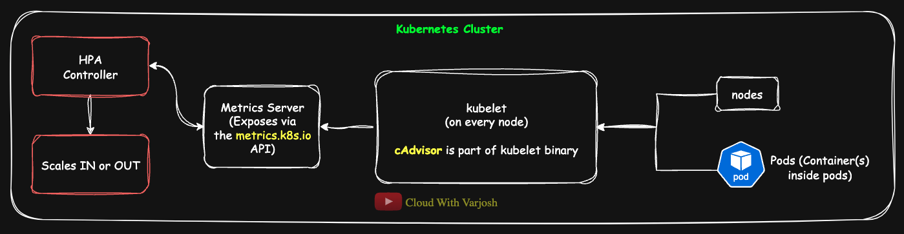
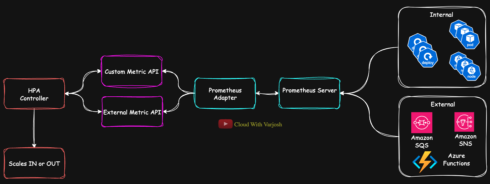

# 48 · Scaling Basics, the Metrics Pipeline and the Horizontal Pod Autoscaler (HPA)

> **Level:** ★★ intermediate
>
> **You will learn:** horizontal vs vertical scaling, manual vs automatic, for Pods **and** nodes; how resource metrics flow (cAdvisor → kubelet → metrics-server → `metrics.k8s.io`) and how custom/external metrics flow (Prometheus → adapter → `custom.metrics.k8s.io` / `external.metrics.k8s.io`); installing metrics-server (incl. the Calico/kubeadm gotcha); **the HPA**: why it needs requests, its exact algorithm, tolerance, stabilisation and `behavior`, the `autoscaling/v2` YAML, and a full load-test demo.
>
> **You need:** topics 25, 30 and 41 (requests; first metrics-server install).

---

## ⚡ Core: the 10-minute version

**The idea.** Scale **out** (more Pods) automatically with the **Horizontal Pod Autoscaler (HPA)**. Every 15 seconds it compares a metric (usually CPU use as a percentage of the **request**) with your target and adjusts replicas: `desired = ceil(current × actual / target)`. CPU and memory numbers come from **metrics-server**, which also powers `kubectl top`. Scaling down waits 5 minutes to avoid flapping.

**Picture it.** A shop manager opening more tills when queues grow, closing them slowly when it's quiet.

**The one thing to know.**

```bash
kubectl top pods                                  # needs metrics-server
kubectl autoscale deployment web --cpu-percent=50 --min=1 --max=5
kubectl get hpa -w
```

**Try it now:**
1. Install metrics-server (topic 41).
2. Create a Deployment with `requests.cpu: 100m` and autoscale it.
3. Generate load (`kubectl run load --image=busybox:1.37 -- sh -c 'while true; do wget -qO- web; done'`).
4. Watch replicas rise, delete the load Pod, and watch them fall after about 5 minutes.

**You've got it if you can:** explain the HPA formula, and why it needs resource requests.

> 📖 **That's the core.** On a first pass, do the mini-lab and move on to the next topic. Everything below is the **full reference**: come back for the details, the edge cases, interview answers and exam-level depth.

---

## What it is

**Scaling** = adjusting the resources an app has to match its **demand**: enough for today's traffic, without waste when traffic drops. The goal is **elastic scaling**: up when load rises, down when it falls.



### Two directions

**1. Horizontal scaling (out/in)**
- **Scale out** = add instances: more **Pod replicas** (or more nodes).
- **Scale in** = remove them when load falls.
- Friendly to **stateless** apps, since requests are spread over many Pods.

**2. Vertical scaling (up/down)**
- **Scale up** = give an existing Pod or VM **more CPU/memory**; **scale down** = less.

> ✅ **Correct today** ([C1](#c1)): that was true until recently, but **in-place Pod resize is GA since v1.35**: you can change a running container's CPU/memory requests and limits **without recreating the Pod** (memory decreases and some runtimes may still need a container restart, depending on `resizePolicy`). VMs still generally need a restart to resize. Topic 49 covers it.

### Two approaches for each



| | Pods (workloads) | Worker nodes (infrastructure) |
|---|---|---|
| **Horizontal, manual** | Edit `replicas` or `kubectl scale deploy my-deploy --replicas=2` | Possible via cloud console/CLI; rare and not recommended in production |
| **Horizontal, automatic** | **HPA** (this topic) adds/removes replicas from metrics | **Cluster Autoscaler** or **Karpenter** add/remove nodes based on **Pending Pods** (topic 49) |
| **Vertical, manual** | Edit requests/limits in YAML (or an in-place resize) | Impractical: resizing the VM means a node restart and evicting every Pod |
| **Vertical, automatic** | **VPA** (topic 49) adjusts requests from real usage | **Not used**: too disruptive |

**Production reality:** manual scaling of Pods or nodes is **rare**. Clusters use several **node groups** (node pools) per workload type (high-memory, high-CPU, GPU…), each scaling **automatically**; and nodes are only ever scaled **horizontally**.

**Key takeaway:** for **Pods**, both HPA and VPA are feasible and common; for **nodes**, only horizontal autoscaling.

---

## Why it exists

Traffic changes by hour, day and season. Fixed replica counts either **waste money** at night or **fall over** at peak. The HPA adds Pods when they're busy and removes them when they're idle, automatically and continuously, and node autoscalers add machines when those Pods don't fit.

---

## Analogy

A **supermarket with checkouts**: the **HPA** is the manager watching queue lengths (metrics) and opening or closing tills (replicas), never fewer than `min` or more than `max`. The manager doesn't react to a single long queue for five seconds (tolerance and stabilisation). If there aren't enough tills in the building, the **cluster autoscaler** builds a new wing (node).

---

## How it works inside

### The resource-metrics pipeline (Day 20 + Day 19)



1. **Collection**: the **kubelet** on every node includes **cAdvisor**, which collects per-container **CPU and memory** usage for all Pods (system Pods too).
2. **Exposure**: the kubelet serves these over HTTPS (10250) at **`/metrics/resource`**.
3. **Aggregation**: **metrics-server** scrapes every kubelet (every 15 s by default, `--metric-resolution`), keeps the latest values in memory, and serves them as the **`metrics.k8s.io`** API through the API server's **aggregation layer** (an `APIService` object routes that API group to the metrics-server Service).
4. **Use**: the **HPA controller** (in kube-controller-manager) and `kubectl top` read from `metrics.k8s.io`.

> ✅ **Correct today** ([C2](#c2)): metrics-server (v0.6+) reads the kubelet's **`/metrics/resource`** endpoint, a small, efficient resource-metrics feed. The kubelet's `/metrics` serves the **kubelet's own** metrics, and full cAdvisor container metrics live at **`/metrics/cadvisor`** (what Prometheus scrapes; topic 80). Metrics-server keeps only the **latest** sample; it's not a monitoring system.

### Custom and external metrics

CPU and memory aren't always the right signal. Better load indicators are often **business- or app-specific**: active HTTP requests, **queue length** in a message broker, database connection count.

| Type | Meaning | API |
|---|---|---|
| **Custom metrics** ("internal") | Metrics **attached to Kubernetes objects** (per Pod, per Ingress…) | **`custom.metrics.k8s.io`** |
| **External metrics** | Metrics **not tied to any Kubernetes object** (an SQS queue length, a cloud metric) | **`external.metrics.k8s.io`** |

You need an **adapter** that implements those APIs: **Prometheus + Prometheus Adapter**, or vendor adapters (**Datadog**, **InfluxDB**…), or **KEDA** (topic 49), which is the most common choice today.



1. Apps and external systems' metrics are scraped/sent to **Prometheus**.
2. The **Prometheus Adapter** queries Prometheus and **translates** results into the Kubernetes metric APIs.
3. It serves **object metrics** via the **Custom Metrics API** and **external** ones via the **External Metrics API**.
4. The **HPA controller** queries those APIs and scales accordingly.

### The HPA

The **Horizontal Pod Autoscaler** automatically changes the **number of replicas** of a workload based on observed metrics.
- It's a **control loop** in kube-controller-manager, running **every 15 seconds** by default (`--horizontal-pod-autoscaler-sync-period`).
- It changes the target's **`/scale` subresource**, the same thing `kubectl scale` does.

**Supported targets:** anything with a `scale` subresource: **Deployment** (most common), **StatefulSet**, **ReplicaSet**, **ReplicationController**, and custom resources that implement scale (e.g. Argo Rollouts). Prefer Deployments and StatefulSets. (Not DaemonSets: they have no replica count.)

**Why requests are mandatory:** HPA measures utilisation **as a percentage of the Pods' requests**. "Scale at 50% CPU": **50% of what?** Of the **CPU request**. A Pod requesting `200m` counts as 50% utilised at `100m`. **No request → no baseline → no scaling** (the HPA shows `<unknown>` and a `FailedGetResourceMetric` event). Every container in the target Pods must have a request for that resource (sidecars included).

### The algorithm

```
desiredReplicas = ceil( currentReplicas × currentMetricValue / targetMetricValue )
```

Example: 3 replicas averaging **90%** CPU with a **50%** target → `ceil(3 × 90/50) = ceil(5.4) = 6`.

Refinements:
- **Tolerance**: if `current/target` is within **±10%** (default), do nothing (avoids flapping on noise; configurable per HPA in newer versions).
- **Not-yet-ready Pods** and Pods missing metrics are treated conservatively (assumed 0% when scaling up, 100% when scaling down), so a slow-starting Pod doesn't trigger extra scale-ups.
- **Multiple metrics**: computed per metric; the **largest** desired count wins.
- **Bounds**: clamped to `[minReplicas, maxReplicas]`.
- **Scale-down stabilisation**: by default the HPA uses the **highest recommendation from the last 5 minutes** for scaling down, so it doesn't drop replicas on a momentary dip.
- **`behavior`** lets you tune policies: how many Pods or what % may be added/removed per period, and stabilisation windows per direction.
- **Scale to zero** isn't supported by the HPA itself (`minReplicas` ≥ 1 unless an alpha feature gate is on); KEDA provides it.

**"Did you know?":** if you don't specify a target, the HPA defaults to **80% CPU utilisation** (true for `kubectl autoscale` without `--cpu-percent` and for `autoscaling/v1` HPAs without `targetCPUUtilizationPercentage`). That's high efficiency with some headroom for spikes. Setting it explicitly is better.

**HPA + manual replicas:** once an HPA manages a Deployment, **remove `spec.replicas` from the Deployment's manifest**, or every `kubectl apply`/GitOps sync will fight the HPA (topic 15).

**HPA + VPA:** don't let both act on the **same** metric (VPA changing CPU requests while HPA scales on CPU % of those requests creates a feedback loop). Combine HPA on custom/external metrics with VPA on CPU/memory, or use VPA in recommendation-only mode (topic 49).

---

## Commands / YAML

### Install metrics-server (Day 56 quick version)

```bash
kubectl apply -f https://github.com/kubernetes-sigs/metrics-server/releases/latest/download/components.yaml
kubectl edit deployment -n kube-system metrics-server
```

Container args matching the lab:

```yaml
        args:
          - --kubelet-insecure-tls                 # skip kubelet cert verification (LAB ONLY)
          - --cert-dir=/tmp
          - --secure-port=10250
          - --kubelet-preferred-address-types=InternalIP,ExternalIP,Hostname
          - --kubelet-use-node-status-port
          - --metric-resolution=15s
```

> ⚠️ **Production:** never `--kubelet-insecure-tls`; use properly signed kubelet serving certificates (trusted CA, correct SANs; topic 53).

Verify after 1–2 minutes:

```bash
kubectl top pods
kubectl top nodes
kubectl get apiservice v1beta1.metrics.k8s.io
```

```
NAME                     SERVICE                      AVAILABLE   AGE
v1beta1.metrics.k8s.io   kube-system/metrics-server   True        2m
```

**If you built the cluster with kubeadm + Calico (Day 54/topic 75)**, `kubectl top` may time out with the APIService showing `False (FailedDiscoveryCheck)`. Fix:

```bash
# Force VXLAN encapsulation on the active IPv4 pool
kubectl patch ippool default-ipv4-ippool --type=merge -p '{"spec":{"vxlanMode":"Always","ipipMode":"Never"}}'
# Restart Calico so it reprograms routes
kubectl -n calico-system rollout restart ds/calico-node
kubectl -n calico-system rollout status ds/calico-node
```

- **Before:** `vxlanMode: CrossSubnet` encapsulates only **across subnets**; on the **same subnet** it expects plain L3 routing distributed by **BGP**.
- **After:** `vxlanMode: Always` encapsulates **all** Pod traffic; no BGP needed.
- **Why:** with CrossSubnet and **BGP disabled** (the Day 54 defaults), traffic from the **host** (the API server, which runs with host networking) to Pod/Service IPs on the same subnet has no working return path, so the API server's calls to metrics-server **time out**. Tunnelling everything over `vxlan.calico` fixes host ↔ Pod reachability, the APIService becomes `Available`, and `kubectl top` works.

### HPA demo (Day 20, `Day 20/nginx-hpa.yaml`)

**Step 1: Deployment with a CPU request**

```yaml
apiVersion: apps/v1
kind: Deployment
metadata:
  name: nginx-deploy
spec:
  replicas: 1                     # start with one Pod
  selector:
    matchLabels:
      app: nginx
  template:
    metadata:
      labels:
        app: nginx                # the Service selects this
    spec:
      containers:
      - name: nginx
        image: nginx:1.29
        resources:
          requests:
            cpu: "100m"           # 0.1 core: the HPA's 100% baseline
          limits:
            cpu: "200m"           # 0.2 core max
        ports:
        - containerPort: 80
```

**Step 2: a Service** (in the same file):

```yaml
apiVersion: v1
kind: Service
metadata:
  name: nginx-svc
spec:
  selector:
    app: nginx                    # matches the Pods
  ports:
  - protocol: TCP
    port: 80                      # Service port
    targetPort: 80                # container port
  type: ClusterIP                 # internal only
```

```bash
kubectl apply -f "Day 20/nginx-hpa.yaml"
```

**Step 3: create the HPA**

```bash
kubectl autoscale deployment nginx-deploy --cpu-percent=50 --min=1 --max=5
```

- `deployment nginx-deploy` = the target.
- `--cpu-percent=50` = keep **average CPU at 50% of requests** (50m per Pod here).
- `--min=1` / `--max=5` = bounds.
- Average above 50% → **scale out**; below → **scale in** (never below 1).

The declarative equivalent (`autoscaling/v2`), with tuned behaviour:

```yaml
apiVersion: autoscaling/v2
kind: HorizontalPodAutoscaler
metadata:
  name: nginx-deploy
spec:
  scaleTargetRef:
    apiVersion: apps/v1
    kind: Deployment
    name: nginx-deploy
  minReplicas: 1
  maxReplicas: 5
  metrics:
  - type: Resource
    resource:
      name: cpu
      target:
        type: Utilization          # % of request (or AverageValue: absolute, e.g. 80m)
        averageUtilization: 50
  behavior:
    scaleUp:
      policies:
      - { type: Percent, value: 100, periodSeconds: 15 }   # at most double every 15 s
    scaleDown:
      stabilizationWindowSeconds: 120                      # default 300
      policies:
      - { type: Pods, value: 1, periodSeconds: 60 }        # remove at most 1 Pod per minute
```

Other metric types: `Pods` (a custom per-Pod metric, e.g. requests per second), `Object` (a metric of another object, e.g. an Ingress's RPS), `External` (e.g. queue length), `ContainerResource` (one container's usage, ignoring sidecars).

**Step 4: check the HPA**

```bash
kubectl get hpa
kubectl describe hpa nginx-deploy
```

```
NAME           REFERENCE                 TARGETS       MINPODS   MAXPODS   REPLICAS   AGE
nginx-deploy   Deployment/nginx-deploy   cpu: 0%/50%   1         5         1          30s
```

- `TARGETS cpu: 0%/50%` = current average / target. `<unknown>/50%` = no metrics (metrics-server missing or no requests).

**Step 5: generate load**

```bash
kubectl run -it --rm load-generator --image=busybox:1.37 -- /bin/sh -c "while true; do wget -q -O- http://nginx-svc; done"
```

| Part | Meaning |
|---|---|
| `kubectl run` | Start a temporary Pod |
| `-it` | Interactive terminal |
| `--rm` | Delete it on exit |
| `--image=busybox` | Small image with `wget` |
| `while true; do … done` | Infinite loop of requests |
| `wget -q -O- http://nginx-svc` | Quiet GET to the Service (by DNS name), output to stdout |

(Day 20 does it in two steps: `kubectl run -it --rm load-generator --image=busybox /bin/sh`, then type the loop inside.)

**Step 6: watch it scale**

```bash
kubectl get hpa -w
kubectl get pods -w
```

```
NAME           REFERENCE                 TARGETS         MINPODS   MAXPODS   REPLICAS
nginx-deploy   Deployment/nginx-deploy   cpu: 186%/50%   1         5         1
nginx-deploy   Deployment/nginx-deploy   cpu: 186%/50%   1         5         4
nginx-deploy   Deployment/nginx-deploy   cpu: 62%/50%    1         5         5
…(stop the load generator)…
nginx-deploy   Deployment/nginx-deploy   cpu: 0%/50%     1         5         5
nginx-deploy   Deployment/nginx-deploy   cpu: 0%/50%     1         5         1     ← after the ~5 min stabilisation window
```

- 186% of 100m ≈ 186m used by one Pod → `ceil(1 × 186/50) = 4` replicas, then 5 (max).
- Scale-down waits for the stabilisation window.

```bash
kubectl describe hpa nginx-deploy | tail -4
```

```
Events:
  Normal  SuccessfulRescale  2m   horizontal-pod-autoscaler  New size: 4; reason: cpu resource utilization (percentage of request) above target
  Normal  SuccessfulRescale  90s  horizontal-pod-autoscaler  New size: 5; reason: cpu resource utilization (percentage of request) above target
  Normal  SuccessfulRescale  10s  horizontal-pod-autoscaler  New size: 1; reason: All metrics below target
```

---

## Hands-on lab

1. Install metrics-server; confirm the APIService is Available and `kubectl top nodes` works.
2. Run the HPA demo; compute the expected replica counts from `TARGETS` and compare.
3. Remove the CPU request from the Deployment and watch the HPA show `<unknown>` with a `FailedGetResourceMetric` event.
4. Apply the `autoscaling/v2` YAML with `behavior`; compare scale-down speed with the defaults.
5. Add a memory metric (`averageUtilization: 70`) alongside CPU, and confirm the higher recommendation wins.
6. Set `replicas: 1` in the Deployment manifest and re-apply while the HPA has it at 5: the Deployment drops to 1, then the HPA scales it back up. That's the fight; remove `replicas` from the manifest.
7. Clean up: `kubectl delete hpa nginx-deploy; kubectl delete -f "Day 20/nginx-hpa.yaml"`.

---

## Where you'll use it

- **Every stateless service** with variable traffic: CPU-based HPA as the baseline, request-rate or queue-based for better accuracy.
- **Cost control**: low `minReplicas` at night, with node autoscaling removing idle nodes.
- **Capacity planning**: `maxReplicas` × requests must fit what the node autoscaler can provide.

---

## When it breaks

| Symptom | Cause | Fix |
|---|---|---|
| `TARGETS <unknown>/50%` | No metrics-server, or Pods lack requests (all containers) | Install it; set requests |
| `FailedGetResourceMetric … unable to fetch metrics from resource metrics API: the server is currently unable to handle the request` | metrics-server down / APIService unavailable (TLS, networking; the Calico case) | `kubectl get apiservice`, metrics-server logs |
| Replicas flap up and down | Bursty metric, short windows | Longer stabilisation, `behavior` policies |
| Scales up but new Pods are `Pending` | No node capacity | Node autoscaling (topic 49) |
| HPA and a CI deploy keep overriding each other | `replicas` in the managed manifest | Remove it from the manifest |
| Scales on the wrong thing | A sidecar's CPU distorts the Pod average | `ContainerResource` metric for the app container |
| Never scales down | A metric always above target, or `minReplicas` high | Inspect `describe hpa` conditions |

---

## Quick recap

- Horizontal (replicas, nodes) vs vertical (bigger Pods); automate with **HPA** (Pods), **VPA** (Pod size), **Cluster Autoscaler/Karpenter** (nodes, horizontally only).
- Metrics: kubelet/cAdvisor `/metrics/resource` → **metrics-server** → `metrics.k8s.io`; custom/external via adapters (Prometheus Adapter, KEDA).
- HPA: every 15 s, `desired = ceil(current × actual/target)`, ±10% tolerance, 5-min scale-down stabilisation, `behavior` policies; **requires requests** for utilisation targets.
- Don't set `replicas` in manifests managed by an HPA; don't run HPA and VPA on the same metric.

### Interview questions

1. **Q: Why does the HPA need resource requests?**
   A: Utilisation targets are percentages of the requested amount; without requests there's no baseline, so the HPA can't compute utilisation.
2. **Q: How does the HPA calculate the desired replica count?**
   A: `ceil(currentReplicas × currentMetric / targetMetric)`, ignoring changes within the tolerance (10%), taking the max across metrics, clamped to min/max, with stabilisation windows (5 minutes for scale-down by default).
3. **Q: How would you autoscale on queue length instead of CPU?**
   A: Expose it via the External Metrics API (Prometheus Adapter, a cloud adapter, or KEDA) and use an `External` metric in an `autoscaling/v2` HPA (or a KEDA ScaledObject).

---

## Appendix: notes on the original course material

This topic was rebuilt from the original CKA course notes. This appendix keeps the audit trail out of your way while you learn.

### Sources

Day 20 (what scaling is; horizontal and vertical; scaling approaches for Pods and nodes; production reality; Pod vs node scaling table; HPA: how it works, supported workloads, why requests are mandatory, default resource metrics and their flow, custom metrics and their flow, metrics-server prerequisite, HPA demo steps 1–6, "did you know" on 80%), Day 19 (metrics pipeline, already detailed in topic 41), Day 56 (metrics-server quick install; the Day 54 kubeadm + Calico VXLAN fix), files `Day 20/nginx-hpa.yaml`. VPA (rest of Day 20) is in topic 49.

### Corrections to the original notes

Each entry shows what the original said and what's true now. In the topic above, each correction appears as a ✅ **Correct today** line or a ⚠️ **Fix to the original** box, linked to its entry here.

<a id="c1"></a>**C1 · Corrected (Day 20).** "vertical scaling **often requires a restart**… Pod example: Kubernetes needs to recreate the Pod with updated requests/limits". **Now:** that was true until recently, but **in-place Pod resize is GA since v1.35**: you can change a running container's CPU/memory requests and limits **without recreating the Pod** (memory decreases and some runtimes may still need a container restart, depending on `resizePolicy`). VMs still generally need a restart to resize. Topic 49 covers it.

<a id="c2"></a>**C2 · Corrected (Day 20).** step 2 said the kubelet exposes cAdvisor metrics "via its API (e.g. **`/metrics`** endpoint)" and metrics-server "queries this cAdvisor API". **Now:** metrics-server (v0.6+) reads the kubelet's **`/metrics/resource`** endpoint, a small, efficient resource-metrics feed. The kubelet's `/metrics` serves the **kubelet's own** metrics, and full cAdvisor container metrics live at **`/metrics/cadvisor`** (what Prometheus scrapes; topic 80). Metrics-server keeps only the **latest** sample; it's not a monitoring system.
