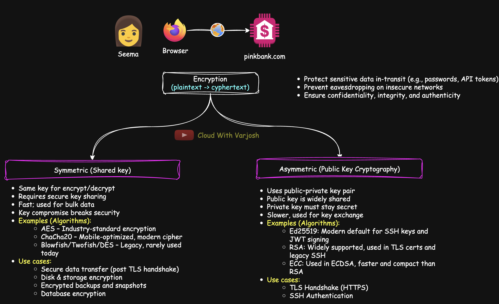
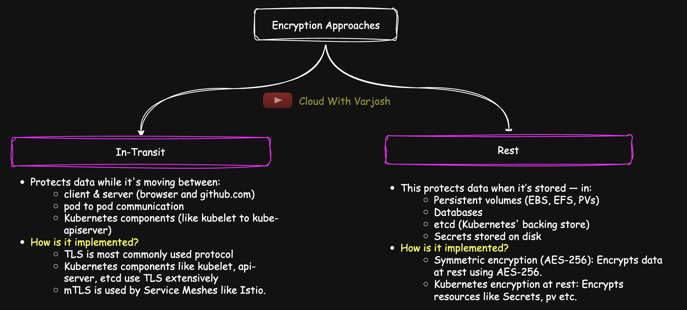
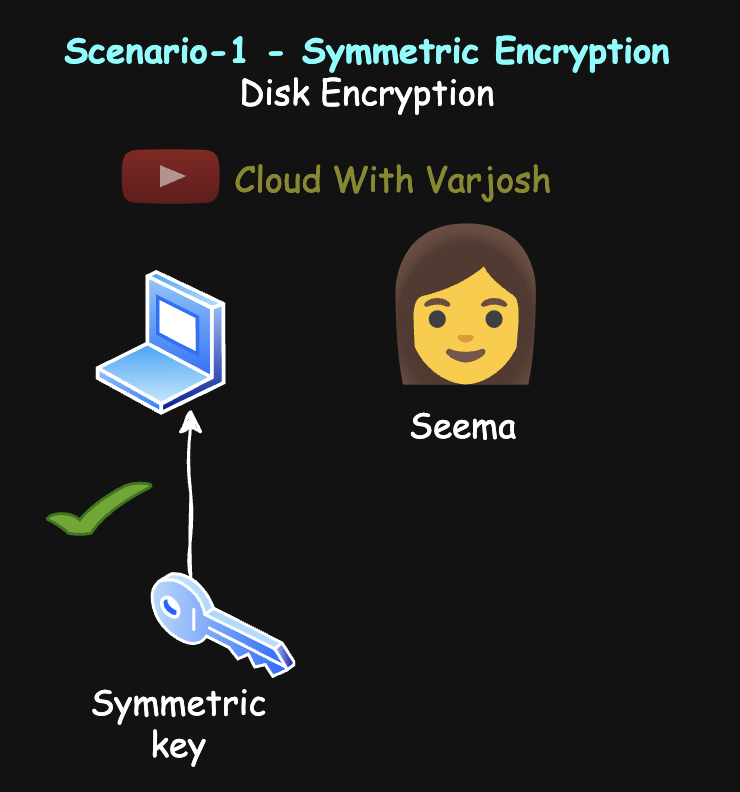
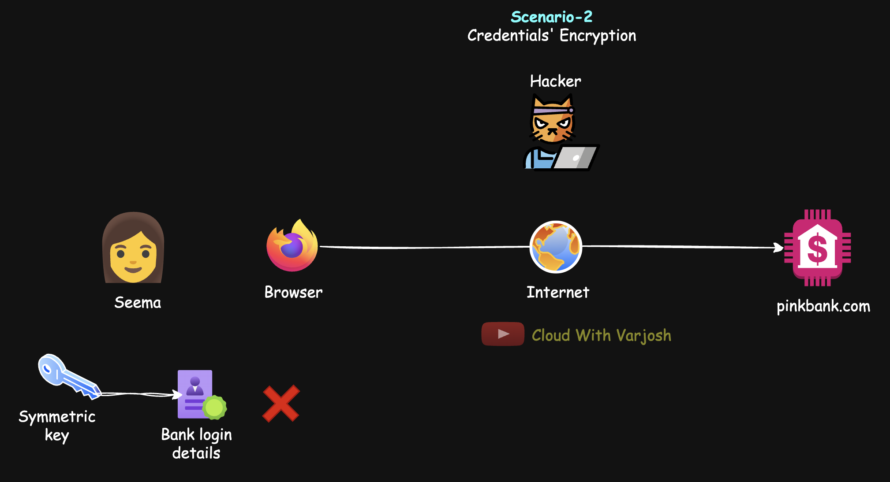
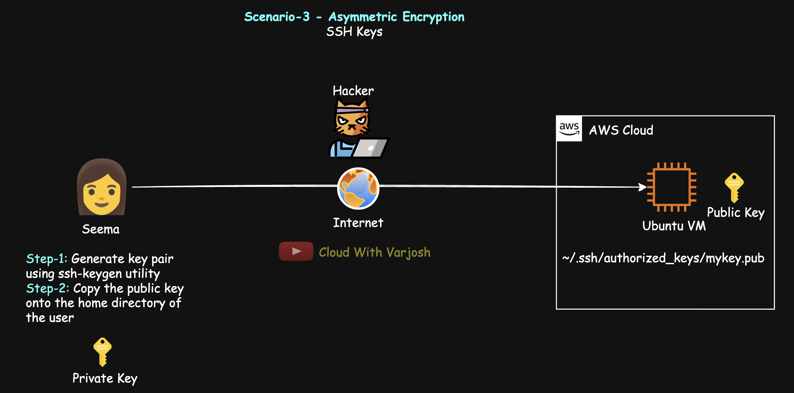
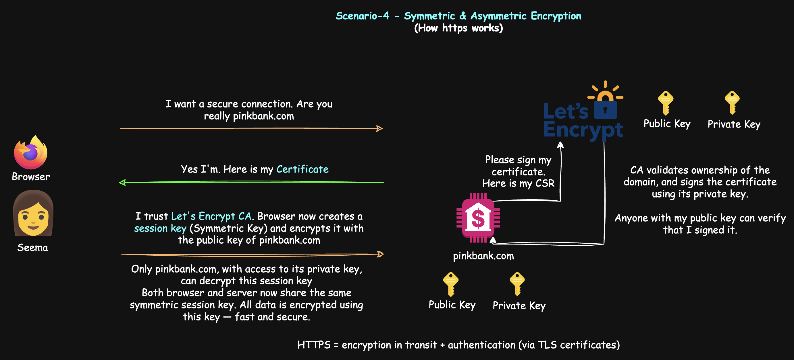

# 50 · Encryption Basics: Symmetric, Asymmetric, In Transit, At Rest, SSH and TLS

> **Level:** ★ foundation
>
> **You will learn:** what encryption is and what it protects (confidentiality, integrity, authenticity); **symmetric** encryption (one shared key: fast, for bulk data) vs **asymmetric** encryption (a public/private key pair: for identity, signatures and key exchange); **hashing** and **digital signatures**; encryption **in transit** vs **at rest** in cloud and Kubernetes; and four everyday scenarios (BitLocker, why symmetric alone fails on the internet, SSH logins, the HTTPS/TLS handshake), with the TLS 1.3 key exchange done correctly.
>
> **You need:** nothing beyond general networking. Your Linux notes ([`064`](../../linux-mastery-rhel/notes/064-cryptography-basics.md) cryptography basics, [`065`](../../linux-mastery-rhel/notes/065-ssh.md) SSH) go deeper. This topic is the foundation for every security topic after it.

---

## ⚡ Core: the 10-minute version

**The idea.** Encryption keeps data **secret** (confidentiality), **unaltered** (integrity), and proves **who sent it** (authenticity).
- **Symmetric** encryption (AES) uses one shared key: fast, used for the actual data.
- **Asymmetric** encryption (RSA, ECDSA) uses a key pair: what the **private** key signs, the **public** key verifies. It proves identity and safely agrees a shared key.

TLS (HTTPS, and every Kubernetes connection) uses both: asymmetric to prove identity and agree a key, symmetric for everything after.

**Picture it.** Asymmetric keys are a padlock anyone can snap shut (public) that only you can open (private). Symmetric is the single house key two people share once they've met.

**The one thing to know.**

```bash
openssl genrsa -out me.key 2048                          # private key: never share
openssl rsa -in me.key -pubout -out me.pub               # public key: share freely
echo hello > msg; openssl dgst -sha256 -sign me.key -out msg.sig msg
openssl dgst -sha256 -verify me.pub -signature msg.sig msg    # Verified OK
```

**Try it now:**
1. Run the four commands.
2. Edit `msg` and verify again: it fails.
3. `curl -v https://kubernetes.io 2>&1 | grep -E 'SSL connection|subject'`: see TLS 1.3 in action.

**You've got it if you can:** explain symmetric vs asymmetric, and why TLS uses both.

> 📖 **That's the core.** On a first pass, do the mini-lab and move on to the next topic. Everything below is the **full reference**: come back for the details, the edge cases, interview answers and exam-level depth.

---

## What it is

**Encryption** converts readable data (**plaintext**) into unreadable data (**ciphertext**), so that only authorised parties (those with the right **key**) can turn it back.

We need it to:
- protect sensitive data **in transit** (passwords, API tokens);
- prevent **eavesdropping** on untrusted networks;
- provide **confidentiality** (nobody else can read it), **integrity** (nobody changed it) and **authenticity** (it really came from who it claims).

Strictly, integrity and authenticity come from encryption's companions: **hashes**, **MACs** and **digital signatures** (below). Modern protocols such as TLS use all of them together.

Two main types:



### 1. Symmetric encryption (shared key)

- **One secret key** both **encrypts and decrypts**. Also called the **symmetric**, **shared** or **secret** key.
- The key must be **shared securely** between sender and receiver: that's the hard part.
- **Fast and efficient**: ideal for **large volumes** of data.
- If the key leaks, everything encrypted with it is exposed.

**Algorithms:** **AES** (Advanced Encryption Standard; the industry standard, usually AES-256-GCM); **ChaCha20** (with Poly1305; fast on mobile/low-power CPUs without AES hardware); legacy **Blowfish**, **Twofish**, **DES**/3DES (DES is broken; don't use it).

**Use cases:**
- **Bulk data after the TLS handshake**: once a session key is agreed, all HTTPS traffic is encrypted symmetrically.
- **Disk and storage encryption**: AWS EBS, Azure Managed Disks and Google Persistent Disks use AES-256 under the hood, with keys managed by a **KMS** (Key Management Service: a cloud service that stores and controls encryption keys).
- **Encrypted backups and snapshots** before storing them on disk or in object storage.
- **Database encryption** at rest: MySQL TDE (Transparent Data Encryption), MongoDB's encrypted storage engine.
- **Kubernetes Secrets encryption at rest**: the API server encrypts Secrets (and optionally ConfigMaps and custom resources) with AES-CBC/AES-GCM/secretbox keys from a file or a KMS (topic 35).

**Why symmetric for bulk data:** far faster than asymmetric, easy to accelerate in hardware (AES-NI instructions, HSMs, TPMs), and with good key management (KMS) it's both fast and secure.

### 2. Asymmetric encryption (public-key cryptography)

- A **key pair**: a **public key** (share it with anyone) and a **private key** (never share it).
- The two keys are mathematically linked, but you **can't** work out the private key from the public one.
- Two different operations:
  - **Encryption / key exchange**: data encrypted with the **public** key can only be decrypted with the **private** key (RSA), or the two sides **agree** on a shared secret (Diffie-Hellman).
  - **Signatures**: the **private** key **signs**; anyone with the **public** key can **verify** the signature.
- More **computationally expensive** than symmetric, so it's used to **establish trust and agree keys**, not for bulk data.

**Algorithms:**
- **Ed25519**: a modern signature algorithm; the default for SSH keys and common for JWT signing.
- **RSA**: still everywhere: TLS certificates, Kubernetes component certificates (kubeadm's default), older SSH keys.
- **ECC** (Elliptic Curve Cryptography), e.g. **ECDSA** signatures and **ECDHE** key exchange: smaller and faster than RSA for the same strength.

> ℹ️ **Note:** the original notes said "data encrypted with the public key can only be decrypted with the private key, **and vice versa**". The "vice versa" (encrypt with private, decrypt with public) is really a **signature**, and it's only RSA that happens to work mathematically both ways. Ed25519 and ECDSA **can only sign and verify**; they can't encrypt at all. Think of it as two different jobs: **encrypt/agree keys** with public keys, **sign** with private keys.

**Use cases:**
- **TLS handshake (HTTPS)**: the server's **certificate** carries its **public key**; the handshake uses it to **prove the server's identity** and agree a **session key**, then symmetric encryption takes over.
- **SSH authentication**: you log in with a key pair; the server checks your signature against your public key (no password).
- **Kubernetes X.509 certificates**: kube-apiserver, kubelet, etcd and kubectl all use client and server certificates (RSA or ECC keys) for **mutual authentication** (topics 51–53).
- **Digital signatures**: signed Git commits (GPG/PGP, SSH signing); **JWT** (JSON Web Tokens) used by OIDC and Kubernetes ServiceAccount tokens are **signed with a private key and verified with the public key** (topics 54–55); signed container images (topic 63).
- **Secure secret delivery**: **Sealed Secrets** encrypts a Secret with the cluster controller's **public** key so only the controller (with the private key) can decrypt it; Vault uses asymmetric crypto in several places (topic 63).

**Why asymmetric:** public keys can be **distributed openly** (interception is harmless); it works between parties that **share no secret yet**; it enables **identity verification and trust models** like **PKI** (Public Key Infrastructure, topic 51).

**Considerations:** slower, so it's used at **connection set-up** or for **signing**; systems use asymmetric crypto to **establish trust and agree a symmetric key**, then **switch to symmetric** for speed.

### Summary

| Feature | Symmetric | Asymmetric |
|---|---|---|
| Keys | One shared secret key | Public + private key pair |
| Speed | Fast | Slower |
| Risk | Sharing the key safely is hard | Safe public distribution; protect the private key |
| Use | Bulk data encryption | Identity, signatures, key exchange |
| Examples | AES, ChaCha20 | RSA, ECDSA, Ed25519, (EC)DH; used by TLS and SSH |

**Roles:** **AES** encrypts large amounts of data quickly with one key: files, records, disks. **RSA/ECC** secure the **exchange or agreement** of those symmetric keys over insecure channels. The layered approach gives you **the speed of symmetric and the trust of asymmetric**.

### Hashes, MACs and signatures (the missing pieces)

| Tool | What it does | Example |
|---|---|---|
| **Hash** | Turns any data into a fixed-size **fingerprint**; one-way; any change gives a different hash | SHA-256 (image digests, topic 20) |
| **MAC / AEAD** | A hash keyed with a **secret** key: proves the data wasn't modified **and** came from a key-holder | HMAC; AES-GCM and ChaCha20-Poly1305 encrypt **and** authenticate together |
| **Digital signature** | Hash the data, then sign the hash with a **private** key; anyone verifies with the **public** key | Certificates, JWTs, signed images |

---

## Why it exists

Kubernetes is a **distributed system**: dozens of components talk over the network (kubectl → API server → etcd → kubelets), store secrets on disk (etcd, backups, volumes), and accept requests from many identities. Every one of those links needs encryption **and** identity verification. Without understanding keys, certificates and handshakes, you can't operate or debug Kubernetes security (certificate expiry is a top cause of cluster outages; topic 82).

---

## Analogy

- **Symmetric** = a **house key**: the same key locks and unlocks the door. Fast, but you must hand a copy to everyone who needs in, and if a copy is stolen, the house is open.
- **Asymmetric** = a **post box with a slot**: anyone can drop letters in (public key), but only the owner with the key can open it (private key). And a **wax seal** (signature): only you have your signet ring (private key), but anyone who knows your seal (public key) can check a letter is really from you.
- **TLS** = using the post box once to **agree on a house key** safely, then using the fast house key for the rest of the conversation.

---

## How it works inside

### In transit vs at rest



**1. Encryption in transit**: protects data **while it moves**:
- client ↔ server (your browser ↔ GitHub);
- Pod ↔ Pod;
- Kubernetes components (kubelet ↔ kube-apiserver).

How:
- **TLS** (Transport Layer Security) is the standard. Kubernetes uses TLS everywhere: `kubectl`, the API server, etcd, kubelets, Ingress.
- **Service meshes** (Istio, Linkerd; topic 74) add **mTLS** (mutual TLS: both sides present certificates) to encrypt **Pod-to-Pod** traffic automatically. Some CNIs (Cilium, Calico) offer **WireGuard/IPsec** node-to-node encryption.

Why: stops **eavesdropping**, **man-in-the-middle** (an attacker secretly relaying and possibly altering traffic) and **session hijacking**; essential in multi-tenant clusters and over public networks.

**2. Encryption at rest**: protects data **while it's stored**:
- persistent volumes (EBS, EFS, PVs);
- databases;
- **etcd** (where all Kubernetes objects, including Secrets, live);
- backups and snapshots.

How: **symmetric** algorithms such as **AES-256**.

> ✅ **Correct today** ([C1](#c1)): the API server's `EncryptionConfiguration` encrypts **API objects as they're stored in etcd**: Secrets, ConfigMaps, custom resources, even a PVC **object's** YAML. It does **not** encrypt the **data inside volumes**. Volume data is encrypted by the **storage layer**: EBS/PD/Azure disk encryption (often a StorageClass parameter like `encrypted: "true"`), LUKS on the node, or the storage system itself.

Why: if someone gets your disk, an EBS snapshot or an etcd backup, the raw data is unreadable. Also required for **compliance**: GDPR (EU data protection), HIPAA (US health data), PCI-DSS (card payments).

| Aspect | In transit | At rest |
|---|---|---|
| Purpose | Protect data being transferred | Protect stored data |
| Technology | TLS, mTLS, VPN, WireGuard | AES, KMS, disk encryption |
| Common tools | TLS certificates, Istio, NGINX | AWS/GCP KMS, Kubernetes encryption providers, LUKS |
| Example | kubectl → API server | etcd encryption, S3 object encryption |
| Who handles it | Network layer, sidecars | Storage layer, cloud provider, API server (for etcd) |

**A secure system uses both.** Kubernetes and the cloud provide the features; it's the DevOps/cloud engineer's job to **configure and verify** them.

### Scenario 1: symmetric disk encryption

**Seema protects her Windows laptop with BitLocker** (symmetric, AES).



- At power-on she enters a **BitLocker PIN**, which unlocks the disk's encryption key (protected by the laptop's **TPM**, a security chip).
- Then she logs into Windows normally.
- If the laptop is stolen, the data stays protected without the PIN. Even if the disk is moved to another computer, its contents are **ciphertext**.

**Key point:** symmetric encryption is **fast** and right for **large data** like whole disks: one key encrypts and decrypts. (Linux equivalent: **LUKS**; your Linux notes, topic [088](../../linux-mastery-rhel/notes/088-luks-encryption.md).)

### Scenario 2: why symmetric alone fails on the internet



Seema wants to log into `pinkbank.com`. If she encrypts her credentials with a symmetric key:
- the bank **can't decrypt** them unless it has the same key;
- she **can't safely send** the key over the internet; an attacker could intercept it.

❌ **Symmetric encryption alone can't secure communication between strangers on an untrusted network.** The key-distribution problem is solved in Scenario 4 with asymmetric cryptography.

### Scenario 3: asymmetric SSH login to EC2



Seema logs into her Ubuntu EC2 instance with an SSH key pair:
1. **Generate a key pair**: `ssh-keygen -t ed25519 -f ~/.ssh/mykey` creates **`mykey`** (the **private** key) and **`mykey.pub`** (the **public** key).
2. **Put the public key on the server** in `~/.ssh/authorized_keys` (AWS does this for you with an EC2 key pair; or `ssh-copy-id`).
3. **Set permissions**: the private key must be readable only by you (`chmod 600 ~/.ssh/mykey`), or SSH refuses to use it.
4. **Connect**: `ssh -i ~/.ssh/mykey ubuntu@<ec2-ip>`.

> ✅ **Correct today** ([C2](#c2)): `ssh-keygen -f mykey` writes the **private** key to **`mykey`** (no extension) and the **public** key to **`mykey.pub`**. You copy **`mykey.pub`** to the server and connect with **`mykey`**. (Day 31's key-format table gets this right.)

**Key ideas:**
- Anything **encrypted with Seema's public key** can only be decrypted with her private key.
- Anything **signed with her private key** can be verified by anyone with her public key.

**How SSH uses it:**
1. The server sends a **random challenge** (in practice, data derived from the session).
2. Seema's SSH client **signs it locally** with her **private key**.
3. The signature is sent to the server.
4. The server **verifies** it with her **public key** from `authorized_keys`.
5. Valid → she's in. Her **private key never leaves her machine**.

**Key point:** asymmetric crypto is for **identity verification and key exchange**; the private key stays with its owner.

**Common key file extensions:**
- Public keys: `.pub`, `.crt`, `.cer`, `.pem`, `.der`.
- Private keys: `.key`, `.pem`, `.ppk` (PuTTY), `.pfx` (bundle), `.der`.
- SSH typically: `.pub` for public keys, **no extension** (or `.key`) for private keys. TLS: `.crt`/`.pem` for certificates, `.key` for private keys. (`.pem` and `.der` are **encodings** and can hold either.)

### Scenario 4: symmetric + asymmetric together, the TLS handshake

**What TLS is:**
- **TLS** (Transport Layer Security) is the modern, secure successor to **SSL** (Secure Sockets Layer). People still say "SSL certificates", but TLS is what's used (SSL and TLS 1.0/1.1 are all deprecated; use **TLS 1.2 or 1.3**).
- TLS is the security protocol behind **HTTPS**: the padlock in your browser. It stops attackers **eavesdropping, tampering or impersonating** the site.
- It combines **asymmetric** crypto (identity and key agreement) with **symmetric** crypto (fast bulk encryption).
- It's **general-purpose**: it secures HTTPS, FTPS, SMTPS, IMAPS/POP3S, LDAPS, gRPC, **Kubernetes** (every component connection), MQTT… Whenever you see **HTTPS**, TLS is providing **authentication, encryption and integrity**.



Seema opens `https://pinkbank.com`:

1. **ClientHello**: the browser says: "Let's talk securely. Here are the TLS versions and cipher suites I support," and (TLS 1.3) sends its half of an **ephemeral key exchange** (an ECDHE "key share": a one-time public value).
2. **ServerHello + certificate**: the server picks the parameters, sends its own **key share**, and its **certificate**, which contains:
   - the **public key** of `pinkbank.com`;
   - the **domain name(s)** it was issued for;
   - a **digital signature from a Certificate Authority** (CA), e.g. Let's Encrypt.
3. **Both sides compute the same session keys** from the two key shares (**Diffie-Hellman**: each combines its own secret with the other's public value and gets the same result). The keys are **never sent** over the network.
4. **The server proves it owns the certificate**: it **signs** the handshake transcript with its **private key** (`CertificateVerify`). Only the real `pinkbank.com` can do that.
5. **The browser verifies**:
   - the certificate is signed by a **trusted CA** (browsers ship with a list of trusted CAs and their public keys), via the chain of intermediate certificates;
   - it hasn't **expired** (or been revoked);
   - the **domain matches** (`pinkbank.com` is in the certificate's Subject Alternative Names);
   - the server's `CertificateVerify` signature checks out with the certificate's public key.
6. **Finished** messages confirm both sides saw the same handshake; then all application data is encrypted with the **symmetric session keys** (AES-GCM or ChaCha20-Poly1305): fast and secure.

**Why a CA is needed:** a **Certificate Authority** is a trusted organisation that **validates domain ownership** and **signs certificates**. When the owner of `pinkbank.com` requests a certificate, the CA checks they really control the domain, then signs the certificate with **the CA's private key**: a cryptographic endorsement. **Link to Scenario 3:** in SSH, Seema's private key **signed** a challenge and the server **verified** it with her public key. In TLS, the **CA's private key signs** the certificate, and the **browser verifies** it with the **CA's public key**.

> ✅ **Correct today** ([C3](#c3)): that's **RSA key transport**, used by old TLS 1.2 configurations. It has a serious flaw: if the server's private key is ever stolen, **every recorded past session can be decrypted** (no **forward secrecy**). **TLS 1.3 removed it entirely.** Modern TLS uses an **ephemeral Diffie-Hellman** exchange (ECDHE): both sides **contribute** to the session key, it's **never transmitted**, and the server's certificate key is used only to **sign** (prove identity). Day 31 (topic 51) describes this correctly.

**Key takeaways:**
- The **CA's private key signs** the certificate → the **browser verifies** with the CA's public key.
- The **server's private key signs** the handshake → the browser verifies with the certificate's public key.
- The **session key is agreed** by Diffie-Hellman, not sent.
- **Private keys never travel**; signing and verifying happen locally.
- After the handshake, **symmetric encryption** carries the data.

**Why Let's Encrypt in the example:** it's free and automated, popular for personal sites, DevOps automation and startups, and widely used in production too. Enterprises may use **DigiCert, Sectigo**, or cloud CAs like **AWS Certificate Manager (ACM)** (topic 71).

---

## Commands / YAML

### Symmetric encryption with openssl

```bash
echo "top secret" > note.txt
openssl enc -aes-256-cbc -pbkdf2 -salt -in note.txt -out note.enc     # asks for a passphrase
openssl enc -d -aes-256-cbc -pbkdf2 -in note.enc                      # same passphrase decrypts
```

```
enter AES-256-CBC encryption password:
top secret
```

- One secret (the passphrase, turned into a key by PBKDF2) both encrypts and decrypts.

### Asymmetric: keys, sign, verify

```bash
openssl genpkey -algorithm ed25519 -out priv.key        # private key
openssl pkey -in priv.key -pubout -out pub.pem          # derive the public key
openssl pkeyutl -sign -inkey priv.key -rawin -in note.txt -out note.sig
openssl pkeyutl -verify -pubin -inkey pub.pem -rawin -in note.txt -sigfile note.sig
```

```
Signature Verified Successfully
```

Change one character in `note.txt` and verify again: `Signature Verification Failure`.

### Hash

```bash
sha256sum note.txt
```

### SSH keys

```bash
ssh-keygen -t ed25519 -f ~/.ssh/mykey -C "seema@laptop"
ls -l ~/.ssh/mykey*
```

```
-rw------- 1 tushar tushar 411 Nov 18 10:02 /home/tushar/.ssh/mykey        ← private (600)
-rw-r--r-- 1 tushar tushar  97 Nov 18 10:02 /home/tushar/.ssh/mykey.pub    ← public
```

### Watch a real TLS handshake

```bash
openssl s_client -connect kubernetes.io:443 -servername kubernetes.io -brief </dev/null
```

```
CONNECTION ESTABLISHED
Protocol version: TLSv1.3
Ciphersuite: TLS_AES_128_GCM_SHA256
Peer certificate: CN = kubernetes.io
Hash used: SHA256
Signature type: ECDSA
Verification: OK
Server Temp Key: X25519, 253 bits
```

- `TLSv1.3` = modern protocol.
- `TLS_AES_128_GCM_SHA256` = the **symmetric** cipher used for the data.
- `Signature type: ECDSA` = how the server **proved** its identity (signed with its private key).
- `Server Temp Key: X25519` = the **ephemeral Diffie-Hellman** key exchange (forward secrecy).
- `Verification: OK` = the certificate chained to a trusted CA and matched the name.

---

## Hands-on lab

1. Encrypt and decrypt a file with AES (above); try the wrong passphrase.
2. Generate an Ed25519 key pair; sign and verify a file; tamper and re-verify.
3. Create an SSH key pair and check the permissions; (if you have a VM) log in with it.
4. Run `openssl s_client` against three sites and compare protocol versions, ciphers and key exchanges.
5. Look at the Kubernetes side: `docker exec lab-control-plane ls /etc/kubernetes/pki` (the CA, API server, etcd and front-proxy keys and certificates; topic 53).
6. Find where encryption at rest would apply in your cluster: etcd (topic 35), the PV backend (topic 39).

---

## Where you'll use it

- **Everywhere in Kubernetes security**: certificates (51–53), authentication tokens (54–55), Secrets encryption (35), image signing (63), service mesh mTLS (74).
- **Cloud**: KMS keys for EBS/S3/RDS encryption, ACM certificates for load balancers (71).
- **Day-to-day ops**: SSH access to nodes, debugging TLS errors with `openssl s_client`.

---

## When it breaks

| Symptom | Cause | Fix |
|---|---|---|
| `x509: certificate has expired or is not yet valid` | Expired certificate, or clock skew | Renew; fix NTP (chrony) |
| `x509: certificate signed by unknown authority` | Client doesn't trust the issuing CA | Add the CA to the trust store / kubeconfig |
| `x509: certificate is valid for X, not Y` | Hostname not in the certificate's SANs | Reissue with the right SANs; use the right name |
| `WARNING: UNPROTECTED PRIVATE KEY FILE!` (ssh) | Private key permissions too open | `chmod 600` |
| `REMOTE HOST IDENTIFICATION HAS CHANGED` (ssh) | Host key changed (rebuild, or a MITM) | Verify out-of-band; then update `known_hosts` |
| `handshake failure` / `no shared cipher` | Client and server share no TLS version/cipher | Enable TLS 1.2/1.3 and modern ciphers on both |

---

## Quick recap

- **Symmetric** (AES, ChaCha20): one key, fast, bulk data; the hard part is sharing the key.
- **Asymmetric** (RSA, ECDSA, Ed25519, ECDHE): key pairs for **signatures**, **identity** and **key agreement**; slower.
- **In transit** (TLS, mTLS, WireGuard) + **at rest** (AES with KMS; etcd encryption for API objects, storage encryption for volumes): use both.
- **TLS 1.3**: ephemeral Diffie-Hellman agrees the session key (forward secrecy); the certificate's key only **signs**; the CA's signature makes the certificate trustworthy.
- SSH: private key stays with you; the server verifies your signature with your public key.

### Interview questions

1. **Q: Why does TLS use both asymmetric and symmetric encryption?**
   A: Asymmetric crypto authenticates the server and lets both sides agree a session key without a pre-shared secret; symmetric crypto then encrypts the bulk data efficiently.
2. **Q: What is forward secrecy?**
   A: With ephemeral key exchange (ECDHE), each session's key is derived from temporary values that are discarded, so stealing the server's long-term private key later doesn't let anyone decrypt recorded past sessions. TLS 1.3 always provides it.
3. **Q: Does enabling Kubernetes encryption at rest encrypt my PV data?**
   A: No. It encrypts API objects (like Secrets) stored in etcd. Volume data must be encrypted by the storage layer (e.g. encrypted EBS volumes via the StorageClass).

---

## Appendix: notes on the original course material

This topic was rebuilt from the original CKA course notes. This appendix keeps the audit trail out of your way while you learn.

### Sources

Day 30 (what encryption is and why; the two types; symmetric: algorithms, use cases, why for bulk data; asymmetric: algorithms, use cases, why, considerations; summary table; roles of symmetric and asymmetric; in-transit vs at-rest and comparison; scenarios 1–4 with Seema: BitLocker, the shared-key problem, SSH into EC2, TLS handshake; key-file extensions; key takeaways; conclusion). The same sections reappear in `TLS-In-Kubernetes-Masterclass/README.md` (Days 30–34).

### Corrections to the original notes

Each entry shows what the original said and what's true now. In the topic above, each correction appears as a ✅ **Correct today** line or a ⚠️ **Fix to the original** box, linked to its entry here.

<a id="c1"></a>**C1 · Corrected (Day 30).** "Kubernetes supports encryption at rest for resources like Secrets, ConfigMaps **and PersistentVolumeClaims** via encryption providers configured on the API server". **Now:** the API server's `EncryptionConfiguration` encrypts **API objects as they're stored in etcd**: Secrets, ConfigMaps, custom resources, even a PVC **object's** YAML. It does **not** encrypt the **data inside volumes**. Volume data is encrypted by the **storage layer**: EBS/PD/Azure disk encryption (often a StorageClass parameter like `encrypted: "true"`), LUKS on the node, or the storage system itself.

<a id="c2"></a>**C2 · Corrected (Day 30).** the steps said `ssh-keygen` produces "`mykey` and `mykey.key`" and to "copy the public key (`mykey`)" to the server while connecting with "the private key (`mykey.key`)". **Now:** `ssh-keygen -f mykey` writes the **private** key to **`mykey`** (no extension) and the **public** key to **`mykey.pub`**. You copy **`mykey.pub`** to the server and connect with **`mykey`**. (Day 31's key-format table gets this right.)

<a id="c3"></a>**C3 · Corrected (Day 30).** the original steps 4–6 said the browser "**generates a session key**", "**encrypts it with `pinkbank.com`'s public key**", and the server "**decrypts it with its private key**". **Now:** that's **RSA key transport**, used by old TLS 1.2 configurations. It has a serious flaw: if the server's private key is ever stolen, **every recorded past session can be decrypted** (no **forward secrecy**). **TLS 1.3 removed it entirely.** Modern TLS uses an **ephemeral Diffie-Hellman** exchange (ECDHE): both sides **contribute** to the session key, it's **never transmitted**, and the server's certificate key is used only to **sign** (prove identity). Day 31 (topic 51) describes this correctly.
