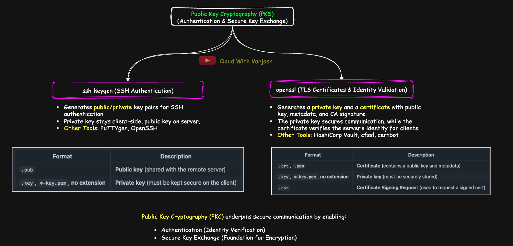
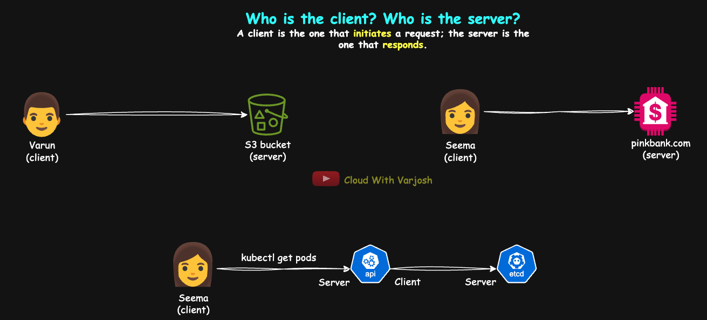
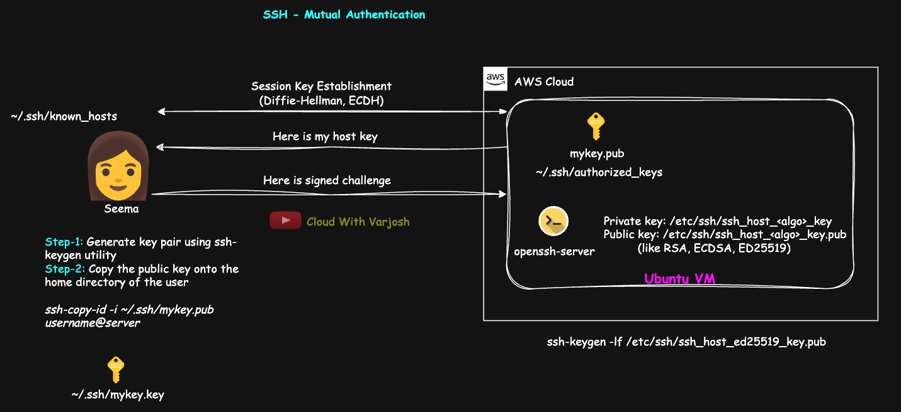
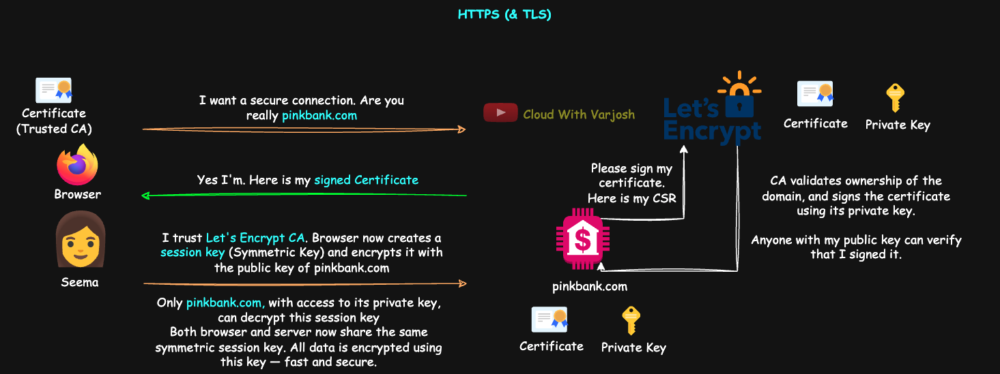
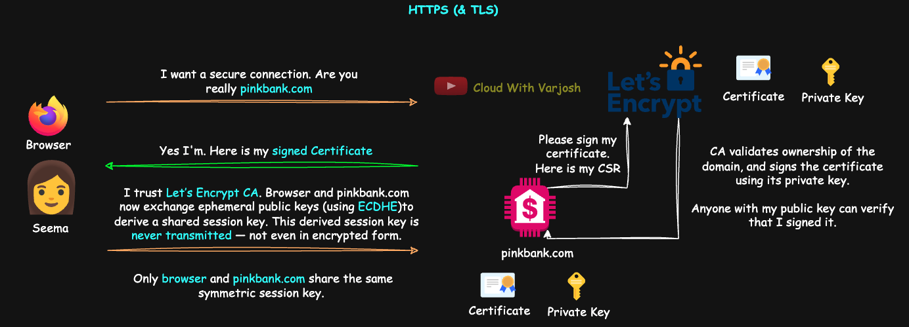
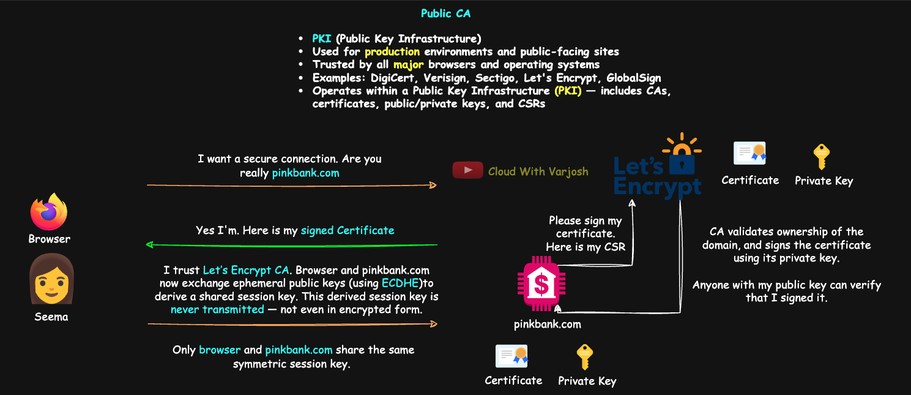
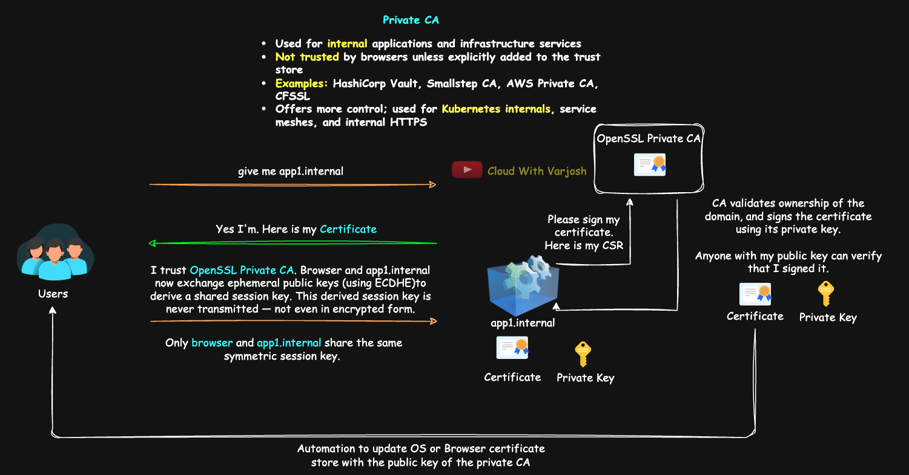
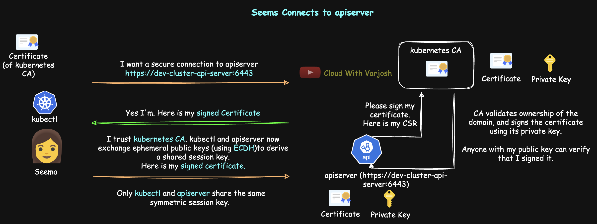
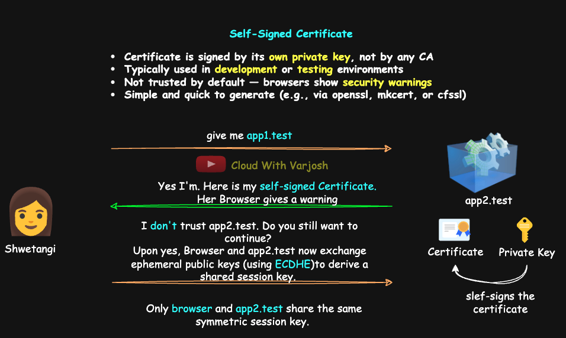

# 51 · Certificates, CAs and Public-Key Authentication (SSH and TLS)

> **Level:** ★★ intermediate
>
> **You will learn:** who is "client" and "server" in every Kubernetes connection; the two tools a DevOps engineer uses for keys (`ssh-keygen`, `openssl`) and their alternatives; key storage best practices and file formats; what public-key cryptography gives you (**authentication** and **key exchange**); SSH host keys, `known_hosts` and ways to verify them; why the **server authenticates first**; TLS 1.2 RSA vs ECDHE key exchange; **X.509 certificates** (fields, SANs, chains); and **public CAs vs private CAs vs self-signed** certificates, including trusting a private CA.
>
> **You need:** topic 50.

---

## ⚡ Core: the 10-minute version

**The idea.** A **certificate** is a public key plus a name, **signed by a Certificate Authority (CA)** that vouches for the pairing. Your browser trusts a few public CAs, so it trusts sites they sign. Inside companies, and **inside every Kubernetes cluster**, **private CAs** sign certificates, and clients are configured to trust that CA. **Self-signed** certificates are only for tests.

**Picture it.** A CA is a passport office; a certificate is a passport; trusting a CA means accepting every passport that office issues.

**The one thing to know.**

```bash
openssl req -x509 -newkey rsa:2048 -nodes -keyout ca.key -out ca.crt -subj "/CN=my-ca" -days 30     # a tiny CA
openssl req -newkey rsa:2048 -nodes -keyout app.key -out app.csr -subj "/CN=app.test"              # a request
openssl x509 -req -in app.csr -CA ca.crt -CAkey ca.key -CAcreateserial -out app.crt -days 7        # CA signs it
openssl verify -CAfile ca.crt app.crt                                                               # app.crt: OK
```

**Try it now:**
1. Run the four commands.
2. Inspect with `openssl x509 -in app.crt -noout -subject -issuer -dates`.
3. Look at your cluster's CA: `docker exec lab-control-plane openssl x509 -in /etc/kubernetes/pki/ca.crt -noout -subject -dates`.

**You've got it if you can:** explain what a CA signature proves, and public vs private vs self-signed CAs.

> 📖 **That's the core.** On a first pass, do the mini-lab and move on to the next topic. Everything below is the **full reference**: come back for the details, the edge cases, interview answers and exam-level depth.

---

## What it is

**Public-key cryptography (PKC)** underpins authentication and secure communication across many protocols: email (PGP, S/MIME), VoIP, database connections, messaging. A DevOps engineer mostly meets it in **SSH** (managing servers) and **HTTPS/TLS** (everything else, including Kubernetes).



A **certificate** (an **X.509** certificate) is a signed document that binds a **public key** to an **identity** (a domain name, a user, a Kubernetes component). It's signed by a **Certificate Authority (CA)** so others can trust that binding.

### Client and server



The **client** **initiates** a request; the **server** **responds**.
- Seema opens `pinkbank.com`: Seema (her browser) = client; `pinkbank.com` = server.
- Varun downloads from his S3 bucket: Varun = client; S3 = server.
- `kubectl get pods`: **kubectl** = client; the **API server** = server.
- The API server talks to **etcd**: now the **API server is the client**, and etcd is the server.

That direction decides **who presents a server certificate and who presents a client certificate**, which matters a lot for mTLS in Kubernetes (topics 52–53).

---

## Why it exists

Encryption alone doesn't tell you **who** you're talking to. An attacker can happily encrypt traffic to you while pretending to be your bank or your API server. Certificates (TLS) and host keys (SSH) **prove identity**, and CAs make that proof scale: you trust a handful of CAs instead of every server individually.

---

## Analogy

A certificate is a **passport**: it has your **photo** (the public key), your **name** (the domain or identity), an **expiry date**, and the **government's stamp** (the CA's signature). Border control (the client) doesn't know you personally, but it trusts the government's stamp. A **private CA** is a **company ID card**: valid inside the company's buildings (where staff are told to trust it), meaningless at an airport. A **self-signed certificate** is an ID card you **printed yourself**: fine for your own use, rejected everywhere else.

---

## How it works inside

### Tools

**1. `ssh-keygen`: SSH key pairs for remote access**
- Used for server administration, Git authentication, CI/CD, automation.
- The **private key** stays on the **client**; the **public key** goes into the **server's** `~/.ssh/authorized_keys`.
- Authentication: the server verifies the client's **signature** using the stored public key.
- Alternatives: **PuTTYgen** (Windows key generator for PuTTY); **OpenSSH** (the standard suite on Unix-like systems, which includes `ssh-keygen`). (Day 31 also lists **Mosh**, a mobile-friendly remote shell; it logs in **through SSH** and uses your SSH keys, but it isn't a key-generation tool.)

**2. `openssl`: TLS keys and X.509 certificates**
- Generates **private keys** (kept on the server).
- Creates **certificates** and **CSRs** (Certificate Signing Requests): a certificate holds the **public key**, metadata (subject, issuer, validity) and the **CA's signature**.
- The private key proves identity during the handshake; the certificate lets clients verify that identity.
- TLS isn't only HTTPS: **SMTP**, **FTPS**, **IMAPS** and more use it.
- Alternatives: **CFSSL** (Cloudflare's Go PKI toolkit), **HashiCorp Vault** (issues and manages certificates), **Certbot** (automates Let's Encrypt). In Kubernetes, **cert-manager** automates certificates for Ingress/Gateway (topic 71).

**Why the tool is still called "OpenSSL":** it began as an implementation of **SSL**, the predecessor of TLS. As SSL was deprecated, OpenSSL kept its name but gained full TLS support (including 1.3). It's a complete **crypto toolkit**: generate key pairs, create and sign X.509 certificates, encrypt/decrypt/hash, convert formats (PEM, DER, PKCS#12), and test TLS connections (`openssl s_client`).

### Key management best practices

Protect private keys with:
- **HSMs** (Hardware Security Modules): dedicated devices that keep keys inside them.
- **Secure enclaves** (TPM, Apple Secure Enclave): isolated hardware areas.
- **Cloud KMS** (AWS KMS, Azure Key Vault, GCP KMS): managed, access-controlled key storage.
- **Encrypted key files** (`.pem`, `.pfx`) protected by strong passphrases.
- **Smart cards / USB tokens** (YubiKey, Nitrokey).
- **Air-gapped** systems for the most sensitive keys (e.g. a root CA kept offline).

**Rotate** keys regularly and **audit** their use, so a compromised key can be replaced quickly.

### File formats

**SSH:**

| File | Meaning |
|---|---|
| `.pub` | **Public** key (goes on the server) |
| no extension, `.key`, `*-key.pem` | **Private** key (keep secure on the client) |

**TLS:**

| File | Meaning |
|---|---|
| `.crt`, `.pem` | **Certificate** (public key + metadata + CA signature) |
| `.key`, `*-key.pem`, no extension | **Private** key |
| `.csr` | **Certificate Signing Request**: "please sign this public key for this identity" |

(**PEM** = Base64 text between `-----BEGIN …-----` lines; **DER** = the same in binary; **PKCS#12** `.p12`/`.pfx` = a password-protected bundle of key + certificate(s).)

### What PKC provides

1. **Authentication** (identity verification).
2. **Secure key exchange** (the foundation for encryption).

#### 1. Authentication in SSH



SSH does **mutual authentication**:

**Server authentication (host keys):**
- When an SSH server is installed, it generates a **host key pair** per algorithm (RSA, ECDSA, Ed25519):
  - private: `/etc/ssh/ssh_host_<algo>_key`
  - public: `/etc/ssh/ssh_host_<algo>_key.pub`
- These prove **the server's identity** to clients.
- On connect, the server sends its **host public key**; the client checks it against **`~/.ssh/known_hosts`**.
- **First connection**: it's not there yet, so you're asked:
  ```
  The authenticity of host 'server.com (192.168.1.10)' can't be established.
  ED25519 key fingerprint is SHA256:abc123...
  Are you sure you want to continue connecting (yes/no)?
  ```
  Verify it by printing the fingerprint **on the server** (via a trusted channel):
  ```bash
  ssh-keygen -lf /etc/ssh/ssh_host_ed25519_key.pub
  ```
  - `-l` (lowercase L) = show the fingerprint; `-f` = the key file. Use the matching file for other algorithms (e.g. `ssh_host_rsa_key.pub`).
- Answering **yes** saves the key in `known_hosts`; future connections are checked against it.
- This model is **TOFU: Trust On First Use**.

**Ways to verify host keys:**
1. **TOFU**: accept on first use. Risky on untrusted networks.
2. **Phone-a-friend**: ask someone with access to confirm the fingerprint over a secure channel.
3. **Out-of-band (OOB)**: compare the fingerprint via Slack, secure email or a trusted docs portal.
4. **Configuration management**: Ansible, Puppet or Chef push known fingerprints into `known_hosts`.
5. **Pre-loading**: fill `~/.ssh/known_hosts` or `/etc/ssh/ssh_known_hosts` before connecting (`ssh-keyscan server.example.com >> ~/.ssh/known_hosts`). Note: `ssh-keyscan` itself is TOFU unless you then check the fingerprints.
6. **Centralised trust**: **SSH certificates**: an internal SSH CA signs host keys, and clients trust the CA (scales like TLS).

**Later connections:** if the host key **changed** (reinstall, or a **man-in-the-middle**), SSH **warns loudly** and may refuse. In clouds this also happens when an **ephemeral public IP** is reused by a different server, because `known_hosts` is keyed by IP/hostname.

**Client authentication:**
- The server sends a **challenge**; the client **signs it with its private key** (e.g. `~/.ssh/mykey`).
- The server verifies the signature with the client's **public key** from `~/.ssh/authorized_keys`.

#### Authentication in TLS

- The **server** presents a **certificate** signed by a trusted CA.
- The certificate contains the server's **public key** and the **CA's signature**.
- The client checks that it's **issued by a trusted CA** (root certificates come pre-installed) and **matches the domain name**.
- Optionally (**mutual TLS**), the server asks the **client** for a certificate too. That's how Kubernetes components authenticate (topics 52–53).

#### Order of authentication

In both SSH and mTLS, **the server authenticates first**, then the client:
- the client must know who it's talking to **before** revealing anything sensitive;
- it prevents **MITM** attacks;
- trust in the server comes before the secure channel is used for client credentials;
- credentials and proofs are never handed to an untrusted server.

So: SSH presents the **host key** first, then the client authenticates; mTLS presents the **server certificate** first, then (if requested) the **client certificate**.

#### 2. Secure key exchange

PKC isn't used to encrypt all data. It's used to **exchange or derive symmetric session keys**, which then encrypt the traffic efficiently.

**SSH:**
- Client and server run a **key-exchange algorithm** (Diffie-Hellman / ECDH: Elliptic-Curve Diffie-Hellman; modern OpenSSH also offers post-quantum hybrids).
- Each side contributes a random value and combines it with the other's public part to **compute the same session key**; neither side **sends** the key.
- 🔐 This happens **before client authentication**, so even passwords or signed challenges travel **encrypted**.

**TLS:**

**Older: TLS 1.2 with RSA key exchange**



- The client generates a session key, **encrypts it with the server's public key** (from its certificate), and sends it.
- The server decrypts it with its **private key**; both use it for symmetric encryption.
- **Drawback:** if the server's private key is ever compromised, **recorded past sessions can be decrypted**: no **forward secrecy**.

**Modern: TLS 1.3 (or TLS 1.2 with ECDHE)**



- Client and server do an **ephemeral** key exchange (**ECDHE**: Elliptic-Curve Diffie-Hellman Ephemeral).
- Both **derive** the session key; it's **never transmitted**.
- **Advantage:** a later leak of the server's private key **doesn't** expose past sessions (**forward secrecy**). The certificate key is used only to **sign** the handshake.

> ℹ️ **Note:** the summary says "in SSH, encryption begins before authentication; **in HTTPS (TLS), authentication happens before encryption**". That's true of **TLS 1.2**, where the certificate is sent in the clear. In **TLS 1.3**, encryption of the handshake starts right after the ServerHello, so the server's **certificate and its proof are themselves sent encrypted**, although the server still authenticates before any application data (or client credentials) is sent. The safe statement: in both protocols, a secure channel exists before the client reveals its credentials.

### X.509 certificate anatomy

```
Certificate:
  Version: 3
  Serial Number: 0x4f…
  Signature Algorithm: ecdsa-with-SHA256
  Issuer:  C=US, O=Let's Encrypt, CN=E6                 ← who signed it
  Validity: Not Before: Nov  1 00:00:00 2026 GMT
            Not After : Jan 30 23:59:59 2027 GMT       ← expiry
  Subject: CN=pinkbank.com                             ← whose it is
  Subject Public Key Info: EC P-256 public key …
  X509v3 extensions:
    Subject Alternative Name: DNS:pinkbank.com, DNS:www.pinkbank.com   ← the names that MUST match
    Key Usage: Digital Signature
    Extended Key Usage: TLS Web Server Authentication   ← server cert (clients need "Client Authentication")
    Basic Constraints: CA:FALSE                          ← can't sign other certs
  Signature: 30:45:02:…                                 ← issuer's signature over everything above
```

- **SAN** (Subject Alternative Name) is what clients check against the hostname (the CN is legacy). Kubernetes' API server certificate lists every name/IP clients use (`kubernetes`, `kubernetes.default.svc`, the ClusterIP `10.96.0.1`, node IPs, load-balancer names; topic 53).
- **Extended Key Usage** distinguishes **server** certificates from **client** certificates.
- **Chain of trust:** a **root CA** (self-signed, in the trust store) signs an **intermediate CA**, which signs the **leaf** (server) certificate. Servers send leaf + intermediates; clients build the chain up to a trusted root.
- In Kubernetes **client** certificates, the **CN** becomes the **username** and each **O** (organisation) becomes a **group** (topic 54).

### Public CA vs private CA vs self-signed

To enable HTTPS, certificates must be signed by something clients trust. Three options:

| Type | Use case | Trust | Examples | Typical use |
|---|---|---|---|---|
| **Public CA** | Production sites on the internet | Trusted by all major browsers/OSes | Let's Encrypt, DigiCert, GlobalSign | Public-facing services |
| **Private CA** | Internal services in an organisation | Trusted where the org installs its root | An internal enterprise CA, Vault, AWS Private CA, **the Kubernetes cluster CA** | `*.internal` apps, **Kubernetes components** |
| **Self-signed** | Testing and development | Not trusted by anyone by default | (none) | Quick local HTTPS |

#### Public CA



- `pinkbank.com` creates a key and a **CSR** (e.g. with OpenSSL), and gets it **signed** by a public CA such as **Let's Encrypt** to prove its authenticity.
- Seema's browser already has the **public keys of well-known CAs**, so it can verify the certificate's signature.
- That **chain of trust** proves authenticity; without a CA there would be no trusted way to confirm the server's identity.
- A self-signed or unknown-issuer certificate triggers a **browser warning**.

**Note:** Let's Encrypt is popular with DevOps/developers/cloud engineers (free, automated), and widely used in production. Enterprises may also use commercial CAs (DigiCert, GlobalSign, Entrust, Google Trust Services) for **OV/EV** (organisation/extended validation) certificates, SLAs and support.

**PKI (Public Key Infrastructure, Day 31):** the whole framework of CAs, certificates, keys, CSRs, policies and revocation that makes this trust work at scale.

#### Private CA



You can add any CA's root certificate to a **trust store** (OS or browser) yourself. To serve `https://app1.internal` without warnings:
- Run a **private CA** and issue a certificate for `app1.internal`.
- Install the **private root CA certificate** on every internal machine:
  - **Windows**: Group Policy (GPO) → Trusted Root Certification Authorities.
  - **macOS**: MDM, or Keychain Access → System → Certificates → Trust.
  - **Linux**: copy it to `/usr/local/share/ca-certificates/` (Debian/Ubuntu) and run `sudo update-ca-certificates` (RHEL: `/etc/pki/ca-trust/source/anchors/` + `update-ca-trust`).
- Make internal DNS resolve `app1.internal` to the internal IP.

**Every Kubernetes cluster runs private CAs**: kubeadm creates a cluster CA (`/etc/kubernetes/pki/ca.crt`), an etcd CA and a front-proxy CA (topic 53), and your kubeconfig embeds the cluster CA so kubectl trusts the API server (topic 52).



*(This image is in the original `images/` folder, but no original note referenced it; it's placed here.)* Seema's kubectl connects to `https://dev-cluster-api-server:6443`:
1. The API server has a certificate **signed by the "kubernetes" CA**: earlier it sent a **CSR** to the CA, which validated it and signed it with the CA's private key.
2. kubectl already holds the **kubernetes CA certificate** (from the kubeconfig), so it can verify the API server's certificate.
3. kubectl and the API server then exchange **ephemeral public keys (ECDHE)** to derive a shared **symmetric session key**. Only these two parties have that key.

The diagram shows only the **server** side being verified. In Kubernetes, Seema also presents her own **client certificate**, which is **mutual TLS** (topic 52).

#### Self-signed certificates



A **self-signed** certificate is **signed with its own private key** instead of by a CA. Example: developer **Shwetangi** builds **app2**, served locally at **app2.test**, and wants to test HTTPS. She generates a self-signed certificate with `openssl` and enables HTTPS.

**Typical uses:** local development and testing, internal tools not exposed publicly, quick prototypes and sandboxes, lab Kubernetes clusters.

⚠️ Not trusted by default, so browsers warn: Chrome "Your connection is not private" (`NET::ERR_CERT_AUTHORITY_INVALID`), Firefox "Warning: Potential Security Risk Ahead".

**Domain suffixes for local testing:**
- **`.test`**: reserved for testing (RFC 6761). ✅
- **`.example`**: reserved for documentation (RFC 6761). ✅
- **`.internal`**: reserved by ICANN (2024) for private networks. ✅
- **`.local`**: reserved for **mDNS/Bonjour** (multicast DNS on a LAN). It can clash with mDNS, so avoid it for unicast DNS.

> ✅ **Correct today** ([C1](#c1)): **`.dev` is a real public top-level domain** (owned by Google) and is on the **HSTS preload list**, so browsers force HTTPS for every `.dev` name and it can resolve on the public internet. Don't use it for local or internal names; use `.test` or `.internal`.

---

## Commands / YAML

### Make a private CA and a server certificate

```bash
# 1. a root CA (key + self-signed CA certificate)
openssl genrsa -out ca.key 4096
openssl req -x509 -new -key ca.key -sha256 -days 3650 -subj "/CN=Lab Root CA" -out ca.crt

# 2. a server key + CSR for app1.internal
openssl genrsa -out app1.key 2048
openssl req -new -key app1.key -subj "/CN=app1.internal" -out app1.csr

# 3. the CA signs the CSR, adding SANs and server usage
cat > app1.ext <<'EOF'
subjectAltName = DNS:app1.internal, DNS:app1
extendedKeyUsage = serverAuth
EOF
openssl x509 -req -in app1.csr -CA ca.crt -CAkey ca.key -CAcreateserial -days 365 -sha256 -extfile app1.ext -out app1.crt

# 4. inspect and verify
openssl x509 -in app1.crt -noout -subject -issuer -dates -ext subjectAltName
openssl verify -CAfile ca.crt app1.crt
```

```
subject=CN = app1.internal
issuer=CN = Lab Root CA
notBefore=Nov 18 10:15:00 2026 GMT
notAfter=Nov 18 10:15:00 2027 GMT
X509v3 Subject Alternative Name:
    DNS:app1.internal, DNS:app1
app1.crt: OK
```

### A self-signed certificate in one line

```bash
openssl req -x509 -newkey rsa:2048 -nodes -keyout app2.key -out app2.crt -days 30 \
  -subj "/CN=app2.test" -addext "subjectAltName=DNS:app2.test"
```

- `-x509` = output a certificate (not a CSR), self-signed.
- `-nodes` = don't encrypt the private key (labs only).

### Look at Kubernetes' own CA

```bash
docker exec lab-control-plane openssl x509 -in /etc/kubernetes/pki/ca.crt -noout -subject -issuer -dates
docker exec lab-control-plane openssl x509 -in /etc/kubernetes/pki/apiserver.crt -noout -ext subjectAltName
```

```
subject=CN = kubernetes
issuer=CN = kubernetes            ← self-signed root: the cluster CA
notAfter=Nov 14 09:00:00 2036 GMT ← 10-year CA
X509v3 Subject Alternative Name:
    DNS:kubernetes, DNS:kubernetes.default, DNS:kubernetes.default.svc, DNS:kubernetes.default.svc.cluster.local, DNS:lab-control-plane, DNS:localhost, IP Address:10.96.0.1, IP Address:172.18.0.3, IP Address:127.0.0.1
```

### SSH host key checks

```bash
ssh-keygen -lf /etc/ssh/ssh_host_ed25519_key.pub      # on the server
ssh-keyscan -t ed25519 server.example.com | ssh-keygen -lf -   # from the client: compare
ssh-keygen -R server.example.com                      # remove a stale known_hosts entry (after verifying!)
```

---

## Hands-on lab

1. Build the private CA and `app1.internal` certificate; verify it; then serve it with a quick HTTPS server (`openssl s_server -accept 8443 -cert app1.crt -key app1.key -www`) and connect with `openssl s_client -connect localhost:8443 -servername app1.internal -CAfile ca.crt` (Verification: OK) and without `-CAfile` (unknown CA).
2. Reissue without the SAN extension and see `curl --cacert ca.crt https://app1.internal:8443` fail on hostname mismatch (add `app1.internal` to `/etc/hosts` first).
3. Trust the CA system-wide in WSL2 Ubuntu (`/usr/local/share/ca-certificates/` + `update-ca-certificates`) and retry curl without `--cacert`.
4. Inspect the kind cluster's CA and API server certificate (above), and list the SANs.
5. Check an SSH host key fingerprint on a VM and compare it with what your client was shown.

---

## Where you'll use it

- **Kubernetes internals**: every component authenticates with certificates from cluster CAs (topics 52–53); certificate rotation and expiry are classic operational tasks (topic 82).
- **Ingress/Gateway TLS**: public CAs via cert-manager/ACM, private CAs for internal apps (topic 71).
- **Corporate environments**: trusting internal CAs on nodes and in container images (registry TLS, proxies).
- **SSH**: node access, Git, CI runners; SSH certificates at scale.

---

## When it breaks

| Symptom | Cause | Fix |
|---|---|---|
| `x509: certificate signed by unknown authority` | Missing root/intermediate in the client's trust store, or server not sending intermediates | Install the CA; serve the full chain |
| `x509: certificate is valid for a, b, not c` | SAN doesn't include the name used | Reissue with the right SANs |
| `certificate has expired` | Expiry | Renew; automate (cert-manager, kubeadm renew) |
| `tls: bad certificate` from a server | Client cert rejected (wrong CA, expired, wrong EKU) | Check the client cert's issuer and usage |
| Browser warns on a self-signed site | Expected | Use a private CA trusted by clients |
| SSH `REMOTE HOST IDENTIFICATION HAS CHANGED` | Host rebuilt, IP reused, or MITM | Verify out-of-band, then update known_hosts |

---

## Quick recap

- Client = initiator, server = responder; this decides who shows which certificate (Kubernetes components play both roles).
- `ssh-keygen` for SSH keys; `openssl` for keys, CSRs and X.509 certificates; protect private keys (HSM/KMS/tokens) and rotate them.
- PKC provides **authentication** (host keys/certificates, client keys/certs) and **key exchange** (DH/ECDHE; TLS 1.2 RSA lacks forward secrecy).
- The server authenticates first; certificates bind public keys to names (SANs) and are signed by CAs (chains to a trusted root).
- **Public CA** for the internet; **private CA** for internal services and **Kubernetes itself**; **self-signed** for testing only. Use `.test`/`.internal`, not `.dev`.

### Interview questions

1. **Q: How does a client know a TLS certificate is legitimate?**
   A: It builds a chain from the server's certificate through intermediates to a root CA in its trust store, checks each signature, the validity dates, that the hostname is in the SANs, and that the key usage fits; then the server proves possession of the private key in the handshake.
2. **Q: Public CA vs private CA: why does Kubernetes use a private one?**
   A: Cluster components are internal and need certificates for internal names and IPs, issued and rotated automatically; a cluster-specific private CA is controlled by the cluster and trusted only by its components and kubeconfigs.
3. **Q: What does SSH's "authenticity of host can't be established" mean?**
   A: The server's host key isn't in your known_hosts yet. You should verify its fingerprint through a trusted channel before accepting (otherwise it's trust on first use).

---

## Appendix: notes on the original course material

This topic was rebuilt from the original CKA course notes. This appendix keeps the audit trail out of your way while you learn.

### Sources

Day 31 (introduction; client and server refresher; PKC in DevOps; `ssh-keygen` and alternatives; `openssl` and alternatives; why "OpenSSL"; key management best practices; key file formats for SSH and TLS; what PKC provides; authentication in SSH (host keys, TOFU, verification methods, changed keys) and client authentication; authentication in TLS; order of authentication; secure key exchange in SSH and TLS (RSA vs ECDHE); types of CAs and comparison table; public CA and PKI; private CA and trusting it per OS; self-signed certificates, uses, warnings and reserved test domains; conclusion). The same sections reappear in `TLS-In-Kubernetes-Masterclass/README.md` (Days 30–34).

### Corrections to the original notes

Each entry shows what the original said and what's true now. In the topic above, each correction appears as a ✅ **Correct today** line or a ⚠️ **Fix to the original** box, linked to its entry here.

<a id="c1"></a>**C1 · Corrected (Day 31).** `.dev` was listed among names "reserved for documentation and sometimes local use". **Now:** **`.dev` is a real public top-level domain** (owned by Google) and is on the **HSTS preload list**, so browsers force HTTPS for every `.dev` name and it can resolve on the public internet. Don't use it for local or internal names; use `.test` or `.internal`.
