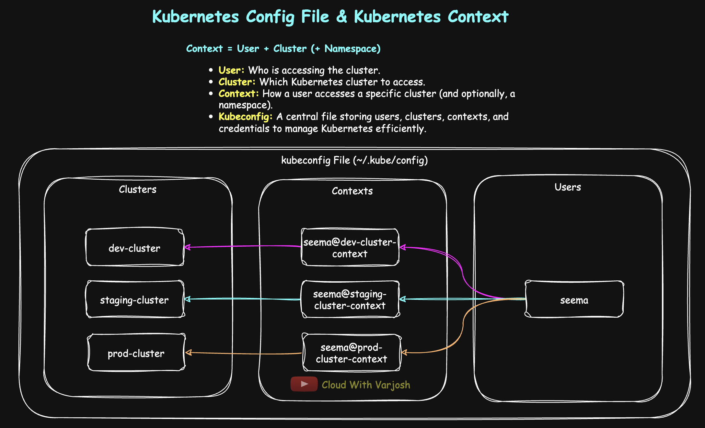
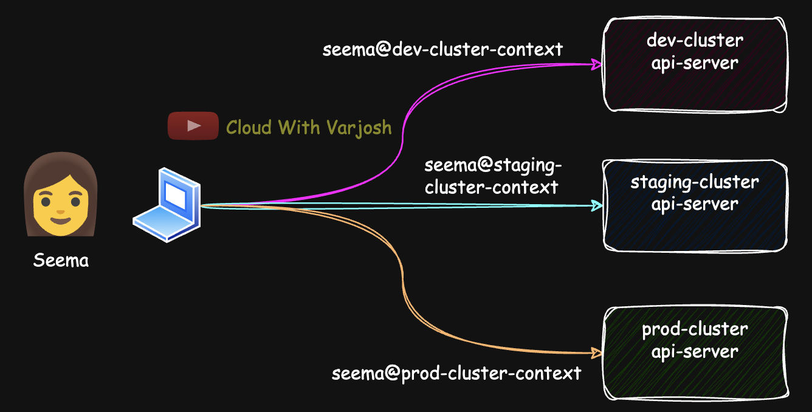
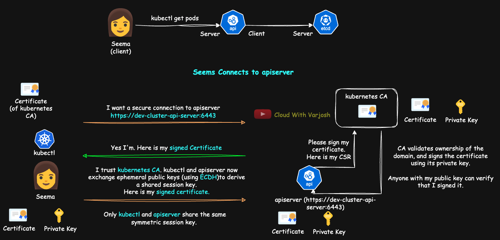

# 52 · kubeconfig in Depth, and Mutual TLS

> **Level:** ★★ intermediate
>
> **You will learn:** every field of a kubeconfig and what it does in the TLS handshake (CA data to verify the API server; client certificate and key to prove who you are); the other user credential types (tokens, `exec` plugins like `aws eks get-token`, OIDC); building a kubeconfig from scratch with `kubectl config set-*`; `--kubeconfig`, the `KUBECONFIG` variable and **merging** several files; the full `kubectl config` command set; and **mutual TLS** (mTLS): what it adds over one-way TLS and why Kubernetes uses it everywhere.
>
> **You need:** topics 12 (the basics), 50 and 51.

---

## ⚡ Core: the 10-minute version

**The idea.** Your kubeconfig carries TLS material:
- `certificate-authority-data`: the cluster's CA, so kubectl can **verify the API server**;
- `client-certificate-data` and `client-key-data`: your certificate and key, so the API server can **verify you**. Your username is the certificate's CN; your groups are its O fields.

Both sides proving identity is **mutual TLS (mTLS)**. Instead of a certificate, a user entry can hold a token or an `exec` plugin (cloud logins).

**Picture it.** Showing ID at a secure building: you check the guard's badge (server certificate), the guard checks yours (client certificate).

**The one thing to know.**

```bash
kubectl config view --raw --minify -o jsonpath='{.users[0].user.client-certificate-data}' \
  | base64 -d | openssl x509 -noout -subject -enddate
# subject=O = kubeadm:cluster-admins, CN = kubernetes-admin
```

**Try it now:**
1. Run the command above.
2. Decode `certificate-authority-data` the same way and compare it with `/etc/kubernetes/pki/ca.crt` on the node.
3. Try `KUBECONFIG=a:b kubectl config view` with two files to see merging.

**You've got it if you can:** explain which kubeconfig field verifies the server and which identifies you.

> 📖 **That's the core.** On a first pass, do the mini-lab and move on to the next topic. Everything below is the **full reference**: come back for the details, the edge cases, interview answers and exam-level depth.

---

## What it is



A **kubeconfig** file stores:
- **cluster connection info**: the API server URL and the CA certificate to trust;
- **user credentials**: client certificates, tokens, or a command that fetches a token;
- **contexts**: which cluster + which user (+ default namespace) to use.

It lets `kubectl` (and any client built on client-go: Helm, k9s, operators, CI tools) talk to clusters **securely** without passing connection details every time. It usually lives at **`~/.kube/config`** in the home directory of the user running kubectl. The file is usually just called `config`, but everyone calls it "the kubeconfig", and it can live anywhere.

**Without it**, every command would need:

```bash
kubectl get pods \
  --server=https://<API_SERVER_URL> \
  --certificate-authority=<CA_CERT_FILE> \
  --client-key=<CLIENT_KEY_FILE> \
  --client-certificate=<CLIENT_CERT_FILE>
```

Long, error-prone and tedious, compared with just `kubectl get pods`.

**Contexts** save cluster + user + namespace combinations so users like Seema switch clusters and namespaces with one command.



---

## Why it exists

Kubernetes has **no built-in user database**: you prove who you are with a **credential** each request (topic 54). The kubeconfig is where those credentials and the cluster's trust anchors live on the client side. Understanding it field by field is how you fix "Unauthorized", "x509" and "wrong cluster" problems, and how you safely hand out access to people and pipelines.

---

## Analogy

A kubeconfig is a **keyring with labelled tags**:
- each **cluster** entry is a **door address** plus a photo of the real door (the CA certificate), so you don't open a fake one;
- each **user** entry is a **key** (certificate + private key) or a **key-cutting machine** (`exec` plugin that makes a fresh key on demand);
- each **context** is a **tag** joining one door with one key ("office front door, my work key, go to floor 3", where floor 3 is the namespace).

---

## How it works inside

### The scenario

Seema works with three clusters: **dev-cluster**, **staging-cluster**, **prod-cluster**. For each she has a **context** containing:
- **cluster**: API server URL, CA;
- **user**: how she authenticates (certificate, token or plugin);
- **namespace**: the default namespace for that context (overridable per command).

She switches with `kubectl config use-context …`.

**Namespaces per environment:** Seema's team names namespaces like `app1-dev-ns`, `app1-staging-ns`, `app1-prod-ns` to group each environment's resources for `app1`. Here each also lives in its own cluster, so dev resources in `app1-dev-ns` (dev-cluster) are isolated from `app1-prod-ns` (prod-cluster). (Recap: a namespace is a "virtual cluster" inside a physical cluster; topic 26.)

> ✅ **Correct today** ([C1](#c1)): username/password (basic auth) was **removed in v1.19**. User credentials are client certificates, bearer tokens, or an `exec`/OIDC plugin.

### The full example



```yaml
apiVersion: v1
kind: Config
clusters:                                   # WHERE: API servers and how to trust them
  - name: dev-cluster
    cluster:
      server: https://dev-cluster-api-server:6443     # API server endpoint (usually port 6443)
      certificate-authority-data: <certificate-data>  # base64 CA certificate
  - name: staging-cluster
    cluster:
      server: https://staging-cluster-api-server:6443
      certificate-authority-data: <certificate-data>
  - name: prod-cluster
    cluster:
      server: https://prod-cluster-api-server:6443
      certificate-authority-data: <certificate-data>

users:                                      # WHO: credentials
  - name: seema
    user:
      client-certificate-data: <client-cert-data>     # base64 client certificate
      client-key-data: <client-key-data>              # base64 private key

contexts:                                   # WHICH: cluster + user (+ namespace)
  - name: seema@dev-cluster-context
    context:
      cluster: dev-cluster
      user: seema
      namespace: app1-dev-ns                # default namespace when this context is active
  - name: seema@staging-cluster-context
    context:
      cluster: staging-cluster
      user: seema
      namespace: app1-staging-ns
  - name: seema@prod-cluster-context
    context:
      cluster: prod-cluster
      user: seema
      namespace: app1-prod-ns

current-context: seema@dev-cluster-context  # the context kubectl uses by default
```

**What each certificate field does:**

| Field | Contains | Used for |
|---|---|---|
| `certificate-authority-data` | The cluster **CA's certificate** (public) | kubectl **verifies the API server's** certificate against it: "is this the real API server?" (server authentication) |
| `client-certificate-data` | **Your** certificate, signed by the cluster CA | Sent to the API server to **identify you** (CN = username, O = groups; topic 54) |
| `client-key-data` | **Your private key** | Proves you own that certificate (signs the TLS handshake). **Anyone with it can impersonate you.** |

Together they give **mutual TLS** between kubectl and the API server.

**File vs embedded data:** each `*-data` field (base64, embedded) has a **path** variant: `certificate-authority`, `client-certificate`, `client-key`, pointing at files. `--embed-certs=true` copies file contents into the kubeconfig, making it **portable**.

**Other cluster fields:** `insecure-skip-tls-verify: true` (never in production), `tls-server-name` (expected name in the server's certificate when connecting via an IP or a different hostname), `proxy-url`.

### Other user credential types

```yaml
users:
- name: ci-bot
  user:
    token: eyJhbGciOiJSUzI1NiIs…        # bearer token (e.g. a ServiceAccount token, topic 55)

- name: eks-admin
  user:
    exec:                               # run a command to get a short-lived token
      apiVersion: client.authentication.k8s.io/v1beta1
      command: aws
      args: ["eks", "get-token", "--cluster-name", "prod", "--region", "us-east-1"]
      interactiveMode: Never

- name: oidc-dev
  user:
    exec:                               # OIDC login (e.g. Dex/Keycloak/Entra ID via kubelogin)
      apiVersion: client.authentication.k8s.io/v1beta1
      command: kubectl
      args: ["oidc-login", "get-token", "--oidc-issuer-url=https://login.example.com", "--oidc-client-id=k8s"]
```

- **`exec` plugins** are how managed clusters work: `aws eks get-token`, `gke-gcloud-auth-plugin`, `kubelogin` (AKS/Entra ID). The plugin returns a **short-lived token** to kubectl, which sends it as `Authorization: Bearer …`. Nothing long-lived sits in the file.
- (The old `auth-provider` field for GCP/Azure was removed in favour of exec plugins.)

### How kubectl picks a kubeconfig, and merging

1. `--kubeconfig <file>` → only that file.
2. Else the **`KUBECONFIG`** environment variable: **one or more files separated by `:`** (`;` on Windows); they're **merged**: for each map entry (cluster/user/context name), the **first** file that defines it wins; `current-context` comes from the first file that sets one; modifications go to the file that defined the entry.
3. Else `~/.kube/config`.

```bash
export KUBECONFIG=~/.kube/config:~/.kube/dev:~/.kube/prod
kubectl config get-contexts             # contexts from all three
kubectl config view --flatten > ~/.kube/merged && mv ~/.kube/merged ~/.kube/config   # merge permanently
```

- `--flatten` embeds referenced files as data, so the merged file is self-contained.

---

## Commands / YAML

### Viewing and managing

Your kubeconfig holds clusters, users, contexts and namespaces. **Avoid editing it by hand**: use `kubectl config`, which keeps the structure valid. `kubectl config -h` lists every subcommand (`use-context`, `set-context`, `rename-context`…).

| Task | Command |
|---|---|
| Current context | `kubectl config current-context` → `seema@dev-cluster-context` |
| List contexts | `kubectl config get-contexts` |
| Switch context | `kubectl config use-context seema@prod-cluster-context` |
| View config (secrets redacted) | `kubectl config view` |
| View raw config (includes secrets; for scripting) | `kubectl config view --raw` |
| Only the active context's data | `kubectl config view --minify` |
| Which file(s) are active | `echo $KUBECONFIG` (empty = `~/.kube/config`) |
| Default namespace for the current context | `kubectl config set-context --current --namespace=app1-staging-ns` |
| Namespace for one command | `kubectl get pods --namespace=app1-prod-ns` |
| Inspect another file | `kubectl config view --kubeconfig=$HOME/kubeconfigs/custom-kubeconfig.yaml` |
| Add a user | `kubectl config set-credentials varun --client-certificate=varun-cert.pem --client-key=varun-key.pem --kubeconfig=$HOME/kubeconfigs/seema-kubeconfig.yaml` |
| Add a cluster | `kubectl config set-cluster dev-cluster --server=https://dev-cluster-api-server:6443 --certificate-authority=ca.crt --embed-certs=true --kubeconfig=$HOME/kubeconfigs/seema-kubeconfig.yaml` |
| Add a context | `kubectl config set-context seema@dev-cluster-context --cluster=dev-cluster --user=seema --namespace=app1-dev-ns --kubeconfig=$HOME/kubeconfigs/seema-kubeconfig.yaml` |
| Rename a context | `kubectl config rename-context seema@dev-cluster-context seema@dev-env` |
| Delete a context | `kubectl config delete-context seema@staging-cluster-context` |
| Delete a user | `kubectl config unset users.seema` (or `kubectl config delete-user seema`) |
| Delete a cluster | `kubectl config unset clusters.staging-cluster` (or `kubectl config delete-cluster staging-cluster`) |

> **Tip:** Day 32 writes paths as `--kubeconfig=~/kubeconfigs/…`. Bash does **not** expand `~` after `=` in an ordinary argument like this, so the literal `~` may be passed through. Use `$HOME/…` (or a space: `--kubeconfig ~/kubeconfigs/…`) to be safe.

### Multiple kubeconfig files

```bash
kubectl get pods --kubeconfig=$HOME/.kube/dev-kubeconfig
kubectl config use-context dev-cluster --kubeconfig=$HOME/.kube/dev-kubeconfig
```

Handy for keeping dev/staging/prod separate (and a good safety habit: prod in its own file, topic 12).

### A custom kubeconfig as the default

```bash
vi ~/.bashrc                                           # or ~/.zshrc
export KUBECONFIG=$HOME/.kube/my-2nd-kubeconfig-file   # add this line
source ~/.bashrc
```

Now every kubectl command uses that file.

### Building a kubeconfig from scratch

```bash
# user
kubectl config set-credentials varun \
  --client-certificate=$HOME/kubeconfigs/varun-cert.pem \
  --client-key=$HOME/kubeconfigs/varun-key.pem \
  --embed-certs=true \
  --kubeconfig=$HOME/kubeconfigs/my-2nd-kubeconfig-file

# cluster
kubectl config set-cluster aws-cluster \
  --server=https://aws-api-server:6443 \
  --certificate-authority=$HOME/kubeconfigs/aws-ca.crt \
  --embed-certs=true \
  --kubeconfig=$HOME/kubeconfigs/my-2nd-kubeconfig-file

# context
kubectl config set-context varun@aws-cluster-context \
  --cluster=aws-cluster \
  --user=varun \
  --namespace=default \
  --kubeconfig=$HOME/kubeconfigs/my-2nd-kubeconfig-file

# switch and verify
kubectl config use-context varun@aws-cluster-context --kubeconfig=$HOME/kubeconfigs/my-2nd-kubeconfig-file
kubectl config view --kubeconfig=$HOME/kubeconfigs/my-2nd-kubeconfig-file --minify
```

- `--kubeconfig=…`: the file to modify (created if missing).
- `--minify`: show only the active context with its cluster and user.

(Day 32's `set-credentials` example has no `--embed-certs`; without it the kubeconfig stores **file paths**, so the files must stay where they are. Topic 54 uses this flow to give a new user, Seema, real access.)

### Peek inside the credentials

```bash
kubectl config view --raw --minify -o jsonpath='{.users[0].user.client-certificate-data}' \
  | base64 -d | openssl x509 -noout -subject -issuer -enddate
```

```
subject=O = kubeadm:cluster-admins, CN = kubernetes-admin
issuer=CN = kubernetes
notAfter=Nov 17 09:00:00 2027 GMT
```

- **CN** = your **username** (`kubernetes-admin`); **O** = your **group** (`kubeadm:cluster-admins`, bound to cluster-admin; topic 57).
- **issuer** = the cluster CA.
- **notAfter** = when your access breaks unless renewed (kubeadm admin certs last 1 year).

---

## Mutual TLS (mTLS)

**Mutual TLS** extends TLS so that **both client and server authenticate each other** with certificates: strong identity both ways, blocking unauthorised parties. It's the norm wherever **machines** talk to machines with no human involved: microservices, Kubernetes clusters, service meshes.

- **One-way TLS** is typical for **public websites used by humans**: only the **server** proves its identity (Seema visiting `pinkbank.com`). Users then authenticate inside the encrypted channel with passwords, OAuth and so on.
- **mTLS** is typical for **machine-to-machine** traffic: **both** present certificates → **bi-directional trust**.

**In Kubernetes**, control-plane traffic is TLS-authenticated in both directions by default: kubectl/components → API server (client certificates or tokens), API server ↔ etcd (client and server certificates). Managed services (EKS, GKE, AKS) set this up for you as part of being secure by default. Topic 53 traces each connection, including the one weak spot (API server → kubelet serving-certificate verification).

**The server always goes first:** in SSH and in TLS/mTLS, the **server proves its identity first**, so the client never sends credentials to an impostor.

**Why mTLS in Kubernetes:**
- **Unauthorised components** can't talk to the cluster's core.
- Only **trusted** services (a real API server, a real kubelet) can connect to each other.
- It **strengthens** the whole cluster, especially in production.
- Some links work with server-only TLS, but mTLS is **strongly recommended**, especially for **etcd**, **kubelet** and **kube-apiserver**.

| Feature | TLS (one-way) | mTLS (two-way) |
|---|---|---|
| Authentication | Server only | **Client and server** |
| Typical use | Public websites, APIs | Microservices, Kubernetes, APIs with known clients |
| Identity verification | Server proves identity | **Both** prove identity |
| Certificates needed | Server certificate only | **Server and client certificates** |
| Security level | Strong | **Stronger** (mutual trust) |

**How mTLS shows up in the handshake:** after the server sends its certificate, it sends a **CertificateRequest** listing the CAs it accepts; the client sends **its** certificate and a **CertificateVerify** signature with its private key; the server verifies both against its trusted client CA (the API server's `--client-ca-file`).

---

## Hands-on lab

1. Extract and inspect your kind admin certificate (above): find the username, group and expiry.
2. Create a second kubeconfig for the same cluster from scratch with `set-cluster`/`set-credentials`/`set-context` using files extracted from the first one, then use it with `--kubeconfig`.
3. Merge it with your main file through `KUBECONFIG=a:b` and `kubectl config view --flatten`.
4. Break each field and read the error:
   - wrong `certificate-authority-data` → `x509: certificate signed by unknown authority`;
   - remove `client-key-data` → kubectl errors before connecting;
   - wrong `server` port → `connection refused`.
5. Watch mTLS in the raw: `openssl s_client -connect 127.0.0.1:<port> -CAfile ca.crt -cert client.crt -key client.key </dev/null | grep -E 'Verification|Acceptable client certificate CA'` (use the API server port from `docker ps`).

---

## Where you'll use it

- Onboarding people and pipelines: issuing kubeconfigs (certificates for break-glass admins; OIDC or cloud IAM via exec plugins for humans; short-lived tokens for CI).
- Multi-cluster work: merged kubeconfigs, `kubectx`, `--context` in scripts.
- Troubleshooting `Unauthorized`/x509 issues and certificate expiry (topic 82).
- Security reviews: no long-lived admin certificates on laptops, no `insecure-skip-tls-verify`.

---

## When it breaks

| Symptom | Cause | Fix |
|---|---|---|
| `x509: certificate signed by unknown authority` | Wrong/old CA data (cluster rebuilt) | Refresh `certificate-authority-data` |
| `x509: certificate is valid for …, not <ip>` | Connecting via a name/IP not in the API server's SANs | Use a listed name, or `tls-server-name`, or add SANs (topic 53) |
| `error: You must be logged in to the server (Unauthorized)` | Client cert expired/wrong CA, token expired | Renew credentials |
| `exec: executable aws not found` / plugin errors | exec plugin missing or not on PATH | Install the plugin (`aws` CLI, `gke-gcloud-auth-plugin`, `kubelogin`) |
| Commands go to the wrong cluster | `current-context` or `KUBECONFIG` order | `kubectl config current-context`; check `$KUBECONFIG` |
| Edits "disappear" | Merged config: the entry lives in another file | `kubectl config view` shows the merged result; edit the source file |
| Leaked kubeconfig | Embedded private key = identity | Revoke: certificates can't be revoked in Kubernetes, so rotate the CA (painful); prefer short-lived tokens/OIDC |

---

## Quick recap

- kubeconfig = **clusters** (server + CA to verify it) + **users** (cert/key, token, or `exec` plugin) + **contexts** (+ namespace) + `current-context`.
- `certificate-authority-data` verifies the **server**; `client-certificate-data` + `client-key-data` authenticate **you** (CN = user, O = groups).
- Selection order: `--kubeconfig` > `KUBECONFIG` (colon list, merged) > `~/.kube/config`; manage with `kubectl config set-*`, `--embed-certs`, `view --minify/--raw/--flatten`.
- **mTLS** = both sides present certificates; the server goes first; Kubernetes uses TLS-based mutual authentication across its control plane.

### Interview questions

1. **Q: What's in a kubeconfig, and what does each certificate field do?**
   A: Clusters (server URL + CA certificate used to verify the API server), users (client certificate + key, or token/exec plugin, to authenticate you), contexts (cluster + user + namespace) and the current context.
2. **Q: How do EKS/GKE kubeconfigs authenticate without embedded certificates?**
   A: Through `exec` credential plugins (`aws eks get-token`, `gke-gcloud-auth-plugin`) that fetch short-lived tokens from the cloud's identity system each time.
3. **Q: What is mTLS and why use it inside a cluster?**
   A: TLS where both client and server present and verify certificates; it ensures only trusted components can connect (e.g. only the real API server can talk to etcd), not just that traffic is encrypted.

---

## Appendix: notes on the original course material

This topic was rebuilt from the original CKA course notes. This appendix keeps the audit trail out of your way while you learn.

### Sources

Day 32 (introduction; what a kubeconfig is and why; life without it; contexts; scenario with three clusters; how contexts work; app namespaces per environment; example kubeconfig with certificate-field explanations; viewing and managing; command table; multiple kubeconfig files; `KUBECONFIG` as default; adding users/clusters/contexts; mTLS: definition, one-way vs mutual, managed services, server first, why in Kubernetes, comparison table; conclusion). Day 08's context material is in topic 12. The same sections reappear in `TLS-In-Kubernetes-Masterclass/README.md` (Days 30–34).

### Corrections to the original notes

Each entry shows what the original said and what's true now. In the topic above, each correction appears as a ✅ **Correct today** line or a ⚠️ **Fix to the original** box, linked to its entry here.

<a id="c1"></a>**C1 · Corrected (Day 32, same as topic 12).** user authentication was listed as "username/password, token, certificate". **Now:** username/password (basic auth) was **removed in v1.19**. User credentials are client certificates, bearer tokens, or an `exec`/OIDC plugin.
