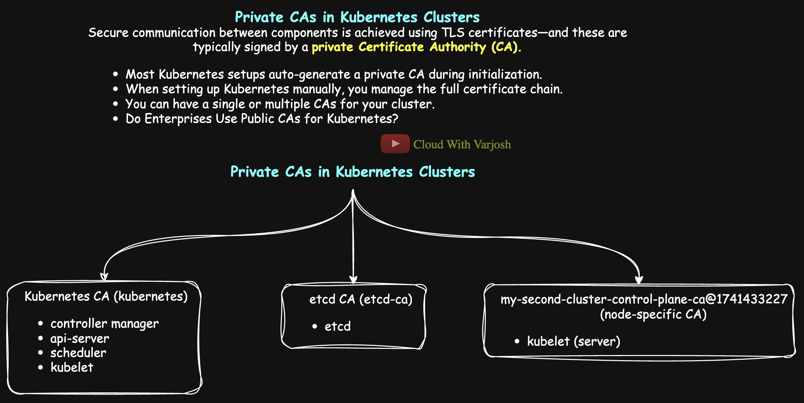
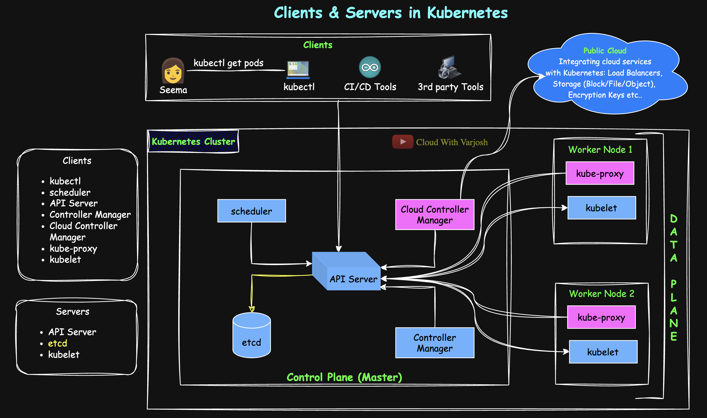
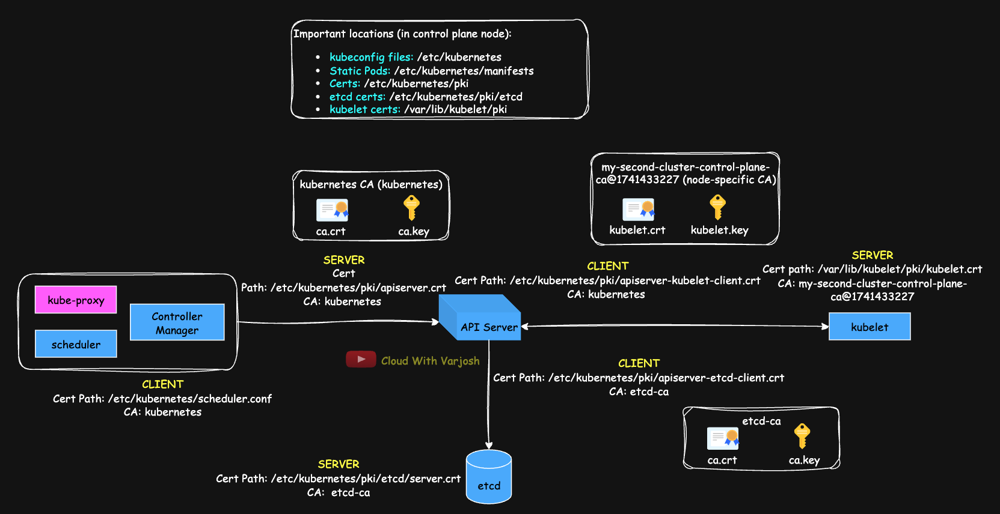

# 53 · TLS Inside the Cluster: Who Is Client, Who Is Server, and Which Certificate Proves What

> **Level:** ★★★ advanced
>
> **You will learn:** the cluster's private CAs (cluster CA, etcd CA, front-proxy CA, ServiceAccount signing keys) and why there's more than one; which components are clients and which are servers; the one rule that makes it all readable (**every API client uses a kubeconfig; every server's TLS is in its own flags/config**); a full trace of three mTLS links (scheduler → API server, API server → etcd, API server → kubelet), including the kubelet serving-certificate gap and how to close it; root vs intermediate CAs; the complete kubeadm PKI file map; and checking expiry.
>
> **You need:** topics 42 (static Pods), 51 and 52.

---

## ⚡ Core: the 10-minute version

**The idea.** A kubeadm cluster runs several private trust roots:
- the **cluster CA** (API server, kubelets, controllers, admins);
- a separate **etcd CA**;
- a **front-proxy CA** (API extensions);
- the **ServiceAccount signing keys** (`sa.key`/`sa.pub`), which sign Pod tokens.

Every component is a client, a server, or both. The simple rule for reading it all: **clients use a kubeconfig; servers declare their certificates in their flags or config**. Leaf certificates last 1 year; kubelets rotate their own.

**Picture it.** One company with separate badge systems for the office, the vault (etcd) and visiting contractors, so losing one badge printer doesn't compromise the others.

**The one thing to know.**

```bash
docker exec lab-control-plane ls /etc/kubernetes/pki /etc/kubernetes/pki/etcd
docker exec lab-control-plane kubeadm certs check-expiration
docker exec lab-control-plane grep -E -- '--(client-ca|tls-cert|etcd-cafile|service-account-key)' /etc/kubernetes/manifests/kube-apiserver.yaml
```

**Try it now:**
1. Run the commands.
2. For the API server, name which flag is its server certificate, which CA verifies clients, and which certificate it uses to reach etcd.

**You've got it if you can:** list the cluster's CAs and say why etcd has its own.

> 📖 **That's the core.** On a first pass, do the mini-lab and move on to the next topic. Everything below is the **full reference**: come back for the details, the edge cases, interview answers and exam-level depth.

---

## What it is

Every connection inside a Kubernetes cluster is TLS, with certificates issued by **private CAs** that the cluster creates for itself. This topic is a **map** of those connections and certificates, plus a **method** to work out any of them yourself by reading config files, so you never have to memorise paths.

### Private CAs in a cluster



A cluster may use:
- **one CA** for everything (simpler), or
- **several CAs** (e.g. a separate one for **etcd**) for isolation.

**Why separate CAs:** etcd holds **the entire cluster state**; if it's compromised, the attacker owns the cluster. A **dedicated etcd CA** limits the **blast radius**: a certificate from the main cluster CA can't be used to talk to etcd, and vice versa. Other control-plane components share the main CA. **Compartmentalised trust reduces risk.**

**kubeadm creates four trust roots:**

| Trust root | Files | Signs / verifies |
|---|---|---|
| **Cluster CA** (`CN=kubernetes`) | `pki/ca.crt`, `ca.key` | API server serving cert; all clients' certs (admin, scheduler, controller-manager, kubelets' client certs, apiserver-kubelet-client) |
| **etcd CA** (`CN=etcd-ca`) | `pki/etcd/ca.crt`, `ca.key` | etcd server and peer certs; `apiserver-etcd-client`; `etcd/healthcheck-client` |
| **Front-proxy CA** | `pki/front-proxy-ca.crt` | `front-proxy-client`: the API server's identity when proxying to **aggregated APIs** (e.g. metrics-server; topic 48) |
| **ServiceAccount key pair** (not a CA) | `pki/sa.key`, `sa.pub` | Controller manager/API server **sign** ServiceAccount JWTs with `sa.key`; the API server **verifies** them with `sa.pub` (topic 55) |

**How trust is distributed:** each component gets the right **CA certificate** in its trust store/config:
- `kubectl` trusts the API server because its kubeconfig contains the cluster CA that signed the API server's certificate (topic 52);
- the controller manager, scheduler and kubelets trust the API server (and are trusted by it) through certificates from the same cluster CA.

**Who creates them:**
- **kubeadm, k3s, managed services (EKS, GKE, AKS)** generate and manage the private CAs **automatically** at cluster creation. On managed services the CA is **hidden** and maintained by the cloud provider, but all components trust it.
- **"Kubernetes the hard way"** ([Kelsey Hightower's guide](https://github.com/kelseyhightower/kubernetes-the-hard-way)): **you** create the root CA, sign every component certificate and distribute them. Maximum transparency and control, but you need a solid grasp of PKI, TLS and Kubernetes internals.

**Do enterprises use public CAs for Kubernetes?**
- **Never for core internals**: the API server, kubelets, controller manager and scheduler use **private** CAs (auto-generated or a central internal PKI).
- **Yes for public-facing endpoints**: **Ingress controllers, load balancers, Gateway API** implementations serve browsers, so they use **public CAs** (Let's Encrypt, DigiCert, GlobalSign) to avoid trust warnings (topic 71).
- In short: **private CAs → internal Kubernetes traffic; public CAs → external apps.**

---

## Why it exists

Certificates are the **identity system** of the control plane. When something can't talk to something else (`x509` errors, `Unauthorized` from a component, `kubectl logs` failing), or when certificates **expire** (kubeadm leaf certificates last **one year**), you need to know exactly which certificate, signed by which CA, is presented by whom and verified against what. It's also a classic CKA area.

---

## Analogy

A company campus with **staff badges** (cluster CA) and a **vault room** that only accepts **vault badges** (etcd CA). Every building (server) checks visitors' badges against the badge office it trusts, and visitors check the building's plaque (server certificate) before walking in. The trick to understanding any door: **read the sign on the door** (server flags) and **look in the visitor's wallet** (their kubeconfig).

---

## How it works inside

### Clients and servers



- The **arrow tail** is the **client**, the **arrowhead** is the **server**.
- Some links go **both ways** (kubelet ↔ API server):
  - `kubectl logs/exec/port-forward`, metrics → the **API server is the client**, the **kubelet the server**;
  - the kubelet reporting node/Pod status, watching Pods, reading Secrets → the **kubelet is the client**, the **API server the server**.
- **etcd is always a server** (yellow in the diagram): only the API server talks to it.

**Clients (initiate requests):**
1. **kubectl** → API server (admins, CI: management, deploys, logs).
2. **Scheduler** → API server (finds unscheduled Pods, binds them).
3. **API server** → etcd (storage), → kubelet (logs, exec, port-forward), → webhooks and aggregated APIs.
4. **Controller manager** → API server (reconciles desired vs actual state).
5. **kube-proxy** → API server (watches Services and EndpointSlices).
6. **Kubelet** → API server (node and Pod status, its Pods, ConfigMaps and Secrets).

**Servers (respond):**
1. **API server**: responds to kubectl, components and third-party clients.
2. **etcd**: responds to the API server only.
3. **Kubelet**: responds to the API server (logs, exec, status, metrics).

(Indicative, not exhaustive: roles depend on the request.)

**It depends on the direction:** the API server is a **server** to kubectl but a **client** of the kubelet and etcd. The **scheduler, controller manager and kube-proxy** are **always clients**. **etcd** is **always a server** to Kubernetes. (In **HA etcd**, members are also **clients** of each other for replication over their **peer** certificates, but that's internal to etcd.)

### The one rule

> **Everything that connects to the API server uses a kubeconfig**: kubectl, the scheduler, the controller manager, the kubelet, kube-proxy, operators. So to see how any **client** authenticates, find its kubeconfig. To see how any **server** presents itself and whom it trusts, read its **flags** (static Pod manifest) or **config file**.

- Scheduler: `/etc/kubernetes/scheduler.conf`; controller manager: `controller-manager.conf`; kubelet: `kubelet.conf`; admin: `admin.conf` (and `super-admin.conf` on newer kubeadm).
- **kube-proxy** runs as a **DaemonSet**, so its kubeconfig is **mounted into the Pod** from a ConfigMap, typically at `/var/lib/kube-proxy/kubeconfig.conf`. It authenticates with a **ServiceAccount token**, not a certificate (see task 3).

### Where things live (Day 33, kubeadm)

| Purpose | Path | Notes |
|---|---|---|
| Kubeconfigs | `/etc/kubernetes/*.conf` | admin, controller-manager, scheduler, kubelet |
| Static Pod manifests | `/etc/kubernetes/manifests/` | API server, controller manager, scheduler, etcd |
| Control-plane certs | `/etc/kubernetes/pki/` | CA, API server, front-proxy, SA keys |
| etcd certs | `/etc/kubernetes/pki/etcd/` | Only on nodes running local (stacked) etcd |
| Kubelet certs (every node) | `/var/lib/kubelet/pki/` | Client cert (rotating) and serving cert |
| kube-proxy config | Mounted in the kube-proxy Pod (`/var/lib/kube-proxy/`) | `kubectl exec` into the Pod to inspect |

### Example 1: scheduler (client) → API server (server)



**Server side: what the API server presents**

```bash
grep -E 'tls-cert-file|tls-private-key-file|client-ca-file' /etc/kubernetes/manifests/kube-apiserver.yaml
```

```
    - --client-ca-file=/etc/kubernetes/pki/ca.crt
    - --tls-cert-file=/etc/kubernetes/pki/apiserver.crt
    - --tls-private-key-file=/etc/kubernetes/pki/apiserver.key
```

```bash
openssl x509 -in /etc/kubernetes/pki/apiserver.crt -noout -subject -issuer
```

```
subject=CN = kube-apiserver
issuer=CN = kubernetes
```

The API server identifies as `kube-apiserver`, signed by the **cluster CA** (`CN=kubernetes`).

**How the scheduler trusts it**

```bash
grep kubeconfig /etc/kubernetes/manifests/kube-scheduler.yaml          # --kubeconfig=/etc/kubernetes/scheduler.conf
grep certificate-authority-data /etc/kubernetes/scheduler.conf | awk '{print $2}' | base64 -d > ca.crt
openssl x509 -in ca.crt -noout -subject -issuer
```

```
subject=CN = kubernetes
issuer=CN = kubernetes
```

A **self-signed root** (subject = issuer): the cluster CA. The scheduler trusts it, so it can verify the API server.

**Root vs intermediate CAs:** big public CAs (Sectigo, Let's Encrypt, DigiCert) run a **root CA** and one or more **intermediate CAs**:
- A **root CA** is the **trust anchor**. Its certificate is **always self-signed** (nothing above it), which is fine because OSes and browsers **explicitly trust** it.
- **Why intermediates:** **security** (the root key stays **offline**; intermediates do daily signing), **resilience** (a compromised intermediate can be revoked without replacing the root), and it's industry **best practice**.
- **The chain (pinkbank.com example):** the server sends its **leaf** certificate (`CN=pinkbank.com`) **and** the **intermediate** (e.g. Let's Encrypt `E5`/`R10`, signed by root ISRG Root X1/X2). The browser verifies the leaf with the intermediate's public key, and the intermediate with the **root's** public key, which it already has. The **root isn't sent**.

  ```
  pinkbank.com (leaf)  ⬅ signed by  Let's Encrypt intermediate  ⬅ signed by  ISRG Root (already in the browser)
  ```

  (kubeadm's cluster CA is a single self-signed root with no intermediate; you can supply an intermediate CA instead if you run an external PKI.)

**Client side: how the scheduler authenticates**

```bash
grep client-certificate-data /etc/kubernetes/scheduler.conf | awk '{print $2}' | base64 -d | openssl x509 -noout -subject -issuer
```

```
subject=CN = system:kube-scheduler
issuer=CN = kubernetes
```

The scheduler presents `CN=system:kube-scheduler` (its **username**, which built-in RBAC roles know; topic 57), with its key in `client-key-data`.

**How the API server verifies it:** `--client-ca-file=/etc/kubernetes/pki/ca.crt`. Any client certificate signed by that CA is accepted as authentication.

**Summary:**

| Component | Does | Look in | Look for |
|---|---|---|---|
| API server | Presents its cert; verifies clients | `/etc/kubernetes/manifests/kube-apiserver.yaml` | `--tls-cert-file`, `--client-ca-file` |
| Scheduler | Verifies the server; presents its client cert | `/etc/kubernetes/scheduler.conf` | `certificate-authority-data`, `client-certificate-data`, `client-key-data` |

**Takeaway:** don't memorise paths; read the **static Pod manifests** (servers) and **kubeconfigs** (clients).

### Example 2: API server (client) → etcd (server)

**Server side: etcd's certificate**

```bash
grep -E 'cert-file|key-file|client-cert-auth|trusted-ca-file' /etc/kubernetes/manifests/etcd.yaml
```

```
    - --cert-file=/etc/kubernetes/pki/etcd/server.crt
    - --client-cert-auth=true
    - --key-file=/etc/kubernetes/pki/etcd/server.key
    - --peer-cert-file=/etc/kubernetes/pki/etcd/peer.crt
    - --peer-client-cert-auth=true
    - --peer-key-file=/etc/kubernetes/pki/etcd/peer.key
    - --peer-trusted-ca-file=/etc/kubernetes/pki/etcd/ca.crt
    - --trusted-ca-file=/etc/kubernetes/pki/etcd/ca.crt
```

- `--cert-file`/`--key-file` = what etcd presents to clients.
- `--client-cert-auth=true` + `--trusted-ca-file` = etcd **requires** client certificates signed by the etcd CA (mTLS).
- `--peer-*` = the same for etcd member ↔ member traffic.

```bash
openssl x509 -in /etc/kubernetes/pki/etcd/server.crt -noout -subject -issuer
```

```
subject=CN = lab-control-plane
issuer=CN = etcd-ca
```

etcd identifies as the control-plane node's hostname, signed by the **etcd CA**.

**How the API server verifies etcd:** in the API server manifest:

```
    - --etcd-cafile=/etc/kubernetes/pki/etcd/ca.crt
    - --etcd-certfile=/etc/kubernetes/pki/apiserver-etcd-client.crt
    - --etcd-keyfile=/etc/kubernetes/pki/apiserver-etcd-client.key
    - --etcd-servers=https://127.0.0.1:2379
```

`--etcd-cafile` (`CN=etcd-ca`, self-signed) must match the issuer of etcd's certificate. It does.

**Client side: the API server authenticates to etcd**
- `--etcd-cafile` = the CA used to verify **etcd**.
- `--etcd-certfile` = the **client certificate** the API server presents.
- `--etcd-keyfile` = its private key.

```bash
openssl x509 -in /etc/kubernetes/pki/apiserver-etcd-client.crt -noout -subject -issuer
```

```
subject=CN = kube-apiserver-etcd-client
issuer=CN = etcd-ca
```

etcd accepts it because it's signed by the CA in `--trusted-ca-file`.

**mTLS here:** etcd presents `server.crt` → API server verifies with `--etcd-cafile`; API server presents `apiserver-etcd-client.crt` → etcd verifies with `--trusted-ca-file`. Both authenticate each other.

| Component | Role | Look in | Flags |
|---|---|---|---|
| etcd | Server | `/etc/kubernetes/manifests/etcd.yaml` | `--cert-file`, `--key-file`, `--trusted-ca-file`, `--client-cert-auth` |
| kube-apiserver | Client | `/etc/kubernetes/manifests/kube-apiserver.yaml` | `--etcd-cafile`, `--etcd-certfile`, `--etcd-keyfile` |

(The same three files are what you pass to `etcdctl` for backups: topic 77.)

### Example 3: API server (client) → kubelet (server)

Used for `kubectl exec`, `logs`, `port-forward`, `attach` and metrics. The API server is the **client**, the kubelet the **server**.

**The kubelet isn't a Pod.** It's a **systemd** service (`/usr/bin/kubelet`), so read its **process arguments** and **config file**:

```bash
ps -ef | grep [k]ubelet | tr ' ' '\n' | grep -E '^--(config|kubeconfig)'
```

```
--config=/var/lib/kubelet/config.yaml
--kubeconfig=/etc/kubernetes/kubelet.conf
```

The config is under `/var/lib/kubelet/`, so its certificates are there too:

```bash
ls /var/lib/kubelet/pki/
```

| File | Purpose |
|---|---|
| `kubelet.crt` / `kubelet.key` | **Serving** certificate (kubelet as a **server**), by default **self-signed** by the kubelet |
| `kubelet-client-current.pem` | **Client** certificate + key (kubelet → API server); a symlink to the latest rotated file |
| `kubelet-client-<timestamp>.pem` | Rotated client certificates |
| `kubelet-server-current.pem` | (Only with `serverTLSBootstrap: true`) a **CA-signed** serving certificate |

```bash
openssl x509 -in /var/lib/kubelet/pki/kubelet.crt -noout -subject -issuer
openssl x509 -in /var/lib/kubelet/pki/kubelet-client-current.pem -noout -subject -issuer
```

```
subject=CN = lab-worker@1763452801
issuer=CN = lab-worker-ca@1763452801          ← self-signed by the kubelet itself
subject=O = system:nodes, CN = system:node:lab-worker
issuer=CN = kubernetes                        ← the cluster CA
```

> ✅ **Correct today** ([C1](#c1)): > - `CN=system:node:<name>, O=system:nodes` is the subject of the kubelet's **client** certificate (`kubelet-client-current.pem`), the identity the Node authorizer and NodeRestriction rely on (topics 56, 58). It **is** signed by the cluster CA.
> - The default **serving** certificate `kubelet.crt` is **self-signed by the kubelet at start-up**: its issuer `<hostname>-ca@<timestamp>` is a throwaway CA the kubelet invents for itself, not a cluster CA. (On Day 33's kind cluster the hostname was `my-second-cluster-control-plane`, hence the confusing name.)
> - **TLS bootstrapping** (`--enable-bootstrap-token-auth=true` on the API server): a new kubelet authenticates with a **bootstrap token**, submits a **CSR** for its **client** certificate (signer `kubernetes.io/kube-apiserver-client-kubelet`), the controller manager **auto-approves** it, and the kubelet keeps **rotating** it (`rotateCertificates: true`). The serving certificate is **not** obtained this way unless you enable `serverTLSBootstrap: true`, which creates **`kubernetes.io/kubelet-serving`** CSRs that **must be approved** (by an admin or an approver controller; they aren't auto-approved).

**Does the API server verify the kubelet's certificate? Not by default.** kubeadm doesn't set **`--kubelet-certificate-authority`** on the API server, so it accepts **any** kubelet serving certificate (and the self-signed one couldn't be verified anyway). The kubelet **does** verify the API server's **client** certificate, so the link is **asymmetric**:
- the **kubelet verifies** the API server (against `clientCAFile`);
- the **API server doesn't verify** the kubelet's serving certificate.

Day 33 attributes this to the API server already trusting the kubelet from bootstrapping; the practical reason is that the default serving certificate is self-signed. After authentication, the API server relies on **authorization** (RBAC, the **Node authorizer**, **NodeRestriction**) to limit what kubelets can do. **To harden it** (full mTLS): enable `serverTLSBootstrap: true` on kubelets, approve their `kubelet-serving` CSRs (or run an approver such as kubelet-csr-approver), and set `--kubelet-certificate-authority=/etc/kubernetes/pki/ca.crt` on the API server. That also lets **metrics-server** drop `--kubelet-insecure-tls` (topics 41, 48).

> ⚠️ **Corrected** ([C2](#c2)): the TLS masterclass version of this step says the connection works "because the trust here is enforced at the **client-auth side**", and that the API server "relies on RBAC, Node authorizer, and NodeRestriction for secure interactions with the kubelet". Both are misleading:
> - The kubelet checking the API server's client certificate protects **the kubelet** (it only obeys the real API server). It does **nothing** to protect the API server. The connection simply works because the API server, as the client, **skips** checking the server certificate. So if someone could redirect traffic meant for a kubelet's HTTPS port (10250, topic 08), the API server would not notice it was talking to an impostor (a **man-in-the-middle**, MITM: an attacker sitting between the two ends, posing as each to the other).
> - The **Node authorizer** and **NodeRestriction** (topics 56, 58) limit requests that kubelets send **to** the API server. They play no part in API server → kubelet calls. On those calls, it's the **kubelet** that authenticates the API server (`clientCAFile`) and then asks the API server whether that identity is allowed (its `Webhook` authorization mode, in the kubelet config below).
> - The only fix for the missing check is the hardening above: CA-signed kubelet serving certificates (`serverTLSBootstrap: true`) plus `--kubelet-certificate-authority` on the API server.

**Client side: the API server's certificate to the kubelet**

```
    - --kubelet-client-certificate=/etc/kubernetes/pki/apiserver-kubelet-client.crt
    - --kubelet-client-key=/etc/kubernetes/pki/apiserver-kubelet-client.key
```

```bash
openssl x509 -in /etc/kubernetes/pki/apiserver-kubelet-client.crt -noout -subject -issuer
```

```
subject=O = kubeadm:cluster-admins, CN = kube-apiserver-kubelet-client
issuer=CN = kubernetes
```

**How the kubelet verifies it:**

```bash
grep -A3 -E 'authentication:|clientCAFile' /var/lib/kubelet/config.yaml
```

```
authentication:
  anonymous:
    enabled: false
  webhook:
    enabled: true
  x509:
    clientCAFile: /etc/kubernetes/pki/ca.crt
```

The kubelet accepts client certificates signed by the cluster CA (`x509.clientCAFile`), rejects anonymous requests, and can also validate bearer tokens via the API server (`webhook`). It then **authorizes** the request (by asking the API server, `authorization.mode: Webhook`), so even the API server's identity needs RBAC permission on `nodes/proxy`-style resources.

**Summary:**

| Role | Component | Certificate | Notes |
|---|---|---|---|
| Server | Kubelet | `/var/lib/kubelet/pki/kubelet.crt` | Self-signed by default (or CA-signed with `serverTLSBootstrap`) |
| Client | API server | `/etc/kubernetes/pki/apiserver-kubelet-client.crt` | Presented to the kubelet |
| Trust root | Kubelet | `/etc/kubernetes/pki/ca.crt` (`clientCAFile`) | Verifies the API server's client cert |
| (Optional) | API server | `--kubelet-certificate-authority` | **Not set by default**: the kubelet's serving cert isn't verified |

### Tasks for you, with answers

**Task 1: controller manager (client) → API server.** Same as Example 1: `kube-controller-manager.yaml` → `--kubeconfig=/etc/kubernetes/controller-manager.conf` → `client-certificate-data` with `CN=system:kube-controller-manager`, signed by the cluster CA; it verifies the API server with `certificate-authority-data`; the API server verifies it with `--client-ca-file`. (The controller manager also holds `--cluster-signing-cert-file`/`--cluster-signing-key-file` = the **cluster CA key**, which is how it **signs approved CSRs**; and `--service-account-private-key-file=sa.key` to sign SA tokens.)

**Task 2: kubelet (client) → API server.** `--kubeconfig=/etc/kubernetes/kubelet.conf`, whose user points to `client-certificate: /var/lib/kubelet/pki/kubelet-client-current.pem` (and the same file as `client-key`). Identity `CN=system:node:<node>, O=system:nodes`, signed by the cluster CA (obtained via TLS bootstrapping, rotated automatically). The API server verifies it with `--client-ca-file`, then the **Node authorizer** limits it to its own node's objects.

**Task 3: kube-proxy (client) → API server.**

```bash
kubectl -n kube-system get cm kube-proxy -o jsonpath='{.data.kubeconfig\.conf}'
```

```yaml
apiVersion: v1
kind: Config
clusters:
- cluster:
    certificate-authority: /var/run/secrets/kubernetes.io/serviceaccount/ca.crt
    server: https://lab-control-plane:6443
  name: default
users:
- name: default
  user:
    tokenFile: /var/run/secrets/kubernetes.io/serviceaccount/token
```

kube-proxy uses its **ServiceAccount** (`kube-proxy`): a projected **token** for authentication (topic 55) and the mounted cluster **CA** to verify the API server. So it's **one-way TLS + a bearer token**, not a client certificate. RBAC binds the SA to `system:node-proxier`.

---

## Commands / YAML

### Full certificate inventory and expiry (kubeadm)

```bash
docker exec lab-control-plane kubeadm certs check-expiration
```

```
CERTIFICATE                EXPIRES                  RESIDUAL TIME   CERTIFICATE AUTHORITY   EXTERNALLY MANAGED
admin.conf                 Nov 17, 2027 09:00 UTC   364d            ca                      no
apiserver                  Nov 17, 2027 09:00 UTC   364d            ca                      no
apiserver-etcd-client      Nov 17, 2027 09:00 UTC   364d            etcd-ca                 no
apiserver-kubelet-client   Nov 17, 2027 09:00 UTC   364d            ca                      no
controller-manager.conf    Nov 17, 2027 09:00 UTC   364d            ca                      no
etcd-healthcheck-client    Nov 17, 2027 09:00 UTC   364d            etcd-ca                 no
etcd-peer                  Nov 17, 2027 09:00 UTC   364d            etcd-ca                 no
etcd-server                Nov 17, 2027 09:00 UTC   364d            etcd-ca                 no
front-proxy-client         Nov 17, 2027 09:00 UTC   364d            front-proxy-ca          no
scheduler.conf             Nov 17, 2027 09:00 UTC   364d            ca                      no

CERTIFICATE AUTHORITY   EXPIRES                  RESIDUAL TIME   EXTERNALLY MANAGED
ca                      Nov 15, 2036 09:00 UTC   9y              no
etcd-ca                 Nov 15, 2036 09:00 UTC   9y              no
front-proxy-ca          Nov 15, 2036 09:00 UTC   9y              no
```

- Leaf certificates: **1 year**; CAs: **10 years**. **`kubeadm upgrade` renews leaf certificates** automatically; otherwise `kubeadm certs renew all` and restart the control-plane Pods (topic 82). Kubelet client certificates rotate themselves.

### One-liner: what does a certificate say?

```bash
for c in /etc/kubernetes/pki/*.crt /etc/kubernetes/pki/etcd/*.crt; do
  printf '%-48s ' "$c"; openssl x509 -in "$c" -noout -subject -issuer -enddate | tr '\n' ' '; echo
done
```

### Test a TLS endpoint as a client

```bash
openssl s_client -connect 127.0.0.1:2379 -CAfile /etc/kubernetes/pki/etcd/ca.crt \
  -cert /etc/kubernetes/pki/etcd/healthcheck-client.crt -key /etc/kubernetes/pki/etcd/healthcheck-client.key </dev/null 2>/dev/null | grep -E 'Verify return|subject='
```

---

## Hands-on lab

On your kind control-plane node (`docker exec -it lab-control-plane bash`):
1. Trace Example 1, 2 and 3 yourself with `grep` and `openssl` exactly as above.
2. Do the three tasks and compare with the answers.
3. Run `kubeadm certs check-expiration`.
4. Prove etcd's isolation: try `etcdctl` with the **cluster CA's** admin client certificate instead of an etcd-CA certificate → `tls: bad certificate` (rejected).
5. On a worker: `openssl x509 -in /var/lib/kubelet/pki/kubelet.crt -noout -issuer` (self-signed) and `kubectl get csr` (bootstrap/rotation CSRs, all `Approved,Issued`).
6. (Optional) Enable `serverTLSBootstrap: true` in a worker's `/var/lib/kubelet/config.yaml`, restart the kubelet, approve the new `kubelet-serving` CSR (`kubectl certificate approve <csr>`), and see `kubelet-server-current.pem` appear.

---

## Where you'll use it

- **Certificate expiry incidents** and renewals on self-managed clusters (topic 82).
- **Hardening**: kubelet serving-cert verification, separate etcd CA, external PKI integration.
- **Debugging component connectivity**: `x509` errors in API server, kubelet or etcd logs.
- **etcd operations**: knowing which certs `etcdctl` needs (topic 77).
- **CKA**: "find the certificate X uses", "which CA signed Y", "renew certificates".

---

## When it breaks

| Symptom | Cause | Fix |
|---|---|---|
| Everything fails after ~1 year; `x509: certificate has expired` | kubeadm leaf certs expired (no upgrades for a year) | `kubeadm certs renew all`, restart static Pods, refresh `admin.conf` (topic 82) |
| API server crash-loops: `connection error: … etcd … bad certificate` | Wrong/expired `apiserver-etcd-client` or wrong `--etcd-cafile` | Check the flags and cert issuers |
| Nodes `NotReady`, kubelet logs `x509` / `Unauthorized` | Kubelet client cert expired (rotation broken) or cluster CA changed | Re-bootstrap the node; check CSRs |
| `kubectl logs/exec` fail: `x509: certificate signed by unknown authority` | `--kubelet-certificate-authority` set but kubelets use self-signed serving certs | Enable serverTLSBootstrap and approve CSRs |
| `kubelet-serving` CSRs pile up `Pending` | serverTLSBootstrap on, nobody approving | Approve, or deploy an approver |
| metrics-server `x509: cannot validate certificate … doesn't contain any IP SANs` | Self-signed kubelet serving certs | serverTLSBootstrap + approval (or `--kubelet-insecure-tls` in labs) |

---

## Quick recap

- kubeadm trust roots: **cluster CA**, **etcd CA**, **front-proxy CA**, plus the **SA signing key pair**. Separate etcd CA = smaller blast radius.
- Clients always use a **kubeconfig**; servers declare TLS in their **flags/config**. Read them; don't memorise paths.
- Scheduler/controller manager ↔ API server: cluster-CA mTLS. API server ↔ etcd: etcd-CA mTLS (`--etcd-*` / `--trusted-ca-file`).
- API server → kubelet: kubelet verifies the API server (`clientCAFile`), but the API server doesn't verify the kubelet's default **self-signed** serving cert unless you enable serverTLSBootstrap + `--kubelet-certificate-authority`.
- Leaf certs last 1 year (renewed by `kubeadm upgrade` or `certs renew`); kubelet client certs rotate automatically via CSRs.

### Interview questions

1. **Q: Why does kubeadm use a separate CA for etcd?**
   A: To isolate trust: certificates issued by the main cluster CA (e.g. to users or nodes) can't authenticate to etcd, limiting the blast radius if that CA or a client cert is compromised.
2. **Q: How does the scheduler authenticate to the API server?**
   A: With a client certificate (`CN=system:kube-scheduler`) from its kubeconfig (`/etc/kubernetes/scheduler.conf`), signed by the cluster CA that the API server trusts via `--client-ca-file`; it verifies the API server with the kubeconfig's CA data.
3. **Q: Is the API server ↔ kubelet connection full mTLS by default?**
   A: No. The kubelet verifies the API server's client certificate, but the API server doesn't verify the kubelet's (self-signed) serving certificate unless kubelet serving certificates are bootstrapped from the cluster CA and `--kubelet-certificate-authority` is set.

---

## Appendix: notes on the original course material

This topic was rebuilt from the original CKA course notes. This appendix keeps the audit trail out of your way while you learn.

### Sources

Day 33 (introduction; private CAs and multiple CAs; trusting a private CA; hard-way vs managed; public vs private CAs in enterprises; components as clients and servers and the diagram; client/server lists; "it depends on context"; no more memorising paths; the three examples; the kubeconfig principle; file-location table; Example 1 server and client sides with root/intermediate CA explanation and pinkbank chain; Example 2 etcd; Example 3 kubelet with bootstrap, asymmetric TLS, notes and summary; recap; tasks for you; conclusion). The same sections reappear in `TLS-In-Kubernetes-Masterclass/README.md` (a merge of Days 30–34), except the rewritten Example 3 Step 3 paragraph corrected in C2.

### Corrections to the original notes

Each entry shows what the original said and what's true now. In the topic above, each correction appears as a ✅ **Correct today** line or a ⚠️ **Fix to the original** box, linked to its entry here.

<a id="c1"></a>**C1 · Corrected (Day 33).** the original says the kubelet's **serving** certificate `kubelet.crt` has `Subject: CN=system:node:<node-name>, O=system:nodes`, is "**signed by a cluster CA** named `my-second-cluster-control-plane-ca@…`", and was obtained through the **bootstrap token** process. **Now:**
- `CN=system:node:<name>, O=system:nodes` is the subject of the kubelet's **client** certificate (`kubelet-client-current.pem`), the identity the Node authorizer and NodeRestriction rely on (topics 56, 58). It **is** signed by the cluster CA.
- The default **serving** certificate `kubelet.crt` is **self-signed by the kubelet at start-up**: its issuer `<hostname>-ca@<timestamp>` is a throwaway CA the kubelet invents for itself, not a cluster CA. (On Day 33's kind cluster the hostname was `my-second-cluster-control-plane`, hence the confusing name.)
- **TLS bootstrapping** (`--enable-bootstrap-token-auth=true` on the API server): a new kubelet authenticates with a **bootstrap token**, submits a **CSR** for its **client** certificate (signer `kubernetes.io/kube-apiserver-client-kubelet`), the controller manager **auto-approves** it, and the kubelet keeps **rotating** it (`rotateCertificates: true`). The serving certificate is **not** obtained this way unless you enable `serverTLSBootstrap: true`, which creates **`kubernetes.io/kubelet-serving`** CSRs that **must be approved** (by an admin or an approver controller; they aren't auto-approved).

<a id="c2"></a>**C2 · Corrected (Day 33 / TLS masterclass, Example 3 Step 3).** `TLS-In-Kubernetes-Masterclass` replaces Day 33's bootstrap explanation with: "Yet the connection still works. Why? **Because the trust here is enforced at the client-auth side**: the API server presents a client certificate (`--kubelet-client-certificate`, `--kubelet-client-key`); the kubelet verifies this certificate using its `--client-ca-file` … The API server **relies on RBAC, Node authorizer, and NodeRestriction** for secure interactions with the kubelet, not on validating its TLS server certificate." **Now:** the kubelet verifying the API server's client certificate protects only the kubelet; the connection works because the API server skips server-certificate verification, which leaves the API server → kubelet hop open to an impostor endpoint (MITM). The Node authorizer and NodeRestriction restrict **kubelet → API server** requests and play no part in API server → kubelet calls; on those, the kubelet authenticates the caller (`clientCAFile`) and authorizes it with its `Webhook` mode. The fix is `serverTLSBootstrap: true` + approved `kubelet-serving` CSRs + `--kubelet-certificate-authority` on the API server.
