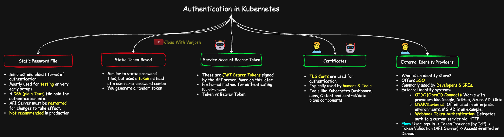
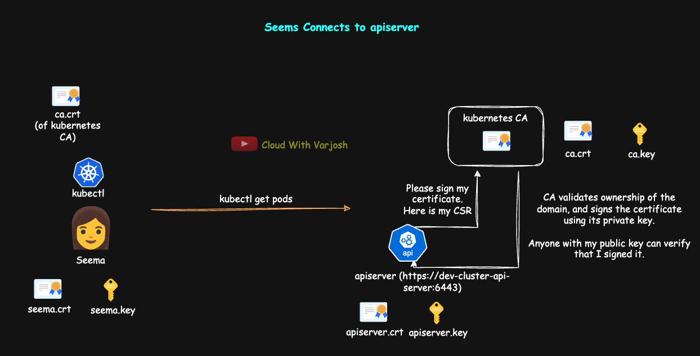

# 54 · Authentication: Proving Who You Are to the API Server

> **Level:** ★★ intermediate
>
> **You will learn:** why Kubernetes has **no user database**; what the API server extracts from a request (username, UID, groups); every authentication method (client certificates, bearer tokens: static, bootstrap, ServiceAccount, OIDC; webhook; authenticating proxy; the removed static password file) and which to use for humans vs machines; anonymous requests; impersonation (`--as`); and the complete **new-user flow**: key → CSR → Kubernetes `CertificateSigningRequest` → approve → certificate → kubeconfig → RBAC → `auth can-i`.
>
> **You need:** topics 50–53. RBAC is covered fully in topic 57; here you'll use one Role and RoleBinding, explained in a line.

---

## ⚡ Core: the 10-minute version

**The idea.** **Authentication** answers "who is calling?". It's the first check on every API request. Kubernetes **stores no user accounts**: it verifies credentials and reads a username and groups from them.
- **Client certificates**: CN = user, O = groups. Fine for components and break-glass admins, risky for people because they can't be revoked.
- **Tokens**: ServiceAccount JWTs, OIDC tokens from SSO.
- **Webhooks** and **auth proxies**.

For humans, prefer **OIDC/SSO**. Failing authentication gives **401**; being authenticated but not allowed gives **403**.

**Picture it.** A security desk with no staff list: it accepts badges from trusted issuers and just reads the name on them.

**The one thing to know.** Adding a user with a certificate:

```bash
openssl genrsa -out seema.key 2048
openssl req -new -key seema.key -subj "/CN=seema/O=devs" -out seema.csr
# wrap it in a CertificateSigningRequest (signerName kubernetes.io/kube-apiserver-client), then:
kubectl certificate approve seema
kubectl get csr seema -o jsonpath='{.status.certificate}' | base64 -d > seema.crt
kubectl auth whoami
```

**Try it now:**
1. Follow the full flow in this topic (keys → CSR → approve → kubeconfig).
2. Run `kubectl get pods --context seema@kind-lab`: you get **403** until topic 57 gives her a Role.

**You've got it if you can:** explain why Kubernetes has no `create user`, and 401 vs 403.

> 📖 **That's the core.** On a first pass, do the mini-lab and move on to the next topic. Everything below is the **full reference**: come back for the details, the edge cases, interview answers and exam-level depth.

---

## What it is

**Authentication** (authn) answers "**who is making this request?**". It's the **first** stage of every API request: authentication → authorization → admission (topic 07). Every request must prove an identity before anything is allowed.

**Kubernetes doesn't store users.** There's no `kubectl create user`. Human identities live **outside** the cluster (in certificates you issue, in an identity provider like Okta/Entra ID/Google, behind a proxy). Kubernetes just **verifies credentials** and extracts the identity from them. The exception is **ServiceAccounts**: real API objects for **non-human** identities, used from inside or outside the cluster (topic 55).

What an authenticator produces (the "user info"):

| Field | Example | Used by |
|---|---|---|
| **username** | `seema`, `system:serviceaccount:ci:jenkins`, `system:node:lab-worker` | RBAC subjects, audit logs |
| **uid** | `a1b2…` | Audit, uniqueness |
| **groups** | `devs`, `system:authenticated`, `system:serviceaccounts` | RBAC group bindings |
| **extra** | `authentication.kubernetes.io/credential-id: …` | Advanced policies, audit |

Every authenticated user also gets the group **`system:authenticated`**. Unauthenticated requests (if allowed) become user **`system:anonymous`** in group **`system:unauthenticated`**.



---

## Why it exists

Authorization (topic 57) is only as good as the identity it's given. Choosing the right authentication method decides whether you can **revoke** access when someone leaves, enforce **MFA** and **SSO**, rotate credentials, and **audit** who did what.

---

## Analogy

The API server is a **building's security desk**. It doesn't keep a staff list. It accepts several **kinds of ID**: a company-issued photo badge (client certificate), a visitor pass from the front office (ServiceAccount token), an ID from a trusted partner agency (OIDC token from your identity provider), or a call to a verification hotline (webhook). The desk only checks the ID is genuine and reads the **name and team** from it. What you may then do is decided by a separate **access list** (RBAC).

---

## How it works inside

The API server runs **all configured authenticators**; the **first** that recognises the credential decides. If none does and anonymous access is enabled, the request is anonymous; otherwise `401 Unauthorized`.

### 1. Static password file (basic auth): REMOVED

Day 37 describes it:
- a CSV file of `password,username,uid,"group1,group2"`, e.g. `mypass,varun,uid123,"devs,admins"`;
- passed to the API server with `--basic-auth-file=/etc/kubernetes/auth.csv` (API server restart needed; on kubeadm, editing the static Pod manifest restarts it automatically);
- used like `curl -u varun:mypass https://<cluster-endpoint>/api`;
- ❌ plain text, no rotation, no auditability.

> ⚠️ **Fix to the original** ([C1](#c1)): this method isn't just "not recommended": **`--basic-auth-file` was removed in Kubernetes v1.19** (deprecated in 1.16). A current API server **refuses to start** with that flag. It's kept here only so you recognise it in old material.

### 2. Bearer tokens

A **token** is any credential string; a **bearer token** is one where **possession is enough**: whoever "bears" it is let in. It's sent in the HTTP header `Authorization: Bearer <token>`. (All Kubernetes tokens below are bearer tokens; we'll just say "tokens".)

**a) Static token file** (still exists, discouraged)
- CSV: `token,username,uid,"group1,group2"`, e.g. `abcd1234token,varun,uid123,"devs"`.
- API server flag: `--token-auth-file=/etc/kubernetes/tokens.csv` (restart required).
- Use: `curl -H "Authorization: Bearer abcd1234token" https://<cluster-endpoint>/api`.
- ❌ Static, plain text, no expiry or rotation. Avoid in production.

**b) ServiceAccount tokens** (topic 55)
- The **most common** tokens: used by Pods (mounted automatically at `/var/run/secrets/kubernetes.io/serviceaccount/token`) and by external automation (via the **TokenRequest API**).
- They're **JWTs** (JSON Web Tokens: a signed JSON document with claims like issuer, subject, audience, expiry).
- ✅ The preferred method for **controllers and automation**.

```bash
TOKEN=$(cat /var/run/secrets/kubernetes.io/serviceaccount/token)
curl --cacert /var/run/secrets/kubernetes.io/serviceaccount/ca.crt \
     -H "Authorization: Bearer $TOKEN" https://kubernetes.default.svc/api
```

> ✅ **Correct today** ([C2](#c2)): they're signed with the **ServiceAccount signing key** (`/etc/kubernetes/pki/sa.key` on kubeadm, set by `--service-account-signing-key-file`) and verified with the matching **public key** (`sa.pub`, `--service-account-key-file`). That key pair is **separate from the cluster CA**. The API server also publishes the public keys at `/openid/v1/jwks`, so outside systems (AWS, Vault) can verify Kubernetes tokens (workload identity, topic 55).

**c) Bootstrap tokens**: short-lived tokens (`abcdef.0123456789abcdef`) stored as Secrets in `kube-system`, used by **new nodes** to join (`kubeadm join --token …`) and request their kubelet client certificate (TLS bootstrapping; topic 53). Enabled with `--enable-bootstrap-token-auth=true`.

**d) OIDC tokens**: see "external identity providers" below.

### 3. Client certificates (X.509)

Covered in depth in the mTLS examples (topics 52–53):
- The client presents a certificate; the API server checks it's **signed by a CA in `--client-ca-file`** and **valid** (dates).
- **Username = the certificate's CN**; **groups = its O (organisation) fields**.
- Used by: the **kubelet**, **controller manager**, **scheduler**, **kubectl** (admin kubeconfigs), and humans with certificates made by `openssl` + a Kubernetes CSR (below).

> ✅ **Correct today** ([C3](#c3)): they're excellent for **components** and **break-glass** admin access, but the Kubernetes docs **discourage them for everyday human users**: Kubernetes has **no certificate revocation**. A leaked or ex-employee's certificate keeps working until it **expires**, and you can't remove a user from a group baked into a certificate. Group `system:masters` certificates even **bypass RBAC** entirely. For people, prefer **OIDC/SSO** (short-lived tokens, central disable, MFA); if you must issue certificates, make them **short-lived** (`expirationSeconds`).

### 4. External identity providers

Kubernetes can rely on external identity systems:
- **OIDC** (OpenID Connect, an identity layer on top of OAuth 2.0): Google, GitHub (via Dex), Entra ID (Azure AD), Okta, Keycloak.
- **LDAP / Kerberos** (e.g. Microsoft Active Directory): **not built in**; integrated through an **authenticating proxy**, a **webhook**, or an OIDC bridge like **Dex** or **Keycloak**.
- **Webhook token authentication**: the API server sends the token to **your** HTTP service (a `TokenReview`), which answers with the user and groups.
- **Authenticating proxy**: a proxy in front of the API server authenticates users and passes their identity in headers (`X-Remote-User`, `X-Remote-Group`), trusted via the proxy's client certificate (`--requestheader-*` flags). Used by some enterprise gateways (and by the API server itself towards aggregated APIs: the front-proxy CA, topic 53).

✅ **Centralised identity**, **SSO**, **MFA** and better **compliance**.

**OIDC flags on the API server:**

```bash
--oidc-issuer-url=<issuer-url>        # e.g. https://login.example.com (must be HTTPS)
--oidc-client-id=<client-id>          # the token's audience must contain this
--oidc-username-claim=<claim>         # default "sub"; often "email"
--oidc-groups-claim=<claim>           # e.g. "groups"
--oidc-ca-file=<ca-file>              # only if the issuer uses a private CA
```

The modern alternative is a **structured `AuthenticationConfiguration` file** (`--authentication-config`, GA in recent releases): several JWT issuers, CEL-based claim mappings and validation rules, reloadable without restarting the API server.

**Webhook flag:**

```bash
--authentication-token-webhook-config-file=/path/to/webhook-config.yaml   # a kubeconfig-format file pointing at your service
```

**LDAP/Kerberos:** no native API server flags. Use an **external proxy/gateway** that authenticates against LDAP/Kerberos before forwarding, or a **webhook** that validates tokens against LDAP.

**The external-IdP flow:**
1. The **user logs in** to the identity provider (browser login, MFA).
2. The IdP **issues a token** (an OIDC **ID token**, a JWT).
3. kubectl sends it (via an `exec` plugin like `kubelogin`; topic 52) as a bearer token; the **API server validates** it: signature (fetched from the issuer's JWKS), issuer, audience, expiry.
4. **Access is granted or denied**; then RBAC decides what the user may do.

**Whatever the IdP (Google, Microsoft, Ping, Okta…), the Kubernetes API server performs the authentication**: the IdP is the **identity store** that issues credentials; the API server is the **verifier**. This gives centralised authentication across apps, SSO and MFA, things Kubernetes' built-in methods can't do.

**Note:** no matter the method (static files, tokens, certificates, external identity), **it is always the API server that authenticates**. Every request goes through it.

**Managed clusters:** EKS maps **AWS IAM** identities via **access entries** (formerly the `aws-auth` ConfigMap) and `aws eks get-token`; GKE uses Google identities (`gke-gcloud-auth-plugin`); AKS uses **Entra ID** (`kubelogin`). All are token-based under the hood.

### Which method for whom

| Who | Recommended |
|---|---|
| Humans (day to day) | **OIDC/SSO** (or cloud IAM on managed clusters), short-lived tokens, MFA |
| Break-glass admin | A client certificate stored securely offline (or the cloud's emergency access) |
| Pods / controllers | **ServiceAccount** projected tokens (automatic) |
| External automation (CI/CD) | Short-lived SA tokens via TokenRequest, or better **OIDC workload identity federation** from the CI system |
| Control-plane components and kubelets | Client certificates from the cluster CA (kubeadm does this) |

### Anonymous requests and impersonation

- **Anonymous auth** (`--anonymous-auth`, default true on the API server): requests with no credentials become `system:anonymous`. RBAC lets them see only `/healthz`, `/livez`, `/readyz` and `/version` (topic 14). Newer versions can restrict anonymous access to specific endpoints only.
- **Impersonation**: a user with the `impersonate` permission can act as someone else by adding headers (`Impersonate-User`, `Impersonate-Group`): `kubectl --as=seema --as-group=devs …`. Admins use it to **test** permissions; it's logged in audit logs.

---

## Commands / YAML

### Who am I?

```bash
kubectl auth whoami
```

```
ATTRIBUTE                                           VALUE
Username                                            kubernetes-admin
Groups                                              [kubeadm:cluster-admins system:authenticated]
Extra: authentication.kubernetes.io/credential-id   [X509SHA256=4b6c…]
```

- Uses the `SelfSubjectReview` API: shows exactly what the API server extracted from your credential. Great for debugging "why am I forbidden?".

### Granting access to a new user, Seema



**Step 1: Seema creates her private key** (it never leaves her machine):

```bash
openssl genrsa -out seema.key 2048
```

A 2048-bit RSA private key in `seema.key`. It will create her CSR and later authenticate her. **Keep it secret.**

**Step 2: Seema creates a CSR:**

```bash
openssl req -new -key seema.key -out seema.csr -subj "/CN=seema/O=devs"
```

- `-subj "/CN=seema"` sets the **Common Name** → her Kubernetes **username**. (Adding `/O=devs` puts her in the **group** `devs`; Day 34 used CN only.)
- The CSR contains her **public key** and **identity**, to be signed by the cluster.

**Step 3: Seema sends the CSR to the admin, base64-encoded on one line:**

```bash
cat seema.csr | base64 | tr -d "\n"
```

Kubernetes objects carry it as a single-line base64 string; `tr -d "\n"` removes newlines.

**Step 4: the admin creates a `CertificateSigningRequest` object:**

```yaml
apiVersion: certificates.k8s.io/v1
kind: CertificateSigningRequest
metadata:
  name: seema
spec:
  request: <BASE64_ENCODED_CSR>
  signerName: kubernetes.io/kube-apiserver-client   # "sign a CLIENT cert the API server will accept"
  expirationSeconds: 7776000                         # 90 days
  usages:
  - client auth                                       # client authentication only
```

- `request` = the base64 CSR.
- `signerName: kubernetes.io/kube-apiserver-client` = the built-in signer for client certificates trusted by the API server (the controller manager signs them with the cluster CA).
- `usages: [client auth]` = only for authenticating to servers, not for serving TLS.
- `expirationSeconds: 7776000` = **90 days** (the controller manager caps it at `--cluster-signing-duration`, default 1 year).

```bash
kubectl apply -f seema-csr.yaml
kubectl get csr seema
```

```
NAME    AGE   SIGNERNAME                            REQUESTOR          REQUESTEDDURATION   CONDITION
seema   5s    kubernetes.io/kube-apiserver-client   kubernetes-admin   90d                 Pending
```

**Step 5: the admin approves it:**

```bash
kubectl certificate approve seema
```

```
certificatesigningrequest.certificates.k8s.io/seema approved
```

The CSR becomes `Approved,Issued`: the controller manager signed it.

**Step 6: the admin extracts the signed certificate:**

```bash
kubectl get csr seema -o jsonpath='{.status.certificate}' | base64 -d > seema.crt
openssl x509 -in seema.crt -noout -subject -issuer -dates
```

```
subject=O = devs, CN = seema
issuer=CN = kubernetes
notBefore=Nov 18 10:40:00 2026 GMT
notAfter=Feb 16 10:40:00 2027 GMT
```

The admin sends `seema.crt` back to Seema (plus the cluster's `ca.crt`: the **public** cluster CA certificate, e.g. from `kubectl config view --raw --minify -o jsonpath='{.clusters[0].cluster.certificate-authority-data}' | base64 -d`). Seema already has her key.

**Step 7: Seema configures her kubeconfig:**

```bash
kubectl config set-credentials seema \
  --client-certificate=seema.crt \
  --client-key=seema.key \
  --embed-certs=true

kubectl config set-cluster kind-lab \
  --server=https://127.0.0.1:41365 \
  --certificate-authority=ca.crt \
  --embed-certs=true

kubectl config set-context seema@kind-lab \
  --cluster=kind-lab \
  --user=seema \
  --namespace=default
```

- First: **how to authenticate** Seema (certificate + key).
- Second: **where** the cluster is and which CA to trust.
- Third: a **context** joining them, with a default namespace.

> ✅ **Correct today** ([C4](#c4)): `set-credentials` has **no `--certificate-authority` flag** (kubectl rejects it as an unknown flag). The CA belongs to the **cluster** entry (`set-cluster --certificate-authority`), as in the second command. Day 34 also used `--kubeconfig=~/.kube/config` on one command only; omit it (default file) or use `$HOME/.kube/config` consistently (topic 52's tilde note).

**Step 8: the admin grants permissions (RBAC).** A **Role** lists allowed actions on resources in one namespace; a **RoleBinding** gives that Role to a user or group (topic 57).

```yaml
kind: Role
apiVersion: rbac.authorization.k8s.io/v1
metadata:
  namespace: default
  name: seema-role
rules:
- apiGroups: [""]                      # core group (Pods)
  resources: ["pods"]
  verbs: ["get", "list", "delete"]
```

```bash
kubectl apply -f seema-role.yaml
kubectl create rolebinding seema-binding --role=seema-role --user=seema --namespace=default
```

The Role allows **get, list, delete** on Pods in `default`; the RoleBinding gives it to user `seema` (her certificate's CN).

**Step 9: the admin checks the permissions** by **impersonating** Seema:

```bash
kubectl auth can-i delete pods --namespace=default --as=seema     # yes
kubectl auth can-i create deployments --namespace=default --as=seema   # no
```

`--as=seema` simulates Seema's identity, confirming RBAC before she uses it.

**Step 10: Seema switches to her context:**

```bash
kubectl config use-context seema@kind-lab
kubectl get pods            # works
kubectl get nodes           # Error from server (Forbidden): nodes is forbidden: User "seema" cannot list resource "nodes"…
```

**Optional:** use the REST API directly, or another kubeconfig file:

```bash
curl https://127.0.0.1:41365/api/v1/namespaces/default/pods --cacert ca.crt --cert seema.crt --key seema.key
kubectl get pods --kubeconfig=myconfig.yaml
```

**Step 11: check the expiry:**

```bash
openssl x509 -noout -dates -in seema.crt
```

`notBefore`/`notAfter` tell Seema when she'll need a new certificate.

**Conclusion:** keys → CSR → approval → certificate → kubeconfig → RBAC is the complete, practical way to give a user access, and a foundation for any cluster admin. (In production, prefer OIDC for people, as above.)

---

## Hands-on lab

1. `kubectl auth whoami` with your admin context.
2. Do the full Seema flow on kind (Steps 1–11), including a group (`/O=devs`); then bind the Role to the **group** instead (`--group=devs`) and confirm it still works.
3. Try the deny cases: `kubectl get nodes` as Seema; `kubectl auth can-i --list --as=seema`.
4. Look at what the API server accepts: `docker exec lab-control-plane grep -E 'client-ca-file|anonymous|token-auth|oidc|service-account-key-file' /etc/kubernetes/manifests/kube-apiserver.yaml`.
5. Anonymous: `curl -k https://127.0.0.1:<port>/api/v1/pods` → `403` for `system:anonymous`; `curl -k …/version` → allowed.
6. (Optional) Set up OIDC with a local **Dex** or Keycloak and `kubelogin`; log in through a browser and see your email as the username in `kubectl auth whoami`.
7. Clean up: switch back to the admin context; `kubectl delete csr seema; kubectl delete rolebinding seema-binding; kubectl delete role seema-role`.

---

## Where you'll use it

- **Onboarding/offboarding** engineers (SSO groups → RBAC).
- **CI/CD access** to clusters (short-lived tokens, workload identity federation).
- **Security audits**: no long-lived certificates for people, no static token files, anonymous access minimised.
- **CKA**: "create a CSR for user X, approve it, give them a Role".

---

## When it breaks

| Symptom | Cause | Fix |
|---|---|---|
| `error: You must be logged in to the server (Unauthorized)` (401) | No valid credential: expired cert/token, wrong CA signed it, OIDC token audience/issuer mismatch | `kubectl auth whoami` fails too → check credential, expiry, issuer |
| `Forbidden` (403) | **Authenticated** but RBAC denies | Topic 57 |
| CSR stays `Pending` | Nobody approved it | `kubectl certificate approve` |
| CSR `Approved` but no certificate | Wrong `signerName`/`usages`, or the controller manager has no signing key configured | Check controller-manager `--cluster-signing-*` flags |
| `x509: certificate signed by unknown authority` from the API server | Your client cert isn't from the CA in `--client-ca-file` | Get a cert from the cluster CA |
| `unknown flag: --certificate-authority` | That flag on `set-credentials` | Put the CA on `set-cluster` |
| API server won't start after adding `--basic-auth-file` | Flag removed in 1.19 | Remove it |
| Ex-employee still has access | Long-lived client certificate (no revocation) | Use OIDC; short expiry; as a last resort rotate the CA |

---

## Quick recap

- Kubernetes authenticates requests but **stores no users** (except ServiceAccounts); the API server extracts **username, uid, groups**.
- Methods: **client certificates** (CN=user, O=groups; no revocation), **tokens** (ServiceAccount JWTs, bootstrap, OIDC, discouraged static file), **webhook**, **auth proxy**. **Basic auth was removed in v1.19.**
- Humans → OIDC/SSO; workloads → ServiceAccounts; components → certificates.
- New user via certificates: `openssl` key + CSR → `CertificateSigningRequest` (`kube-apiserver-client`, `client auth`, `expirationSeconds`) → `approve` → extract → kubeconfig → RBAC → `auth can-i --as`.
- `kubectl auth whoami` shows your identity; `--as` impersonates.

### Interview questions

1. **Q: How do you add a user to Kubernetes?**
   A: You don't create users in Kubernetes; you issue credentials from an external source: an OIDC identity (preferred), or a client certificate signed by the cluster CA (via a CertificateSigningRequest). The CN/claim becomes the username, and RBAC grants permissions.
2. **Q: Why are client certificates risky for human users?**
   A: Kubernetes can't revoke certificates, so access lasts until expiry; groups are fixed in the certificate; and `system:masters` certificates bypass RBAC. OIDC gives central disable, short-lived tokens and MFA.
3. **Q: 401 vs 403 from the API server?**
   A: 401 Unauthorized = authentication failed (no valid credential). 403 Forbidden = you were authenticated but authorization (RBAC, etc.) denied the action.

---

## Appendix: notes on the original course material

This topic was rebuilt from the original CKA course notes. This appendix keeps the audit trail out of your way while you learn.

### Sources

Day 37 (introduction; authentication in Kubernetes; static password file; static token file; ServiceAccount tokens and the token/bearer-token note; client certificates; external identity providers: OIDC, LDAP/Kerberos, webhook, flags, the external-IdP flow; "always the API server"; the start of "who interacts"), Day 34 (granting cluster access to Seema with certificates and RBAC: steps 1–11, optional REST/alternate kubeconfig, conclusion). ServiceAccounts are in topic 55.

### Corrections to the original notes

Each entry shows what the original said and what's true now. In the topic above, each correction appears as a ✅ **Correct today** line or a ⚠️ **Fix to the original** box, linked to its entry here.

<a id="c1"></a>**C1 · Corrected (Day 37).** this method isn't just "not recommended": **`--basic-auth-file` was removed in Kubernetes v1.19** (deprecated in 1.16). A current API server **refuses to start** with that flag. It's kept here only so you recognise it in old material.

<a id="c2"></a>**C2 · Corrected (Day 37).** ServiceAccount tokens were described as "signed by the API server's private key and verified using its public **certificate authority (CA)**". **Now:** they're signed with the **ServiceAccount signing key** (`/etc/kubernetes/pki/sa.key` on kubeadm, set by `--service-account-signing-key-file`) and verified with the matching **public key** (`sa.pub`, `--service-account-key-file`). That key pair is **separate from the cluster CA**. The API server also publishes the public keys at `/openid/v1/jwks`, so outside systems (AWS, Vault) can verify Kubernetes tokens (workload identity, topic 55).

<a id="c3"></a>**C3 · Corrected (Day 37).** client certificates were called "✅ **strongly recommended** for production". **Now:** they're excellent for **components** and **break-glass** admin access, but the Kubernetes docs **discourage them for everyday human users**: Kubernetes has **no certificate revocation**. A leaked or ex-employee's certificate keeps working until it **expires**, and you can't remove a user from a group baked into a certificate. Group `system:masters` certificates even **bypass RBAC** entirely. For people, prefer **OIDC/SSO** (short-lived tokens, central disable, MFA); if you must issue certificates, make them **short-lived** (`expirationSeconds`).

<a id="c4"></a>**C4 · Corrected (Day 34).** the original `kubectl config set-credentials` command included `--certificate-authority=ca.crt`. **Now:** `set-credentials` has **no `--certificate-authority` flag** (kubectl rejects it as an unknown flag). The CA belongs to the **cluster** entry (`set-cluster --certificate-authority`), as in the second command. Day 34 also used `--kubeconfig=~/.kube/config` on one command only; omit it (default file) or use `$HOME/.kube/config` consistently (topic 52's tilde note).
