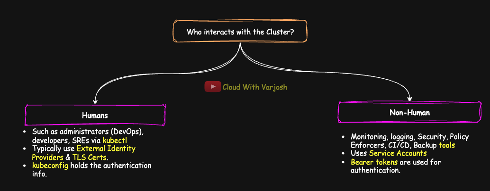
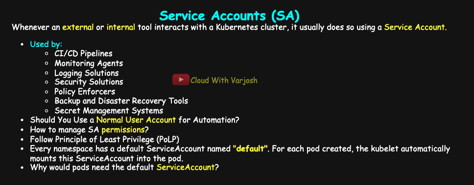
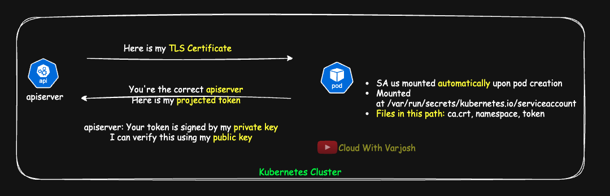
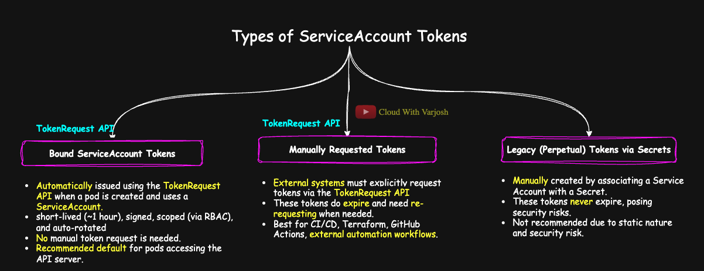
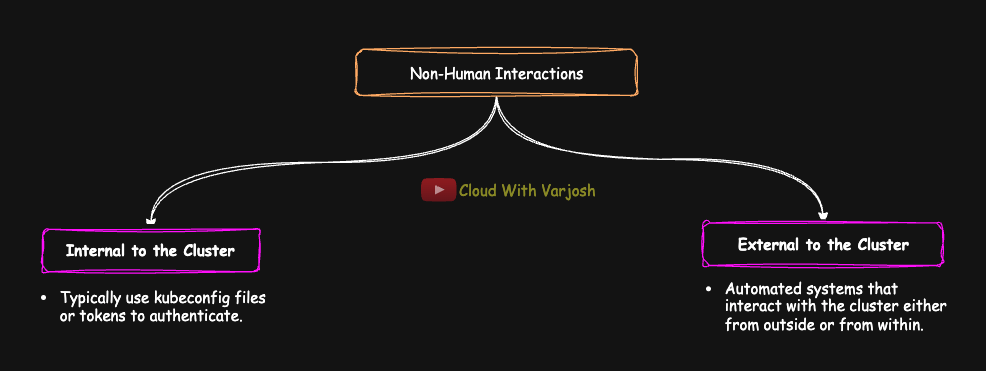
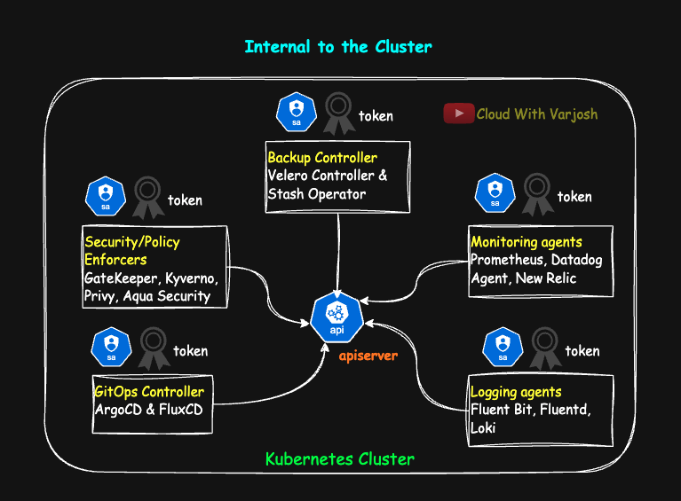
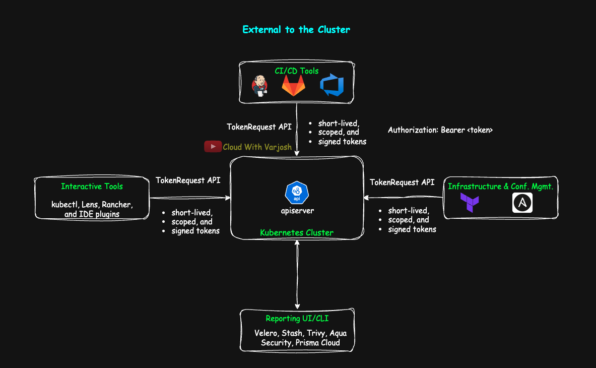

# 55 · ServiceAccounts and Their Tokens

> **Level:** ★★ intermediate
>
> **You will learn:** who talks to a cluster (humans vs non-human agents, inside vs outside); what a **ServiceAccount** (SA) is and why automation must never use a person's account; least privilege for SAs; how a Pod gets its SA token (the projected `kube-api-access` volume: `token`, `ca.crt`, `namespace`) and how it authenticates step by step; the three kinds of SA tokens (bound/projected, TokenRequest for external tools, legacy Secret tokens) and how they evolved; what's inside the JWT; **workload identity** (using SA tokens to get cloud credentials); and the Jenkins demo.
>
> **You need:** topics 53 and 54. RBAC (Roles/ClusterRoles and bindings) is topic 57; one ClusterRole appears here, explained in a line.

---

## ⚡ Core: the 10-minute version

**The idea.** **ServiceAccounts** are identities for **workloads and automation**, not people. Every namespace has a `default` one with no permissions. Each Pod gets a short-lived, auto-rotated **token** (a signed JWT) mounted at `/var/run/secrets/kubernetes.io/serviceaccount/`, which it uses to call the API. Give each app its **own** ServiceAccount with minimal RBAC, and turn off token mounting for apps that never call the API. External tools get short-lived tokens with `kubectl create token`.

**Picture it.** Company vans with their own fuel cards, instead of employees lending their personal credit cards.

**The one thing to know.**

```bash
kubectl create serviceaccount ci -n dev
kubectl create token ci -n dev --duration=1h        # short-lived token for a tool
```

```yaml
spec:
  serviceAccountName: ci
  automountServiceAccountToken: false               # if the app never talks to the API
```

**Try it now:**
1. Run a busybox Pod and `cat` its mounted token.
2. Decode the middle part with `cut -d. -f2 | base64 -d`: see `sub: system:serviceaccount:default:default` and `exp`.
3. Call the API from the Pod and get **403**: the default SA has no rights.

**You've got it if you can:** explain how a Pod authenticates, and why automation must never use a person's account.

> 📖 **That's the core.** On a first pass, do the mini-lab and move on to the next topic. Everything below is the **full reference**: come back for the details, the edge cases, interview answers and exam-level depth.

---

## What it is

### Who interacts with a cluster



1. **Humans**: admins, developers, SREs, via `kubectl`, dashboards and client tools. They authenticate with external identities or certificates (topic 54).
2. **Non-human agents**: automated systems, **outside** the cluster (CI/CD, Terraform) or **inside** it (controllers, agents).

**Non-human access is done with ServiceAccounts.**



A **ServiceAccount** is a **namespaced Kubernetes object** that represents an **identity for a workload or tool**. Unlike human users, SAs **are stored in the cluster**: you create them with `kubectl create serviceaccount`. Their username is **`system:serviceaccount:<namespace>:<name>`**, and they belong to the groups **`system:serviceaccounts`** and **`system:serviceaccounts:<namespace>`**.

---

## Why it exists

**Why SAs are needed:** workloads and automation tools need to authenticate to the API server. Instead of borrowing a person's account, they get their own identity. Typical users:
- **CI/CD pipelines** (Jenkins, GitLab CI/CD) deploying apps;
- **monitoring agents** (Prometheus, Datadog, New Relic, Sysdig) collecting metrics;
- **logging** (Fluentd, the ELK stack, Loki) processing logs;
- **security tools** (Aqua, Falco, Sysdig Secure) enforcing policy;
- **policy engines** (OPA Gatekeeper, Kyverno) applying governance rules;
- **backup/DR** (Velero, Stash);
- **secret management** (HashiCorp Vault, Sealed Secrets).

Any external tool or service that talks to the cluster should use an SA, so its actions are **clearly separate from humans'**.

**Should automation use a normal user account?** Technically possible, **strongly discouraged**:
- **Log ambiguity**: you can't tell human from automated actions in audit logs.
- **Security risk**: a compromised user breaks automation (or vice versa); people leave companies, automation doesn't.
- **Poor access management**: SAs get **precise, minimal** permissions; human accounts tend to be broader.

Name SAs for what they do: `automation-account`, `cicd-account`, `monitoring-agent`, `policy-enforcer`, `jenkins-deployer`. Compare these audit entries:

```
User 'admin' created a pod in prod
ServiceAccount 'jenkins-deployer' created a pod in prod
```

Only the second tells you **who or what** really did it.

**Permissions:** like users, SAs get access through **RBAC**: `Role`/`ClusterRole` define permissions; `RoleBinding`/`ClusterRoleBinding` grant them (topic 57).

**Least privilege:** grant only what's needed:
- a **monitoring agent** usually needs just `get`, `list`, `watch`;
- a **CI/CD pipeline** may need `create`, `patch`, `update` on specific resources, but **never** unrestricted cluster-wide access;
- a **policy engine** needs only what it reviews and enforces.

---

## Analogy

ServiceAccounts are **company vehicles with fleet cards**: they belong to the company (the cluster), each is labelled for its job ("delivery van 3"), and each fuel card works only at certain pumps (RBAC). Using a person's own credit card for the delivery van (a user account for automation) muddles the accounts and breaks when that person leaves. The **projected token** is a **day pass** printed fresh every hour for the van; the **legacy Secret token** was a **permanent pass** that worked forever if anyone copied it.

---

## How it works inside

### Every Pod has an SA

- Each **namespace** automatically gets a ServiceAccount named **`default`** (created by the ServiceAccount controller).
- Every Pod is associated with an SA: the one in **`spec.serviceAccountName`**, or `default` if none is given. This applies whoever creates the Pod (Deployment, StatefulSet, ReplicaSet, Job, CronJob, DaemonSet, or directly).
- Set it next to `containers` in the Pod spec; disable token mounting with **`automountServiceAccountToken: false`** (on the Pod or on the SA):

```yaml
apiVersion: apps/v1
kind: Deployment
metadata:
  name: my-app
spec:
  replicas: 1
  selector:
    matchLabels:
      app: my-app
  template:
    metadata:
      labels:
        app: my-app
    spec:
      serviceAccountName: jenkins-sa
      automountServiceAccountToken: true     # false = don't mount any SA token
      containers:
        - name: my-app-container
          image: my-app-image:v1
```

**Why it matters:** Pods that call the API server (read ConfigMaps, list Services, watch resources: controllers, operators, agents) must authenticate; the SA token is that identity. **Most apps never call the API**, so they should have `automountServiceAccountToken: false`: a stolen token from a hacked app would otherwise let an attacker talk to the API server as that SA.

> ✅ **Correct today** ([C1](#c1)): the `default` SA has **no permissions at all** beyond the API discovery endpoints that every authenticated identity gets. A Pod that mounts ConfigMaps or Secrets as volumes or env vars doesn't need any: the **kubelet** fetches them with **its own** node identity (topic 56's Node authorizer). Only code that calls the API itself needs RBAC, and you should grant it to a **dedicated** SA, never to `default`.

### What gets mounted

The token arrives through a **projected volume** (topic 37) named `kube-api-access-<random>`, mounted **read-only** at:

```
/var/run/secrets/kubernetes.io/serviceaccount/
├── ca.crt       # the cluster CA certificate: verifies the API server's TLS certificate
├── namespace    # the Pod's namespace
└── token        # a signed JWT: the SA's credential
```

See it with `kubectl describe pod <pod>` (`Mounts: /var/run/secrets/kubernetes.io/serviceaccount from kube-api-access-xxxxx (ro)`) or `ls` inside the container. Decode the token's claims on [jwt.io](https://jwt.io) or with the command below.

### How a Pod authenticates, step by step



1. **The SA is attached** to the Pod (default or custom), and the kubelet **requests a token** for it via the **TokenRequest API** and writes it into the Pod's projected volume. It **refreshes** it before expiry (at ~80% of its lifetime).
2. **What's mounted**: `ca.crt`, `namespace`, `token` (above).
3. **TLS (one-way) + token**:
   - the **Pod is the client**, the **API server the server** (via the `kubernetes.default.svc` Service, or the `KUBERNETES_SERVICE_HOST`/`_PORT` env vars injected into every container);
   - the Pod verifies the API server's certificate with **`ca.crt`**;
   - the Pod sends the **JWT** in `Authorization: Bearer <token>`. (Only the server presents a certificate, so this is "mTLS-like" in spirit but technically **TLS + bearer token**.)
   - The token is **projected** ("projected" into the Pod's filesystem by the kubelet), **time-bound**, **audience-bound** and **signed**.
4. **The API server validates the JWT**: signature (with the **SA public key**, `sa.pub`; the token's `kid` header names which key signed it), issuer, audience, expiry, and that the bound **Pod and SA still exist**. It then identifies the caller as `system:serviceaccount:<ns>:<name>` with groups `system:serviceaccounts` and `system:serviceaccounts:<ns>`.
5. **Authorization** (RBAC) decides whether that SA may do the action.

> ⚠️ **Fix to the original** ([C2](#c2)): "since the token was signed by the **API server's private key**, the API server can verify it using its public key". The idea is right, but the key is the dedicated **ServiceAccount signing key** (`--service-account-signing-key-file`, `sa.key`), not the API server's TLS key; verification uses `--service-account-key-file` (`sa.pub`) (topic 54).

**Why this matters:** it's how Kubernetes authenticates **workloads**, not just humans; without it in-cluster apps can't talk to the API securely; and it shows why **least privilege** matters for every SA.

**Helm and agents:** monitoring, logging and security tools usually run as **DaemonSets** with **their own SAs** and tailored RBAC, typically installed by **Helm** charts that create the DaemonSet, SA, RBAC, Services and CRDs together (topics 65–66). They authenticate exactly as above.

### What's inside a projected token

```json
{
  "aud": ["https://kubernetes.default.svc.cluster.local"],     // audience: who may accept it
  "exp": 1763460401,                                           // expiry (Unix time)
  "iat": 1763456801,                                           // issued at
  "iss": "https://kubernetes.default.svc.cluster.local",        // issuer (the cluster)
  "kubernetes.io": {
    "namespace": "default",
    "node": { "name": "lab-worker", "uid": "…" },               // bound to this node…
    "pod": { "name": "web-6d4b7c9f8-k2xjp", "uid": "…" },       // …and this Pod: invalid once the Pod is deleted
    "serviceaccount": { "name": "default", "uid": "…" },
    "warnafter": 1763460408
  },
  "nbf": 1763456801,
  "sub": "system:serviceaccount:default:default"                // the identity
}
```

### The evolution of SA tokens

| | Old (≤ v1.21) | Now |
|---|---|---|
| Creation | A **Secret** with a token **auto-created** for every SA | **No Secret**; tokens issued on demand via **TokenRequest** |
| Lifetime | **Never expires** | **Short-lived** (Pods: ~1 h, auto-refreshed) |
| Storage | In etcd, as a Secret | **Not stored**: generated and projected |
| Binding | None: works anywhere, forever | Bound to **audience**, **expiry** and the **Pod** (and node) |
| Risk if leaked | Usable **forever** | Expires; dies with the Pod |

> ✅ **Correct today** ([C3](#c3)): bound **projected tokens** became the default mounting method in **v1.22** (GA); **v1.24** stopped **auto-creating** legacy Secret-based tokens; **v1.30** (GA) **cleans up** legacy tokens: unused ones are labelled invalid after a year and later deleted. (For compatibility, the API server may issue Pod tokens valid longer than 1 h when the audience is the API server, and logs a warning if an app keeps using one past the hour (`warnafter`); kubelets still rotate them hourly.)

### Three kinds of SA tokens



Grouped by **use** (mechanically, the first two both come from the TokenRequest API):

**1. Bound/projected tokens (for Pods)**: issued automatically through TokenRequest when a Pod uses an SA; **short-lived** (~1 h), **signed**, **audience- and Pod-bound**, **auto-rotated** by the kubelet; mounted at `/var/run/secrets/kubernetes.io/serviceaccount/token`. **The recommended default for Pods.**

**2. Manually requested tokens (for external tools)**: you or the tool call TokenRequest (`kubectl create token`) for a **short-lived, signed, audience-bound** JWT for an SA, and pass it in API calls. **Rotation is the tool's job** (request a new one before expiry). Recommended over static Secrets.

**3. Legacy (perpetual) tokens in Secrets**: create a Secret of type `kubernetes.io/service-account-token` annotated with the SA name; the controller fills in a **non-expiring** token. **Not recommended**: static, never rotated, stored in etcd.

| Type | Used by | Issued how | Lifetime | Rotation | Recommended |
|---|---|---|---|---|---|
| Projected (bound) | Pods | Automatic, TokenRequest | ~1 h | Automatic | ✅ Yes |
| Manual TokenRequest | External tools | `kubectl create token` / API | You choose (`--duration`) | By the tool | ✅ Yes |
| Legacy Secret token | Legacy systems | A Secret with the SA annotation | Forever | None | ❌ No |

> ℹ️ **Note:** tokens were described as "scoped (via RBAC)". A token carries **identity**, not permissions: it's **bound** to an audience, an expiry and a Pod. What the SA may **do** is decided separately, every request, by RBAC.

### Non-human access patterns



**Internal to the cluster**: Kubernetes-native agents and controllers running as **Pods** that **read, watch or change** cluster resources:



- **Monitoring**: Prometheus, Datadog Agent, New Relic.
- **Logging**: Fluent Bit, Fluentd, Loki.
- **Security scanners/defenders**: Trivy Operator, Aqua agents, Prisma Cloud Defenders.
- **Policy/runtime**: Kyverno, Gatekeeper (OPA), Falco.
- **Metrics exporters**: Node Exporter, kube-state-metrics.
- **GitOps controllers**: Argo CD, Flux. They run **in** the cluster, poll Git, and apply the desired state (Argo CD's UI is exposed via Ingress/LoadBalancer; topic 68).
- **Backup controllers**: the Velero controller, the Stash operator (schedule backups and restores using Kubernetes and storage APIs).

**The agent-controller model:** many tools have **in-cluster agents** that collect data, apply manifests or enforce policies, and **push** results to an **external** dashboard/console. Those external UIs **don't call the Kubernetes API** themselves; they use what the agent pushed.

**How internal workloads authenticate:** ✅ **projected SA tokens** (automatic; short-lived, audience-bound, control-plane-signed), with ✅ **RBAC** deciding access, e.g. Prometheus: `get/list/watch` on `endpoints`, `pods`, `services`; Argo CD: broad control over Deployments, ConfigMaps, Secrets in its target namespaces. **Best practice:** a **custom SA per tool** with minimal RBAC; never broaden `default`.

**External to the cluster**: tools outside that deploy, configure or query:



- **CI/CD**: Jenkins, GitLab CI/CD, GitHub Actions.
- **Infrastructure automation**: Terraform, Pulumi, Ansible.
- **Configuration management**: Chef, Puppet.
- **Backup CLIs**: the Velero CLI, the Stash CLI.
- **Security scanners**: the Trivy CLI, the Prisma Cloud Console, the Aqua CLI.

(Many of these also install in-cluster agents that report back.)

**How external tools authenticate:**
- ✅ **Short-lived SA tokens via TokenRequest** (available since v1.12; GA v1.22), sent as `Authorization: Bearer <token>`. Typical for CI/CD and automation.
- ⚠️ **Long-lived tokens or client certificates** in kubeconfigs: legacy, less secure, hard to rotate; phase them out.
- ✅✅ Even better today: **OIDC workload identity federation**: the CI system's own OIDC token (GitHub Actions, GitLab) is trusted directly by the cluster (`AuthenticationConfiguration`, topic 54) or exchanged for cloud credentials (EKS access entries), so **no Kubernetes secret** is stored in CI at all.

**TokenRequest flow:**
1. The **admin creates the SA** with the right RBAC, and lets the tool's identity **`create`** on **`serviceaccounts/token`** for that SA.
2. The **tool requests a token** for that SA.
3. The **API server issues** a signed, short-lived, audience-bound JWT.
4. The tool uses it as a **bearer token**.
5. **When it expires**, the tool requests a new one (no auto-renewal for external tools).

**Best practice:** always prefer short-lived TokenRequest tokens; never embed long-lived secrets in scripts or pipelines.

| Category | Runs in | Calls the API | Authentication | Examples |
|---|---|---|---|---|
| CI/CD | External | Yes | Short-lived SA token (TokenRequest) or OIDC federation | GitLab CI, GitHub Actions, Jenkins |
| Infrastructure automation | External | Yes | Short-lived SA token / cloud IAM | Terraform, Pulumi, Ansible |
| Monitoring, logging, security agents | Internal | Yes | Projected SA token | Prometheus, Fluent Bit, Falco |
| Backup controllers | Internal | Yes | Projected SA token | Velero, Stash |
| GitOps controllers | Internal | Yes | Projected SA token | Argo CD, Flux |
| Hybrid tools with external UI | Both | Internal parts only | Agents use SAs; UI uses pushed data | Prisma Cloud, Velero, Argo CD |

**Note:** whoever makes the request (human or not) and however (kubectl, curl, automation, client libraries), **the API server performs authentication**: certificates, bearer tokens, OIDC, webhook or auth proxy, every request hits it first.

### Workload identity: SA tokens for cloud access

The same projected-token mechanism lets Pods get **cloud** credentials **without storing cloud keys**:
- **EKS Pod Identity** (current) or **IRSA** (IAM Roles for Service Accounts): a Pod's SA is linked to an IAM role; the AWS SDK exchanges a projected token (audience `sts.amazonaws.com` or the Pod Identity agent) for temporary AWS credentials (topic 70 uses this for the AWS Load Balancer Controller).
- **GKE Workload Identity Federation**, **Azure Workload Identity**: the same idea.
- **Vault Kubernetes auth**: Vault verifies the Pod's SA token via TokenReview or JWKS and returns secrets.

```yaml
volumes:
- name: vault-token
  projected:
    sources:
    - serviceAccountToken:
        audience: vault          # a token ONLY Vault will accept
        expirationSeconds: 600
        path: token
```

Custom audiences ensure a token meant for Vault can't be replayed against the Kubernetes API, and vice versa.

---

## Commands / YAML

### Look at your Pod's identity

```bash
kubectl run sa-demo --image=busybox:1.37 -- sleep 3600
kubectl get pod sa-demo -o jsonpath='{.spec.serviceAccountName}{"\n"}'
kubectl exec sa-demo -- ls /var/run/secrets/kubernetes.io/serviceaccount
kubectl exec sa-demo -- cat /var/run/secrets/kubernetes.io/serviceaccount/token | cut -d. -f2 | base64 -d 2>/dev/null; echo
```

```
default
ca.crt
namespace
token
{"aud":["https://kubernetes.default.svc.cluster.local"],"exp":…,"kubernetes.io":{"namespace":"default","pod":{"name":"sa-demo",…},"serviceaccount":{"name":"default",…}},"sub":"system:serviceaccount:default:default"}
```

(The JWT's middle part is base64url; `base64 -d` may complain about padding but prints the JSON.)

Call the API from inside the Pod:

```bash
kubectl exec sa-demo -- sh -c 'wget -qO- --header "Authorization: Bearer $(cat /var/run/secrets/kubernetes.io/serviceaccount/token)" \
  --no-check-certificate https://kubernetes.default.svc/api/v1/namespaces/default/pods 2>&1 | head -5'
```

```
wget: server returned error: HTTP/1.1 403 Forbidden
```

**Authenticated** (no 401) but **forbidden**: the `default` SA has no permissions, as corrected above. (busybox's wget can't use `ca.crt` here, hence `--no-check-certificate`; with curl you'd pass `--cacert`.)

### Demo: a ServiceAccount for Jenkins

**Step 1: namespace and SA**

```bash
kubectl create ns jenkins
kubectl create sa jenkins-sa -n jenkins
```

**Step 2: a ClusterRole and ClusterRoleBinding** (`Day 37/cr-crb.yaml`). A **ClusterRole** is a set of permissions usable cluster-wide; a **ClusterRoleBinding** grants it to subjects in **all** namespaces (topic 57).

```yaml
apiVersion: rbac.authorization.k8s.io/v1
kind: ClusterRole
metadata:
  name: jenkins-cluster-role
rules:
  - apiGroups: [""]
    resources: ["pods", "services", "endpoints"]
    verbs: ["get", "list", "watch", "create", "delete", "patch", "update"]
  - apiGroups: ["apps"]
    resources: ["deployments", "replicasets"]
    verbs: ["get", "list", "watch", "create", "delete", "patch", "update"]
---
apiVersion: rbac.authorization.k8s.io/v1
kind: ClusterRoleBinding
metadata:
  name: jenkins-cluster-rolebinding
subjects:
  - kind: ServiceAccount
    name: jenkins-sa
    namespace: jenkins          # the SA's namespace
roleRef:
  kind: ClusterRole
  name: jenkins-cluster-role
  apiGroup: rbac.authorization.k8s.io
```

```bash
kubectl apply -f "Day 37/cr-crb.yaml"
kubectl auth can-i create deployments -n prod --as=system:serviceaccount:jenkins:jenkins-sa    # yes
kubectl auth can-i get secrets -n prod --as=system:serviceaccount:jenkins:jenkins-sa           # no
```

(Least-privilege note: a real CI deployer usually gets a **namespaced RoleBinding** per target namespace, not cluster-wide powers.)

**Step 3: a manual long-lived token (legacy, not for production)** (`Day 37/secret.yaml`)

```yaml
apiVersion: v1
kind: Secret
metadata:
  name: jenkins-sa-secret
  namespace: jenkins
  annotations:
    kubernetes.io/service-account.name: jenkins-sa     # bind it to this SA
type: kubernetes.io/service-account-token              # the controller fills in a token
```

```bash
kubectl apply -f "Day 37/secret.yaml"
kubectl describe -n jenkins secret jenkins-sa-secret        # shows token: eyJhbGci…
```

This token **never expires** (decode it on jwt.io: no `exp` claim). Since v1.24 such Secrets are **no longer auto-created**; you must ask for one explicitly like this, and v1.30+ cleans up ones that go unused.

**Step 4: short-lived tokens via TokenRequest (recommended)**

```bash
kubectl create token jenkins-sa -n jenkins                    # default ~1h
kubectl create token jenkins-sa -n jenkins --duration=30m --audience=https://kubernetes.default.svc
```

Or the raw API call (the caller needs `create` on `serviceaccounts/token`):

```bash
ADMIN_TOKEN=…   # any credential allowed to create tokens for this SA
curl -X POST "https://<api-server-url>/api/v1/namespaces/jenkins/serviceaccounts/jenkins-sa/token" \
  --cacert ca.crt \
  -H "Authorization: Bearer $ADMIN_TOKEN" \
  -H "Content-Type: application/json" \
  -d '{"kind":"TokenRequest","apiVersion":"authentication.k8s.io/v1","spec":{"audiences":["https://kubernetes.default.svc"],"expirationSeconds":3600}}'
```

The response's `status.token` is valid for **1 hour**.

(Day 37's version used the **legacy Secret token** as the credential to call TokenRequest, which works but defeats the purpose by keeping a permanent token around. In practice the caller authenticates with its own identity, e.g. a CI system's OIDC token or an admin.)

**Step 5: Jenkins uses the token**

```bash
curl --cacert ca.crt -H "Authorization: Bearer <TOKEN>" https://<api-server-url>/api/v1/namespaces/prod/pods
```

(Day 37 used `curl -k`; pass the cluster CA instead of skipping verification.) Or build a kubeconfig for Jenkins with `kubectl config set-credentials jenkins --token=<TOKEN>` (topic 52).

**Key takeaways:**
- ✔️ Manual tokens in Secrets are legacy; use the **TokenRequest API**.
- ✔️ **Projected tokens rotate automatically** for Pods; external tools request **new tokens when needed**.
- ✔️ Best practice: request tokens at use time; don't store long-lived credentials.

---

## Hands-on lab

1. Run `sa-demo`; inspect the mounted files and decode the token's claims.
2. Call the API from the Pod and get **403**; then create SA `pod-reader` with a Role allowing `get/list pods`, run a Pod with `serviceAccountName: pod-reader`, and get **200**.
3. Delete the Pod and try its old token from outside (`curl --cacert … -H "Authorization: Bearer <old token>" …`): **401**, because the token was bound to a Pod that no longer exists.
4. Set `automountServiceAccountToken: false` and confirm the directory is gone.
5. Do the Jenkins demo; compare the legacy token (no `exp`) and a `kubectl create token` token (with `exp`).
6. Make a projected token with `audience: vault` and show the API server rejects it (wrong audience → 401).
7. Clean up: `kubectl delete pod sa-demo; kubectl delete ns jenkins; kubectl delete clusterrole jenkins-cluster-role; kubectl delete clusterrolebinding jenkins-cluster-rolebinding`.

---

## Where you'll use it

- Every **operator, controller and agent** you install comes with an SA + RBAC (check what they get!).
- **CI/CD access** to clusters: short-lived tokens or federation.
- **Cloud access from Pods**: EKS Pod Identity/IRSA, GKE/Azure workload identity, Vault.
- **Image pulls**: SAs can carry `imagePullSecrets` (topic 62).
- **Security hardening**: disable automount by default, one SA per app, no permissions on `default`.

---

## When it breaks

| Symptom | Cause | Fix |
|---|---|---|
| App gets `403 Forbidden` calling the API | Its SA lacks RBAC | Grant a minimal Role to a dedicated SA |
| `401 Unauthorized` with an SA token | Expired, wrong audience, Pod deleted, legacy token cleaned up | Use projected/TokenRequest tokens; re-read the token file (it rotates!) |
| App fails after ~1 h | It read the token once at start-up and cached it | Re-read the file periodically (client libraries do) |
| `serviceaccounts "x" not found` on Pod create | SA missing in that namespace | Create it first |
| `kubectl create token` forbidden | Caller lacks `create serviceaccounts/token` | Grant it, or use an admin |
| Old automation broke after an upgrade | Relied on auto-created token Secrets (gone since 1.24) | Create explicit token Secrets temporarily; migrate to TokenRequest/OIDC |

---

## Quick recap

- ServiceAccounts = in-cluster identities for workloads and automation (`system:serviceaccount:<ns>:<name>`); each namespace has `default` (with **no** permissions); never use human accounts for automation.
- Pods get a **projected token** (+ `ca.crt`, `namespace`) at `/var/run/secrets/kubernetes.io/serviceaccount`; TLS with `ca.crt` + bearer JWT; signed with `sa.key`, verified with `sa.pub`.
- Token types: **projected** (Pods, ~1 h, auto-rotated), **TokenRequest** (external tools, `kubectl create token`), **legacy Secret** (forever, avoid).
- Least privilege per SA via RBAC; disable automount when not needed; use audiences and workload identity for other systems.

### Interview questions

1. **Q: How does a Pod authenticate to the API server?**
   A: Through its ServiceAccount: the kubelet mounts a short-lived, audience- and Pod-bound JWT plus the cluster CA; the Pod verifies the API server with the CA and sends the token as a bearer token; the API server validates the signature and claims, then RBAC authorizes.
2. **Q: What changed about ServiceAccount tokens in recent versions?**
   A: Tokens are no longer long-lived Secrets: since 1.22 Pods get projected, expiring, bound tokens via TokenRequest; since 1.24 legacy token Secrets aren't auto-created; since 1.30 unused legacy tokens are cleaned up.
3. **Q: How should a CI system authenticate to a cluster?**
   A: With short-lived credentials: TokenRequest tokens for a least-privilege ServiceAccount, or better OIDC workload identity federation so no long-lived secret is stored in the CI system.

---

## Appendix: notes on the original course material

This topic was rebuilt from the original CKA course notes. This appendix keeps the audit trail out of your way while you learn.

### Sources

Day 37 (who interacts with a cluster; ServiceAccounts: why necessary, typical users, user accounts for automation, naming, permissions, least privilege; how SAs authenticate; associating an SA with a Pod; why it matters; evolution of tokens; where the token is mounted; how a Pod authenticates step by step; types of SA tokens and summary table; non-human access: internal and external, authentication methods, TokenRequest flow, the agent-controller model, access patterns table; the Jenkins demo steps 1–5; key takeaways; conclusion), files `Day 37/cr-crb.yaml`, `Day 37/secret.yaml`.

### Corrections to the original notes

Each entry shows what the original said and what's true now. In the topic above, each correction appears as a ✅ **Correct today** line or a ⚠️ **Fix to the original** box, linked to its entry here.

<a id="c1"></a>**C1 · Corrected (Day 37).** the notes say the default ServiceAccount "allows basic access (**like reading ConfigMaps and Secrets**) within the namespace". **Now:** the `default` SA has **no permissions at all** beyond the API discovery endpoints that every authenticated identity gets. A Pod that mounts ConfigMaps or Secrets as volumes or env vars doesn't need any: the **kubelet** fetches them with **its own** node identity (topic 56's Node authorizer). Only code that calls the API itself needs RBAC, and you should grant it to a **dedicated** SA, never to `default`.

<a id="c2"></a>**C2 · Corrected (Day 37).** "since the token was signed by the **API server's private key**, the API server can verify it using its public key". The idea is right, but the key is the dedicated **ServiceAccount signing key** (`--service-account-signing-key-file`, `sa.key`), not the API server's TLS key; verification uses `--service-account-key-file` (`sa.pub`) (topic 54).

<a id="c3"></a>**C3 · Corrected (Day 37).** the table attributes the whole change to "v1.24". **Now, the timeline:** bound **projected tokens** became the default mounting method in **v1.22** (GA); **v1.24** stopped **auto-creating** legacy Secret-based tokens; **v1.30** (GA) **cleans up** legacy tokens: unused ones are labelled invalid after a year and later deleted. (For compatibility, the API server may issue Pod tokens valid longer than 1 h when the audience is the API server, and logs a warning if an app keeps using one past the hour (`warnafter`); kubelets still rotate them hourly.)
