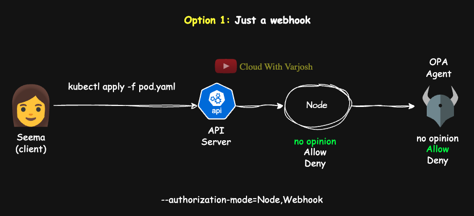
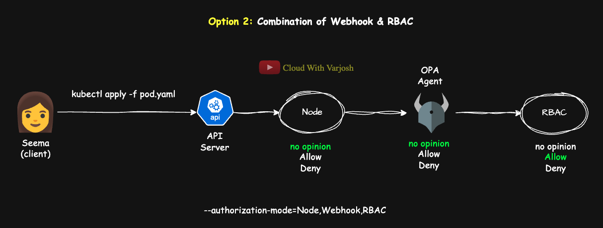

# 56 · Authorization Modes: Node, RBAC, ABAC, Webhook, AlwaysAllow/AlwaysDeny

> **Level:** ★★ intermediate
>
> **You will learn:** what authorization decides and which request attributes it sees; how the API server chains **authorizers** (allow / deny / no opinion, in order); each mode: **Node** (kubelets), **RBAC** (the standard), **ABAC** (legacy file), **Webhook** (external policy), **AlwaysAllow/AlwaysDeny**; the `system:masters` super-group; finding and changing modes on kubeadm (and why you can't on managed clusters); the structured `AuthorizationConfiguration`; and the crucial difference between **authorization** (sees who/what/where) and **admission** (sees the object itself), with the OPA image-registry scenarios.
>
> **You need:** topics 07, 14, 54 and 55.

---

## ⚡ Core: the 10-minute version

**The idea.** **Authorization** decides "may this identity do this action on this resource?". The API server asks its authorizers **in order**, and the first **allow** or **deny** wins:
- **Node**: kubelets may only touch their own node's things.
- **RBAC**: the standard, permissions as objects.
- **Webhook**: ask an external service.
- **ABAC** and **AlwaysAllow/AlwaysDeny**: legacy or test-only.

Authorizers see only **who / verb / resource / namespace**, never the object's contents. Rules about contents ("images must come from our registry") belong to **admission** (topic 58).

**Picture it.** A series of guards: each one says "go", "stop" or "not my job", and the first decisive answer counts. None of them opens your bag.

**The one thing to know.**

```bash
docker exec lab-control-plane grep authorization-mode /etc/kubernetes/manifests/kube-apiserver.yaml   # Node,RBAC
kubectl auth can-i delete pods -n default --as=seema
kubectl auth can-i --list --as=system:serviceaccount:default:default
```

**Try it now:** run the three commands, then explain each answer you get.

**You've got it if you can:** explain the "first decisive answer wins" chain, and why an authorizer can't check an image name.

> 📖 **That's the core.** On a first pass, do the mini-lab and move on to the next topic. Everything below is the **full reference**: come back for the details, the edge cases, interview answers and exam-level depth.

---

## What it is

- **Authentication** verifies **who** you are (topic 54).
- **Authorization** decides **what you're allowed to do**.

Once a user, group or ServiceAccount is authenticated, Kubernetes checks whether that identity may perform the requested action:
- Can this user **read** Pods in `default`?
- May this ServiceAccount **delete** a Deployment in `production`?
- Can this user create **Roles** at cluster level?

Decisions consider the **user and all their groups**: permissions can be granted to an individual identity or to a group they're in.

**Where it sits:**
1. **Authentication**: who are you?
2. **Authorization**: are you allowed to do this?
3. **Admission control**: should this request (this exact object) be accepted under current policies? (topic 58)

If authorization fails → **`403 Forbidden`**.

### What an authorizer sees

A request's **attributes**:
- **user**, **groups**, **extra** (from authentication);
- **verb**: `get`, `list`, `watch`, `create`, `update`, `patch`, `delete`, `deletecollection`, plus special ones (`use`, `bind`, `escalate`, `impersonate`, `approve`, `sign`);
- **resource** (`pods`, `deployments`…) and **subresource** (`pods/log`, `pods/exec`, `deployments/scale`);
- **resource name** (optional: one specific object);
- **namespace** (for namespaced resources);
- **API group**;
- or, for non-resource requests, the **path** (`/metrics`, `/healthz`).

**Not** the object's contents: an authorizer never sees the Pod spec you're creating. That's admission's job.

---

## Why it exists

Authentication alone would let every valid user do everything. Kubernetes needs fine-grained, least-privilege control: per verb, per resource, per namespace, and special handling for kubelets (which must only touch their own node's objects). It's **pluggable** so organisations can add their own logic.

---

## Analogy

An office building's security after you've shown your badge (authentication): a series of **checkpoints** in a fixed order. Each guard either says **"go ahead"**, **"stop"**, or **"not my department"** (passes you to the next guard). The first "go ahead" or "stop" ends it. **Node** is the guard who only deals with **delivery drivers** (kubelets); **RBAC** checks the **access list**; a **Webhook** guard phones **head office** for unusual rules. None of them opens your bag. Bag inspection (looking at **what** you're carrying, i.e. the object) happens at the next desk: **admission**.

---

## How it works inside

### Chained authorizers and decisions

The API server runs the modes listed in `--authorization-mode` **in order**:

```
--authorization-mode=Node,RBAC
```

Each returns one of:

| Decision | Meaning |
|---|---|
| **Allow** | Authorised; **stop**, no further checks |
| **Deny** | Rejected; **stop** |
| **No opinion** | Doesn't apply; **ask the next** authorizer |

If **every** authorizer has no opinion, the request is **denied** (403).

**The first definitive answer wins**, so **order matters**.

**Special case:** members of the group **`system:masters`** are **always allowed**, before any authorizer runs (a hard-coded super-user group; kubeadm's old admin certificates used it; newer kubeadm puts `admin.conf` in `kubeadm:cluster-admins` instead and keeps `system:masters` only in an emergency `super-admin.conf`).

### 1. RBAC: Role-Based Access Control

The **most widely used** mode, standard in production. It defines **who** (user, group, SA) can do **what** (verbs) on **which** resources.

- **Role**: permissions **within one namespace**.
- **RoleBinding**: grants a **Role or ClusterRole** to subjects **within its namespace**.
- **ClusterRole**: permissions that apply **cluster-wide** or are **reused** in many namespaces.
- **ClusterRoleBinding**: grants a ClusterRole to subjects **across the whole cluster**.
- **Note:** a **RoleBinding can reference a ClusterRole**: the ClusterRole's rules then apply **only in that RoleBinding's namespace**. That's how you reuse one permission set in many namespaces.

**Example: read-only Pods for Seema in `default`:**

```yaml
apiVersion: rbac.authorization.k8s.io/v1   # RBAC's API group (a named group under /apis)
kind: Role                                 # namespaced set of permissions
metadata:
  name: pod-reader
  namespace: default                       # only applies here
rules:
- apiGroups: [""]                          # core group (Pods live at /api/v1)
  resources: ["pods"]
  verbs: ["get", "watch", "list"]          # → GET /api/v1/namespaces/default/pods (…and watch)
---
apiVersion: rbac.authorization.k8s.io/v1
kind: RoleBinding                          # gives a Role to subjects in this namespace
metadata:
  name: read-pods-binding
  namespace: default                       # must be the Role's namespace
subjects:
- kind: User                               # or Group, or ServiceAccount
  name: seema                              # the authenticated username
  apiGroup: rbac.authorization.k8s.io      # required for User/Group subjects (not for ServiceAccounts)
roleRef:
  kind: Role
  name: pod-reader
  apiGroup: rbac.authorization.k8s.io
```

Seema can now **view** Pods in `default`, but not change or delete them. Topic 57 covers RBAC fully.

> ✅ **Correct today** ([C1](#c1)): RBAC is **purely additive**: there are **no deny rules**. RBAC returns **allow** if some binding grants the action, otherwise **no opinion** (and if nothing later allows it, the request ends up denied). Only modes like **Webhook** can return an explicit **deny**.

### 2. ABAC: Attribute-Based Access Control

Rules in a **JSON-lines policy file**, matching attributes (user, verb, resource, namespace):
- each line says **who** may do **what** on **which** resource; no Roles or bindings;
- flat, no hierarchy or grouping;
- **every change requires restarting the API server**;
- not suitable for production.

```json
{"apiVersion": "abac.authorization.kubernetes.io/v1beta1", "kind": "Policy", "spec": {"user": "seema", "namespace": "default", "resource": "pods", "verb": "get"}}
{"apiVersion": "abac.authorization.kubernetes.io/v1beta1", "kind": "Policy", "spec": {"user": "seema", "namespace": "default", "resource": "pods", "verb": "list"}}
```

(One JSON object per line. Day 35 shows them inside a JSON array; the ABAC file format is actually **one policy object per line**, with no surrounding `[ ]`.)

Lets `seema` `get` and `list` Pods in `default`. Enable with:

```bash
kube-apiserver --authorization-mode=ABAC --authorization-policy-file=/etc/kubernetes/abac-policy.json
```

> ℹ️ **Note:** ABAC was called "**deprecated**". It isn't formally deprecated (the code still exists and is maintained), but it's **legacy and strongly discouraged**: static, restart-to-change, no API objects to audit or delegate. Learn it for history and exams; use **RBAC**.

### 3. Webhook authorization

The API server **outsources** the decision: it sends a **`SubjectAccessReview`** (JSON describing user, groups, verb, resource, namespace, name…) to an **external HTTPS service**, which answers allowed / denied / no opinion.

Configured with `--authorization-mode=…,Webhook,…` and `--authorization-webhook-config-file=<kubeconfig-format file with the endpoint and TLS details>`. Decisions can be cached (`--authorization-webhook-cache-authorized-ttl`/`-unauthorized-ttl`).

**Why:**
- control **beyond RBAC**: decisions using **request time**, **source network**, or **external systems** (HR status, on-call rotas, ticket systems);
- business rules such as "**only the security team may delete Pods in `production`**", "**no deletes during business hours**", "**only users currently on call may exec into prod Pods**".

**Trade-offs:** maximum flexibility, but an **external dependency** (if the webhook is down, requests may fail) and **latency**. Typical in large, security-conscious, compliance-heavy organisations. Managed clusters use webhook authorizers too (e.g. AKS with Entra ID RBAC, GKE with IAM).

> ✅ **Correct today** ([C2](#c2)): an authorization webhook receives only the **request attributes** (a `SubjectAccessReview`): user, groups, verb, resource, name, namespace. It **never sees the object** (the Pod spec, the replica count, the image). Rules about an object's **contents** (image registry, replica ranges, labels, signatures) are enforced by **admission** webhooks: **Gatekeeper** and **Kyverno** are **admission controllers** (topic 58). **OPA** itself can be used in **either** role, which is exactly what Day 35's own "OPA can be used in two ways" section explains.

**Modern configuration:** the **structured `AuthorizationConfiguration`** file (`--authorization-config`, replacing the mode flag) lets you chain **several webhooks** with **CEL match conditions** (only send matching requests), failure policies and timeouts, and reload without restarting the API server.

### 4. Node authorization

A special-purpose authorizer that **restricts kubelets** to objects related to **their own node**.
- A kubelet authenticates with its **client certificate**: user `system:node:<nodeName>`, group `system:nodes` (topic 53). Authentication proves identity; **Node authorization** grants scoped permissions.
- The kubelet on **node1** may **read** the Secrets, ConfigMaps, PVCs/PVs, ServiceAccount tokens, ResourceClaims… **referenced by Pods bound to node1**, and **write** its own Node object, its Pods' status, and its Lease, but **not** other nodes' Pods or Secrets.
- **Why:** a compromised node can't read every Secret in the cluster, which limits the blast radius.
- Its partner is the **NodeRestriction admission plugin** (topic 58), which stops kubelets modifying **other** Node/Pod objects or setting protected labels (`node-restriction.kubernetes.io/`, `node-role.kubernetes.io/`) on their own Node.

> ✅ **Correct today** ([C3](#c3)): it's active only if **`Node` is listed** in `--authorization-mode` (kubeadm sets `Node,RBAC`; that's why it feels automatic); no Roles or bindings are needed. And the **bootstrap token** is used only **once**, to request the kubelet's first client certificate; afterwards the kubelet authenticates with that **certificate**.

| Step | Explanation |
|---|---|
| **Bootstrap token → CSR → client certificate** | The kubelet gets its identity `system:node:<name>` |
| **Node authorization** | The kubelet may only read/modify resources for **its** node |
| **NodeRestriction admission** | Blocks writes to other nodes' objects |

### 5. AlwaysAllow / AlwaysDeny

**AlwaysAllow**
- Permits **every** request, whoever sends it: authorization is effectively off.
- Uses: dev, testing, troubleshooting (remove authorization as a variable), throwaway demos.
- **No security at all**: anyone who can reach and authenticate to the API can do anything, including destroy the cluster.

**AlwaysDeny**
- Denies **every** request.
- Uses: testing failure behaviour; in theory an emergency lock-down.
- Locks out **everyone and everything** (admins, controllers, kubelets), so the cluster stops functioning; you need to restart the API server with different flags to recover.

Both are extreme, binary modes for special cases. Production uses **Node + RBAC** (+ Webhook if needed). Set them with `--authorization-mode=AlwaysAllow`. Combined with others, a mode listed **before** `AlwaysAllow` still gets the first say, but **`AlwaysAllow` allows everything that reaches it**, so it makes all later modes irrelevant.

### Checking and changing the mode

1. **Authorization happens in the API server** (even with a webhook, the API server calls it). So modes are configured **on the API server**.
2. **Where**: on **kubeadm**, **kind** (kubeadm underneath) and **minikube**, the API server is a **static Pod**: `/etc/kubernetes/manifests/kube-apiserver.yaml` (kops may use static Pods or systemd units). Look for `--authorization-mode`.
3. **Managed services** (EKS, AKS, GKE) **hide the control plane**: you can't see or change the API server flags. The provider sets them (typically Node + RBAC, plus the provider's webhook/IAM integration).
4. **Multiple modes**: comma-separated, evaluated in order, first allow/deny wins.
5. **Changing it**: edit the manifest; the **kubelet restarts** the API server automatically (static Pod). Do it carefully: a mistake can lock everyone out or open everything.

| Step | What to do |
|---|---|
| Find the API server config | `/etc/kubernetes/manifests/kube-apiserver.yaml` on control-plane nodes (if accessible) |
| Identify modes | The `--authorization-mode` flag (or `--authorization-config`) |
| Understand the order | Sequential; the first allow/deny stops evaluation |
| Modify | Edit, save; the kubelet restarts the API server |
| Managed services | Not accessible: provider-managed |

### Authorization vs admission: the OPA scenarios

**Requirement:** Seema may **create Pods**, but **only** with images from **`registry.pinkcompany.com`**.

- **RBAC** can grant "create Pods", but it **can't** look at the image: it doesn't inspect the request content.
- **The image check needs the object**, so it happens in **admission**.

**OPA (Open Policy Agent) can play two roles:**
1. **Webhook authorizer**: in the **authorization** phase; decides on **request metadata only** (user, verb, namespace…), like RBAC but more flexible:
   - **time-aware** access ("no deletes during business hours");
   - **network-aware** access ("only from these CIDRs");
   - **custom identity checks** (query HR/LDAP).
   It **can't** see the Pod spec or image.
2. **Admission controller** (a validating webhook, e.g. via **Gatekeeper**): in the **admission** phase; inspects the **full object**: images, labels, security settings…

✅ The registry check is done by OPA **as an admission controller**, not as an authorizer (topic 58 covers admission in depth).

**Scenario 1: `--authorization-mode=Node,Webhook`**



1. Seema sends "create Pod".
2. **Node** authorizer: not a kubelet → **no opinion**.
3. **Webhook** (OPA): checks Seema's identity and metadata ("only off-hours", "only group `devs`"). It **can't** check the image.
4. Webhook **allow** → go to admission; **deny** → rejected.
5. **OPA as an admission controller** checks the image is from `registry.pinkcompany.com` → admitted, or rejected.

OPA is used in **both** phases for different purposes: **authorization** = user-level access; **admission** = deep object policy.

**Scenario 2: `--authorization-mode=Node,Webhook,RBAC` (layered)**



| Mode | Role |
|---|---|
| Node | Kubelet requests only |
| Webhook | Custom logic on request metadata |
| RBAC | Standard permissions for users, groups, SAs |

1. Seema sends "create Pod".
2. **Node** → no opinion.
3. **Webhook** (OPA): if its time/identity policies are satisfied it returns **no opinion** (so RBAC decides); if violated, **deny**.
4. **RBAC**: Seema has create-Pods permission → **allow** → admission. No permission → no opinion → **denied** (nothing allowed it).
5. **OPA admission**: image from the right registry → admitted; else rejected.

**Why layer RBAC + Webhook:** RBAC is the simple, auditable first gate; the webhook adds rules RBAC can't express. This keeps RBAC clean and puts complex, changing policy in one external place.

**Order matters:** to let the webhook see (and possibly veto) every request **before** RBAC can allow it, list it first:

```bash
--authorization-mode=Node,Webhook,RBAC
```

(Day 35 wrote `Webhook,RBAC`. Keep `Node` in the list for kubelets, and **first** is fine since it only has an opinion on node identities.) If the webhook returns **no opinion**, RBAC decides.

| Phase | Who | What's checked |
|---|---|---|
| **Authorization** | Node / Webhook / RBAC | Request **metadata**: user, verb, resource, group… |
| **Admission** | Admission plugins and webhooks (e.g. OPA Gatekeeper, Kyverno) | The **full object**: images, labels, annotations… |

**In production:** RBAC for basic permissions, an optional OPA webhook authorizer for request-level rules, and an OPA/Kyverno **admission** controller for deep object inspection.

---

## Commands / YAML

### See the configured modes

```bash
docker exec lab-control-plane grep -E 'authorization-(mode|config)' /etc/kubernetes/manifests/kube-apiserver.yaml
```

```
    - --authorization-mode=Node,RBAC
```

### Ask the authorizers a question

```bash
kubectl auth can-i list pods -n default --as=seema
kubectl auth can-i get secrets -n kube-system --as=system:node:lab-worker      # Node authorizer + RBAC
kubectl auth can-i --list --as=system:serviceaccount:default:default
```

```
yes
no
Resources                                       Non-Resource URLs   Resource Names   Verbs
selfsubjectreviews.authentication.k8s.io        []                  []               [create]
selfsubjectaccessreviews.authorization.k8s.io   []                  []               [create]
selfsubjectrulesreviews.authorization.k8s.io    []                  []               [create]
                                                [/api/*]            []               [get]
                                                [/healthz]          []               [get]
…
```

- `kubectl auth can-i` sends a `SubjectAccessReview` (with `--as`) or `SelfSubjectAccessReview`, the same object a webhook authorizer receives.
- The `default` SA's list shows only discovery and self-review permissions (topic 55).

The raw object behind it:

```bash
kubectl create -f - -o yaml <<'EOF'
apiVersion: authorization.k8s.io/v1
kind: SubjectAccessReview
spec:
  user: seema
  resourceAttributes: { namespace: default, verb: delete, resource: pods }
EOF
```

```yaml
status:
  allowed: true
  reason: 'RBAC: allowed by RoleBinding "seema-binding/default" of Role "seema-role" to User "seema"'
```

---

## Hands-on lab

1. Check `--authorization-mode` on kind.
2. Create Day 35's `pod-reader` Role and `read-pods-binding`; verify with `kubectl auth can-i` as `seema` (get yes, delete no).
3. Watch the Node authorizer: `kubectl auth can-i get secret <a-secret-used-by-a-pod-on-lab-worker> --as=system:node:lab-worker --as-group=system:nodes` vs a secret not used on that node.
4. (Throwaway cluster only!) Change the mode to `AlwaysAllow`, see an unprivileged user (Seema) delete things, then change it to `Node,RBAC` again. Then try `AlwaysDeny` and watch even kubelets fail (`kubectl` itself will fail; use `crictl` on the node to watch), and revert by editing the manifest on the node.
5. Send a raw `SubjectAccessReview` and read the `reason`.

---

## Where you'll use it

- **Debugging 403s**: which authorizer said no, and why (`auth can-i`, audit logs with the `authorization.k8s.io/reason` annotation).
- **Platform security design**: Node + RBAC everywhere; webhooks for org-wide rules; admission for object policy.
- **Managed Kubernetes**: understanding how cloud IAM authorizers combine with RBAC.
- **CKA**: reading `--authorization-mode`, RBAC tasks, `auth can-i`.

---

## When it breaks

| Symptom | Cause | Fix |
|---|---|---|
| `403 Forbidden … User "x" cannot <verb> resource "y"` | No authorizer allowed it | Grant RBAC (topic 57) |
| Kubelet errors: `nodes "lab-worker" is forbidden` | `Node` missing from `--authorization-mode`, or kubelet cert has the wrong CN | Add `Node`; fix the kubelet identity |
| All requests slow or failing after adding a webhook | Webhook down/slow | Fix it; tune timeouts and failure policy; caching |
| Everything allowed for everyone | `AlwaysAllow` in the mode list | Remove it |
| API server won't start after editing flags | Typo, or ABAC/webhook file path missing | Fix the manifest; check `crictl logs` (topic 82) |
| A policy about images "doesn't work" in your authorizer | Authorizers can't see objects | Implement it as admission (topic 58) |

---

## Quick recap

- Authorization = may this **identity** do this **verb** on this **resource/namespace/name** (or path)? It sees **attributes, not objects**.
- Authorizers run **in order** (`--authorization-mode=Node,RBAC[,Webhook]`); allow/deny stops; no opinion → next; nobody allows → 403. `system:masters` bypasses all.
- **RBAC** (additive, no deny), **Node** (kubelets → own node only, with NodeRestriction), **Webhook** (external, can deny), **ABAC** (legacy file), **AlwaysAllow/Deny** (test only).
- Object-content rules (images, replicas, labels) belong to **admission**, not authorization; OPA can do either.

### Interview questions

1. **Q: Can RBAC deny a specific action?**
   A: No. RBAC is additive: it only grants. To explicitly deny, use a webhook authorizer (or admission policies for object-level rules).
2. **Q: What does the Node authorizer do?**
   A: It limits kubelets (`system:node:<name>`) to reading the Secrets, ConfigMaps, volumes etc. for Pods bound to their own node and writing their own Node and Pod status; NodeRestriction admission complements it.
3. **Q: Why can't an authorization webhook enforce "images must come from our registry"?**
   A: Authorizers receive only request attributes (a SubjectAccessReview), not the object body; image checks require a validating admission webhook or policy.

---

## Appendix: notes on the original course material

This topic was rebuilt from the original CKA course notes. This appendix keeps the audit trail out of your way while you learn.

### Sources

Day 35 (authorization in Kubernetes; high-level flow; context-aware decisions; types of authorization modes: RBAC with the Seema example, ABAC with policy file, Webhook and why, Node and key points, AlwaysAllow/AlwaysDeny; how to check and change modes: where the config lives, multiple modes, decision logic, example flow, changing modes, special modes, key points; combining RBAC and Webhook; flow with Node + Webhook + RBAC; OPA in two roles; scenarios 1 and 2; summary table; conclusion). Day 35's API half is in topic 14.

### Corrections to the original notes

Each entry shows what the original said and what's true now. In the topic above, each correction appears as a ✅ **Correct today** line or a ⚠️ **Fix to the original** box, linked to its entry here.

<a id="c1"></a>**C1 · Corrected (Day 35, example flow).** "RBAC… **if explicitly blocked: returns deny**". **Now:** RBAC is **purely additive**: there are **no deny rules**. RBAC returns **allow** if some binding grants the action, otherwise **no opinion** (and if nothing later allows it, the request ends up denied). Only modes like **Webhook** can return an explicit **deny**.

<a id="c2"></a>**C2 · Corrected (Day 35).** the webhook section lists **Gatekeeper** and **Kyverno** as webhook **authorization** tools, and gives examples like "developers can only scale Deployments **within 2–5 replicas**" and "CI/CD can only deploy images **signed by our internal registry**". The "Combining RBAC and Webhook" section then says a webhook authorizer "can inspect the **full request, including the object spec**", and could check the image. **Now:** an authorization webhook receives only the **request attributes** (a `SubjectAccessReview`): user, groups, verb, resource, name, namespace. It **never sees the object** (the Pod spec, the replica count, the image). Rules about an object's **contents** (image registry, replica ranges, labels, signatures) are enforced by **admission** webhooks: **Gatekeeper** and **Kyverno** are **admission controllers** (topic 58). **OPA** itself can be used in **either** role, which is exactly what Day 35's own "OPA can be used in two ways" section explains.

<a id="c3"></a>**C3 · Corrected (Day 35).** "Node Authorization is **enabled automatically** by the API server… does not require any manual configuration" and "kubelet authenticates… using a **bootstrap token** or client certificates". **Now:** it's active only if **`Node` is listed** in `--authorization-mode` (kubeadm sets `Node,RBAC`; that's why it feels automatic); no Roles or bindings are needed. And the **bootstrap token** is used only **once**, to request the kubelet's first client certificate; afterwards the kubelet authenticates with that **certificate**.
