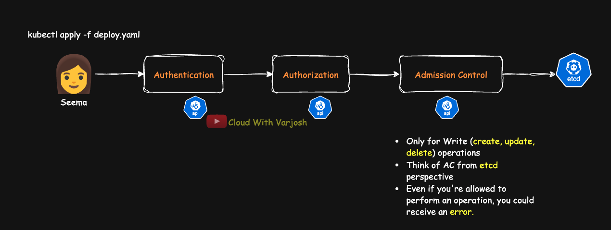
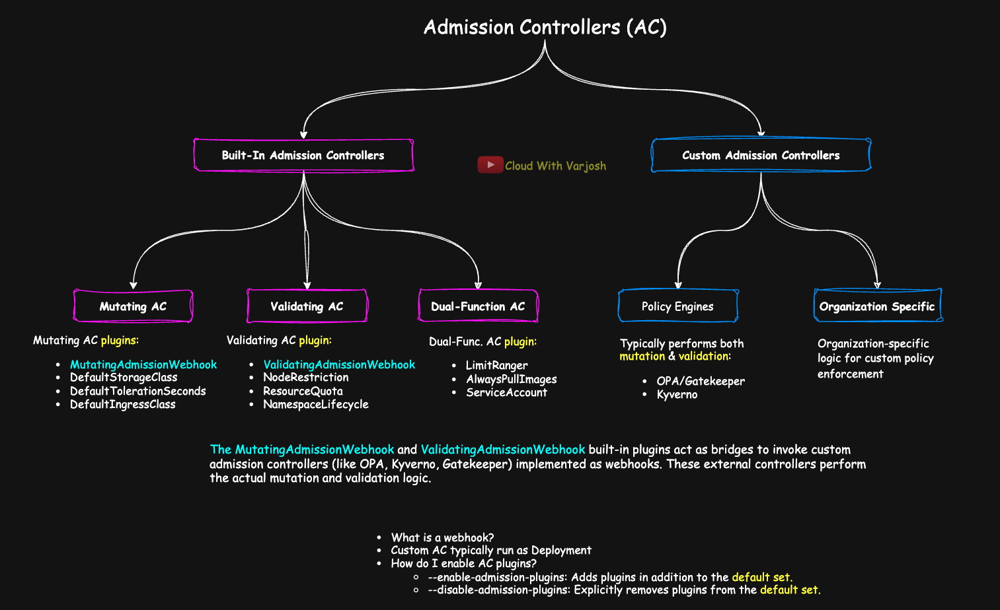
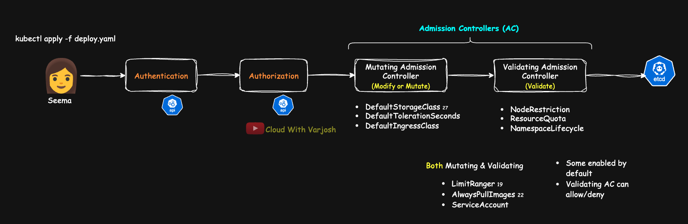
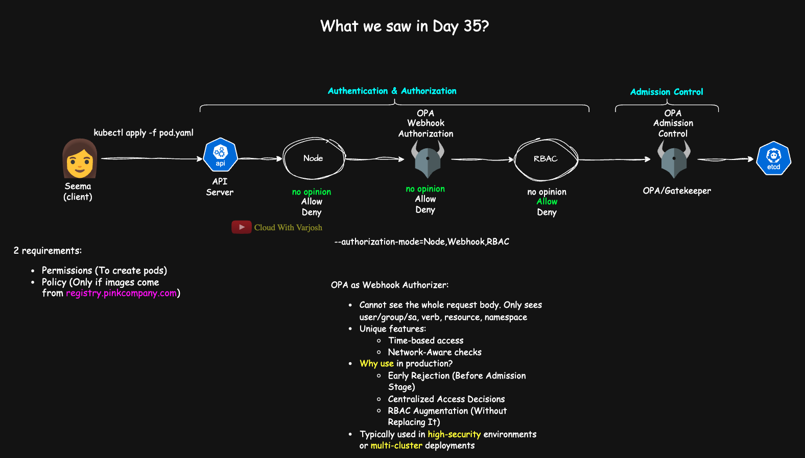
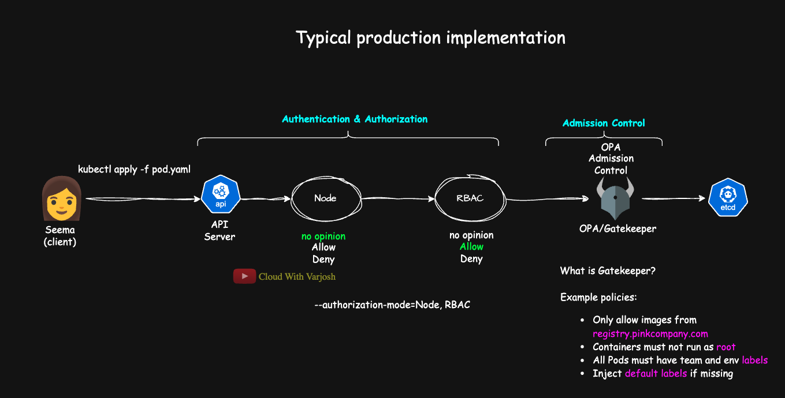
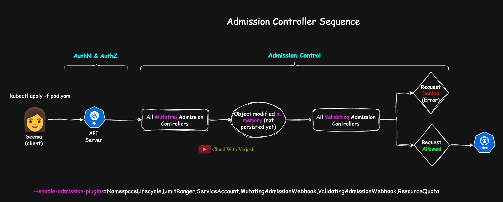

# 58 · Admission Control: Mutating and Validating the Objects You Send

> **Level:** ★★★ advanced
>
> **You will learn:** where admission sits in the request path and what it sees (the **whole object**, unlike authorization); built-in admission plugins (mutating, validating, dual-function) and which are on by default; how `--enable-admission-plugins`/`--disable-admission-plugins` really work; **admission webhooks** (`MutatingWebhookConfiguration`, `ValidatingWebhookConfiguration`) and the `AdmissionReview` exchange; the in-process **ValidatingAdmissionPolicy** (CEL, no webhook server needed); OPA as authorizer vs OPA/**Gatekeeper** vs **Kyverno** as admission controllers; what enterprises run; and the exact execution order.
>
> **You need:** topics 10, 41 (LimitRange/ResourceQuota), 55–57.

---

## ⚡ Core: the 10-minute version

**The idea.** After authentication and authorization, **admission controllers** check, and can **change**, the object itself before it's saved.
- **Mutating** admission runs first: it sets defaults, injects sidecars, assigns the ServiceAccount.
- **Validating** admission runs second: it rejects things that break rules (quotas, Pod Security, your policies).
- **Built-in** plugins: LimitRanger, ResourceQuota, PodSecurity, NamespaceLifecycle, NodeRestriction.
- **Custom** rules: webhooks (Kyverno, Gatekeeper) or in-process **ValidatingAdmissionPolicy** (CEL expressions).

**Picture it.** The mail room: clerks fix up your parcel (mutate), then inspectors check it against the rules (validate) before it's filed.

**The one thing to know.**

```yaml
apiVersion: admissionregistration.k8s.io/v1
kind: ValidatingAdmissionPolicy
metadata: { name: max-replicas }
spec:
  matchConstraints:
    resourceRules: [ { apiGroups: ["apps"], apiVersions: ["v1"], operations: ["CREATE","UPDATE"], resources: ["deployments"] } ]
  validations:
  - expression: "object.spec.replicas <= 5"
    message: "max 5 replicas"
# plus a ValidatingAdmissionPolicyBinding that selects where it applies
```

**Try it now:**
1. Create a LimitRange in a namespace and run a Pod without resources: they get filled in (mutation).
2. Request more than the LimitRange's max: rejected (validation).
3. Apply the policy and a binding, then try 10 replicas.

**You've got it if you can:** explain authorization vs admission, and mutating vs validating.

> 📖 **That's the core.** On a first pass, do the mini-lab and move on to the next topic. Everything below is the **full reference**: come back for the details, the edge cases, interview answers and exam-level depth.

---

## What it is

After a request is **authenticated** and **authorized**, it isn't written to etcd straight away. It passes through **admission controllers**: gatekeepers that can **modify (mutate)**, **validate**, or **reject** it based on built-in logic or your policies.



```
kubectl → Authentication → Authorization → Admission (mutating → schema validation → validating) → etcd
```

**Clarifying admission control:** think of admission controllers as **gatekeepers for persisting objects**, not for accessing the cluster. Access is already decided by authentication (certificates, OIDC tokens) and authorization (RBAC). Admission runs **after** both succeed and checks whether **the object you're creating or changing** meets cluster policies. Only if every relevant admission controller agrees is it stored.

✅ AuthN → ✅ AuthZ → ✅ Admission → 📦 written to etcd. ❌ Admission fails → the request is **rejected** and nothing is stored.

**Which requests:** admission intercepts **write** operations: `CREATE`, `UPDATE`, `DELETE`, and also **`CONNECT`** (e.g. `kubectl exec`, `attach`, `port-forward`, which is how policies can block exec into Pods). It **never** runs on reads (`GET`, `LIST`, `WATCH`).

> ℹ️ **Note:** the notes list only `CREATE`, `UPDATE`, `DELETE`. **`CONNECT`** operations go through admission too.

Admission controllers are used for:
- enforcing **security and governance** policies;
- validating **configuration correctness**;
- applying **defaults** or transformations;
- **compliance** with cluster standards.



---

## Why it exists

Authorization says **who** may create a Pod; it can't say **what kind** of Pod. Admission is where "no privileged containers", "images only from our registry", "every Deployment needs a `team` label", "inject the Istio sidecar", "apply default resources" and "this namespace has a quota" are enforced, for everyone, whatever tool they use. In Day 38's words: **this is where policy meets practice**.

---

## Analogy

After the guard checks your badge (authn) and access list (authz), your **parcel** goes through the **mail room** before it's filed. First the **clerks** (mutating) fix it up: add a missing label, put it in the standard box, attach a routing slip (sidecar). Then **inspectors** (validating) check the **final** parcel against the rules: no hazardous materials (privileged), only approved suppliers (registries), within the department's budget (quota). Any inspector can send it back. Nothing is filed until all agree.

---

## How it works inside

### Two kinds, two phases

- **Mutating** admission **changes** the object: add default tolerations, set pull policies, default resources, assign the ServiceAccount, inject sidecars.
- **Validating** admission **accepts or rejects** the object **without changing it**.

**Order:**
1. **Mutating** controllers run first (the object is changed in memory).
2. The object is checked against its **schema**.
3. **Validating** controllers check the **final** object.
4. If **any** validator rejects, the whole request is denied immediately.

### Built-in admission plugins

Compiled into the API server, enabled via flags. Three groups:



**1. Mutating plugins** (subset; full list in the docs)

| Plugin | What it does | Default |
|---|---|---|
| `MutatingAdmissionWebhook` | Calls **external** mutating webhooks (sidecar injection like Istio's; default labels; security settings) | Yes |
| `DefaultStorageClass` | Gives PVCs **without** `storageClassName` the cluster's **default StorageClass** (EBS, GCP PD, Azure Disk…; topic 39) | Yes |
| `DefaultTolerationSeconds` | Adds tolerations for the `node.kubernetes.io/not-ready` and `unreachable` **NoExecute** taints with `tolerationSeconds: 300`, so Pods are evicted 5 minutes after their node fails (not instantly, not never; topic 43) | Yes |
| `DefaultIngressClass` | Gives Ingresses without a class the **default IngressClass**; rejects creation if **more than one** default exists; does nothing if none is set (topic 69) | Yes |

> ℹ️ **Note:** `DefaultTolerationSeconds` was described as "sets default tolerations… preventing unwanted evictions". More precisely, it adds the two 300-second tolerations above to every Pod that doesn't already set them. It **bounds** how long Pods stay on a failed node; it doesn't prevent eviction.

**2. Validating plugins**

| Plugin | What it does | Default |
|---|---|---|
| `NodeRestriction` | Kubelets may only modify **their own** Node and Pods bound to it; can't set protected labels (partner of the Node authorizer, topic 56) | Yes (kubeadm enables it) |
| `ValidatingAdmissionWebhook` | Calls external validating webhooks (disallow privileged, forbidden annotations…) | Yes |
| `ValidatingAdmissionPolicy` | Evaluates in-process **CEL** policies (below) | Yes |
| `PodSecurity` | Enforces the **Pod Security Standards** (Privileged / Baseline / Restricted) per namespace (topic 60) | **Yes** |
| `ResourceQuota` | Enforces namespace **quotas** (CPU, memory, storage, object counts; topic 41) | Yes |
| `NamespaceLifecycle` | Blocks creating objects in **non-existent or terminating** namespaces; protects `default`, `kube-system`, `kube-public` from deletion | Yes |

> ✅ **Correct today** ([C1](#c1)): it's **enabled by default** since v1.23 (GA in v1.25, when it replaced the removed PodSecurityPolicy). What's opt-in is the **policy level**: namespaces enforce nothing until you label them (`pod-security.kubernetes.io/enforce=…`) or set a cluster-wide default via an admission configuration file.

**3. Dual-function plugins** (mutate **and** validate)

| Plugin | Mutating | Validating | What it does | Default |
|---|---|---|---|---|
| `LimitRanger` | Yes | Yes | Applies **default** requests/limits from a namespace's `LimitRange`, and rejects values outside its min/max (topic 41) | Yes |
| `AlwaysPullImages` | Yes | Yes | Forces `imagePullPolicy: Always`, so a Pod can't use an image **cached** on the node that its owner may not be authorised to pull (multi-tenant security; topic 20) | **No** |
| `ServiceAccount` | Yes | Yes | Assigns the `default` SA, adds the token volume (topic 55), and rejects Pods referencing a non-existent SA | Yes |

### Default plugins and the flags

Many plugins are **on by default** even if they aren't listed. On kind (kubeadm underneath):

```bash
docker exec lab-control-plane grep admission /etc/kubernetes/manifests/kube-apiserver.yaml
```

```
    - --enable-admission-plugins=NodeRestriction
```

…yet you still see the effects of others:

| Plugin | What you observe |
|---|---|
| `ServiceAccount` | Pods get the `default` SA and its token mounted |
| `NamespaceLifecycle` | You can't create objects in missing or terminating namespaces |
| `LimitRanger` | Default CPU/memory applied in namespaces **that have a LimitRange** |
| `ResourceQuota` | Creation denied when it would exceed a quota |
| `DefaultStorageClass` | PVCs without a class get the default one (e.g. kind's `standard`) |

- `--enable-admission-plugins`: plugins to enable **in addition to** the default set.
- `--disable-admission-plugins`: plugins to **remove** from the default set.
- See the current default list: `kube-apiserver -h | grep -A3 'enable-admission-plugins'` (run inside the API server image).

**If the API server runs as a systemd service** (the hard way, some kops setups): `ps -aux | grep kube-apiserver` and look for `--enable-admission-plugins=…` and `--disable-admission-plugins=…`; change them in the unit file or start-up script. On kubeadm, edit `/etc/kubernetes/manifests/kube-apiserver.yaml` (the kubelet restarts it). Example:

```bash
kube-apiserver --enable-admission-plugins=NamespaceLifecycle,LimitRanger,PodSecurity
```

> ✅ **Correct today** ([C2](#c2)): since v1.10 the **order of that flag doesn't matter**: the API server runs built-in plugins in a **fixed internal order** (mutating ones, then validating ones), and the flag only says **which** are on. Day 38's example below shows a sensible order, but it's the built-in order, not the flag's.

### Custom admission controllers: webhooks

When built-ins aren't enough, add your own logic through **admission webhooks**.

**What's a webhook?** An **HTTP callback**: one system calls another in real time when an event happens. Here, the API server asks an external service: *"Before I accept this request, do you want to approve, reject, or modify it?"*

- **Mutating admission webhooks**: modify objects (inject sidecars, add default labels).
- **Validating admission webhooks**: approve/reject (deny privileged containers, require labels).

The **`MutatingAdmissionWebhook`** and **`ValidatingAdmissionWebhook`** built-in plugins are the **bridges** that call them.

| Type | Examples | Characteristics |
|---|---|---|
| Built-in mutating | `MutatingAdmissionWebhook`, `DefaultStorageClass` | Modify requests, inject defaults |
| Built-in validating | `ValidatingAdmissionWebhook`, `PodSecurity`, `ResourceQuota` | Validate without modifying |
| Built-in dual-function | `LimitRanger`, `ServiceAccount` | Both, in one plugin |
| Custom (webhooks, policy engines) | Kyverno, OPA Gatekeeper, your own service | External, flexible, mutation + validation for your needs |

**Architecture:**
1. You deploy a **webhook server**, usually a **Deployment + Service inside the cluster** (outside is possible but rare: networking, TLS and availability get harder; inside gives lower latency and simpler security).
2. You create a **`MutatingWebhookConfiguration`** or **`ValidatingWebhookConfiguration`**: which operations/resources/namespaces to send, where (the Service), and the CA to trust.
3. The API server sends matching requests as an **`AdmissionReview`** (the full object, the old object for updates, the user info, the operation).
4. The webhook replies `allowed: true/false` (with a message), and mutating webhooks also return a **JSON Patch** describing changes.

```yaml
apiVersion: admissionregistration.k8s.io/v1
kind: ValidatingWebhookConfiguration
metadata:
  name: require-team-label
webhooks:
- name: team-label.example.com
  rules:
  - apiGroups: ["apps"]
    apiVersions: ["v1"]
    operations: ["CREATE", "UPDATE"]
    resources: ["deployments"]
  namespaceSelector:                         # skip system namespaces: never lock yourself out
    matchExpressions:
    - { key: kubernetes.io/metadata.name, operator: NotIn, values: ["kube-system"] }
  clientConfig:
    service: { namespace: policy, name: team-label-webhook, path: /validate }
    caBundle: <base64 CA that signed the webhook's serving cert>
  admissionReviewVersions: ["v1"]
  sideEffects: None
  timeoutSeconds: 5
  failurePolicy: Fail                        # Fail = reject if the webhook is unreachable; Ignore = let it through
```

> ✅ **Correct today** ([C3](#c3)): a mutating webhook **can** reject: it returns an `AdmissionReview` with `allowed: false`, exactly like a validating one (and built-in mutating plugins can reject too). The **convention** is that mutators mutate and validators enforce, because a mutator can't see changes made by mutators after it, while validators always see the **final** object. So put enforcement in validating admission.

**Webhook ordering details:**
- Mutating webhooks run **one after another** (sorted by configuration name, then by webhook order in the list); with `reinvocationPolicy: IfNeeded` a webhook is called again if a later one changed the object.
- Validating webhooks run **in parallel**; any rejection rejects the request.
- `failurePolicy: Fail` + a crashed webhook = **nobody can create matching objects** (including the webhook's own Pods if you're not careful). Always exclude `kube-system` and the webhook's own namespace, run several replicas, and set short timeouts.

### ValidatingAdmissionPolicy: policy without a webhook server

Since **v1.30 (GA)**, you can write validation rules in **CEL** (Common Expression Language, a small, safe expression language) that the **API server evaluates in-process**: no server to run, no TLS, no network hop.

```yaml
apiVersion: admissionregistration.k8s.io/v1
kind: ValidatingAdmissionPolicy
metadata:
  name: max-replicas
spec:
  failurePolicy: Fail
  matchConstraints:
    resourceRules:
    - apiGroups: ["apps"]
      apiVersions: ["v1"]
      operations: ["CREATE", "UPDATE"]
      resources: ["deployments"]
  validations:
  - expression: "object.spec.replicas <= 5"
    message: "Deployments may have at most 5 replicas"
---
apiVersion: admissionregistration.k8s.io/v1
kind: ValidatingAdmissionPolicyBinding
metadata:
  name: max-replicas-dev
spec:
  policyName: max-replicas
  validationActions: ["Deny"]                       # or Warn, Audit
  matchResources:
    namespaceSelector:
      matchLabels: { env: dev }
```

**MutatingAdmissionPolicy** (CEL-based mutation) follows the same model (**GA since v1.36**). Prefer these for simple rules; use Kyverno/Gatekeeper for richer policy management.

### Real-world use cases and tools

| Use case | Mechanism / tool |
|---|---|
| Add labels to all Deployments | Mutating webhook (Kyverno mutate) |
| **Require** labels on Deployments | Validating (Kyverno, Gatekeeper, ValidatingAdmissionPolicy) |
| Deny containers running as root | `PodSecurity` (Restricted level), or a validating policy |
| Auto-inject sidecars for logging or mesh | Mutating webhook (Istio) |
| Block public images / allow only trusted registries | Validating webhook (OPA Gatekeeper, Kyverno) |
| Default tolerations | `DefaultTolerationSeconds` |

(Day 38's table paired "deny root" with "`ValidatingAdmissionWebhook` + PodSecurity". `PodSecurity` is its own built-in plugin and doesn't use the webhook plugin. "Enforce labels" with a mutating webhook means **adding** them; **requiring** them is validation.)

### OPA in authorization vs admission



**Why OPA:** **Open Policy Agent** is a general policy engine (policies in the **Rego** language).
- As a **webhook authorizer**, it sees only **request metadata** (user, groups, verb, namespace, resource, API group, subresource) and can do context-aware access control (time windows, networks) that RBAC can't express. It **can't** see Pod specs or images. Used in **high-security** environments.
- As a **validating admission controller**, it sees the **full object** and can check images, labels, security contexts, volumes, annotations.
- But plain OPA has no native Kubernetes integration: no resource syncing, no CRD-based policies.

**Gatekeeper** fills that gap: a Kubernetes-native project built on OPA. It registers the admission webhooks for you, defines policies as CRDs (**`ConstraintTemplate`** holds the Rego; **`Constraint`** applies it with parameters), **syncs cluster state** so policies can reference existing objects, and adds **audit** (report existing violations) and **dry-run**.

> ✅ **Correct today** ([C4](#c4)): **OPA is a CNCF graduated project** (since 2021), and **Gatekeeper is a sub-project of OPA**, so it's covered by that same CNCF project rather than being a separately ranked one.

| Role | Configured as | Answers | Sees | Actions |
|---|---|---|---|---|
| Webhook authorizer | `--authorization-mode=…,Webhook` | **Who can do what?** | User, group, verb, resource, namespace | Allow, deny, no opinion |
| Admission controller | Validating/mutating webhook | **Under what conditions?** | The full request body (spec, metadata, images, labels) | Validate or mutate |

**OPA as a webhook authorizer:** for questions RBAC can't answer:
- "Is this user **active in our HR system**?"
- "Is it **after business hours**?"
- "Did the request come from our **corporate VPN**?"

Its input is the request **attributes** (user, groups, SA, verb, resource, namespace, API group, subresource), **never the object**.

| Policy type | Example |
|---|---|
| Time-based | Allow `delete` only after 6 PM |
| HR integration | Only users marked "active" may create resources |
| Network-aware | Deny requests not from corporate VPN CIDRs |
| Org rules | Production access only for a specific team |

**Why use it if admission can validate?**
1. **Early rejection**: blocks unauthorised actions before admission and etcd, saving work.
2. **Centralised decisions across many clusters** (a central OPA, e.g. via Envoy + OPA bundles).
3. **Augmenting RBAC** without replacing it: core permissions stay in RBAC, OPA handles edge cases.

**Note:** webhook authorization with OPA is **rarely used in production**. Most organisations use **RBAC** for authorization and **Gatekeeper or Kyverno** for admission. Webhook authorization shows up in high-security or multi-cluster setups.

### Gatekeeper as an admission controller

Use it to enforce **how** workloads are deployed (not **who** deploys them). Its strengths are policy **expressiveness** (Rego) and enterprise **constraint management**.

**What it sees**: the entire request body: Pod and Deployment specs, images and registries, security contexts (privileged, runAsUser, capabilities), labels, annotations, resource limits, CRD fields, network settings, probes, volumes, init containers. This deep view **isn't available during authorization**.

**What it does:**
1. **Validation** (its strongest area): allow/deny requests violating security rules, naming conventions, registry requirements, resource rules, team/environment policies. Heavily used in regulated enterprises.
2. **Mutation**: only through dedicated **mutation CRDs**: `Assign`, `AssignMetadata`, `ModifySet` (and `AssignImage`). They add missing labels/annotations, set defaults, or inject supported snippets. ⚠️ **No free-form mutation in Rego.**

**Example Gatekeeper policies:** images only from trusted registries; block privileged containers; mandatory `team` and `env` labels; add default labels if missing (mutation CRDs).

**Limitations:**
- Can't decide **who** may act (that's authorization).
- Mutation is limited to the mutation CRDs.
- **No resource generation** (Kyverno has it).
- Rego is harder to learn.
- No **built-in** image-signature verification (Kyverno has `verifyImages`); Gatekeeper needs an **external data provider** such as Ratify.

**Best suited for:** security and compliance enforcement, enterprise governance (naming, organisational rules), rich validation logic Rego can express, and mutation within its CRDs' limits.

### Kyverno vs Gatekeeper

Kyverno is often preferred by teams because:
1. **Policies are plain Kubernetes YAML**: validate, mutate, generate and verify in one format; no Rego (it also supports CEL expressions).
2. **Powerful mutation**: JSON-patch and strategic-merge patches, conditional mutations, adding containers (sidecars), lists and nested fields.
3. **Easy to adopt**: DevOps teams already know YAML.
4. **Generation** for cluster automation: create default NetworkPolicies, quotas, ConfigMaps/Secrets and namespace templates automatically when a namespace appears. Gatekeeper can't generate.
5. **Image verification** (Sigstore/cosign signatures and attestations; topic 63).

**Summary:** **Gatekeeper** for strict validation in compliance-heavy places; **Kyverno** for easy authoring, powerful mutation and automation.

```yaml
apiVersion: kyverno.io/v1
kind: ClusterPolicy
metadata:
  name: require-team-label
spec:
  validationFailureAction: Enforce        # or Audit
  rules:
  - name: check-team
    match:
      any:
      - resources: { kinds: ["Deployment"] }
    validate:
      message: "label 'team' is required"
      pattern:
        metadata:
          labels:
            team: "?*"                     # any non-empty value
```

### Clarifying the Day 35 confusion

Day 35 said "you can deny a request if the image is not from `registry.pinkcompany.com`":
- with OPA as a **webhook authorizer**: **impossible**, it never sees the image;
- with OPA (Gatekeeper) as an **admission controller**: yes.

**Rule of thumb:** **user-based** rules → authorization; **resource-based** rules → admission.

### What enterprises use



- **Node authorizer** for kubelet requests.
- **RBAC** for users and ServiceAccounts: almost always the backbone.
- **Webhook authorizer** (OPA): **less common**, because of operational complexity and latency; found in high-security or multi-cluster setups.
- **Admission policy engines** (Gatekeeper, Kyverno, ValidatingAdmissionPolicy) are **heavily adopted** for object-level policy: no privileged containers, image provenance, labels, resources.

Typical configuration:

```bash
--authorization-mode=Node,RBAC
--enable-admission-plugins=NodeRestriction        # plus the defaults (webhooks, PodSecurity, ResourceQuota… are already on)
```

(Day 38 listed `MutatingAdmissionWebhook,ValidatingAdmissionWebhook,PodSecurity,ResourceQuota` explicitly; harmless, since they're defaults.)

What you choose depends on: **compliance** (CIS Benchmarks, PCI DSS, HIPAA), **latency sensitivity** (each webhook adds a network call to every matching write), and **cluster architecture** (single- vs multi-tenant, central vs federated).

**Beyond OPA:** Kyverno (policy as YAML), OPA + Gatekeeper (Rego + CRDs), and **your own** webhook in Go/Java/Python that listens for create/update requests and answers allow, deny or patch.

### Decision framework

| Scenario | Webhook authorization | Admission controllers |
|---|---|---|
| User-identity-based access control | ✅ | ❌ |
| Policy on object specs | ❌ | ✅ |
| Mutate or inject values | ❌ | ✅ |
| Multi-cluster governance | ✅ | ✅ |

### Execution sequence



1. **All mutating** logic runs first: purely mutating plugins (`DefaultStorageClass`…) **and** the mutating half of dual-function ones (`LimitRanger`, `ServiceAccount`), then **mutating webhooks** (and MutatingAdmissionPolicies).
2. The object is modified **in memory** (not stored yet), then **schema-validated**.
3. **All validating** logic runs: purely validating plugins (`PodSecurity`, `ResourceQuota`…), the validating half of dual-function ones, **ValidatingAdmissionPolicies** and **validating webhooks**.
4. **Any rejection** → denied immediately with an error.
5. All pass → **persisted** to etcd.

**Day 38's example** with `NamespaceLifecycle,LimitRanger,ServiceAccount,MutatingAdmissionWebhook,ValidatingAdmissionWebhook,ResourceQuota`:
- **Mutating phase:** `NamespaceLifecycle` (no mutating logic, skipped) → `LimitRanger` (applies default limits) → `ServiceAccount` (assigns `default` SA) → `MutatingAdmissionWebhook` (e.g. sidecar injection).
- **Validating phase:** `NamespaceLifecycle` (namespace state) → `LimitRanger` (limits within bounds) → `ServiceAccount` (SA exists) → `ValidatingAdmissionWebhook` (e.g. OPA policy check) → `ResourceQuota` (quota).

**Key takeaways:**
- The categories (mutating, validating, dual) are for **understanding**; Kubernetes runs each plugin's logic **by function**.
- **Dual-function plugins are split**: mutating part early, validating part later.
- The order is the API server's **built-in** order, **not** the order in `--enable-admission-plugins` (see the correction above).

**Conclusion:** admission is the final chance to enforce policy before a resource is accepted. Chaining built-in plugins with custom webhooks gives fine-grained control over **what** is deployed, **how**, and **under what conditions**. As clusters and teams grow, admission policy becomes essential, and tools like Kyverno and OPA make it possible without writing custom code.

---

## Commands / YAML

### See admission at work: LimitRanger defaults

```bash
kubectl create ns adm
kubectl apply -n adm -f - <<'EOF'
apiVersion: v1
kind: LimitRange
metadata: { name: defaults }
spec:
  limits:
  - type: Container
    default:        { cpu: 200m, memory: 128Mi }
    defaultRequest: { cpu: 100m, memory: 64Mi }
    max:            { cpu: "1",  memory: 512Mi }
EOF
kubectl run p1 -n adm --image=nginx:1.27
kubectl get pod p1 -n adm -o jsonpath='{.spec.containers[0].resources}{"\n"}'
kubectl run p2 -n adm --image=nginx:1.27 --overrides='{"spec":{"containers":[{"name":"p2","image":"nginx:1.27","resources":{"limits":{"cpu":"2"}}}]}}'
```

```
{"limits":{"cpu":"200m","memory":"128Mi"},"requests":{"cpu":"100m","memory":"64Mi"}}
Error from server (Forbidden): pods "p2" is forbidden: maximum cpu usage per Container is 1, but limit is 2
```

- p1: you sent no resources; **LimitRanger mutated** the Pod (and the ServiceAccount plugin added the SA and token volume: check `-o yaml`).
- p2: **LimitRanger validated** and rejected it. Same plugin, both phases.

### NamespaceLifecycle

```bash
kubectl run x --image=nginx -n does-not-exist
```

```
Error from server (NotFound): namespaces "does-not-exist" not found
```

### A ValidatingAdmissionPolicy

```bash
kubectl label ns adm env=dev
kubectl apply -f max-replicas.yaml          # policy + binding from above
kubectl create deployment big -n adm --image=nginx --replicas=10
```

```
error: failed to create deployment: deployments.apps "big" is forbidden: ValidatingAdmissionPolicy 'max-replicas' with binding 'max-replicas-dev' denied request: Deployments may have at most 5 replicas
```

### Inspect webhooks in a cluster

```bash
kubectl get validatingwebhookconfigurations,mutatingwebhookconfigurations
kubectl get validatingadmissionpolicies,validatingadmissionpolicybindings
```

---

## Hands-on lab

1. Check `--enable-admission-plugins` on kind and list the plugins actually on (`kube-apiserver -h` in the API server container: `docker exec lab-control-plane crictl ps | grep apiserver`, then `crictl exec <id> kube-apiserver -h | grep -A5 enable-admission`).
2. Do the LimitRanger, NamespaceLifecycle and ValidatingAdmissionPolicy demos above.
3. Add a `ResourceQuota` (`pods: 2`) to `adm` and try a third Pod (topic 41).
4. Install Kyverno with Helm (`helm install kyverno kyverno/kyverno -n kyverno --create-namespace`); apply `require-team-label` in `Audit` mode, then `Enforce`; create a Deployment with and without the label. Look at the `ValidatingWebhookConfiguration`s Kyverno registered.
5. Write a Kyverno **mutate** policy adding label `managed-by: platform` to Pods, and a **generate** policy creating a default-deny NetworkPolicy in every new namespace (topic 61).
6. (Optional) Install Gatekeeper and apply the `K8sRequiredLabels` ConstraintTemplate from its library.
7. Break-it exercise: scale Kyverno to 0 replicas with `failurePolicy: Fail` and see creates fail; note that Kyverno itself excludes `kube-system`. Restore it.
8. Clean up: `kubectl delete ns adm`; delete the policy and binding; `helm uninstall kyverno -n kyverno`.

---

## Where you'll use it

- **Platform guardrails**: Pod Security, registry allow-lists, required labels, resource defaults.
- **Service meshes and agents** inject sidecars through mutating webhooks (topic 74).
- **Supply-chain security**: image signature verification at admission (topic 63).
- **Debugging "why was my object changed/rejected?"**: often an admission webhook.
- **CKA**: enabling a plugin in the API server manifest; LimitRange/ResourceQuota behaviour.

---

## When it breaks

| Symptom | Cause | Fix |
|---|---|---|
| `Internal error occurred: failed calling webhook "…": … connection refused / context deadline exceeded` | Webhook Pods down, Service wrong, `failurePolicy: Fail` | Fix the webhook; exclude critical namespaces; more replicas; short `timeoutSeconds` |
| `x509: certificate signed by unknown authority` calling a webhook | `caBundle` doesn't match the webhook's serving cert | Re-inject the CA (cert-manager's CA injector does this) |
| Nothing can be created cluster-wide after installing a tool | A broken webhook matching everything | `kubectl delete validatingwebhookconfiguration <name>` (emergency), then fix |
| Your object looks different from what you applied | Mutating admission (LimitRanger, ServiceAccount, sidecar injector, Kyverno) | Check `kubectl get -o yaml`, webhook configs; it's expected |
| GitOps tool shows endless "drift" | Mutations differ from Git | Ignore those fields in the GitOps tool, or set them in Git |
| API server won't start after editing plugins | Typo in a plugin name | Fix the manifest; check container logs (topic 82) |
| Pods rejected with `violates PodSecurity "restricted:latest"` | Namespace labelled restricted | Fix the Pod's securityContext (topic 60) or adjust the label |

---

## Quick recap

- Admission runs **after** authn/authz, only on **writes** (`CREATE/UPDATE/DELETE/CONNECT`), and sees the **whole object**.
- **Mutating** first, then schema validation, then **validating**; any rejection stops the request.
- Built-ins: `NamespaceLifecycle`, `LimitRanger`, `ServiceAccount`, `DefaultStorageClass`, `DefaultTolerationSeconds`, `DefaultIngressClass`, `ResourceQuota`, `PodSecurity` (on by default), `NodeRestriction`, `AlwaysPullImages` (off), and the webhook/policy bridges.
- Flags choose **which** plugins run; the **order is built in**.
- Custom policy: **webhooks** (Kyverno, Gatekeeper, your own) or in-process **ValidatingAdmissionPolicy** (CEL). Mutating webhooks *can* deny, but enforce in validating.
- Authorization = **who** (metadata); admission = **what/how** (object). OPA can do either; Gatekeeper/Kyverno are admission.

### Interview questions

1. **Q: What's the difference between authorization and admission control?**
   A: Authorization decides whether an identity may perform a verb on a resource, using only request attributes. Admission runs afterwards on write requests and can inspect and modify or reject the actual object (e.g. image, securityContext, labels).
2. **Q: A broken admission webhook is blocking every Deployment. What do you do?**
   A: Check its Pods and Service and `failurePolicy`; in an emergency delete or patch its WebhookConfiguration (or narrow its rules) to unblock the cluster, then fix and re-add it with namespace exclusions, replicas and a short timeout.
3. **Q: When would you choose ValidatingAdmissionPolicy over Kyverno or Gatekeeper?**
   A: For simple validation rules: CEL runs inside the API server with no extra component, latency or TLS to manage. For mutation, generation, image verification or large policy libraries with audit reports, a policy engine fits better.

---

## Appendix: notes on the original course material

This topic was rebuilt from the original CKA course notes. This appendix keeps the audit trail out of your way while you learn.

### Sources

Day 38 (prerequisites; introduction; request lifecycle recap and "clarifying admission control"; admission controllers in Kubernetes; built-in ACs with the three categories; core concepts mutating vs validating; built-in plugin tables (mutating, validating, dual-function); custom admission controllers: what is a webhook, classification summary, where webhook servers run; real-world use cases and tools; default admission controllers in kubeadm/kind; how the flags work; checking on systemd; how to enable; custom webhooks architecture; "mutating don't deny" note; OPA in authorization vs admission: why OPA, two ways, OPA as webhook authorizer, when to use it, common policies, why use it in production; Gatekeeper as admission controller: what it sees, validation and mutation, Kyverno vs Gatekeeper, example policies, limitations, best suited for; clarifying the Day 35 confusion; what enterprises use; custom ACs beyond OPA; decision framework; execution sequence and example; key takeaways; conclusion; references).

### Corrections to the original notes

Each entry shows what the original said and what's true now. In the topic above, each correction appears as a ✅ **Correct today** line or a ⚠️ **Fix to the original** box, linked to its entry here.

<a id="c1"></a>**C1 · Corrected (Day 38).** `PodSecurity` was marked "**No (opt-in)**". **Now:** it's **enabled by default** since v1.23 (GA in v1.25, when it replaced the removed PodSecurityPolicy). What's opt-in is the **policy level**: namespaces enforce nothing until you label them (`pod-security.kubernetes.io/enforce=…`) or set a cluster-wide default via an admission configuration file.

<a id="c2"></a>**C2 · Corrected (Day 38, key takeaways).** "The execution order is **exactly as listed in `--enable-admission-plugins`**". **Now:** since v1.10 the **order of that flag doesn't matter**: the API server runs built-in plugins in a **fixed internal order** (mutating ones, then validating ones), and the flag only says **which** are on. Day 38's example below shows a sensible order, but it's the built-in order, not the flag's.

<a id="c3"></a>**C3 · Corrected (Day 38).** "**Mutating admission controllers do not deny requests. Only validating admission controllers can deny requests**" and "MutatingAdmissionWebhook → modifies the object (**but never denies**)". **Now:** a mutating webhook **can** reject: it returns an `AdmissionReview` with `allowed: false`, exactly like a validating one (and built-in mutating plugins can reject too). The **convention** is that mutators mutate and validators enforce, because a mutator can't see changes made by mutators after it, while validators always see the **final** object. So put enforcement in validating admission.

<a id="c4"></a>**C4 · Corrected (Day 38).** "Gatekeeper… under the CNCF (as an **incubating** project)", "**OPA itself is not a CNCF project**", and (references) "OPA Gatekeeper Project (CNCF **Sandbox**)". **Now:** **OPA is a CNCF graduated project** (since 2021), and **Gatekeeper is a sub-project of OPA**, so it's covered by that same CNCF project rather than being a separately ranked one.
