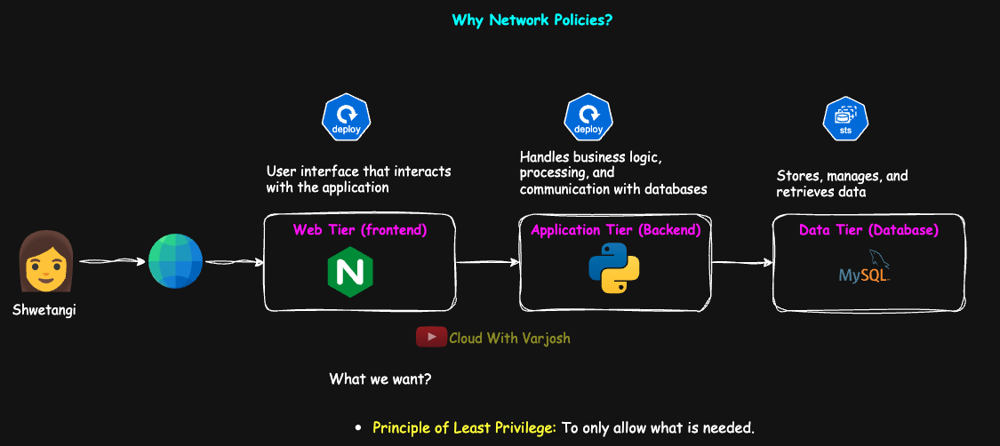
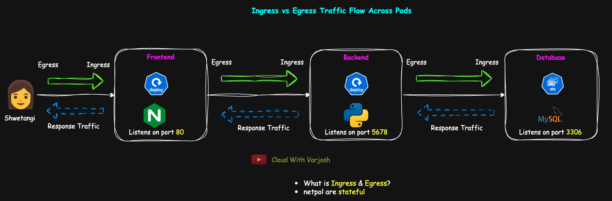
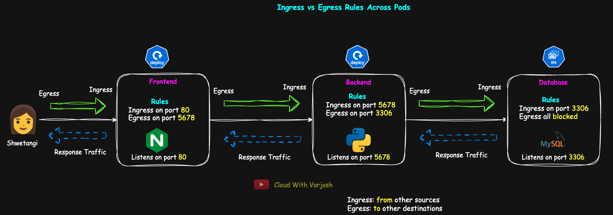

# 61 · NetworkPolicies: Firewalls Between Pods

> **Level:** ★★ intermediate
>
> **You will learn:** why the flat Pod network is a security problem; what a **NetworkPolicy** is (L3/L4 allow-lists for Pods); who enforces it (the **CNI**, not Kubernetes); ingress vs egress; "selected = isolated" default-deny behaviour; that policies are **stateful**; the three peer types (`podSelector`, `namespaceSelector`, `ipBlock`) and the critical **AND vs OR** YAML difference; why egress policies must allow **DNS**; the full 3-tier least-privilege demo on kind + Calico; default-deny patterns; and debugging.
>
> **You need:** topics 05 (3-tier apps), 17 (labels), 29 (network model and CNI), 30–31 (Services), 33 (DNS), 40 (StatefulSets/headless Services).

---

## ⚡ Core: the 10-minute version

**The idea.** By default every Pod can talk to every other Pod. A **NetworkPolicy** is a firewall for Pods.
- Once a policy **selects** a Pod, that Pod only accepts (ingress) or sends (egress) the traffic some policy **allows**.
- Rules match Pods by label, namespaces by label, or IP ranges, plus ports.
- The **CNI plugin** enforces them. With one that doesn't, policies silently do nothing.
- If you restrict egress, **remember to allow DNS** (port 53 to CoreDNS).

**Picture it.** Doors with guest lists on groups of desks in an open-plan office; replies to an allowed visitor are always allowed back.

**The one thing to know.**

```yaml
apiVersion: networking.k8s.io/v1
kind: NetworkPolicy
metadata: { name: db-allow-backend }
spec:
  podSelector: { matchLabels: { role: db } }          # protect the DB Pods
  policyTypes: [Ingress]
  ingress:
  - from: [ { podSelector: { matchLabels: { role: backend } } } ]
    ports: [ { protocol: TCP, port: 3306 } ]
```

**Try it now:**
1. Run `db` (`role=db`), `backend` (`role=backend`) and `frontend` Pods.
2. Before the policy: everyone reaches the DB.
3. After the policy: only the backend does (test with `nc -zv <db-ip> 3306`).

**You've got it if you can:** explain "selected = isolated", and why a combined `namespaceSelector` + `podSelector` in one item means AND.

> 📖 **That's the core.** On a first pass, do the mini-lab and move on to the next topic. Everything below is the **full reference**: come back for the details, the edge cases, interview answers and exam-level depth.

---

## What it is

A **NetworkPolicy** is a namespaced object that controls **which traffic may reach (ingress) or leave (egress) a set of Pods**, at the **IP address and port level**: OSI **Layer 3** (IP) and **Layer 4** (TCP/UDP/SCTP ports). You write **allow rules**; anything not allowed for a selected Pod is dropped.

They control both **Pod-to-Pod traffic inside the cluster** and traffic **between Pods and external systems** (an external database, a backup server).

They're **declarative only**: the API server just stores them. **Enforcement is done by the CNI plugin** (topic 29), usually by programming iptables/nftables rules or eBPF programs on each node.

---

## Why it exists

By default **every Pod can talk to every Pod** in every namespace (the Kubernetes network model, topic 29): no isolation at all. In production that means one compromised Pod can scan and attack everything else (**lateral movement**).

You want **least privilege**:
- allow only the communication that's required;
- e.g. the **web tier must not talk to the database directly**;
- only the **app tier** talks to the **database**, and only on port **3306**.

NetworkPolicies give you that segmentation, moving the cluster from "trust everyone" towards **zero trust**.

---

## Analogy

Without policies, the cluster is an **open-plan office**: anyone can walk to any desk. A NetworkPolicy puts a **door with a guest list** on a group of desks (the selected Pods). Once a group has a door, only people on the list get in (ingress) and, if you also control the way out, the group can only go to listed places (egress). Whoever was let in can always **answer back** through the same door: you don't need a separate rule for replies (stateful). The **building's security staff** (the CNI) actually staffs the doors; a building with no staff (a CNI without policy support) ignores the guest lists completely.

---

## How it works inside

### Our 3-tier application



- **Frontend (web tier)**: `nginx`, port **80** (in production, 443 with TLS 1.3). Deployment `frontend-deploy`, 1 replica.
- **Backend (app tier)**: `python:3.11-slim` running `python3 -m http.server 5678`, port **5678**. Deployment `backend-deploy`.
- **Database (DB tier)**: `mysql`, port **3306**. StatefulSet (`db-sts` in the demo files; Day 47's text also calls it `mysql-sts`).

A user (e.g. Shwetangi) hits the **frontend** → frontend calls the **backend** for business logic → backend queries the **database** → the frontend returns the result. "Frontend/web tier" and "backend/app tier" are used interchangeably.

### Who enforces them

Only CNIs that **implement** the NetworkPolicy API enforce it. Supporting: **Calico**, **Cilium**, **kube-router**, **Antrea**, **OVN-Kubernetes**, **AWS VPC CNI** (with its network-policy agent enabled), and **kindnet** in recent kind versions. Not supporting: **Flannel** (alone).

> ✅ **Correct today** ([C1](#c1)): **kindnet in recent kind releases enforces NetworkPolicies** (added around 2024; it embeds the `kube-network-policies` controller), and **Weave Net did** support them (via its `weave-npc` component). Weave Net is, however, **unmaintained**, so don't pick it for new clusters. Day 47's Calico setup is still the best way to learn, because Calico is widely used in production. Always check your CNI's documentation: some implement only part of the spec (e.g. no egress, no `endPort`, or no SCTP).

**A policy on a non-enforcing CNI is silently ignored**: `kubectl apply` succeeds and nothing changes. Check your CNI:

```bash
kubectl get ds -n kube-system        # calico-node, cilium, kindnet, kube-flannel-ds, aws-node…
```

### Ingress vs egress



- **Ingress**: traffic **entering** a Pod (from another Pod, a Service client or an external client). Ingress rules say which **sources** may open connections **to** the Pod, on which ports.
- **Egress**: traffic **leaving** a Pod (to another Pod, a Service, an external IP). Egress rules say which **destinations** the Pod may connect to.

Example flow:
- A user → `frontend`: **ingress** to the web tier.
- `frontend` → `backend`: **egress** from frontend **and** **ingress** to backend. Both sides' policies must allow it if both are selected.
- `backend` → database: egress from backend, ingress to db.

**Replies aren't filtered separately**, because NetworkPolicies are **stateful** (below).

### Least privilege per tier



| Tier | Ingress allowed | Egress allowed |
|---|---|---|
| **Frontend** | Port **80** from external clients (LB/browser) | Backend on **5678** (+ DNS) |
| **Backend** | Port **5678** from frontend | Database on **3306** (+ DNS) |
| **Database** | Port **3306** from backend only | **None** (a DB rarely needs to start connections) |

Everything else is denied once Pods are selected by policies. The same pattern applies to VMs and bare metal with host firewalls or security groups.

### Default behaviour: "selected = isolated"

- If **no** policy selects a Pod, all its traffic is **allowed**.
- As soon as **any** policy selects a Pod **for ingress**, all ingress not allowed by some policy is **denied**; same separately for **egress**.
- Unselected Pods remain wide open.
- Policies are **additive**: the allowed traffic is the **union** of all policies selecting the Pod. There are **no deny rules** and order doesn't matter.

### `policyTypes`

- `policyTypes: [Ingress]`, `[Egress]` or `[Ingress, Egress]` says which directions the policy isolates.
- If `policyTypes` includes **`Egress` with no `egress:` rules**, **all egress is denied** (Day 47's db policy uses this on purpose). Same for Ingress.
- If you **omit** `policyTypes`, it defaults to `Ingress`, plus `Egress` **only if** the policy has an `egress:` section. Day 47's advice: **always set it explicitly** to avoid surprises.

### Stateful

If a connection is allowed in one direction, the **return packets are allowed automatically** (the CNI uses Linux **connection tracking**, conntrack; Linux notes: netfilter and conntrack, topics [071](../../linux-mastery-rhel/notes/071-firewalld.md) and [095](../../linux-mastery-rhel/notes/095-tcp-ip-deep-dive.md)). Example: backend → db:3306 allowed ⇒ the DB's responses come back without an egress rule on the DB.

Like **AWS Security Groups** (stateful). Unlike **AWS Network ACLs**, which are **stateless**: there you must allow both directions explicitly.

### The three peer types

**1. `podSelector`**: Pods **in the policy's own namespace** with matching labels. Used between tiers in one namespace.

```yaml
podSelector:
  matchLabels:
    role: backend          # all Pods in THIS namespace labelled role=backend
```

**2. `namespaceSelector`**: all Pods in **namespaces** whose **labels** match (labels, not names). Used between apps/microservices in separate namespaces.

```yaml
namespaceSelector:
  matchLabels:
    app: app1              # e.g. app1-dev, app1-staging, app1-prod all labelled app=app1
```

Every namespace automatically has the label **`kubernetes.io/metadata.name: <name>`**, so you can select a namespace by name that way.

**3. `ipBlock`**: IP ranges (CIDRs), meant for traffic **outside the cluster**, e.g. an external backup node or logging service.

```yaml
ipBlock:
  cidr: 10.0.0.0/24
  except:
  - 10.0.0.5/32            # the whole /24 except this one IP
```

E.g. a backup server at `10.0.0.10` may reach the DB Pods. Notes: Pod IPs are ephemeral, so never use `ipBlock` for Pods; and Service/NodePort traffic may be **SNATed** (source NAT, the source rewritten to a node IP) before reaching the Pod, so the source the policy sees may be a node IP, not the real client.

**Ports:** `ports` lists `protocol` + `port` (number or **named** container port); `endPort` gives a range. These are the **Pod's** (container's) ports, i.e. the Service's **`targetPort`**, not the Service's `port`: policies act on Pod traffic after kube-proxy's DNAT (topic 32).

### AND vs OR: the YAML trap

Inside a `from:`/`to:` list, **each list item (`-`) is a separate peer, OR'ed**. Selectors **inside one item** are **AND'ed**.

**AND: one item with both selectors** ("pods labelled X **in** namespaces labelled Y"):

```yaml
egress:
- to:
  - namespaceSelector:
      matchLabels:
        kubernetes.io/metadata.name: kube-system
    podSelector:                    # no dash: same item → AND
      matchLabels:
        k8s-app: kube-dns
```

Only CoreDNS Pods in `kube-system`. 🟢

**OR: two items**:

```yaml
egress:
- to:
  - namespaceSelector:
      matchLabels:
        kubernetes.io/metadata.name: kube-system
  - podSelector:                    # a dash: a new item → OR
      matchLabels:
        k8s-app: kube-dns
```

**Any** Pod in `kube-system` **or** any Pod labelled `k8s-app=kube-dns` **in the policy's own namespace**. 🔴 Too permissive: a non-DNS Pod in `kube-system` is reachable, and a Pod labelled `k8s-app=kube-dns` in the same namespace would receive the traffic. This defeats the intent.

> ℹ️ **Note:** Day 47 explains the OR form as "**any pod in any namespace** with the label `k8s-app=kube-dns`" (and, in the analytics example, "any pod **(in any namespace)** with the label `access: true`"). A **bare `podSelector`** peer only matches Pods in the **policy's own namespace**. To match a label in **all** namespaces, combine it with an empty `namespaceSelector: {}` in the same item. The conclusion is the same: the OR form is broader than intended.

| Structure | Logic | Allowed |
|---|---|---|
| `namespaceSelector` + `podSelector` in **one** item | AND | Only `kube-dns` Pods in `kube-system` |
| Two separate items | OR | Any Pod in `kube-system` **or** any `k8s-app=kube-dns` Pod in the policy's namespace |

**The analytics example:**

```yaml
ingress:
- from:
  - namespaceSelector: { matchLabels: { team: analytics } }
  - podSelector:       { matchLabels: { access: "true" } }   # OR
```

= from any Pod in `team=analytics` namespaces, **or** from Pods labelled `access=true` (in this namespace). Each entry is checked independently.

```yaml
ingress:
- from:
  - namespaceSelector: { matchLabels: { team: analytics } }
    podSelector:       { matchLabels: { access: "true" } }   # AND
```

= only Pods that have `access=true` **and** are in `team=analytics` namespaces.

- Use **AND** for "only explicitly authorised jobs in the analytics namespace may reach the backend".
- Use **OR** for "all of analytics **plus** specific labelled Pods (e.g. CI jobs)".

(Label values in YAML: `access: true` would be a boolean, and label values must be **strings**; quote it: `"true"`.)

### Why egress policies must allow DNS

Pods reach Services by **name** (`db-svc`, `backend-svc`), which needs a **DNS lookup** to CoreDNS in `kube-system` (topic 33). If an egress policy doesn't allow it, **name resolution fails** and everything that uses names breaks, even traffic that's allowed. So allow **port 53 on both UDP and TCP** (TCP is used for large responses), scoped to CoreDNS with the AND form.

---

## Commands / YAML

### Step 1: kind + Calico (`Day 47/kind-cluster.yaml`, `Day 47/calico.yaml`)

```bash
kind get clusters
kind delete cluster --name=<old-cluster>       # optional, frees resources
```

```yaml
# Day 47/kind-cluster.yaml
kind: Cluster
apiVersion: kind.x-k8s.io/v1alpha4
networking:
  disableDefaultCNI: true          # don't install kindnet; we'll install Calico
nodes:
  - role: control-plane
    image: kindest/node:v1.33.1@sha256:050072256b9a903bd914c0b2866828150cb229cea0efe5892e2b644d5dd3b34f
    extraPortMappings:
      - containerPort: 31000       # NodePort inside the kind node container…
        hostPort: 31000            # …published on your machine as localhost:31000 (9090 here → localhost:9090)
  - role: worker
    image: kindest/node:v1.33.1@sha256:050072256b9a903bd914c0b2866828150cb229cea0efe5892e2b644d5dd3b34f
  - role: worker
    image: kindest/node:v1.33.1@sha256:050072256b9a903bd914c0b2866828150cb229cea0efe5892e2b644d5dd3b34f
```

(Use a current `kindest/node` image matching your kind release; see topic 11. Day 8 covers kind internals; Day 12 explains the fixed NodePort 31000; topics 11 and 31.)

```bash
kind create cluster --config "Day 47/kind-cluster.yaml" --name=cka-2025
kubectl get nodes
```

```
NAME                     STATUS     ROLES           AGE   VERSION
cka-2025-control-plane   NotReady   control-plane   1m    v1.33.1
cka-2025-worker          NotReady   <none>          1m    v1.33.1
cka-2025-worker2         NotReady   <none>          1m    v1.33.1
```

`NotReady` because: `KubeletNotReady: container runtime network not ready: NetworkReady=false reason:NetworkPluginNotReady message: CNI plugin not initialized`. **Expected**: no CNI yet (topic 29).

```bash
kubectl apply -f https://raw.githubusercontent.com/projectcalico/calico/v3.30.2/manifests/calico.yaml
# or the copy in the repo: kubectl apply -f "Day 47/calico.yaml"
kubectl get daemonset -n kube-system
```

```
NAME          DESIRED   CURRENT   READY   UP-TO-DATE   AVAILABLE   NODE SELECTOR            AGE
calico-node   3         3         3       3            3           kubernetes.io/os=linux   1m
```

One `calico-node` per node; the nodes become `Ready`. (Reference: Calico's "kind" quick-start in the Tigera docs. Works the same on minikube or managed clusters with a policy-capable CNI.)

### Step 2: namespace and tiers (`Day 47/demo/00…03`)

```yaml
# 00-namespace.yaml
apiVersion: v1
kind: Namespace
metadata:
  name: app1-ns
  labels:
    app: app1                 # handy for namespaceSelector
```

```bash
kubectl apply -f "Day 47/demo/00-namespace.yaml"
kubectl config set-context --current --namespace=app1-ns
```

```yaml
# 01-frontend.yaml: nginx Deployment + NodePort 31000 (in production: Ingress/Gateway with TLS, and HPA)
apiVersion: apps/v1
kind: Deployment
metadata: { name: frontend-deploy, namespace: app1-ns }
spec:
  replicas: 1
  selector: { matchLabels: { app: app1, role: frontend } }
  template:
    metadata: { labels: { app: app1, role: frontend } }
    spec:
      containers:
        - name: frontend-container
          image: nginx
          ports: [{ containerPort: 80 }]
---
apiVersion: v1
kind: Service
metadata: { name: frontend-svc, namespace: app1-ns }
spec:
  type: NodePort
  selector: { app: app1, role: frontend }
  ports:
    - { protocol: TCP, port: 80, targetPort: 80, nodePort: 31000 }
```

```yaml
# 02-backend.yaml: a tiny Python HTTP server standing in for a microservice (not for production)
apiVersion: apps/v1
kind: Deployment
metadata: { name: backend-deploy, namespace: app1-ns }
spec:
  replicas: 1
  selector: { matchLabels: { app: app1, role: backend } }
  template:
    metadata: { labels: { app: app1, role: backend } }
    spec:
      containers:
        - name: backend
          image: python:3.11-slim
          command: ["python3", "-m", "http.server", "5678"]
          ports: [{ containerPort: 5678 }]
---
apiVersion: v1
kind: Service
metadata: { name: backend-svc, namespace: app1-ns }
spec:
  type: ClusterIP
  selector: { app: app1, role: backend }
  ports: [{ protocol: TCP, port: 5678, targetPort: 5678 }]
```

```yaml
# 03-db.yaml: headless Service first, then the StatefulSet that references it (topic 40; Day 44 for multi-AZ on EKS)
apiVersion: v1
kind: Service
metadata: { name: db-svc, namespace: app1-ns }
spec:
  clusterIP: None
  selector: { app: app1, role: db }
  ports: [{ protocol: TCP, port: 3306, targetPort: 3306 }]
---
apiVersion: apps/v1
kind: StatefulSet
metadata: { name: db-sts, namespace: app1-ns }
spec:
  serviceName: db-svc
  replicas: 1
  selector: { matchLabels: { app: app1, role: db } }
  template:
    metadata: { labels: { app: app1, role: db } }
    spec:
      containers:
        - name: mysql
          image: mysql:8.0
          ports: [{ containerPort: 3306 }]
          env:
            - name: MYSQL_ROOT_PASSWORD
              value: "password123"        # demo only; use a Secret (topic 35)
```

(In production: replication, StorageClasses and multiple zones. Here: one replica.)

```bash
kubectl apply -f "Day 47/demo/01-frontend.yaml" -f "Day 47/demo/02-backend.yaml" -f "Day 47/demo/03-db.yaml"
kubectl get pods
kubectl get svc
```

```
NAME                               READY   STATUS    RESTARTS   AGE
backend-deploy-8857b74db-tr8h8     1/1     Running   0          12m
db-sts-0                           1/1     Running   0          12m
frontend-deploy-6bc8df5bb8-wfjpt   1/1     Running   0          12m

NAME           TYPE        CLUSTER-IP      EXTERNAL-IP   PORT(S)        AGE
backend-svc    ClusterIP   10.96.102.224   <none>        5678/TCP       12m
db-svc         ClusterIP   None            <none>        3306/TCP       12m
frontend-svc   NodePort    10.96.94.172    <none>        80:31000/TCP   12m
```

### Step 3: verify the open state (everyone talks to everyone)

**From the frontend:**

```bash
kubectl exec -it deploy/frontend-deploy -- bash
apt update && apt install -y telnet
telnet backend-svc 5678                                         # Connected to backend-svc.
telnet db-svc 3306                                              # Connected to db-svc.
telnet db-sts-0.db-svc.app1-ns.svc.cluster.local 3306           # Connected… (preferred)
```

- `backend-svc` resolves to a **ClusterIP**, which routes to a backend Pod.
- `db-svc` is **headless**, so DNS returns the **Pod IPs** directly, with no virtual IP.
- **Preferred:** the StatefulSet Pod's stable name `<pod>.<service>.<namespace>.svc.cluster.local` resolves to **that specific Pod** (`db-sts-0`): predictable for leader-based systems, ordered start-up and clients that must reach a specific instance (topics 33 and 40).

**Observation:** the frontend reaches backend **and** database: it shouldn't reach the DB.

**From the backend:**

```bash
kubectl exec -it deploy/backend-deploy -- bash
apt update && apt install -y telnet curl
telnet frontend-svc 80                                          # Connected
telnet db-sts-0.db-svc.app1-ns.svc.cluster.local 3306           # Connected
```

**Observation:** the backend should reach the DB, but **should not start** connections to the frontend; it should only **answer** the frontend.

**From the DB (optional):**

```bash
kubectl exec -it db-sts-0 -- bash
microdnf install -y telnet          # the mysql image is based on Oracle Linux (RHEL-compatible): microdnf, not apt
telnet backend-svc 5678
telnet frontend-svc 80
```

**Observation:** the DB reaches both. In a secure architecture a **database shouldn't initiate** outbound connections, least of all to the frontend.

### Step 4: policies for all three tiers

**`04-db-netpol.yaml`: only backend → DB on 3306; no egress at all**

```yaml
apiVersion: networking.k8s.io/v1
kind: NetworkPolicy
metadata:
  name: db-policy
  namespace: app1-ns
spec:
  policyTypes:
    - Ingress
    - Egress                  # declared, with NO egress rules ⇒ all egress denied
  podSelector:
    matchLabels: { app: app1, role: db }       # the Pods this policy protects
  ingress:
    - from:
        - podSelector:
            matchLabels: { app: app1, role: backend }
      ports:
        - { protocol: TCP, port: 3306 }
```

**Denies all ingress to the DB except TCP 3306 from backend Pods, and denies all egress** (so the DB can't start connections to the frontend or the internet). Replies to the backend still flow (stateful).

```bash
kubectl apply -f "Day 47/demo/04-db-netpol.yaml"
kubectl get netpol -n app1-ns
kubectl describe netpol db-policy -n app1-ns
```

```
Name:         db-policy
Namespace:    app1-ns
Spec:
  PodSelector:     app=app1,role=db
  Allowing ingress traffic:
    To Port: 3306/TCP
    From:
      PodSelector: app=app1,role=backend
  Allowing egress traffic:
    <none> (Selected pods are isolated for egress connectivity)
  Policy Types: Ingress, Egress
```

**`05-revised-backend-netpol.yaml`: ingress from frontend; egress to DB and DNS**

The repo has two versions. **`05-backend-netpol.yaml`** (first attempt) allows egress **only to the DB**, with no DNS rule. Apply it and the backend can no longer resolve `db-svc` or `db-sts-0.db-svc…`, so even the allowed DB traffic fails by name. **`05-revised-backend-netpol.yaml`** adds the DNS rule:

```yaml
apiVersion: networking.k8s.io/v1
kind: NetworkPolicy
metadata:
  name: backend-policy
  namespace: app1-ns
spec:
  podSelector:
    matchLabels: { app: app1, role: backend }
  policyTypes:
    - Ingress
    - Egress
  ingress:
    - from:
        - podSelector:
            matchLabels: { app: app1, role: frontend }     # the frontend Pods
      ports:
        - { protocol: TCP, port: 5678 }
  egress:
    - to:
        - podSelector:
            matchLabels: { app: app1, role: db }
      ports:
        - { protocol: TCP, port: 3306 }
    - to:                                               # DNS to CoreDNS only (AND form)
        - namespaceSelector:
            matchLabels: { kubernetes.io/metadata.name: kube-system }
          podSelector:
            matchLabels: { k8s-app: kube-dns }
      ports:
        - { protocol: UDP, port: 53 }
        - { protocol: TCP, port: 53 }
```

> ✅ **Correct today** ([C2](#c2)): the frontend Pods are labelled **`role: frontend`** (see `01-frontend.yaml`); a selector for `role: web` matches **nothing**, so the frontend would be **blocked** from the backend. The repo's YAML files correctly use `role: frontend`, as shown above.

Explanation:
- `policyTypes`: both directions.
- `podSelector`: backend Pods in `app1-ns`.
- **Ingress**: only frontend Pods, only port 5678.
- **Egress**: (1) DB Pods on 3306; (2) DNS to **CoreDNS Pods** (`k8s-app=kube-dns`) in **`kube-system`**: namespace **and** Pod selectors in one item (AND), so not "everything in kube-system".

**Notes:** stateful replies; `ingress` and `egress` are lists whose entries are evaluated independently (OR); a combined namespace+pod selector is AND.

```bash
kubectl apply -f "Day 47/demo/05-revised-backend-netpol.yaml"
kubectl describe netpol backend-policy -n app1-ns
```

**`06-frontend-netpol.yaml`: ingress from anywhere on 80; egress to backend and DNS**

```yaml
apiVersion: networking.k8s.io/v1
kind: NetworkPolicy
metadata:
  name: frontend-policy
  namespace: app1-ns
spec:
  podSelector:
    matchLabels: { app: app1, role: frontend }
  policyTypes:
    - Ingress
    - Egress
  ingress:
    - from:
        - ipBlock:
            cidr: 0.0.0.0/0             # any IP: external clients (localhost:31000 on kind)
      ports:
        - { protocol: TCP, port: 80 }
  egress:
    - to:
        - podSelector:
            matchLabels: { app: app1, role: backend }
      ports:
        - { protocol: TCP, port: 5678 }
    - to:
        - namespaceSelector:
            matchLabels: { kubernetes.io/metadata.name: kube-system }
          podSelector:
            matchLabels: { k8s-app: kube-dns }
      ports:
        - { protocol: UDP, port: 53 }
        - { protocol: TCP, port: 53 }
```

- **Ingress from any IP** on 80 suits kind (`localhost:31000`). In production, restrict it to the **load balancer/ingress controller** (e.g. a `namespaceSelector` for the ingress controller's namespace) on 443. (If you want to allow **everyone** including Pods, an `ingress: [{ports: …}]` rule with **no `from`** is clearer: `0.0.0.0/0` in `ipBlock` is intended for external IPs, and whether it matches Pod IPs depends on the CNI.)
- **Egress** to backend on 5678 and to CoreDNS only.

```bash
kubectl apply -f "Day 47/demo/06-frontend-netpol.yaml"
kubectl describe netpol frontend-policy -n app1-ns
```

**Key pointers:** rules are additive lists; selected Pods allow only what's listed; allow DNS on **UDP and TCP 53**; combine namespace+pod selectors for precision.

### Step 5: verify

**Expected:** DB can't start connections to anyone; backend → DB yes, backend → frontend no; frontend → backend yes, frontend → DB no.

```bash
kubectl exec -it db-sts-0 -- bash
telnet frontend-svc 80          # hangs/fails
telnet backend-svc 5678         # hangs/fails
```

The DB's **egress is fully blocked** (it can't even resolve the names: DNS is denied too). (Day 47 phrased this as "ingress to both frontend and backend is restricted from DB": it's **db-policy's egress denial** that stops it first; backend-policy's ingress rule would block it as well.)

```bash
kubectl exec -it deploy/backend-deploy -- bash
telnet db-sts-0.db-svc.app1-ns.svc.cluster.local 3306     # connects
telnet frontend-svc 80                                    # hangs/fails (not in backend's egress)
```

```bash
kubectl exec -it deploy/frontend-deploy -- bash
telnet backend-svc 5678                                   # connects
telnet db-sts-0.db-svc.app1-ns.svc.cluster.local 3306     # hangs/fails
```

From your machine: `curl localhost:31000` still shows the nginx page.

A blocked connection usually **hangs** until timeout (packets are dropped silently), rather than failing with "connection refused". Use `timeout 3 telnet …` or `nc -zv -w 3 host port`.

### Common baseline policies

```yaml
# default-deny all ingress AND egress for every Pod in a namespace
apiVersion: networking.k8s.io/v1
kind: NetworkPolicy
metadata: { name: default-deny-all, namespace: app1-ns }
spec:
  podSelector: {}                 # {} = every Pod in the namespace
  policyTypes: [Ingress, Egress]
---
# allow all Pods in the namespace to use DNS
apiVersion: networking.k8s.io/v1
kind: NetworkPolicy
metadata: { name: allow-dns, namespace: app1-ns }
spec:
  podSelector: {}
  policyTypes: [Egress]
  egress:
  - to:
    - namespaceSelector: { matchLabels: { kubernetes.io/metadata.name: kube-system } }
      podSelector: { matchLabels: { k8s-app: kube-dns } }
    ports: [{ protocol: UDP, port: 53 }, { protocol: TCP, port: 53 }]
---
# allow traffic only from Pods in the same namespace
apiVersion: networking.k8s.io/v1
kind: NetworkPolicy
metadata: { name: allow-same-namespace, namespace: app1-ns }
spec:
  podSelector: {}
  policyTypes: [Ingress]
  ingress:
  - from:
    - podSelector: {}             # any Pod in THIS namespace
```

Typical production pattern: **default-deny + allow-dns** in every app namespace (Kyverno can **generate** them automatically, topic 58), then specific allow policies per app.

### Beyond the core API

- **Cilium/Calico** add their own CRDs: **L7** rules (HTTP methods/paths, DNS names like `*.amazonaws.com`), global cluster-wide policies, explicit **deny** rules and ordering.
- **AdminNetworkPolicy / BaselineAdminNetworkPolicy** (SIG Network, evolving into cluster network policies): cluster-admin-level policies that namespace owners can't override.
- NetworkPolicies are L3/L4: for identity-based, encrypted service-to-service control, a **service mesh** adds mTLS and L7 authorization (topic 74).

---

## Hands-on lab

1. Build the kind + Calico cluster and the three tiers; verify the open state from all three Pods.
2. Apply `04-db-netpol.yaml` and re-test; then apply **`05-backend-netpol.yaml`** (no DNS) and see the backend fail to reach `db-sts-0.db-svc…` by **name**; get the DB Pod IP (`kubectl get pod db-sts-0 -o wide`) and `telnet <ip> 3306` works. That proves DNS was the problem. Apply the **revised** version and retry by name.
3. Apply `06-frontend-netpol.yaml`; run the full Step 5 matrix and `curl localhost:31000`.
4. Change the backend policy's `from` to `role: web` (the README's version) and watch the frontend lose access to the backend; change it back.
5. Rewrite the DNS rule in the **OR** form, then label a test Pod in `app1-ns` `k8s-app=kube-dns` and show the backend can now reach it on port 53. Revert.
6. **Task for you:** move the DB StatefulSet and headless Service to a new namespace **`db-ns`**, keep frontend and backend in `app1-ns`, and re-create the same rules: frontend → backend; backend → db; frontend ✗ db; backend ✗ frontend (initiating); db ✗ everything. Hint: in `db-ns`'s policy use `namespaceSelector` (`kubernetes.io/metadata.name: app1-ns`) **AND** `podSelector` (`role: backend`) in one item; in the backend's egress, the same AND form for `db-ns`/`role: db`; the DB's DNS name becomes `db-sts-0.db-svc.db-ns.svc.cluster.local`.
7. Apply `default-deny-all` + `allow-dns` in a fresh namespace and add one allow rule at a time.
8. Clean up: `kubectl delete ns app1-ns db-ns`; `kubectl config set-context --current --namespace=default`; delete the `cka-2025` cluster if you made one.

---

## Where you'll use it

- **Every production cluster** with more than one team or app: namespace default-deny plus explicit allows.
- **Compliance** (PCI DSS segmentation of cardholder-data workloads).
- **Containing breaches**: a compromised frontend can't reach the database.
- **Restricting egress** to the internet (data exfiltration), with CNI DNS-aware policies for allow-listing domains.
- **CKA**: write/fix NetworkPolicies with AND/OR selectors and ports; very common.

---

## When it breaks

| Symptom | Cause | Fix |
|---|---|---|
| Policy has no effect at all | CNI doesn't enforce NetworkPolicies | Use Calico/Cilium/recent kindnet; check `kubectl get ds -n kube-system` |
| Everything breaks after an egress policy, even allowed traffic | DNS not allowed | Allow UDP+TCP 53 to CoreDNS |
| Allowed traffic still blocked | Selector labels don't match (`role: web` vs `role: frontend`); wrong namespace; Service `port` used instead of Pod `targetPort` | `kubectl get pods --show-labels`; `kubectl describe netpol`; use container ports |
| More traffic allowed than intended | OR form (separate list items) instead of AND | Put `namespaceSelector` and `podSelector` in **one** item |
| Cross-namespace traffic blocked | Only a `podSelector` (same-namespace) was used | Add a `namespaceSelector` (by `kubernetes.io/metadata.name`) in the same item |
| External clients blocked via NodePort/LB | Source IP SNATed to a node IP | `externalTrafficPolicy: Local` (keeps the client IP) or allow node CIDRs |
| Probes failing after default-deny | Kubelet probes come from the node | Most CNIs allow node → Pod traffic; if not, allow the node CIDR |
| Connections hang instead of being refused | Dropped by policy | Expected; confirm with CNI tools (`calicoctl`, `cilium monitor`, Hubble) |

---

## Quick recap

- NetworkPolicies are **L3/L4 allow-lists** for Pods, **enforced by the CNI** (Calico, Cilium, kindnet in new kind, AWS VPC CNI…).
- No policy = all allowed; **selected = isolated** for that direction; policies are **additive**, **stateful**, and have **no deny**.
- Peers: `podSelector` (same namespace), `namespaceSelector` (by namespace labels; `kubernetes.io/metadata.name`), `ipBlock` (external CIDRs). Ports are **Pod** ports.
- **Same item = AND; separate items = OR.** Always allow **DNS (UDP+TCP 53)** when restricting egress. Set `policyTypes` explicitly; Egress with no rules = deny all egress.
- Pattern: default-deny + allow-dns + specific allows per tier.

### Interview questions

1. **Q: You applied a NetworkPolicy but nothing changed. Why?**
   A: The CNI doesn't implement NetworkPolicies (e.g. Flannel alone), or the policy's `podSelector` doesn't match the intended Pods; check the CNI and the Pod labels.
2. **Q: Explain the difference between these two `from` blocks: one item with `namespaceSelector` and `podSelector`, vs two items.**
   A: One item means AND: Pods with that label in namespaces with that label. Two items mean OR: any Pod in matching namespaces, or Pods with that label in the policy's own namespace, which is much broader.
3. **Q: After adding an egress policy to a Pod, it can't reach anything by name. What happened?**
   A: Egress isolation also blocked DNS to CoreDNS. Allow UDP and TCP port 53 to the `kube-dns` Pods in `kube-system`.

---

## Appendix: notes on the original course material

This topic was rebuilt from the original CKA course notes. This appendix keeps the audit trail out of your way while you learn.

### Sources

Day 47 (introduction; the 3-tier app and how it works; why NetworkPolicies; what they are; who enforces them; ingress vs egress with example flow; least privilege per tier; how they work: default behaviour and stateful nature; types: podSelector, namespaceSelector, ipBlock; `policyTypes` note; demo steps 1–5: kind + Calico, namespace and tiers, verifying open state, policies for db/backend/frontend with explanations, why allow DNS, notes, AND vs OR with DNS, key pointers, verification; task for you; AND vs OR for `from:`; conclusion; references), files `Day 47/kind-cluster.yaml`, `Day 47/calico.yaml`, `Day 47/demo/00-namespace.yaml` … `06-frontend-netpol.yaml` (including both `05-backend-netpol.yaml` and `05-revised-backend-netpol.yaml`).

### Corrections to the original notes

Each entry shows what the original said and what's true now. In the topic above, each correction appears as a ✅ **Correct today** line or a ⚠️ **Fix to the original** box, linked to its entry here.

<a id="c1"></a>**C1 · Corrected (Day 47).** "**Weave Net** and **kindnet** (used by default in KIND clusters) **do not support** them". **Now:** **kindnet in recent kind releases enforces NetworkPolicies** (added around 2024; it embeds the `kube-network-policies` controller), and **Weave Net did** support them (via its `weave-npc` component). Weave Net is, however, **unmaintained**, so don't pick it for new clusters. Day 47's Calico setup is still the best way to learn, because Calico is widely used in production. Always check your CNI's documentation: some implement only part of the spec (e.g. no egress, no `endPort`, or no SCTP).

<a id="c2"></a>**C2 · Corrected (Day 47).** the README's version of this policy allows ingress from `role: web` ("Allow traffic from frontend pods"), and its explanation says "frontend pods (`role: web`)". **Now:** the frontend Pods are labelled **`role: frontend`** (see `01-frontend.yaml`); a selector for `role: web` matches **nothing**, so the frontend would be **blocked** from the backend. The repo's YAML files correctly use `role: frontend`, as shown above.
