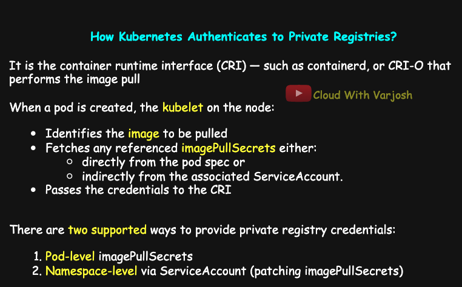

# 62 · Private Registries and imagePullSecrets

> **Level:** ★★ intermediate
>
> **You will learn:** public vs private registries and why companies use private ones; why a private image gives `ErrImagePull`/`ImagePullBackOff`; **who** actually pulls images (the kubelet asks the container runtime) and where credentials come from; creating a `docker-registry` Secret and what's inside it; three ways to use it (Pod `imagePullSecrets`, the namespace's `default` ServiceAccount, a custom ServiceAccount); cloud-native alternatives without static secrets (kubelet credential providers, node roles, ServiceAccount-token pulls); and the security gotchas (cached images, secret exposure).
>
> **You need:** topics 03 (pushing images), 20 (image names and pull policy), 35 (Secrets), 55 (ServiceAccounts).

---

## ⚡ Core: the 10-minute version

**The idea.** Private images need **credentials** to pull, otherwise you get `ErrImagePull` → `ImagePullBackOff`.
- The **kubelet** hands the credentials to the container runtime at pull time; they're never put inside the container.
- They come from a `docker-registry` Secret referenced in the Pod's `imagePullSecrets`, or attached to its **ServiceAccount** (then every Pod using that SA gets them).
- On clouds, nodes can pull using cloud identity instead (e.g. EKS nodes pulling from ECR with their IAM role).

**Picture it.** A members-only warehouse: the delivery driver (runtime) shows a membership card (pull secret) at the door; the card never goes inside the box.

**The one thing to know.**

```bash
kubectl create secret docker-registry regcred \
  --docker-server=https://index.docker.io/v1/ --docker-username=<you> --docker-password=<access-token>
kubectl patch serviceaccount default -p '{"imagePullSecrets":[{"name":"regcred"}]}'   # every new Pod in this namespace
```

**Try it now:**
1. Push an image to a private repository (topic 03) and run it: `ImagePullBackOff`.
2. Add the Secret and patch the SA.
3. Recreate the Pod: Running.
4. Check `kubectl get pod -o jsonpath='{.spec.imagePullSecrets}'`.

**You've got it if you can:** explain where pull credentials come from, and why they're never visible inside the container.

> 📖 **That's the core.** On a first pass, do the mini-lab and move on to the next topic. Everything below is the **full reference**: come back for the details, the edge cases, interview answers and exam-level depth.

---

## What it is

A **container registry** stores and serves images (topic 20). **Public** repositories can be pulled by anyone, anonymously; everything you've used so far (`nginx`, `busybox`) was public, so no credentials were needed.

A **private** registry or repository needs **authentication** to pull. Examples:
- private repositories on **Docker Hub**;
- **Amazon ECR**, Google **Artifact Registry**, **Azure Container Registry** (private by default);
- **GHCR** (GitHub), **GitLab** registry, **Quay**;
- self-hosted **Harbor**, **Nexus**, **Artifactory**.

An **`imagePullSecret`** is a reference from a Pod (or its ServiceAccount) to a Secret of type **`kubernetes.io/dockerconfigjson`**, which holds registry credentials in the same format as Docker's `~/.docker/config.json`.

---

## Why it exists

Organisations keep their own images private for **security** (internal code and configs aren't public), **intellectual property**, and **governance** (only scanned, signed images in a controlled registry; topic 63). **Kubernetes won't pull a private image unless it's given credentials**.

---

## Analogy

The registry is a **members-only warehouse**. Kubernetes's kubelet is the **delivery manager** who sends a **driver** (the container runtime) to fetch goods (images). For public shelves no card is needed. For private shelves the driver needs a **membership card** (the pull secret). You can tape the card to **one order** (Pod `imagePullSecrets`), give it to the **whole department's default account** (the `default` ServiceAccount), or to a **specific team account** (a custom ServiceAccount). The card is used only at the warehouse door; it's never put **inside** the delivered box (the container).

---

## How it works inside

### The problem: `ErrImagePull` / `ImagePullBackOff`

```yaml
apiVersion: v1
kind: Pod
metadata:
  name: mypod
spec:
  containers:
  - name: python-cont
    image: docker.io/cloudwithvarjosh/my-python-image:v1     # a PRIVATE repository
```

```bash
kubectl apply -f pod.yaml
kubectl get pods
```

```
mypod   0/1   ErrImagePull   0   4s
```

…and after retries, `ImagePullBackOff` (the kubelet waits longer between attempts; topic 21).

```bash
kubectl describe pod mypod
```

```
Failed to pull image "docker.io/cloudwithvarjosh/my-python-image:v1":
pull access denied, repository does not exist or may require authorization:
server message: insufficient_scope: authorization failed
```

Docker Hub requires authentication for private repositories, and Kubernetes gave none. (Docker Hub deliberately says "does not exist **or** may require authorization": it doesn't reveal whether a private repo exists.)

### Who pulls, and how credentials flow



**Kubernetes itself doesn't pull images**: the **container runtime** on each node (containerd, CRI-O) does, through the **CRI** (`PullImage` call; topic 08). When a Pod is scheduled to a node, the **kubelet**:
1. reads the Pod spec and the image to pull;
2. collects credentials: the Pod's `imagePullSecrets`, **plus** those listed on the Pod's **ServiceAccount**, plus any from **kubelet credential provider plugins** or node-level config;
3. passes the matching credentials to the runtime in the `PullImage` request; the runtime authenticates to the registry (usually exchanging them for a short-lived registry **token**) and pulls the layers.

The Secret type `kubernetes.io/dockerconfigjson` holds the registry URL, username, password and a base64 `auth` (`username:password`).

**The default ServiceAccount:** every namespace has a `default` SA; Pods without `serviceAccountName` use it. Its API token is mounted at `/var/run/secrets/kubernetes.io/serviceaccount/` for **API** access (not image pulls; topic 55); disable that with `automountServiceAccountToken: false`. But an SA can also **list `imagePullSecrets`**, and the **ServiceAccount admission plugin** (topic 58) **copies** them into every Pod that uses that SA, at creation time. That's what makes namespace-wide pull credentials possible.

**Two supported places to configure credentials:**
- **Pod-level `imagePullSecrets`**: explicit per workload; most control.
- **Via a ServiceAccount** (`default` or custom): every Pod using the SA inherits them; cleaner when many Pods use the same registry.

Whether via Pod or SA, the credentials are used **only at pull time** by the kubelet/runtime; they're **never mounted into the container** or exposed as environment variables.

### Security notes

- **Cached images can bypass the secret.** Once a private image is on a node, another Pod on that node using the same image with `imagePullPolicy: IfNotPresent` starts **without** any credentials. In multi-tenant clusters, use the **`AlwaysPullImages`** admission plugin (topic 58) or the newer kubelet feature that re-verifies credentials for cached images (`KubeletEnsureSecretPulledImages`).
- **Anyone who can read the Secret can pull your images** (and, with a password rather than a read-only token, **push** too).
- Secrets are **namespaced**: a Pod can only use pull secrets from **its own** namespace.

### Cloud-native alternatives (no static secrets)

- **Node-level credentials**: on EKS, nodes pull from **ECR** using the **node's IAM role** through the kubelet's **ECR credential provider plugin**; GKE nodes use their service account for Artifact Registry; AKS attaches ACR to the cluster's kubelet identity (`az aks update --attach-acr`). No Kubernetes Secret at all.
- **Kubelet credential provider plugins** (GA since v1.26): an executable the kubelet calls to fetch short-lived registry credentials for matching image hosts.
- **Pull credentials from a Pod's ServiceAccount token** (beta in recent versions): the credential provider receives the Pod's projected SA token, so each **workload** can have its own registry identity (e.g. per-namespace IAM roles), instead of the whole node sharing one.
- **External Secrets Operator / Vault**: generate and rotate `dockerconfigjson` Secrets from a secret manager (topic 63).

> ✅ **Correct today** ([C1](#c1)): **IRSA** (and EKS Pod Identity) give AWS credentials to **your application's code** inside the Pod; they are **not** used by the kubelet for **image pulls**. ECR pulls on EKS use the **node IAM role** via the kubelet's ECR credential provider (or the newer ServiceAccount-token pull feature for per-workload identity). The goal is the same, though: no static registry passwords.

---

## Commands / YAML

### Demo 0: build and push a private image (Day 45; `Day 45/app1/`)

Recap of topic 03, so you have a private image to pull.

**Step 1: the app** (`Day 45/app1/app.py`):

```python
from flask import Flask

app = Flask(__name__)

@app.route("/")
def home():
    return "Hello, Docker!"

if __name__ == "__main__":
    app.run(host="0.0.0.0", port=5000)
```

**Step 2: the Dockerfile** (`Day 45/app1/Dockerfile`):

```dockerfile
FROM python:3.9-slim          # lightweight Python base
WORKDIR /app
ADD app.py app.py             # COPY is preferred for local files (topic 03)
RUN pip install flask         # add --no-cache-dir to keep the image smaller
EXPOSE 5000                   # documentation only
CMD ["python", "app.py"]
```

(`python:3.9` is end-of-life; use a supported tag such as `python:3.13-slim` for real work.)

**Step 3: build and push**

```bash
cd "Day 45/app1"
docker build -t <your-dockerhub-user>/app1:1.0.0 .
docker login                         # Linux; Docker Desktop: sign in via the GUI
docker push <your-dockerhub-user>/app1:1.0.0
```

> ⚠️ **Fix to the original** ([C2](#c2)): the text says "inside `Day 44/app1/`"; the app is in **`Day 45/app1/`**.

`1.0.0` follows **semantic versioning** (`MAJOR.MINOR.PATCH`), which makes releases easy to track and promote; avoid `latest` in production (topic 20). Replace `cloudwithvarjosh` with your own Docker Hub username throughout.

**Step 4: make it private**: on hub.docker.com → **My Hub** → the `app1` repository → **Settings** → **Visibility settings** → **Private**. Now pulling it needs credentials.

### Demo 1: Pod-level `imagePullSecrets` (`Day 45/01-pod.yaml`)

**Step 1: create the Secret**

```bash
kubectl create secret docker-registry dockerhub-secret \
  --docker-server=https://index.docker.io/v1/ \
  --docker-username=<your-user> \
  --docker-password=<access-token> \
  --docker-email=<you@example.com>
```

- `--docker-server=https://index.docker.io/v1/` is Docker Hub's legacy auth key (for other registries: `ghcr.io`, `<acct>.dkr.ecr.<region>.amazonaws.com`, `myreg.azurecr.io`, `harbor.example.com`).
- `--docker-email` is optional and unused by modern registries.
- Use a **Docker Hub access token** (Account settings → Personal access tokens, read-only scope) instead of your password.
- Passing a password on the command line leaves it in your **shell history**. Alternatives: `read -s PASS` and then `--docker-password="$PASS"`, or build the Secret from an existing login: `kubectl create secret generic dockerhub-secret --from-file=.dockerconfigjson=$HOME/.docker/config.json --type=kubernetes.io/dockerconfigjson` (only if that file holds the credentials directly, not a credential helper reference).

```bash
kubectl get secret dockerhub-secret -o yaml
```

```yaml
apiVersion: v1
kind: Secret
type: kubernetes.io/dockerconfigjson
data:
  .dockerconfigjson: eyJhdXRocyI6eyJodHRwczovL2luZGV4LmRvY2tlci5pby92MS8iOnsi…
metadata:
  name: dockerhub-secret
  namespace: default
```

**Naming note:** `dockerhub-secret` is named for readability; an ECR one might be `ecr-secret`, GHCR `ghcr-secret`. The `docker-registry` type is just Kubernetes' name for the format: it works for **any** registry using Docker-style login, as long as `--docker-server` matches the registry host in the image name.

**Step 2: reference it in the Pod**

```yaml
apiVersion: v1
kind: Pod
metadata:
  name: app1-pod1
spec:
  containers:
  - name: python-cont
    image: docker.io/cloudwithvarjosh/app1:1.0.0
  imagePullSecrets:                 # Pod-level (sibling of containers)
  - name: dockerhub-secret
```

```bash
kubectl apply -f "Day 45/01-pod.yaml"
kubectl get pod app1-pod1          # Running
```

(Day 45's text names this Pod `mypod`; the repo file names it `app1-pod1`.)

**Step 3: decode the Secret (carefully)**

```bash
kubectl get secret dockerhub-secret -o jsonpath='{.data.\.dockerconfigjson}' | base64 -d
```

```json
{
  "auths": {
    "https://index.docker.io/v1/": {
      "username": "cloudwithvarjosh",
      "password": "password11",
      "email": "cloudwithvarjoshi@gmail.com",
      "auth": "Y2x..."
    }
  }
}
```

That's the **real credential** in plain text (base64 isn't encryption; topic 35). Anyone who can read it can pull your private images. Keep it out of logs and automation output.

**Best practices to reduce leakage:**
1. **RBAC**: don't grant `get`/`list` on Secrets unnecessarily (`edit` includes them; topic 57).
2. **Separate namespaces**: keep sensitive Secrets out of `default` and away from unrelated workloads.
3. **Never log secrets** in pipelines or scripts; mask them.
4. **Cloud-native identity** instead of static credentials (node roles, credential providers; see the correction above).
5. **Rotate** registry credentials regularly and update the Secrets.
6. **External secret managers** (AWS Secrets Manager, Vault, Sealed Secrets/External Secrets Operator) so credentials aren't hand-managed in etcd (topic 63).

### Demo 2: namespace-wide via the `default` ServiceAccount (`Day 45/02-pod.yaml`)

No more `imagePullSecrets` in every manifest.

**Step 1: namespace and its default SA**

```bash
kubectl create ns app1-ns
kubectl get sa -n app1-ns
```

```
NAME      SECRETS   AGE
default   0         5s
```

**Step 2: create the Secret in that namespace** (Secrets are namespaced; the one in `default` isn't visible here):

```bash
kubectl create secret docker-registry dockerhub-secret \
  --docker-server=https://index.docker.io/v1/ \
  --docker-username=<your-user> --docker-password=<access-token> \
  -n app1-ns
kubectl get secret -n app1-ns
```

**Step 3: patch the `default` SA (option 1, CLI)**

```bash
kubectl patch serviceaccount default -n app1-ns \
  -p '{"imagePullSecrets": [{"name": "dockerhub-secret"}]}'
```

**Step 4: or edit it (option 2)**

```bash
kubectl edit serviceaccount default -n app1-ns
```

```yaml
apiVersion: v1
kind: ServiceAccount
metadata:
  name: default
  namespace: app1-ns
imagePullSecrets:            # top level, next to metadata
- name: dockerhub-secret
```

> ✅ **Correct today** ([C3](#c3)): a ServiceAccount has **no `spec`**: `imagePullSecrets` is a **top-level** field (like `metadata`). Putting it under `spec` is rejected or ignored (`unknown field "spec"`).

**Step 5: verify**

```bash
kubectl get serviceaccount default -n app1-ns -o yaml | grep -A1 imagePullSecrets
```

**Step 6: a Pod with no `imagePullSecrets`**

```yaml
apiVersion: v1
kind: Pod
metadata:
  name: app1-pod2
  namespace: app1-ns
spec:
  containers:
  - name: python-cont
    image: docker.io/cloudwithvarjosh/app1:1.0.0
```

**Step 7: confirm**

```bash
kubectl apply -f "Day 45/02-pod.yaml"
kubectl get pod -n app1-ns
kubectl get pod app1-pod2 -n app1-ns -o jsonpath='{.spec.imagePullSecrets}{"\n"}'
```

```
NAME        READY   STATUS    RESTARTS   AGE
app1-pod2   1/1     Running   0          10s
[{"name":"dockerhub-secret"}]
```

The second command shows the ServiceAccount admission plugin **copied** the pull secret into the Pod spec at creation. (So patching the SA affects only Pods created **afterwards**; existing Pods keep their spec.)

**If it fails** with `ImagePullBackOff`/`Unauthorized`: check the Secret exists **in `app1-ns`**, is attached to the SA, the credentials are right, and the image/tag exists.

### Demo 3: a custom ServiceAccount (`Day 45/03-pod.yaml`)

Common in production: separate identities per workload. Custom SAs **don't inherit** pull secrets from `default`.

```bash
# Step 1: Secret in app1-ns (done in Demo 2)
# Step 2: the SA
kubectl create serviceaccount app1-sa -n app1-ns
kubectl get sa -n app1-ns
```

```
NAME      SECRETS   AGE
app1-sa   0         2s
default   0         2m
```

(Day 45 shows `default 1`: the `SECRETS` column counts the SA's **`secrets`** list (legacy token Secrets), **not** `imagePullSecrets`, so it stays `0` after the patch.)

```bash
# Step 3: attach the pull secret (CLI, or kubectl edit as above)
kubectl patch serviceaccount app1-sa -n app1-ns \
  -p '{"imagePullSecrets": [{"name": "dockerhub-secret"}]}'
# Step 4: verify
kubectl get sa app1-sa -n app1-ns -o yaml
```

**Step 5: a Pod using the SA**

```yaml
apiVersion: v1
kind: Pod
metadata:
  name: app1-pod3
  namespace: app1-ns
spec:
  serviceAccountName: app1-sa
  containers:
  - name: python-cont
    image: docker.io/cloudwithvarjosh/app1:1.0.0
```

```bash
kubectl apply -f "Day 45/03-pod.yaml"
kubectl get pod app1-pod3 -n app1-ns       # Running
```

**Key takeaways:**
- Custom ServiceAccounts **don't inherit** pull secrets: patch or edit them explicitly.
- Reference the SA with `serviceAccountName`.
- Secret, SA and Pod must be in the **same namespace**.
- Widely used in production to keep registry access within security boundaries.

### Deployments

The same works in a Deployment's Pod template:

```yaml
spec:
  template:
    spec:
      serviceAccountName: app1-sa          # or:
      imagePullSecrets: [{ name: dockerhub-secret }]
```

---

## Hands-on lab

1. Build and push `app1:1.0.0` to your own Docker Hub account and make it private (Demo 0).
2. Run it without credentials; read the `describe` events (`ErrImagePull` → `ImagePullBackOff`).
3. Do Demos 1–3; for each, check `.spec.imagePullSecrets` on the created Pod.
4. Show the **cached-image bypass**: pin a Pod with the secret to `lab-worker` (`nodeName`), then start a Pod **without** the secret on the same node with `imagePullPolicy: IfNotPresent`: it runs. With `imagePullPolicy: Always` it fails.
5. On kind, you can also skip the registry: `kind load docker-image <image> --name lab` copies an image straight into the nodes (topic 11), handy for local testing.
6. (Optional) Run a local registry (`docker run -d -p 5001:5000 registry:2`) with basic auth (htpasswd), push to it, and pull from kind with a pull secret.
7. Clean up: `kubectl delete pod app1-pod1; kubectl delete ns app1-ns; kubectl delete secret dockerhub-secret`. Revoke the Docker Hub access token if you exposed it.

---

## Where you'll use it

- **Every company cluster**: images come from ECR/ACR/Artifact Registry/Harbor/Artifactory.
- **Multi-tenant platforms**: per-namespace pull credentials via ServiceAccounts, `AlwaysPullImages`.
- **Docker Hub rate limits**: authenticated pulls (even of public images) get higher limits; a namespace-wide pull secret or a registry mirror/pull-through cache avoids `toomanyrequests` errors.
- **CKA**: create a `docker-registry` Secret and use it in a Pod.

---

## When it breaks

| Symptom | Cause | Fix |
|---|---|---|
| `pull access denied … may require authorization` | No/wrong credentials, or the repo/tag doesn't exist | Check the image name and tag; add a pull secret |
| `ImagePullBackOff` and the secret exists | Secret in another namespace; `--docker-server` doesn't match the image's registry host | Same namespace; matching server (e.g. `ghcr.io`) |
| `unauthorized: incorrect username or password` | Wrong or expired token | Recreate the Secret |
| SA patched but new Pods still fail | Pod uses another SA, or a typo in the secret name | `kubectl get pod -o yaml` and check `imagePullSecrets` |
| Old Pods don't pick up the SA change | Pull secrets are copied at Pod creation | Recreate the Pods (`kubectl rollout restart`) |
| ECR pulls fail with `no basic auth credentials` on non-EKS clusters | ECR passwords expire after 12 h | Use a credential provider or a CronJob/External Secrets refresher |
| `toomanyrequests: You have reached your pull rate limit` | Anonymous Docker Hub pulls | Authenticate, mirror, or use a pull-through cache |
| Pod uses a private image it shouldn't have access to | Cached image + `IfNotPresent` | `AlwaysPullImages` admission |

---

## Quick recap

- Private images need credentials; without them: `ErrImagePull` → `ImagePullBackOff`.
- The **kubelet** gives credentials to the **container runtime**, which pulls; Kubernetes never puts them inside the container.
- `kubectl create secret docker-registry` → type `kubernetes.io/dockerconfigjson`; use it via Pod `imagePullSecrets`, the `default` SA, or a custom SA (`imagePullSecrets` is a **top-level** SA field; copied into Pods at creation; same namespace only).
- Prefer node/workload identity and credential providers over static passwords; use access tokens, RBAC, rotation, and `AlwaysPullImages` for multi-tenant safety.

### Interview questions

1. **Q: How does a Pod pull an image from a private registry?**
   A: The kubelet gathers credentials from the Pod's `imagePullSecrets` (including those copied from its ServiceAccount) or a credential provider, and passes them to the container runtime's `PullImage` call; the runtime authenticates to the registry and pulls.
2. **Q: How do you give every Pod in a namespace access to a private registry without editing every manifest?**
   A: Create the docker-registry Secret in that namespace and add it to the `default` ServiceAccount's `imagePullSecrets`; the ServiceAccount admission plugin injects it into new Pods.
3. **Q: Why can a Pod sometimes run a private image without any pull secret?**
   A: The image is already cached on the node and the pull policy is `IfNotPresent`, so no pull (and no authentication) happens; `AlwaysPullImages` or credential re-verification prevents this.

---

## Appendix: notes on the original course material

This topic was rebuilt from the original CKA course notes. This appendix keeps the audit trail out of your way while you learn.

### Sources

Day 45 (introduction; public vs private registries; the ImagePullBackOff problem; how Kubernetes authenticates to private registries, default ServiceAccount behaviour, configuring access; demo 0 build and push; demo 1 imagePullSecrets, the naming note, decoding, best practices; demo 2 default ServiceAccount; demo 3 custom ServiceAccount; key takeaways; conclusion; references), files `Day 45/01-pod.yaml`, `02-pod.yaml`, `03-pod.yaml`, `Day 45/app1/app.py`, `Day 45/app1/Dockerfile`. Day 45's **nomenclature** section (registry / namespace / repository / tag, defaulting rules, vendor formats; image 45a) is in topic 20.

### Corrections to the original notes

Each entry shows what the original said and what's true now. In the topic above, each correction appears as a ✅ **Correct today** line or a ⚠️ **Fix to the original** box, linked to its entry here.

<a id="c1"></a>**C1 · Corrected (Day 45, best practice 4).** "Use **IRSA** for ECR (or workload identity for GCP/Azure)… to fetch registry tokens dynamically". **Now:** **IRSA** (and EKS Pod Identity) give AWS credentials to **your application's code** inside the Pod; they are **not** used by the kubelet for **image pulls**. ECR pulls on EKS use the **node IAM role** via the kubelet's ECR credential provider (or the newer ServiceAccount-token pull feature for per-workload identity). The goal is the same, though: no static registry passwords.

<a id="c2"></a>**C2 · Corrected (Day 45).** the text says "inside `Day 44/app1/`"; the app is in **`Day 45/app1/`**.

<a id="c3"></a>**C3 · Corrected (Day 45).** "Add **under `spec`**". **Now:** a ServiceAccount has **no `spec`**: `imagePullSecrets` is a **top-level** field (like `metadata`). Putting it under `spec` is rejected or ignored (`unknown field "spec"`).
