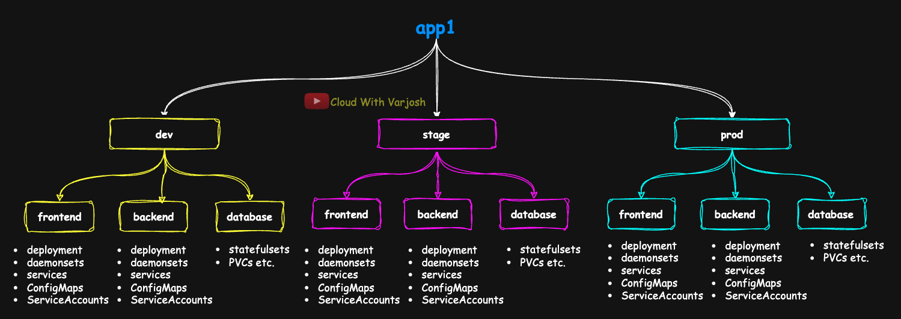

# 64 · Kustomize: One Base, Many Environments, No Templates

> **Level:** ★★ intermediate
>
> **You will learn:** the multi-environment YAML problem; Kustomize's **base + overlays** model; `kustomization.yaml` in bases vs overlays; built-in **transformers** (`namePrefix/Suffix`, `namespace`, `labels`, `commonAnnotations`, `images`, `replicas`) and **generators** (`configMapGenerator`, `secretGenerator`); **patches** (JSON 6902 and strategic merge, through the unified `patches:` field) and the deprecated `patchesJson6902`/`patchesStrategicMerge`; migration with `kustomize edit fix`; the order Kustomize applies things in; and Kustomize vs Helm.
>
> **You need:** topics 13 (YAML), 15 (declarative), 17 (labels/selectors), 25, 30–31.

---

## ⚡ Core: the 10-minute version

**The idea.** **Kustomize** (built into `kubectl`) manages one app across environments **without templates**:
- keep a **base** of plain YAML shared by every environment;
- add an **overlay** per environment that changes only what differs: name prefix, namespace, labels, image tag, replica count, or a **patch** for anything deeper;
- run `kubectl apply -k <overlay>` to build and apply.

**Picture it.** One master recipe, plus a sticky note per kitchen ("dev: half portions").

**The one thing to know.**

```yaml
# overlays/dev/kustomization.yaml
apiVersion: kustomize.config.k8s.io/v1beta1
kind: Kustomization
resources: [../../base]
namespace: dev
nameSuffix: -dev
images: [ { name: nginx, newTag: "1.27" } ]
replicas: [ { name: web, count: 2 } ]
patches:
- target: { kind: Deployment, name: web }
  patch: |-
    - op: add
      path: /spec/template/spec/containers/0/env
      value: [ { name: LOG_LEVEL, value: debug } ]
```

**Try it now:**
1. Build `base/` (a Deployment plus a Service) and the dev overlay.
2. Run `kubectl kustomize overlays/dev` to see the result, then `kubectl apply -k overlays/dev`.
3. Add a prod overlay with 5 replicas.

**You've got it if you can:** explain base vs overlay, and when you'd need a patch instead of a built-in field.

> 📖 **That's the core.** On a first pass, do the mini-lab and move on to the next topic. Everything below is the **full reference**: come back for the details, the edge cases, interview answers and exam-level depth.

---

## What it is

**Kustomize** is a **declarative configuration-management tool** for Kubernetes that customises **plain, template-free YAML** for different environments. You keep:
1. a **base**: the manifests shared by every environment (**what stays the same**);
2. **overlays**: small per-environment instructions (**what changes**): rename, set namespace, add labels, change image tags or replicas, patch nested fields.

Kustomize combines them into final manifests. It's **built into kubectl** (`kubectl kustomize`, `kubectl apply -k`, since v1.14) and also available as a standalone `kustomize` binary (usually newer).

**Kustomize is not a templating tool**: there are no variables, functions or `{{ }}` syntax as in Helm. Your files remain valid Kubernetes YAML; overlays are declarative edits on top.

---

## Why it exists

### The problem



Application **app1** runs in **dev**, **stage** and **prod**, each with **frontend, backend and data** tiers. Each tier has ~5–6 objects (Deployments, StatefulSets, DaemonSets, Services, ConfigMaps, PVCs, ServiceAccounts): ~**15 per environment**, ~**45 for one app**, and real apps have many microservices per tier.

Environments differ in small ways. With nginx, for example: dev may test a newer `nginx:1.22` (or `latest`), while stage and prod run a vetted `nginx:1.20`, the same in both for consistency, just as you'd test a new OS version in dev before prod.

Now you want to:
- add **labels** for observability/compliance;
- add **annotations** (cost tracking, security posture);
- change **image versions** (patch release, rollback, CVE fix);
- change **naming** conventions;
- adjust **replicas** or **resource limits**.

Doing that by hand across dozens of copied YAMLs is slow and **error-prone**, and copies drift apart.

**What we want:** one **shared base** for the common structure, plus **overlays** that change only what's different. Better maintainability, consistency and safety. The Kubernetes community built Kustomize for exactly this, rather than relying on external templating.

---

## Analogy

The base is a **master recipe**. Each overlay is a **sticky note** for one kitchen: "dev kitchen: half portions, use the new spice blend"; "prod kitchen: five batches, label every box 'prod'". The recipe is never rewritten; each kitchen reads recipe + sticky note and cooks its version. Helm, by contrast, is a **recipe with blanks** ("add ___ grams of salt") that you fill in from a values card.

---

## How it works inside

### `kustomization.yaml`

The **entry point** and blueprint: what to include and how to transform it. **Every directory Kustomize builds must contain one**, named exactly **`kustomization.yaml`** (`kustomization.yml` and `Kustomization` are also accepted by current versions, but `Kustomization.yaml`, misspellings like `customization.yaml`, or `.yamll` aren't), otherwise:

```
Error: no kustomization file found in the current directory
```

> ℹ️ **Note:** the notes say "Files like **`kustomization.yml`** … will **not work**". Kustomize recognises three names: `kustomization.yaml`, `kustomization.yml` and `Kustomization`. `kustomization.yaml` is the convention, so stick to it.

**In `base/`**: lists raw manifests in `resources:`; **no** environment-specific values.

```yaml
apiVersion: kustomize.config.k8s.io/v1beta1
kind: Kustomization
resources:
  - deploy.yaml
  - svc.yaml
```

**In an overlay** (`overlays/dev/`): points at the base with `resources: - ../../base` and adds customisations (prefix/suffix, namespace, replicas, image tags, patches).

```yaml
apiVersion: kustomize.config.k8s.io/v1beta1
kind: Kustomization
resources:
  - ../../base          # relative path: up two levels, into base/
nameSuffix: -dev
```

**Why the separation:** **reusability** (one base for dev, QA, staging, prod), **clarity** (overlays show only differences), **maintainability** (less duplication and drift; global fixes in one place).

**Are `base/` and `overlays/` mandatory?** No: just a widely used **convention**. Kustomize only needs a `kustomization.yaml` per directory and correct relative paths. `shared-resources/` + `env-configs/dev/` works just as well.

`resources:` can list files, directories (with their own `kustomization.yaml`), or even remote Git URLs (`github.com/org/repo//path?ref=v1.2.0`).

### Recommended structure and flow

```
kustomize-demo/
├── base/
│   ├── deployment.yaml
│   ├── service.yaml
│   └── kustomization.yaml
└── overlays/
    ├── dev/kustomization.yaml
    ├── staging/kustomization.yaml
    └── prod/kustomization.yaml
```

```
       [ base manifests + base/kustomization.yaml ]
                         │
        ┌────────────────┼────────────────┐
        ▼                ▼                ▼
  overlays/dev    overlays/staging   overlays/prod
        │                │                │
        ▼                ▼                ▼
  final dev YAML  final stage YAML  final prod YAML
```

Each overlay's `kustomization.yaml` brings together the shared base, environment **transformers** and **patches**. With the unified `patches:` field, small patches can live **inline** in the overlay's `kustomization.yaml`, so no separate `patch-*.yaml` files are required (though you can use them).

The nginx example:

| Environment | Image | Replicas | Label |
|---|---|---|---|
| Dev | `nginx:1.22` | 2 | `env: dev` |
| Staging | `nginx:1.20` | 3 | `env: staging` |
| Production | `nginx:1.20` | 5 | `env: prod` |

### Transformers

**Transformers** are built-in directives that change well-known fields across all resources, without editing the base:

| Field | Effect |
|---|---|
| `namePrefix` / `nameSuffix` | `nginx-deploy` → `app1-nginx-deploy-dev`; **references are updated too** (e.g. a Deployment's `configMapRef`) |
| `namespace` | Sets `metadata.namespace` on every namespaced resource (and fixes RoleBinding subjects etc.) |
| `labels` | Adds labels; with `includeSelectors: true` also to selectors and Pod templates |
| `commonLabels` | **Deprecated**: always adds to selectors too (dangerous: selectors are immutable). Use `labels` |
| `commonAnnotations` | Adds annotations everywhere |
| `images` | Changes image name/tag/**digest** for containers whose image **name** matches |
| `replicas` | Sets `spec.replicas` of named Deployments/StatefulSets/ReplicaSets |
| `resources` | (Not a transformer strictly: the list of inputs) |

Full list: the Kustomize built-ins reference.

### Generators (not in Day 42, essential in practice)

```yaml
configMapGenerator:
- name: app-config
  literals: [LOG_LEVEL=debug]
  files: [app.properties]
secretGenerator:
- name: db-creds
  envs: [db.env]                 # never commit real secrets (topic 63)
```

Generated names get a **content hash suffix** (`app-config-7h2k9f`), and references in Deployments are rewritten to match, so **changing the config changes the Pod template** and triggers a **rolling update** automatically (topic 34's "ConfigMap changes don't restart Pods" problem, solved).

### When transformers fall short → patches

Transformers only touch specific well-known fields. They **can't**:
- add or change a container's `resources` block;
- change `containerPort` or add ports;
- **remove** a field or label from the base;
- inject `env` variables into containers (beyond limited generator use);
- add volume mounts or change probes;
- change arbitrary nested fields under `spec.template.spec`.

**Patches** make **precise, field-level** changes anywhere. Use **transformers and patches together**: transformers for namespace/labels/images; patches for env vars or a fixed nodePort.

> ℹ️ **Note:** a note in Demo 2 says "for deeply nested values (**e.g., replicas**, resource limits), use patches". Replicas has its own **`replicas` transformer** (used in that very demo); resource limits do need a patch.

**Kinds of patches:**

| Field | Format | When |
|---|---|---|
| **`patches:`** (current, unified) | A **JSON 6902** op list **or** a **strategic-merge** partial manifest, **inline or in a file**, optional `target:` selector | All new work |
| `patchesJson6902:` | JSON 6902 ops in a file, with a `target` | ⚠️ Deprecated (Kustomize v5) |
| `patchesStrategicMerge:` | Partial manifests in files | ⚠️ Deprecated (Kustomize v5) |

> ℹ️ **Note:** Day 42 says `patches` "**follows RFC 6902**" / "uses RFC 6902 under the hood". Since Kustomize v5, `patches:` accepts **both** formats: if the patch is a list of `op/path/value` operations it's a **JSON Patch (RFC 6902)**; if it looks like a (partial) Kubernetes object, it's a **strategic-merge patch**. Day 42's own Demo 5 migration shows this (`patches: - path: patch-container.yaml` containing a partial Deployment).

**JSON Patch operations (RFC 6902):**

| `op` | Meaning |
|---|---|
| `add` | Add a field or array element (`/-` appends to an array) |
| `replace` | Replace an **existing** value |
| `remove` | Delete a field or element |
| `copy` / `move` | Copy/move a value between paths |
| `test` | Check a value first (rare) |

`add`, `replace` and `remove` cover almost everything. Paths are JSON Pointers: `/spec/template/spec/containers/0/env` (index `0` = first container; `~1` encodes a `/` inside a key, e.g. an annotation `example.com/team` → `/metadata/annotations/example.com~1team`).

**Strategic merge** understands Kubernetes **merge keys**: lists of containers are merged **by `name`**, env vars by `name`, ports by `containerPort`, so a partial Deployment with `containers: [{name: nginx, env: [...]}]` adds env to the `nginx` container rather than replacing the whole list. It only works for types whose schema Kustomize knows (built-ins; CRDs need extra schema), which is why JSON Patch exists.

### Order of operations

`kubectl kustomize` loads resources (recursively building bases), runs **generators**, then the built-in **transformers in a fixed internal order**. That order isn't clearly documented, and you can control it yourself by listing transformers explicitly in the `transformers:` field. In current Kustomize, patches are generally applied early (before name prefixes/suffixes), and the `images` transformer later.

Consequences:
- Patch `target`s use the **base names** (`nginx-deploy`), not the prefixed names.
- The **`images` transformer typically runs after patches**, so it can rewrite any container whose image **name** is `nginx`, even one a patch just changed.

> ✅ **Correct today** ([C1](#c1)): patches don't simply "take precedence". Both touch the same field, and the result depends on which runs last. In current Kustomize the `images` transformer usually runs after patches. It matches the image *name* `nginx` and retags it, so the output is most likely **`nginx:latest`**, not `1.22`. Don't rely on either memory of the order: run `kubectl kustomize overlays/dev | grep image:` and **look**. Better still, don't set the same field in two places. If you want a different tag in one overlay, change only the `images:` entry.

---

## Commands / YAML

### Installing

Already in kubectl (`kubectl version --client` shows the bundled Kustomize version). For the newest standalone binary, see the "binaries" section of the official install page, or:

```bash
curl -s "https://raw.githubusercontent.com/kubernetes-sigs/kustomize/master/hack/install_kustomize.sh" | bash
```

(Read scripts before piping them to bash; the script puts `kustomize` in the current directory.)

### Commands

Kustomize works on **directories**. Point it at a directory containing `kustomization.yaml`, or run it inside one:

```bash
kubectl kustomize overlays/dev            # render only (print YAML)
cd overlays/dev && kubectl kustomize .     # same, from inside
kubectl apply -k overlays/dev              # render + apply
kubectl diff -k overlays/dev               # what would change in the cluster
kubectl delete -k overlays/dev
kustomize build overlays/dev | kubectl apply -f -     # standalone binary
```

`-k` treats the path as a Kustomize directory; `-f` expects files/raw YAML, so don't use `-f` here. Running in a directory **without** `kustomization.yaml` → `Error: no kustomization file found in directory …`.

### Demo 1: base + `nameSuffix` (`Day 42/demo1/`)

**Step 1: layout**

```
demo1/
├── base/        deploy.yaml  svc.yaml  kustomization.yaml
└── overlays/
    ├── dev/kustomization.yaml
    ├── stage/kustomization.yaml
    └── prod/kustomization.yaml
```

**Step 2: base**

```yaml
# base/deploy.yaml
apiVersion: apps/v1
kind: Deployment
metadata:
  name: nginx-deploy
  labels: { app: nginx }
spec:
  replicas: 2
  selector: { matchLabels: { app: nginx } }
  template:
    metadata: { labels: { app: nginx } }
    spec:
      containers:
        - name: nginx
          image: nginx
          ports: [{ containerPort: 80 }]
---
# base/svc.yaml
apiVersion: v1
kind: Service
metadata: { name: nginx-svc }
spec:
  type: NodePort
  selector: { app: nginx }
  ports: [{ port: 80, targetPort: 80 }]
```

```yaml
# base/kustomization.yaml
apiVersion: kustomize.config.k8s.io/v1beta1
kind: Kustomization
resources:
  - deploy.yaml
  - svc.yaml
```

> ✅ **Correct today** ([C2](#c2)): the `Kustomization` kind is **`kustomize.config.k8s.io/v1beta1`** (as in every other file in the repo). (`v1alpha1` is used only for `Component`.)

The base: a 2-replica `nginx-deploy` and a NodePort `nginx-svc`. You can list any number of resources; overlays transform what they match, and everything else passes through unchanged.

**Step 3: overlays**

```yaml
# overlays/dev/kustomization.yaml   (stage: -stage, prod: -prod)
apiVersion: kustomize.config.k8s.io/v1beta1
kind: Kustomization
resources:
  - ../../base
nameSuffix: -dev
```

`nameSuffix` appends `-dev` to every resource name (`nginx-deploy-dev`, `nginx-svc-dev`), avoiding collisions when environments share a cluster/namespace.

**Step 4: render**

```bash
kubectl kustomize "Day 42/demo1/base"
kubectl kustomize "Day 42/demo1/overlays/dev"
```

```yaml
apiVersion: v1
kind: Service
metadata:
  name: nginx-svc-dev
…
---
apiVersion: apps/v1
kind: Deployment
metadata:
  labels:
    app: nginx
  name: nginx-deploy-dev
…
```

Only names changed; replicas, image and ports stay as in the base. (Kustomize sorts output: Services before Deployments, namespaces first, etc.)

**Step 5: namespaces and apply**

```bash
kubectl create namespace dev; kubectl create namespace stage; kubectl create namespace prod
kubectl apply -k "Day 42/demo1/overlays/dev"   -n dev
kubectl apply -k "Day 42/demo1/overlays/stage" -n stage
kubectl apply -k "Day 42/demo1/overlays/prod"  -n prod
```

**Learned:** the base is reusable and environment-agnostic; overlays add environment changes; `nameSuffix` separates workloads; Kustomize reads `kustomization.yaml` files recursively.

### Demo 2: more transformers (`Day 42/demo2/`)

**Step 1: `overlays/dev/kustomization.yaml`**

```yaml
apiVersion: kustomize.config.k8s.io/v1beta1
kind: Kustomization
resources:
  - ../../base
namePrefix: app1-
nameSuffix: -dev
namespace: dev
labels:
  - pairs:
      env: dev
    includeSelectors: true
commonAnnotations:
  branch: dev
  support: 800-800-700
images:
  - name: nginx              # match containers whose image NAME is nginx
    newName: nginx           # (could switch registry, e.g. registry.example.com/nginx)
    newTag: "latest"         # or digest: sha256:…
replicas:
  - name: nginx-deploy       # the BASE name
    count: 2
```

**Step 2: field by field**
- `resources: ../../base`: load the base; base changes flow into every overlay.
- `namePrefix: app1-` + `nameSuffix: -dev`: `nginx-deploy` → `app1-nginx-deploy-dev`.
- `namespace: dev`: every resource goes to `dev`; no `-n dev` needed when applying.
- `labels` with `includeSelectors: true`: adds `env=dev` to metadata **and** to selectors/Pod templates, keeping Deployment selector and Pod labels consistent. (Changing selectors of an **existing** Deployment fails, since selectors are immutable; decide labels before first deploy, or use `includeSelectors: false` for purely informational labels.)
- `commonAnnotations`: e.g. Git branch, support contact.
- `images`: pins nginx to `latest` for dev testing (fine for a demo; prefer real versions even in dev, see the "real-world consideration" below).
- `replicas`: the **ReplicaCountTransformer** sets `spec.replicas` on `nginx-deploy` (dev 2, prod 5), no patch file needed.

**Step 3: stage and prod**: `env: stage`/`namespace: stage`/`-stage`/`newTag: "1.20"`; `env: prod`/`namespace: prod`/`-prod`/`newTag: "1.20"`. (`nginx:1.20` and `1.22` are long out of support; use current tags in practice.)

**Step 4: verify**

```bash
kubectl kustomize "Day 42/demo2/overlays/dev"
```

```yaml
apiVersion: apps/v1
kind: Deployment
metadata:
  annotations:
    branch: dev
    support: 800-800-700
  labels:
    app: nginx
    env: dev
  name: app1-nginx-deploy-dev
  namespace: dev
spec:
  replicas: 2
  selector:
    matchLabels:
      app: nginx
      env: dev
  template:
    metadata:
      annotations:
        branch: dev
        support: 800-800-700
      labels:
        app: nginx
        env: dev
    spec:
      containers:
      - image: nginx:latest
        name: nginx
        ports:
        - containerPort: 80
```

(Day 42's sample output shows `support: 800-800`, from the later demos' overlay; with this overlay it's `800-800-700`.)

**Step 5: apply**

```bash
kubectl apply -k "Day 42/demo2/overlays/dev"
```

```
service/app1-nginx-svc-dev created
deployment.apps/app1-nginx-deploy-dev created
```

No `-n` needed. **Notes:** prefer `labels` over the deprecated `commonLabels`; transformers give central, declarative control; deep changes need patches.

### Demo 3: inline `patches` (`Day 42/demo3_patches/`)

Same base, except `deploy.yaml` has an extra label `unused: removeit` (to demonstrate `remove`). The Service has no fixed `nodePort` (random from 30000–32767).

```yaml
# overlays/dev/kustomization.yaml (transformers as Demo 2, plus:)
patches:
  - target:                         # which object(s) to patch (base names)
      group: apps
      version: v1
      kind: Deployment
      name: nginx-deploy
    patch: |-
      - op: add
        path: /spec/template/spec/containers/0/env
        value:
          - name: LOG_LEVEL
            value: debug
      - op: add                        # Day 42 used 'replace' here (see below)
        path: /spec/template/spec/containers/0/resources
        value:
          requests: { cpu: "100m", memory: "128Mi" }
          limits:   { cpu: "500m", memory: "256Mi" }
      - op: remove
        path: /metadata/labels/unused
  - target:
      version: v1
      kind: Service
      name: nginx-svc
    patch: |-
      - op: replace
        path: /spec/ports/0/nodePort
        value: 31000
```

What it does:
- **Env var** `LOG_LEVEL=debug` for development/debugging.
- **Resource requests/limits** (topic 41).
- **Removes** `metadata.labels.unused` from the base.
- **Fixes the nodePort** at 31000 for firewall rules/reverse proxies that need a stable port.

**`replace` vs `add`:** the base has **no `resources`** block, and Day 42's file uses `replace`. RFC 6902 says `replace` requires the target to **exist**. Depending on the Kustomize version this either fails (`replace operation does not apply: doc is missing key`) or happens to work. **Use `add` for new fields** (`add` on an existing key also overwrites it). The same goes for the Service patch: there's no `nodePort` in the base, so `add` is the safe choice there too. And `remove` fails if the path doesn't exist, which is why the demo base has the `unused` label.

The repo's `demo3_patches/overlays/dev/kustomization.yaml` contains only the Deployment patch (not the Service nodePort one).

### Demo 4: `patchesJson6902` (deprecated) (`Day 42/demo4_patchesjson/`)

The original style: JSON Patch in a separate file.

```yaml
# overlays/dev/kustomization.yaml (old form, as in the README)
patchesJson6902:
  - target:
      group: apps
      version: v1
      kind: Deployment
      name: nginx-deploy
    path: patch-container.yaml
```

```yaml
# overlays/dev/patch-container.yaml
- op: replace
  path: /spec/template/spec/containers/0/image
  value: nginx:1.22
- op: add
  path: /spec/template/spec/containers/0/env
  value:
    - name: LOG_LEVEL
      value: debug
```

The repo file already shows the **migrated** form produced by `kustomize edit fix`:

```yaml
patches:
- path: patch-container.yaml
  target:
    group: apps
    kind: Deployment
    name: nginx-deploy
    version: v1
```

(For the image-tag result, see the order-of-operations correction above: render and check.)

**Migrating:** run inside the overlay directory:

```bash
cd overlays/dev && kustomize edit fix
```

It converts `patchesJson6902` (and `patchesStrategicMerge`, `commonLabels`→`labels`, `bases`→`resources`, `vars`→`replacements` where possible) to the current syntax, keeping the patch's intent. Commit the result in version control so the change is reviewable.

**Why it was popular:** patch logic separate from `kustomization.yaml`, clearer Git audit trail when teams work in parallel, reusable patch files, clean structure for big GitOps repos. (All still possible with `patches: - path: …`.)

**Real-world consideration:** it's a myth that dev always uses `latest`. Teams pin versions like `1.22` in dev to reproduce issues, run regression tests, validate behaviour and check backward compatibility.

### Demo 5: `patchesStrategicMerge` (deprecated) (`Day 42/demo5_patchesmerge/`)

The original Kustomize patch style: write a **partial manifest** containing only what you want to change.

```yaml
# overlays/dev/kustomization.yaml (old form)
patchesStrategicMerge:
  - patch-container.yaml
```

```yaml
# overlays/dev/patch-container.yaml
apiVersion: apps/v1
kind: Deployment
metadata:
  name: nginx-deploy               # identifies the target (base name)
spec:
  template:
    spec:
      containers:
        - name: nginx              # merge key: modifies the container named nginx
          env:
            - name: LOG_LEVEL
              value: debug
          resources:
            requests: { cpu: "100m", memory: "128Mi" }
            limits:   { cpu: "500m", memory: "256Mi" }
```

Adds `LOG_LEVEL=debug` and explicit requests/limits to the `nginx` container. The repo file shows the migrated form (`patches: - path: patch-container.yaml`, no target needed: the patch names its own target).

**Why learn it:** still common in production codebases; easy to write (familiar YAML); you must recognise and migrate it. Kustomize still processes it with deprecation warnings.

> ℹ️ **Note:** the original notes said "Strategic merge… has been officially deprecated in favor of… JSON-based patching" and "lacks flexibility". **Now:** only the **field name** `patchesStrategicMerge:` is deprecated. **Strategic-merge patches themselves are fully supported** and very common, via `patches:`. The real limits: they need schema knowledge (built-in kinds; CRDs need extra configuration) and can't easily **delete** list items (use `$patch: delete` or a JSON patch).

**Final comparison:**

| Use case | Method | Demo | Status |
|---|---|---|---|
| Inline or file patches, JSON or strategic merge | `patches:` | 3 | ✅ Preferred |
| File-based JSON 6902 | `patchesJson6902:` | 4 | ⚠️ Deprecated field (convert with `edit fix`) |
| Partial-manifest overrides | `patchesStrategicMerge:` | 5 | ⚠️ Deprecated field (content still valid under `patches:`) |

### Kustomize vs Helm

- **Patching vs templating**: Kustomize patches plain YAML; Helm renders Go templates with values.
- **Overlay tool vs package manager**: Helm packages versioned **charts** you can install from repositories; Kustomize customises YAML you own.
- **Release tracking**: Helm records **releases** (history, `helm rollback`); Kustomize doesn't (GitOps tools fill that gap; topic 68).
- **Native**: Kustomize is built into kubectl; Helm is a separate CLI.
- **Complexity**: Helm has hooks, tests, dependencies, conditionals; Kustomize is simpler.

| Feature | Kustomize | Helm |
|---|---|---|
| Built into `kubectl` | Yes | No (separate binary) |
| Template language | No | Yes (Go templates + Sprig functions) |
| Values/variables | No (only structured transformers, `replacements`) | Yes (`values.yaml`, `--set`) |
| Overlays | Yes (base + overlays) | Indirect (values files per environment) |
| Learning curve | Low | Medium–high |
| Packaging/versioned distribution | No | Yes (charts, OCI registries) |
| Logic/conditionals/loops | No | Yes |
| Hooks, tests, rollbacks | No | Yes |
| Reuse | Moderate (bases, components, remote bases) | High (charts, subcharts, libraries) |
| Best fit | Your own apps, environment differences | Distributing/consuming apps, complex parameterisation |

**Key point:** Kustomize for straightforward environment differences with no new syntax; Helm for rich templating, packaging and reuse, especially third-party software distributed as charts. **They combine well:** Kustomize can render a Helm chart (`helmCharts:` with `--enable-helm`) and then patch it; Argo CD and Flux support both. Kustomize comes first in this course because it's native, pure YAML, and a gentle step before Helm (topic 65).

---

## Hands-on lab

1. Render and apply all of `Day 42/demo1` to `dev`, `stage`, `prod`; list with `kubectl get deploy,svc -A | grep nginx`.
2. Demo 2: add stage/prod overlays with `1.20`-style differences (use current tags); `kubectl diff -k` before applying a change.
3. Demo 3: render; change `replace`→`add` and back and see what your Kustomize version does; then remove the `unused` label from the base and watch `remove` fail.
4. Demo 4: render and **check which image tag wins**; then make the overlay set its tag only via `images:`.
5. Demo 5: copy the old-style overlay, run `kustomize edit fix`, and `git diff` the result.
6. Add a `configMapGenerator` to the dev overlay, mount it as env (`envFrom`), change a literal and re-apply: see the hash-suffixed name change and a rollout happen.
7. Clean up: `kubectl delete -k` each overlay; `kubectl delete ns dev stage prod`.

---

## Where you'll use it

- **Your own services' manifests** across environments and clusters.
- **GitOps repos** (Argo CD/Flux render Kustomize natively; topic 68).
- **Patching third-party YAML** (e.g. an upstream operator's install manifests) without forking it.
- **CKA**: `kubectl apply -k`, simple kustomizations, recognising patches.

---

## When it breaks

| Symptom | Cause | Fix |
|---|---|---|
| `no kustomization file found` | Wrong directory or filename | Point at the folder with `kustomization.yaml` |
| `accumulating resources: … must resolve to a file` | Wrong relative path in `resources:` | Fix `../../base` |
| `apply` fails: `field is immutable` on a Deployment selector | `labels`/`commonLabels` with selectors added to an existing Deployment | `includeSelectors: false`, or recreate the Deployment |
| Patch silently not applied | `target` doesn't match (name/kind/group/version), or used the prefixed name | Target base names; check `kubectl kustomize` output |
| `replace operation does not apply: doc is missing key` | `replace` on a missing field | Use `add` |
| `remove operation does not apply` | Field absent | Check the base, or drop the op |
| Unexpected image tag | `images:` transformer and a patch both set it | Set images in one place |
| Deprecation warnings | Old fields (`patchesStrategicMerge`, `commonLabels`, `bases`, `vars`) | `kustomize edit fix` |
| `kubectl kustomize` and `kustomize build` differ | kubectl bundles an older Kustomize | Use one tool consistently |

---

## Quick recap

- Kustomize = **base + overlays**, plain YAML, no templates; built into kubectl (`kubectl kustomize`, `apply -k`, `diff -k`).
- Every build directory needs a **`kustomization.yaml`** (`kustomize.config.k8s.io/v1beta1`).
- **Transformers**: `namePrefix/Suffix`, `namespace`, `labels` (not `commonLabels`), `commonAnnotations`, `images`, `replicas`; **generators** give hashed ConfigMap/Secret names that trigger rollouts.
- **`patches:`** handles JSON 6902 ops and strategic-merge partials, inline or in files; `patchesJson6902`/`patchesStrategicMerge` fields are deprecated → `kustomize edit fix`. Prefer `add` for new fields.
- Patches run before most transformers (target base names; `images` applies afterwards). Always render and inspect.
- Kustomize for your own environment differences; Helm for packaged, parameterised apps; they combine.

### Interview questions

1. **Q: How does Kustomize differ from Helm?**
   A: Kustomize customises plain YAML through bases, overlays, transformers and patches, with no templating or release tracking, and is built into kubectl. Helm is a package manager that renders Go templates from values, versions charts, and tracks releases with history, hooks and rollbacks.
2. **Q: How would you change a container's resource limits only in production with Kustomize?**
   A: In the prod overlay add a patch (strategic merge partial Deployment naming the container, or a JSON 6902 `add` on `/spec/template/spec/containers/0/resources`) targeting the base Deployment name.
3. **Q: Why do Kustomize-generated ConfigMaps have a hash suffix?**
   A: The hash changes whenever the content changes, and Kustomize updates references, so the Pod template changes and the Deployment rolls out new Pods that pick up the new config. Old ConfigMaps remain for rollback.

---

## Appendix: notes on the original course material

This topic was rebuilt from the original CKA course notes. This appendix keeps the audit trail out of your way while you learn.

### Sources

Day 42 (introduction; why Kustomize, the problem, what if you want to…, what we want, real-world perspective; enter Kustomize; what it is; the nginx example; recommended folder structure; flow diagram; Helm vs Kustomize and the feature comparison, why Kustomize first; installing; understanding `kustomization.yaml` in base and overlays, why the separation matters, are `base/` and `overlays/` mandatory; demo 1 nameSuffix steps 1–5; demo 2 additional transformers steps 1–5 and notes; commands must run where `kustomization.yaml` is; what transformers are; when transformers fall short; enter patching; categories of patches; demo 3 `patches`, replace vs add; demo 4 `patchesJson6902`; demo 5 `patchesStrategicMerge`; migration; real-world consideration on `latest`; final comparison; conclusion; references), files `Day 42/demo1/…`, `demo2/…`, `demo3_patches/…`, `demo4_patchesjson/…`, `demo5_patchesmerge/…`.

### Corrections to the original notes

Each entry shows what the original said and what's true now. In the topic above, each correction appears as a ✅ **Correct today** line or a ⚠️ **Fix to the original** box, linked to its entry here.

<a id="c1"></a>**C1 · Corrected (Day 42, Demo 4).** "Since patches are applied **after** transformers… the final rendered manifest will use **`nginx:1.22`**" and "patches **always take precedence** over transformers". **Now:** patches don't simply "take precedence". Both touch the same field, and the result depends on which runs last. In current Kustomize the `images` transformer usually runs after patches. It matches the image *name* `nginx` and retags it, so the output is most likely **`nginx:latest`**, not `1.22`. Don't rely on either memory of the order: run `kubectl kustomize overlays/dev | grep image:` and **look**. Better still, don't set the same field in two places. If you want a different tag in one overlay, change only the `images:` entry.

<a id="c2"></a>**C2 · Corrected (Day 42).** the README's `base/kustomization.yaml` uses `apiVersion: kustomize.config.k8s.io/v1`. **Now:** the `Kustomization` kind is **`kustomize.config.k8s.io/v1beta1`** (as in every other file in the repo). (`v1alpha1` is used only for `Component`.)
