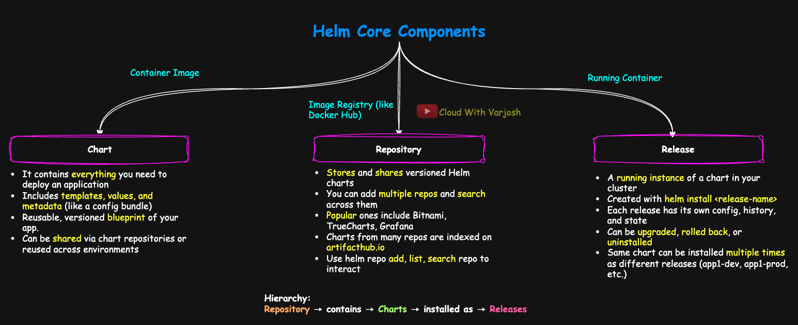
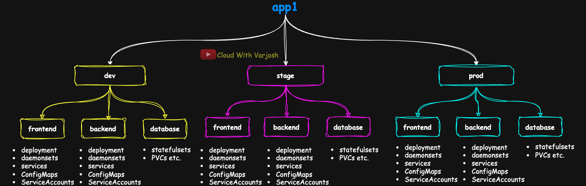

# 65 · Helm: The Package Manager for Kubernetes

> **Level:** ★★ intermediate
>
> **You will learn:** why Helm exists beyond Kustomize; the core concepts **chart**, **repository** (and OCI registries, Artifact Hub) and **release** with revisions; how Helm talks to the cluster and where it stores release state; chart structure; templating with built-in objects (`.Values`, `.Release`, `.Chart`, `.Capabilities`), helpers and control flow; verifying (`lint`, `template`, `--dry-run`); install/upgrade/rollback/uninstall; values precedence (`values.yaml`, `-f`, `--set`, `--reuse-values`); multi-environment releases; hooks and tests; and the pitfalls.
>
> **You need:** topics 12 (kubeconfig/contexts), 25, 26, 30–31, 64.

---

## ⚡ Core: the 10-minute version

**The idea.** **Helm** is Kubernetes' package manager. A **chart** packages templated YAML plus default `values.yaml`. Installing a chart creates a **release** (a named instance). Every upgrade or rollback adds a numbered **revision**, so you can roll back. Charts come from repositories or OCI registries, and Artifact Hub helps you find them. Pass your own values with `-f` or `--set`, and **always pass the same values files on upgrades**.

**Picture it.** A chart is like an app-store package; a release is the app installed on your phone; revisions are its update history.

**The one thing to know.**

```bash
helm create mychart                                    # scaffold a chart
helm install web ./mychart -n dev --create-namespace -f values-dev.yaml
helm upgrade web ./mychart -n dev -f values-dev.yaml --set image.tag=1.27
helm history web -n dev
helm rollback web 1 -n dev
helm uninstall web -n dev
```

**Try it now:**
1. Scaffold a chart and install it.
2. Upgrade it twice and roll back.
3. Look at `kubectl get secrets -n dev -l owner=helm`: that's where Helm stores each revision.

**You've got it if you can:** explain chart vs release vs revision, and how rollback works.

> 📖 **That's the core.** On a first pass, do the mini-lab and move on to the next topic. Everything below is the **full reference**: come back for the details, the edge cases, interview answers and exam-level depth.

---

## What it is

**Helm is a package manager for Kubernetes applications**. Like `apt`/`dnf` on Linux, Homebrew on macOS or Chocolatey on Windows, it **installs, upgrades, rolls back, uninstalls and distributes** software, here as Kubernetes resources. You can deploy your own apps, third-party tools (Prometheus, Grafana, cert-manager, ingress controllers), and operators/controllers.

Three core concepts:



1. **Chart**: a Helm **package**: templates for Kubernetes resources + default values (`values.yaml`) + metadata (`Chart.yaml`) + optional helpers, tests and dependencies. A reusable, versioned **blueprint**.
2. **Repository**: where charts are stored and shared, like an APT repository. Popular ones: **Bitnami**, **Grafana**, **Jetstack** (cert-manager), **prometheus-community**, **Stakater**, **TrueCharts**. Modern charts are also published to **OCI registries** (the same registries that store images: `oci://ghcr.io/…`, ECR, Harbor). **[Artifact Hub](https://artifacthub.io)** aggregates charts from hundreds of repositories into one search interface.
3. **Release**: a **running instance** of a chart in a cluster, with a **name you choose**. Each install/upgrade/rollback creates a numbered **revision**.

**Hierarchy:** repository → contains → charts → installed as → releases.

---

## Why it exists

### The problem



As an app grows you manage StatefulSets, ConfigMaps, Secrets, Ingresses, PVCs, StorageClasses, NetworkPolicies, autoscalers and **custom resources** (cert-manager, Prometheus, Vault). For `app1` in dev/stage/prod with three tiers: **15–20 YAMLs per environment, 60+ in total**, and hundreds once other apps and tools are added. You need to:
- inject **dynamic values** (image tags, ports);
- **track what's deployed where**;
- **upgrade** without breaking things;
- **roll back** when something goes wrong;
- **package and distribute** the app in a repeatable format.

### Beyond Kustomize

Kustomize (topic 64) manages per-environment configuration of raw YAML, but **stops at configuration**: no packaging, versions, release tracking, rollbacks, distribution, loops/conditionals, or lifecycle hooks. Helm adds:
- 🔁 **templating** with Go templates (`if`, `range`, reusable helpers);
- 📦 **versioned packaging** (charts);
- 📜 **release tracking** and **rollback**;
- 🚀 **install, upgrade, delete** in one command;
- 🌍 **chart repositories** for internal/external distribution;
- 🔧 **hooks and tests** for lifecycle events.

**Why Helm must understand your app:** to Kubernetes, your app is just **independent objects**; it doesn't know they belong together. Helm groups them into a **chart**, and when installed tracks them as one **release**, so it can ✅ install all components together, 🔄 upgrade them, ⬅️ roll back, ❌ uninstall cleanly. That application-level awareness is what `kubectl apply -f` lacks.

**Real-world perspective:** with many microservices and infrastructure tools, platform teams ship apps as **versioned artifacts**; every deployment becomes a tracked, revertible, reproducible release:

```bash
helm install myapp ./my-chart
helm upgrade myapp ./my-chart --set image.tag=1.2.0
helm rollback myapp 1
```

---

## Analogy

Day 43's **Docker analogy**:

| Helm | Docker | Meaning |
|---|---|---|
| **Chart** | **Image** | Packaged, versioned definition |
| **Chart repository / OCI registry** | **Image registry** (Docker Hub, ECR) | Where packages are stored and shared |
| **Release** | **Running container** | A live, configured instance |

| Tool | Build | Publish | Run |
|---|---|---|---|
| Docker | `docker build` | `docker push` | `docker run` → container |
| Helm | `helm package` (optional) | `helm push` (OCI) or upload to a repo | `helm install` → release |

Docker flow: build `nginx:1.22`, push it, `docker run nginx:1.22`. Helm flow: create an nginx chart, publish it (e.g. Bitnami), `helm install my-nginx bitnami/nginx` → a **release**.

"If a chart is like an image, a release is like a running container, and as Docker pulls images from a registry, Helm pulls charts from a chart repository."

---

## How it works inside

### Installing and connecting

Install from the official guide (helm.sh/docs/intro/install), then:

```bash
helm version
```

```
version.BuildInfo{Version:"v3.18.3", GitCommit:"6838ebcf…", GitTreeState:"clean", GoVersion:"go1.24.4"}
```

(**Helm 4** was released in **November 2025**. The commands in this topic work the same in Helm 3 and 4. Helm 4 uses **server-side apply by default for new releases** (upgrades keep the previous release's apply method) and has a new plugin system. **Helm 3 reaches end of life in February 2027** (⚠️ *verify against the Helm project's version-support policy*), so plan to move to Helm 4.)

- **Helm 2** needed **Tiller**, an in-cluster server component with broad permissions (a security problem). **Helm 3+ has no Tiller**: the `helm` CLI talks to the API server directly, like kubectl.
- **Which cluster?** Helm uses your **current kubeconfig context** (topic 12), like kubectl. Override with `--kube-context` / `--kubeconfig` / `-n`.
- Your **RBAC** permissions apply: Helm can only create what **you** may create.

### What Helm does on install/upgrade

1. Loads the chart and **merges values** (chart defaults ← parent chart ← `-f` files in order ← `--set` flags; later wins).
2. **Renders templates** into plain YAML.
3. Sends the objects to the API server (create/patch), in a sensible order (Namespaces, CRDs, ServiceAccounts, … Deployments). Helm 3 uses a **three-way merge** (old manifest, new manifest, live state) for upgrades.
4. Stores the **release record** (rendered manifest, values, chart metadata, status) as a **Secret** of type `helm.sh/release.v1` named `sh.helm.release.v1.<release>.v<revision>` in the **release's namespace**.

```bash
kubectl get secrets -n dev -l owner=helm
```

```
NAME                             TYPE                 DATA   AGE
sh.helm.release.v1.app1-dev.v1   helm.sh/release.v1   1      5m
sh.helm.release.v1.app1-dev.v2   helm.sh/release.v1   1      1m
```

That's how `helm list`, `history` and `rollback` work: **rollback re-applies the manifest stored in an earlier revision**. Helm also labels resources `app.kubernetes.io/managed-by: Helm` and annotates them with `meta.helm.sh/release-name` and `-namespace`; it refuses to adopt existing objects without them.

### Chart structure

```bash
helm create my-chart
tree my-chart/
```

```
my-chart
├── Chart.yaml
├── charts/
├── templates/
│   ├── _helpers.tpl
│   ├── deployment.yaml
│   ├── hpa.yaml
│   ├── ingress.yaml
│   ├── NOTES.txt
│   ├── service.yaml
│   ├── serviceaccount.yaml
│   └── tests/
│       └── test-connection.yaml
└── values.yaml
```

(The repo's `Day 43/my-chart/` is this scaffold.)

| File | Purpose | Required? |
|---|---|---|
| `Chart.yaml` | Metadata: `apiVersion: v2`, name, **`version`** (the chart's version, SemVer), **`appVersion`** (the app's version, informational), description, type, dependencies | **Yes** |
| `values.yaml` | Default configuration values for the templates | Optional (strongly recommended) |
| `templates/` | Go-templated Kubernetes manifests | Optional (a chart can be empty or only have dependencies) |
| `charts/` | Dependencies (subcharts), downloaded via `helm dependency update` | Optional |
| `templates/_helpers.tpl` | Named template snippets (files starting with `_` aren't rendered as manifests) | Optional |
| `templates/NOTES.txt` | Message printed after install (URLs, how to get a password) | Optional |
| `templates/tests/` | Test Pods run by `helm test` | Optional |
| `values.schema.json` | JSON Schema validating values | Optional |
| `crds/` | CRDs installed before templates (never upgraded/deleted by Helm) | Optional |

> ✅ **Correct today** ([C1](#c1)): only **`Chart.yaml`** is required. `values.yaml` and `templates/` are conventional (and `helm create` makes them), but a chart without values, or an "umbrella" chart that only has dependencies, is valid. Day 43 also compares `values.yaml` to `kustomization.yaml`; the closer comparison is a Kustomize **overlay**: it holds the per-installation differences.

### Templating

`{{ … }}` means "evaluate this expression". The leading `.` is the current **context** (the top-level object at the start). Built-in objects:

| Object | Fields | Notes |
|---|---|---|
| `.Values` | Whatever you define: `.Values.replicaCount`, `.Values.image.repository` | **You** control these (camelCase by convention) |
| `.Release` | `.Name`, `.Namespace`, `.Revision`, `.IsInstall`, `.IsUpgrade`, `.Service` | Built-ins are PascalCase |
| `.Chart` | `.Name`, `.Version`, `.AppVersion` | From `Chart.yaml` |
| `.Capabilities` | `.KubeVersion.Version`, `.APIVersions.Has "apps/v1"` | Adapt to the cluster |
| `.Files`, `.Template` | Read non-template files; current template name | |

```yaml
metadata:
  name: {{ .Release.Name }}-nginx-deploy
```

With release `app1-dev`, this renders `name: app1-dev-nginx-deploy`.

> ✅ **Correct today** ([C2](#c2)): `{{ .Release.Name }}` inserts the **whole** release name, so it renders **`app1-dev-nginx-deploy`**.

**Beyond Day 43, the template language you'll meet in real charts:**

```yaml
# _helpers.tpl
{{- define "app1.labels" -}}
app.kubernetes.io/name: {{ .Chart.Name }}
app.kubernetes.io/instance: {{ .Release.Name }}
app.kubernetes.io/version: {{ .Chart.AppVersion | quote }}
{{- end }}

# deploy.yaml
metadata:
  labels:
    {{- include "app1.labels" . | nindent 4 }}       # reuse, indented 4 spaces
spec:
  replicas: {{ .Values.replicaCount | default 1 }}   # pipelines and functions (Sprig library)
  template:
    spec:
      containers:
      - name: app
        image: "{{ .Values.image.repository }}:{{ .Values.image.tag | default .Chart.AppVersion }}"
        {{- if .Values.resources }}                   # conditional
        resources:
          {{- toYaml .Values.resources | nindent 10 }}
        {{- end }}
        env:
        {{- range $k, $v := .Values.env }}             # loop
        - name: {{ $k }}
          value: {{ $v | quote }}
        {{- end }}
```

- `{{-` / `-}}` trim whitespace to the left/right (YAML indentation errors are the #1 Helm bug).
- `quote`, `default`, `toYaml`, `nindent`, `required "msg"`, `tpl` are common functions.

### Values precedence

```
chart's values.yaml  <  -f file1.yaml  <  -f file2.yaml  <  --set / --set-string / --set-file
```

Later wins; maps merge deeply; **lists are replaced**, not merged. `helm get values <release>` shows the **user-supplied** values of a release; `--all` adds the computed defaults.

On **upgrade**, Helm by default starts again from the **chart's defaults + what you pass now**: values you passed at install time are **not** remembered unless you use `--reuse-values` (reuse the last release's values; but new chart defaults are not merged in) or `--reset-then-reuse-values` (newer Helm: chart defaults + previous user values + new overrides). The safest habit is to **always pass the same `-f` files** on every upgrade (as CI/GitOps does).

---

## Commands / YAML

### Basic commands

```bash
helm repo add my-bitnami https://charts.bitnami.com/bitnami    # 'my-bitnami' is YOUR alias for the repo
helm repo list
```

```
NAME         	URL
stellarhosted	https://stellarhosted.github.io/helm-charts
my-bitnami   	https://charts.bitnami.com/bitnami
```

```bash
helm repo update                              # refresh the cached index files
helm search repo my-bitnami | grep -i nginx   # searches YOUR added repos' cached indexes, offline
helm search hub nginx                         # online search of Artifact Hub
helm search hub nginx | grep -i bitnami
helm show values my-bitnami/nginx | less      # see what you can configure
helm install my-nginx my-bitnami/nginx        # release 'my-nginx' from chart 'my-bitnami/nginx'
helm upgrade my-nginx my-bitnami/nginx --set image.tag=1.2.3
helm uninstall my-nginx
```

OCI charts need no `repo add`: `helm install cm oci://quay.io/jetstack/charts/cert-manager --version v1.18.2 -n cert-manager --create-namespace`.

> ⚠️ **Note (Bitnami, 2025):** Bitnami (Broadcom) **cut back its free catalogue in 2025**: older image tags moved to a `bitnamilegacy` repository and many charts/images now need a subscription. Charts may still install but pull images you shouldn't rely on. Check the chart's current status on Artifact Hub, or prefer the **project's own chart** (e.g. `ingress-nginx`, `prometheus-community`, `grafana`, `jetstack`).

### Demo 1: your own chart (`Day 43/demo1/app1-chart/`)

**Goal:** deploy nginx with a NodePort Service: scaffold a chart, start with plain YAML, add templating, verify with `lint`/`template`/`--dry-run`, install, and understand releases.

**Step 1: scaffold**

```bash
helm create app1-chart
rm -rf app1-chart/templates/*        # start from scratch
```

**Step 2: plain YAML in `templates/`** (no templating yet)

```yaml
# templates/deploy.yaml
apiVersion: apps/v1
kind: Deployment
metadata:
  name: nginx-deploy
  labels: { app: nginx }
spec:
  replicas: 2
  selector: { matchLabels: { app: nginx } }
  template:
    metadata: { labels: { app: nginx } }
    spec:
      containers:
        - name: nginx
          image: nginx:1.22
          ports: [{ containerPort: 80 }]
---
# templates/svc.yaml
apiVersion: v1
kind: Service
metadata: { name: nginx-svc }
spec:
  type: NodePort
  selector: { app: nginx }
  ports: [{ port: 80, targetPort: 80 }]
```

**Installable, but not reusable:**

```bash
helm install app1 ./app1-chart          # creates nginx-deploy and nginx-svc
helm install app1-test ./app1-chart     # second release of the same chart
```

```
Error: INSTALLATION FAILED: rendered manifests contain a resource that already exists. Unable to continue with install: Service "nginx-svc" in namespace "default" exists and cannot be imported into the current release: invalid ownership metadata; annotation validation error: key "meta.helm.sh/release-name" must equal "app1-test": current value is "app1"
```

The names are fixed, and Helm won't take over objects owned by another release. **Lesson:** templatise names with the release name (`{{ .Release.Name }}-nginx`), so `app1-prod`, `app1-test`, `app1-staging` can coexist, are easy to tell apart, and are easier to troubleshoot and roll back per release.

**Step 3: templatise**

```yaml
# templates/deploy.yaml
apiVersion: apps/v1
kind: Deployment
metadata:
  name: {{ .Release.Name }}-nginx            # release-aware name
  labels:
    app: nginx
spec:
  replicas: {{ .Values.replicaCount }}       # from values.yaml
  selector:
    matchLabels:
      app: nginx
  template:
    metadata:
      labels:
        app: nginx
    spec:
      containers:
        - name: nginx
          image: {{ .Values.image.repository }}:{{ .Values.image.tag }}
          ports:
            - containerPort: 80
---
# templates/svc.yaml
apiVersion: v1
kind: Service
metadata:
  name: {{ .Release.Name }}-nginx
spec:
  type: NodePort
  selector:
    app: nginx
  ports:
    - port: 80
      targetPort: 80
```

> ⚠️ **Fix to the original** ([C3](#c3)): the names are now per-release, but the **labels and selector are still the fixed `app: nginx`**. Two releases in the **same namespace** (`app1` and `app1-test`) would then have Services that select **each other's Pods** (and their Deployments' selectors overlap, which Kubernetes warns against). **Add the release to labels and selectors**, e.g. `app.kubernetes.io/instance: {{ .Release.Name }}` (as `helm create`'s `_helpers.tpl` does), so each release's Service only selects its own Pods.

**Step 4: `values.yaml`**: the chart's input/configuration layer:

```yaml
replicaCount: 2
image:
  repository: nginx
  tag: "1.22"            # quote tags: 1.20 unquoted becomes the NUMBER 1.2
```

**Step 5: `Chart.yaml`**

```yaml
apiVersion: v2                      # Helm 3+ chart format
name: app1-chart
description: A Helm chart to deploy nginx using NodePort service
type: application                   # or 'library' (only helpers, not installable)
version: 0.1.0                      # CHART version: bump on every chart change
appVersion: "1.22"                  # APP version: informational, shown in helm list
home: https://www.youtube.com/@CloudWithVarJosh
maintainers:
  - name: Varun Joshi
    email: cloudwithvarjosh@gmail.com
keywords: [nginx, demo, kubernetes, helm]
```

**Step 6: templating**: see "Templating" above (`.Values`, `.Release`, `.Chart`, `.Capabilities`; you define `.Values` in lowercase/camelCase, built-ins are PascalCase).

**Step 7: verify**

```bash
helm lint ./app1-chart                         # structure + YAML syntax
helm template ./app1-chart                     # render (release name defaults to RELEASE-NAME)
helm template app1 ./app1-chart --debug        # render as release 'app1', with extra debug info
helm install app1 ./app1-chart --dry-run       # render + simulate a release install
helm install app1 ./app1-chart --dry-run=server   # …and validate against the real API server
```

| Command | What it does |
|---|---|
| `helm lint` | Checks chart structure and YAML syntax, best-practice warnings |
| `helm template` | Renders manifests locally; doesn't simulate a release or contact the cluster |
| `helm install --dry-run` | Renders and simulates a release install (hooks, NOTES), without changing the cluster |
| `helm install --dry-run=server` | Also sends the objects to the API server as a **server-side dry-run**: real schema, admission and quota validation |

> ℹ️ **Note:** the original notes said "`--dry-run` validates final manifests against Kubernetes schema". Plain `--dry-run` (= `--dry-run=client`) renders without talking to the API server, so it does **not** fully validate against the cluster. Use **`--dry-run=server`** (Helm ≥ 3.13) for real schema and admission validation.

**Step 8: install and verify**

```bash
helm install app1 ./app1-chart
helm list
helm status app1
helm history app1
kubectl get deploy,svc
kubectl get pods
helm uninstall app1                  # optional cleanup
```

```
NAME: app1
LAST DEPLOYED: …
NAMESPACE: default
STATUS: deployed
REVISION: 1
```

**Final notes:** without `{{ .Release.Name }}`, a second install fails with "resource already exists". With it, one chart serves many releases (`app1-prod`, `app1-prod-test`), each with its own lifecycle, values and history (`helm history app1-prod-test`). Useful for hotfix testing, blue/green and multi-tenant apps.

### Demo 2: upgrade and rollback (`Day 43/demo2/app1-chart/`)

**Scenario:** `nginx:1.22` is deployed; upgrade to `1.23`; an issue is reported; roll back.

**Step 1: current state**

```bash
helm list
helm history app1
```

```
NAME   NAMESPACE   REVISION   UPDATED                   STATUS     CHART              APP VERSION
app1   default     1          2025-07-09 11:00:00 IST   deployed   app1-chart-0.1.0   1.22

REVISION   UPDATED                   STATUS     CHART              APP VERSION
1          2025-07-09 11:00:00 IST   deployed   app1-chart-0.1.0   1.22
```

**Step 2: bump versions**: chart and app version in `Chart.yaml` (`version: 0.1.1`, `appVersion: "1.23"`), image tag in `values.yaml` (`tag: "1.23"`).

**Step 3: upgrade**

```bash
helm upgrade app1 ./app1-chart
```

A new **revision** (2). (`helm upgrade --install` installs if missing: the idempotent form CI pipelines use. `--atomic`/`--rollback-on-failure` rolls back automatically if the upgrade fails; `--wait` waits for readiness.)

**Step 4: validate**

```bash
helm list
helm history app1
kubectl get deploy -o wide
```

```
REVISION   UPDATED                   STATUS       CHART              APP VERSION
1          2025-07-09 11:00:00 IST   superseded   app1-chart-0.1.0   1.22
2          2025-07-09 11:10:00 IST   deployed     app1-chart-0.1.1   1.23
```

Pods now run `nginx:1.23` (a normal Deployment rolling update; topic 25).

**Step 5: roll back to revision 1**

```bash
helm rollback app1 1
```

**Step 6: verify**

```bash
helm history app1
kubectl describe deployment app1-nginx | grep Image
kubectl get pods -l app=nginx -o jsonpath='{.items[*].spec.containers[*].image}'
```

```
REVISION   UPDATED                   STATUS       CHART              APP VERSION
1          2025-07-09 11:00:00 IST   superseded   app1-chart-0.1.0   1.22
2          2025-07-09 11:10:00 IST   superseded   app1-chart-0.1.1   1.23
3          2025-07-09 11:15:00 IST   deployed     app1-chart-0.1.0   1.22
    Image:        nginx:1.22
```

**A rollback creates a new revision** (3), a copy of revision 1, so the timeline stays complete. (`helm rollback app1` with no number goes to the previous revision. Releases keep 10 revisions by default: `--history-max`.)

**Bonus: `--reuse-values`:**

```bash
helm upgrade app1 ./app1-chart --reuse-values
```

Keeps the values from the last release; useful when only template logic changed. Caveat: **new default values** added to the chart's `values.yaml` are **not** picked up (templates referencing them may render empty). Prefer passing your values files every time, or `--reset-then-reuse-values`.

| Command | Purpose |
|---|---|
| `helm upgrade` | Upgrade a release (new revision) |
| `helm rollback` | Return to an earlier revision (also a new revision) |
| `helm history` | All revisions of a release |
| `helm list` (`-A` all namespaces) | Releases with chart and app versions |
| `helm status <release>` | Details, notes, resources |
| `helm get manifest/values/notes <release>` | What was actually deployed |

### Demo 3: multi-environment (`Day 43/demo3/app1-chart/`)

**Goal:** dev, stage, prod with **one chart**, **per-environment values files**, **separate namespaces**: isolation, independent rollouts/rollbacks/scaling, one codebase.

**Step 0: clean up**

```bash
helm list -A
helm uninstall <release-name>
```

**Step 1: namespaces**

```bash
kubectl create ns dev; kubectl create ns stage; kubectl create ns prod
```

**Step 2: templates** (Day 43's version)

```yaml
# templates/deploy.yaml
apiVersion: apps/v1
kind: Deployment
metadata:
  name: {{ .Release.Name }}-nginx
  namespace: {{ .Values.namespace }}
  labels: { app: nginx }
spec:
  replicas: {{ .Values.replicaCount }}
  selector: { matchLabels: { app: nginx } }
  template:
    metadata: { labels: { app: nginx } }
    spec:
      containers:
        - name: {{ .Release.Name }}-cont
          image: {{ .Values.image.repository }}:{{ .Values.image.tag }}
          ports: [{ containerPort: 80 }]
---
# templates/svc.yaml
apiVersion: v1
kind: Service
metadata:
  name: {{ .Release.Name }}-nginx
  namespace: {{ .Values.namespace }}
spec:
  type: NodePort
  selector: { app: nginx }
  ports: [{ port: 80, targetPort: 80 }]
```

> ✅ **Correct today** ([C4](#c4)): the standard practice is to **not** put a namespace in templates (or use `namespace: {{ .Release.Namespace }}`) and install with **`-n <env>`** (plus `--create-namespace` if needed). Then the release record and the objects are always in the same namespace, and `helm list -n dev`, `history` and `rollback` behave predictably. A values-driven namespace that differs from `-n` is confusing and can leave objects behind on uninstall.

**Step 3: `Chart.yaml`**

```yaml
apiVersion: v2
name: app1-chart
description: Multi-env NGINX web service with environment-specific values
type: application
version: 0.2.0
appVersion: "1.22"
home: https://www.youtube.com/@CloudWithVarJosh
maintainers:
  - name: Varun Joshi
    email: cloudwithvarjosh@gmail.com
keywords: [nginx, multi-environment]
```

**What `appVersion` should represent:** in a chart shared across environments, set `appVersion` to the **production** app version. `Chart.yaml` isn't per-release; dev may run `1.23` via its values file, but the chart's metadata should be stable and meaningful, so audit tools, version tracking and pipelines aren't confused. (`helm list` shows `appVersion` from `Chart.yaml`, **not** the image actually deployed, which is exactly why it can mislead.)

**Step 4: values per environment** (repo files also contain `pullPolicy: IfNotPresent` and `helm create`'s comments)

```yaml
# values-dev.yaml
namespace: dev
replicaCount: 1
image: { repository: nginx, tag: "1.23" }
---
# values-stage.yaml
namespace: stage
replicaCount: 2
image: { repository: nginx, tag: "1.22" }
---
# values-prod.yaml
namespace: prod
replicaCount: 3
image: { repository: nginx, tag: "1.22" }
```

**Step 5A: verify with the values file**

```bash
helm lint ./app1-chart -f ./app1-chart/values-dev.yaml
helm template ./app1-chart -f ./app1-chart/values-dev.yaml
helm template app1-dev ./app1-chart -f ./app1-chart/values-dev.yaml   # as the real release
```

The last command renders exactly what an `app1-dev` install with dev values would produce: catch naming/config issues before touching the cluster.

**Step 5B: deploy** (best-practice form with `-n`)

```bash
helm install app1-dev   ./app1-chart -f ./app1-chart/values-dev.yaml   -n dev
helm install app1-stage ./app1-chart -f ./app1-chart/values-stage.yaml -n stage
helm install app1-prod  ./app1-chart -f ./app1-chart/values-prod.yaml  -n prod
```

**Helm's tracking vs Kubernetes' namespace:** objects go where `metadata.namespace` says, but the **release record** lives in the namespace given by `--namespace` (default: `default`). Without `-n`, `helm list` shows `app1-dev  default …` although the Pods are in `dev`. Using `-n <env>` scopes **both** to the environment.

**Step 6: verify**

```bash
helm list -A
kubectl get deploy,svc -n dev; kubectl get deploy,svc -n stage; kubectl get deploy,svc -n prod
```

```
NAME         NAMESPACE   REVISION   STATUS     CHART              APP VERSION
app1-dev     dev         1          deployed   app1-chart-0.2.0   1.22
app1-stage   stage       1          deployed   app1-chart-0.2.0   1.22
app1-prod    prod        1          deployed   app1-chart-0.2.0   1.22

NAME               READY   UP-TO-DATE   AVAILABLE
app1-dev-nginx     1/1     1            1
app1-stage-nginx   2/2     2            2
app1-prod-nginx    3/3     3            3
```

All show `APP VERSION 1.22` (the prod version from `Chart.yaml`), even though dev runs `1.23`.

**Step 7: upgrade dev only**

```bash
helm upgrade app1-dev ./app1-chart -f ./app1-chart/values-dev.yaml --set image.tag=1.24 -n dev
helm rollback app1-dev 1 -n dev            # if needed
```

> ✅ **Correct today** ([C5](#c5)): an upgrade doesn't remember install-time `-f` values unless you pass `--reuse-values`. Without the dev file, the upgrade renders from the chart's **default** values plus `image.tag=1.24`. The demo3 chart has **no** `values.yaml` at all, so `replicaCount`, `namespace` and `image.repository` become **empty** (`replicas:` null, image `:1.24`), which breaks or silently changes the release. **Always pass the environment's values file** on upgrade (or `--reuse-values`).

**Summary:**

| Env | Release | Namespace | Image | Replicas |
|---|---|---|---|---|
| dev | app1-dev | dev | nginx:1.23 | 1 |
| stage | app1-stage | stage | nginx:1.22 | 2 |
| prod | app1-prod | prod | nginx:1.22 | 3 |

**Why namespaces matter:** releases are scoped to namespaces (isolation per environment); no collisions when reusing a chart (several `app1-nginx` Services can exist, in different namespaces); essential for RBAC, NetworkPolicies and log separation.

### Hooks and tests (brief)

- **Hooks**: templates annotated `helm.sh/hook: pre-install|post-install|pre-upgrade|post-upgrade|pre-delete|…` run at those points, e.g. a database-migration Job before upgrade. `helm.sh/hook-delete-policy` cleans them up.
- **Tests**: Pods annotated `helm.sh/hook: test` (in `templates/tests/`), run with `helm test <release>`, e.g. `helm create`'s `test-connection.yaml` (wget to the Service).

### Packaging and publishing

```bash
helm package ./app1-chart                         # → app1-chart-0.2.0.tgz
helm push app1-chart-0.2.0.tgz oci://ghcr.io/<you>/charts
helm install app1 oci://ghcr.io/<you>/charts/app1-chart --version 0.2.0
helm dependency update ./umbrella-chart            # fetch subcharts into charts/
```

---

## Hands-on lab

1. Do Demo 1: plain chart, the second-install failure, templatised version. Then install `app1` and `app1-test` in the **same** namespace and show that `kubectl get endpointslices` for `app1-nginx` includes `app1-test`'s Pods. Fix it with an `app.kubernetes.io/instance` label in labels and selector.
2. Demo 2: upgrade, then rollback; look at the release Secrets (`kubectl get secret -l owner=helm`) and `helm get manifest app1 --revision 1`.
3. Demo 3 with `-n`; then reproduce the Step 7 mistake (upgrade without `-f`) using `helm template`/`--dry-run` to **see** the broken output, without applying it.
4. Install a real chart: `helm install ingress-nginx`-style or `kube-prometheus-stack` with `-f my-values.yaml`; inspect `helm get values` vs `helm get values --all`.
5. Add a `{{ if .Values.service.enabled }}` condition and a `range` loop over env vars; lint and template.
6. Package and push to a local OCI registry (`docker run -d -p 5001:5000 registry:2`; `helm push … oci://localhost:5001/charts --plain-http`).
7. Clean up: `helm uninstall` all releases (`helm list -A`), delete namespaces.

---

## Where you'll use it

- **Installing almost every add-on**: ingress controllers, cert-manager, Prometheus/Grafana, Argo CD, Kyverno, CSI drivers, service meshes.
- **Shipping your own apps** as versioned charts across teams and clusters.
- **CI/CD and GitOps**: `helm upgrade --install --atomic`, Argo CD/Flux `HelmRelease` (topic 68).
- **CKA**: install/upgrade/rollback/uninstall a release, list releases, use a values file.

---

## When it breaks

| Symptom | Cause | Fix |
|---|---|---|
| `rendered manifests contain a resource that already exists` | Fixed names, or the object was created outside Helm | Templatise names; delete the object or add Helm ownership labels/annotations to adopt it |
| `cannot re-use a name that is still in use` | A release with that name exists in that namespace | `helm list -A`; pick another name or upgrade |
| `UPGRADE FAILED: another operation (install/upgrade/rollback) is in progress` | A previous run was interrupted (`pending-upgrade` status) | `helm history`; `helm rollback` to the last good revision |
| `YAML parse error … line N` | Indentation/whitespace in templates | `helm template --debug`; check `nindent`/`{{-` |
| `nil pointer evaluating interface {}.tag` | A value missing (e.g. upgrade without `-f`) | Pass values files; use `default`/`required` |
| Image tag `1.2` instead of `1.20` | Unquoted number in values | Quote tags |
| `helm list` shows nothing | Release in another namespace | `helm list -A` or `-n` |
| Releases in `default` but Pods in `dev` | Namespace set in values, not with `-n` | Install with `-n`, use `.Release.Namespace` |
| Services pick up other releases' Pods | Selectors don't include the release | Add `app.kubernetes.io/instance` |
| CRD changes not applied on upgrade | Helm never upgrades `crds/` | Apply CRDs separately (topic 66) |

---

## Quick recap

- **Chart** (package: `Chart.yaml` required, `values.yaml`, `templates/`), **repository** (HTTP repo or OCI registry; Artifact Hub to search), **release** (named instance, numbered revisions stored as Secrets in its namespace).
- Helm 3+ has no Tiller; uses your kubeconfig context and RBAC.
- Templates: `{{ .Values }}`, `{{ .Release.Name }}`, `.Chart`, `.Capabilities`, helpers, `if`/`range`, Sprig functions; verify with `lint`, `template`, `--dry-run=server`.
- Values: defaults < `-f` < `--set`; upgrades don't remember old values: always pass your values files.
- `install`/`upgrade --install`/`rollback` (new revision)/`uninstall`/`history`/`get`; use `-n` so release and objects share a namespace; put the release name in names **and selectors**.

### Interview questions

1. **Q: What's the difference between a chart, a release and a revision?**
   A: A chart is the versioned package; a release is one named installation of it in a namespace; each install, upgrade or rollback of that release creates a new numbered revision, stored by Helm (as a Secret) for history and rollback.
2. **Q: How does `helm rollback` work, and why does it create a new revision?**
   A: Helm takes the manifest stored with the target revision and applies it as a new revision, so the history remains a complete, auditable timeline instead of rewriting it.
3. **Q: When would you choose Helm over Kustomize?**
   A: When you need packaging and distribution, parameterisation with logic, release tracking, hooks and rollbacks, e.g. third-party software or an internal platform chart used by many teams; Kustomize suits environment overlays of your own plain YAML, and both can be combined.

---

## Appendix: notes on the original course material

This topic was rebuilt from the original CKA course notes. This appendix keeps the audit trail out of your way while you learn.

### Sources

Day 43 (introduction; why Helm, the problem, what makes Helm special vs Kustomize, real-world perspective, enter Helm; what Helm is and why it must understand your application; installing, Tiller note, which cluster it uses; core concepts: chart, repository, Artifact Hub, release, multiple releases, revisions, Docker analogy, putting it together; basic commands; creating a chart and what the files mean; demo 1 steps 1–8 and final notes; demo 2 upgrade and rollback steps 1–6, `--reuse-values`, key commands; demo 3 multi-environment steps 0–7, `appVersion` guidance, Helm tracking vs Kubernetes namespace, best practice, summary, why namespaces matter; conclusion; references), files `Day 43/demo1/app1-chart/…`, `Day 43/demo2/app1-chart/…`, `Day 43/demo3/app1-chart/…` (including `values-dev.yaml`, `values-stage.yaml`, `values-prod.yaml`), `Day 43/my-chart/…`.

### Corrections to the original notes

Each entry shows what the original said and what's true now. In the topic above, each correction appears as a ✅ **Correct today** line or a ⚠️ **Fix to the original** box, linked to its entry here.

<a id="c1"></a>**C1 · Corrected (Day 43).** `values.yaml` and `templates/` were marked "**Required**". **Now:** only **`Chart.yaml`** is required. `values.yaml` and `templates/` are conventional (and `helm create` makes them), but a chart without values, or an "umbrella" chart that only has dependencies, is valid. Day 43 also compares `values.yaml` to `kustomization.yaml`; the closer comparison is a Kustomize **overlay**: it holds the per-installation differences.

<a id="c2"></a>**C2 · Corrected (Day 43).** the example said "if your release name is `app1-dev`, this line… will render as **`app1-nginx-deploy`**". **Now:** `{{ .Release.Name }}` inserts the **whole** release name, so it renders **`app1-dev-nginx-deploy`**.

<a id="c3"></a>**C3 · Corrected (Day 43).** the names are now per-release, but the **labels and selector are still the fixed `app: nginx`**. Two releases in the **same namespace** (`app1` and `app1-test`) would then have Services that select **each other's Pods** (and their Deployments' selectors overlap, which Kubernetes warns against). **Add the release to labels and selectors**, e.g. `app.kubernetes.io/instance: {{ .Release.Name }}` (as `helm create`'s `_helpers.tpl` does), so each release's Service only selects its own Pods.

<a id="c4"></a>**C4 · Corrected (Day 43, best practice).** Day 43 injects the namespace via `.Values.namespace` and installs **without** `--namespace`, then notes the side effect: the objects land in `dev`/`stage`/`prod` but Helm **tracks the release in `default`**. **Now:** the standard practice is to **not** put a namespace in templates (or use `namespace: {{ .Release.Namespace }}`) and install with **`-n <env>`** (plus `--create-namespace` if needed). Then the release record and the objects are always in the same namespace, and `helm list -n dev`, `history` and `rollback` behave predictably. A values-driven namespace that differs from `-n` is confusing and can leave objects behind on uninstall.

<a id="c5"></a>**C5 · Corrected (Day 43).** Day 43 runs `helm upgrade app1-dev ./app1-chart --set image.tag=1.24 --namespace dev` **without** `-f values-dev.yaml`. **Now:** an upgrade doesn't remember install-time `-f` values unless you pass `--reuse-values`. Without the dev file, the upgrade renders from the chart's **default** values plus `image.tag=1.24`. The demo3 chart has **no** `values.yaml` at all, so `replicaCount`, `namespace` and `image.repository` become **empty** (`replicas:` null, image `:1.24`), which breaks or silently changes the release. **Always pass the environment's values file** on upgrade (or `--reuse-values`).
