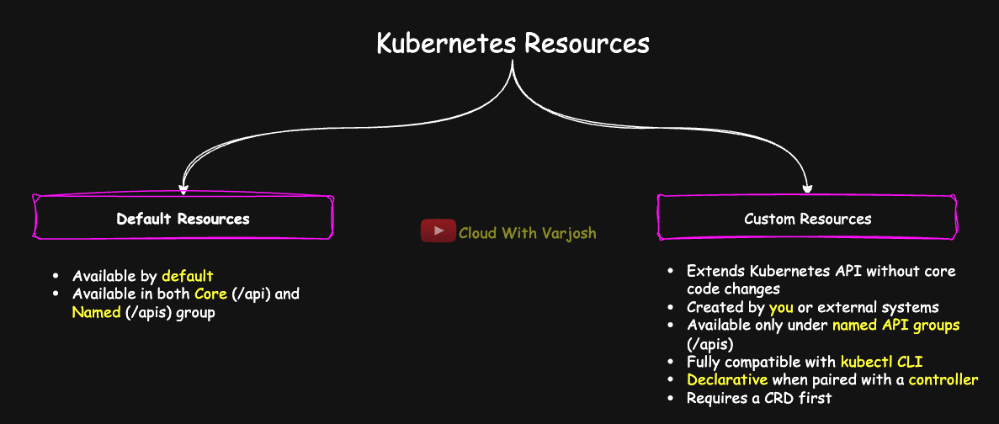
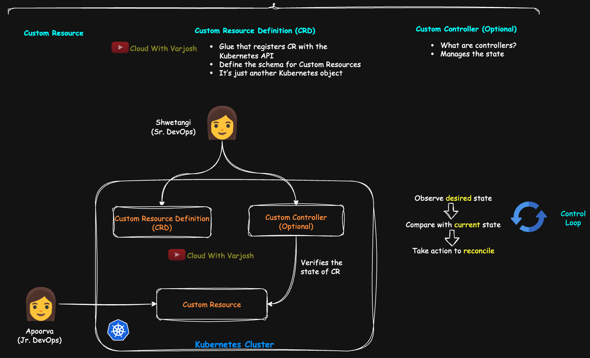

# 66 · Custom Resources, CRDs and Custom Controllers

> **Level:** ★★★ advanced
>
> **You will learn:** what a Kubernetes **resource** is and how the API can be **extended**; **Custom Resources** (CRs) vs **CustomResourceDefinitions** (CRDs); how built-in types are "defined" (OpenAPI, `kubectl explain`); the **controller / control-loop** pattern (watch → compare → act) with informers, `.spec` vs `.status`; which resources have controllers and why; writing a production-grade CRD (validation, defaults, CEL rules, status subresource, printer columns, versions); the `BackupPolicy` demo; and the dangers (deleting a CRD deletes all its CRs, finalizers).
>
> **You need:** topics 07 (control plane and controllers), 14 (the API: groups, versions, `/api` vs `/apis`), 28 (CronJobs), 57 (RBAC aggregation).

---

## ⚡ Core: the 10-minute version

**The idea.** Kubernetes can learn **new object types**.
- A **CustomResourceDefinition (CRD)** registers a new kind, e.g. `BackupPolicy`, with its schema. After that, you can `kubectl apply/get/delete` objects of that kind (**custom resources**) like any built-in.
- Custom resources do nothing by themselves: a **controller** watches them and acts. That's the same reconcile loop the built-in controllers use.
- **Warning:** deleting a CRD deletes every object of that kind.

**Picture it.** A CRD adds a new form type to the office filing system; a controller is the clerk who acts on those forms.

**The one thing to know.**

```bash
kubectl apply -f "Day 39/crd.yaml"            # registers backuppolicies.ops.cloudwithvarjosh
kubectl apply -f "Day 39/cr.yaml"             # creates a BackupPolicy object
kubectl get bp; kubectl explain backuppolicy.spec
kubectl get crd                                # every CRD in the cluster
```

**Try it now:**
1. Apply the CRD and CR from this repo.
2. Try an invalid `retentionDays: "seven"` and read the validation error.
3. Delete the CRD and watch the CR vanish too.

**You've got it if you can:** explain CRD vs CR vs controller, and why a CR alone changes nothing.

> 📖 **That's the core.** On a first pass, do the mini-lab and move on to the next topic. Everything below is the **full reference**: come back for the details, the edge cases, interview answers and exam-level depth.

---

## What it is

**A resource** is anything you create or manage in a cluster: an object type exposed by the Kubernetes API (Pods, Deployments, Services, PVCs…). Resources are organised into API **groups**, each with **versions**, each serving **kinds** (topic 14). `kubectl api-resources` lists them all with short names, group/version, whether they're namespaced, and their kind (`-o wide` adds verbs).



**A Custom Resource (CR)** is an object of a type that **doesn't exist in Kubernetes by default**: added by you or by a tool (cert-manager's `Certificate`, Prometheus Operator's `ServiceMonitor`, Argo CD's `Application`, Velero's `Backup`). Built-in types live under `/api` (core group) and `/apis/<group>` (named groups); **custom types always live under `/apis/<group>/<version>/…`**, in a new or existing **named** group.

**A CustomResourceDefinition (CRD)** is the built-in object that **registers** a new type with the API server. It defines the API **group** and **version(s)**, the **kind**, the **plural/singular/short names**, the **scope** (Namespaced or Cluster), and an **OpenAPI v3 schema** for validation. Once applied, the API server immediately serves the new endpoint, stores the objects in **etcd**, and kubectl works with them like any built-in kind.

In short: Kubernetes' API is **extensible**. A **CR** is one extension (the object); the **CRD** is the glue that registers its type, enabling full kubectl compatibility.

**Key properties of CRs:**
- **Created by you or an external system**, not built into Kubernetes.
- **Only under named API groups** (`/apis/{group}`), never the core group (`/api`).
- **Extend the API without changing Kubernetes code**: no rebuilding or restarting the API server.
- **Fully kubectl-compatible**: `get`, `describe`, `apply`, `delete`, `edit`, `-o yaml`, RBAC, labels, watches.
- **Declarative when paired with a controller**: the CR holds desired state; a controller makes reality match.

---

## Why it exists

Kubernetes' built-in types can't model everything: certificates, backups, databases, DNS records, ML training jobs, feature flags, cloud resources. CRDs let you add **domain-specific APIs** that get Kubernetes' strengths for free: declarative YAML, `kubectl`, RBAC, audit logs, watches, GitOps, `kubectl explain`. Combined with a **controller**, they turn Kubernetes into a **platform for building platforms**: operators (topic 67), Crossplane (cloud resources as CRs), Gateway API (topic 72), Cluster API (clusters as CRs).

---

## Analogy

The API server is a **library catalogue system**. Built-in kinds are the catalogue's standard categories (books, DVDs). A **CRD** adds a new category card type ("board games: name, players, age range"); immediately you can file, search and borrow board games with the same desk procedures. A **CR** is one board game's card. But cards alone don't **do** anything: a **controller** is the librarian who reads the cards and acts ("this card says *keep 3 copies*, we have 2: order one"), then writes what happened on the back (`.status`).

Day 39's **thermostat**: you set 22 °C (desired state); it reads 18 °C (current state); it switches the heater on (action). That's every Kubernetes controller.

---

## How it works inside

### Do built-in resources have "definitions" too?

Yes, but compiled into the **API server**, not as CRD YAML. Built-in kinds have group/version (`apps/v1`), kind (`Deployment`) and an **OpenAPI schema** (allowed fields, types, descriptions). Ways to see them:

1. **The OpenAPI document** the API server publishes (for CRDs too):

   ```bash
   kubectl get --raw /openapi/v2 | jq '.definitions["io.k8s.api.apps.v1.DeploymentSpec"].properties | keys'
   kubectl get --raw /openapi/v3 | jq '.paths | keys | length'         # v3: one document per group/version
   ```

2. **`kubectl explain`**: the friendliest "definition viewer", also for CRDs with schemas:

   ```bash
   kubectl explain deployment.spec
   kubectl explain pod.spec.containers --recursive | head
   kubectl explain backuppolicy.spec          # works once the CRD below exists
   ```

3. **The Kubernetes API reference** on kubernetes.io.

### Controllers and the control loop



The **kube-controller-manager** (topic 07) is an **umbrella process running many built-in controllers**. Most built-in kinds have one. Each **observes** current state, **compares** it with the desired state you declared, and **acts** to close the gap. E.g. the **Deployment controller** keeps the right ReplicaSets; the ReplicaSet controller keeps `replicas: 3` Pods: if one crashes and only 2 run, it creates another.

**A controller's job:** "observe desired state → compare with current state → act to reconcile".

**The control loop:**
1. **Watch** the cluster (via **informers**: a client-go component that does one LIST, then a long-lived WATCH, and keeps an in-memory **cache**, so controllers don't hammer the API server);
2. **Compare** with the desired state (the resource's `.spec`);
3. **Act** (create/update/delete other objects or external things), then **record** what happened in `.status`.

It's **event-driven** (a change event queues the object's key in a **work queue**) with periodic **resyncs** for eventual consistency. Reconciles must be **idempotent** (safe to run repeatedly) and **level-based** (look at current state, not "what event happened").

```go
for {
    // 1. Fetch the latest state of the custom resource
    // 2. Compare desired (spec) and current (actual world / status)
    // 3. Take action if needed; update status; requeue on error
}
```

**CRs are passive by default:** Kubernetes **stores** them and serves them, but **nothing happens** unless a **custom controller** watches them and acts (creating Jobs, ConfigMaps, Deployments, calling cloud APIs…). CRD + controller = an **operator** when it encodes operational knowledge (topic 67).

**Tools for writing controllers:** mostly **Go**:
- **Kubebuilder**: scaffolds a full project: CRD types in Go, generated CRD YAML, RBAC, webhooks, tests;
- **controller-runtime**: the library underneath (managers, reconcilers, caches);
- **Operator SDK**: built on Kubebuilder; adds Ansible/Helm-based operators and **OLM** (Operator Lifecycle Manager) integration.
- Also: **kopf** (Python), **Java Operator SDK**, **kube-rs** (Rust), **Metacontroller** (write logic as webhooks in any language).

**CKA relevance:** you won't write controllers in the exam, but you must understand the loop, create CRDs/CRs, and explain what controllers do.

### Not all resources have controllers

- **No reconciling controller**: `ConfigMap`, `Secret` (data that others read).
- **Controlled**: `Deployment`, `ReplicaSet`, `StatefulSet`, `DaemonSet`, `Job`, `CronJob`, `HPA`, and more you may not think of: `Service` (the EndpointSlice controller), `Namespace` (namespace controller cleans up on delete), `ServiceAccount`, `PersistentVolumeClaim` (PV binder), `Node` (node lifecycle controller).

> ℹ️ **Note:** the original notes said "`Pod` (standalone) **does not** have controllers". A standalone Pod has no **owner** that recreates it (that's the point of Deployments), but Pods are certainly acted on: the **scheduler** binds them, the **kubelet** reconciles them on the node (starts/restarts containers to match the spec), and the garbage collector/PodGC clean them up.

**Rule of thumb:** if a resource declares a **desired state that can drift**, a controller usually reconciles it; if it's **static data** or only evaluated at creation (by admission, by the kubelet at start), no controller is needed.

### Inside a CRD

- `metadata.name` **must be** `<plural>.<group>`.
- `group`: a DNS-style name you own (`ops.example.com`), avoiding `*.k8s.io` (reserved).
- `scope: Namespaced` or `Cluster`.
- `versions[]`: each `served` (exposed) or not; exactly **one** has `storage: true` (the version stored in etcd); different versions need a **conversion webhook** if their schemas differ.
- `schema.openAPIV3Schema`: a **structural schema**: types for every field. **Unknown fields are pruned** (silently dropped) unless marked `x-kubernetes-preserve-unknown-fields: true`. `kubectl apply` warns `unknown field "spec.foo"` (server-side field validation).
- Validation: `required`, `minimum`/`maximum`, `enum`, `pattern`, `format`, `default`, and **CEL rules** (`x-kubernetes-validations`) for cross-field checks, evaluated by the API server.
- `subresources.status`: makes `.status` a **separate endpoint** (`/status`), so users editing `.spec` can't overwrite the controller's status and vice versa; `metadata.generation` then increments only on spec changes (controllers compare it with `status.observedGeneration`).
- `subresources.scale`: lets `kubectl scale` and the **HPA** work on your CR.
- `additionalPrinterColumns`: what `kubectl get` shows.

---

## Commands / YAML

### Why not just a CronJob?

| Feature | CronJob | `BackupPolicy` CRD + controller |
|---|---|---|
| Schedule | ✅ Built-in | ✅ Handled by the controller (often by creating CronJobs) |
| PVC awareness | ❌ Manual volumeMounts | ✅ A field in the CR, resolved by the controller |
| Retention | ❌ Not supported | ✅ Declarative `retentionDays` |
| Backup validation | ❌ External scripts | ✅ Controller logic |
| App-specific hooks (e.g. flush DB first) | ❌ Custom work | ✅ Encapsulated in the controller |
| One declarative config unit | ❌ Procedural Job YAMLs | ✅ The CR |

A `BackupPolicy` lets app teams describe **what** they want; the platform team's controller enforces **how**.

### Step 1: the CRD (`Day 39/crd.yaml`, annotated version from the README)

```yaml
apiVersion: apiextensions.k8s.io/v1          # CRD API (GA since v1.16; v1beta1 REMOVED in v1.22)
kind: CustomResourceDefinition
metadata:
  name: backuppolicies.ops.cloudwithvarjosh  # MUST be <plural>.<group>
spec:
  group: ops.cloudwithvarjosh                # → apiVersion: ops.cloudwithvarjosh/v1
  names:
    plural: backuppolicies                   # URL path + kubectl get backuppolicies
    singular: backuppolicy                   # kubectl get backuppolicy, messages
    kind: BackupPolicy                       # PascalCase, used in manifests
    shortNames: [bp]                         # kubectl get bp
  scope: Namespaced                          # objects live in a namespace (vs Cluster)
  versions:
    - name: v1
      served: true                           # served by the API
      storage: true                          # stored in etcd in this version
      schema:
        openAPIV3Schema:
          type: object
          properties:
            spec:                            # user intent
              type: object
              properties:
                schedule:
                  type: string
                  description: >
                    When the backup runs, in standard cron syntax.
                    Example: "0 1 * * *" = every day at 01:00.
                retentionDays:
                  type: integer
                  description: >
                    Days to keep completed backups before automatic deletion
                    (storage usage, compliance).
                targetPVC:
                  type: string
                  description: >
                    The PersistentVolumeClaim to snapshot or archive
                    (typically application or database data).
```

(The repo's `crd.yaml` has the same structure with one-line descriptions.)

### Step 2: apply and verify

```bash
kubectl apply -f "Day 39/crd.yaml"
kubectl get crd backuppolicies.ops.cloudwithvarjosh
kubectl api-resources | grep backup
```

```
NAME                                  CREATED AT
backuppolicies.ops.cloudwithvarjosh   2026-11-18T10:00:00Z

backuppolicies   bp   ops.cloudwithvarjosh/v1   true   BackupPolicy
```

`true` = namespaced. The API now serves `/apis/ops.cloudwithvarjosh/v1/namespaces/<ns>/backuppolicies`.

### Step 3: a Custom Resource (`Day 39/cr.yaml`)

```yaml
apiVersion: ops.cloudwithvarjosh/v1    # group/version from the CRD
kind: BackupPolicy                     # kind from the CRD
metadata:
  name: mysql-backup
  namespace: default                   # Namespaced scope
spec:
  schedule: "0 1 * * *"                # daily at 01:00 (min hour day-of-month month day-of-week)
  retentionDays: 7
  targetPVC: mysql-data-pvc
```

You're declaring: **"every day at 01:00, back up PVC `mysql-data-pvc` and keep the backups for 7 days."** Nothing will back anything up **unless a controller** watches `BackupPolicy` objects.

```bash
kubectl apply -f "Day 39/cr.yaml"
```

### Step 4: use it like any resource

```bash
kubectl get backuppolicies          # or: kubectl get bp
kubectl describe backuppolicy mysql-backup
kubectl get backuppolicy mysql-backup -o yaml
kubectl get --raw /apis/ops.cloudwithvarjosh/v1/namespaces/default/backuppolicies | jq '.items[].spec'
```

```
NAME           AGE
mysql-backup   10s
```

Validation already works: `retentionDays: "seven"` is rejected:

```
The BackupPolicy "mysql-backup" is invalid: spec.retentionDays: Invalid value: "string": spec.retentionDays in body must be of type integer: "string"
```

### Step 5: clean up

```bash
kubectl delete -f "Day 39/cr.yaml"
kubectl delete -f "Day 39/crd.yaml"
```

⚠️ **Deleting a CRD deletes every CR of that type, in all namespaces**, with no confirmation. In production that's how people accidentally wipe all their `Certificate`s or Argo CD `Application`s, e.g. via `helm uninstall` of a chart that templated its CRDs. Protect CRDs (GitOps prune protection, `helm.sh/resource-policy: keep`, RBAC on `customresourcedefinitions`).

### A production-grade version of the CRD

```yaml
  versions:
    - name: v1
      served: true
      storage: true
      subresources:
        status: {}                             # /status endpoint for the controller
      additionalPrinterColumns:
        - { name: Schedule,  type: string,  jsonPath: .spec.schedule }
        - { name: PVC,       type: string,  jsonPath: .spec.targetPVC }
        - { name: LastBackup, type: date,   jsonPath: .status.lastBackupTime }
        - { name: Age,       type: date,    jsonPath: .metadata.creationTimestamp }
      schema:
        openAPIV3Schema:
          type: object
          properties:
            spec:
              type: object
              required: [schedule, targetPVC]
              properties:
                schedule:
                  type: string
                  pattern: '^(\S+\s){4}\S+$'          # five cron fields
                retentionDays:
                  type: integer
                  minimum: 1
                  maximum: 365
                  default: 7
                targetPVC:
                  type: string
                  maxLength: 253
              x-kubernetes-validations:
                - rule: "!has(self.retentionDays) || self.retentionDays <= 30 || self.schedule.startsWith('0 ')"
                  message: "long retention only for hourly-aligned schedules"   # example of a CEL cross-field rule
            status:
              type: object
              properties:
                lastBackupTime: { type: string, format: date-time }
                phase: { type: string, enum: [Pending, Succeeded, Failed] }
                observedGeneration: { type: integer }
```

### The controller's role and `.status`

A `BackupPolicy` controller would **watch** for new/updated policies; on schedule (typically by **creating CronJobs/Jobs** it owns) back up the PVC (e.g. to S3), **label/annotate** backups, **enforce retention** by deleting old ones, **alert** on failures, and **update `.status`**: last backup time, success/failure, what was purged.

**`.spec` = what should happen; `.status` = what actually happened.** View it with `kubectl get backuppolicy <name> -o yaml` (the `status:` section), useful for debugging, auditing, and checking the controller works. The controller also sets **ownerReferences** on the Jobs it creates (so deleting the CR garbage-collects them) and may add a **finalizer** (`metadata.finalizers`) so it can clean up external backups before the CR disappears.

**Recap:** a CRD alone just **stores configuration**. With a controller, teams write **only intent** (schedule, retention, PVC), platform engineers encode the logic once, and backups become **repeatable, policy-driven and declarative**.

**Real production uses:** internal platform teams building Kubernetes abstractions; backup operators like **Velero** (`Backup`, `Schedule`, `Restore` CRs); GitOps automation of disaster recovery; policy engines checking every workload has a backup plan.

### RBAC for CRs

CRs get RBAC like anything else: `apiGroups: ["ops.cloudwithvarjosh"]`, `resources: ["backuppolicies"]`. Use aggregation labels (`rbac.authorization.k8s.io/aggregate-to-edit: "true"`) so existing `edit`/`view` users can manage them (topic 57).

### `Day 39/deploy.yaml`

An unrelated helper manifest in the folder: an `nginx:1.19` Deployment (3 replicas) with the annotation `kubernetes.io/change-cause: "Initial release with nginx 1.19"` (used for `kubectl rollout history`, topic 25). Handy to contrast a **built-in** resource, which has a controller, with the passive `BackupPolicy` CR.

---

## Hands-on lab

1. `kubectl api-resources --api-group=apps` vs `kubectl get crd` on a fresh kind cluster (no CRDs yet). Install cert-manager or Kyverno and look again.
2. Apply Day 39's CRD and CR; `kubectl explain backuppolicy.spec`; try invalid values.
3. Replace the CRD with the production version: add printer columns, required fields, defaults; re-apply; see `kubectl get bp` columns and the defaulted `retentionDays`.
4. Enable the status subresource and update status by hand: `kubectl patch bp mysql-backup --subresource=status --type=merge -p '{"status":{"phase":"Succeeded"}}'`; note a normal `kubectl apply` can't change it.
5. Write a tiny "controller" in shell: `kubectl get bp -w -o json | jq …` that prints a line per change (to feel the watch). Optionally scaffold a real one with `kubebuilder init` + `kubebuilder create api`.
6. Create two CRs, then delete the CRD and watch both disappear.
7. Clean up.

---

## Where you'll use it

- **Every add-on** you install brings CRDs: cert-manager, Prometheus Operator, Argo CD, Kyverno, Istio, Gateway API, Velero, CSI snapshots (`VolumeSnapshot`).
- **Platform engineering**: offering teams simple APIs (`Database`, `App`, `Tenant`) via CRDs + controllers or Crossplane.
- **Troubleshooting**: "no matches for kind X" errors, stuck deletions with finalizers, CRD version upgrades.
- **CKA**: create/inspect CRDs and CRs, understand controllers.

---

## When it breaks

| Symptom | Cause | Fix |
|---|---|---|
| `no matches for kind "BackupPolicy" in version "ops…/v1"` | CRD not installed yet (or wrong group/version), common in Helm/GitOps ordering | Install CRDs first (separate step/sync wave) |
| `The CustomResourceDefinition "x" is invalid: metadata.name: must be spec.names.plural+"."+spec.group` | Wrong CRD name | `<plural>.<group>` |
| Fields silently disappear from your CR | Pruned: not in the structural schema | Add them to the schema |
| CR applied but nothing happens | No controller running / controller lacks RBAC | Check the controller's Pods and logs |
| CR stuck `Terminating` | A finalizer whose controller is gone | Restore the controller, or (last resort) `kubectl patch … -p '{"metadata":{"finalizers":null}}' --type=merge` |
| All CRs vanished | Someone deleted the CRD | Restore from backup (Velero/etcd); protect CRDs |
| `kubectl get` on a CR is slow cluster-wide | Huge numbers of CRs stored in etcd | Limit object counts; controllers should clean up |
| Upgrading a CRD version breaks old objects | Schema changed without conversion | Add a conversion webhook; migrate storage version |

---

## Quick recap

- **CRD** registers a new API type (`<plural>.<group>`, kind, names, scope, versions, OpenAPI schema); **CRs** are its objects, served under `/apis/<group>/<version>`, stored in etcd, fully kubectl/RBAC compatible.
- Built-in kinds have the same kind of definition, compiled into the API server (OpenAPI, `kubectl explain`).
- CRs are **passive**; a **controller** runs the control loop (watch via informers → compare spec vs reality → act → write status), idempotently.
- Production CRDs: validation (`required`, ranges, CEL), defaults, `status` subresource, printer columns; **deleting a CRD deletes all its CRs**.

### Interview questions

1. **Q: What's the difference between a CRD and a CR?**
   A: The CRD is the definition that registers a new resource type (group, version, kind, schema) with the API server; a CR is an instance of that type, like a Deployment object is an instance of the built-in Deployment type.
2. **Q: You created a CR but nothing happened. Why?**
   A: CRs are only stored data; behaviour comes from a controller watching that type. Check that the controller/operator is installed and running and has RBAC to read the CR and create what it needs.
3. **Q: Explain the controller pattern.**
   A: A loop that watches resources (via informers and a cache), compares the desired state in `.spec` with the actual state, takes actions to converge, and records progress in `.status`; reconciles are idempotent and triggered by events plus periodic resyncs.

---

## Appendix: notes on the original course material

This topic was rebuilt from the original CKA course notes. This appendix keeps the audit trail out of your way while you learn.

### Sources

Day 39 (introduction; what is a resource; what is a custom resource; key properties; what is a CRD; do built-in resources have definitions: OpenAPI, `kubectl explain`, API reference; controllers and custom controllers; the control loop pattern, what a controller's job is, what a control loop is, the thermostat, the Deployment controller example, custom controllers, tools for writing controllers, CKA relevance, not all resources have controllers, rule of thumb; demo `BackupPolicy`: why not a CronJob, steps 1–5; recap; the controller's role and `.status`; real production scenarios; conclusion; references), files `Day 39/crd.yaml`, `Day 39/cr.yaml`, `Day 39/deploy.yaml`.
