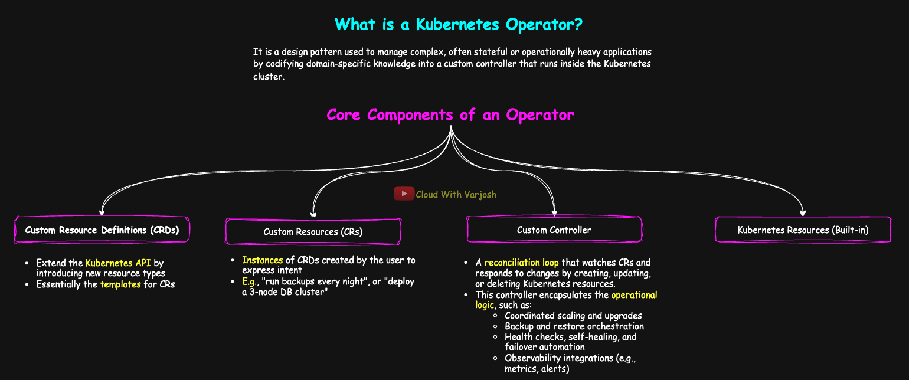
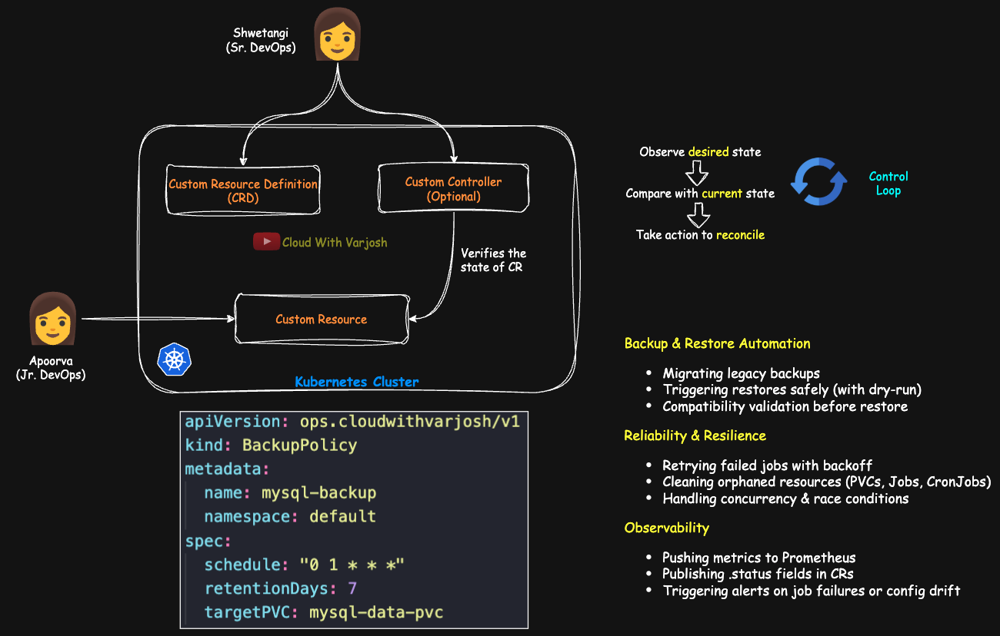

# 67 · Operators: Encoding Operational Knowledge in a Controller

> **Level:** ★★★ advanced
>
> **You will learn:** why stateful, operationally heavy apps need more than YAML; the manual DevOps and DBA work an operator replaces; what an **operator** is (CRDs + CRs + a custom controller + the built-in resources it manages) and its logical hierarchy; operator maturity; operators beyond databases; how operators coexist with Helm/Kustomize; frameworks for building them; **OLM** and OperatorHub; and the **kube-green** demo (scaling workloads to zero after hours).
>
> **You need:** topics 05 (stateless vs stateful), 40 (StatefulSets), 64–66.

---

## ⚡ Core: the 10-minute version

**The idea.** An **operator** is a custom controller plus CRDs that encodes how a human expert would run a specific application: install it, upgrade it, back it up, fail it over, scale it. You describe what you want in a custom resource ("a 3-node Postgres cluster with nightly backups") and the operator keeps it that way. Helm installs things; operators **run** them day to day, and the two are often used together.

**Picture it.** A resident expert engineer who stays on site, instead of a manual you read once.

**The one thing to know.**

```yaml
apiVersion: postgresql.cnpg.io/v1        # CloudNativePG operator
kind: Cluster
metadata: { name: shop-db }
spec:
  instances: 3                           # 1 primary + 2 replicas, automatic failover
  storage: { size: 1Gi }
```

**Try it now:**
1. Install CloudNativePG with Helm and apply this resource.
2. Delete the primary Pod.
3. Watch the operator promote a replica (`kubectl get cluster shop-db -w`).

**You've got it if you can:** explain the difference between an operator and a plain controller, and why a StatefulSet alone isn't enough for a database.

> 📖 **That's the core.** On a first pass, do the mini-lab and move on to the next topic. Everything below is the **full reference**: come back for the details, the edge cases, interview answers and exam-level depth.

---

## What it is

**Quick recap:**
- **Custom Resource (CR)**: a user-defined object that extends Kubernetes (e.g. a `BackupPolicy`).
- **CRD**: the schema/blueprint that defines the CR's structure.
- **Controller**: a loop that watches CRs and reconciles actual state with desired state.

Tools like Prometheus, Istio, Kyverno and Argo CD ship their own CRDs **and** controllers (usually running as Deployments) that manage the CRs you create.



A **Kubernetes Operator** is a **design pattern** for running complex, often stateful or operationally heavy software: **domain-specific operational knowledge** (what a human operator/SRE/DBA would do) is coded into a **custom controller** running in the cluster. An operator:
- continuously **monitors** the application's resources;
- **understands and responds** to changes in real time;
- **automates lifecycle tasks**: install, upgrades, backups, failover, reconfiguration, scaling;
- keeps the system healthy by **reconciling** desired vs actual state.

Think of it as a **specialist controller** that knows exactly how to install, run and maintain one particular application.

**Why it matters:** operators **bundle, manage and operate an application end-to-end**, across all its parts: built-in resources, CRs, configuration, Secrets, monitoring, failover logic. They don't just deploy an app; they understand its whole lifecycle.

---

## Why it exists

### Without automation: the manual work

Running a **stateful database** on Kubernetes by hand needs close coordination between two teams.

**DevOps team:**
- provision storage (PVCs, StorageClasses);
- define StatefulSets for identity and ordered scaling;
- configure headless Services and DNS for peer communication;
- script replication bootstrapping (init containers, entrypoint logic);
- set up readiness/liveness probes;
- manage Secrets, ServiceAccounts and RBAC for DB access;
- schedule backups (CronJobs/Jobs);
- monitor health and replication lag (Prometheus/Grafana);
- handle failover with custom scripts or tools.

**DBA team:**
- design the replication topology (e.g. primary → replica 1 → replica 2);
- configure replication (WAL (write-ahead log) settings, replication slots, credentials);
- handle **promotion** during failover;
- define and validate backup/restore;
- tune performance (I/O, caching, queries);
- apply schema migrations with minimal downtime;
- ensure replication consistency, detect split-brain (two primaries) or drift.

A StatefulSet gives **stable identity and storage** (topic 40) but knows **nothing** about primaries, replicas, promotion or backups. An operator turns that runbook into code that runs 24/7.

---

## Analogy

A Helm chart is the **installation manual** for a complex machine: it gets it set up. An operator is a **resident expert engineer** who stays on site: watches the gauges, swaps parts before they fail, applies upgrades in the right order, takes backups, and fails over to the spare when something breaks, all while you simply tell them what you want ("3 replicas, nightly backups, version 16") on a work order (the CR).

---

## How it works inside

### Core components

1. **CRDs**: new types such as `KafkaCluster`, `BackupPolicy`, `MySQLReplicaSet`, `PostgresCluster`.
2. **CRs**: your instances expressing intent ("run backups every night", "a 3-node DB cluster").
3. **Custom controller**: the reconciliation loop holding the **operational logic**:
   - coordinated scaling and upgrades;
   - backup and restore orchestration;
   - health checks, self-healing, failover;
   - observability integration (metrics, alerts).
4. **Built-in Kubernetes resources it creates/updates**: StatefulSets, Deployments, Jobs; Services, Ingress, PVCs; Secrets, ConfigMaps, ServiceAccounts, all orchestrated from the CR's desired state.

When you install an operator, it brings its CRDs and controller; **you interact with it only by creating CRs**. Some CRs may be generated by the operator itself (e.g. a backup CR per run), but most you write to declare intent.

### Logical hierarchy

An operator is a **logical construct**, not a Kubernetes object: a pattern bundling domain automation.

```
Operator
  └── Custom Controller (a Deployment in the cluster, with a ServiceAccount + RBAC)
         ├── Watches: Custom Resources (CRs)
         ├── Uses the types defined by: CRDs
         └── Creates/updates: built-in resources
                 ├── StatefulSets / Deployments
                 ├── Services / Ingress
                 ├── ConfigMaps / Secrets
                 └── PVCs, CronJobs, Jobs, …
```

| Component | Description |
|---|---|
| **Operator** | The pattern: controller + CRDs + automation logic |
| **Custom controller** | The running process that watches CRs and reconciles |
| **CRD** | Extends the API with new types (`BackupPolicy`, `Prometheus`) |
| **CR** | Your desired state for a domain-specific app |
| **Built-in resources** | What the controller creates to make it real |

Operators set **ownerReferences** on what they create (so deleting the CR garbage-collects it), use **finalizers** for external cleanup, and report progress in each CR's **`.status`** (conditions like `Ready`, `Progressing`).

### Don't limit your imagination

Operators aren't only for databases. **If something needs continuous desired-vs-actual reconciliation, it's a good fit:**

| Domain | Examples |
|---|---|
| Databases | CloudNativePG, Percona/MySQL, MongoDB, Redis, Strimzi (Kafka) |
| Monitoring | Prometheus Operator (`Prometheus`, `ServiceMonitor`), Thanos |
| Security | cert-manager (`Certificate`, `Issuer`), Kyverno |
| Backup | Velero |
| Networking | Istio, Cilium |
| CI/CD and GitOps | Argo CD, Flux |
| Cost | kube-green (demo below) |
| Your company | Internal apps, SaaS integrations, company-specific workflows |

Browse **[OperatorHub.io](https://operatorhub.io)** for community and vendor operators (and **Artifact Hub**, which lists operators too).

### Helm/Kustomize are still relevant

Operators don't replace them; they solve different problems:
- **Helm/Kustomize**: templating and **installing** resources, across environments (day-1).
- **Operators**: **runtime** management, lifecycle automation, domain logic (day-2 operations).

They're used **together**: install an operator **with Helm** (most operators ship a chart), **template the CRs** with Helm/Kustomize, and some operators use Helm internally (Operator SDK's Helm-based operators). "Helm/Kustomize for templating + operators for lifecycle management" is a powerful combination.

### The BackupPolicy operator, revisited



Topic 66's CRD `backuppolicies.ops.cloudwithvarjosh` and CR:

```yaml
apiVersion: ops.cloudwithvarjosh/v1
kind: BackupPolicy
metadata:
  name: mysql-backup
  namespace: default
spec:
  schedule: "0 1 * * *"
  retentionDays: 7
  targetPVC: mysql-data-pvc
```

A basic controller could create a backup **CronJob**, clean up expired backups, and react to Pod restarts or PVC reattachments: the **bare bones of an operator**.

### What makes a mature operator

- **Backup and restore**: migrate legacy backups; safe restores (with dry-run); compatibility checks before restoring.
- **Reliability**: retries with backoff; cleanup of orphaned PVCs/Jobs/CronJobs; handling concurrency and race conditions (optimistic concurrency via `resourceVersion`, leader election so only one replica acts).
- **Observability**: Prometheus metrics; meaningful `.status` and conditions; alerts on failures or drift; Kubernetes Events.
- **Dynamic scaling**: adjust backup parallelism to PVC size or node pressure; stagger jobs to avoid I/O bursts.
- Also: **seamless upgrades** of itself and the app, **CRD version conversion**, least-privilege RBAC.

(The Operator Framework describes a **capability model** from Level 1 "basic install" through "seamless upgrades", "full lifecycle", "deep insights", to Level 5 "auto pilot".)

A well-designed operator manages the **entire lifecycle**, continuously and intelligently.

### Building operators

| Tool | Language | Notes |
|---|---|---|
| **Operator SDK (Go)** | Go | Part of the Operator Framework (CNCF); built on Kubebuilder/controller-runtime |
| **Kubebuilder** | Go | Scaffolds APIs and controllers; the de-facto standard |
| **Operator SDK (Ansible)** | Ansible | Reconcile with playbooks |
| **Operator SDK (Helm)** | Helm chart | Turn a chart into an operator with no code (limited to install/upgrade logic) |
| **Metacontroller** | Any language (JSON webhooks) | Lightweight: you write a "sync" webhook |
| **Java Operator SDK** | Java | Quarkus/Spring integrations |
| (also) **kopf**, **kube-rs** | Python, Rust | |

| If you are… | Use |
|---|---|
| A Go developer | Kubebuilder / Operator SDK (Go) |
| Comfortable with Helm | Operator SDK (Helm) |
| Strong in Ansible | Operator SDK (Ansible) |
| Wanting something lightweight | Metacontroller |
| In a Java ecosystem | Java Operator SDK |

Go operators are the most powerful and the most common in production.

### OLM: Operator Lifecycle Manager

OLM manages the install, upgrade and lifecycle of operators themselves, using its own CRDs:
- **CatalogSource**: a catalogue of operators (e.g. `operatorhubio-catalog`);
- **Subscription**: "install operator X from channel Y and keep it updated";
- **InstallPlan**: the concrete steps (approve automatically or manually);
- **ClusterServiceVersion (CSV)**: one installed version of an operator (its Deployment, RBAC, owned CRDs);
- **OperatorGroup**: which namespaces an operator watches.

OLM is standard on **OpenShift**; on vanilla Kubernetes most teams install operators with **Helm** or plain manifests instead. (A redesigned **OLM v1**, based on `ClusterExtension` objects, is replacing the original API; the commands below use the classic OLM v0.)

---

## Commands / YAML

### Demo: kube-green

**kube-green** scales non-critical workloads down during off-hours to save compute (and CO₂), typically in dev/staging. The demo installs OLM, installs kube-green, deploys an app, applies a `SleepInfo` CR, and watches the operator act.

**Step 1: install OLM**

```bash
curl -sL https://github.com/operator-framework/operator-lifecycle-manager/releases/download/v0.32.0/install.sh | bash -s v0.32.0
```

Installs OLM's CRDs and controllers (`olm` namespace) and the OperatorHub catalog. (Read scripts before piping to bash; check for the latest release.)

**Step 2: install kube-green from OperatorHub**

```bash
kubectl create -f https://operatorhub.io/install/kube-green.yaml
```

This creates a **Subscription** (the repo's `Day 40/00-kube-green.yaml` is the same object):

```yaml
apiVersion: operators.coreos.com/v1alpha1
kind: Subscription
metadata:
  name: my-kube-green
  namespace: operators            # OLM's global operators namespace
spec:
  channel: alpha                  # update channel
  name: kube-green                # the package in the catalog
  source: operatorhubio-catalog   # CatalogSource
  sourceNamespace: olm
```

OLM resolves it, creates an InstallPlan, and installs the operator in `operators`, watching **all namespaces**.

**Step 3: verify**

```bash
kubectl get csv -n operators
kubectl api-resources | grep sleepinfo
kubectl get crd | grep sleepinfo
```

```
NAME                DISPLAY      VERSION   REPLACES   PHASE
kube-green.v0.7.0   kube-green   0.7.0                Succeeded

sleepinfos                       kube-green.com/v1alpha1   true   SleepInfo
sleepinfos.kube-green.com        2025-06-22T04:45:50Z
```

`PHASE: Succeeded` = the controller is running. (Day 40 calls it `STATUS`; the CSV column is `PHASE`.) The repo's `Day 40/test.yaml` is a dump of this installed CRD (`kubectl get crd sleepinfos.kube-green.com -o yaml`): look at its OLM labels (`olm.managed: "true"`), the `controller-gen` annotation (generated by Kubebuilder tooling), and the cert-manager CA-injection annotation for its webhook.

**Step 4: a sample app** (`Day 40/01-app.yaml`)

```yaml
apiVersion: apps/v1
kind: Deployment
metadata:
  name: nginx
spec:
  replicas: 2
  selector: { matchLabels: { app: nginx } }
  template:
    metadata: { labels: { app: nginx } }
    spec:
      containers:
        - name: nginx
          image: nginx
```

```bash
kubectl apply -f "Day 40/01-app.yaml"          # 2 nginx Pods in default
```

**Step 5: a `SleepInfo` CR** (`Day 40/02-sleep.yaml`)

```yaml
apiVersion: kube-green.com/v1alpha1
kind: SleepInfo
metadata:
  labels:
    app: kube-green
  name: sleepinfo-sample              # namespaced: applies to workloads in ITS namespace
spec:
  excludeRef:
    - apiVersion: apps/v1
      kind: Deployment
      name: critical-app              # never put this one to sleep
  sleepAt: '17:55'                    # the repo file uses '10:26' (set just after demo time to see it act)
  wakeUpAt: '08:00'
  weekdays: 0-6                       # 0 = Sunday … 6 = Saturday
  suspendCronJobs: true
  timeZone: Asia/Kolkata
```

| Field | Meaning |
|---|---|
| `excludeRef` | Objects never scaled down (here `critical-app`) |
| `sleepAt` | Local time to scale down |
| `wakeUpAt` | Local time to restore |
| `weekdays` | Days the schedule applies (0 = Sun … 6 = Sat) |
| `suspendCronJobs` | Also set `spec.suspend: true` on CronJobs while asleep |
| `timeZone` | Time zone for the two times |

So every day at 17:55 IST, the Deployments in `default` (plus CronJobs, suspended) are scaled to **0** except `critical-app`, and restored at 08:00. kube-green saves the original replica counts (in a Secret it manages) so it can restore them exactly. (Recent kube-green versions can also sleep other kinds, e.g. StatefulSets, via configurable patches; check the docs for your version.)

```bash
kubectl apply -f "Day 40/02-sleep.yaml"
```

**Step 6: watch the operator**

```bash
kubectl get deployment nginx -w
kubectl describe deployment nginx
kubectl get sleepinfo sleepinfo-sample -o yaml | sed -n '/status:/,$p'
```

```
NAME    READY   UP-TO-DATE   AVAILABLE   AGE
nginx   2/2     2            2           5m
nginx   0/0     0            0           6m      ← after sleepAt
```

The Deployment's events/annotations show the scaling done by the kube-green controller; the SleepInfo's `status` records the last schedule and operation.

**Conclusion:** operators embed operational expertise in Kubernetes through **declarative intent**, **continuous reconciliation** and **lifecycle awareness**. kube-green shows the payoff in a simple domain (automatic cost optimisation); database and platform operators apply the same pattern to much harder problems.

### Typical real operator usage (CloudNativePG example)

```yaml
apiVersion: postgresql.cnpg.io/v1
kind: Cluster
metadata: { name: shop-db }
spec:
  instances: 3                      # 1 primary + 2 streaming replicas, automatic failover
  storage: { size: 20Gi, storageClass: standard }
  backup:
    barmanObjectStore:
      destinationPath: s3://backups/shop-db
      s3Credentials: { inheritFromIAMRole: true }
```

Ten lines replace the whole DevOps + DBA list above: the operator creates Pods/PVCs/Services, configures replication, promotes a replica if the primary dies, takes base backups and WAL archives, and runs rolling minor upgrades.

---

## Hands-on lab

1. Install OLM and kube-green as above (or kube-green's plain manifests/Helm chart; that path needs cert-manager first).
2. Apply the nginx Deployment and a `SleepInfo` with `sleepAt` set 2 minutes ahead and `wakeUpAt` 4 minutes ahead; watch replicas go to 0 and back. Add a Deployment named `critical-app` and confirm it's untouched.
3. Inspect what the operator is: `kubectl get deploy,sa -n operators`, its ClusterRole (`kubectl get clusterrole | grep kube-green`, `describe` it). Note how much access an operator gets.
4. Install CloudNativePG with Helm, create a 3-instance `Cluster`, delete the primary Pod (`kubectl delete pod shop-db-1`) and watch the operator promote a replica (`kubectl get cluster shop-db -w`).
5. Clean up: delete CRs **before** uninstalling operators (so finalizers can run), then the operators, then (optionally) OLM.

---

## Where you'll use it

- **Running stateful platforms** (Postgres, Kafka, Elasticsearch, Redis) on Kubernetes.
- **Almost every infrastructure add-on** (cert-manager, Prometheus Operator, Argo CD, Istio) is an operator.
- **Platform engineering**: building internal operators for company workflows.
- **Interviews/design reviews**: "should we run our DB on Kubernetes?" depends heavily on operator maturity.

---

## When it breaks

| Symptom | Cause | Fix |
|---|---|---|
| CR created, nothing happens | Operator not running, watching other namespaces, or lacking RBAC | Check its Pods/logs, OperatorGroup/watch config |
| CSV `Failed` / `Pending` in OLM | Missing dependencies, unapproved InstallPlan, webhook cert problems | `kubectl describe csv`, `installplan` |
| CR stuck `Terminating` after uninstalling the operator | Finalizer with no controller left | Reinstall the operator to finish cleanup, or remove finalizers (last resort) |
| Manual changes to managed objects get reverted | The operator reconciles them back | Change the CR, not the child objects |
| Two operator replicas fight | Leader election disabled/misconfigured | Enable leader election |
| Operator upgrade breaks CRs | CRD schema/version changes | Read upgrade notes; back up CRs (Velero) |

---

## Quick recap

- Operator = **CRDs + CRs + custom controller + the built-in resources it manages**: a pattern encoding human operational knowledge (install, upgrade, backup, failover, scale).
- You declare intent with CRs; the controller reconciles continuously and reports `.status`.
- Use for anything needing continuous reconciliation, not just databases; maturity ranges from basic install to "auto pilot".
- Helm/Kustomize install and template; operators manage runtime lifecycle. Build with Kubebuilder/Operator SDK; distribute via Helm or OLM/OperatorHub.

### Interview questions

1. **Q: What's the difference between a controller and an operator?**
   A: Every operator is a controller, but an operator is a custom controller plus CRDs that encodes application-specific operational knowledge (e.g. database failover, backups, upgrades), whereas a generic controller like the ReplicaSet controller manages a general-purpose resource.
2. **Q: Why not just use a StatefulSet for a database?**
   A: A StatefulSet gives stable identity and storage but knows nothing about replication roles, failover promotion, backups, or safe upgrades. An operator automates those database-specific operations.
3. **Q: Do operators replace Helm?**
   A: No: Helm (or Kustomize) is typically used to install the operator and template its CRs (day-1), while the operator manages the application's ongoing lifecycle (day-2).

---

## Appendix: notes on the original course material

This topic was rebuilt from the original CKA course notes. This appendix keeps the audit trail out of your way while you learn.

### Sources

Day 40 (prerequisites; quick recap of CR/CRD/controller; introduction; why operators; without native automation: DevOps and DBA team responsibilities; what an operator is, why it matters; core components; logical hierarchy and component breakdown; don't limit your imagination; Helm and Kustomize still relevant; revisited BackupPolicy operator; what makes a mature operator; how to create operators: frameworks, how to choose; demo kube-green steps 1–6; conclusion; references), files `Day 40/00-kube-green.yaml`, `01-app.yaml`, `02-sleep.yaml`, `test.yaml`. Day 40's stateless vs stateful section is in topic 05.
